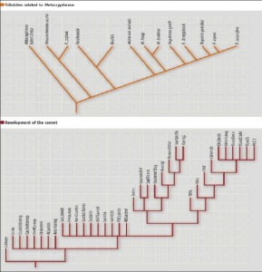
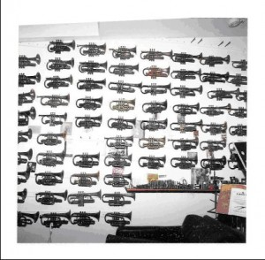

In 1972, Eldredge developed the theory of ‘punctuated equilibria’ with Stephen Jay Gould. This is a revision of Darwinian theory that debunked a reigning assumption in paleontology at the time; that fossil records should show smooth, gradual change over any timescale. Eldredge and Gould showed that the creation of new species occurs in rapid bursts over short periods, followed by long periods of stability where organisms undergo little change (1972). According to Ernst Mayr, whether one accepts this theory or rejects it, ‘there can be no doubt that it had a major impact on paleontology and evolutionary biology’ (1992). Since that time, Eldredge has written 20 books and more than 100 scientific articles on evolutionary theory. Some of his books include *The Pattern of Evolution* (1999), *Life in the Balance* (1998) and *Re-Inventing Darwin* (1995). His most recent book is called *Why We Do It* (2004). It puts forward a convincing critique of gene-centred theories of evolution. {#para3}

When he is not writing books or collecting fossils, Eldredge has another passion: cornets, a type of musical instrument. He has over 500 cornet specimens at his house in New Jersey, arranged into taxonomic groups of shape and style, manufacturer and date. There are silver and gold ones, polished and matte, ancient and modern. Late in 2002, Eldredge’s curiosity got the better of him: he started to wonder if these instruments had an evolutionary dynamic of their own, and what this might look like. Could there be a pattern, a general structure to the way that cultural artefacts evolve? He decided to put the instruments through their evolutionary paces, to apply the ‘scientific method’ to cultural artefacts for the first time. {#para4}

But before he could do this, he had to work out exactly what characteristics he was tracing. Biologists deduce lineages for organisms based on characteristics like shell shape or genetic similarity. Eldredge chose a representative sample of 36 cornets from his collection, and nominated 17 characteristics (or features of cornet “anatomy”) to trace over time, like how the bell is positioned on the instrument. He then fed this data through the phylogenetic computer program he uses for his trilobites. {#para5}

The results were astounding. Compared to phylogenetic diagrams for biological organisms, the lines in the cornet evolutionary tree were thoroughly confused. Instead of a neat set of diagonal V-shaped branches, a ‘cone of increasing diversity’, you would see flat lines from which multiple machines appeared. Flat lines do not usually characterise biological phylogenetic diagrams; when they occur, they imply explosive radiation. In material cultural systems flat lines are abundant, and this may tell us something about the dynamic at work behind cultural evolution. This means that the cornet’s relationship to time and inheritance is different to that of biological organisms. The question is exactly how it is different, and if this difference might be translated into a general theory of material cultural evolution. That is the topic under discussion here. {#para6}

Eldredge has now assembled a database of nearly 200 makers, 123 distinct ‘models’ and 525-550 entries, spanning 1825 to the present. This database and the phylogenetic information it contains is perhaps the first detailed study into the lineage of a material cultural artefact. Eldredge is cautious about using Darwinian metaphors haphazardly, however; this evolutionary ‘dynamic’, if it exists, is radically different to what is found in the natural world. Unlike nature, cultural artefacts are subject to intelligent design. {#para7}

The following discussion took place in March 2004.

__________________________________________________________________________________ {#para8}

BB: Although biologists usually think about evolution in strictly physical terms, you think about it in terms of information; evolution is the ‘fate of heritable information in an economic context’. In the biological realm this makes complete sense – at a cursory level, information about an organism and its family history is inscribed in DNA, and this information is passed on to offspring if the organism is successful. On another level, organisms ‘compete’ for scarce energy resources in order to live, and this has implications for the survival of genes into the next generation. But in terms of material cultural evolution this gets more complicated. {#para9}

Cultural artefacts like computers or cornets don’t have their histories neatly inscribed in DNA to pass on to the next generation; they don’t have ‘agency’ or a will to compete for resources in this economic sense. Yet we think we see a ‘history’ in some cultural artefacts, they demonstrate change over time and stability of some core characteristics (for example, your collection of cornets). This makes me wonder what the mode of transmission might be between cultural objects, if it is human beings who pass ‘characteristics’ between artefacts, or if this information is contained in the objects themselves. {#para10}

How do you think historical information is passed between cultural artefacts? Do you think that the history or ‘lineage’ of an object – like a technical machine – is inscribed in the object itself? {#para11}

NE: In both biology and material cultural systems, history is indeed staring you in the face when you look at a wombat or a cornet. But there is no way to divine that history unless you compare a series of objects that you assume a priori are related-more wombats; other marsupials; other mammals, other vertebrates, or a series of cornets. This is the so-called “comparative method”-and owes its beginnings to the nominal father of comparative anatomy, Baron Georges Cuvier. {#para12}

In the biological realm, you find that while not all wombats are exactly alike, they share a lot of features-more than they do with any other mammalian species. You find they share with other species like koalas and wallabies a reproductive system different than other otherwise putative relatives (like platypuses): there are subgroupings here defined on the basis of shared possession (i.e. within the group) of features not seen in the other subgroups; but the pouched animals share with the placental ones (e.g. rabbits) the presence of three bones in the middle ear-unlike the egg-laying platypus, with one bone there. Yet all three groups have hair. {#para13}

So you think: hair is more widely distributed in nature than three-bones-in-the middle ear; hair is in animals (platypus) that otherwise lay eggs and have a single middle-ear bone-features that are also found in still other animals lacking hair (reptiles). So we think we see history here: hair evolved before non-egg-laying modes of reproduction; hair defines “mammalia”, while the placenta defines, well, placental mammals. Hypotheses such as these are further tested by addition of new data (for example, gene sequences)-which may or may not agree with notions of history previously derived from comparative anatomy. {#para14}

For the most part, simple trees of what-is-more-closely-related to-what fall out of this sort of exercise-trees which, as Darwin pointed out-must exist if all organisms have descended from a single common ancestor. This search for history among a series of objects is a mapping exercise of the distribution of characteristics. {#para15}

The same must be true, in general, in any system that has a history-i.e. some features of a focal object (a cornet, say) expectedly were invented before others-every instrument type is a melange of design ideas of varying age. The circular pattern of three turns in the windway between mouthpiece and valves-the pattern most commonly seen in cornets-was in place before a third valve was added to the original two, and before the modern valve was invented and incorporated onto these instruments. We happen to know this through patents and dated specimens-but it is also apparent simply because two valved cornets with the older valve type, and three-valved cornets with that valve type have this “circular wrap”-indistinguishable from the wrap of modern cornets with modern valves. Same principle. {#para16}

But right away there are problems: what do you call a 4 ½’ long coil of lip-blown brass tubing furnished with a slide (like a trombone) rather than valves (like a piston valved trumpet, or cornet)? Is it a soprano trombone, or a slide trumpet/cornet? The answer is a resounding “Yes.” Depending upon context, such instruments have been built and called all of these names-both before and after the invention of valves. {#para17}

The key difference is that biological systems predominantly have “vertical” transmission of genetically-ensconced information (meaning parents to offspring). To be sure, there are some groups where hybridization (lateral blending of two species) occurs; remotely related bacteria are also famous for being able to exchange genetic information. But the neatness of evolutionary trees in general in biological systems stems from the compartmentalisation of information within historical lineages. {#para18}

Not so in material cultural systems-where horizontal transfer is rife-and arguably the more important dynamic. Makers copy each other, and patents affording only fleeting protection. Thus, instead of neatly bifurcating trees, you would predict to find what is best described as “networks”-consisting of an historical signal of what came before what, obscured often to the point of undetectability by this lateral transfer of subsequent ideas. {#para19}

But unlike nature (including the fossil record), material cultural systems of the modern era characteristically leave a paper trail-patents, advertising, sometimes even serial numbers and records of the dates they represent that allow an independent assessment of history-one against which the results of a comparative study can be compared. Unsurprisingly, it is VERY good to have this extra information! {#para20}

So, yes, the information is in the object-even if no single specimen (of an organism, or a machine) can tell you what that history is. The information also resides in plans, drawings, photographs, shop models-accurate representations of the objects. But the information just sits there. It takes people to replicate, further modify-or go laterally around, by coming up with alternative designs-that information. There are, inevitably, constraints limiting directions of change to the system (you cannot lengthen or shorten a 4 ½’ tube without changing the pitch; you need cylindrical tubing for adjustable slides for tuning, etc.); there may also be latent possibilities for change in the system itself, but this is harder to define and grasp. This needs further exploration. {#para21}

BB: I’d like to talk about the relationship between human beings and material cultural artefacts a bit more; particularly the idea that information in artefacts just ‘sits’ there, that it requires humans to modify and transfer itself. So the inventor of a technical machine, for example, would transfer information between generations of machines. Do you think that this creative genius, ideas and designs, are themselves inherited? {#para22}

NE: Knowledge is inherited through the wider cultural context-minimally two humans-the teacher and the learner. One of the craftsman I have used to restore my old cornets started out as an apprentice in the German company Alexander Gebr. For the first year, he got there before dawn, lit the fire, swept up and, I guess, made the coffee. He wasn’t allowed to touch anything for that entire first year-and then was given the simplest of tasks. By degrees he was taught all the intricacies of how to make a trumpet from sheets of brass-and by the end of his five year apprenticeship, he was a master trumpet builder. {#para23}

Put another way, the best cornetist who ever lived never heard of a cornet, much less saw or played one. You have to live in a place where cornets have already been dreamt up and manufactured, and music conceived for cornetists to play; the odds are great that the (potentially) greatest cornet player so far did not live in a time or place where there were cornets. That is the role of the ambient knowledge of culture. {#para24}

BB: So the ability to play or manufacture cornets – the techniques associated with the instrument – are inherited through this wider cultural context. Humans are not born with the ability to fashion trumpets from sheets of brass, nor to read music and play cornets; they must be born into a culture where these things already exist so they can acquire them. The same applies to language – we are born ‘into’ language, it existed before us and will continue after us, and it has its own history, larger than ourselves (Stiegler, 1998). {#para25}

Techniques in particular can achieve ‘stability’ through time, they can be handed down from teacher to learner for generations. There is variation in these techniques, there is change, but also stability of some core characteristics. This can occur with the design of cultural artefacts as well (we can see it with computers, for example, which come in ‘generations’ – each design is slightly different, but we perceive a history in those designs). What is interesting is how this might be different from biological evolution; selection must work differently, for example. {#para26}

What would you say are the dynamics of change in material cultural systems compared to biological systems? {#para27}

NE: Consider stability through time of a particular design as a prelude to understanding the dynamics of change when it does occur. Comparison with biological systems is instructive-and stability in biological systems is perhaps my signature area of evolutionary theory (“stasis” is the dominant signal of most species’ histories-and a cornerstone empirical element of the notion of “punctuated equilibria” that I developed with Steve Gould back in the 1970s). {#para28}

In biological systems, species have natural boundaries-the limits determined by the ability of component organisms to mate successfully. Component organisms of a species ordinarily cannot and do not mate with components of other species organised in the same way; they have different “Mate Recognition Systems” that define the species and keep them distinct from other species. Thus species are discrete packages of genetic information. Stability of such systems for the most part hinges on the fact that species tend to be widespread, with subunits living in a variety of somewhat different environments (different temperatures, water resources, food items, predators, diseases, etc.)-so the probability that natural selection will push such a heterogeneous melange in any one particular direction is always very low. {#para29}

In material cultural systems, where lateral exchange among designs (such as my cornets) is rife, and where human inventiveness always lurks to change the system, we also find astonishing stability/conservatism-more than one might have predicted. But here there are no genetic constraints, no boundaries to the system, responsible for stasis in design. And while it may be true that there is simply no other better way to design something (a simple tool like a hammer, perhaps-or a more complex object like a trumpet), hence the design in place remains forever fundamentally the same, this is seldom the entire story. {#para30}

I think there are two forms of “selection” which account for most of design stability: manufacturers of cornets were in general always aware of design variation in the marketplace at large. Manufacturers “selected” a few of the possible models to focus on-based, presumably, on their perception of what would sell, and also constrained by the exigencies of manufacture: tooling to make a design is usually expensive and takes up space. {#para31}

The “type-token” relationship is critical here: in industrial design, there is a concept, a design (the “type”), and individual exemplars (the “tokens”) are the more-or-less faithfully rendered versions of the type. These types may sort of drift through time. But basically they remain the same-if the design is successful in the marketplace. In another context, once uniformity in design and production techniques was achieved in Palaeolithic stone tool cultures, a fantastic level of fidelity of product was achieved-with some tools lasting many tens of thousands of years essentially unchanged {#para32}

So those are the two main constraints-a form of “selection” mediated by the exigencies of manufacturing in a type/token framework, and the demands of the public for (1) models that their friends or famous musicians have adopted, and (2) uniformity/consistency in manufacturing quality. {#para33}

But change, of course does come in the history of designed systems-and that change can only come through the actions of individuals. In this context, consider yet another crucial distinction between biological and material cultural systems: in biology, we speak of “mutations”-which for the most part are copying errors when DNA is replicated. They are mistakes-and bear no relation to the needs of the organism. If a mutation is harmful, selection weeds it out; if it is neutral, mutations can accumulate as background genetic variation; and if, of course, a mutation proves beneficial, it will immediately be selected for. {#para34}

BB: What is the equivalent of mutation in industrial design? {#para35}

NE: Accidental copying mistakes that lead to something useful have no doubt occurred (I cannot with confidence point to any such examples in the history of cornet design-but products of a chemical nature might very well provide examples). And (as my colleague T. Ryan Gregory points out) all sorts of ideas undoubtedly pop up, often unbidden, and perhaps not all at the conscious level, in the creative mind-many to be instantly discarded, but perhaps some to be kept and eventually incorporated into new designs: a more compelling analogy to biological mutation. {#para36}

But much more prevalent is “directed variation”-the deliberate production of variant designs. This is a huge difference between biological and material cultural systems-as the two-step biological process of generation of random variation and the process of selecting for or against that variation is fused in designed systems: variation is dreamt up for a purpose-so a variant of a type is imagined and selected simultaneously. {#para37}

The individual human is indeed very important here, when it comes to design innovation. Often there is an element of play (as when a French maker, I believe Gautrot, supposedly fashioned a cornet tube out of cheese-to demonstrate that the resonating tube’s function did not depend upon the material from which it was constructed). Sometimes it is an honest attempt to improve pre-existing designs. Often (probably most often) it is an attempt to outstrip competition in the marketplace. {#para38}

Consider patents again; patents are designed to protect product designs that are deemed sufficiently different from other similar products-a property rights protection. But a case can easily be made that patents actually spur on invention-as, prevented for a number of years from making a particular design, a rival manufacturer often comes up with a variant version-one that is different enough to avoid patent infringement law suits. {#para39}

So patents often spur on end-runs-i.e. ways of going around protected designs by coming up with something yet different again. The history of the Perinet valve in cornets is in large part a story of patents, alternatives-and finally a winnowing process and ultimate selection of one-of-many designs, after the patents have long-since expired. {#para40}

And this simple consideration leads to yet another deeply profound difference between biological and material cultural systems. In biology, because of the mode of genetic inheritance, and because, too, of the packaging of that genetic information into discrete species, what evolutionary change occurs is predicated/controlled to an enormous extent on the previous state of the system. The length of a mammal’s tail can be changed in evolution-but only given the pre-existence of a tail, the requisite genetic variation that allows such modification-and of course the environmental component of selection that will utilise that variation to lengthen or shorten the tail. {#para41}

This “memory-in-the-system” that constrains, informs and possibly in a sense guides the further evolution of the system, is also to be found in material cultural systems-but, at least insofar as my cornet data show, to a far lesser degree than in biological systems. For example, there is a sort of progressive (if step-wise) modification in the length and depth of the instrument through time-as cornets became rather more like trumpets as the ages rolled by. {#para42}

But by far the most striking feature of design history is the occurrence of alternative versions that cannot be said to emanate from any one pre-existing state. Thus, in the ten or so basic versions of the Perinet valve, the second design to appear was radically different from the valve that first appeared (that itself emulated the standard Stolzel valve it was eventually to replace). And so on with later designs-as originally pointed out by Mme. Florentine Besson in her 1874 patent of what I call Perinet valve # 5. Indeed, Mme. Besson stated in her patent of the “#5” valve that it combined elements of the “#2” and “#4” earlier designs (both of which she claimed to have been prior inventions of her firm-though the # 2 valve was almost certainly the invention of Adolphe Sax). {#para43}

Such connections are a far-cry from the situation in biological evolution-where change through time in structures always takes the form of “transformation series”-a sequence of primitive structures later modified into derived forms that themselves become primitive with respect to later, even more derived, conditions. That, indeed, is why there is a “heterobathmy of synapomorphy” in biological systems-i.e. those nested sets of resemblance that link up all of life. {#para44}

In industrial design, such transformation systems are rare. The transistor replaces the vacuum tube-an alternative (and, in some contexts, not necessarily superior) way of performing the same function. But no way did the transistor “evolve from” the vacuum tube-the way the eyes on one side of a flatfish’s head are derived from the original bilaterally symmetrical conformation of the ancestral fish. {#para45}

Lack of transformation series (for the most part) in the change in types in the design history of material cultural entities is the second major reason (along with lateral transmission of ideas across lineages) why the geometry of evolutionary trees of biological history will be expectedly different from trees depicting the history of designed objects. {#para46}

That further implies, as a practical matter, that most of the algorithms developed to reconstruct biological history are inappropriate for the reconstruction of material cultural systems. {#para47}

BB: So you have highlighted some major differences between biological and material cultural systems; firstly, in material cultural systems, the mechanism of lateral exchange among designs is rife. Secondly, evolutionary change in material cultural systems is not always predicated, controlled or limited by previous states of the same system as it is in biology; alternative versions occur which cannot be said to emanate from one pre-existing state. Material cultural systems also demonstrate ‘directed variation’; the deliberate production of variant designs. {#para48}

Could these differences be creating a pattern, a pattern to the way that material cultural artefacts evolve? {#para49}

NE: There are two general sorts of patterns lurking in the term as used so far in this dialogue: (1) the diagram that depicts the historical flow and fate of information (evolutionary trees or “cladograms” in biology)-perhaps better thought of as historical networks in material cultural systems. Because, in material cultural systems, lateral exchange of information is indeed rife, and because very often a change in state is not a smooth or linear derivation from the pre-existing state, the networks/trees are expectedly very different in the two systems. It would of course be interesting to work on this further-to derive the circumstances in design history which might mimic more closely the patterns of evolutionary trees. {#para50}

But (2) there are other sorts of patterns-best thought of as the degree of stability/change of individual bits of information (valve design type, for example), and details of rates and modes of whatever change occurs in the system. There is stasis, gradual change, and abrupt change in both biological and material cultural systems-as perhaps first pointed out in any great detail by the historian F. J. Teggart in his Theory and Processes of History (1925/1977). In a sense, that these three sorts of patterns can be found in both systems is hardly surprising. After all, what can happen to information but to remain the same, be modified in some sort of gradual, progressive manner, change abruptly, or be replaced by an alternative)? {#para51}

The dynamic processes underlying the stasis, gradual and abrupt change in both systems, however, cannot be the same-simply because of the differences in how the information is stored and transmitted. We have already touched on further differences-such as the degree to which mutation, selection, and drift in biological evolution finds valid counterparts in the design realm. Directed variation, for example, is all but unknown in biology-but lies at the heart of conscious design. So it is fascinating to me that similar patterns of fates of information (like stasis, gradual change, and abrupt change) are to be found in both systems, but for very different reasons. {#para52}

“Stasis” in evolutionary biology is said to characterise entire species-and not just the isolated bits of anatomy of its component organisms. What this means, of course, is that most of the anatomical parts of organisms within a species remain for the most part stable (always allowing for variation and some drifting around-but never very far from the original condition). And this is true, too, of my cornet models-despite periods of rampant experimentation, for the most part, for most of the time, there were two or three basic models that dominated the marketplace. In the latter half of the nineteenth century, makers who supplied generally cheaper, less-well-made copies of the leading designs called them by the inventor’s/makers names who came up with the successful designs originally-e.g. the “Besson model” and the “Courtois model”. {#para53}

So, if one ignores the profusion of different valve types applied to each of these basic designs, a marked consistency/stability of design falls readily out of my cornet data. {#para54}

Which leads me to the final pattern-one that has arrested my attention the most over the last decade or so: so-called “turnovers.” In biological evolution, these are disruptions of economic systems that affect the genetic composition of many different species at the same time. Small-scale disturbance leads to ecological succession-and the eventual resumption of pretty much the status quo state of the pre-disturbed system. On the other extreme end of the spectrum, there is global mass extinction-where entire groups of organisms are wiped out; evolution is based on the genetic information that survives (perhaps as little as 4%, it has been estimated, after the most devastating event 245 million years ago)-thus entirely new groups eventually arise, and the complexion of life is forever radically altered. There is, perhaps most interestingly, a mid-scale version of these turnovers-where regional environmental disturbance crosses a threshold and entire species begin to disappear. In such events, we find a complex pattern of speciation (evolution of new species), survival of some old species, and migration in and out of the region of still others. Thus the complexion of life in that region changes-far more than in local ecological succession, but far less than in wholesale, global mass extinction/evolutionary rebound situations. {#para55}

BB: Are there comparable turnovers, or “revolutions” in material cultural history? {#para56}

NE: Clearly there are-though I should note at the outset that extinction seems to be far more rare, and difficult to effect in the material cultural realm than in biological history. (Indeed, Kevin Kelly has recently suggested to me that true extinction simply does not occur in human-designed systems). Only when all artefacts of a system are lost is the underlying information completely lost (archaeologists had to experiment for years before they were confident that they had rediscovered certain Palaeolithic stone tool making techniques). {#para57}

Another, related factor that expectedly “smears out” sharp turnovers within designed systems is simply the continued preference, the will to keep older designs around-at least in some regions. A design, or set of designs might disappear nearly completely in some places-but linger longer in others. Such was the case in perhaps the most conspicuous turnover in cornet design history-occurring right around the turn of the nineteenth into the twentieth century. In the early to mid-1890s, Conn in the United States, and the AGOR firm in Paris added a stop rod to the second slide of an otherwise conventional cornet model so that the pitch of the instrument could be adjusted precisely instantaneously. Portentously, AGOR called their design the “Fin-de-Siecle” (end of the century). Both firms kept the removable shank system as well-the older, slower method of changing pitch. But all that changed very fast, and by the early years of the twentieth century, many makers, especially in the United States, dropped the removable shanks in favour of what has long since become the modern “fixed lead pipe.” {#para58}

Concurrently-i.e. right at the start of the 19th century–a wild proliferation of cornet design broke out among competing firms in the United States-longer, more trumpet-like cornets with an amazing variety of valve types/air flow design appeared at a very fast rate right up to the outbreak of World War I. Most disappeared as quickly as they arose-true extinction in the sense that they-at least so far-have never been manufactured subsequently. (In biology, specialized species, often with highly modified anatomies or behaviours, are also prone to faster rates of both evolution and extinction). {#para59}

At the same time, the stalwart designs dominating the latter half of the nineteenth century in both Europe and the United States all but became extinct (the double waterkey Courtois designs) or modified into fixed lead pipe, longer versions (the Besson single waterkey designs)-particularly in the United States. Courtois, in Paris, ceased producing its most classic cornets early in the century-copying instead their long-time rival Besson’s cornet designs. Yet in Great Britain and France, a preference for the older designs with shanks persisted well into the twentieth century (not disappearing until the 1950s). {#para60}

So the turnover pattern is sloppy, and not identical between regions. But cornet design history was forever changed by events at the turn of the century-begging, of course, the question: What events were these? There being no evidence of worldwide economic slumps, social unrest such as warfare, or any leap forward in manufacturing materiel or techniques-the answer seems to lie in aesthetics: the turn of the century seemed to require new, “modern” designs-as indeed some of the surviving American advertising copy suggests. If this is indeed the case, a corollary prediction would of course be that a similar drive towards innovation for the new century should be evident in many other categories of product-a prediction that could be put to the test by careful examination of Sears Roebuck catalogues spanning the century’s turn. {#para61}

Another example: The advent of radio pretty much killed the town band (over 80,000 thought to be active in the 1880s in the USA alone)-and manufacturers scurried to reinvent their market (the school band movement was the brainchild of Carl Greenleaf, who took C.G. Conn over in 1915). But radio and the recording industry-in ways as yet not completely understood, seem to underlie the great switch from cornets to trumpets-in the USA, in the early-mid 1920s (famously, Louis Armstrong made the switch in the mid-1920s, in so doing supposedly inspiring many other musicians in jazz as well as commercial and even classical contexts to do the same). Piston-valved trumpets were not manufactured in any great numbers until the 1920s. {#para62}

Thus, economic “environmental factors” extraneous to the design, production and use of cornets appear to have had rare, but major, effects on the history of cornet design. The pattern mirrors the turnovers we seen in biological evolutionary history-but again, the details of the dynamic processes underlying the similar patterns in both systems differ substantially in detail. {#para63}

## Authors’ Biographies

Niles Eldredge is Adjunct Professor of Biology and Geology at the City University of New York, and Curator-in-Chief of the permanent exhibition “Hall of Biodiversity” at the American Museum of Natural History. He has been a paleontologist for over forty years, and is the author of over 160 books and scientific articles on evolutionary theory and evolutionary biology. *Why We Do It* is his most recent book.

Belinda Barnet is Lecturer in Media and Communications at Swinburne University of Technology, Melbourne. Her work has appeared both online and in print, in journals such as *Continuum*, *Convergence*, *The American Book Review*, *Media/Culture*, *Fibreculture*, *Trace* and *CTheory*. [bbarnet@swin.edu.au]

## References

Mayr, Ernst. ‘Speciational Evolution or Punctuated Equilibria,’ in Albert Somit and Steven Peterson (ed.s), *The Dynamics of Evolution* (New York: Cornell University Press, 1992), 21-48.

Stiegler, Bernard. *Technics and Time, 1: The Fault of Epimetheus*, (Stanford, California: Stanford University Press, 1998).

Further Reading

Barnet, Belinda. ‘Technical Machines and Evolution’, *CTheory* Article A319 (2004) [https://www.ctheory.net/text_file.asp?pick=414](https://www.ctheory.net/text_file.asp)

Eldredge, Niles. ‘Evolution in the marketplace’, *Structural Change and Economic Dynamics* 8 (1997):385-398.

_____. ‘Biological and material cultural evolution: Are there any true parallels?’, *Perspectives in Ethology* 13 (2000): 113-153.

_____. ‘An Overview of Piston-Valved Cornet History’, *Historic Brass Sociey Journal* 14 (2002): 337-390.

_____. *Reinventing Darwin: The Great Debate at the High Table of Evolutionary Theory* (New York: John Wiley and Sons, 1995).

_____. *Dominion* (New York: Henry Holt and Co, 1995; paperback edition: Berkeley: University of California Press, 1997).

_____. *Life in the Balance: Humanity and the Biodiversity Crisis* (Princeton: Princeton University Press, 2000).

_____. *The Pattern of Evolution* (New York: W. H. Freeman and Co., 1999).

_____. *The Triumph of Evolution..And the Failure of Creationism* (New York: W.H. Freeman and Co., 2000).
