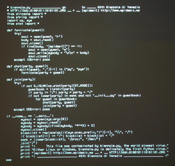

> As an analogy to a computer virus, consider a biological disease that is 100% infectious, spreads whenever animals communicate, kills all infected animals instantly at a given moment, and has no detectable side effects until that moment. If a delay of even one week were used between the introduction of the disease and its effect, it would be very likely to leave only a few remote villages alive, and would certainly wipe out the vast majority of modern society. If a computer virus of this type could spread throughout the computers of the world, it would likely stop most computer usage for a significant period of time, and wreak havoc on modern government, financial, business, and academic institutions. (Fred Cohen, 1984) {#para2}
>
> We feel that “The Virus” is the “stranger”, the “other”, in our machine, a sort of digital sans papier—uncontrollable diversity. Once Hollywood, like Empire, finished killing “Indians” and the “Soviet Russians”, the Hollywood propaganda machine had to build other anti-Empire monsters to keep alive the social imaginary of 2001: aliens, meteors, epidemic… so many monsters. Now the “virus” equals damage, it is easier to sell the idea of a “full spectrum” anti-virus product that would “kill them all”, with no distinctions. Instead, our work says that there are many types of viruses: good, evil, entertaining, boring, elegant, political, furious, beautiful, and very beautiful. ‘There are no good viruses’, anti-virus producers say. (Luca Lampo, net art group [epidemiC], 2002) {#para3}

Computer worms and viruses are not just technical entities, bits of digital code – they also express central traits of information culture. In a world where production focuses more and more on information instead of goods, an information error registers as a break-up within the system. [1] In capitalism, time is money and so too is information : a malicious piece of computer code seems to be an attack on the very basics of global order. The connection between information capitalism—a well-researched topic in itself—and computer viruses has not, however, been sufficiently explicated. [2] {#para4}

Computer worms and viruses can be understood as accidents of digital culture. An accident, as Paul Virilio writes, is not in intended to mean the opposite of absolute and necessary, rather, the term signifies an inherent part of an entity since its production. Accidents are internal to technologies: ‘Since the production of any “substance” is simultaneously the production of a typical accident, breakdown or failure is less the deregulation of production than the production of a specific failure, or even a partial or total destruction.’ (Virilio, 1993: 212) The train introduced the train accident (Schievelbusch, 1977); with the boat came the boating accident; and data storage, such as film, includes the inherent ‘accident’ of erasure of information (Lundemo, 2003). In a similar fashion, computer viruses can be conceived as internal to the media ecology of digital capitalism. {#para5}

This article deals with articulations of digital accidents, focusing especially on how the virus has been signified as a problem for national security, international commerce and the individual user. In information capitalism production is increasingly tied to information networks instead of physical regions, and information itself, in the form of entertainment, news services, communication services etc., is the ‘end product’ of production machinery: ‘The novelty of the new information infrastructure is the fact that it is embedded within and completely immanent to the new production processes. At the pinnacle of contemporary production, information and communication are the very commodities produced; the network itself is the site of both production and circulation.’ (Hardt & Negri 2001: 298) In other words, as Manuel Castells (1996) argues, the contemporary world is based on networks and paths of flow(s) that are informational, and digital technology provides the necessary background for this contemporary media society. What are at stake are not computers per se, but networks. {#para6}

By offering an outline of a cultural history of computer viruses this article endeavours to expose the genealogical roots of contemporary discourse on information diseases. It considers three instances within the cultural history of computing that I find crucially important considering the fear of contagion increasingly evident in present-day discussions: anti-virus technologies, the ethics of computing and the figure of the responsible user. These themes are analysed as expressions of information capitalism based on digital communication, networking and connectivity. However, at the same time as the virus has been articulated as a problem of information capitalism, it has also been captured as a part of that same machinery. Anti-virus software became a lucrative business. In general, what I argue in the latter half of my article is that viruses and worms are not simple anomalies or “enemies” of digital capitalism, but an integral part of it. Hence, capitalism is viral in itself, meaning that its essence lies exactly in its capability of infecting the outside in order to replicate itself.. There is no absolute Other for the capitalist logic of expansion. What is crucial is the understanding of this constant double articulation of the virus as a threat and an integral part of the contemporary society. The seemingly contradictory themes of the virus as the threat and the essence of capitalism are, in fact, intertwined and operate in sync. The ideas of risk control, safety measures and the construction of the responsible user are thus to be read as integral elements of viral capitalism: with these elements, or discourses, the fear of computer viruses has been turned into a part of the flows of consumer capitalism, products and practices that “buy off” anxiety. My article will begin by outlining the historical elements that provide the background for the general operations of viral capitalism. {#para7}

### The Virus Risk

Computer viruses have been perceived as a problem since the beginning of the 1980s. The first officially recognized paper on viruses was Fred Cohen’s Computer viruses – Theory and Experiments, released in 1984. Cohen’s definition has since become a classic: {#para8}

> We define a computer ‘virus’ as a program that can ‘infect’ other programs by modifying them to include a possibly evolved copy of itself. With the infection property, a virus can spread throughout a computer system or network using the authorizations of every user using it to infect their programs. Every program that gets infected may also act as a virus and thus the infection grows. (Cohen, 1984) {#para9}

Cohen was the first to emphasize the risks of computer viruses and similar sorts of self-spreading software programs. While earlier virus-like programs were tests within computer laboratories in universities, Cohen saw these mini-programs as serious threats to the whole of networked information society. Commentators have underlined that his work demonstrated the ‘universality of risk, and the limitations of protection’ (Slade, 1992), meaning that potentially every computer system was vulnerable. If we recall the quote from Cohen which prefaced this article, a computer virus equivalent to a biological disease that is absolutely infectious and spreads when communicating, would ‘stop most computer usage for a significant period of time, and wreak havoc on modern government, financial, business, and academic institutions.’ (Cohen, 1984). This was probably the first ‘worst-case-scenario’ concerning viruses—since then, similar predictions have been plentiful. {#para10}

Cohen’s work was the first in a number of influential books, articles, papers and essays dealing with viruses. Time magazine – one of the first among the popular media to take up the virus issue (as early as 1985) – warned of the threat of malicious software and of hackers who wanted to sabotage computer systems with dangerous mini-programs (Murphy, 1985). In addition, the industry of anti-virus programs was born, and with it, new techniques and programs for virus recognition, destruction and prevention. Nowadays, technological anti-virus programs can be divided into three kinds: {#para11}

- Pre-emptive measures aimed at stopping the virus from entering the systems,

- Virus-specific software for scanning particular, pre-determined signs or search strings which imply that a virus is present. These programs are often also able to remove the virus.

- Generic detection software for searching system anomalies. By scanning for unusual behaviour within a computer, the program might be able to conclude that a virus or some other malicious mini-program is present. (Harley, Slade & Gattiker, 2001: 143–144)

The anti-virus industry had been growing since the first computer virus and worm incidents in 1986–1988, but doubts about the seriousness of the virus threat were also raised. Was the success of the industry due to superficially constructed hype, unfounded fears of killer viruses attacking the base of organized society? Users were intimidated with reports of hundreds of viruses spreading at the beginning of the 1990s, even if only 70–80 of these 600 known PC-viruses were encountered in real life; others were mostly research specimens and laboratory examples (Wilding, 1992: 66). The aim—conscious or not—was to create an atmosphere of ‘digital fear’ as illustrated in the following example from Virus Bulletin-magazine: {#para12}

> Rather like Hitler’s V1 ‘flying bomb’, no-one knows when or where a computer virus will strike. They attack indiscriminately. Virus writers, whether or not they have targeted specific companies or individuals, must know that their programs, once unleashed, soon become uncontrollable. It is, perhaps, the saddest indictment of these people that they are prepared to hurt anybody and everybody. (Virus Bulletin, 1989: 2) {#para13}

Consequently, new viruses meant a boom for the anti-viral software industry. For example, the Michelangelo virus scare in 1992 raised public awareness concerning the threat of malicious software, especially in corporate environments. Sales of anti-virus programs went up with special ‘Michelangelo Limited Edition’ scanners. Because of the huge demand, there were even speculations that the virus originated within the anti-virus community itself in order to increase their profits. (Zajac 1992) This link does not however have to be intentional. It is part of the virality of capitalism that accidents and break-ups can be turned into elements of its productive flows. In this way, concerns about viruses were in total sync with the consumer products produced to relieve the anxieties of the new digital culture. Fear was “reconciled” by participating in the consumer market. {#para14}

However, as Fred Cohen had already concluded, no anti-viral software could give absolute protection and purely technical solutions alone would be insufficient. Of course, the detection and recognition of viruses was the corner stone of a successful computer security policy, yet these procedures were not enough. Techniques for computer virus protection were to be understood as techniques for risk reduction, not removal: {#para15}

> anti-virus software can’t ‘stop’ viruses, any more than a police station can ‘stop’ crime. In a perfect world, a global social engineering programme (as social scientists understand it, rather than hackers) might attempt to educate computer users of all ages and persuasions in the mysteries of ‘ethical’ computing. However, it is not realistic to expect the application of a purely technological approach to individual systems to solve what is essentially a special case of a worldwide social problem. (Harley, Slade & Gattiker, 2001: 140) {#para16}

Security, or the reconciliation of fear, was thus only postponed and not obtained at all. Security in the context of risk society is not something attainable but only a shifting horizon, or a limit, which can be approached. To put it another way, consumerist digital security functions according to the (Lacanian) logic of desire as lack: never finding fulfilment but rather always postponed.. This, as Deleuze and Guattari (1983) have shown us, is the essential coupling of psychoanalysis and consumer capitalism. {#para17}

### Digital Sanitation

Computers and so-called personal computing in particular represented a new phase in development of society. While a hundred years earlier, at the turn of the 19th-century, western societies in general had to cope with the new pressures of mass society, the computer culture of the 1970’s and 1980’s had to deal with similar problems of ‘over-crowdedness’. Alongside the technical safeguards mentioned above, the issue of security policy was raised, as was the more general question of the meaning of electronic interaction. The threats to internal security via networks and malicious software created an atmosphere of distrust, expressed in Ken Thompson’s frequently cited article ‘Reflections of Trusting Trust’ from 1984. Thompson was the 1983 Turing award winner for the Association for Computer Machinery (ACM). His point was simple: every piece of code is potentially malicious if it does not originate from oneself. ( Thompson, 1984; see also Ferbrache, 1992: 9) {#para18}

Thompson’s statement of suspicion can be understood as an expression of a certain process of‘modernization and detraditionalization’ within the computer world. The birth of network computing also meant being in frequent contact with more and more people, most of whom would not be known. Implicitly Thompson posed the problem as follows: as long as self-reproducing programs are made by computer specialists everything is fine, but when this knowledge ends up in the hands of a wider public, the key institutions of society become threatened. Consequently, Thompson, and others after him, wished for an official recognition of the situation and the threats posed by these untrustworthy intruders. According to Thompson, the problem was a lack of general understanding of the security problems of digital culture. The utopia of connectivity was suddenly also producing connections that, it was feared, would jeopardize the whole system. {#para19}

The problem of unethical computing broke news headlines when the first worm incident captured full media attention. The 1988 Morris- or Internet-worm was discussed on most major evening TV-news shows in the US and was visible in major newspapers as well. Originally intended as a harmless prank, the worm forced major parts of the Internet to shut down, causing huge amounts of loss of computing time. Named after the programmer, college student Robert Tappan Morris Jr., the worm had a bug that caused its uncontrollable spreading. Most noteworthy are the reactions within the media and the positions taken. (See, eg. Lundell, 1989: 1–18) {#para20}

According to several commentators, the hacker behind the worm had attacked the very basis of an open society. The Morris worm incident, despite the huge amounts of literature on technical details of the worm, was defined as a human problem. One of the participants in the discussion, Eugene Spafford, notes that the problem was due to the fast pace of technological revolution. According to Spafford, while it was totally acceptable in the 1960’s that pioneering computer professionals were hacking and investigating computer systems, by the end of 1980s, the situation had changed. Society had become dependent on computing in general: ‘Entire businesses are now dependent, wisely or not, on the undisturbed functioning of the computers. Many people’s careers, property, and lives may be placed in jeopardy by acts of computer sabotage and mischief.’ (Spafford, 1989: 686) {#para21}

So basically, the problem was not what Robert T. Morris did, but where he did it. The Internet had risen to become a symbol of the central trends within computerization and the whole of information capitalism. Networking, as perceived by Manuel Castells (1996, 2001), was the keyword of the late 20th-century information society, and the Internet in particular was to be the backbone of its digital infrastructure. The original technical open architecture resonated with cultural trends; in order to ease the spreading of networking, the internet-architecture was planned so as to leave freedom to the local network provider, facilitating the interworking of heterogenous networks. (See Leiner et. al., 1997; Abbate, 2000) {#para22}

However, as the growing number of virus and worm incidents since the mid-1980’s demonstrated, open architecture could not be as open as had been hoped. Using the allegory of a (biological) disease that occurs in over-crowded circumstances (cholera, for example) commentators warned against the dangers of dirty computing practices that go hand-in-hand with the over-crowdedness of the emerging digital culture. Bryan Kocher saw the Morris worm as a ‘hygiene lesson’, referring to the incident’s similarities with all kinds of epidemic diseases: {#para23}

> Just as in human society, hygiene is critical to preventing the spread of disease in computer systems. Preventing disease requires setting and maintaining high standards of sanitation throughout society, from simple precautions (like washing your hands or not letting anyone know your password), to large investments (like water and sewage treatment plants or reliably tested and certified secure systems). (Kocher, 1989: 3 & 6) {#para24}

Thus, Kocher presents information society in terms of an ecological system, with diseases that have to be weeded out in order for the healthy parts to grow. In other words, the flow of capital must be maintained through hygienic operations that keep the economy “healthy”. Disease is to be cured in order for the functional system to go on producing. While hygiene, cleanliness and order had been the central building blocks of 19th-century modernity, the same ideas were now being adopted as part of the media ecology of the computerized society of the end of the 20th-century. In this new context, the cultural idea of sickness continued to play the same pejorative and heavily loaded symbolic role as previously in cultural history. (See Sontag, 2002; Lupton, 1994: 560–562) {#para25}

### The Responsible User

At the centre of these “hygienic measures” stood the individual user. Since computers had, until the 1970s and 1980s, meant big constellations used by professionals in computing centres, the process of the individualization of digital culture changed the security emphasis. Computing and computer security had become a personal issue since the end of the 1970s and the rise of network environments. (Denning, 1979) [3] To quote Mark Drew: {#para26}

> Traditionally, computer security was someone else’s problem, invariably performed by someone else on behalf of the user. Distributed Computing has removed the traditional support personnel from the scene and made the user perform all the management roles: system programmer, analyst, engineer, support group, recovery manager, capacity planner, security officer, and so forth. PC viruses brought the issue of technology and support for end users to the forefront. Now the users had to make sure they could recover and perform the security officer role on their system. Many failed, most did not know what to do, others chose to ignore the problem, many were unaware. (Drew, 1994: 93) {#para27}

The user found herself in a new situation. The change of computer culture from centralized, hierarchical systems based on mainframe computers to personalized, user-friendly desktop computers resonates with the general cultural change from a heavily centralized society of industrialism, Fordism and mass production to a network society of decentralized organization structures and individual responsibilities. [4] The individual person, whether at work or at home, became the consuming and producing computer user. She was understood as a valuable key point in keeping up the flows of capital, which appeared more and more in the form of digital data, of information, since the 1980’s. So, when Jean-Francois Lyotard wrote his The Postmodern Condition in the late 1970’s, he pinpointed computers as the key machines in the circulation of information. What Lyotard neglected was the fact that computers were no longer controlled by large institutions, but increasingly by individual users at home and at work. (Lyotard, 1979; Nye, 1997: 165 – 166) This trend became emphasized during the 1980’s. {#para28}

The shift resulted in a huge amount of manuals and articles advising people as to safe computing habits. Write-protection, caution with new software, limiting accessibility, making back-ups, using specialized malware protection software, safe file-sharing and general awareness of computer activities were things that came to be expected of the user. (Van Loon, 2002: 165–166; see also, Brothers, 1990; Fites, Johnston & Kratz, 1989: 87–93). The user had to be educated to become a responsible computer user. Even if the personal computer revolution was based on such values as innovation, self-enhancement, experimentality and liberation, the reality was something different. [5] This is due to the fact that – as Jon Marshall (2003) has pointed out – knowledge workers have since the 1960’s been seen as key actors in the Post-Industrial or Informational Revolution. Hence, even if they are celebrated as the new hackers of digital culture (Himanen, 2001), they are simultaneously under several demands and pressures due to their importance as nodes within flows of money and information. {#para29}

In addition to the ethics of computing, avoiding viruses became a responsibility often referred to as “safe hex”. As the AIDS-phenomenon raised the issue of responsible safe sex, computer viruses were understood as digital counterparts of sexually transmitted diseases. The computer virus crisis from 1989 defined safe hex using several key points, things to do and things not to do (Fites, Johnston and Kratz, 1989: 87–94). Among other issues the book advised reasonable care with programs. They should be purchased only from reputable dealers, while public domain programs and games downloaded from bulletin boards should be avoided. As in AIDS-discourse, sex with strangers became an irrational risk, and similarly computer security culture warned against the dangers of non-secure software. Aptly, one commentator advanced the following solution to the problem of effective virus protection: Increased awareness and motivation training for new computer users and for the population of future computer users, teaching them to be cautious, e.g., to avoid putting untrusted software into their computers as they would avoid putting tainted food into their bodies. (Parker, 1990: 552) {#para30}

The connection between notions of the human body and care of the self and computer viruses has been noted by Susan Sontag (2002). Sontag analyses the political implications of AIDS rhetoric while also referring to how the metaphors moved into computer talk. These digital contagions borrowed from the language and articulations with which the HI-virus was animistically characterized. The segregation and marginalization of alleged “high-risk groups” was replicated also in computer virus culture, as analysed by Jeffrey Weinstock (1997). However, contrary to what Weinstock suggests, moral judgments are not absent from computer virus paranoia. As argued above, the individual users in general are at the centre of this discourse that tries to keep up the “normal” flow of information. The moralizing judgments are targeted against users who copy pirate games, download software from dubious BBS’s or net sites, or, as is often mentioned, visit pornographic websites. The creation of this morally responsible subject was part and parcel of the new digital order. As Deborah Lupton has argued, this was made comprehensible by a connection made with a public health discourse that stressed the individual’s responsibility ‘to stay healthy, avoid risk and resist indulgence in certain behaviours defined as “dangerous”’ (Lupton, 1994: 561). {#para31}

For this reason, when Byte-magazine instructed its readers to ’Keep your PC Healthy’ (Williams, 1988), it was not just a metaphor but also an order-word (Deleuze and Guattari, 1987: 106–108), guiding the user to proper computing. Jerry Pournelle, also in Byte, similarly emphasized this when he writes: {#para32}

> The best way to avoid computer virus infections is to be careful where you get software. If you don’t put strange programs in your system, you can’t get strange results. That ‘free’ copy of a program you got from a bulletin board may be more costly than you think. You’re not even safe getting pirated software from a friend; even if there have been no signs of infection, some virus programs don’t wake up for a long time. (Pournelle, 1988: 199) {#para33}

### Flow and Disruption

Stefan Helmreich points out how computer viruses group together the interests of nation states and evolutionary capitalism. Computing discourse with its references to sexual contaminations provides a powerful image and justification for counter measures. Helmreich analyses how the idea of sexual intercourse putting the body at risk has endowed digital communication with sexist undertones: a vulnerable system is symbolically feminine, implying that safe computers are impenetrable, masculine and thus, male. Consequently, the issue is essentially a political one: {#para34}

> Computers are imagined as pristine, autonomous entities that exist prior to their embedding in networks—an idea that echoes the liberal conception of society as made up of individuals who exist prior to the society of which they are a part, an ideology deeply written into U.S. political culture. The Internet body politic is supposed to be made of rational actors, agents who enter responsibly into a kind of Rousseauian social contract. (Helmreich, 2000: 477) {#para35}

But what about capitalism? In what way are the issues within the history of computer diseases analysed above connected to the notion of informational economy? As mentioned at the start of this paper, contemporary capitalism is essentially connected to the digital infrastructure. Digital flows—be it entertainment products, informational services or computer mediated communication—construct the essential backbone of a global economic regime. The deterritorialization of capitalism to encompass the whole globe depends on the networks of connection and communication that computerization and telecommunications have brought about. Michael Hardt and Antonio Negri place this turn towards information capitalism in the 1970s and the end of the Vietnam War, after which transnational companies spread across the globe. Digital flexibility and informational networks are the key issue in this new global order, where ‘communication and control can be exercised efficiently at a distance, and in some cases immaterial products can be transported across the world with minimal delay and expense.’ (Hardt & Negri, 2001: 294–295) Thus, as Hardt and Negri suggest, the network is to be considered as the organizational model of production instead of the assembly line, the paradigmatic symbol of industrial capitalism. {#para36}

In general, this theme of networks and knowledge production is part of the discussion concerning the ‘informationalization’ of the economy, a discussion that started during the 1960’s and 1970’s with the writings of Peter Drucker, Alvin Toffler and Daniel Bell. Jon Marshall has summarised the key points of these discussions as follows: {#para37}

- Knowledge or information is central to the “new economy” both to its organisation and to the production of wealth. Information is the society’s raw material. Facticity is important.

- The use of Information Technology is changing society—it is a shift at least comparable to that from Agrarian Society to Industrial Society. There is often a technologically determinist ring to the argument.

- Knowledge workers are central to this change—either as creative innovators or manipulators of symbols. They are forming an increasing percentage of the work force.’ (Marshall, 2003)

These themes have been pushed forward within capitalism for decades. In 1995, Bill Gates foretold the way digital networking would revolutionize the business world via improvements in productivity through such technologies as Web publishing, video conferencing, e-mail, etc. ‘Corporations will redesign their nervous systems to rely on the networks that reach every member of the organization and beyond into the world of suppliers, consultants and customers.’ (Gates, 1996: 153) According to Gates, especially the Internet was to provide ‘friction-free capitalism’, which is to be understood as a contemporary technological version of Adam Smith’s invisible hand. Quoting Gates: ‘We’ll find ourselves in a new world of low-friction, low-overhead capitalism, in which market information will be plentiful and transaction costs low. It will be a shopper’s heaven’ (Gates, 1996: 181). {#para38}

Nicholas Negroponte (1995) offers a similar view of the future. According to Negroponte’s frequently cited ideas, the world is changing from atoms to bits. Hence, in the world to come, businesses will be dependent on digital information, selling bits, not things. In Negroponte’s prophetic and optimistic vision, the future world of information will be a world of expressing one’s selfhood and interacting with intelligent technological environments. Paraphrasing Being Digital, the information highway will provide a global marketplace where people and machines interact, without friction in a wonderland of never-ending digital consumption. This is basically what Manuel Castells refers to as the ‘faceless capitalist collective, made up of financial flows operated by electronic networks.’ (Castells, 1996: 474) Against this background worms and viruses have been judged as ‘loss of money’: {#para39}

> In a corporate environment when a virus is reported by an antivirus software, whether it is a false alarm or not, the normal flow of operation is interrupted. It takes at best several hours to contact the antivirus technical support and to make sure it was a false alarm before the normal operation is resumed. And, as we all know, time is money. And in the case of a big company, time is big money. (Gryaznow, 1995: T-7) [6] {#para40}

Viruses appear primarily as disruptors that have to be shut out of the circuit in order to find the perfect equilibrium of communication, or the frictionless state of economical transactions. Thus, the view of viruses as disconnectors of flows of information and therefore also of flows of capitalism seems to fit nicely in with these articulations of “the new digital economy.” Truly, the virus-parasite seems to be the excluded third, as Michel Serres (1982) suggests. This is also in accordance with Deleuze’s idea of viruses as a form of luddism in contemporary culture.(Deleuze, 1990: 240–247) [7] Paraphrasing Deleuze, we may state that every society has its own kind of technical machine expressing the social machinery. While the industrial societies of modernity depended on thermodynamic machines, whose passive danger is entropy and active danger comes from sabotage, contemporary societies of control express themselves in terms of cybernetic machines handling information flows. Information interference, piratism and computer viruses are the dangers of this machinery, disrupting the flows of information. The capitalism of the 19th-century was based on the ownership of the means of production as well as the management of certain key places of production, but control societies are based on selling services and buying actions, deterritorialized as fluid networks of the global operations of money. In general, the central technological machines of capitalism (the typewriter, the calculating machine, the Turing machine, etc.) have incorporated the operations of abstraction, standardization and mechanization and the computer is no exception. With these technologies for the deterritorialization of production and money, wealth becomes increasingly an issue of exchange and circulation. The money commodity has found its ultimate form in the digitalization of money in the form of e-money and e-commerce, and, instead of presenting a sudden rupture, has followed the immanent logic of capitalism. (Cf. Gere, 2002: 19–30) {#para41}

We must note, however, that although viruses and worms can be understood as disruptions within the technological dispositif of the society of control, they have other non-technological contexts as well. While ‘communications’ has been the general technological trend of computer culture since the 1960s, it has also grown to be the general expression of contemporary society to such an extent that one can talk about a society of communication. While digital technologies of connectivity provide the framework, the utopia of communication provides the horizon for contemporary notions of work and leisure within capitalism. The whole of capitalist culture is increasingly based on both material and symbolic communication—producing communication in a way that the content of what is communicated is more or less irrelevant. The pure fact of communication resonates with the needs of information capitalism. [8] The Nokia slogan ‘connecting people’ provides the ultimate crystallization of information capitalism. (See also Hardt & Negri, 2001: 346–347) Thus, the concept of virus as a disrupter of communications functions also on a more conceptual level, as a marker of the general accident (Virilio, 1993) of a digital culture based on connectivity. {#para42}

These issues of ethics and responsibilities concerning malicious software are not to be understood as ideological constructs in the traditional sense, but as productions of desire. There is no false consciousness, hiding the real operations of capitalism. Instead, the figure of the responsible user is intrinsically linked to the idea of capitalism, which takes advantage of the accidents and disintegrations of flows. The problems of so-called malicious software were answered with the antidotes of anti-virus programs and ethics of computing, but the aim was not so much to keep the viruses out but to incorporate them as elements of the flow. Namely, malicious software programs such as viruses and worms have not been regarded solely as problems for information capitalism; they have also been converted, captured as a part of it. This idea stems from a conception of capitalism as an apparatus of capture, a machine of appropriation. The accidental form of the virus actually expresses the essential logic of capitalist digital economy perhaps in a similar fashion as the Serresian parasite is the excluded third but, at the same time, also the term making possible the functioning of the system. Disruptions are not excluded but short-circuited as part of the flexible machinery of capitalism. Perhaps this is also the fundamental meaning behind the idea of viruses as the general accidents of digital culture. Accidents are absolute and necessary, and all “substances” carry with them their own accidents. In a paradoxical manner, capitalism is its own accident, which is the constant breaking up and recreation of flows. Capitalism “evolves” via accidents in a manner that makes it possible to talk about “viral capitalism” and viruses at the heart of digital culture. {#para43}

Following Deleuze and Guattari, we can state that capitalism works as an immanent axiomatic. Instead of understanding it as a regime of transcendental power, capitalism should be seen as working through an axiomatic of decoded flows; it actually is a generalized decoding of flows. Production does not flow to a privileged class of rulers, but ultimately towards itself, that is, towards the body of capital that deterritorializes constantly. Flows are decoded so that they can be connected to the capitalist machinery through axiomatics. Quoting Deleuze and Guattari: {#para44}

> Flows of property that is sold, flows of money that circulates, flows of production and means of production making ready in the shadows, flows of workers becoming deterritorialized: the encounter of all these flows will be necessary, their conjunction, and their reaction on one another—and the contingent nature of this encounter, this conjunction, and this reaction, which occur one time—in order for capitalism to be born […]. (Deleuze and Guattari, 1983: 223–224) {#para45}

Deleuze and Guattari emphasise that it is not so much the decoded flows but the process of generalized decoding, deterritorialization which is crucial to capitalism. This is to be understood through the notion of conjunction, the ultimate power of capitalism to appropriate the outside as a part of itself. Capitalism knows no limit (but schizophrenia) and continues to push itself forward. It is a continuing machine of the new, inventing itself all the time, refusing to tie itself to any final transcendent point. (Deleuze & Guattari, 1983, 223–250; Deleuze & Guattari, 1987: 20; see also Goodchild, 1996: 97–98) In this sense, no disruption of the capitalist logic is able to stay transcendentally Other in relation to that order. For the capitalist machine of decoding, nothing seems to be absolutely hostile. {#para46}

In Empire, Michael Hardt and Antonio Negri elaborate on these ideas. Their main point—following Deleuze’s and Guattari’s Anti-Oedipus and A Thousand Plateaus—is that capitalism is immanent and works through the notion of empire. We do not live in a world of overcoding despotic imperial regimes, but of a global body of capitalism that emphasizes the continuing processual nature of informational culture. Capitalism lives in a perpetual state of metamorphosis and holds the ability to transform itself without reference to a transcendent order. Therefore, for Hardt and Negri, the capitalist axiomatic is: {#para47}

> […] a set of equations and relationships that determines and combines variables and coefficients immediately and equally across various terrains without reference to prior and fixed definitions or terms. The primary characteristic of such an axiomatic is that relations are prior to their terms. (Hardt and Negri, 2001: 326–327) {#para48}

Hence, the idea of a completely immanent and ever reforming capitalistic machine is able to convert and conjugate contradictory, minoritarian, disruptive and even potentially revolutionary constellations to itself. This is concretely illustrated by the case of computer viruses. Even if viruses act as disruptions of information and thus flows of money, they have been integrated as productive parts of the information hegemony. The years 1986 and 1987 saw the first more or less widespread viruses in the US, Brain and Leligh; and around 1987 and 1988 the first anti-virus program kits and companies emerged. Flushot, Vaccine, Antidote, Data Physician etc. mark not only the metaphorisation of the computer world as a biological system, but also, to put it bluntly, the capitalization of computer viruses with the rise of the anti-virus industry. Prevention of malicious software conjugates as part of the flow of informational capital. This marks the point where viruses, at least indirectly, are captured as parts of the flow. A quote from the website of the G-Connect Internet dealer testifies how viruses have been captured and normalized as a part of the flow of business revenues: {#para49}

> Customers are willing to pay extra for virus protection, especially if a service provider can transparently maintain this service without distributing software updates or upgrades. Using POPmaestro and an anti-virus server, virus protection can be quickly and easily implemented to generate profitable revenue, and increasing the stickiness of a service provider’s offering. (G-Connect, 2004) {#para50}

In addition, flexible global capitalism lives at the heart of the anti-virus discourse, as Stefan Helmreich notes (2000: 485–487). Computers and anti-virus protection are modelled on discourses that emphasize adaptation, flexibility, agility and adjustability. (See Martin, 1994) These features have been emphasized especially since the early 1990s with the introduction of polymorphous viruses, which are able to create numerous variations of themselves, rendering them potentially invisible to traditional virus scanners. {#para51}

What Helmreich does not point out, however, is that viruses also act in accordance with this evolutionary capitalism. Polymorphous viruses are programs that are capable of adjusting and adapting, just as capitalism in general as described by Deleuze and Guattari as well as Hardt and Negri. Paradoxically, then, capitalism itself is viral, advancing via mutations and adaptations within heterogeneous systems (See Deleuze and Guattari, 1987: 10). Capitalism has no external limit, only an internal one, which is capital itself. Hence capital replicates itself via a constant displacement, a constant process of deterritorialisation and reterritorialisation. This is also a constant process of “introducing breaks and cleavages” with which reshape and remodel its order. (Deleuze and Guattari, 1983: 230–233) {#para52}

Capitalism also creates its own machines, Deleuze and Guattari continue. The network virus as a way of operating crystallizes the logic of capital, the two being conceptually intertwined. The virus as a specific, non-linear form of evolution proceeds via rhizomatic jumps between heterogeneous elements, for example between different species. At the same time, it brings along its own bits of information with which to capture the code of the new host. Similarly, capitalism can be conceptualised as a molecular coupling that – due to its immanent nature, expressed in the universal code of money and nowadays with the equally universal power of the digital code – can adapt to foreign places and anomalous contexts. Capitalism functions via a constant folding of the outside and the inside. {#para53}

Hence the idea of capitalism as a (computer) virus designates the actual functioning of the system. If ‘computer’ is understood as the technical machine operating the decoding of flows of the abstract machine of capitalism, then is not the virus conceptually at the centre of this social machine as well? While viruses are a logical part of the computer system in that they use the normal operating and programming procedures of computers, they are also to be understood as essential parts of the logic of capitalism. ‘Like a missionary or a vampire, capital touches what is foreign and makes it proper’, write Hardt and Negri, and we might add that, like a virus, capital keeps transforming the world with its own piece of program code, spreading without an internal limit. (Hardt and Negri, 2001: 226) [9] In a way, capitalism invents these kinds of accidents and risks in order to keep itself busy. This idea of ‘if it’s not broken, break it’ provides an apt description of the functioning of the so-called information capitalism. (See Murphie and Potts, 2003: 186–187, 190–191) Dangers and risks produce excellent needs and products in the consumer market, which aims to provide tools for controlling the uncertainties and anxieties of everyday life. (See Bauman, 1993: 204–205) In this sense digital capitalist culture seems to be maybe the first one that has really succeeded in converting its own accidents to its own profit. This, of course, as has been analysed above, is due to the internal functioning of this cultural machinery, aptly expressed in the technicality of the universal machine of computer, able to potentially simulate the functioning of any other machine. This universality at the heart of the technical machine acting within the more abstract machine of digital capitalism means in other words the potentiality to code all the world according to its own image. {#para54}

In this light, the discourses of fear, risk control, user education and other safety measures are in fact also an expression of this viral capitalism. Through an effective feedback loop and short-circuiting of disruptions and interruptions, threats of capitalism are turned into general fears and risks, which in turn are translated into consumer products that aim to control that fear and deliver safety. In our case, this refers to the complex discourses and practices of anti-virus software and digital security policies. The truly responsible user is one who takes care of herself and her loved ones by protection—and, as it happens, influential part of the protection comes in the form of commodity products. {#para55}

### Epilogue: Viral Art

In my article I have mapped the paradoxical position of the computer virus within digital capitalist culture. Computer virus research was captured as a productive part of the system of information society, countering the potentially disruptive breakage induced by viral programs. Computer viruses and worms were, however, continually represented as damage inflicting products of psychotic persons. (See, for example, Highland, 1988) These one-sided notions of computer viruses have been called into question during the past few years within some net art-projects, which offer maybe the most profound understanding of this contemporary phenomenon. This understanding means a kind of “rendering-visible”, an exposition, of the internal machinery of the virus event. As quoted at the beginning of the article, Luca Lampo, from the art group [epidemiC], describes the discourse of computer viruses as connected to the general mental history of Occidental thought that has tried to rule out the Other as an ‘uncontrollable diversity’. Lampo notes how this discourse is inherently tied to the business of virus protection: {#para56}

> Now the “virus” equals damage, it is easier to sell the idea of a “full spectrum” anti-virus product that would “kill them all”, with no distinctions. Instead, our work says that there are many types of viruses: good, evil, entertaining, boring, elegant, political, furious, beautiful, and very beautiful. ‘There are no good viruses’, anti-virus producers say. (Lampo, 2002) {#para57}

Contemporary technological risks are very much media risks, and computer viruses are also media viruses, meaning that they are perceived, valorized and signified within the simulacra of contemporary media. (Van Loon, 2002) This is what Lampo in general refers to as the Hollywood production machinery, which constructs ever-new aliens and monsters, lining up computer viruses with such previous dangers as ‘Indians’ and ‘Soviet Russians.’ And Lampo’s Hollywood is deeply tied to other interests as well. As briefly noted earlier, computer viruses and worms have so far been articulated according to the perspectives of the State and the international economic system. These definitions have served as important mediators with which the very concrete notion of viruses as damagers of organized society have been transformed into a productive instance of that very same system. To upkeep this productivity, it has also been important not to consider the multiplicity of viruses there actually is, and not to introduce public, free remedies to the problem that is constantly touted. {#para58}

The net art groups [epidemiC] and 0100101110101101.ORG participated in the Venice Biennale of 2001 in an exhibition aimed at exposing this unquestioned status of viral programs. They programmed the Biennale virus with a new programming language Python and presented it as a piece of net art. Loyal to the traditions of media art, their art work can be understood as taking an everyday element of media culture and decontextualizing it in order to map the networks of power and articulation that signify it in our everyday life. {#para59}

The virus was intended to show how viruses and media are deeply connected: viruses live on media coverage, a certain hysteria or paranoia of contagion. The Biennale virus source code was printed on T-shirts and sold on CD-ROMs in order to turn upside down the one-sided understanding of viruses. {#para60}

As the artists themselves explained: {#para61}

> Additionally, by showing the code in the pavilion, by printing it on t-shirts and post cards, we want people come close to it, and so demystify the aura of a virus. They can find out how it looks like, and that it works exactly as any other software. (Cited in Sollfrank, 2001) {#para62}

Another similar exposition of computer viruses and worms within media art took place with the I Love You-exhibition in Germany (2002–2003). The underlying theme of I Love You seemed to be the sheer multiplication of the notions of viruses: viruses were understood in the exhibition not just as an economic threat but also as aesthetic creations, acts of resistance and cultural constructions. [10] For example, the net artist Jaromil (2002) describes viruses as poetry that resists uniform majoritarian (digital) language, bringing in unexpected elements within the flow of communication: {#para63}

In considering a source code as literature, I am depicting viruses as though they were the sort of poems written by Verlaine, Rimbaud et al., against those selling the net as a safe area for straight society. The relations, forces and laws governing the digital domain differ from those in the natural. The digital domain produces a form of chaos—which is inconvenient because it is unusual and fertile—on which people can surf. In that chaos, viruses are spontaneous compositions which are like lyrical poems in causing imperfections in machines ‘made to work’ and in representing the rebellion of our digital serfs. [11] {#para64}

How does this, then, relate to the connections between capitalism and informationalism that I have been describing? Why bring in these ideas by net artists of viruses as poetry? The answer lies in Jaromil’s writing: he continues by arguing that ‘making the digital language stutter’ is a political act. Viruses as poetry of the computer networks are aimed at battling the capitalist powers who dream ‘of turning the Net into a virtual shopping area for their own forms of business’. These conceptions do not have to be interpreted as a form of irresponsible vandalism or a criminal state of mind, but as culturally and historically critical acts trying to expose the functioning of discursive and non-discursive networks of power within contemporary society, the complex interminglings of viruses, anti-viruses and capitalist axiomatics. Consequently, when Nicholas Negroponte (1995: 229) exuberantly states that ‘[l]ike a force of nature, the digital age cannot be denied or stopped’, we have to remember that every ecological system has its parasites and viruses that question the notion of linear predetermined progress; capitalist and technological determinism are challenged by ‘the uncontrollable diversity’ introduced by viruses. {#para65}

## Author’s Biography

Jussi Parikka is a licentiate of philosophy and a doctoral student at the Department of Cultural History, University of Turku, Finland. He is working on his thesis on the cultural history of computer worms and viruses. His other research interests include the interconnections of Man and Machine, poststructuralist media theory as well as the questions of media history, especially media archaeology. Homepage at:

## Notes

[1] A computer virus is a tiny piece of programming code, ranging from 10 kilobytes to 30 kilobytes. It is designed to attach a copy of itself to a host program, potentially infecting and spreading infinitely. Often computer viruses also include a ‘trigger’ and a ‘payload’. This means, for example, that a virus will trigger after, say, fifty boot-ups, releasing its payload. These payloads vary: some viruses play a song, others format your hard disk, and some do nothing out of the ordinary. Some classic viruses have dropped letters off the screen one by one, imitated the Yankee Doodle tune and printed insults. While a virus attaches itself to other programs, computer worms are self-contained and do not need to be part of another program to propagate. Basically, and technically, these are two different kinds of programs. In this article I, however, use the term ‘virus’ in a general manner to refer to self-spreading computer programs without necessarily making the distinction.

[back]

[2] On cultural theory concerning viruses, see e.g. Helmreich (2000), Lupton (1994), Ross (1990) and Sampson (2004).

[back]

[3] Narratives of computing during the 20th century are analysed in Suominen (2003). He argues for a three-phased understanding of computerized modernity: 1) the age of attraction (1920–1958), 2) the age of automation and integration (1958–1973), and 3) the age of intimacy and personal computing (1973–).

[back]

[4] The notion of moving responsibilities and risks to the individual is a general theme of risk society as defined by Beck (1986). As Bauman (1993: 203) notes, collectively produced risks are placed on individuals; controlling risks is turned into an individual project.

[back]

[5] In Byte-magazine this novel situation of personal computing was also seen as problematic: “No one truly wants personal computer security. Access control, passwords, authorizations, and the procedures needed to enforce them are all part of the old world of mainframes: Microcomputers are about freedom and simplicity, not bureaucracy.” (Kochanski 1989: 257). In general the issue of the educated user had to do with the new phenomenon of commercial software designed for the public, the lay user. For example, in 1984 the Scientific American articulated the importance of computer literacy, of teaching average people correct computing: ‘What then is computer literacy? It is not learning to manipulate a word processor, a spreadsheet or a modern user interface; those are paper-and-pencil skills. Computer literacy is not even learning to program. That can always be learned, in ways no more uplifting than learning grammar instead of writing. Computer literacy is a contact with the activity of computing deep enough to make the computational equivalent of reading and writing fluent and enjoyable. As in all the arts, a romance with the material must be well under way. If we value the lifelong learning of arts and letters as a springboard for personal and societal growth, should any less effort be spent to make computing a part of our lives?’ (Kay 1984: 47)

[back]

[6] In the same European Institute for Computer Antivirus Research (EICAR) conference of 1995 Urs Gattiker acknowledged the problem viruses present for the Information Highway and the business opportunities in networking businesses on the Internet: ‘For managers and policy makers alike the flourishing InfoBahn [Information Highway] is making it difficult to ensure a safe and natural progression of use of this technology. Everyone is anxious to capitalize on this new frontier. Growth has been incredibly rapid and those organizations who have not already established an InfoBahn presence may miss golden business opportunities. With the rapid computerization of information and data, however, protecting privacy and safety/security of data subjects and information systems becomes crucial while simultaneously maintaining the viability and accessibility of information. The freedom to acquire information will be facilitated by the hybridization of the telephone, television and the computer. Data collection will become easier with each evolution of technology. Data subjects will become information.” (Gattiker 1995: P1-14)

[back]

[7] In 1975 John Brunner (1976) wrote his The Shockwave Rider science fiction novel, which introduced a similar conception of viruses: in a world controlled by Orwellian procedures of digital surveillance and control, viruses—or tapeworms as Brunner calls them—are entities of disruption and resistance that expose the logic of power operating in the novel’s world.

[back]

[8] The Finnish philosopher Jussi Vähämäki has analysed this culture of communication, drawing on the works of Gilles Deleuze, Guy Debord, Paolo Virno and Maurizio Lazzarato, among others. See e.g. Vähämäki 2003. On the utopia of communication at the heart of digital culture see Flichy 2001.

[back]

[9] Viral capitalism is exemplified in the so-called commercial viruses or ‘viral marketing’, a kind of an elaborated version of chain letters and spam. See Harley, Slade & Gattiker 2001: 409. On the principles of the ‘new economy’ as expressed in the mid-1990s, see Tapscott 1996; Kelly 1997.

[back]

[10] See the I Love You-exhibition catalogue at https://www.digitalcraft.org/index.php?artikel_id=244.

[back]

[11] This conception of digital language can be understood for example through a Deleuze-Guattarian view of language as rhizomatic. Language and writing are not images, representations of the world, but intertwine, work within the world. (Deleuze and Guattari 1987: 3–8)

[back]

## References

Abbate, Janet. Inventing the Internet. (Cambridge, Massch.: The MIT Press, 2000.)

Bauman, Zygmunt. Postmodern Ethics. (Oxford & Cambridge: Blackwell, 1993).

Beck, Ulrich. Risikogesellschaft. Auf dem Weg in eine andere Moderne. (Frankfurt am Main: Suhrkamp, 1986).

Brothers, M.H. ‘Computer Virus Protection Procedures’, In: Peter J. Denning (ed.) Computers Under Attack. Intruders, Worms, and Viruses. (New York: ACM Press, 1990), 357–380.

Brunner, John. The Shockwave Rider. (New York: Ballantine Books, 1976).

Castells, Manuel. The Rise of the Network Society. (Massachusetts: Blackwell, 1996).

Castells, Manuel. ‘Informationalism and the Network Society.’ In: Himanen, Pekka, The Hacker Ethic and the Spirit of Capitalism, (New York: Random House, 2001), 157–178.

Cohen, Fred. ‘Computer Viruses – Theory and Experiments.’ DOD/NBS 7th Conference on Computer Security, originally appearing in IFIP-sec 84, also appearing as invited paper in IFIP-TC11, ‘Computers and Security’’, V6#1 (Jan. 1987): 22–35. [https://www.all.net/books/virus/index.html](https://www.all.net/books/virus/index.html).

Deleuze, Gilles. Pourparlers 1972–1990. (Paris: Les éditions de minuit, 1990.)

Deleuze, Gilles and Guattari, Félix. Anti-Oedipus. Capitalism and Schizophrenia, transl. Robert Hurley, Mark Seem, and Helen R. Lane. (Minneapolis: University of Minnesota Press. 1983, 1972).

Deleuze, Gilles and Guattari, Félix. A Thousand Plateaus. Capitalism and Schizophrenia II, transl. Brian Massumi. (Minneapolis and London: University of Minnesota Press, 1987, 1980).

Denning, Dorothy. ‘Secure Personal Computing in an Insecure Network’, Communications of the ACM. Volume 22, (8 / August 1979): 476–482.

Drew, Mark. ‘Distributed Computing – Business Risk or Risking the Business’, EICAR Conference Proceedings (1994): 93–114.

Ferbrache, David: A Pathology of Computer Viruses (Berlin: Springer-Verlag, 1992).

Fites, Philip; Johnston, Peter; Kratz, Martin. The Computer Virus Crisis (New York: Van Nostrand Reinhold, 1989).

Flichy, Patrice. L’imaginaire d’internet (Paris: La Découverte, 2001).

G-Connect Website, (2004).

https://www.g-connect.co.il/html/AntiVirus.shtm

Gates, Bill. The Road Ahead (London: Penguin Books, 1996).

Gattiker, Urs. ‘The Information Highway: Opportunities and Challenges for Organizations.’ EICAR Conference Proceedings, (1995): P1-1– P1-18.

Gere, Charlie. Digital Culture (London: Reaktion, 2002).

Goodchild, Philip. Deleuze and Guattari. An Introduction to the Politics of Desire (London: Sage, 1996).

Gryaznow, Dmitry O. ‘Scanners of The Year 2000: Heuristics.’ EICAR Conference Proceedings, (1995): T4-1–T4-11.

Hardt, Michael and Negri, Antonio. Empire (Cambridge, Massch. and London: Harvard University Press, 2001).

Harley,David; Slade, Robert and Gattiker Urs E. Viruses Revealed! Understand and Counter Malicious Software (New York: Osborne/McGraw-Hill, 2001.)

Helmreich, Stefan (2000). ‘Flexible Infections: Computer Viruses, Human Bodies, Nation-States, Evolutionary Capitalism’, Science, Technology, & Human Values Volume 25, (4/Autumn 2000): 472–491.

Highland, Harold. ‘Case History of a Virus Attack.’ Computer Fraud & Security Bulletin Volume 10, (4/1988): 4–7.

Himanen, Pekka. The Hacker Ethic and the Spirit of Capitalism (New York: Random House, 2001).

I Love You. Exhibition Catalogue at [https://www.digitalcraft.org/index.php?artikel_id=244](https://www.digitalcraft.org/index.php).

Jaromil. ‘:(){ :|:& };:’ In: ‘I love You’- exhibition catalogue, 2002, [https://www.digitalcraft.org/index.php?artikel_id=292](https://www.digitalcraft.org/index.php).

Kay, Alan. ‘Computer Software.’ Scientific American, volume 251, (September 1984): 41–47.

Kelly, Kevin. ‘New Rules for the New Economy: Twelve Dependable Princibles for Thriving in a Turbulent World.’ Wired (5.09 / 1997) [https://www.wired.com/wired/archive/5.09/newrules.html](https://www.wired.com/wired/archive/5.09/newrules.html).

Kochanski, Martin. ‘How Safe Is It?’ Byte, (June 1989): 257–266.

Kocher, Bryan. ‘A Hygiene Lesson.’ Communications of the ACM Volume 32, (1/1989): 3 & 6.

Lampo, Luca. ‘When The Virus Becomes Epidemic.’ An Interview with Luca Lampo by Snafu and Vanni Brusadin. (18.4.2002). [https://www.epidemic.ws/downJones_press/THE_THING_Interview_files/index_files/display.forum](https://www.epidemic.ws/downJones_press/THE_THING_Interview_files/index_files/display.forum).

Leiner, Barry M. et al. ‘The Past and Future History of the Internet’, Communications of the ACM Volume 40, (2/February1997): 102–108.

Lundell, Allan. Virus! The Secret World of Computer Invaders That Breed and Destroy (Chicago, New York: Contemporary Books, 1989).

Lundemo, Trond. ‘Why Things Don’t Work. Imagining New Technologies From The Electric Life to the Digital.’ In: Pasi Väliaho and Tanja Sihvonen (eds.) Experiencing the Media: Assemblages and Cross-overs, (Turku: University of Turku, 2003), 13–28.

Lupton, Deborah. “Panic Computing: The Viral Metaphor and Computer Technology”, Cultural Studies. Volume 8, (3/October 1994): 556–568.

Lyotard, Jean-Francois. La Condition Postmoderne (Paris: Minuit, 1979).

Marshall, Jon. ‘Internet Politics in an Information Economy’, Fibreculture Journal, Issue 1, (2003), [https://journal.fibreculture.org/issue1/issue1_marshall.html](https://journal.fibreculture.org/issue1/issue1_marshall.html).

Martin, Emily. Flexible Bodies. The Role of Immunity in American Culture from the Days of Polio to the Age of AIDS (Boston: Beacon Press, 1994).

Murphie, Andrew and Potts, John. Culture & Technology (New York: Palgrave McMillan, 2003).

Murphy, Jamie. ‘A Threat from Malicious Software’, Time,( November 4 1985).

Negroponte, Nicholas. Being Digital (London: Hodder & Stoughton, 1995).

Nye, David. Narratives and Spaces. Technology and the Construction of American Culture (Exeter: University of Exeter Press, 1997).

Parker, Donn B. ‘The Trojan Horse Virus and Other Cimoids.’ In: Peter J. Denning (ed.) Computers Under Attack. Intruders, Worms, and Viruses (ACM Press, New York, 1990), 544–554.

Pournelle, Jerry. ‘Dr. Pournelle vs. The Virus’, Byte, (July 1988).

Ross, Andrew. ‘Hacking Away at the Counterculture.’ Postmodern Culture 1.1. (1990).

Sampson, Tony. ‘A Virus in Info-Space. The Open Network and Its Enemies.’ M/C: A Journal of Media and Culture, (2004), [https://www.media-culture.org.au/0406/07_Sampson.html](https://www.media-culture.org.au/0406/07_Sampson.html).

Schievelbusch, Wolfgang. Geschichte der Eisenbahnreise. Zur Industrialisierung von Raum und Zeit im 19.Jahrhundert (München and Wien: Hanser, 1977).

Slade, Robert. ‘History of Computer Viruses’, (1992), [https://members.tripod.com/thermopyle/sladehis.htm](https://members.tripod.com/thermopyle/sladehis.htm).

Sollfrank, Cornelia. ‘Biennale.py – The Return of the Media Hype’, Telepolis, (2001), [https://www.heise.de/tp/english/inhalt/sa/3642/1.html](https://www.heise.de/tp/english/inhalt/sa/3642/1.html).

Sontag, Susan. Illness as Metaphor and Aids and Ist Metaphors (London: Penguin Books, 2002).

Spafford, Eugene . ‘Crisis and Aftermath’, Communications of the ACM, Volume 32, (6/June 1989): 678–687.

Suominen, Jaakko. Koneen kokemus. Tietoteknistyvä kulttuuri modernisoituvassa Suomessa 1920-luvulta 1970-luvulle (Tampere: Vastapaino, 2003).

Tapscott, Don. The Digital Economy: Promise and Peril in the Age of Networked Intelligence (New York: McGraw Hill, 1996).

Thompson, Ken. ‘Reflections on Trusting Trust’, Communications of the ACM, Vol. 27,(8 / August 1984): 761–763.

Van Loon, Joost. Risk and Technological Culture (London & New York: Routledge, 2002).

Virilio, Paul. ’The Primal Accident.’ In: Brian Massumi (ed.) The Politics of Everyday Fear (Minneapolis, London: University of Minnesota Press, 1993), 210–218.

Virus Bulletin. Editorial, (July 1989).

Vähämäki, Jussi. Kuhnurien kerho. Vanhan työn paheista uuden hyveiksi (Helsinki: Tutkijaliitto, 2003).

Wilding, Edward. ‘Computer Viruses – A Management Overview’, Computer Law & Security Report, Volume 8, (2/1992): 66–69.

Williams, Gene B. ‘Keep Your PC Healthy’, Byte. (Fall 1988).

Zajac, Bernard P. ’The Michelangelo Virus – Was It a Failure?’ Computer Law & Security Report. Volume 8, (3/1993): 137.
