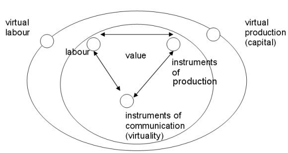
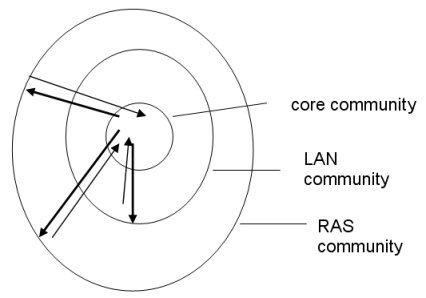

Everyone engaging with the theme of this special issue would agree on two premises: the post-Fordist global economy is radically new, with profound impacts on social organization and forms of consciousness; and new information technologies play a major role in this newness. In our article we will not add to the set of case studies in particular areas, or develop a new theoretical argument, as others in the issue will be doing. We believe there is space, with so new a phenomenon, for a more speculative form of enquiry, digging around the roots of these basic premises to ask some open questions: how new is this new information era, and is it so radically different? Is it useful to call it a “revolution”, using the term in the considered sense it had for Marx, however much it has been over-used and trivialized by later thinkers? {#para2}

We take the term virtuality as the focus for our enquiry. Castells influentially makes the Network Principle primary – ‘The Network is the message’ as he adapts McLuhan’s famous slogan (2001: 75) – but he also discusses virtuality at length, as a quality that pre-existed the information revolution but has taken new forms. Virtuality is an attribute of any symbol in any media, he says, including perception and thought; virtuality in itself does not constitute a revolution. But he sees a development in virtuality, sufficiently new to be remarked on; Castells’ interest is in the way the new technologies can now dissolve the boundary with reality into what he calls ‘a culture of real virtuality’ (2000: 358). “Virtuality” in common usage does other things, becoming a promiscuous attribute of all products of information technology – “virtual producers”, “virtual consumers” of “virtual knowledge” in “virtual communities”, organised by “virtual chains” of ownership, finance, management, design and distribution, enabled by computers and networks. The term is morphing into the heart of the new system. {#para3}

In order to test the scope of the new virtuality, we set our concern with the conditions of new media (digital) labour in the wider framework of the new conditions of all labour, seeing how far virtuality, as a property of all media, has penetrated and affected all modes of production. Has virtuality made all the primary categories of Marxism obsolete? Or is virtuality constructing a new global entity, a multitude, heir to Marx’s predictions on behalf of his proletariat and their mission to end history? {#para4}

Our strategy is to play with a double focus, from Marxism and the world of business, interrogating modern business writers (agents of this supposed revolution) against a conceptual background developed from Marx. We will find that virtuality poses new questions for Marxism that provoke surprising new answers. Nor is there a simple outcome of the juxtaposition. Although Marx’s works (including those he co-authored with Engels) still provide a powerful, relevant framework, these writers have a window into a world Marx never saw. {#para5}

### The Ideology of Virtual Business

We begin with claims from within contemporary capitalism that there has indeed been a virtual revolution. Is this hyperbole to be taken seriously? How should we situate such claims in a Marxist framework? {#para6}

Writers from the field of business are supposedly practical people concerned with practical things like ‘bottom lines’, not with grand visions of new worlds. Yet there is a strong strand of work on ‘virtual business’ now that is taken very seriously in business. Some of this work makes moderate claims. Efteland and Martina, for instance, begin soberly: ‘The emergence of virtual factories has been painfully slow, and, to date, their promise has been largely unfulfilled’. Yet despite this apparent evidence to the contrary, they still declare: ‘However, we are clearly at the threshold of a revolution that will change the manner in which not only manufacturing but also business in general is conducted’ (1996: 184). Hinks writes from just across the threshold: ‘The development of virtual working practices heralds a technology led revolution in the way of working for some types of business’ (2002: 172). Coates and Wolff announce that: ‘The infotech revolution is only just beginning’, in the title of an article, which warns: ‘It is a false comfort to think that all the basic development in information technology have occurred’ (1998: 7). {#para7}

It is interesting to note that for all these writers a virtual revolution is now a fact, yet it has a curious status, as something that has already happened yet is also in important ways only now about to happen. The ‘virtual revolution’ is a ‘virtual fact’, what Castells called ‘a culture of real virtuality’, yet this effect here seems to owe nothing to new information technologies themselves. {#para8}

As our guide to the world of such writers we will take a manifesto for ‘Virtual Business’: Business in a Virtual World (Czerniawska and Potter, 1998). This book announces the new paradigm: ‘competitive advantage in this context comes from transforming the “rules of the game” almost overnight, throwing away the old way of doing things and creating new industry paradigms’ (1998: 5). Such is the force of this revolution that great companies will perish overnight, these authors say, unless they learn the new rules of the only game in town. {#para9}

Not only is their rhetoric of revolution strangely reminiscent of Marx’s words, so are parts of their analysis. They like Marx talk of the double nature of commodities: {#para10}

> Even the most “physical” industries have an information aspect to them… Every product sold consists of information that can be sold and manipulated along with the atoms that make up its shape. (1998: 6) {#para11}

But this is not Marx’s theory of commodities, whose double nature, as material and ideological, specifically included the social powers of labour. They oppose material and informational, and exclude labour. This is no harmless oversight. The aim of virtual business is to remove human labour as far as possible. For instance they recommend ‘disintermediation’: removing ‘the middle man’ in production and exchange (1998: 4). {#para12}

Their manifesto for this new paradigm is worth quoting in full: {#para13}

> The use of information is a revolutionizing force: enlightened companies have realised that the trick of winning this battle is to hold off converting their product into its physical form until the last possible moment. Information – unlike physical goods – can be transmitted round the world literally at the speed of light; it can be manipulated with computers far faster than any physical object can be changed; it can be duplicated at no cost, whereas reproducing physical goods is a slow and expensive business. It makes sense, therefore, for as many activities as possible – product development, sales, marketing and distribution – to be performed in the virtual world, thereby increasing speed and decreasing costs. (1998:7) {#para14}

We note the hyperbole, ‘revolutionizing force’, a term from Marx’s core vocabulary. Yet this revolution seems only a “trick” in a battle or game: a simple trick that surely everyone can learn and neutralise, and then go on to try another trick in another game. This way of seeing their project is expressed in another slogan they use, ‘competitive advantage’, a term which implies a game in which some are winners but the game itself goes on. {#para15}

The underlying logic on which this inevitable triumph will seemingly be based is contained in claims that the shift to the virtual world will ‘increase speed and decrease costs’. The two effects are put together as though they are cause and effect, linked by an inverse law: the faster the speed the lower the costs. But this assumption rests on other assumptions made in this passage, that information flow is all that matters, along networks that magically exist. Human labour to make this happen does not have “no cost”. Software is not free. Material instruments of production are made invisible in this fantasy of instant power. {#para16}

This ideology imagines what it wants to produce: a world in which all human labour has ceased to exist, operated by technicians whose work is indispensable to the new capitalists yet who do not exist in the scheme. We call this tendency invisibilisation , the virtual equivalent of “downsizing”. But invisibilisation has a complex relation to physical downsizing. Invisibilisation makes it thinkable that production can do without labour, which can underpin downsizing plans. It can equally create a state of mind in which the value and need for labour is minimised, leading to lower pay, less care and regard for the work force: more profit simply by more exploitation. Many core strategies of globalisation such as “out-sourcing” operate under the cover of virtual operations. A company removes from its balance sheets the cost of its own workers, but the work is still done somewhere, which is virtual for them though real for those who do it, in the home economy or exploited workers in poorer countries. {#para17}

It could seem as though nothing has changed. Capitalists still want the same thing, and they still run the system. However, in our analysis this is only true of their fantasies, not of the inconvenient world they seek to rule. The new class of virtual labour must expand, in spite of its paradoxical minimisation in the ideological map of “virtual business”. Management might like to see digital labour as dispensible, precarious, but actually removing them is another matter. When they get specific, Czerniawska and Potter stress, briefly but definitely, how useful, how indispensible IT people now are to modern executives. If digital labour power is a scarce commodity which contributes substantially to the value of commodities, then its price will rise, creating a division within the workforce, in spite of the capitalist’s wish, a constant in capitalism now as when Marx wrote, to pay workers as little as possible and expropriate their labour to the maximum. {#para18}

This is all familiar as what Marxism labels ‘ideology’: a poor guide to business practice, unreliable evidence of a real “virtual revolution”. This is the world as it should be for capitalists to become ever richer, using digital technology that magically keeps improving to serve their needs. This text celebrating a “digital revolution” is not produced by new (digital) technologies but by the old practices that Marx already knew well. These prophets of the virtual revolution are re-cycling an old fantasy as if it were new common sense. Thus far, it is hard to see anything here that could justly be called a “revolution”. {#para19}

### A Marxist Framework and the Category of “Revolution”

The word “revolution” is so over-used in cyber-hype like that of Czerniawska and Potter that it has lost much of its meaning and value, yet it is still needed to describe dramatic kinds and scales of change. We will try to ground the term in Marx’s seminal work, in which it has a definitively strong sense, connecting it with Marx’s theories as a whole. {#para20}

The Communist Manifesto of 1848 contains Marx’s extraordinarily prescient insight into globalisation, in a framework in which “revolution” plays a key role. He describes the role of the bourgeoisie as ‘revolutionary’: not only how they became a new dominant class, but how they function as one: {#para21}

> The bourgeoisie cannot exist without constantly revolutionizing the instruments of production, and thereby the relations of production, and with them, the whole relations of society. (Marx and Engels, 1848/1970: 38) {#para22}

Globalisation even in 1848 was a major strategy: {#para23}

> The need of a constantly expanding market for its products chases the bourgeoisie over the whole surface of the globe. It must nestle everywhere, settle everywhere, establish connections everywhere. (Marx and Engels, 1848/1970: 38). {#para24}

Passages like this demonstrate that Marx would not have been surprised by modern globalisation. On the contrary, we find the surprise in our students as they read such texts. It is a time warp in reverse. How could he have known? they ask. {#para25}

The generators of the revolutions are changes in instruments of production, and these explicitly include modes of communication (for Marx as for McLuhan, these included systems which transport goods and bodies as well as information): {#para26}

> The bourgeoisie, by the rapid improvement of all instruments of production, by the immensely facilitated means of communication, draws all, even the most barbarian, nations into civilization. (Marx and Engels, 1848/1970: 39). {#para27}

The still early Wage Labour and Capital describes the key relationships involved: {#para28}

> Social relations within which individuals produce, **the social relations of production, change, are transformed, with the change and development of the material means of production, the productive forces. The relations of production in their totality constitute what are called the social relations of production, society, and specifically, a society at a definite stage of historical development**, a society with a peculiar, distinctive character. (Marx, 1849/1970: 80) {#para29}

Three sets of question arise for us from these statements: {#para30}

- What is a “revolution” if it sometimes produces a change of epoch, a change of the totality, as between feudal and bourgeois society, and sometimes, as in the case of the bourgeoisie, does not produce such a change? If we call the revolutions that mark transitions from one totality to another Type A revolutions, then the frenetic, continuous revolutions of the bourgeoisie, Type B, seem often to prevent or delay the onset of a revolution Type A. But what of the cumulative effect of revolutions Type B? May they not make up a qualitative change in society that makes it different in kind?

- The “communication revolution” since 1848 appears so extensive, it has surely made a difference, cumulatively and systemically. By what criteria is it declared to be still a series of Revolutions Type B, not a catalyst for a Revolution Type A?

- What is the explanatory value of insisting that the present epoch is still just a phase of the Capitalist totality (often called “late capitalism” by Marxists)? Are there no significant differences in the forms and strategies of global capitalism in a global market, enabled by “information revolutions”?

 Virtuality is a significant dimension determining value, in on-going interaction with labour and instruments of production. “Surplus value”, expropriated wherever possible by capitalists, can be taken from value added by labour, by instruments of production, or by virtual, semiotic production.

- “Virtual labour” refers to an aspect of all operations of labour and capital, including what Marx calls ‘labour power’, and also capital itself, which is labour virtually concreted into the form of instruments of production.

- Labourers in virtuality (using instruments of communication) constitute a special category of worker, even though it is an impure category (overlapping continually with material workers co-opted to produce virtual commodities on an unacknowledged, part-time basis, with labour and workers both invisibilised).

- The inclusion of virtuality disrupts the determinism of binary logics (whether the triumph and catastrophe of capital, or the triumph without catastrophe of virtuality), making prediction impossible over many iterations.

It is not in doubt that we are living in times of great change. Castells’ influential work describes it as ‘a process of profound restructuring’ of Capitalism, an ‘information technology revolution’ (2000: 1, 29) The drivers of change now include forces of production, material and symbolic, and forms of communication, material and symbolic, understood as a totality. As Czerniawska and Potter say, material processes are interwoven with symbolic (“chips with everything”), and symbolic processes are packaged as commodities (hardware, software, infrastructure). Virtuality effects are not contained within a separate sphere (non-material “virtual space”) but act in and through their effects on a totality in Marx’s sense. Perhaps it is indeed a revolution Type A, not quite complete. Or perhaps we need a new category, a revolution which is both Type A and not Type A, a far-reaching transformation which however has not (yet) led to a change in the ruling class or the basis of its rule. {#para31}

### Intimations of Virtuality in Classic Marxism

“Revolution” as a term spans Marx’s time and ours, but “virtuality” does not seem to have its digital sense before the computer age. At first these differences of vocabulary may seem to block our enquiry into deep-seated continuities or revolutions. But as we have seen, Castells interprets virtuality in a wide sense, to refer to the symbolic dimension of all media, in addition to a specifically digital referent. Czerniawska and Potter likewise emphasise the digital affiliations of “virtuality”, but to give it its central place in the new form of business they give it a wider sense: ‘virtual elements are items such as information about customers, knowledge about how to get the best from a manufacturing process and the rights to exploit a particular invention’ (1998:viii). And “virtuality” did exist as a word in Marx’s time, even though not including its digital sense. {#para32}

In this context it becomes interesting to follow two complementary lines of question: whether or how far was Marx aware of the concept underlying “virtuality”, and how might he have understood the word in his time? Our procedure here may seem unduly speculative, imposing later meanings on Marx’s thought, but our intent is different: to set up terms for a dialogue across the two periods, without which we would never be able to tell whether there was indeed a revolution or not. {#para33}

We begin with the 19th century virtual, and its place in a history of thought Marx knew well. Something like its modern sense can be seen in its use in optics, the 19th century science of images. Webster’s Dictionary of 1905 has this entry: {#para34}

> Virtual image in Optics is a point or system of points, on one side of a mirror or lens, which, if it existed, would emit the system of rays which actually exists on the other side of the mirror or lens. (Clerk Maxwell, 1905, cited in Webster, 2005: 729) {#para35}

Virtuality in this sense is the ancestor of its modern sense in information technology. It relates to an image (not words or information) projected by mathematics. It refers to a non-existent point, yet it guarantees the reality of the image. In a sense it has a greater reality than the image itself, even though it does not exist. The image is only a copy of reality, so the virtual image exists at two removes from physical reality, yet this unreality has a higher scientific status than both reality and image. {#para36}

“Virtuality” in this sense came from Mediaeval Latin virtualis, usually traced back to the Latin virtus (force, or moral virtue). This was a key category in mediaeval philosophy, which built on Aristotle’s profound pun on ‘virtue’ (as force, goodness, and essence of a thing or argument). This complex structure of meanings suited the aims of catholic theologians, by creating a form of “science” in which laws of nature were the laws of God, as inscribed in the doctrines of the Church. {#para37}

Marx knew this philosophical tradition well. He fiercely attacked its 19th century incarnation, in Hegelian idealism, which attributed a similar world-shaping power to “spirit”. The early Marx called this “ideology”, and described it in a famous image: {#para38}

> If in all ideology men and their relations appear upside down as in a camera obscura, this phenomenon arises just as much from their historical life-process as the inversion of objects on the retina does from their physical life-processes. (1846/1976: 42) {#para39}

Marx does not use the word “virtual” but his field of reference is, like Clerk Maxwell’s, the physics of perception and the instruments by which images are reproduced. Ideology is the product of mind working like a virtuality machine, which operates much like a modern camera or computer. Ideology and virtuality are not unique products of the computer age. Ideology is a general process of constructing and manipulating images by any means, by minds as well as computers. If there is a new virtuality in this sense, then, it would be in view of a new strategy for materialising the imagination. {#para40}

In spite of our etymology, there are good grounds for distinguishing Ideology from virtuality. Virtuality as a cover category includes (as Castells says) all ways of producing meaning. Ideology is one form, along with art and advertising in all media, including also mathematics, and information. The defining characteristic of the virtual in this sense is not distortion or illusion (technology can reduce distortion without making an image any less virtual) but rather its imaginary origin in an abstract, non-material space, geometrical for Clerk Maxwell, metaphysical for Marx, digital for Czerniawska and Potter. {#para41}

The term “ideology” does not figure prominently in Marx’s later work, but the concept, and the image of virtuality, are still recognisable in his famous description of the commodity: {#para42}

> A commodity appears, at first sight, a very trivial thing, and easily understood. Its analysis shows that it is, in reality, a very queer thing, abounding in metaphysical subtleties and theological niceties… the table continues to be that common, everyday thing, wood. Yet as soon as it steps forth as a commodity, it is changed into something transcendent. It not only stands with its feet on the ground, but, in relation to all other commodities, it stands on its head. (1959a: 71) {#para43}

What Marx here calls ‘metaphysical’ he would earlier have called ‘ideological’. Like Czerniawska and Potter, Marx imputes to the commodity a double character, formed by the co-presence of material and “virtual” (metaphysical, ideological) entities. For Marx as for Czerniawska and Potter this double character is basic to the economic system and its social effects. For Marx it underpins the conditions under which human labour power is sold as a commodity, alienating workers from the commodities they produce. As commodities, containing this virtual dimension, are translated into numbers (with or without the aid of computers) we can see a further effect. Virtuality is multiplied, producing what we call a greater density of virtuality. As numbers applying to commodities accumulate and are manipulated through the stock exchange, the density of virtuality grows into ever stranger forms. When commodities are traded as futures, the degree of virtuality grows greater, reaching a density which can only be managed by computers. {#para44}

In the virtual dimension, the commodity has and becomes its price, a virtual equivalent to a multiplicity of things, all of which can be exchanged for a price. This interweaving of virtuality and materiality is intrinsic to the logic of capitalist modes of production, and to its forms of organisation. From this point of view, virtuality appears not as a break with capitalism but intrinsic to it. Computers merely accelerate a basic process. {#para45}

Marx’s theory of commodification was bound up with his theory of labour, where virtuality plays a crucial role. Between 1848 and 1859, according to Engels (1970:65), Marx made a conceptual breakthrough in his theory of labour. Previously he had talked, like the neo-classical theorists, of labour as what was turned into a commodity and sold by workers. He came to insist that what was sold was “labour power”, potential labour, not the work itself. “Power” in this sense is equivalent to “potential” or “virtual”: so the commodity they sell is virtual labour. In this form, made virtual, it is ready to be manipulated, bought and sold in the virtual world of Capitalism, by a logic today sustained by information technology. {#para46}

Our aim in this section has not been to show ‘what Marx really thought’, just to establish a basis for comparison. In these limited terms, the relation we outline between “ideology”, “virtuality” and symbolic production is suggestive. It brings the modern ideologues into significant contact with Marx, and vice versa. It is salutary to see that what they prefer to call “information” is labeled “ideology” by Marx, and that both theories situate virtuality in the economic base. But do such differences signal a revolution, or just the different perspectives to be expected from such different traditions? {#para47}

### Chaos Theory and the End of Certainty

Czerniawska and Potter are prophets of their virtual revolution, using a seductive line of reasoning popular among modern prophets, including Marx in some moments. This kind of prophecy rests on so-called “laws” which mimic a form of science that is capable of making certain predictions. For example Czerniawska and Potter refer to ‘ Moore’s law’, a foundation myth of cyber-prophecy (1998: 14). In 1965 Gordon Moore predicted that the number of transistors contained within an integrated circuit would double every 18 months, producing an inverse relation between size (and hence cost) and computing power. As Czerniawska and Potter boast, this law produces an exponential curve which accelerates over time – just as computer technology has done. They do not add that this curve finally heads off the chart, towards infinity, producing either infinite computing power for a standard unit size and cost, or zero size and cost for standard computing power. Either way, a scenario that sounds fine for a while inevitably produces catastrophe, if no other factors intervene. This is a virtual image in Clerk Maxwell’s sense, and ideology in Marx’s. {#para48}

Marx was fond of laws of this kind, establishing an inverse relation between capital and labour, with the enrichment of the one and the misery of the other – Capitalism ‘establishes an accumulation of misery corresponding to the accumulation of capital’ (1959a: 645) – with also an inevitable reversal of this trajectory, leading to the triumph of the proletariat. He based some of his most striking prophecies on this premise: {#para49}

> What the bourgeoisie produces, above all, is its own grave diggers. Its fall and the victory of the proletariat are equally inevitable. (1848/1970: 46) {#para50}

This claim is still seductive, as the success of Hardt and Negri’s Empire shows. For these writers, “Empire” subsumes all previous national powers into a single abstract (“virtual” in our terms) entity, facing the re-named heirs of Marx’s proletariat, “the multitude”: ‘The creative forces of the multitude that sustain Empire are also capable of autonomously constructing a counter-Empire’ (Hardt and Negri, 2000: xv). Regrettably, we see no evidence that this new version of Marx’s laws predicts any better than the old did. This ‘multitude’ is virtual in one sense, produced in abstract space by extrapolating from Marx’s laws, but the real test must be empirical. The processes of world capitalism (“Empire”) produce many losers, but how will they become an entity with political effects? Users of the Internet potentially (“virtually”) can connect with everyone else, constituting a “virtual” multitude, but is this, at the moment, much more than ideology? {#para51}

However, Marx is not just a (failed) prophet. There are significant disclaimers by Marx that his “laws” should be understood in a linear sense: {#para52}

> Under capitalist production, the general law acts as a prevailing tendency only in a very complicated and approximate manner, as a never ascertainable average of ceaseless fluctuations. (1959b: 159) {#para53}

Marx’s work contains suggestions of something more powerful and exciting than caution: traces of a remarkable premonition of what has been called “chaos theory”, a postmodern form of science.[1] {#para54}

For instance, his early lecture Wage labour and capital begins by discussing price fluctuations. He criticises classical economists who dismissed these fluctuations as ‘accidents’ which obscured the reality of the equivalences between prices and costs. Perhaps it is the anarchy of the fluctuations which is the reality, he says: the equivalence is the accident, and the ‘total movement of this disorder is its order’ (1849/1970: 78). Seen from the vantage point of chaos theory, classical economists treated price as an equilibrium system which tends always towards a “point attractor” (a stable point towards which the system always returns after any perturbation). Marx seems to envisage what has been called a “strange attractor” (see Lorenz, 1993), a pattern of oscillations in which each oscillation is unique, never repeated, circling around an area, not a point. Lorenz’s strange attractor exists in “phase space” (a mathematical or “virtual” state). So do Marx’s price movements. Lorenz’s attractors are mathematical abstractions which correspond to physical events and systems. The driver of Marx’s scheme is the all-pervasive social fact of struggle: here, between buyers and sellers, supply and demand, ‘inquiry’ and ‘delivery’. This struggle in the material world is expressed in the virtual world of prices. {#para55}

Lorenz’s phase space is three dimensional, the minimum number of dimensions, he says, in which an attracter can be ‘strange’, never fully predictable. Significantly Marx begins his discussion of prices in a ‘three-sided’ scheme co-determined by the competition between buyers and sellers, by relations between supply and demand, and by something he called ‘inquiry and delivery’ (Marx 1849/1970: 75). Phenomena co-determined by three autonomous but interdependent systems were the focus of Henri Poincaré’s analysis of three-body systems, which in 1890, forty years after Marx’s work, showed that such systems in principle are never predictable. Another century later, Poincaré’s insight became a foundation of what came to be known as chaos theory, a new form of science in which prediction and certainty are no longer defining qualities. In 1849, Marx did not have the terms to express or systematise this radical new insight, yet he produced it nonetheless. {#para56}

If Marx’s “laws” are understood not as universal like those of physics but as vectors of capitalism then it is legitimate to use them (as he mostly did in practice) to show the reductio ad absurdum of the linear capitalist mind-set if pursued to its limit, in its own form of ideal conditions. It will produce outcomes that jeopardise its conditions of existence, when only one principle, the profit motive, acts uni-directionally in a world reduced to two classes, capitalists and workers. {#para57}

To be true to Marx’s insights rather than his system, Marxism needs a three-body analysis of the many-bodied systems which jostle unpredictably in the chaos of the globalising world. We posit virtuality as a third body, already recognised by Marx. Virtuality in this sense includes value added to commodities by the symbolic dimension. As one instance, brands like Adidas add greatly to the price of their commodity. Czerniawska and Potter claim that brands will become irrelevant in virtual business, because customers will use the net to obtain the real information which brands only promise. But the two strategies may not be so different. In the past a brand signified skilled and expensive labour, hence higher cost, justifying a higher price. Now out-sourcing may allow cheap overseas labour to produce a cheaper commodity, which still has a high price, because of the virtual meaning contained in the brand. Brands promised (though did not guarantee) desirable qualities in the commodity. So does “information” they may get from the net. That information is likely to include soft meanings, just as the brand implies hard meanings (quality controls, etc.). As Galbraith remarked, of an earlier stage of capitalism: ‘The economy for its success requires organised public bamboozlement’ (1972: 294). It needs it now as it did then, because symbolic value is still a key to exploitation of the other two kinds of value. {#para58}

We will combine the two binary schemes, Marx’s and Czerniawska and Potter’s, in a single three-body system, including Marx’s key terms, labour and capital, along with virtuality and forces of communication. ‘Value’ is at the center, affected by interactions between all three: {#para59}

 {#para60}

 {#para61}

This diagram attempts to capture a number of points: {#para62}

### Virtuality and the Global Workplace

We suggest that virtuality is an intrinsic dimension of two kinds of worker in contemporary capitalism. Digital workers form a first category created by and for the new instruments of communication production. The second category is implicit in the program of virtual business, whereby all workers now are virtualised, to a greater or less degree, as a condition for participating in the current form of capitalist production. Just as the commodity in Marx’s analysis is formed by the fusion of material and metaphysical dimensions, producing contradictions and complexities, so virtuality, implanted in workers whether or not classified as digital workers, introduces a new, paradoxical character into labour. {#para63}

As our way in to this theme, we take an article in the Mexican edition of Network Computing on Remote Access Servers (RAS). {#para64}

> Distances do not only create alienation between people, they also create problems of business efficiency. If a mobile work force cannot use the resources of the net of its company, kilometers can translate into red figures on the balance sheet. With a remote access server, frontiers can be erased. {#para65}
>
> Remote access servers are the vital link with the LAN (local access network), and on it depend as much workers at a distance, lounging in their favorite arm chair in their home, as sales reps, reporting from Beijing after 20 hours without sleep. To connect users with the resources of a LAN is a standard operating procedure in many corporations, which is employed with ever greater frequency for people who work in remote sites. (Webster, 1999: 20) {#para66}

This text is written by and for workers in virtuality, playing with the potent fantasies of cyber-speak. It written about non-digital workers who interface with each other as partly virtualised workers, but still also live and work in a material world. The text repeats the foundation myth, the legitimising ideology of cyberculture: in the beginning was a globalised world without computers, alienated (another term from Marx) and inefficient, not truly capable of globalisation. The mobile work force of globalisation was in darkness without the net to connect with the resources of virtuality, assumed here to be as unquestionably powerful as Czerniawska and Potter claim. A single device fulfils the promise (so often made, always needing to be repeated), the final elimination of borders. {#para67}

The second paragraph inserts this device in the assemblage without which it would not function. This forms concentric circles, the innermost the core, the next level the LAN, which has (in this account) already transformed conditions of work for the imaginary corporation. RAS completes the final circle, dominating the globe through virtuality. {#para68}

 {#para69}

This virtual world, created through words on a page, consists of a virtual community of concentric circles, each containing nodes with multiple connections at the respective levels. In its virtual form this elegant alternative world is so interconnected it is not clear whether it offers an illusion of decentralisation or an illusion of centralisation, or both, oscillating between each other, super-imposed on a material world organised in intractable other terms. In current practice the flows will be mostly be what Bickerton et al. (1999) call presentations, linear communications dominated by the centre, consisting of reports (from periphery to center, shown by light arrows) and instructions (from centre to periphery, shown by dark arrows). {#para70}

In the idealised (ideological, virtual) version, the RAS creates a better-informed centre, and more responsive workforce. In practice the layers of virtuality make it likely that “information” will be distorted, partial, irrelevant or misleading, each step along the chain adding a degree of virtual density. Given dense virtuality and continual interaction between material and virtual systems, both chaotic, the ideal will never be achieved. {#para71}

Beneath the ideology this text shows glimpses of material situations and people, working far from home, or working from a home that (in spite of the beloved armchair) has been converted into a work place. The salesperson in Beijing has worked for 20 hours without sleep. Real time continues to act on workers, whether linked to a computer or not. This is invisibilised in the dominant picture which has given the phrase “24/7” to the U.S. dialect of the English language, in which time has been eliminated, or invisibilised. In this text, invisibilisation acts with characteristic ambiguity, erasing the real time in which real bodies live, and coercing those bodies to act differently. A LAN allows weekends to be invaded as though they did not exist, invisibilised. Workers are expected to check emails, download data and respond to urgent requests before work officially begins on Monday. The extra hours involved in “flexibilisation” are invisibilised, and in this form they are more readily appropriated as surplus value. {#para72}

Workers who connect to a global intranet, like prospective users of this device, are not necessarily de-skilled, because of the complex tasks it opens up. Partial virtualisation enables them to defy, to some degree, the tendencies coded in Marx’s inverse law of labour impoverishment. The RAS, as part of an assemblage, makes complex skills and local initiatives more possible, more valuable, even indispensable, to multinational corporations, because the technology does not solve all problems after all. In terms of our three body model, in which virtuality, along with labour and capital, affects price, value and wages, unpredictability is introduced. Wages are sometimes stable or increased as a result of virtualisation, in what is then called “skilled labour”, though capital can flow rapidly to labour markets, like China and India, where for the moment skilled labour is paid cheaper rates. In other cases “unskilled labour” is increasingly impoverished. The capitalist profit motive always exists but is not always equally gratified. It is never beyond challenge, in a context of struggle in which virtuality can work in complex ways. {#para73}

We found this magazine in Mexico, translated into Spanish for Mexican readers, presumably digital workers likely to be employed by Mexican branches of American-owned multi-national corporations, for whom Mexico is not much different from Beijing. The text, originating from the USA, undergoing the translocation typical of globalisation, produces new fissures in the ideology. The two categories of worker, digital and physical, are seamlessly woven together in the text, one at “home”, the other abroad, but in Mexico they face each other more directly in the same country. {#para74}

As a short hand way of invoking this Mexican context outside the ideology of virtuality, we quote from a report on poverty in Latin America by Celam, the Catholic Council of Bishops of Latin America. By a nice irony they echoed Marx’s critique so closely he would have been surprised, but the diagnosis would have been all too familiar: {#para75}

> The great transnational consortiums, principal agents in the process of integration of economic blocks, are located in those nations where they obtain most benefits and where the salaries or government charges are lowest, and as globalization advances, they are organized to assume more power and dominion. {#para76}
>
> In this way, multinational industries are turned into true financial powers who enter into competition with the economies of nations, they weaken them and destroy the means of sustenance of marginalized and rural communities; thus, at a time when the generation of wealth diminishes in many countries, because of international competition, the distribution of income becomes all the time more unequal, to the detriment of the weakest. (Roman, 2004: 45) {#para77}

This is Marx’s “law” of the increasing impoverishment of the working classes, still working 150 years after he wrote, now part of a consensus. We make three points arising from it: {#para78}

- This analysis, from such a source, seems to vindicate Marx as prophet, but it is a repetition, not an extension from Marx’s original analysis. The logic of capitalism is not a straight line extrapolating from 1850 to 2005, but another return to a now different situation, with a trajectory that is unpredictable in both directions. As Marx said, ‘the total movement of this disorder is its order’.

- The bishops do not isolate the role of the “virtual revolution” in the processes they describe, yet it is surely there, providing the new sinews (including the humble RAS along with many others) that hold together the monstrous limbs of a new kind of gigantic beast, Multinational Corporations, which could not survive or function without them.

- Meanwhile back in Mexico we can see the contradictory movements which constitute the latest stage in the “revolution”: impoverishment of many, yet new opportunities for some Mexicans to co-operate with some capitalists; digitalisation a source of opportunities that many are taking, from the top (Carlos Slim, the richest man in Mexico does good business with Bill Gates’ Microsoft) to somewhere above the middle. And from the bottom, from the ranks of the dispossessed who worry the Catholic bishops, there is a groundswell expressed most notably by the Zapatista rebels, organising resistance by creative use of old and new media from the jungles of south-east Mexico (see Coronado and Hodge, 2001).

### But is it a Revolution?

Capitalism has developed a new array of devices to fulfill its old aim, to extract surplus value wherever it can. All these devices to some degree draw on resources of virtuality: “virtual surplus value” makes it easier to appropriate other kinds of surplus value. All these forms of expropriation are usually presented in ideological form, in Marx’s sense, which is virtual in Clerk Maxwell’s: an inverted image made to seem the right way up. {#para79}

Yet these are only the dreams of one class, shadows projected onto the screen of virtuality, which has space for many other projections. Outside the camera obscura of capitalist ideology the struggle continues, precarious or strong labour against strong or precarious capital, in a field of struggle unpredictably affected by new technologies of production and information. Virtuality has conditioned all forms of labour to some degree, creating different classes of worker, set against each other, not conscious of the web of virtuality that links them all into a single multitude. That unity is virtual in one sense – a potential that could be activated by virtuality in another sense, the resources of the net. The connections are not being made at the moment, by the real users who are the only ones who could make this grand alliance virtual, and thence real. But will they? {#para80}

“Virtuality” is not unique to today’s world, but because it is so basic a category, the huge changes of virtuality enabled by the “information technology revolution” make it a type B revolution. It impacts on other revolutions in unpredictable ways to produce outcomes that Marx did not imagine, and capitalists cannot predict or control. Will all this one day precipitate a change so wide-ranging that few would deny its status as a “Revolution Type A”? We do not presume to know. {#para81}

## Authors’ Biographies

Bob Hodge is Foundation Professor of Humanities at the University of Western Sydney. His main current research interests are in the development of chaos theory and fuzzy logic as applied to the social sciences, especially in the areas of globalization and the issue of postmodernity. His most recent books have been Social Fuzziology (2002, with Vladimir Dimitrov) and El hipertexto multicultural en Mexico posmoderno (2004, with Gabriela Coronado).

Gabriela Coronado is Senior Lecturer in Organisational Studies in the School of Management at the University of Western Sydney. Her current research interests include cross-cultural management and global strategy, using theories of chaos and complexity. Her most recent books have been Las voces silenciadas de la cultura mexicana (2003) and El hipertexto multicultural en Mexico posmoderno (2004, with Bob Hodge)

## Note

[1] See Hodge (1995) for an outline of this argument, and Coronado and Hodge (2004) for application to issues of globalisation.

[back]

## References

Bickerton, P. and Simpson-Holley, K. Cyberstrategy (Oxford: Butterworth Heinemann, 1999).

Castells, M. The Rise of the Network Society, 2nd ed. (Oxford: Blackwell, 2000).

______. The Internet Galaxy (Oxford: Oxford University Press, 2001).

Coates, J. and Wolff, M. ‘The Infotech Revolution is Only just Beginning’, Research Technology Management 41.1 (1998): 7-8.

Coronado, G. and Hodge, B. ‘David and Goliath in Cyberspace’, Mots pluriels 18 (2001), [https://www.arts.uwa.edu.au/MotsPluriels/](https://www.arts.uwa.edu.au/MotsPluriels/).

______. El hipertexto multicultural en México postmoderno (Mexico: CIESAS/Porrua, 2004).

Czerniawska, F. and Potter, G. Business in a Virtual World (London: MacMillan Business, 1998).

Galbraith, J. The New Industrial State (Harmondsworth: Penguin, 1972).

Efteland, J. and Martina, R. ‘The Virtual Factory’, Harvard Business Review 74.5 (1996): 184-185.

Hardt, M. and Negri, A. Empire (Cambridge, Mass.: Harvard University Press, 2000).

Hinks, R. ‘The Transition to Virtual’, Journal of Facilities Management 1.3 (2002): 272-283.

Hodge, B. ‘Labour Theory of Language: Postmodernism and a Marxist Science of Language’, Transformation 1.1 (1995): 252-271.

Lorenz, E. The Essence of Chaos (Washington: Washington University Press, 1993).

McLuhan, M. Understanding Media (London: Routledge, 1964).

Marx, K. and Engels, F. Selected Works (London: Lawrence and Wishart, 1970).

(Includes Manifesto of the Communist Party 1848, Wage Labour and Capital (K. Marx) 1849).

______. The German Ideology (Moscow: Progress Publishers, 1976).

Marx, K. Capital Vol 1 (London: Lawrence and Wishart, 1959a).

______. Capital Vol 3 (London: Lawrence and Wishart, 1959b).

Roman, J. A. La Jornada, 17 June (2004): 45.

Webster, A. ‘Servidores de acceso remoto’, Network Computing México 3 (1999): 20-26.

Webster, N. International Dictionary of English (Springfield: Mirriam, 2005).
