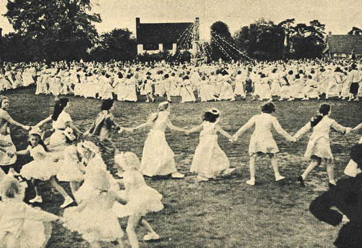

If a network forms a social relation between gestural beings, then that same network must also connect our dissatisfactions of broken relations and our hopes for their renewal. The elliptical gap that generates this frustration is encircled by clusters of geo-gestural behaviour. The framing of the question “network?” does not account for these movements and gestures, but how they come to form a pattern around the communicative material that can produce both satisfying and sad affections. {#para2}

The network is a maze; it has designated fissures and portals. Using the neologism of the digital maypole provides us with a conceptual tool for thinking through the various indices of cultural life; the digital maypole is a measure of the degrees of gesticulated manifold twists. In the sense of Deleuzean *multiplicité*, the maypole expresses the network’s torsion balance chart of power. The maypole topology is order through rhythmic tension and torsion, and in this sense its continuous binding of power makes the concept the paradoxical apostate of the network’s labyrinthine structure. The instinctual and biological ties of the etymological maypole enable us to focus upon specific power combinations of the network’s prescience. {#para3}

A network is formed through relations of various *radius vectors*. Those vectors, we propose, can be explored using the conceptual paradigm of the maypole. The physical relation from computer-to-ISP, phone-to-tower is often adapted into a digital hierarchy in order to map systems of power, but that abstraction in turn alerts us to the physical shadow of a not always visible referent object, and to the ribboned-string of information that bind us not only to a network (a system for configuring and comprehending syntax) but also to a transitory axis of movement and gesture. What follows are elliptical notes on the gravity of these movements – the digital maypole. {#para4}

Although it was formed around the idea of economies of affect, our discussion is interested in the gestures of communication. In the context of the network, a vector indicates the direction, transference, and control of quantities of things (information, emotion, affect). The vector was articulated by McKenzie Wark in his book *Virtual Geography*, where he identified the media ‘conjunctures’ and ‘contours’ of the affective powers of the media images of events surrounding the first Persian Gulf War (1990-1991) (Wark, 1994: ix). Those same contours have engendered a radial thinking of the forces of the controlling powers of affective spaces and objects. We can make glib observations such as Ericsson and Nokia being companies that draw their heritage from countries still ritualistically invested in maypoles, and naturally part of any dialogue on gesture requires such provocative slips to be as gestural as possible, but the network’s traversal of subjective ground determines our radial pursuit. In that spirit, we begin this circular dance with a gesture more familiar; a finger pointing to the nearest pole, and a spoken question: “*What is that*?” In this identification alone, faith in the symbolic value of the network suffers tremendous pressure from the inchoate flurry of ribbons and leaves that make up the temporal and affective dimensions of life. {#para5}

### May

Consider a maypole firstly as a sacred site, a home to ritual movement; any geophysical configuration of ritual and memory that activates passage and mobilizes movements of human thought in relation to the elements, the seasons, their bodies, their age; that is – each other body. {#para6}

According to Robert Graves’ maddening and lysergic exegesis on the figuring of languages and histories in Europe, *The White Goddess* (1947) the function of the maypole was the re-establishment of order through a chaotic, wild ceremony. What makes the maypole a paradigmatic site of radical social renewal is transience and impermanence, tied forever into the Bacchanalian rites of spring. Great artificial hill forts and mounds were constructed, especially in England’s bronze and iron ages, to oversee valleys and form authority by sheer ability of sight. Maypoles were often forms at these sites, such as Avesbury, Silbury Hill, and Stonehenge, to mark the movement into spring. Manifold ceremonies developed across Europe in the centuries since throughout the month of May, symbolically connecting the maypole to ritual waste, abundance. The maypole, then, is the ur-pole, an unsubtle precursor to the microwave reception stations, relay towers and clustered satellite dishes perched atop our lived-in monuments. The radius vectors of signals, images, calls, videos, GPS searches, wireless connections fan out and fold over each other in arcane systems and patterns, different coloured ribbons connecting the dancers to the movable-and-moving centre. In the modern maypole dances, where flowers are gifted and grafted to the pole each May, we would find an analogue of our wasteful bills, ritualistically sent to us each season and symbolically returned. {#para7}

The maypole dances were part of ritual life over much of Western and Northern Europe, regenerating the usefulness of the community after the winter, providing a place for the first dance of spring. Whether it was the ancient Swedish idea of Irminsul (connecting heaven and earth – elsewhere, the world-tree Yggdrasil), an indigenous Australian initiation-sited dance, or the Ruskin-era ribbon dances, the maypole symbolises social orders: rebirth, regrowth, community formation and the re-establishment of law. Yet this law remains sensory in its ritual-seriousness, playful in its boundaries, and lived in its communicative comfort. The maypole regulates and is regulated around. {#para8}

Just as ‘*space is a practiced place*’ (de Certeau, 1984: 117, emphasis in original), gestures require practice and repetition for them to become meaningful. The maypole is a spatial concept, defying the surfaces of meaning. We can think of these gestures of radius vectors through any number of paradigms of thought and everyday practices, for example: speech, construction, organic functions, reactionary or subversive practices, acts of violence, compassion, or love, and movements. The gestural lines attaching themselves to any maypole ‘contain noise’ (Kahn, 1999: 72); they are affectively resonant. This noise has often coagulated history within them, inside, within their containment of practiced place-growth: ‘Occasionally I would put my ear against the bunkers’ hardened shell to catch the roar of war still trapped inside.’ (Lotringer, 2002: 10) We must not forget that the fecundity of men’s wars has nurtured our digital maypoles. The ecology of war has created many radius vectors that cast an ashen pallor over the sunshine implicit in the maypole’s ribbon paradigm. The power lines of communication request human beings be made cripple through a short chain too close to their prison walls. The vectors engendered by torture will resonate in their bones many years later if they still have consciousness of the radiants of nerve endings. Lines of recordings transmit lines of violent sound, molecular disturbances, colonized perceptions of behaviour. Lines of digital sound are sedimentary testimonials to symptoms of communication; the line contains the compound of previous relations, it is *intensive time*. (Virilio, [1990] 2000:20) The cultural form of the digital maypole enables us to see these connective paradigms more clearly, to be attuned to the screams and bleeding edges of history, to be receptive to the affective encodings of experience compressed into space-time cultural curvatures. We know that the current ecology of the maypole is funded by those self-same bearers of the short chains of hatred and fear. {#para9}

The invocation of the maypole here is as an absolute law. The maypole is topologically organising; a law-inscribing movement of hierarchical formation. The maypole seems unsolicited for the comprehension of self-organised networks and socially self-regulating information technologies. We take networks to be developmentally asystematic. The maypole greets, and beckons by a simple gesture of familiarity, to an embrace. Maypoles configure organising law, drawing power from already established regulations. Groups may swell and accommodate newcomers, but societal harmonies are maintained by maypole regulations. {#para10}

Formal and public acknowledgement of social orders and alliance-groups enable reconciliation of multiple events of every conceivable scale because they symbolically enable the paradigmatical power of each established alliance-group. The maypole maintains the haptic siting, and binding, of each group. The maypole is a motion that is invoked to deepen the discussion of the nature and scale of ‘the network’ of communication theory. {#para11}

### Digital Digits

The services of short messages are playful, they engage us in a game of describing what else is said. Using an SMS to locate yourself in time-space is the first engagement, beyond that is something like communication, a game of interpretation. By ‘game’ we can mean a system of simulations (of languages and loves) which reaches a conclusion (the last message). De Certeau spoke of games as disjunctive operations, ‘because they produce differentiating events’, a term borrowed from Freud’s discussion of wit. An exchange of SMS is a game between our agencies; it produces events (conversations) that differentiate us with disjunctive operations. How you read me, how you want to read me, these are the rules which govern the game between us.

The gesture – the movement of thumb to forefinger, the digital digit which permutates into different meanings depending on the technik in the hand – has remained the centre of the social dynamic. A depression is both number and letter; like Hebrew, it enunciates both sequences and names at once. The gesture from one button to other is at once indexical search and flirtation. 160 characters is more than enough to tell a lie or to fall in love; is it enough to speak of truth, or of a movement. The printing of my thumb on my keypad is a gesture which means primarily “I can communicate.” before a thought is sent in masquerading as content, and naturally “I could not” – the prior state. Use of entertainment/communication technology speaks first of the prior inability. {#para12}

When the opening of a realm is ritualised, it signifies only its prior absence – and what could be more ritualized, arcane, more steeped in magic and prophecy than the screens, tones, sounds, pad layouts, call charges, bills, advertisements and thefts of phones, PDAs and portable game systems? Where else can we practice all the weird combinations of number-letter substitution (4663 = “good”), once the province of academic-religious scholars, on the way to organizing a night at the movies? {#para13}

### Hieroglyphic Breath

The maypole’s theoretical precedents are very much invested in the ritualistic rejuvenation of the acts of speech, writing and reading. In Derrida’s essay ‘The Theatre of Cruelty and the Closure of Representation’, reproduced in the volume *Writing and Difference*, the gyre is widened past what Derrida introduces as ‘theatrical writing’ into Artaud’s “hieroglyphic speech”, the revitalised magical breath of multi-modal expenditures of speech and gesture. Derrida quotes Artaud extensively in order to form ideas of writings-to-come, speeches-to-come and readings-to-come that are birthed in eggs of self-awareness. To do this, the essay takes on the quality of a manifesto by the gesture of excitation. Derrida’s thoughts become excited by Artaud’s, they extend and converse, not agreeing but extending, forming a conspiracy of movement. {#para14}

Derrida’s speech-to-come is first reunited with gestures; the ‘logical and discursive intentions which speech ordinary uses to ensure its rational transparency, and in order to purloin its body in the direction of meaning, will be reduced or subordinated.’ (Derrida, 1978: 302) This calls to mind Alfred Jarry’s ‘pataphysical clinamen’, the acts of language that swerve around and away from meanings and logics, leaving the maypole of pure potentiality ensorcelled with affective motion. Most importantly, the clinamen reminds us of the accumulation of meaning through the ‘affective energy’ engendered by movement, as José Gil has noted of the movement of bodies, wherein the previously written continuously reorganises the system of signs. (Gil, 1998:143) We add to the ability-to-speak, alter it forever, every time we act. {#para15}

More explicitly, Derrida expands Artaud’s hieroglyphic writing as recombining speech with the mythic and magical; ‘the writing in which phonetic elements are coordinated to visual, pictorial and plastic elements.’ (Derrida, 1978:303) An SMS is, strictly speaking, coded and recoded in these hieroglyphic structures, but above this, what concerns both the Theatre of Cruelty and the maypole milieus we form between our technologies is the potentiality in movements like the SMS of a speech before language – accessed not by stripping away codes but by alchemically assembling them into puzzles, allegories, collages, myths, spells, balms, manifestos and so forth. {#para16}

No wonder that manifestos such as Artaud’s and Derrida’s, seeking to recombine the language-acts with gestural forms, continually reference the rejuvenation of speech. This focus on renewal acts as if logical expression is apologetically historicised as a necessary evil before the coming return to magical culture: ‘We have seen the reasons why hieroglyphs had to be substituted for purely phonic signs. It must be added that the latter communicate less than the former with the imagination of the sacred.’ (Derrida, 1978: 307) Derrida goes on to quote the most intense moment of Artaud’s fraught utopia, where the writing-to-come also re-consists the hieroglyphic act of hopeful writing: ‘And through the *hieroglyph of a breath*, I am able to recover an idea of the sacred theatre.’ (Artaud, *The Theatre and its Double*, quoted in Derrida, 1978: 11, emphasis added) The manifesto that Derrida combines with Artaud speaks not about this rejuvenation of speech, but proves to be an example of its process. The conspiratorial velocity of their hope and analysis is meant to foreground a return to hieroglyphic speech that in all the worry about the loss of linguistic meaning in networked culture, we may have forgotten to celebrate. Extending Artaud’s thought, there is no longer a spectacle or spectator, but a festival of language – and any writing which explores it, as their essays did and these notes do, must also engage in its elliptical, resolutely irresolute intuitions. {#para17}

The maypole’s insinuations towards the seasonal rejuvenation of law and language through a festival are not merely adrift elements of its agrarian and communal past, but the very axis of what we are beginning to understand as a maypole logic. A digital relay station, mobile phone tower or satellite is our contemporary seasonal celebration of the potential return to hieroglyphic speech. The seasons of language are linguistic microclimates; between friends exist atomic conspiracies of meaning that can be reconstituted and deployed in an SMS, the winters from which we emerge bearing our rituals and planning our festival are the silences we unlock our keypads to break. {#para18}

> Once aware of this language in space, language of sounds, cries, lights, onomatopoeia, the theatre must organise it into veritable hieroglyphs, with the help of characters and objects, and make use of all their symbolism and interconnections in relation to all organs and on all levels. (Artaud, quoted in Derrida, 1978: 90) [1] {#para19}

### Clusters Form

Groups are not an expression of democratic spontaneity. Their origin is much older. Groups always form around a corpse. When there is no corpse, that empty place evokes the many corpses that have been there and the many yet to appear. It is the last rite that holds civil society together. The group is a crowd crystal. Those who form it obey a calling, suddenly revealing their adherence to a vast sect: devotees of an official innocuous, essentially persecutory power: Opinion. They throng together and jostle each other without realizing it; they all converge toward one point, which is the empty circle at the centre of the group. There, as Rene Girard has pointed out, they were once able to see the mangled body of the victim of the original lynching. (Roberto Calasso, *The Forty-Nine Steps*, 1980) {#para20}

Calasso describes Karl Kraus’ bible of war *The Last Days of Mankind* as a magical practice, and suggests that if we able to publish with it the second part of Flaubert’s Bouvard et Pecuchet, some 2100 pages, we would have a “Great Hybrid” for our age; The Age of the Perpetual War, which we call late-cycle capitalism. The moral of this story is entirely too simple. When even mass graves and concentration camps can be brought under the sensibility of public opinion – so that we allow ourselves the temerity to even form ‘ideas’ about what it means for people to be killed en masse in our name, when we even bring it to the realm of argument – we have paved over the varied possibilities of our peaces with the hard, venal sludge of Final Industry. {#para21}

The maypole is that first, “ur-victim” of winter. The question is not who murdered the victim, but who will clean up the mess. The cluster forms around the possibility of something final happening. When we use a phone, we are jostling around a circle, and a body is nearby. Imagine all the uses of phones; videos, photographs, all capture figments and pigments at the inner edge of the circle – look what I found, look where I am, be impressed with my gestell, and finally, where am I? Or perhaps, more obviously, why am I in the middle of a circle? {#para22}

### Maypole Milieus

God is a Lobster, or a double pincer, a double bind

(Deleuze and Guattari, *A Thousand Plateaus: Capitalism and Schizophrenia*. 1980 [1987:40]) {#para23}

A maypole is a self-organising communication of regional contexts. Once the province of agrarian societies, today it exists as mobile towers/ satellites (of love, of determining ratios of correspondence, of choice elimination), remembered, and re-enacted ritual and monumental sites. The maypole has a mayflowering lineage, wherein a migratory blossoming of communicative abilities nurtures microclimates of ideas. The maypole, as ritual, as performance, as gesture, is a growth movement of seasonal potential. Spring is a form of opportunity – of a qualitative invention-production of a prophetic milieu. The mobile as maypole has a distinctive set of topological translation practices. Pretends to democracy and egalitarianism, but the maypoles are the stakes of every network – grounding powers that are as binding as they are libratory. {#para24}

If we can take any part of the infinite hype around mobile telephonics to heart, then it has to be the overwhelming sense of ‘festival’ that affects us first. We were sold generation after generation of telephone toys not on productivity, not on convenience or safety, but play. Images of more free time, more connected time with things that really mattered; instant gratification and organization. A networked carnival, a capital free play is enabled by the feedback, the maypole experiential circularity of the *double bind* of communication – feedback and gesture. As Bateson reminds us, ‘The cat does not say “milk”; she simply acts out (or is) her end of an exchange, the pattern of which we in language would call “dependency”'([1969] 1987: 275). A ‘network’ implies a behavioural pattern, a system of qualifications and qualifiers that belong to no-one, yet belong to the economy of the particular system. A network implies an illusory sense of communicative practices, an establishment of aesthetic commonalities, political boundaries. A network is formed through relations of different maypole radiant vectors. There is no one centre, rather multiple centres, these may shift, move, be erected where necessary. Often the maypole centre may be forgotten, or bulldozed, blown up, decayed beyond recognition, but the genetic remembrance of the performative gesture may resurrect, reinvent a maypole form: an affective energy of the body blossoming forth. {#para25}

The maypole milieu acts as a translator of the clustered communications that may share an effective economy of behaviour, but not the affective economy of gesture. *We don’t need to move to communicate* – our gestures are but spirit marks of past mobility. An identifiable site of belonging grounds the maypole. The maypole may partake of other networks, but the ritual power of the maypole over the ur-*mobileuse* is such that the mimetic milieu is binding. Gestural marks of the maypole’s binding are evident on recipients. Networks forms clusters of individual economies of identifiable behaviour. The maypole has the magnetic potential of a mutable cluster with a past, ever-engaged in a process of reworking, redefinition, refining, testing, reusing, continually doing, becoming. The maypole can provide a non-static communicative basis for this activity; utilising a skater-logic that affects established networks of duration and space, through a continual re-imagining, and re-creation of utility – today’s hand rail is tomorrow’s surface, and yesterday’s confidence provider for the chaining of transport. (cf Borden, 2001; Bauman, 2000) {#para26}

Dialling history by stepping into the maypole energy means traversing a different modality of Being; one that belongs to the creative code of ideogrammatic communication, a code of hieroglyphs, painting, and mud pies. It’s a modality of play-dough language, porous, and easily transversible across media – thought, text, screen, sound, image, movement (vibration), recognition, affect – and transversal engagement begins anew. Maypole logic is the intensity of affective processes of communication – not just the message, the activity, not just the action, the need. As De Certeau wrote: ‘The most obvious trait of communication is its extreme necessity’. (1997 [1994] 97) But beyond the co-modified temporal modality of the needful play-phone is the potential of the maypole – the power of the middle ground of language marks extending their scale, changing the direction of the vernacular by their affective economies of speed, possibility, and summary. Second-hand sacrifices at the micropolitical, every second the capital clock does not tick, you send me the recording of an affective moment, a careless gesture that blows itself into techno-transferable importance, a tableau vivant. {#para27}

Somatosensory (body sensations) affects of the mobile communication include a social presence within a public space, a relational thought produced chain of touch and fine motor skills engaging body, hand, eye. These three work tangentially to the neural-psychological configurations of the message, of the communication, of the compression of thought translated into the outgoing semiology of extreme characters, images, and sounds. The SMS effects a colonialism of communication, less about communicating, than about an activity of moving gestures into meanings. The concept of a communication network is a primordialist movement, Appudurai agues – a relational aesthetic that takes a macro event and disseminates it at the level of the local. In doing so, the localized group creates sentiments, learns affective relations – the ‘paradox of constructed primordalism’. (Appadurai, 2003: 28) {#para28}

The primordial nature of maypole logic redistributes the network, re-learning relations, yet also engendering notions and imaginative responses. A predistributed aesthetics remains – the network is about shifting, the maypole is about gravity. The maypole isn’t centralising time, but topos. *We gather, but we remain apart* – a network as total concept doesn’t explain this. Memory can drop into the duration of the maypole connection and enable a transversal leap onto another pole, another place. The maypole is not in time, it is time. This is the paradox generated by and in the small group behaviour of mobile networks, affected by maypole energies. {#para29}

Maurice Merleau-Ponty speaks of how affective thought can alter a field without even touching it, entering it; thought can oblige us to, {#para30}

> …seek the being of the essence in the form of a second positivity beyond the order of the “facts”, to dream of a variation of the thing that would eliminate from it all that is not authentically itself and would make it appear all naked whereas it is always clothed-to dream of an impossible labour of experience on experience that would strip it of its facticity as if it were an impurity’. (Merleau-Ponty, 1968 [1964]:112) {#para31}

### Why Are Less

It is the contract that binds, not the ribbon. Expansive economies compel by paradigmatic ritual; through implicit cultures of management and influence. {#para32}

The maypole project sketched in these notes is not a metaphorical construct substituted for the network, or a sense of the mobile. In the first instance, these remarks formulate a diagnostic hypothesis of affective regimes under the systems of communication, elsewhere called ‘networked’. Further maypole phenomena and practice include the affective telephonics of war; the alchemical processes of call-and-response under information technology, and the affective oblivion of public writing in the blogosphere. The radius vectors of the maypole have absolutes, and these are to be found within localized and specific communicative movements of the incantory bind of tonal feedback. The maypole is a set of material activities of memory that will recall the retention of the hieroglyphic breath. The maypole’s body politic will take on its contemporary front line, alluding to the primitive movements and ritual gestures that leave their marks and traces on the screens and hard drives of our communication culture. {#para33}

What can be said about the increasing waves and radiations that pass through us, searching for a receptive signal? What are they, before they reach their destination, if not vibrationary milieus? In one, familiar sense, all milieus are set to vibrate (Deleuze and Guattari, 1987: 313). Can we really wonder anymore that when these milieus are not met by rhythm, as they search the biospheres for a home, that cancer must result? Cancers developed by the atomic specificity of a vibrationary milieu are related by blood to the ‘critical moments’ that lie on the opposite end of the scale of vibration. {#para34}

## Authors’ Biographies

Felicity Colman and Christian McCrea currently teach in the cinema program at the University of Melbourne, Australia. They are working on a book of Digital Maypole theories that engage the non-textual maypole life and pursue the trails of sugar, copy the hieroglyphic gestures, and participate in the seasonal dances that make up digital life. Contact: digitalmaypole@gmail.com

## Notes

[1] A natural extension to the hieroglyph, considering the context of this historicisation, would be the hologram. As a hieroglyph represents many linguistic acts pictorially, the hologram is naturally extendible as it represents itself only when perceived – a natural enough logic to systems of digital communication. The notes here stop at the hieroglyphic and only partially complete the logical circle.

[back]

## References

Artaud, Antonin. *The Theatre and its Double* (London: Grove Press, 1966).

Appardurai, Arjun. *Modernity at Large: Cultural Dimensions of Globalization* (Minneapolis: University of Minnesota Press, 2003).

Bateson, Gregory. ‘Double Bind Theory’ *Steps to an Ecology of Mind* (Northvale, New Jersey & London: Jason Aronson [1969] 1987), 271-278.

Bauman, Zygmunt. *Liquid Modernity* (Cambridge: Polity, 2000).

Bök, Christian. *Pataphysics: The Poetics of an Imaginary Science* (New York: Northwestern Press, 2001).

Borden, Iain. ‘Performing the City: Commodity Critique’ *Skateboarding, Space and the City: Architecture and the Body* (Oxford and New York: Berg, 2001).

Calasso, Roberto. *The Forty-Nine Steps* trans. John Shepley. (Minneapolis: University of Minnesota Press, c2001).

De Certeau, Michel. *The Capture of Speech and Other Political Writings* trans. Tom Conley, ed. Luce Girade (Minneapolis and London: University of Minnesota Press, [1994] 1997).

____. *The Practice of Everyday Life* trans. Steven Rendell (Berkeley, Los Angeles, London: The University of California Press, 1984).

Deleuze, Gilles and Guattari, Félix. *A Thousand Plateaus: Capitalism and Schizophrenia*. trans. Brian Massumi. (London and New York: Continuum, [1980] 1987).

Derrida, Jacques. *Writing and Difference* (London and New York, Routledge, 1978).

Driver, Tom F. *The Magic of Ritual* (San Francisco: Harper, 1991).

Flaubert, Gustave. *Bouvard and Pécuchet* trans. T.W. Earp and G.W. Stoner. (Norfolk, Conn.: New Directions, 1954).

Gil, José. *Metamorphoses of the Body* trans. by Stephen Muecke. (Minneapolis: University of Minnesota Press, 1998).

Girard, René *Things Hidden since the Foundation of the World* trans. Stephen Bann and Michael Metteer (London: Althone, [1978] 1987).

Kahn, Douglas. *Noise, Water, Meat: A History of Sound in the Arts* (Cambridge and London: The MIT Press, 1999).

Kraus, Karl, *In These Great Times: a Karl Kraus reader*; trans. Joseph Fabry…et al., ed. Harry Zohn (Manchester: Carcanet, 1984).

Lotringer, Sylvere, and Paul Virilio. *Crepuscular Dawn* (New York: Semiotext(e), 2002).

Merleau-Ponty, Maurice. *The Visible and the Invisible* trans. Alphonso Lingis, (New York: Northwestern University Press,[1964] 1968).

Wark, McKenzie. *Virtual Geography: Living with Global Media Events* (Bloomington and Indianapolis: Indiana University Press, 1994).
