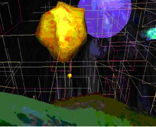
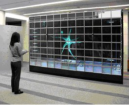
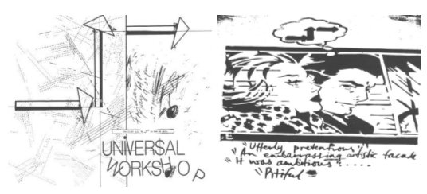
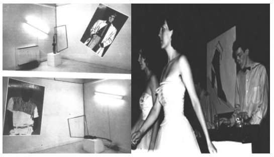
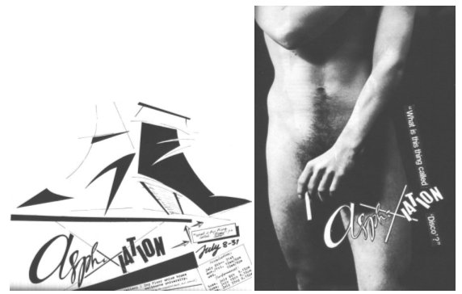
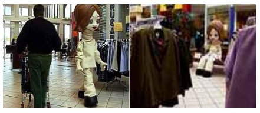
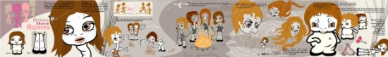
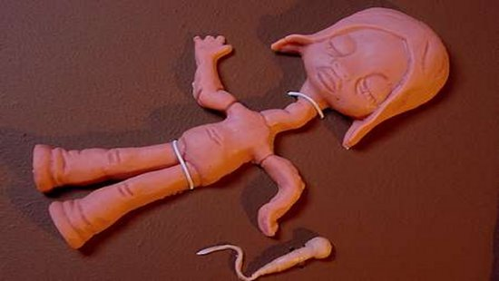
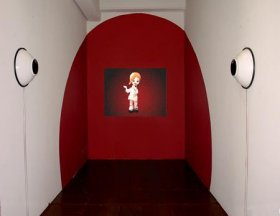
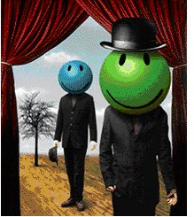

###  & beyond: anticipating distributed aesthetics

**Darren Tofts
 Swinburne University of Technology, Australia** {#para1}

Connectivity, interactivity and displacement have accelerated situations of difference. The social concept of networked communities, which preoccupied us in the ‘90s, has its correlative in a particular strand of aesthetics. Distributed and distributable media have made a significant impact upon the way we think about aesthetic practices generally. The have been especially pivotal in drawing attention to the possibility of different conceptions of participation, of different relations between art work and audience. Online forms of distribution, exhibition and interaction, such as net art and collaborative multi-user environments, are important in that it they have modified the spatial and temporal dimensions of what constitutes an art event and an experience of it. They have been particularly affective in temporal and differential terms, in that the diffusion of location, of both art work and participant, has multiplied the indeterminacy of experiential time. This dislocation of participation from a stable event-time has made the experience of art purely at the discretion of individuals. There is no necessary or prescribed synchronicity of URL and IRL (with the exception, of course, of co-ordinated live webcasts or multi-user immersive art events). Distribution, in this sense, is profoundly temporal, a vector of difference in which there is no common time of participation. This discussion will consider the practices of a number of Australian media artists whose work solicits questions about temporality, distribution and participation. In doing so it seeks to account for a qualitatively different set of relations between aesthetics and consumption under networked conditions. {#para2}

French theorist Nicolas Bourriaud’s ‘relational aesthetics’ emerged in the 1990s as an influential concept for thinking about alternative models of art and spectatorship. Although contemporary with the advent of digital culture and the emergent media art forms of the 1990s, Bourriaud’s work does not specifically speak to conditions of digital, networked culture. Much of the work on which his theories have been based relate to site specific or performative art events that explicitly rely upon audience interaction and participation. However relational aesthetics can be thought of as a useful starting point for thinking about distribution as it applies to networked culture specifically. Relational aesthetics addresses the concept of art being defined by social interaction, by co-ordinated or impromptu acts of participation that may or may not require specific locations in and times at which to occur. In this respect the similarities with distributed aesthetics are striking. Bourriaud is interested in using the concept to ‘decode or understand the type of relations to the viewer produced by the work of art. Minimalism addressed the question of the viewer’s participation in phenomenological terms. The art of the ’90s addresses it in terms of use’ (Bourriaud, 2001). The primal context of use in relational aesthetics resonates in the primacy of the user in distributed aesthetics. This confluence allows us to appropriate ideas from one form of offline art and adapt them to online practices. {#para3}

Bourriaud was working in a theoretical tradition of ephemerality that traversed early twentieth century Dadaists, John Cage’s chance operations, the happenings of Fluxus, performance art and the ‘detournements’ of the Situationists (Randolph, 2003). German artist Joseph Beuys derived the term ‘social sculpture’ or ‘social architecture’ to capture the idea of an audience or participants actively shaping in real time both the art work and its potential meanings. Relational aesthetics assumes the centrality of the spectator and the act of reception as a vital component in the constitution of the work. It asks what in everyday, local terms is possible as art and asks how audience’s negotiate such events as aesthetic experience. Stencil art is as good an instance of the art of ephemerality as you can get. The practice of stencil art, like graffiti, is public, highly visible, organised and sublimely ephemeral. It is here today, gone tomorrow. With respect to relational aesthetics, it blurs the conceptual and political boundaries between what is public art and what is not, what is an appropriate space of exhibition and what is not. The resolution of these contradictions is largely the province of the artists and the observer, as there is no aesthetic or social mandate that marks a stencil as art or someone’s back fence as a gallery. In other words, the relations between artist and audience are negotiable and are played out in unpredictable and unstable conditions. The relevance of such precarious conditions to a model of distributed aesthetics lies in the re-definition of art from being spatial to profoundly temporal. The nature of its consumption is highly contingent not only upon if, but when anyone sees the work, before it is either removed or superseded. In this sense stencil art is like Oulippean literary experimentation — a potential art. {#para4}

The convergence of Bourriaud’s relational aesthetics with the advent of a culture of digital connectivity, with its interactive arts and immersive conditions, has meant that a new or at least revived art of contingency is becoming more conspicuous as the signature culture of the early twenty-first century. Such art posits a very different way of thinking about what an audience is in a nodal culture; a culture contoured by a manifold ensemble of distributed and distributable communications media, from the Internet to ubiquitous multimedia audio-visuality (otherwise misleadingly known as mobile phones). Consider the global phenomenon of flash mobbing. Flash mobbing, according to the Melbourne Flash Mob website, involves ‘sudden gatherings of people at a predetermined location at a predetermined time. People in flash mobs usually perform according to a written script, then disperse quickly’ ([https://www.flashmob.com](https://www.flashmob.com/)). On the 21st August, 2003 seventy Melburnians assembled in an apparently spontaneous manner on the steps of Flinders Street Station at 5.24pm precisely. They donned yellow dishwashing gloves and pointed to the sky before disappearing into the peak hour traffic.[1] A cross between Dada street theatre and a Fluxus happening, this event and myriad others like it occurring everyday all over the world, is grounded in the quotidian rhythms of daily life, such as train travel and being a pedestrian. {#para5}

Co-ordinated by email, SMS and more recently blogging, such events are motivated by a taste for the ephemeral and the absurd. But also a desire to form temporary, ephemeral communities that come into mediated being and disperse just as quickly. Flash mobbing also tells us something about the ways in which people historically relate to and appropriate new technology, such as SMS, to generate unexpected uses of it. American photo-journalist Craig Stecyk made a similar observation in the 2001 documentary film *Dogtown* and *Z-Boys*. In relation to the history of skateboarding in the 1970s, pre-cyber-savvy Californian teenagers used word of mouth and graffiti, rather than cell phones and the internet, to tactically appropriate the built environment of storm-water drains, empty swimming-pools and high school embankments of suburbia. In the process they created a cultural revolution. Today’s culture of SMS messaging works in a similar way in relation to flash mobbing and other networked phenomena such as stencil art to coalesce remote individuals into autonomous and temporary networks of collaboration and participation. But both are in their own ways persuasive instances of William Gibson’s aphorism from *Neuromancer* (1984) that ‘the street finds its own uses for things.’ Referring in the early 1980s to an emergent do-it-yourself culture of appropriation and empowerment in the name of technological literacy, Gibson’s vision is both prescient and retrospective, imagining and recalling spontaneous conditions of social and cultural emergence. {#para6}

Distributed aesthetics are largely associated with online networked phenomena. Melinda Rackham’s *Empyrean* (2000-2003) is an indicative work in this respect. Described by the artist as a ‘soft skinned e_scape,’ a ‘zone of electronically constructed 3 dimensional space,’ *Empyrean* is a vrml world of abstracted presence. It ambiguously locates the immersant (viewer or spectator won’t do here) in a virtual geography that is conceptual as much as spatial. It invites us to consider what it means to be co-present in actual and virtual space, to be simultaneously embodied and represented digitally. The problematic nature of location in the work is an index of its location as a work. While the work is permanently online and always accessible (theoretically anyway), experience of it is discretionary, asynchronous and indeterminate. This is the nature of the internet as space of distribution and exhibition. As an ecology of distance it is, to use Norie Neumark’s phrase, ‘always multiple and relative in its configurations’ (Neumark, 2005: 3). Gallery installations of *Empyrean*, on the other hand (such as at the Art Centre Nabi in Seoul in 2001), are the exception to the rule. Signified as an event and circumscribed by curatorial time, the work and its potential audience very rarely coincide in space in this way. {#para7}

 {#para8}

<table border="0" cellspacing="1" cellpadding="1" width="100%"> <tbody> <tr align="center" valign="top"> <td> 
  Melinda Rackham, Empyrean (2000-2003)
 </td> <td> 
  Photo: Art Centre Nabi, Seoul, South Korea, 2001.
 
 </td> </tr> </tbody> </table>

Australian media artists such as Rackham have been preoccupied with the very idea of an indeterminate and contingent audience as being an integral component of their work, rather than an external observer of it. The notion of audiences being interactive, rather than contemplative or participatory, heightens the basic challenges associated with generating public awareness of and interest in emerging or new arts practices. To encourage audiences to be actively involved in a work is a potentially confronting gesture, since it disrupts a philosophical comfort zone that has traditionally assigned well demarcated roles for audience and art work alike (though such confrontation is, of course, not unique to media art). Such confrontation can be identified in particular experiments in the pre-history of interactive computer-based and networked art, some of which blurs into the conceptual terrain of relational and distributed aesthetics. {#para9}

Philip Brophy is Australia’s leading writer on film soundtrack and sound design, responsible for conceiving and organising *Cinesonic* (1998-2001), a landmark international symposium devoted to promoting the study of sound in film. A practising sound designer for feature films as well as an independent filmmaker and musician, he continues to exert his influence on contemporary media arts practice, especially in relation to the spatial exploration of surround-sound. In the late 1970s and early 1980s, Brophy was doing stuff that, while not overtly suggestive of distributed art as it is conceived today, nonetheless opened up ways of thinking about art and culture that would become indispensable to media arts in the 1990s and beyond. During this time Brophy’s varied interests in film, video, installation and graphics were concentrated around the activities of a band with a deliberately unpronounceable name, signalled by a sequence of three geometrically arranged arrows. Pronounced like an admonitory clicking of the tongue (like the tutting noise made by Skippy the Kangaroo), the band, for convenience sake, was usually referred to in print as *Tsk-tsk-tsk*, or *Tch-tch-tch*. Already, in the title alone, Brophy was messing with our heads, short-circuiting the normative channels of communication and signification with which we go about doing things in relation to life and art. *Tsk-tsk-tsk*’s distinctive symbol had a familiar, ubiquitous presence on the streets of Melbourne during this time. {#para10}

Like a co-ordinate in an orienteering exercise, it signified a terrain being laid out, distributed for exploration. Fliers, bill-posters and other designed ephemera bearing this strange imprimatur announced the imminent activation of a serial work, a decentred performance network (to use a very contemporary term) that would unfold in space and time, in which discrete components could be thought of as linked nodes (to use two more). A live music performance would take place in a suburban laneway at a party in Collingwood or at the Crystal Ballroom in St Kilda, a film or video work would screen in a university cinema a week later, accompanied by a printed text and an LP or EP, both produced independently through Brophy’s *Stuff* publications imprint and Innocent/Present recording labels. This was a combinatory poetic that generated an unknown, indeterminate audience who were familiar with the *Tsk-tsk-tsk* concept and were prepared to be collaborators in a multimedia circuit of reference, performance and participation. Attendance at an installation or screening, acquiring and reading a text, purchasing a purpose-made record, were conscious choices to participate, to play a role in a kind of rendezvous-art experience. The integration of diverse media elements into what could loosely be called ‘the work’ was entirely the province of an indeterminate audience, as was their understanding of its potential meanings. {#para11}

Take “What Is This Thing Called ‘Disco’?”(1980). For this critical investigation into the structures and meanings of disco music (which had rivalled punk as a phenomenon of the late 1970s), Brophy conceived of exploring this question through a series of multimedia iterations. Part of this process was the invention of Asphyxiation, a fictitious pick-up band for the occasion. Asphyxiation conducted a series of musical performances, featuring singing and dancing, at an installation at the George Patton Gallery at Melbourne University. The physical installation was interpreted as a minimalist space with musical instruments set out as sculptures on plinths, fluorescent tube lighting on the walls, as well as a series of stylised silk-screen images depicting the clichés of disco fashion. A monotonous soundtrack reinforced the idea of the gallery as an other space, a ‘Disco’. {#para12}

Brophy deliberately circumscribed the word in inverted commas to register the fact that the entire installation was a reflexive commentary on the audio-visual language of disco as a musical form, as well as a confrontation of its cultural meaning as ‘the most recent and prolific enigma yet to seduce the mass-market.’ A detailed program note, which was more of an essay, added a deeper, analytical dimension to the installation and live performances. A record, made by Asphyxiation, entitled “What Is This Thing Called ‘Disco’?” was released by Innocent Records. The entire project, under the title of “What Is This Thing Called ‘Disco’?” was not a unified thing to be encountered and consumed. It was a kind of epiphenomenon and, in general terms, was indicative of the many other projects that *Tsk-tsk-tsk* conceived around themes ranging from muzak (*Venetian Rendezvous*, 1978) to rock and roll (*Nice Noise*, 1978). It presumed the interaction of a co-ordinating agency that was beyond the artist, fictitious or otherwise, that cohered a series of related, contiguous media events into a conceptual, if not material whole. {#para13}

To name the band you had to make a commitment to collaborate in the pervasive circuit of reference, performance, publication and multi-media events that constituted the *Tsk-tsk-tsk* cultural program. Knowing that it was something to be spoken was the germ of a poetic involving signs and acts of interpretation. In this respect the significance of Brophy’s exploration of collaborative poetics was noted by Paul Taylor, one of Australia’s leading art and cultural critics of the time. Writing in 1981 in the first issue of *Art+Text* magazine, Taylor discussed *Tsk-tsk-tsk* as an example of what he referred to as ‘Australian New Wave’ (Taylor, 1981). Drawing on Roland Barthes’ notion of the ‘second degree,’ Taylor outlined an artistic style that exploited quotation and repetition, the self-conscious use of familiar, usually subcultural images, sounds and meanings. For Taylor, this style was made for an audience literate in the information flows of mass media, an audience highly receptive to cultural signs and the relations between them, as well as their own relations to them. His general theoretical account of the connections between artist, spectator and work uncannily brings to mind models of interaction with which we are very familiar today in the context of relational and distributed aesthetics:

> In the realm of the “second degree,” those abstract relations which connect the artist and spectator to the artwork are organised around a sense of participation wherein the spectator’s role is openly affective. There is a recognition that the work is incomplete without the spectator and that its meaning exists externally – in the space of language and culture (Taylor, 1981: 24). {#para14}

Brophy had an intuitive understanding of the ways in which different combinations of media can galvanise an audience into unique modes of participation. But more crucially, he wanted to liberate the concept of what art could be by moving away from the singular idea of the art object— arguably the defining characteristic of what we refer to as distributed aesthetics. In so doing he opened up new ways of thinking about audience interaction. What he has called ‘post-object art’ refers to the replacement of art, as a privileged, identifiable, graspable thing, by gatherings or accumulations of events, performances and other methods (Brophy, 1988: unpaginated). Works such as “What Is This Thing Called ‘Disco’?” exemplified a genuine intermedia practice in which there were no boundaries limiting what could be possible in the name of an art event. He also conceived of the idea of intermedia installation as a spatio-temporal concept years before Nicolas Bourriaud conceptualised the idea of relational aesthetics in the late 1990s. {#para15}

By the late 1990s the idea of audiences interacting with serial, distributed media that provisionally formed the basis of the work, was becoming very familiar and more recognisable within popular culture as much as media arts practice. Consider the exploitation of trans-media in the film industry. By this I mean the way in which a feature film is promoted as one element in a series of related media events. A case in point is *The Matrix Reloaded* (2003). Already part of an ongoing sequence of films (*The Matrix* before and *The Matrix Revolutions* after), *The Matrix Reloaded* was released as part of an ensemble of media that broadened the context of the film into a cultural event. Notwithstanding the now standard accompaniments of soundtrack and interactive website, the film was linked to a console video game, *Enter the Matrix*, as well as a series of nine short animated films, the Animatrix, representing different stories set in the hyperreal world of the Matrix – both of which are promoted on the official Warner Brothers web site as an integral part of the overall Matrix experience. Of course there is a commercial imperative here, despite the somewhat twee overtures to an essential narrative dimension to these other media (‘without the game, you won’t see the entire *Matrix Reloaded* story’). But despite the obvious couching of commercial expedience in terms of cultural innovation, such spin-offs reveal how pervasive the idea of interaction and extended distribution had become within popular culture as a whole. {#para16}

Nor, for that matter, was it confined to commercial cinema. Art-house cinema, too, had embraced the potential of interactive media as a means of heightening and extending the audience’s involvement in the film, which is now reconfigured as something more like a personal aesthetic choice to commit to a work over time— a commitment once reserved for the great romans a clef of literary modernism, such as Proust’s *A la Recherche du Temps Perdu*, Joyce’s *Ulysses* and Kakfa’s *The Castle*. Peter Greenaway’s *The Tulse Luper Suitcases: a personal history of uranium* is an audacious attempt to utilise the “new visual languages”, such as the Internet and other interactive, distributable media, to create a complex multi-text that unfolds over time. A serial work par excellence, aspects of the narrative and the projects of the eponymous hero were introduced and archived on [www.tulselupernetwork.com](https://www.tulselupernetwork.com/), then developed more extensively in the first of three feature film releases in 2003, as well as in forthcoming television programs, print, CD-ROM and no less than 92 DVDs (92 being the atomic number of uranium). Still an ongoing work in progress, *The Tulse Luper Suitcases* will surely test the outer limits of interaction and distribution, even in a culture apparently besotted with the concept. {#para17}

The limits of tolerance and involvement have also been put to the test in media art works. Sometime in 2001 a strange, cartoon-like character took a disquieting stroll through a suburban shopping centre in Melbourne. The presence of this clearly artificial entity was heightened by its exaggerated features and its slightly melancholy, lost look. This was Leanne, the lead singer of a fabricated all girl pop group called *Household Names*.

The creation of Martine Corompt, *Household Names* first appeared on the scene in 2000 in a work of the same name that traced the rise and fall of the musical aspirations of a group of disillusioned yet ambitious young girls. *Household Names* explored issues to do with transformation and the pressure to alter physical appearance in order to make it big as a ‘household name’ in the pop music industry. For Leanne and the other members of *Household Names*, such change meant mutation and desperation, a radical deformation of everything they had been. This is reflected in the various representations of their synthetic rise and fall from fame on Corompt’s website, in the form of Margaret and Walter Keane waifs, gelflex sculptures and comic book characters. Their sense of confusion with the cost of such change is directly expressed in the subsequent work, *This is My World* (2001), in which Leanne made her transubstantial appearance at Northcote Plaza shopping centre in Melbourne’s north, leaving the digital world of the computer and the gallery installation behind. {#para18}

Corompt’s development of these characters and the exposure of their saga under the collective, decentred network of events that make up *This is My World* is suggestive of the kind of audience integration described in relation to the work of Philip Brophy. It is both relational and distributed; a hybrid media event of offline and online components. Interactivity for Corompt is interpreted in terms of bringing two worlds into unpredictable connection, enmeshing an audience into an impromptu encounter of unformatted outcomes in which they must, conceptually at least, play a role. The interactive component of the work involves the unwitting ‘audience’s’ encounter with this dislocated lost soul and their attempts to understand its presence or avoid it altogether, as she walks aimlessly around the shops or sits in wide eyed silence on a bench, holding her preposterously large, hydrocephalic head upright. Corompt, a.k.a Leanne in mufty, has commented on the strangeness of this encounter, of a general discomfiture as people avoided even acknowledging that Leanne was there. This irresistible and unwitting engagement of the audience in a performance is an example of what Shiralee Saul has called ‘audience manipulation’, a reversal of the usual spectator/performer relationship whereby the audience feels under scrutiny, involved in an experience not of their own making (Saul, 2003). {#para19}

By taking Leanne beyond the interface of the screen, Corompt opened up a space of engagement in which less obvious, unseen modes of interaction between work and viewer can be explored. The response Leanne received during her walk around Northcote Plaza is telling: ‘It was strange, nobody paid any attention to us. They would look away, no one wanted to be involved. They thought that it was a set-up, like Candid Camera, and no one wanted to make a fool of themselves in public’.[2] Leanne’s presence at Northcote Plaza was out of place, disjunctive, unnerving. Yet this indeterminate coming together of events is suggestive of the differential relations of distributed and relational aesthetics. It manifests an unexpected new ground in which the event, the avatar and the audience occupy a temporary space of uncertainty, dislocated from the normative stabilities of things being in their appropriate place. The wonderful irony of the title of this work – *This is My World* – implies a metaphysical boundary dispute over terrain, as well as a politics of difference. But it also resonates with an unresolved uncertainty: whose world is it and what am I in it? {#para20}

Such indeterminacy is the nature of distributed aesthetics; not everyone will experience the same thing. Nor, for that matter, is it guaranteed that any one person will experience every trace within a distributed art event. I wonder, for example, if anyone can truly say that they scoured every item in the excessive and delirious volume of ephemera assembled in Nat and Ali’s installation *not only, but also*, *honk for art* in the 2004 exhibition at the Ian Potter Gallery in Melbourne. It is in the nature of relational aesthetics that participants will encounter difference and that the nature of participation will be different for everyone. The same is true for distributed media, from hypertext fiction to multi-user domains. This is the conclusion drawn by Daniel Palmer in his extensive discussion of the logic of participatory media culture (Palmer, 2004). Palmer persuasively argues that the cultural phenomena of contemporary media – reality television, cable tv, digital games, media art – have given rise to qualitatively individualistic modes of viewing and consumption. For Palmer what is at stake is a shared sense of time and participation. The public sphere of common engagement has been ruptured by massive privatization and a proliferation of available viewing times and discretionary options to individuals. The same can be said of networked or distributed media. The notion of shared frames of reference and the possibility of viewing or interpretive communities are redefined in terms of personal experience and a new individualism, in which the collective and socially discursive context of art is a discretionary option.[3] And in the context of a convergence of relational and distributed aesthetics, a potentially accidental option at that. {#para21}

Consider what must surely be one of the strangest performances ever staged on the Internet. In 1997 in Crested Butte Colorado a group of conference delegates at the Digital Storytelling Festival sat in a theatre watching a projected image of an Internet chat room. The room in question was The Palace, one of the first graphic-user interface chat environments that succeeded the text-only domains of the early 1990s. The delegates were watching Samuel Beckett’s *Waiting For Godot* being performed in real time in a virtual room in the Palace (appropriately called the ‘Waiting Room’). Here was the commingling of a collective, dedicated audience, congregated in the same place at the same time to watch a specified event, with an indeterminate, remote and decentred audience of online lurkers who may or may not have been aware that they were in fact an audience, watching an online drama unfold. Furthermore, many of the telepresent inhabitants of the Waiting Room would have been unaware that they had become performers in a meta-drama of recursion. Like the play-within-the-play in *Waiting for Godot* (when Vladimir and Estragon watch Lucky and Pozzo perform), the very mix of determined and indeterminate spectators of the play in the Palace was for the Colorado audience part of the spectacle itself. Watching an online performance of *Waiting For Godot* was an instance of the larger inquiry into net invention, the critical investigation of the creative uses of online spaces such as the Palace. Scott Rosenberg, writing of the event, observed that in a ‘post-performance discussion, the performers and their audience came to the same conclusion: the hovering possibility of interference – the ever-present threat of street-theater-style interference – was precisely what was most compelling about the show’ (Rosenberg, 1997). This had been dramatically confirmed by the fact that casual passers-by, who happened upon the Waiting Room, insinuated themselves into the performance. Rosenberg points out, with great pleasure, that at one point an avatar named Muscleman (‘a recumbent beefcake model straight out of a men’s underwear ad’) interrupts one of the official actors with the question, ‘Why are you waiting for him, anyway? I forgot.’ And who said nothing happens in *Waiting For Godot*? {#para22}

Distributed and relational modes of art represent different ways of conceptualizing communities, but they do so at the expense of some historically entrenched assumptions to do with the social nature of participation in the artifacts of cultural production. Such theories have been pivotal in enabling the articulation of different kinds of aesthetic theory, of aesthetic theories of difference. For better or worse, this has been especially important in the context of the clarion call of the late 1990s for appropriate paradigms with which to discuss and critically evaluate things such as net art and collaborative online networked media events. The shift from fixed location, public gallery-based art to ambient, distributed and customisable art continues to exert pressure on the practice of criticism. Within the network of distributed aesthetics, strange, unpredictable attractions can, as we have seen, emerge between spectator and spectacle. But even stranger relations can take place between critics and readers, especially when there is no shared basis of familiarity with the work (let alone understanding or critical appreciation). In this the aesthetics of distribution are indicative of our changing habits of consumption as much as our changing conception of what art is and can potentially be in a networked world. {#para23}

### Author’s Biography

Darren Tofts is Chair of Media and Communications, Swinburne University of Technology in Melbourne. He is a well-known cultural critic who writes regularly for a range of national and international publications on issues to do with cyberculture, new media arts and critical and cultural theory. His latest book, *Interzone: Media Arts in Australia*, is published by Thames and Hudson (2005). He is the author (with artist Murray McKeich) of *Memory Trade. A Prehistory of Cyberculture* (Sydney, Interface Books, 1998) and *Parallax. Essays on Art, Culture and Technology* (Sydney, Interface Books), 1999. Formerly an editorial correspondent for *21C* magazine, he is a member of the editorial boards of *Postmodern Culture*, *Continuum*, *The Australian Journal of Media and Culture*, *fibreculture journal*, *Rhizomes* and *RealTime*, where he is a commissioning editor for new media arts.

**Notes**

[1] For an image of this event, see [https://www.theage.com.au/articles/2003/09/01/1062403447291.html?oneclick=true](https://www.theage.com.au/articles/2003/09/01/1062403447291.html).

[back]

[2] Martine Corompt, quoted in Saul, 2003.

[back]

[3] See Darren Tofts, ‘f2f 2 url & b ond: space/time and the dissemination of community’, Transformations: Online Journal of Region, Culture and Society, (December, 2005), [https://www.transformationsjournal.org/journal/index.shtml](https://www.transformationsjournal.org/journal/index.shtml).

[back]

## References

Bourriaud, Nicolas. ‘Public Relations: Bennett Simpson Talks With Nicolas Bourriaud’, *Artforum* (April 2001). Reproduced online at [https://www.findarticles.com/p/articles/mi_m0268/is_8_39/ai_75830815](https://www.findarticles.com/p/articles/mi_m0268/is_8_39/ai_75830815).

Brophy, Philip. ‘The Non-Event of Sound in Video Art’, Scan 1, (August, 1988), reprinted in *ReStuff*, ‘Media, Theory, Technology’ (1991): unpaginated.

Flashmobs, [https://www.flashmob.com](https://www.flashmob.com).

Neumark, Norie. ‘Relays, Delays, and Distance Art/Activism’, Introduction to Annemarie Chandler and Norie Neumark (eds.) At *A Distance: Precursors to Art and Activism on the Internet* (Cambridge, MA.: MIT Press, 2005): 3–24.

Palmer, Daniel. ‘Participatory Media: Visual Culture in Real Time’, PhD thesis, University of Melbourne (2004). [https://eprints.unimelb.edu.au/archive/00000125](https://eprints.unimelb.edu.au/archive/00000125).

Randolph, Sal. ‘Notes on Social Architectures’, (March 2003), [https://www.highlala.com/projects/socarch.html](https://www.highlala.com/projects/socarch.html).

Rackham, Melinda, ‘empyrean:soft-skinned space’, [https://www.subtle.net/empyrean/](https://www.subtle.net/empyrean/).

Rosenberg, Scott. ‘Clicking for Godot’, *Salon*, (October 2, 1997), [https://archive.salon.com/21st/feature/1997/10/02godot2.html](https://archive.salon.com/21st/feature/1997/10/02godot2.html).

Saul, Shiralee. ‘Review of *This is My World*‘, ABC Online, (2003), [https://www.abc.net.au/arts/digital/stories/s474111.htm](https://www.abc.net.au/arts/digital/stories/s474111.htm).

Taylor, Paul. ‘Australian “newwave” and the “second degree”’, *Art + Text* 1 (1981): 23–32.

Images Courtesy of Melinda Rackham, Philip Brophy, Martine Corompt and William Duke.
