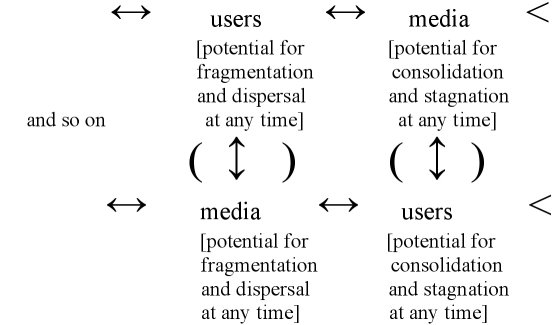

“Distributed aesthetics: form or forming?” We are moving from living, analysing and imaging contemporary culture as an information society technically underwritten by the computer, to inhabiting and imagining relays of entwined and fragmented techno-social networks. New media are increasingly distributed media and they require a rethink of aesthetics beyond the twinned concepts of form and medium that continue to shape analysis of the social and the aesthetic.[1] They require a distributed aesthetics. Distributed aesthetics must deal simultaneously with the dispersed and the situated, with asynchronous production and multi-user access to artifacts (both material and immaterial) on the one hand, and the highly individuated and dispensed allotment of information/media, on the other. The aesthetics of distributed media, practices and experience cannot be located in the formal principles of their dispersal. This provides us with the conditions for serving information via a network to end-users and renders the following reductive schematisation, recalling all the problems of a communications systems transmission model: {#para2}

SERVER –––––––––––––––––––– NETWORK –––––––––––––––––––– CLIENT

Nor can we simply derive a distributed aesthetics from the viewpoint of use. There is no singular or “end use” of/for information but rather the endless relaying of media, practices and experience as successive dispersals. These loops of dispersal give us something closer to the mechanics of formation than the analysis of form: {#para3}

But in both these schematisations, “the network” looms, either as the “black box” to be explained in the first diagram or as something interstitially forming – loose, unpredictable and unprincipled, as implied in the diagram above. A distributed aesthetics, then, might be better characterised as a continuous emergent project, situated somewhere between the drift away from coherent form and the drift of aesthetics into relations with new formations, including social (networked) formations. {#para4}

At any rate, networks cannot be studied as mere tools or as schematisations and diagrams. They need to be apprehended within the complex ecologies in which they are forming. This can easily become an empty statement. By complex we mean unpredictable, often poor, harsh, and not exactly “rich” expressions of the social. To project positive predictions, hopes and desires onto networks is deceptive as it often distracts by focusing solely on the first, founding and euphoric phase of networks. Consequently this positivism is ill-equipped to deal with the conflict, boredom, confusion, stagnation and other expressions of our playful nihilist culture that turn up in unmoderated channels such as lists, blogs and chatrooms. If we call now for a distributed aesthetics nonetheless, this needs to account for these experiences of stagnation within network formations and for coupling these networked experiences with a network’s potential to transform and mutate into something not yet fully codified. {#para5}

“The map is not the network.” If we began first with a question and now follow with a gesture of negation, this is precisely because “the network”– so opaque, so ubiquitous and non-formal – is, however, recruited to serve various strategies of representation. Maps of networks abound: software for visualising criminal networks such as ‘PatternTracer’, is easily available online; an entire discursive field – social network analysis – has arisen around the mapping of networks from corporate to terrorist; the noncartographic specialist can now log on to an entire ‘Map of the Internet’ and drop in and link his or her own computer address as a 3-D visualisation in the network of all other addresses.[2] Richard Rogers suggests that mapping networks, especially as an intelligence task, carries with it more than just an aesthetic outcome; we are in the midst of a techno-epistemological impulse in which the form(at) of the map has a structuring effect on how we understand the organisation (structure) and dynamics (movement) of networks (2003). {#para6}

Theorising networks (as opposed to these tasks of network visualisation) must struggle with the abstraction of dispersed elements – elements that cannot be captured into one image. The very notion of a network is in conflict with the desire to gain an overview. Mapping software, the technological answer to this problem, by its own nature reduces complexity in order to produce a limited amount of general categories, which then can be stuck onto the map and linked. The art of network visualisation deals with limitations of the screen, algorithms and the boundaries of human perception. We can only read – and understand – that many linked elements. Maps make visible what we have already “sensed” before. Maps provoke a sense of recognition. And network maps may also organise our perception of a social in formation without being forthright about the premises upon which this organising impulse rests. What network mapping exposes is a desire to be in the know: ‘a way of coming to know and making particular claims only with a technological apparatus that desires to grow to satisfy its cravings for “really knowing” and, especially “really knowing what our” intelligence also knows or should know’ (Rogers, 2003). Mapping information ­– the aesthetics of contemporary visualisation – provides a sense of relief that the twisted and unstructured info-bits that roam around in our cognitive unconscious are finally laid-out to rest. A beast is tamed. {#para7}

Network mapping itself underwent a significant shift in geometry and visualisation around the late 1990s (Dodge and Kitchin, 2000: 107-128). As we moved from the superimposition of flows onto geo-political space toward the abstraction of topology, similarly our understandings of what comprised networks shifted. We became interested in relations, dynamics and sociability as opposed to traffic, connections and community. This change in network mapping visualisation has had advantages and disadvantages – we are now aware that networks are different kinds of formations that cannot be understood according to the old distinctions between society (Gesellschaft) and community (Gemeinschaft). But the increasing abstraction of topological visualisation removes us from an analysis of the ways in which networks engage and are engaged by current political, economic and social relations. {#para8}

Maps reveal the ways in which we perceive things to “be” at a given historical time. The Mercator Map (circa 1569), now analysed from a moment “post” its particular “portioning” of perception along a colonial set of axes, reveals what was at stake politically and economically in making the world run according to a north-south cartography. Perhaps network mapping will similarly reveal the logic of its own will to tame complexity, to make the flows of a network society traceable. It could be more interesting, then, not simply to look at the map but at what desires network mapping is trying to satisfy. If cartography has in the past been linked to imperial conquests of space, what space is there left today to conquer; the space between the nodes or even the space of all potential connections and links to be made? Just as network formations are indications that an unstable reshuffle of the categories for understanding socialities is playing itself out, mapping this rearranging sociality indicates an aesthetics at work to order more rampant and mutant forms of social relations from emerging. It is not surprising that the impetus for network mapping arrives today from the social sciences, on the one hand and from the analysis, tracking and tracing of crime, on the other (see Granovetter, 1973: 1360-1380; Williams, 2001). We ought also to be suspicious about the pervasive Will to Network Mapping. {#para9}

“The Fou-Code”. Over the past couple of decades aesthetics has been extended, stretched and turned upside down from a discipline that deals with the interpretation of the meaning and structure of the object of beauty into a philosophical praxis that investigates the very conditions of contemporary life. Aesthetics is not the science of “eye-candy”, in which taste is reduced to a matter of mere statistics and samples of information. What we must investigate here instead is the “aesthesia” of today’s networked experience. How do we perceive the socially invisible, yet all too real, relationships that are accumulating around us? Distributed aesthetics, as a project, needs to be understood as a participatory journey of network users, aiming to capture the not yet described, the not yet visualised, beyond poles such as real-virtual, new-old, offline-online and global-local. We should forget about exposing the links that are already there, and, with our capacity to engage a networked logic, forge links to what is in the network but not yet of the network. By this we mean to invoke a project more akin to social aesthetics or aesthesia in which we engage in and with the collective experiences of being embroiled in networks and being actively part of their making. This we can contrast with the abstracted activity of simply mapping quantities of data – such as social network maps – a form of production already captured by the codes and conventions of connectivity. {#para10}

We don’t need allegorical readings of networks. Networks are not proposals, constructions, metaphors or even alternatives for existing social formations such as the church and company, the school, the NGO or the political party. Instead, we should analyse the rise of networks as an all too human endeavor, as a tragic fall, and not as post-human machines that automate connections for us. Networks are not the answer to global problems nor are they a substitute for forgotten religions or disintegrated communities. Networks are not models to be transposed from one social or political situation or conflagration to another. It is certainly the case that technology provokes networking. But then this provocation is not the be all and end all of the network. We should be wary of techno-contractions like “social software” that suggest technology glues us humans together (again).[3] Instead, we should read – and enjoy – networks as info-clouds that cover the sun. They disperse the bright light of broadcasting media. {#para11}

Networks are fragmentors. They break up strong signs and experiences into countless threads. These info-bits might in themselves be meaningless but the overall sum of them provides enough distraction to topple the attention monopoly of newspapers and television. This is not done through the classic activist strategy of building up parallel counter worlds. Lists, blogs, chatrooms and other “social networks” are the “long tail” of the media landscape (Anderson, 2004). Networks do not therefore burn-off the media, taking centre stage and continuing to provide the background noise of the chattering classes. It doesn’t matter how big they grow. Instead of anticipating a “takeover” by the corporate sphere and attempting to protect networked and locative media from demise, it is more than likely that business interests will integrate selected parts of the blogosphere. The rest of this online “noise” will probably fade away into digital oblivion. In the meantime blogs, wiki, podcasting and whatever comes next will continue to run under the rubric of media diversification. Nothing is as fluid, fragile – and unsustainable – as today’s network landscape. {#para12}

In the meantime, we could treat the info-bits that flow our way as short-term solutions to the environmental crises brought about by the breakdown of both massified media outlets and dedicated high-end digital aesthetics. Data are flowing from peer to peer, in networks hardly noticed by authorities. But before the law moves in – and with it, the academics – the crowds will already have moved on to cooler pastures. Let’s not invest some salvation in all of this distribution. Distributed media are both too loose and too large to build a new utopia upon. Their fragmentary nature will have effects but we cannot link them to a “cause”. We may be unable to house the endless link lists, unanswered calls and emails, cute blogs and stagnant conversations under the banner of complete social and media transformation. But we will nonetheless have to find a mode of comprehending their everyday perceptual accretions; the ways in which they make small changes to our social relations with others and with broader groupings such as the media. {#para13}

“Dead shoots and roots.” What network theory, and with it distributed aesthetics, first and foremost need to tackle is the myth of seamless and perpetual growth. Once upon a time, during the golden dotcom days, it was an insight to present networks as dynamic, ever-growing entities. These days, we have moved to obsessively focussing upon the micro politics of networks within networks (see Krebs, 2003; Muir, 2003) It’s impressive but useless to know that your social network puts you in connection with 371,558 “friends”. 1 + friends is simply an effect of a network, not its constituent relations.[4] The social scientists almost reveal the desires that shape their own trajectories around “social and organisational network analysis” with their talk of “ego-centric” networks. The micro has become awash with the atomised individual and we waste our capacity to comprehend the shapes or shaping of networks by plotting out the link lines of one node to another. In actuality, these lines that appear so connected, seamless and smooth on the network maps, can never account for the human labour required to create the link, to maintain it or the sudden death and change of direction for a network in which strong lines give way and the network changes, even dies. Rhizomes, in fact, have odd shapes and are actually small roots that die off at some point in their lifeline. The problem with a naïve cloning of Deleuze and Guattari’s botany in the networked context lies with a commitment to “growth”. This involves a blinding by the potentialities that the network-as-dream-machine would seem to offer. Here the network and info-capital converge rather than produce friction, complications or even poisonings. Instead, we could say that growing could mean not simply expansion but growing up. There is plenty of quantity in the mediascape and so to simply grow without changing or even dying only multiplies or clones more networks of connected atomised units. What networks need are ideas and aesthetic projects for how they might mature and transform. {#para14}

Let’s draw a difference between growth and persistence. Growth feeds the lifecycle of capital and capital loves any kind of growth – upwards, downwards or outwards. Persistence, on the other hand, apprehends that something doggedly survives but that its growth or decay depends on other forces, conditions and upon effort. Bits of the network break off and wither and maybe something can endure elsewhere because of this little death. But maybe the whole damn patch of grass just ups and dies one day, and then there is no longer a network in your backyard. Online social formations are more like these small tendrils of growth that shoot and die – the list, for example, lives for a while as its members try to feed it. They work to shape and develop it, providing it with new impetus while the overall form just lumbers along. But then its energy burns out and there is no more growing left to do. Something endures between some of its participants or another effort starts up elsewhere but then that something, that network, has changed too. These processes are not all part of the same growing “organism” or self-organising system. Attempts to homogenise or sustain processes as a singular drive towards growth are endemic to capital. The processes are, instead, lateral, cumulative and de-energised modes of laboring, also endemic to capital but, for the most part, the unpaid arc of its cycles. {#para15}

“Against biologism.” Networks do not simply emerge. They are cybernetic constructs that, once founded and installed, erupt then slumber and decline, go on and on, fall asleep and wake up again before they die a sudden death or entropically decline. Networks do not follow the simplistic models of linear-mechanics or of evolutionary growth. A critical theory of scalability and sustainability has to go beyond the biological metaphors that speak of contagion, copy-paste epidemics and memes. We have to make a distinction between real, existing patterns and behaviors within technical networks and the wet dreams (or nightmares) of marketing departments trying to give a positive spin on the unpredictable moves of their blogging customers. {#para16}

Complexity – of data, of connectivity – has been rolled out an excuse for technical and cultural phenomena being too hard to comprehend. Subsequently, it figures that we have to feed all this complexity back into the machine to be analysed. Numbers are too hard so we get a picture instead. Complexity should not be an excuse for deferring the work of human thought and human creation – theoretical and aesthetic – to network software. Complexity is difficult and arduous but not aesthetically unmanageable. Let’s not cede the complexity of networked life to proceduralism. If we want suggestions as to how this complex networked aesthetics might be rendered, then let’s look less to maps and more to sketches and rough that infer a category of “the relational” comprised of potentialities. This would be somewhat different from framing relations within reductive models of utility or connectivity. Let’s look instead to work such as Harwood’s current software research NetMonster ([https://www.scotoma.org/notes/index.cgi?NetMonster](https://www.scotoma.org/notes/index.cgi)). Here variable keywords related to a user’s current image interests or obsessions are used to initialise a crawl for sites that contain text or images related to these keywords. The crawl returns these sites as stripped text and pictures, rearranging these around an image mask based upon the user’s current image obsession, collaging and redrawing the information so that it butts up in convoluted lines of connection against itself. {#para17}

The links that connect the text and image together in NetMonster’s re-collaged information arise out of a differential between what is pre-linked online – the image’s ‘mediated causes of its own existence’ – and the variables a user introduces into these connections via the mask and the keywords (Harwood, 2005a). There are other aspects to this software in which the crawler automatically attempts to spam the phone numbers and emails from the garnered sites, alerting people to ways in which their information has participated in a link or connection against ‘common sense’. There is an anti-navigational and irresolvable aesthetic oscillation that results from this work. Its informatic rendering is monstrous, rampant and pathological rather than friendly or sociable. As Harwood suggests, the image functions in the unimaginable spaces and indeterminate relations of distributed information: ‘The picture acts as a proposition – frustrated – oscillating between a picture’s ability to say and show’ (Harwood, 2005b). {#para18}

We need a more complex conception of the network sociality than the concept of “social software” that is currently attached to descriptions of networks of friends or lovers in an online dating database. We need a more complex understanding of the visual plane of information than the pictorial map of the network. Networks are not glued together by software and software does not make us social. Networks are not resolvable into zoomable details of landscapes that must fit the window of a browser. But equally we cannot take the social out of software; in fact, what we need is to be more specific about how the social and its myriad aesthetics are operating through and in software. How is a network really being sustained – computationally and through creative labour? How is the network experience to be thought as felt? Whose labour – creative, manual, skilled, disorganised, etc – keeps it moving along? What intrusions of rhetoric from other images of the social – neo-liberal democratic theory and its dreams of customised participation, for example – break into and intrude upon the fragile links that tentatively form within networked experience? {#para19}

“Absent links”. Networks should not be defined by the visible links they place on display. Getting “linked in” a network is not materialised through (digital) information. This is what makes it so fake to “ask” a computer to visualise a network or to “believe” in link lists. “Putting” a link in is work, a tedious activity, which requires precision and dedication. Only very few of us develop a routine that leads us to the “felt experience” of linking in the network; an experience that is mixed – one of curiosity coupled with distraction and a drift, off in other directions. Today’s networked existence hops from one medium to the next and then demands that we return back to our links in order to put in the work of connecting again and again. {#para20}

We are in search, instead, of an aesthetics that comes to terms with conflict, boredom, confusion and stagnation – one that includes social complexity (as opposed to bio-complexity). At the same time, we are dealing with a non-visual aesthetics with respect to networks or at least a visual that is not pictorial, that cannot be depicted as such. What kind of aesthetics, then, does the network herald? We should not forget that our debates are not entirely out of the blue and respond to certain software configurations – which can be changed. A future generation of blogs may not have the option to externally respond to postings anymore. Due to spam, wikis could lose their capacity to alter texts. At the same time, we could see impressive new incorporations of data flows now circling around inside mobile space. These configurations are not merely technical innovations or developments. Software-wise they are easy to write and to implement. Their innovative power does not lie in the complexity of code but in the simplicity of their techno-social implementations. This “simplicity” comes from many directions and forces at once – efficiency, standardisation, commercial viability, but also from user circumvention and invention. We’re not merely reflecting, imaging or imagining when we engage a distributed aesthetics. We are configuring and remaking. {#para21}

## Authors’ Biographies

Geert Lovink is a Professor in Media at the University of Amsterdam and during 2005-6 is a Research Fellow at the WissenschaftKolleg zu Berlin. He is the author of My First Recession (V_2 Publishers, Amsterdam, 2003) and Dark Fiber (MIT Press, 2002). He is the co-founder of the fibreculture and nettime discussion lists and networks. He is also the director of the Institute of Network Cultures. [https://www.networkcultures.org](https://www.networkcultures.org)

Anna Munster is a new media artist and critic, Senior Lecturer in the School of Art History and Theory, College of Fine Arts, University of New South Wales, Sydney Australia. She is the author of Materializing New Media (University Press of New England, 2006). She is a facilitator of the online discussion list fibreculture and a member of the editorial committee of the fibreculture journal. She was the recipient from 2003-2005 of an Australian Research Council Discovery Grant.

## Notes

[1] The most complete contribution of a formalist analysis of new media is made by the work of Lev Manovich. This is evident in his book The Language of New Media (Cambridge, Mass.: MIT Press, 2001), where he proposes a set of formal principles for the analysis of new media but also in more recent texts, such as ‘The Shape of Information’ ([https://www.manovich.net](https://www.manovich.net), 2005). Although Manovich does not maintain that new media can be analysed through a universal form or aesthetics, the question of emerging forms of culture driven by information as process and flow drive the theoretical trajectory of his work. The medium specificity approach is best exemplified in a text such as Janet Murray’s ‘Inventing the Medium’, her introduction to The New Media Reader, eds Noah Wardruip-Fruin and Nick Montfort (Cambridge, Mass.: MIT Press, 2003), 3-29.

[back]

[2] ‘PatternTracer’ is a software package for professional crime investigators that analyses and maps to, ‘quickly and automatically uncover clusters and underlying patterns’, ‘Product Overview –i2: Investigative Analysis Software’ ([https://www.i2inc.com/Products/Pattern_Tracer/default.asp](https://www.i2inc.com/Products/Pattern_Tracer/default.asp)). Valdis Krebs’ (2001; 2003) is the most obvious example of recent work being conducted in the field of social network analysis and was responsible for “mapping” the network of pilots and hijackers involved in the World Trade Tower attacks on September 11. The Web site for the ‘Map of the Internet’ is at [https://mapoftheinternet.com/](https://mapoftheinternet.com/).

[back]

[3] There is no standardised usage or understanding of the term “social software”. It is deployed by marketing executives and radical software analysts to categorise two polarised vectors in networks ­– the social and collective understanding and production of distributed software and the deployment of software to produce social ties between individualised subjects. Our concern with a use and elaboration of the socio-technical lies with this latter deployment. See, for example, the article by Stowe Boyd ‘Are You Ready for Social Software?’ in Darwin: Information for Executives, May 2003, [https://www.darwinmag.com/read/050103/social.html](https://www.darwinmag.com/read/050103/social.html).

[back]

[4] See particularly the ‘Friendster’ network, which aims to ‘make the world a smaller place by bringing the power of social networking to every aspect of life, one friend at a time’ (‘About Friendster’, [https://www.friendster.com/info/index.php?statpos=footer](https://www.friendster.com/info/index.php)).

[back]

## References

Anderson, Chris. ‘The Long Tail’, Wired 12.10, October (2004),

[https://www.wired.com/wired/archive/12.10/tail.html](https://www.wired.com/wired/archive/12.10/tail.html).

Dodge, Martin and Kitchin, Rob. Mapping Cyberspace (London: Routledge, 2000).

Granovetter, Mark. ‘The strength of weak ties’, The American Journal of Sociology 78.6 (May 1973): 1360-1380.

Harwood, Graham. ‘Net Monster – Research site: HowItWorks’ (2005a), Kwiki located at [https://www.scotoma.org/notes/index.cgi?HowItWorks](https://www.scotoma.org/notes/index.cgi).

Harwood, Graham. ‘Net Monster – Research site: Description’ (2005b), Kwiki located at [https://www.scotoma.org/notes/index.cgi?NetMonsterDescription](https://www.scotoma.org/notes/index.cgi).

Krebs, Valdis. ‘Data Mining Email to Discover Social Networks and Emergent Communities’ (2003), [https://www.orgnet.com/email.html](https://www.orgnet.com/email.html).

Krebs V. ‘Mapping Networks of Terrorist Cells’, Connections 24.3 (2001),

[https://www.insna.org/Connections-Web/Volume24-3/Valdis.Krebs.web.pdf](https://www.insna.org/Connections-Web/Volume24-3/Valdis.Krebs.web.pdf).

Muir, Hazel. ‘Email traffic patterns can reveal ringleaders’, New Scientist (2003), [https://www.newscientist.com/article.ns?id=dn3550](https://www.newscientist.com/article.ns).

Rogers, Richard. ‘Why Map? The Techno-epistemological outlook’ (2003), [httpss://pzwart.wdka.hro.nl/mdr/pubsfolder/whymap/](httpss://pzwart.wdka.hro.nl/mdr/pubsfolder/whymap/).

Williams, Phil. ‘Transnational Criminal Networks’ in Networks and Netwars: The Future of Terror, Crime, and Militancy, eds. J. Arquilla and D. Ronfeldt (Santa Monica, CA: RAND Corporation, 2001).
