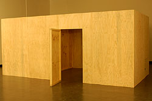
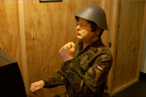
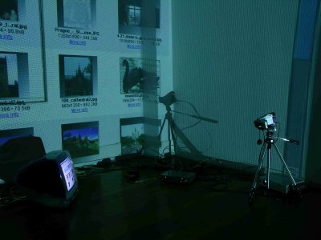

> In the lives of emperors there is a moment which follows pride in the boundless extension of the territories we have conquered … There is a sense of emptiness that comes over us at evening … It is the desperate moment when we discover that this empire, which had seemed to us the sum of all wonders, is an endless, formless, ruin, that corruption’s gangrene has spread too far to be healed by our sceptre … Only in Marco Polo’s accounts was Kublai Khan able to discern, through the walls and towers destined to crumble, the tracery of a pattern so subtle it could escape the termites’ gnawing. (Calvino, 1997: 5-6) {#para2}
>
> Since, ordinarily, channels have a certain amount of noise, and therefore a finite capacity, exact transmission is impossible. (Shannon, 1948: 48) {#para3}

What would it mean if communication were exact? That, in spite of the real, material, spaces of message, channel, format, filters, modulations, mediation, and plain old error, it might be possible to exclude all noise and see through to some pure space of connection and transmission. Despite my curiosity, I suspect the result would be disappointingly dull, or simply redundant. The search for perfect communication is as pointless as trying to find an audio space not infected with electromagnetic waves, or a gallery space where only one work is apprehended at a time. Our communications spaces are always already determined by the varieties of noise that constitute their surfaces. In scientific and informatic models there are laws that repeatedly demonstrate the futility of any attempt to maintain purity as a static form. Key to these demonstrations is the role of entropy. Entropy is both a force and a probability measure. This essay examines shifting roles and definitions of entropy in two recent digital installations. What I suggest is that an understanding of the operations and implications of entropy helps us to unpack operations of noise and materiality in these works. The installations discussed here use the tools of distributed media at the same time as they locate themselves within the physical spaces of the art gallery. Furthermore, a focus on entropy and its role in digital installation acknowledges that both information theory and aesthetics are themselves impure and inexact. {#para4}

In the two works discussed in this essay, the networked systems of digital media stretch the spatial and temporal coordinates of gallery installation. It is not possible for a viewer to stand before or within the work and see all of its elements. Instead, the works contain what Eco terms ‘intrinsic mobility’ (Eco, 1989:12). That is, the works can be understood as ‘elementary structures which can move in the air and assume different spatial dispositions. They continuously create their own space and the shapes to fill it’ (Eco, 1989:12). Operating across analogue and digital media, not necessarily located or contained within the physical spaces of the gallery, these works bring together a distributed model found in Eco’s ‘open work’ with the informational notion of entropy. Additionally, through their embrace of entropy these works extend our understandings of materiality in digital media and thus question relationships between aesthetics and media. This essay locates entropy and noise at a crucial juncture for digital materiality. A remapping of entropy is central to a discussion of digital installation for the very reason that the works themselves suggest the operations of noise as a force for distribution, and highlight a potential new aesthetic mode that focuses on mobility and transformation. {#para5}

Entropy is a statistical measure; in particular, it is a measure of probability. When devising his mathematical model for information theory, Shannon (1948) borrowed the term entropy from thermodynamics.[1] What interested Shannon was the possibility for information to become a material quality which could be measured, rather than a vague medium through which meaning was conveyed. When examining the heat exchange processes of thermodynamics in 1865 Clausius coined and defined the word entropy to mean ‘transformation content’ (von Baeyer, 2003: 91-92). Entropy was used as a measure, not of the loss or gain of energy (for according to the first law of thermodynamics the sum of energy is always constant), but a measure of the energy that was dissipated and broken down into less and less usable packets within a closed system (Spielberg and Anderson, 1987: 108). Today, entropy is still used as a measurement of the speed and gradual increase of the energy in any given system that can no longer be transformed into useful work or heat. Whenever energy is transformed it becomes degraded. Without an injection of fresh differentiated structures a closed system will become fully dispersed, and as undifferentiated matter, it will suffer what has been termed ‘heat death’ (Spielberg and Anderson, 1987: 125). This tendency towards maximum entropy is the second law of thermodynamics. Over time, entropy at work within a closed system leaves more and more energy unworkable.[2] However, because there are so few truly closed systems, the statistical character of entropy means that entropy becomes more the ‘measure of that state of maximal equiprobability towards which natural processes tend’ (Eco, 1989: 48) rather than a finalizing statement. Entropy is itself not the tendency towards unworkable systems, but the measurement of that tendency. {#para6}

Shannon, too, wanted to challenge the operations of a closed system, and overcome the different roles that noise held within information transmission. He saw a similarity between his probability function called ‘information’ and the probability function called ‘entropy’ (Shannon, 1948: 20). It was clear that both information and entropy were statistical measures. Shannon turned to thermodynamics for his terms, arguing that a mathematical discussion of information required a study of force and measure, rather than meaning and reception. For Shannon, both force and measure were about distributions and probabilities, something that the statistical measure of entropy proved. Although he presented us with a problematically linear approach to communication, Shannon also addressed the environmental impacts of communication by locating noise in two crucial places in his equation. Firstly, noise was defined as entropy found and encoded within the message itself. This for Shannon was an essential and positive role; entropy at the source invited continual re-organisation and assisted with the removal of repetition enabling faster message transmission. The second position he accorded noise was external, that is, noise introduced to the message channel whilst in transit. External noise confused the purity of the message, whilst equivocally adding new information. If it produced the same received signal every time, Shannon called the disturbance distortion. If the received signal changed constantly, the disturbance was called stochastic noise (Shannon, 1948: 19). In both external roles noise actually made additional information. Consequently, Shannon concluded that without noise there cannot be information. The two became intimately connected through the measure of entropy. In the absence of inherent meaning, noise was found to determine the existence of the very thing apparently determined to eliminate it. He wrote: {#para7}

> The first defining expression has already been interpreted as the amount of information sent less the uncertainty of what was sent. The second measures the amount received less the part of this which is due to noise. The third is the sum of the two amounts less the joint entropy and therefore in a sense is the number of bits per second common to the two. Thus all three expressions have a certain intuitive significance. The capacity C of a noisy channel should be the maximum possible rate of transmission, i.e., the rate when the source is properly matched to the channel. We therefore define the channel capacity by C Max H x Hy x where the maximum is with respect to all possible information sources used as input to the channel. If the channel is noiseless, Hy x 0. The definition is then equivalent to that already given for a noiseless channel since the maximum entropy for the channel is its capacity. (1948: 22) {#para8}

Without noise and entropy there could not be a functioning channel. It is this dependant relationality that excited Shannon about entropy. In its first role, entropy could measure both noise and information. And in its second role entropy was the disturbance to these measures, entropy as noise was the material distortion, disturbance, or surface through which information traveled. {#para9}

The relevance of Shannon’s model for digital installation is in the relationship it establishes between material distortion and media surface. As well as distorting the clear surface of materiality, entropy as a measurement of that system introduces noise. When entropy is evoked in digital installation this dual role of measure and material force becomes further complicated. Although a digital installation is not a classical closed system – in fact the essential intervention of a viewer means it cannot ever be closed – a focus on entropy can offer a new vocabulary and a new set of concepts in which to discuss what goes on in digital installation. If digital installation is understood through an analysis of shifting materiality, the manner in which entropy actually introduces and defers the material becomes fundamental. The remainder of this essay will focus on two recent digital installations, Ronnie van Hout’s On the Run (2004, City Gallery Wellington, NZ), and Alex Monteith’s Invisible Cities (2004, The Physics Room, Christchurch, NZ). In van Hout’s On The Run entropy is both the force by which a viewer can engage directly with the work, and a tool for the measurement and transformation of the work’s borders. In Monteith’s Invisible Cities entropy is a model and apparatus for the materialisation of description. Not necessarily immaterial or singularly material, the digital installation finds its mathematical equivalent in Shannon’s impure, noisy, transformative and entropic communications model. When working across networked media, as both these works do, Clausius’s idea of ‘transformation content’ becomes even more pertinent (von Baeyer, 2003: 91-92). It is possible to see how entropy in these installations is more than a pessimistic description of decay, and instead operates as a productive force for, and measure of, material transformation. This is because ‘the entropy of a substance determines whether it will exist as a solid, liquid, or gas and how difficult it is to change from one such state to another’ (Spielberg and Anderson, 1987: 106). {#para10}

Van Hout’s On the Run (2004) takes the digital tropes of interactivity and presence and through the invocation of entropy as a networked force, gives the viewer a way to become complicit in the artist’s desertion of his own work. In the gallery is a large architectural form built from plywood. It could be read as a maze of packing crates, abandoned at the end of the gallery, or a basic house designed for a person to inhabit the gallery. A small trap door, a number of bolted flaps and two entrance/exit spaces punctuate the surface. The front doorway entrance is open, and the viewer must slip through an uncertain gap to enter the confines of the work. Like the First World War gun emplacements scattered on the coastal harbours of New Zealand, the inside spaces and the external space do not appear to be aligned. Viewers find themselves within the deadened sound space of a thin wooden corridor. There is the sense that the work is some kind of architecture of confinement. On our right is a large glass pane that lines a cell room. Leaning over and pressing our noses against the glass, we can make out what seems to be the sleeping figure of an inmate on a low army camp stretcher. His cell is littered with detritus from an artist’s studio, including recognisable incarnations of van Hout’s other works, marquettes, embroidery, and multiple pieces of screwed up A4 white paper. There seems to be some kind of escape plan or map sketched on one. The prisoner has been busy in his cell. The sleeping figure is at first shocking, how does he breathe in there? Suddenly it is obvious that although the room shows evidence of recent habitation, the prisoner has escaped, his form is only just covered by the green wool blankets, his head a stuffed bag. The mess of the cell room recently inhabited by the prisoner, apparently van Hout himself, offers fragments and clues to the operations that may have occurred within the space to enable his escape. {#para11}

There is no sound at all in this space and there is not enough room for the viewer to turn around to exit. The closeness of the air is cloying, and the deadened atmospherics imply that we are somehow underground. Where to now? Deeper inside the space and around a sharp bend the viewer encounters the figure of a guard dressed in army camouflage fatigues sitting before a computer monitor with his fist raised. He is an uncannily realistic figure – bearing a striking resemblance to van Hout. The guard has obviously neglected to look to the glass in the cell, and as a result has lost his charge. To find out why, we must stand too close to him, and peer over his shoulder, over his lifted fist. On the screen before him are endless messages. Scrolling across the screen are SMS messages and emails posted from the artist (the prisoner, on the run), visitors to the exhibition and distant onlookers. Alongside the artist, the audience has sent posts offering the warden advice on where to locate the artist/prisoner, or gleeful messages of escape.[3] {#para12}

‘where am I?’ {#para13}

‘Ann & Stephanie are on the run.’ {#para14}

‘you’ll never catch me! mwa-ha-ha-ha!’ {#para15}

‘Squirrels are like cigarettes, neither are dangerous until you put them in your mouth and set fire to them.’ {#para16}

‘I can see you. I know what you’re up to. I’m coming to get you. Watch out…..ha ha ha!’ {#para17}

‘LOOK OUT!!!!!!!! there’s something BEHIND you…’ {#para18}

‘I am watching…’ {#para19}

I will Not GiVe uP’ {#para20}

‘blah blah blah I escaped your crap jail!’ {#para21}

Sleep with one eye open…’ {#para22}

always a man on the run.’ {#para23}

‘We Are Watching You… We Know where you live… We are Stalking U.’ {#para24}

‘NAT N LUCE R 2 HOT MAMA’S.’ {#para25}

‘the longest childhood is that of man himself growing into self-knowledge.’ {#para26}

‘it looks real.’ {#para27}

‘Hey kids in the room I am saying hello.’ {#para28}

‘the brilliance of my mind has slipped away. When I wasn’t looking caz.’ {#para29}

‘the evidence lies in your t-shirt.’ {#para30}

‘Ha. I know who you really are.’ {#para31}

‘GO RONNIE GO.’ ‘ {#para32}

‘”a map of the world that does not include utopia is not worth even glancing at”Oscar Wilde.’’ {#para33}

‘don’t know much about art but great nosh at the opening…’ {#para34}

‘C U at t-e vault on w!ll!5 5f.’ {#para35}

‘just like Ward 27 @ Wellington.’ {#para36}

Reading the posts there is ambivalence surrounding the positions adopted by the audience or the artist. Some offer advice as another voice helping the prisoner out. Others, inhabiting the space as textual avatars, write as the prisoner himself. The broader assumption is that participants became assimilated into yet another of van Hout’s personas.[4] As van Hout infiltrates their phone systems, they pay for the artist to stay on the run, keeping the ball going. Van Hout uses these records of networked media to disrupt the closed spaces of the installation. By including the messaging options van Hout suggests that a viewer must adopt both an embedded and a mobilised position in order to engage fully with the work. Not only must we be where the artist is not, in order to interact fully we must also be away from the structural object. {#para37}

By sending messages on van Hout’s behalf, gallery visitors assume the role of the artist, momentarily taking the starring role in an ever-changing present of the screen. Present, yet not present, the artist’s escape can be charted through these posted messages; they are a reminder of the warden’s failure to contain him. There are a number of entropic forces at play here. Reliant on the improbability of escape, and the reassurance of repetition in the messages before him, the warden does not leave his chair to check the cell. His adherence to a model of information as repetition, redundancy and order has foiled him. Deleuze identifies this concentration of information, and reliance on analogue spaces of confinement as central to the operations of the disciplinary society (1992). Following Foucault, Deleuze argues that within the disciplinary society the individual is subject to the watchword or signature and is forced to conform to particular architecture molds. In On The Run this model is shown to lose its effectivity, due in part to its inherent entropy. Although the prison guard has established spatial and informatic controls, the prisoner has slipped his grasp. This is because the prisoner is aware of a second mechanism of control, that of modulation. For Deleuze the society of control (which follows the disciplinary society) is digital, and it can be measured, not by static media or the reassurance of fixed architectures but by codes. ‘The numerical language of control is made of codes that mark access to information, or reject it’ (Deleuze, 1992: 5). Enclosed within continuous networks the prisoner has used the very network of enclosure, and the access to information afforded by the network to map his escape. On The Run makes us aware of the interleaving of these two systems. Neither the network of the society of control nor the entropic machine of the disciplinary society is a closed system. Both are shown to have spaces for escape. {#para38}

On The Run locates escape as a temporal activity. Entropy is tied to duration, and the movement of entropy is always forward, toward greater entropy. Entropy cannot flow backward. Nevertheless, within the macroscopic durational force of entropy small pockets of discrete ‘order’ persist. Arnheim and others use the example of the entropic force of a small child in a bedroom, claiming that once the child has passed through the system of a bedroom it is impossible to discern the original order of the space (1971). Arnheim rightly points out that small pockets of order are the key focus of any child’s room, and the interpretation of whether the structure is ordered or disordered depends on the perspective of the observer on the system. In On The Run the confined but messy system of the cell block reflects this relationship. Entropy has spun the prisoner away, and looking into the cell it is easy to see the clues and traces of its ongoing dissipation. Positioned so that he is unable to see directly into the cell room, van Hout’s guard reads the external ordered structure as a sign of control, allowing him to disregard any minor infringements as simply ‘mess.’ Entropy is found operating as both singular event (the escape of the prisoner) and generator of further leaks and flows (the apparent ‘order’ authorised by the SMS messages as they appear on the screen.) The work operates across distributed and entropic temporalities rather than within the fixed duration of the gallery. {#para39}

Van Hout introduces further clues regarding the space’s transformation. Like all architecture of detention, the prison itself is positioned at a remove from ‘normal’ life; it is a closed finite environment. When entering the space, on the viewer’s left is a large flat screen monitor showing an ever so slightly moving image of an idyllic lakeside (a kind of mimetic window). The lake is redundant enough to be any lake in New Zealand, non-specific enough to be any lake with deciduous poplars at its banks, and familiar enough to be anywhere. This is nostalgia and kitsch (both tropes dependant on redundancy; that is, they do not make us think but show us somewhere we already know) repackaged as location. The scene becomes a place-holder or sign of the desire for the removal of entropy. It is the seemingly perfect environment, in which duration is stilled and the scene (nature) has not been overtaken by the potential entropy contained within the cell or the prison. The window/screen offers both a panorama of normality and a scene of unattainable perfection, and is a further indication of the necessity of entropy as a force and measure, a tool to read the system. Unfortunately the guard watching his monitor knows nothing of this, because he relies on a standardised model of interactivity that excludes entropy. He believes that if he looks long enough, enough information will come. But due to the redundancy of his system – tell me you are still here, and I will believe you – ‘I’m still here’ becomes equated with ‘I’m on the run’ and he receives no information. In informational terms, he has no entropic uncertainty measure, only the certainty of his position and the authority of his glass box. He has made this mistake because he has dismissed entropy as some kind of random, undifferentiated matter irrelevant to the study of systems. {#para40}

In Entropy and Art Arnheim both presents and questions this reductive model of entropy as undifferentiated matter, leakage and flow (1971). Arnheim is most concerned with the threat to order that the uncritical application of entropy principles to art practice pose. Separating out informatic and thermodynamic definitions of entropy, Arnheim argued that the accepted notion of entropy within thermodynamics ignores the larger structure or form, and instead focuses on the microscopic arrangements within the structure. He calls this focus on systems or sequences absurd, and suggests that we must return our gaze to the ‘preserved islands of order everywhere’. The ‘ludicrous’ nature of entropy for Arnheim is further encapsulated in the fact that within informatic definitions of entropy order itself becomes defined as ‘improbable’. The absurdity of disorder leads him to ask ‘Now what sort of sequence of events will be least predictable and therefore carry a maximum of information?’ His reluctant answer is that ‘the least structured sequence will be called the most orderly.’ His example is found in a pack of cards. The least likely probability is that a pack of cards would end up identical (or ordered) after subsequent shuffling. His own equation of probability with predictability, and the broader dismissal of structure which he sees occurring in systems leads Arnheim to declare the tension of the second law of thermodynamics to be at its very worst anti-Darwinian. The most extreme exemplars of what he saw as entropy gone mad are found in Arnheim’s footnoted references to minimalism, experimental music and avant-garde film. {#para41}

Arnheim’s dislike of the connections drawn between information and entropy in the above examples lead him to argue for the realignment of information with order. As such he did not dismiss the necessary role of entropy, but resisted what he saw as its unnecessarily dominant role in art practice. Although he argues that an awareness of entropy is necessary for the perfect artwork to reach a position of equilibrium, a point of order and maximum entropy, he argues that current (1971) social relaxations of the ‘demands of organised experience’ mean that many artworks take the ideas of entropy too far, resulting in ‘the shapelessness of accidental materials, happenings, or sounds.’ His targets here are performance, improvisation and conceptual art. That is, any works that do not appear to adhere to an external structure, or desire a stability of order. As he explains: ‘Mere noise involves a minimum of structural tension and therefore calls for a minimum of energy expended by producer and recipient, in spite of creating the illusion that much is going on.’ By establishing hierarchies for the appropriate employment of entropy and noise, Arnheim reaches the end of his text sounding very much like van Hout’s prison warden looks; watching his monitor for any sign of order, and unaware of the ‘impossibility’ of ‘exact transmission’ (Shannon 1948: 48). The difficulty for Arnheim is in the unachievable resolution of Shannon’s dual definition of entropy as both function and parameter for a system. {#para42}

The analogy made by Shannon between entropy as material force, and entropy as probability measure becomes significant here. As uncertainty, noise and entropy work together in the threefold process of measuring efficiency . Shannon does not dismiss noise but locates it as a crucial determining capacity. Without entropy there cannot be capacity. Arnheim’s formalist ideal of order without noise does not admit transformative movement as a quality of the art work. As entropy increases the useable capacity of the channel shrinks and it is necessary to employ other models of distribution that focus on the transformative rather than the fixed. As I have mentioned, Deleuze connected entropy specifically with the disciplinary society arguing that the subsequent society of control (in many ways more insidious) is reliant on the leakage and noise of distribution, whether through code, modulation or incorporation. Present within this society of control is an expanded notion of entropy, which is not specifically tied to closed systems. This expanded notion of entropy is central to the second work discussed here, Invisible Cities (2004) by Alex Monteith. The source of Monteith’s work is located in the novel Invisible Cities by Italo Calvino. In the novel Marco Polo describes the movement of entropy outside of the closed system: {#para43}

> “I have also thought of a model city from which I deduce all the others,” Marco answered. “It is a city made only of exceptions, exclusions, incongruities, contradictions. If such a city is the must improbable, by reducing the number of abnormal elements, we increase the probability that the city really exists. So I have only to subtract exceptions from my model, and in whatever direction I proceed, I will arrive at one of the cities which, always as an exception, exist. But I cannot force my operation beyond a certain limit: I would achieve cities too probable to be real”. (Calvino, 1997: 69) {#para44}

In the installation Invisible Cities (2004) Monteith draws on the languages and objects found in Calvino’s novel to activate a trawling of Internet image spaces. {#para45}

Invisible Cities is a record of the interrelationship between entropy and information in the visualization of a search engine. Monteith isolated two thousand noun groups from Calvino’s book. Using a code written by Sean Kerr to limit, and to some extent automate the AltaVista search engine, Invisible Cities (the installation) brings up linked images based on these terms every twenty seconds. One large projection fills the whole end wall of the gallery, its screen continuously projecting the AltaVista search results. The work deceptively fulfils Shannon’s definition of information as quantity measure and its conflation with an extended, or distributed notion of entropy. There is already a reliance on the structures of fragmentary narrative and subtle variation within Calvino’s book; Monteith adds to this a new action as the book becomes reduced to nouns and is fed or filtered through the search engine. Invisible Cities get searched, sorted, arranged and manipulated as visual images rather than descriptors. {#para46}

Calvino’s novel plays out the impossibility of mythical and unmediated communication. The book documents conversations between Kublai Khan and his emissary Marco Polo. Polo is sent out to the far reaches of Khan’s empire to bring back tales of the cities he finds there. As the novel progresses both Polo and Khan become increasingly aware of certain amounts of noise gnawing in their conversations – what Shannon would call the ‘conditional entropy’ of their messages (1948: 20). In spite of his desires to hear more and to believe in the greatness and strangeness of his kingdom Khan begins to distrust the descriptions he is hearing. Polo is describing only one city, his home – Venice. Both hide their awareness or distrust of the tales being told, because, as Shannon would later inform them, entropy offers a significant tool by which they can each measure the exchange of information. Disclosed, entropy might vanish, and the story would be finished, uncertainty removed at both source and reception would lead to redundancy. Nothing more could be learnt, no more cities could be visited, no more stories could be told. To hold off redundancy, Khan and Polo concentrate on the objects found within the cities. {#para47}

Monteith picks these objects up, and sends them back out to the farthest reaches of a different kind of empire but one equally distributed. As they return they too bring different tales of their locations, and contain inadequate informational relationships. In this way Monteith sets into play the entropic forces of distribution, again as a probability measure. In a text so intimately concerned with information Calvino makes us as readers complicit in the agreement that entropy is not only necessary but also essential (in both senses) for the continuation of the story. Entropy determines, delays and distorts the materiality of Venice as it is described through inventory, narrative and measure within the novel. Paradoxically then, in Calvino’s Invisible Cities entropy both causes and defers material decay, whilst also recording and perpetuating the narrative’s movement towards its conclusion. Entropy operates at a macro-material level within the structures of the story, as well as generates the sequences that determine the micro-material events of the narrative. It is both a complex force and a measure of that force. {#para48}

There are a number of apparently random occurrences in the viewer’s anticipation of the installation. Firstly, the images produced may not be exactly what are expected from the search term. Secondly, the selection of nouns appears arbitrary until the context of Calvino’s Invisible Cities is understood. Lastly, the viewer’s visible intervention in the space means that no one experience is like any other. However, Invisible Cities operates through entropy not randomness. The appearance of a particular image inside the search engine database is reliant on a previous identification of image with text, on a series of decisions that have lead the work to this material point. Determined either by the search engine and its rules or by the individual who has placed the image into the databases of the Internet, there are factors that limit this seemingly infinite system. The work is not random nor indeterminate but entropic. If something improbable introduces order (or in Polo’s case – reality) then its probability or number of bits ‘per second common to the two’ can be understood as its material (Shannon 1948: 20). This is how as a quantity measure entropy comes to share its definition with information rather than randomness. In the installation Invisible Cities there is a further doubling of this relationship. In front and to the side of the large screen projection are a monitor, camera, another smaller projection and other assorted electronics. Using the same code as the Calvino search a second iMac conducts a live examination of its own contexts and surroundings by sending AltaVista search terms drawn from objects in the room: ‘….RCA, Imac, Tripod, video switcher, CCTV camera, four-plugs, extension cables, Ethernet cables, roller blind…. ‘ {#para49}

There is no overlap between the search terms, but the two are bought into close proximity by the overlapping screens and the timing of the searches. The images are viewed together amidst the multiple architectures of the gallery. The second iMac is watched by a mini-DV camera, which transfers its signal to a smaller wall projection on the left of the space. This second projection is also connected to a video switcher. Entering the space means that a viewer’s presence is picked up by a CCTV camera on the back wall of the gallery, this image is intermittently fed to the video switcher appearing for approximately twenty seconds on screen before the switcher returns to the computer image and its ceaseless task of searching for the objects that construct the space. The materials that make up this installation are not only those present within the space but the forces that introduce outside materials, disturbances, dirt and noise into the system of the search engine. A viewer can also enact her own duplication and become part of the inventory of this space. By positioning herself in front of the mini-DV camera the viewer’s presence becomes multiple – becoming no longer a singular or proper noun but a phrase appearing across a number of locations and projected large by the video switcher. The descriptive nouns are not determining but simply one material among many: {#para50}

> …cities, silver domes, bronze statues, streets, crystal theatre, tower, lamps, doors, buildings, spiral staircases, square, wall, aluminium towers, gates, drawbridges, moat, canal, houses, chimneys, market, steps, streets, stairways, arcades, roofs, lamppost, dock, gratings, banisters, steps antennae, lightening rods, poles, canals, pool garden, trees, stones, sand, marsh, signboards, walls, house, tavern, barracks… {#para51}

Removed from original context (meaning) the AltaVista images arrive automatically on the installation screens every twenty seconds. At the viewer’s end of the channel we have enough time to engage with them, assess their relevance, and perhaps make connections to our own images of these terms before another poll begins. The computer conducting the poll has keyboard and mouse removed, so we are surplus to the generation of the information, and in many ways redundant to its interpretation. Instead we operate as part of the continued distribution of noun, phrase, image and text. {#para52}

The relationship between the projections and the monitors is one of multiplication but also inhabitation of the space. Calvino’s Invisible Cities presented multiple takes or narrations of a city. The many imaginings brought by Polo to Khan transport them back repeatedly to the same place only different; a difference of kind rather than type. At one point Khan questions whether they are even present within the room together. Through the text Calvino suggests that it is possible to know a city by its contents but also that this city is made of previously constructed spaces and inhabitations. After a while it feels like Polo is describing multiple diasporic entities rather than the singular growth of empire. The inventory becomes a tool for the documentation of the matter that makes the city but also a way to avoid the entropy, which seems to threaten the empire’s borders. By employing a similar modular and descriptive method Monteith offers a tool by which the viewer can grasp at a different sort of space. Monteith has said that ‘Calvino often uses a slightly modular, mathematical or scientific rhetoric in the structure of his works and I enjoyed this framework. His approach seemed to suggest a way to hem-in virtual space’ (2005). Monteith suggests that by listing and searching it is possible to reach some kind of distributed or entropic edge located within a more generalized notion of Internet space. {#para53}

In its desires to archive and retrieve more and more ‘information’, a search engine is committed to a constant but imperfect view. AltaVista explains the operation of the search engine within its ‘terms of use’: {#para54}

> Search results: the web changes constantly and no searching or indexing techniques can possibly include all pages accessible on the web in its index of sites (the ‘index’). As a result, AltaVista does not and cannot guarantee that your search results will be complete or accurate or that the links associated with the index will be complete or accurate or active at the time of your search. The web sites included in the index are developed by people we do not control. The process of including sites in the index is largely automatic. AltaVista cannot and does not screen the sites included in the index. For these reasons, we assume no responsibility for the content of any site included in the index, and are not responsible for any errors or omissions contained in the site or any AltaVista site (or any site you may link to from the site or any of the AltaVista sites), or any offensive or otherwise objectionable content contained in the site or any AltaVista site (or any site you may link to from the site or the AltaVista sites). (AltaVista, 2005) {#para55}

This emphatic disavowal of control and scope is supported by sites such as Nous that have been designed to assist Website managers get the best results from the search engine. Nous explains that AltaVista operates by downloading pages and indexing them utilizing robot or spider technology that makes a copy of the site’s html into the AltaVista database. ‘AltaVista then accesses each page and looks for every instance of the search within the indexed pages. AltaVista views every page and article on the web sequentially. A word may be misspelled but as long as that word exists on the Web, AltaVista will search for it’ (Nous, 2003). This highlights the role of the search engine itself as a monitor of entropy and distribution. Invisible Cities makes us aware of the limits and architectures of the search engine. AltaVista literally means ‘view from above’ and Monteith’s Invisible Cities operates at the limits of a virtualized information space (a place that on early topographical maps would have been marked with dragons). A question is raised regarding how much can be seen from above without additional magnification. Monteith’s work suggests that what can be discerned are pattern, permutation, and modulation; the tightly bound edges at which entropy functions. {#para56}

Monteith’s Invisible Cities also has a stand-alone online version. In the Web version of the work it seems possible to set the timing between polls, so that a user can navigate some of the retrieved links. Yet whatever text is entered or intervention attempted is automatically overwritten by the computer in its endless quest for images from the invisible cities. The user cannot change or transform the ongoing movement of the search. Obeying the rules of entropy the forces of the search engine are unidirectional and ongoing. Although the infinite point of heat-death may be approached it will never be met and the journey toward it cannot be stalled. In the installation, the second iMac does have a keyboard and mouse, and the viewer can interfere with the activities of the computer but, again, this is overwritten within twenty seconds. In both cases the live Web narrative is constructed through the repetition of parameters and systems. That is, Invisible Cities is a digital installation in which the terms of interactivity and immersion are distributed between viewing and scanning machines and the viewer becomes one element distributed across its screens. If this is a model of digital interactivity it is a consciously flawed one by being a frustrated byproduct of something else. And a viewer is quickly made aware that she is interrupting a particular and ongoing narrative. The work operates as a transformation of both the search engine as a device and Calvino’s original text. The lasting material is of a silent room filled with the noise of data searching: {#para57}

> …canoes, Banks, Green estuary, Land, Mullioned windows, estuaries, Hole, wheels, 63, half-cities, roller coaster, carousel, Ferris Wheel, Death ride, Big Top, trapeze, Half-city, Stone, Marble, Cement, Bank, Factories, Palaces, Slaughterhouse, School, Half, City, Half-city, Marble pediments, Stone Walls, Cement Pylons, Ministry, Docks, Petroleum, refinery, Hospital, Trailers, Shooting galleries, Carousel, cart, Roller Coaster, Caravan, 64, territory, one city, rolling plateau…window sills, flapping curtains, ground, gutters, manhole covers… {#para58}

The noise of the descriptions contaminates the spaces inside the gallery that are layered with the noise of virtualised spaces inside the Web. Marco Polo infected his descriptions of different (invisible) cities with the real Venice; here the gallery space becomes Venice. The screens float before us, the litter of surveillance cameras, monitors and lights, and electrical cable scattered over the space encourage us to stay a little longer. And we wait like Kublai Khan, our breath held like any other expectant tourist, except we are already present within the material spaces that will be shown to us. {#para59}

The spaces of both installations discussed here are not experienced in continuous cinematic instants or destination-based interactive play but through duration – a distributed affective experience of sound, image, and delay. Duration is a key measure of entropy, and entropy occurs through duration. Although it is durational, entropy is not a singular smooth progression. Because it is simultaneously a material force and a measure of that force entropy contains its own stutters, gaps, dirt and noise. When located amidst digital materials, entropy echoes and records the modulations and distributions of code. It is Clausius’s ‘transformation content’ not necessarily tied to particular systems (von Baeyer, 2003: 91-92). Like Deleuze and Guattari’s intensive multiplicities, the digital work changes after each division or viewing – likewise, the work is distributed. In Eco’s sense of the word, it maintains disjunctions and contains an intrinsic mobility. (Deleuze and Guattari, 1996: 261; Eco, 1989: 12–15). On The Run and Invisible Cities address the problems of distributed aesthetics by drawing on the force and measure of entropy. When we view these installations listening (even to silence) augments looking. In listening for bursts of entropic noise in Invisible Cities and On the Run it is possible to identify points of delay that highlight the infinite material shiftings of entropy and matter. In these digital installations entropy both determines and maps material relationships by encouraging a politics of noise. This is its necessity. {#para60}

## Author’s Biography

Su Ballard is an artist, writer and musician whose research focuses on new media art with a particular emphasis on contemporary digital and time-based installation from Aotearoa New Zealand. She is completing a PhD with Art History and Theory and the Centre for Contemporary Art and Politics at the University of New South Wales, Sydney, Australia. Su is a senior lecturer, and head of Art Theory at Otago Polytechnic School of Art, Dunedin, New Zealand. She is a convenor of ADA Aotearoa Digital Arts Network and deputy board chair of the Physics Room contemporary art space, Christchurch, NZ. [[https://www.physicsroom.org.nz](https://www.physicsroom.org.nz), [https://www.aotearoadigitalarts.org.nz](https://www.aotearoadigitalarts.org.nz)]

## Notes

[1] This paper will focus on Claude Shannon’s equation of information and entropy. Shannon wrote ‘A Mathematical Theory of Communication’ in 1948, and published it in the Bell Systems Technical Journal. The following year the article was reprinted, with alterations and a preface by Warren Weaver, as: ‘The Mathematical Theory of Communication’ (Shannon and Weaver, 1949). Weaver offered a particular reading of Shannon and emphasized the importance of the separation of information from meaning. It is from this second text that we get the Shannon-Weaver communications model. In this essay I refer to the original Shannon text and the authoritative version posted online by Bell Labs, and in text paginations refer to the pdf pagination.

Norbert Wiener presented a strong counter to Shannon’s use of entropy stating that information and entropy are not the same, but that ‘the information carried by a message is the negative of its entropy’ (Wiener, 1967: 31). Wiener tried to rewrite Shannon’s formulas so they used the term negentropy, as a way of maintaining a position that claims ‘information means order and entropy is its opposite’ (Eco, 1989: 53). For more on the implications of Shannon’s decision to equate information and entropy see Hayles (1990: 48–60).

[back]

[2] In 1867, facing this pessimistic probability head on was James Clerk Maxwell’s ‘demon’. As a way to challenge what he saw as the unnecessary inevitability of this law, Maxwell proposed a microscopic demon that sat between two boxes of equal temperature in a closed thermodynamic system. The demon was imbued with enough intelligence to sort molecules as they rapidly approached him; at his gate the demon would sort fast from slow. By only letting exceptionally fast balls travel in one direction and very slow balls travel the other, one box would increase in temperature and theoretically heat would flow without a change in temperature (von Bayeur, 1999: 92ff). (In a parallel phenomenon water might be seen to flow uphill). Unfortunately for the demon, his position was unsustainable, for as Leon Brillouin pointed out in 1950, ‘the energy the Demon would have to expend to get information about molecules is greater than what the Demon could gain by the sorting process’ (Hayles, 1999: 102, see also von Bayeur, 1999: 145ff). Entropy as a measure of possibility would defeat the perpetual stability introduced by the demon who would have to break the borders of the closed system in order to gain more useful energy.

[back]

[3] The following is a transcription of selected texts recorded by the exhibition’s curator, Emma Bugden, over a two-week period.

[back]

[4] Van Hout’s work is characterised by a number of these persona that include a dog man, a monkey man, the prison warden, and van Hout himself variously guised. In the sculptural installation I’ve abandoned me (2003, Resin, plastic, rubber, fabric, fibreglass, video systems, Dunedin Public Art Gallery) van Hout presents a life-size model of himself standing fixed in front of a TV monitor in which his onscreen doppelganger repeatedly tries on different costumes whilst also berating himself for the ineffectualness of his appearance. The watching figure is silent. Furthermore, another of van Hout’s alter egos watches both figures at a short distance. Seated on the floor and resting against a fibreglass log is a ‘monkey’ staring intently at a small hand-held monitor, which screens a CCTV feed of the exchange. For more details on these multiple personas, see Justin Paton (2003).

[back]

## References

AltaVista. ‘terms of use’ (2005) [https://www.altavista.com/about/termsofuse](https://www.altavista.com/about/termsofuse).

Arnheim, Rudolph. Entropy and Art: An Essay on Disorder and Order (Berkeley, Los Angeles, London: University of California, 1971), [https://acnet.pratt.edu/~arch543p/readings/Arnheim.html](https://acnet.pratt.edu/~arch543p/readings/Arnheim.html).

Calvino, Italo. Invisible Cities, trans. William Weaver (London: Vintage, 1997).

Clarke, Bruce. ‘From Thermodynamics to Virtuality,’ in From Energy to Information: Representation in Science and Technology, Art, and Literature eds Bruce Clarke and Linda Henderson (Stanford: Stanford University Press, 2002), 17–33.

Deleuze, Gilles. Cinema 1: The Movement-Image, trans. Hugh Tomlinson and Barbara Habberjam. (Minneapolis: University of Minnesota, 1986).

Deleuze, G. ‘Postscript on the Societies of Control’ October 59 (Winter 1992): 3-7.

Deleuze, G., and Felix Guattari. A Thousand Plateaus: Capitalism and Schizophrenia, trans. Brian Massumi (London: The Athlone Press, 1996).

Eco, Umberto. The Open Work, trans. Anna Cancogni (Cambridge, Mass.: Harvard University Press, 1989).

Hayles, N. Katherine. Chaos Bound: Orderly Disorder in Contemporary Literature and Science (Ithaca and London: Cornell University, 1990).

Hayles, N. K. How We Became Posthuman: Virtual Bodies in Cybernetics, Literature and Informatics (Chicago and London: The University of Chicago Press, 1999).

Monteith, Alex. Invisible Cities. (2004) Computer, Internet search engines, CCTV, Macromedia Director code by Sean Kerr. Exhibited at Physics Room, Christchurch, New Zealand. Also, Web only version hosted by Window Gallery, Auckland: [https://www.window.auckland.ac.nz/showing/viewinvisible.html](https://www.window.auckland.ac.nz/showing/viewinvisible.html).

Nous information technology, ‘search tips’ (2003),. [https://www.nous.net.au/search-tips/altavista_search-tip.asp](https://www.nous.net.au/search-tips/altavista_search-tip.asp).

Nunes, Mark. ‘Virtual Topographies: Smooth and Striated Cyberspace.’ (reprinted from Cyberspace Textuality, ed. Marie-Laure Ryan place of publication needed Bloomington: Indiana University Press, 1999), [https://www.gpc.edu/~mnunes/vtop.htm](https://www.gpc.edu/~mnunes/vtop.htm).

Paton, Justin. ed. Ronnie Van Hout: I’ve Abandoned Me (Dunedin: Dunedin Public Art Gallery, 2003).

Paulson, William. The Noise of Culture: Literary Texts in a World of Information (Ithaca : Cornell University, 1988).

Shannon, Claude. ‘A Mathematical Theory of Communication’ The Bell System Technical Journal 27, (July–October 1948): 379–423, 623–56, [https://cm.bell-labs.com/cm/ms/what/shannonday/paper.html](https://cm.bell-labs.com/cm/ms/what/shannonday/paper.html).

Spielberg, Nathan, and Bryon Anderson. ‘Entropy and Probability’, in Seven Ideas That Shook the Universe, (New York, Chichester: Wiley Science Editions, 1987), 106–38.

van Hout, Ronnie. On the Run. (2004) Multimedia installation including Web interface, digital flat screen projection, sculptural elements, computer technology. Exhibited in “Telecom Prospect 2004”, curated by Emma Bugden, City Gallery, Wellington New Zealand, [https://www.telecomprospect2004.org.nz/artist/vanhoutronnieresume.asp](https://www.telecomprospect2004.org.nz/artist/vanhoutronnieresume.asp).

von Baeyer, Hans Christian. Warmth Disperses and Time Passes: The History of Heat (New York: Random House, 1999).

von Baeyer, H. C. Information: The New Language of Science (London: Phoenix, 2003).Wiener, Norbert. The Human Use of Human Beings, (New York: Avon Books, 1967).
