Australia Council New Media Arts Fellow {#para1}

> These artworks invent a gift-exchange community involved in a more intimate sense of transactions that we usually consider impersonal. (Saper, 2001:x) {#para2}

In 2005, The Australian Centre For the Moving Image promoted *Intimate Transactions* as follows: {#para3}

> An immersive, interactive installation unlike any other, members of the public can experience Intimate Transactions for one week at ACMI commencing April 25. The two participants, one at the ACMI Screen Pit in Melbourne, and the other 1700 km away at the Queensland University of Technology Creative Industries Precinct in Brisbane, will enter a space at each location that is equipped with a touch sensitive physical interface called a Bodyshelf, embedded with sensors that detect body movement and shifting of body weight. Before getting on to the Bodyshelf, each participant puts on a wearable device that passes gentle vibrations into their stomachs, enabling them to sense vibrations of different frequencies and intensities. Each body movement influences an evolving world created from digital imagery and multi-channel sound, allowing the participants’ bodies to become aware of the other’s movements, despite the fact that they are geographically separated and cannot actually see or hear each other (ACMI 2005). {#para4}

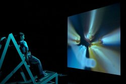

The Transmute Collective conceived and developed *Intimate Transactions* over a four-year period in phases from a single site, non-networked artwork to a multi-site, server-driven experience for two networked participants. In 2003, we showed a single site version to an invited peer group at the Brisbane Powerhouse Centre for the Live Arts in order to garner feedback. This led us to better understand what type of computational architecture would be required for the work to function successfully within a networked, multi-site environment. We went on to design and build a dual site version that we previewed at the Performance Space, Sydney in 2004. After further development, it was made tour ready and publicly premiered in February 2005 in Glasgow, Scotland at the National Review of Live Art/New Moves Festival. In 2005, it received a prestigious Honorary Mention and major showing at the Ars Electronica Festival in Linz, Austria It has also been shown simultaneously at the Australian Centre For the Moving Image, Melbourne and the QUT Creative Industries Precinct, Brisbane and later at the Institute of Contemporary Art, London [[https://www.ica.org.uk/index.cfm?articleid=14460](https://www.ica.org.uk/index.cfm)] and BIOS (New Synthesis of Urban Culture), [[https://www.bios.gr](https://www.bios.gr/)], Athens, Greece. In May 2006 it will be shown in Sydney, Australia. {#para5}

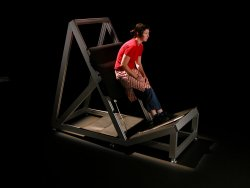

As artistic director of the project, I was responsible for shaping and directing the entire project, in close collaboration with an interdisciplinary team of sound artists, programmers, electronic engineers, sound artists, performers and ecological scientists. To achieve this, I drew upon a mode of making work that I call ecosophical  which I have been developing since completing my doctoral thesis, ‘Towards an Ecosophical Praxis of New Media Space Design’ (Armstrong, 2003). I summarized the general thrust of this practice in my 2004 paper, ‘Investigating Ecological Subjectivity’. {#para6}

We now live under the enduring mantle of a global crisis, a self-imposed act of unparalleled and seemingly irrational self-destruction, which we misname as ecological – WE are the crisis. Numerous contemporary theorists have suggested that this ‘problem of ecology’ indicates a crisis of human subjectivity and agency linked to a fundamental problem in how we image ourselves within the world.  Having observed how much new media art praxis operates largely without awareness of the homo-ecological implications of those practices, I began developing new processes for conceptualising and developing media art works, to which I applied the term ‘ecosophical’. My objective was to discover whether such works could be used to create contexts within which participants might reflect upon connections between the ‘problem of ecology’ and the proposed problem of humanity/human subjectivity (Armstrong 2004). {#para7}

In this paper I continue to reflect upon the conditions leading to this praxis as well as the issues and implications of this approach to art making, explaining how it has underpinned the critical journey of the *Intimate Transactions* (yes) project – a work which I would describe as ecosophical, praxis-led, embodied and networked. {#para8}

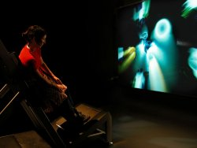

The term ‘practice-led’ is used by Carol Gray who describes a mode of research: {#para9}

> initiated in practice, where the questions, problems and challenges are identified and formed by the needs of practice and practitioners. ‘The research strategy is carried out through practice, using predominantly methodologies and specific methods familiar to us as practitioners (Gray, 1996:3). {#para10}

I use the term *praxis-led* to accord with this approach while emphasising an iterative, creative research practice where theory and practice are inseparable. I use the term*embodied* not only to stress the importance of the participants’ bodies in the work, but also to foreground the conversational, engaged sensibility that underpins its conception and production. This accords with Dourish, who describes embodiment as denoting ‘a participative status’ and: {#para11}

> the presence and occurrentness of a phenomenon in the world. So, physical objects are certainly embodied, but so are conversations and actions. They are things that unfold in the world, and whose fundamental nature depends on their properties as features of the world rather than as abstractions (Dourish, 2001:235). {#para12}

I have drawn upon a method of making media artwork that I call ecosophical (Armstrong, 2004). This approach has evolved out of a long-term study of principles of scientific ecology and ecological philosophies and draws from ideas and concepts to create a practice deeply underpinned by eco-social and eco-political engagement. Although this content and approach is subtle and non-didactic, it ultimately influences many aspects of the experience. In this paper I summarise some of the issues that drive this approach and discuss their implications within this particular mode of practice. {#para13}

 {#para14}

**Conditions Suggesting Ecosophy** {#para15}

Although humanity is now an integral part of almost all life’s interlocking cultural and biophysical ecologies, our collective history of ecological sustainment is bleak.[[1]](https://journal.fibreculture.org/issue7/issue7_armstrong.html) We have a deeply ingrained perceptive image of ourselves as lording over, rather than interacting within, our worlds. Our long history of dominance and oppression of ‘the other’ parallels our history of dominance and oppression of biophysical systems. This has led to the ecological malaise that grips our planet today. Vandana Shiva reminds us that we have entered an era ‘dominated by violence, conflict, disharmony and terror… troubled times and troubled thinking’ (quoted in Merchant, 2004:310). {#para16}

Theorists such as Guattari (1995), Fry (1999; 2000) and Conley (1997) have explored connections between the ecological crisis and a crisis of human subjectivity, deeply critiquing our homocentric conceptions of self and our perceived role within interconnected systems. Ecospsychologist Metzner suggests that ‘the most basic facts of our existence on this Earth …appears to be irrelevant to our psychology. Yet our own personal experience as well as common sense contradict this self-imposed limitation’ (1995). Similarly Felix Guattari suggests that the key question facing us today is how to produce, tap, enrich and permanently reinvent a subjectivity; a subjectivity which comprises our own attitudes, beliefs and emotions, in ways that might become comparable with a universe of changing values (1995:124). He suggests the deployment of a ‘four dimensional ecosophic object’ with the interrelations between them being in constant variation. {#para17}

Ecosophy is a word initially coined by Norwegian philosopher Arne Naess (1995) and subsequently developed by Sessions (1995). It is a series of guiding principles for thinking and acting – a lived philosophical position. Michael Heim describes how ‘ecosophy’ is derived from the Greek words ‘oikos’ and ‘sophia’, meaning ‘wisdom of the dwelling’ (1998). Founder of ‘deep ecology’ Arne Naess describes his own personal ecosophy, which he calls ‘Ecosophy-T’, as being a self-realisation, born both out of his development of and identification with the philosophical ideals of deep ecology and his evolving engagements with the world.[[2]](https://journal.fibreculture.org/issue7/issue7_armstrong.html) He suggests a series of broad, defining characteristics to which the ecosophical practitioner should subscribe, while also clarifying that an ecosophy is contextual, personal and therefore its definitions must remain open and fluid.[[3]](https://journal.fibreculture.org/issue7/issue7_armstrong.html) {#para18}

Ecology is popularly thought of as being just solely a scientific, biophysical discipline. However it is also a long established critical, philosophical discipline that theorises around the dynamic, dialogic relationships between multiple forms and manifestations of life. Correspondingly my ecosophical praxis is deeply engaged with the possibilities and qualities of conversational communication that either already do, or could feasibly exist, between forms of systemically located life, matter and technologically created forms. This praxis operates out of an embodied concern for breakdown and disjunctures within systems, particularly those skewed by human interference. Through my artworks, I aim to create discursive, artistic experiences inspired and focused by the possibility of metaphysical shifts in our understandings of place and role within dynamic, interlocking systems. One aspect of this approach leads me to favour interactive experiences that ask participants to reflect upon the implications of individual action and group collaboration within computational, aesthetic systems of which they become an integral part. {#para19}

This approach is epitomised within *Intimate Transactions* by its interface design (the ‘Bodyshelf’) and the networked, computational system that underpins it. The ‘Bodyshelf’ requires full body contact and continual movement by two networked participants, allowing them to co-creatively control much of the work’s complex computational systems. Although there are many ways to approach the work, it ultimately rewards participants with a willingness to collaborate, based upon an understanding of their own place and role within a series of complex, shifting relationships (manifested in image, sound and vibration). {#para20}

In my doctoral thesis (completed in 2003) and through subsequent works, I developed an approach to creating ecosophical work based upon a number of questions (considered as being always contingent and under development). This process of asking ‘ecosophical questions’ was key to *Intimate Transactions*’ conception, iterative design and development processes. {#para21}

**Ecosophical Questioning** {#para22}

Electronic networks are now an integral part of our human-material/cultural ecologies. They ‘seep into our consciousness, our everyday existence’ (Raqs Media Collective, 2005). The phenomena of the accessible electronic network arrived within my lifetime (courtesy of the US military) and the immaterial webs underpinning our networked society are now arguably the foregrounding ecology of interest within the media arts community. That network continually feeds us stories of terror, lost opportunity and collapse, information that we may often feel powerless to process or engage with. These increasingly urgent, seemingly intractable problems of dysfunctional ecologies demand our action and attention. {#para23}

Ten years ago, I began to ask myself how I might best act as a media artist? What role might I play through my profession that could be of any consequence in engaging with the problems of ecology? Tony Fry advises that an act of ‘sustainment’ should be ‘considered, circumstantially appropriate action’ rather than ‘a stock “solution”’(2001). I resolved that my contribution should be to deploy the interactive, connective, popular aspects of networked new media arts to create contexts for conversation around these pressing ecological issues. This would be best achieved through a located, engaged praxis that avoided didacticism. I believed that other professionals were already engaged with such approaches. {#para24}

At the start of the *Intimate Transactions* project, we began to pursue processes of ecosophical questioning around form, approach, modality and content. These specific questions are described in detail in my paper, ‘Investigating Ecological Subjectivity’ (Armstrong, 2004). This led us to design a durational experience for participants that required their active engagement. We resolved that physical movement would be central to the experience and that its effects would ripple through to affect all computational and experiential aspects. The two physical interfaces and their supporting environments should also have a strong physical presence, while not strongly detracting from the experience of the participants once engaged with the work. This led us to design the ‘Bodyshelf’ in collaboration with furniture designer Zeljko Markov. This unique hybrid of furniture and interface demands a particularly active physical engagement. Furthermore the work’s interactive, computational design was inspired by the energetic flows inherent within scientifically described ecologies (e.g. the flows of energy within ecological systems that originate from the sun/photosynthesis and that are subsequently exchanged via consumption and decomposition). {#para25}

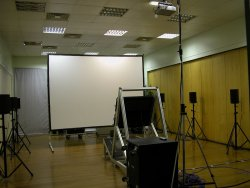

This focus on ideas of energy transfer concurred well with the performance theory and practice of Transmute Collective’s performance director Lisa O’Neill who performs in the Japanese tradition of Suzuki Theatre. This actor training method focuses upon the energetic centre of each actor and explores the subsequent energetic relationships between other actors and their audiences. This led us to conceive *Intimate Transactions* as a personal, performative experience in which both participants become woven within its systemic operations and immersed within multiple processes of dialogue, exchange and transfer. This parallels Arne Naess’s ecosophy, which declares ‘a rejection of the person IN environment image’ in favour of a  ‘relational total field image’ (Naess, 1995:151). {#para26}

Throughout these early design processes, my intention was never to attempt to mimic the sophisticated (and mostly mysterious) operations of biophysical or social ecologies, but rather to focus upon the connection-making and communicative features that these tools offered. This would involve recognising the potential these tools offer for creating simple energetic ‘transmission and reception paths’ metaphors. {#para27}

The first stage of this research involved a number of pilot projects, which initiated theoretical and practical approaches to dual site and online installation and created single and multi-site networked infrastructures. These led to two publicly presented works: *Liquid Gold*(2001), a dual site and online performance/installation event; and *Transact (Flesh, Skin & Bone)* (2002), an interactive installation: {#para28}

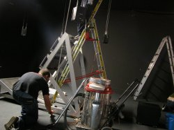

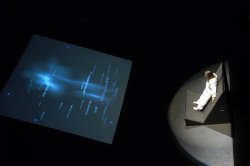

*
*

These works both had strong performance imagery created by Lisa O’Neill. As we better understood the role of performance within the interactive design process we decided to shift its role in the work, instead moving the participant towards a more actively performative context. This decision also recognized the power of choreography within the design of interactive systems, interfaces and virtual characterization. At that time, we also resolved to focus the work around what project mentor and sustainability scientist/mentor Elizabeth Baker named ‘ecological subjectivity’, a sense of self she describes in her writings as being intimately relational, embodied and embedded (1997: 261). We engaged Baker in a number of conversations around this topic and together highlighted three interlocking concepts, called ‘Me’, ‘Us’ and ‘Other’: {#para29}

> ME is…that bit the participant identifies as themself – as he or she.. US – for most people on the planet…is other people like me! Other PEOPLE like me. US is a more inclusive term…OTHER…is that stuff which is not like me, that stuff that is really other to me that I have no connection to. (Armstrong 2003) {#para30}

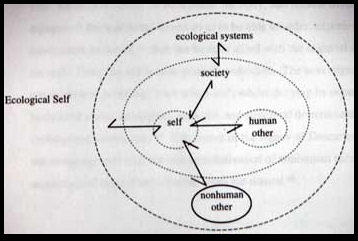

We used this trio of concepts as core organizing factors for the work, both within the scripting methodology and the media design. Each artist interpreted these ideas within their own forms: interaction design, visual design, sound design, bodily movement of the participant and interface design. {#para31}

The first iteration of *Intimate Transactions* (2003) was designed to give a single participant the opportunity to journey through three distinct movements within the work (‘Me/Us/Other’) using gentle body movements. These would all have different, but thematically related textural, textual and emotive sensibilities. The ‘Bodyshelf’ was designed not only to support the reclining body, but also to control the possible range of a participant’s body movements. These were choreographed to move between containment/compactness (envisaged as ‘Me’) through ‘Us’ towards ‘Other’ (increasing physical extension of upper body and limbs). This involved a physical shift from pressing arms and body backwards into the ‘Bodyshelf’ to reaching away from the ‘Bodyshelf’ and thus engaging with an overhead camera-controlled, gestural recognition system. This method of controlling the work was taught to participants before they began the experience. {#para32}

The ‘Me/Us/Other’ conceptual progression was also designed into the imaging of the body-based media activated by these movements. The interactive soundscape by Guy Webster was similarly created from a spread of sounds interpreted as personal/close/spatially familiar, moving towards distant/unfamiliar and spatially abstracted. This version of the work also included a textual component with animated words and phrases similarly arranged in thematic groupings that would emerge and combine with the body based media. These were drawn from Italo Calvino’s short story ‘Smog’, a work with ecosophical relevance that tracks a man’s obsessive preoccupation with a physical/psychological pollution enveloping his increasingly fraught relationships (1971). In all of these ways, the work used a single participant’s bodily expression as the means for invoking and exploring mediatised relationships that were at times comforting and personal, but that could quickly shift to moments of great intensity and agitation. {#para33}

It was my intention that this interactive structure would promote the metaphorical allusion to the aforementioned principles of ecological science and philosophy – alluding to a self re-imagining through navigational choices within this particular experience. Elizabeth Baker later wrote about her experience of this initial stage of the work: {#para34}

> The installation, I came to realise, is a way of exploring otherness, strangeness, unknowability in a safe way: a physical / aural / visual analogy to storytelling. Because it is safe, the individual is more likely to explore just that little bit further, to take themselves into unfamiliar territory…Its objectives are met through the experience of exploration. It helps us learn to push the boundaries of our familiar in ways that accept unknowability. In that, it is a small lesson in developing an ecological consciousness. (Armstrong and Baker, 2003) {#para35}

This first version of *Intimate Transactions* was shown extensively to focus groups. Subsequent discussion and debate with each of the participants uncovered some key design problems. A key issue was the lack of agency experienced by some participants who were unable to easily locate themselves within the experience and thus comprehend how their bodily actions related to changes within the work’s image, text and sound. The consensus was that a direct, controllable representation of their presence within the work would make navigating the experience much easier.

It had always been our intention to avoid making each participant’s presence central to the work, situating him or her as one key, environmental force affecting the experience (e.g. their actions might affect changes in colour, speed, mixing, replication or processing rather than the direct motion of an on-screen or aural entity). However, despite our satisfaction with the initial design, we also acknowledged that our experience of using the work was skewed by the many hours we had spent with it in discovering the broad subtleties of the work. Furthermore we had intended to make a work that would be effective within thirtyminutes or less as our research had indicated any longer would simply make the work unpalatable for exhibition/gallery curators. {#para36}

Therefore we decided at that stage to make fundamental changes to our design, ensuring it could work as a dual person, networked application. We decided that the structure required should be much closer to that of the multi-player game engine, which typically used avatars to represent the participants’ positions and activities, working in dialogue with other characters. Most importantly, this new approach would allow us to build upon and refine the ecosophical questioning that had led us to this point. {#para37}

**Developing an ecosophical networked praxis** {#para38}

In order to undertake this major systemic change at what was a late stage in the project’s funding cycle I brought together a new interdisciplinary team to work with our collective. At the outset, we resolved to capitalise upon the strengths of the ‘Bodyshelf’, retaining it as the work’s core navigational device because of its successes in establishing embodied energetic flows between the participant and the work. New team member Marcos Caceres brought with him the technical possibility of creating an underlying relational model for the work that would inherently encompass core aspects of ecologies, such as evolution, emergence and the exchange and transfer of objects/forms between two or more parties. This led us to imagine an entirely new computational model based upon *transactions* – exchanges between parties that would lead to change for all. We resolved to temper this formal idea of exchange by engendering a sense of increasing sensual intimacy between participants, particularly as acting remotely via a network had the potential to be an alienating experience. This involved collaboration with Pia Ednie-Brown and Inger Mewburn of RMIT’s Spatial Information Architecture Lab. On their research group’s website, they describe the sense of presence between participants that we were seeking as being ‘about ways that affective (qualitative, emergent) dimensions arise, move through and translate across different media, moments and spaces’ (Spatial Information Architecture Lab, 2005). {#para39}

Therefore we set ourselves the task of creating a new version of *Intimate Transactions* that was entirely networked, that would assure a strong sense of agency for participants and that would provide a more intuitive, navigational capacity for the ‘Bodyshelf’. Conceptually it would reinterpret the ‘Me/Us/Others’ idea whilst continuing to operate around ideas of energetic transfer and the performative role of the body. It would also use character-based avatars and icons for navigational ease and dual player familiarity and place transactive exchanges between them at the heart of the work in ways that necessitated collaboration. The work would attempt to also encourage a sense of increasing intimacy between participants and be welcoming and accessible to participants of different ages, cultures and body shapes. {#para40}

The opening video for this new work states: {#para41}

> You have just begun the *Intimate Transactions* experience. {#para42}
>
> Someone in another place is doing the same thing right now. You are connected together and standing on identical Bodyshelves. {#para43}
>
> Both you and this person will experience your own world of unusual creatures. {#para44}
>
> You can take things away from your Creatures, but in order to return these, you must interact with the other person. {#para45}
>
> How you treat these Creatures will ultimately affect what you see, hear and feel and what the other person sees, hears and feels. {#para46}

(Introductory Video, *Intimate Transactions*, Transmute Collective, 2005) {#para47}

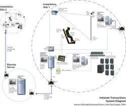

 {#para48}

 {#para49}

*Intimate Transactions* comprises two sites, each with a ‘Bodyshelf’, controlled via a server. Participants use their ‘Bodyshelf’ to control their own body-shaped avatar moving within a virtual audiovisual space populated by a group of other avatars (creatures). The work’s exploratory, navigational and interactive structure was adapted from the prior ‘Me –> Us –> Other’ (familiar –> unfamiliar) progression. Navigating within the work without the intention to transact with another creature or the other participant implies operation within the ‘Me’ realm. Interactions between two participants are termed the ‘Us’ realm (that is, a place of relative familiarity/empathy), whereas interactions between participants and creatures indicate a shift into the realm of ‘Others’. During the experience of the work, these loose distinctions dissolve as participants integrate elements of creatures and exchange them collaboratively with the other person. Participants are therefore encouraged to explore ‘otherness’ (set up through the transactive process of taking away images away from the creatures and embodying them). This collecting process, commonly situated as the way to ‘win’ in computer games, is designed to slowly destroy the creatures and their constituent environment (indicated by a rapidly increasing, overall sluggishness, lessening brightness and inability to transact smoothly). The only way to restore the ‘health’ of the system is to work collaboratively with the other person to return these objects to the creatures and thus raise the overall energy of the worlds. This new design celebrates the possibility of individual exploration by suggesting roles that ecologists terms ‘keystones’: ‘those species having a large, disproportionate effect, with respect to their biomass or abundance, on their community’ (Piraino, 1999). However it also stresses the need for collaborative action and sensitivity to the entire system. {#para50}

This model was achieved through the unusual design approach of creating two separate, local, parallel universes populated by two sets of creatures. Each participant’s local actions mean that the image and sound experience at each site may evolve and develop quite differently. However they are still able to view the position of the other person acting in their own local universe (but not actually observe what is also happening to their local creatures or the quality of their local environment). The shadow of the other person’s avatar implies ideas of ‘overshoot’, caused by ecological foot-printing and ‘entanglement’ whereby ‘quantum particles such as electrons’ remain ‘mysteriously linked even when separated by enormous distances.’ (Buchanan 2004:32). {#para51}

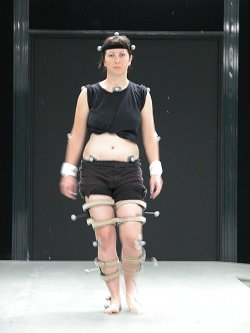

Although participants are able to influence an almost infinite array of image, sound and haptic outcomes, they can never exert absolute control either individually or collectively. Furthermore, the effects of all their apparently private actions ripple through the system to increasingly atrophy both worlds.  Although participants may choose to disappear into their own local worlds and never transact with each other this will quite quickly limit their experiences. Hence participants who choose, instead, to transact frequently with each other begin to read a representation of the state of each other’s worlds and then choose to alter their actions within the work accordingly. This encourages a reflective, embodied state that capitalises upon the work’s slow, engrossing pace of interaction and the subsequent increase in sensory awareness that accompanies the deceleration of bodily activity. {#para52}

The redesigned ‘Bodyshelf’ integrates navigational capacities for direction and intensity controlled via the feet or the back. These subtle, embodied navigational methods include a tilting floor, driven by body balance and weight and a pressure-sensitive backboard, driven by weight and position of the upper back, invoking subtle modes of body action that concur with the ideas of energy flow, centralisation and embodied focus developed for the initial version of the work. Vibrations were also incorporated within the ‘Bodyshelf’ structure, indicating subtle qualities of movement of the other remotely situated person. A further wearable device, located on the stomach (the haptic pendant) indicates the proximity and qualities of the other creatures, incorporating sensate responses at the core of the experience. {#para53}

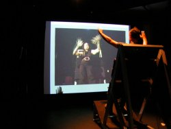

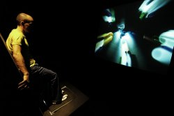

 {#para54}

These outcomes both built and extended upon the original process of ecosophical questioning, leading to four refined questions attuned to ecosophical networked praxis. They are relevant as a guiding method for other media artists engaged in creative practices with eco-social/political concerns and are listed here: {#para55}

1. Is the work part of a cyclical process of experiencing that shapes the way in which connected participants interface concurrently and co-dependently within networked new media spaces? Together, do these networked environments create a ‘living’ experience for which the work either initiates or provides the topological context? {#para56}

2. Is a relational field experience being constituted by the work that progressively negotiates and aligns itself within its host environments both locally and globally and does this develop a distributed poetics of energy transfer? {#para57}

3. Does each networked participant become enmeshed within the systemic experience of a work that alludes to the processes of energy flow within globally distributed ecological systems? Do participants collectively embody these energy exchanges in ways that integrate them within cycles of energy transfer, exchange and recycling woven together by the work’s server-based structures? {#para58}

4. Do all networked participants become immersed within processes of a broadening dialogue involving each component of the work, the connecting networks and other participants? {#para59}

**Conclusions** {#para60}

This paper has presented an intertwined journey of practice and theory evolved through the development of a major new work. This was also the vehicle for better understanding how praxis-led, ecosophical embodied research might be pursued within the networked domain. These new questions listed above will form the basis for the development of subsequent works and are also offered here to other practitioners who might use them to establish similar engagements within their own modes of praxis. The development and production of this work, and these resulting questions, therefore mark a renewed place from which to continue ongoing processes of ecosophical exploration and reflection. {#para61}

The significance of this journey for me is much more than simply the development of that vital tool kit of techniques, strategies, ideas and experiences or even an increasing body of artistic work. Such praxis is not simply undertaken, but lived and experienced in a way in which one’s own life merges into a desirable inseparability. Ultimately, ecosophical processes are integral to my personal, subjective investigation into what it might mean to think and act ecologically within a networked context. {#para62}

It is my desire and aim that others will also choose to also take on this pressing challenge. {#para63}

## Acknowledgements

I would like to acknowledge the support of the Transmute Collective of which I am the Artistic Director – Lisa O’Neill (Performer) and Guy Webster (Sound), my numerous creative co-collaborators (please refer to https://www.intimatetransactions.com/artists3.htm), The Australian Government through the Australia Council, its arts funding and advisory body & the Queensland Government through Arts Queensland, QUT’s Creative Industries Faculty and The Creative Industries Research and Applications Centre (CIRAC), The Australasian CRC For Interaction Design, the Performance Space (Headpsace  Residency Program) and my partner, Dr. Julie Dean.

>

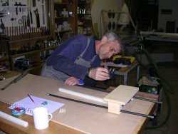

>
>

>
>

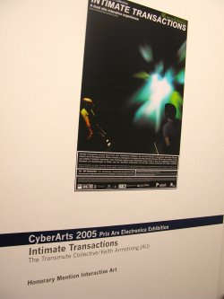

>
>
>
>

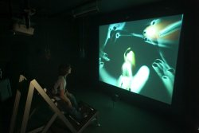

>
> * *
>
>

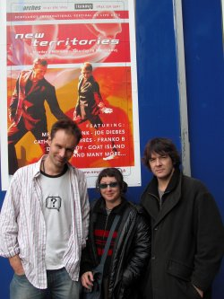

>
> #### **Author’s Biography**

Keith Armstrong was formerly an electronic engineer and Information Technology specialist, later training in visual,

new media arts with a strong engagement with innovative performance practices. (For full details, see [https://www.outlook.com.au/keith](https://www.outlook.com.au/keith)). He is an internationally exhibiting new media artist and is currently an Australia Council New Media Arts Fellow. He is the artistic director of the interdisciplinary Transmute Collective, and was formerly a Postdoctoral Fellow at CIRAC, Queensland University of Technology Creative Industries Faculty, Kelvin Grove, Brisbane, Australia and a lead researcher in ACID (The Australasian CRC for Interaction Design).

## Notes

[1] Tony Fry writes, ‘Sustainment is the result of whatever is necessary at any given place or time to counter the negations of the unsustainable. It essentially comprises of a collective giving value and acting. It cannot be reduced to a formulaic set of actions as it has to be conjuncturally responsive – in other words an act of sustainment is determined by taking considered, circumstantially appropriate action rather than applying a stock ‘solution’. Moreover, the act of sustainment taken is always one of addressing temporal consequence, it always produces change that, anthropocentrically, ‘gives time’. This expression of sustainment registers the highest order of species self interest, it fuses a recognition that ‘we’ cannot be response-able without being sustain-able, ‘we’ cannot secure the conditions upon which we depend without securing the condition upon which ‘that-which-is-not-us’ depends. No matter what we have come to believe, ‘we’ are not individuated entities but relational beings who have become eternally alienated from this condition – in this sense human centredness is being with an absolute blindness to the fact of our connectedness to both material and immaterial ecologies’ (2001).

[back]

[2] ‘A philosophy that calls for a profound shift in our attitudes and behaviour based on voluntary simplicity; rejection of anthropocentric attitudes; intimate contact with nature; decentralization of power; support for cultural and biological diversity; a belief in the sacredness of nature; and direct personal action to protect nature, improve the environment, and bring about fundamental societal change’. (Cunningham and Cunningham, no date available)

[back]

[3] Naess’ eight pointers to an ecosophy (listed at [https://www.haven.net/deep/council/eight.htm](https://www.haven.net/deep/council/eight.htm)) are

- The well-being and flourishing of human and non-human life on Earth have value in themselves These values are independent of the usefulness of the non-human world for human purposes.

- Richness and diversity of life forms contribute to the realization of these values and are also values in themselves.

- Humans have no right to reduce this richness and diversity except to satisfy vital needs.

- The flourishing of human life and cultures is compatible with a substantially smaller human population. The flourishing of non-human life requires a smaller human population.

- Present human interference with the non-human world is excessive, and the situation is rapidly worsening.

- Policies must therefore be changed. These policies affect basic economic, technological, and ideological structures. The resulting state of affairs will be deeply different from the present.

- The ideological change will be mainly that of appreciating life quality (dwelling in situations of inherent value) rather than adhering to an increasingly higher standard of living. There will be a profound awareness of the difference between bigness and greatness.

Those who subscribe to the foregoing points have an obligation directly or indirectly to try to implement the necessary changes.

[back]

## References

Australian Centre for the Moving Image, ‘Immersive interactive experience at ACMI, Intimate Transactions’, press release, (March 9, 2005).

Armstrong, Keith, M. ‘Investigating Ecological Subjectivity: Intimate Transactions (Shifting Dusts)’. PixelRaiders 2004, Sheffield Hallam University, Sheffield, UK, (Sheffield Hallam University Press, 2004).

Armstrong, Keith M. ‘Towards an Ecosophical Praxis of New Media Space Design’. Unpublished Ph.D. Thesis (Creative Industries Research and Applications Centre. Brisbane, Queensland University of Technology, 2003)

Armstrong, Keith & Baker, Elizabeth. ‘Keith Armstrong in Conversation With Liz Baker’, (2003), [https://embodiedmedia.com/projects/intimate_t/Bakerconv.htm](https://embodiedmedia.com/projects/intimate_t/Bakerconv.htm).

Baker, Elizabeth, ‘Ecological Being/Being Ecological: Self, Morality, and the Environmental Exigency’. Unpublished Ph.D Thesis (Faculty of Science, Griffith University, Queensland, Australia,1997).

Baker, Elizabeth. ‘Me, Us, Them’. (2005). [https://www.embodiedmedia.com/projects/intimate_t/ConvLizBak.rtf](https://www.embodiedmedia.com/projects/intimate_t/ConvLizBak.rtf).

Buchanan, Mary. ‘Mind Games: Quantum Tricks That Read Your Thoughts?’ New Scientist, 184 (2004) 32–34.

Calvino, Italo. Smog, The Watcher & Other Stories (New York: Harcourt Brace Jovanovich, 1971), 181.

Conley, Verena. Ecopolitics:The Environment in Poststructuralist Thought (New York: Routledge, 1997).

Dourish, Paul. ‘Seeking a Foundation For Context-Aware Computing’, Human Computer Interaction (2001), 229-241.

Eldredge, Niles & Barnet, Belinda. ‘Material Cultural Evolution: An Interview with Niles Eldredge’, Fibreculture Journal, issue 3 (2004), [https://journal.fibreculture.org/issue3/issue3_barnet.html](https://journal.fibreculture.org/issue3/issue3_barnet.html).

Fry, Tony. A New Design Philosophy: An Introduction to Defuturing (Sydney: UNSW Press, 1999).

Fry, Tony. ‘Know Your Enemy: Defining the Problem of Unsustainability, Shaping the Sustainable Millennium’,paper delivered at Shaping the Sustainable Millennium Conference, Queensland University of Technology, Brisbane, (2000), [https://www.teamdes.com.au/pdf_files/Know%20Enemy.pdf](https://www.teamdes.com.au/pdf_files/Know%20Enemy.pdf).

Fry, Tony. ‘Openings Into The Ecology of Information Technology, Impacts of Information Technology Briefing Paper’, (2001), [https://www.edf.edu.au/Pathfinding/Archived/IIT/BriefPart1.htm](https://www.edf.edu.au/Pathfinding/Archived/IIT/BriefPart1.htm).

Gray, Carol. ‘Inquiry Through Practice: Developing Appropriate Research Strategies’ (1996), [https://ww2.rgu.ac.uk/criad/cgpapers/ngnm/ngnm.html](https://ww2.rgu.ac.uk/criad/cgpapers/ngnm/ngnm.html).

Gablik, Suzi. Conversations Before The End of Time (New York: Thames and Hudson, 1995).

Guattari, Felix. Chaosmosis: An Ethico-Aesthetic Paradigm (Bloomington & Indianapolis: Indiana University Press, 1995).

Heim, Michael. ‘Virtual Reality and the Tea Ceremony’ (1998), [https://www.mheim.com/html/docs/vrtea/vrtea.html](https://www.mheim.com/html/docs/vrtea/vrtea.html).

Spatial Information Architecture Lab, ‘The Liveness Manifold’ (2004), [https://liveness.sial.rmit.edu.au/](https://liveness.sial.rmit.edu.au/), (2005).

Merchant, Carolyn. Reinventing Eden, The Fate of Nature in Western Culture. (New York: Routledge, 2004).

Metzner, Robin. ‘The Place and the Story: Where Ecopsychology and Bioregionalism Meet’ (1995), [https://trumpeter.athabascau.ca/content/v12.3/metzner.html](https://trumpeter.athabascau.ca/content/v12.3/metzner.html).

Naess, Arne. ‘The Shallow and The Deep, Long-Range Ecology Movements’, in Deep Ecology for the 21st Century, ed. George Sessions (Boston, Shambhala, 1995), 151-155.

Naess, Arne. ‘Eight Points’ to a deep Ecology, [https://www.haven.net/deep/council/eight.htm](https://www.haven.net/deep/council/eight.htm).

Piraino, Stefano and Giovanni Fanelli. ‘Keystone Species: What Are We Talking About?’ Conservation Ecology, vol. 3(1) no. 1 4, (1999), [https://www.ecologyandsociety.org/vol3/iss1/resp4/](https://www.ecologyandsociety.org/vol3/iss1/resp4/).

Robins, Brent, ‘Maurice Merleau-Ponty’, from What is Existential Phenomenology? [https://mythosandlogos.com/MerleauPonty.html](https://mythosandlogos.com/MerleauPonty.html).

Sessions, George. Deep Ecology For the 21st Century (Boston: Shambhala, 1995).

Transmute Collective. Liquid Gold: The New Adventures of Ling Change, dual site media performance with streamed and online components, Brisbane, Australia and Sheffield, England, (2001).

Transmute Collective. Transact (Flesh, Skin and Bone), interactive installation, State Art Galley, Hobart, Tasmania, (2002).
