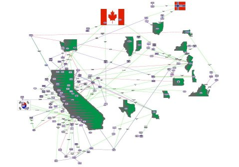
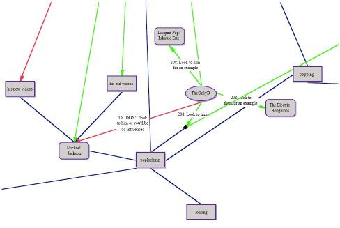
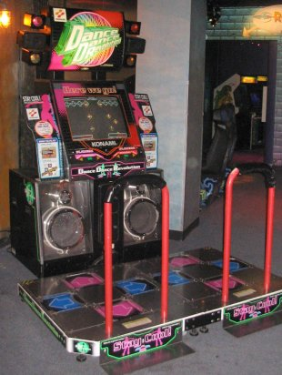

As a few scholars of media have begun to note, Actor-Network Theory is uniquely suited to unite the disparate models of the social role of media presented throughout the past century. Where some social constructivist scholars worry that Marshall McLuhans work attributes too much agency to media products themselves, ANT welcomes this idea and suggests we look at how human power is in fact invested in and extended through these products, as Joost Van Loon and Matthew Fuller have detailed in their work (Fuller, 2005; Van Loon, 2005). Where a Chomskyan or Bagdikianian view assumes that media monopolies and other hegemonies retain all power in determining the interpretation of a message, ANT keeps the construction of these hegemonies power in perspective while at the same time considering the repurposing of their messages by fans which is described by audience studies scholars (Hills, 2002; Jenkins, 1992). Rather than insist on a monolithic causality – either on the part of new technologies or of those who use them – in understanding the effects of a medium in society, ANT suggests we need more studies like Ronald Deiberts description of the mutual development of the printing press and Renaissance society, or James Careys elaboration of the relations between the telegraph, railroads, commodity standardization, and the rise of the futures market (Deibert, 1997; Carey, 1988). {#para2}

It is this ability to support a more ecological sense of media which makes ANT an ideal methodology for a world in which media increasingly cross-promote each others contents, are owned by the same companies, and come to us through the same pipes. And it is also ideally suited for media which contain multiple references to other media forms such as video games. One of these is *Dance Dance Revolution* (*DDR*), the large-motor, rhythm-based video game which I will discuss in this paper. {#para3}

*Dance Dance Revolution* is one of the most visible of the rhythm games, a genre popular enough in Japan that at its peak, *DDR* manufacturer Konami claimed there was a *DDR* machine in every arcade in the country. The game has since spread throughout much of the rest of the world, and has appeared in a number of television shows and music videos. In *DDR*, players stand on a raised stage, pressing buttons with their feet in time to cues on the arcade machines screen. Some players choreograph dance routines to go with the steps specified by the machine. {#para4}

One of the few other investigators of dance games, Jacob Smith, notes, {#para5}

> even when media technologies leave a gap for a very specific audience behavior, that gap can always become the space of an astounding range of active and creative response and that music and dance are powerful vehicles… for the performance of identity. (Smith, 2004: 81) {#para6}

While many game texts make multiple references to other media texts, players of dance games have a great deal more agency in referencing other texts during play. It is the activity of the human body in *DDR* which makes this possible. Arcades have always made video games a performative medium by dint of being public spaces, but in most digital game spaces, even massively multiplayer online games, there have traditionally been few affordances for original creativity (beyond a small system of binary choices) which affects subsequent play. Indeed, much of the games industry seems ill-at-ease with the possibility of turning over creative control to players.[1] {#para7}

*DDR* takes creative intertextuality out of the virtual world of the game. It gives us play writ large in a range of forums. The connections players make to other texts are visible on their bodies, not just on the screen, as they choose different dance moves and styles. Arcade visitors stop, watch, and comment on their style. Players also share videos and ideas about the game in forums online, sending the activity of creating the games meaning far from arcades and home consoles. Beyond everyday activities such as these, decisions about how to play dance games are also made at dance game competitions and in the scoring of their judges. All of these sites to a greater or lesser extent inform the paper at hand. {#para8}

While my research confirms Smiths claim that *DDR* has left a large canvas on which its artists may creatively express themselves, my own investigation of how playerstalk about the dancing element of *DDR* play indicates that the dominant forms of *DDR* dance are shaped, and often limited, by conceptions of dance and play and associated identities external to *DDR*, and by global cultural and economic flows. I find Bruno Latours conception of antiprograms (see below for an explanation of this term) of great use in understanding why players reject some of the features of the game and accept others. Contrary to some critics complaints that ANT cannot explain broad social forces, I also find Latours concept of black boxes (see below for an explanation of this term) useful in modeling how players tacitly accept homophobia and racial stereotypes, especially when coupled with Castellss ideas about global cultural and economic flows. {#para9}

This paper traces successful and unsuccessful attempts to control the meanings of the game, specifically with reference to what dancing means in this context, as the game moves between various interested parties – game developers, players, Internet forum participants, and other media producers. Who decides how *DDR* players dance, and at what times? Are the decisions about play made in the development meeting, the arcade, competitions, online, or around the home console? Globally, how do some regions or groups emerge as experts or leaders in play style? {#para10}

### Methods

While an understanding of media construction as large-scale as Deiberts or Careys is beyond the scope of this paper, I will attempt to reconstruct the forces shaping players stylistic decisions by doing an analysis of dance game machines and software, and of a single forum thread on *DDRFreak.com*, a major website in the dance game community. {#para11}

This thread, titled ‘Freestyling Tips, is a site in which players negotiate the ideal ways to perform freestyle, a style of *DDR* play in which players engage in more creative movement than they do when simply playing for points, and may in fact sacrifice points for the sake of style. It involves putting significantly more thought and effort into movement in the torso, arms, head, etc., or using the feet and legs more creatively. There has been some discussion as to whether freestyle implies improvised dance, or routines; it has been used interchangeably for both, though a distinction between routines and improv is sometimes made at competitions. {#para12}

In addition to following the references that players on the Freestyle Tips thread make to external cultural sources, and the references to these sources made within the game itself, I draw on external points of triangulation. The first is an earlier survey of players I conducted, as well as interviews of players at an international *DDR* competition. I also draw on my own knowledge of dance after ten years of casual learning in a range of styles, from jazz and tap to West African and bhangra, not to mention playing *DDR* myself. Finally, I make use of the findings of other papers on *DDR* and the related medium of karaoke. Using these triangulation points, I hope to sketch out a map of the multimedia, international, social network in which the game is positioned (Smith, 2004). To better illuminate the international dimension, I will make a brief digression along the way to discuss the location of *DDR* arcade machines in a Castellsian space of flows. {#para13}

### Textual analysis and network mapping

As syntagms and programs (see below for an explanation of these terms) are composed of arguments made by those engaged in a network shaping the use of technologies, a textual analysis of the Freestyle Tips thread seemed likely to yield a snapshot of players conceptions of the game. I did not have time to look at the complete Freestyling Tips thread, though I would have liked to. At the time this paper was begun, over a year ago, the thread was over 55 forum pages of text, or 1114 posts. This article, then, represents an analysis of the beginning of the community’s wrestling with the idea of “freestyle. The thread began July 26, 2002 with a post by staff member Miss Toy; I followed through post 299, a little over a quarter of the discussion on this topic. {#para14}

Simple grammatical analysis of the thread was performed on the utterance (sentence) level. Statements about specific players, dance styles, musicians, and other cultural actors *enroled* by players into *DDR*s network were judged as having a positive, negative, or neutral attitude toward that actor, based on simple linguistic judgement (looking to negatory or charged words). I then literally drew out a network of these statements, linking the poster and their referent with a single line indicating the semantic charge of their statement – positive, negative, or neutral.(Figures 1,2) Subsequent references to the same actor were added as additional links. To make it easier to visualise this propositional networks relation to traditional centers of power – the persistent centers of capital and media power, which Castells notes have carried over from the Industrial Revolution to the Information Age – I then overlaid this network over a rough map of the United States and other relevant countries, situating posters and their referents in the geographical places from whence they were posting (Castells, 2002). {#para15}

I am assuming players truthfully register where they live in the profile information *DDRFreak* lists to the left of every post (they are not obligated to, this being the Internet, where nobody knows you’re a dog; but why else would a kid cop to living in Scranton, Pennsylvania?). Using this self-reported information and other clues (mentions of location in posts, etc.), the locations of only about one third of commenters could not be identified. The two thirds who did report mostly identified as residents of the United States, reporting from (or referring to players in) California, Delaware, Florida, Illinois, Indiana, Louisiana, Massachusetts, Missouri, Pennsylvania, New Jersey, New York, Ohio, Texas, Virginia, and Washington State – interestingly, all of these states with borders either on major waterways or another country, historically raising the likelihood that residents have more exposure to international cultural flows. One poster hailed from Norway, one was from Northern Ireland, and a few were from Canada. Additionally, a few references were made to *DDR* performers from Korea. {#para16}

While *DDRFreak*‘s forums are open to visitors from all over the world, and have specific boards for other countries and regions, the bulk of commenters on this thread appeared to be American (certainly among players reporting their location). My discussion will thus focus on American styles of playing *DDR*, and specifically American freestyle. {#para17}

### Background

***Relevant elements and applications of ANT*** {#para18}

A brief discussion of key ideas in Actor-Network Theory (ANT) which I will make use of is in order. Readers familiar with the work of Bruno Latour will quickly notice that I am sticking closely to the ideas he initially put forth in *Science in Action*, without making much reckoning of his later revisions to his overall project. This is in part because I am new to ANT, and *Science in Action* is the text I know best. However, I also do not find that Latours revisions, which are largely philosophical, substantially affect the simple yet usefully abstract tools he laid out in this first sally. I add to my toolbox a few extra tools developed by users of his work. {#para19}

Chesher (2003), for one, has suggested that media offer potential *avocations* for their users, harking back to Weber’s use of the word (Weber, 1946). Avocations are akin to identities, though they imply additional legitimacy imparted by the machine and a distinct set of actions related to this identity which the user may invoke to operate the machine. Chesher also discusses *affordances*, or the features of a technology which offer users the opportunity to act on it in various ways. The avocations and affordances offered by *DDR* machines will be the first things I describe following a description of my methods. {#para20}

Chesher also draws on Latour’s ideas about the ways humans and objects become linked in chains and networks to support particular arguments, technologies, or ways of being. He calls these chains *associations* or *syntagms*, the latter referring to linguists’ term for the syntactic structure of a particular sentence (Latour, 1999). I will most often use this latter term. I generally take as my syntagms the ideas of how to dance, and what it means to dance, put forth by players, game designers, and a broader range of cultural commentators on this issue. {#para21}

Latour has stated that these arguments rarely remain the same as they move out into the world and are adopted by others; rather, other people change them to fit their purposes, modifying their affordances and the avocations they offer. The original idea he calls a *program*. The conflicting interests of those it passes on to he describes as *antiprograms* (Latour, 1999). Changes to the order or content of syntagms or associations Latour calls *translations* – say, a change from video games are for boys to some video games are for boys but some are for girls or video games can be played by anyone, with associated supportive changes to game objects themselves, the contexts in which they are played, the places they are sold, the people who develop them, etc. (Latour, 1991). {#para22}

But the originators of an argument have at their disposal a number of tactics to try to prevent excessive translation and thereby maintain their initial arguments intact. One of these which I will discuss is *framing*, or the specification of an argument’s intended audience by the text containing the argument (Latour, 1987). Framing will be briefly considered in the discussion of the machines hardware and software. {#para23}

Another idea from Latour which I will make use of is that of an *obligatory passage point* (Latour, 1987). Obligatory passage points need little explanation; essentially, they are the claims made in any argument or the affordances of any technology which must be reckoned with if one wants the benefit of the argument or technology. In playing *DDR*, the only obligatory passage point is pressure on the buttons, as I will discuss later. {#para24}

One last idea of Latours is that of the *black box*. Latour borrows this phrase from engineering, using it to describe a machine whose inner workings are unknown but whose output can be expected to be consistent given a consistent input (Latour, 1987). He alternately uses it to describe arguments (*programs* or *syntagms*) which are generally taken to be factual, and are not exposed to questioning or investigation when brought in to support other arguments. {#para25}

I will, finally, also make use of Brandt and Clintons work using ANT to bridge the divide between globalist and localist traditions in the field of new literacies (Brandt, 2002). New literacies, concerned as it is with both the technological changes to and human construction of practices of reading and writing, is not far from a consideration of media ecology (and is, as it happens, also the theoretical framework with which I am most familiar). From their article, I have gleaned two more Latourianisms: *localizing moves*, which encompass actions of humans and things in framing or partitioning particular interactions, and *globalizing connects*, which serve to connect people and things on a larger scale through the creation of abstract categories, fictional worlds, text-delivered imperatives, or engagement with other places or times (Brandt, 2002). These ideas come into the picture particularly as I consider the ramifications of the global media market and other economic factors on the historical shaping of freestyle play. {#para26}

***Arcades in international perspective*** {#para27}

The distinction between American and other play styles is important for a couple of reasons. Patterns of arcade and console game use have been demonstrably different across national boundaries (Suess, 1998). Console play in the United States has historically been the domain of males, often for reasons of access (Lenhart, 2001; McNamee, 1998). In recent years, much has been made of an increase in women playing games; however, these have tended to be puzzle and card games on home computers or handhelds, not games on consoles or in arcades (IGDA, 2004). But anecdotal evidence from some other countries, such as Japan and England, shows that *DDR* players in arcades there are more often female. *DDR*‘s initial success in Japan has been attributed to the fact that in that country, arcades are a place to take your date rather than a masculine preserve. {#para28}

I focus on arcades rather than the games home version because *DDR* first made its way into the United States in arcades. The first legal version released for the home console did not appear until a few years later. So *DDR* was subject to arcade demographics and arcade culture first. Additionally, the arcade space fosters a performance dynamic which is simply not present in the home, where strangers are not likely to happen by and watch people play or try it out themselves. {#para29}

I make the distinction that the first *legal* version appeared in 1998 because *DDR* culture appears to have spawned in U.S. arcades before Konami officially shipped machines here. Some arcades have had illegally imported Japanese *DDR* machines for years. Players were also burning discs of the console versions for each other and buying mats from Asian sources so they could practice at home before the first American home versions of the game were produced. While I do not have statistics to back up this observation, anecdotal observation suggests these illegal machines, which appeared in predominantly Asian immigrant communities, seem to have helped shape the rise of *DDR* culture on the Internet around the wealthy technopoles discussed by Manuel Castells, following trends in global society as a whole. {#para30}

On *DDRFreak*, production of *DDR* culture is largely mapped around major urban areas on the Pacific Rim. *DDRFreak*‘s founders, and a number of its current operators, are Californians. It is likely there were more *DDR* machines in Californian arcades earlier than anywhere else in the States. Perhaps as a result of this abundance of resources, *DDRFreak* was one of the first websites on *DDR*. Tens of thousands of players have also contributed to the stability of the sites reputation, becoming *enroled* in its discussions. It has become Googles number one hit for the phrase dance dance revolution, which means that a preponderance of links from other sites, particularly other popular sites, link to *DDRFreak* when referring to the game. *DDRFreak* is also one of the most complete sites; where other sites may only have forums, *DDRFreak* also includes a listing of machine locations, unlock codes, news, song listings, step pattern printouts, videos of competitions, and other supporting materials for those looking to improve their gameplay. {#para31}

To this day, the volunteer-developed list of *DDR* machines still lists a disproportionate number of arcade machines in California (402) while the number in Texas is less than half that (153) and the combined number listed in New York, New Jersey, and Connecticut (considered by the US Census to be the New York City Metropolitan Area) is only 173. To make this proportional imbalance clear, there are approximately 35 million people in California, 31 million combined in NY, NJ, and CT, and 22 million in Texas. {#para32}

Interestingly, the Census numbers which most closely resemble the proportion of *DDR* machines to players in these states are those for the populations of resident people of Asian descent. Asians and Asian-Americans make up nearly 11% of the population in California, between 2% and 5% in the New York Metropolitan Area, and close to 3% in Texas. Asians appear to have been largely responsible for bringing machines into arcades in the US. For example in the games earliest days in New York City (circa 2000), the two arcades in Queens which had *DDR* machines, as well as at least two of the four most popular arcades in Manhattan, were run by Asians. Two of these arcades were located in the neighborhoods with the largest percentage of Asian capital flowing into local banks – Flushing and Chinatown (Kuang 2002). {#para33}

A number of the *DDR* players participating in the *DDR*Freak forum on freestyle, and a number of the players featured in the sites videos, are of Korean, Philippine, Chinese or Japanese descent. Some wear their ethnicities as a badge of pride, choosing handles like Tsinay Butterfly (tsinay being Chinese Filipina) or asian invasion 2000. {#para34}

In addition to imports of illegal machines, Smith (2004) has noted that the availability of videos of *DDR* performance teams in Japan and Korea has also informed *DDR* play in the States. Citing Condry (2001), he notes that ‘movement of the body moves easily across linguistic and cultural boundaries, and that movies and videos are a primary channel for this exchange. Players in the United States were thus able to judge moves in Asian players routines and adapt them to their own style without needing to know how to speak Japanese or Korean, or the context of the culture in which their dances arose. {#para35}

Interestingly, as Smith describes in depth, both the music and graphics programmed into the game and the styles of dance performed by Asian players were heavily influenced by the popularity of breakdance in Japan (Smith, 2004). The cultural flows in which *DDR* participates are ultimately circular: Japanese youth became interested in American breakdance; the style became *enroled* in Konamis production of *DDR*; and, finally, the game returned breakdance to the States, in deracinated form (Smith, 2004). {#para36}

These patterns suggest *DDR*s connection to the larger patterns of global flows of labor, capital, and media between the United States and Asia. As Castells notes, these flows are to some extent built on pre-established patterns of commerce. Large cities of earlier eras – the aerospace city of Los Angeles, the port city of San Francisco, and the world commerce center of New York – continue to be where capital flows and immigrants gather. As Castells describes, they also continue to provide resources to support the cultural life, outside of the workplace, sought and prized by professionals in the new economy. And it should be noted that *DDR* seems to be most popular in these (immigrant) communities. There might be more support overall in them for related ideas about dancing and martial arts which were initially foreign to American culture. Various black boxes of *DDR*‘s main tenets – dance, urban and foreign music – would not likely have been as welcome outside of these major nodes on the network, for example, in the American South.. {#para37}

Indeed, an initial survey of players yielded more concerns about non-players heckling *DDR* players in the American South than in other parts of the country (Andrews, 2005). Additionally, Southern players who travelled to the *DDR* National Championships in New York reported having to defend themselves from criticism at arcades. {#para38}

Players awareness of global power centers was illustrated for me at one point on a trip to Barstow, a desert city little more than a glorified bus stop halfway between Las Vegas and Los Angeles. Stopping through a video game store there, I asked the twentysomethings at the counter whether there was a local arcade with *Dance Dance Revolution*. ‘Pssh, we wish, they responded. ‘Where do you think you are, Los Angeles? *DDR* players are aware – as so many on the periphery are – that cities which are not major nodes fall through the network mesh; this likely impacts who they look to when attaching their dance styles to others’ aesthetic arguments. {#para39}

It may be telling that when one player whose profile indicated he was in Norway suggested on the freestyle forum that other players should look to boy bands N’Sync and the Backstreet Boys for moves, he was soundly ignored, aside from one tepid comment. It was made by a player in Ohio. (‘[E]veryone has there [sic] own little way of dancing, the Ohio player said. ‘[…] if you can do other stuff like nsync/bsb stuff very good, stick with that.) In an earlier survey of players, most dismissed the possibility of doing moves performed by these groups, who are usually associated with a fan base of preadolescent girls (Andrews, 2005). {#para40}

### Findings and discussion

**A textual analysis of the game *Dance Dance Revolution*** {#para41}

Because ANT follows the arguments passed around in communities of practice, I begin here with an analysis of those aesthetic arguments inherent in *DDR*s software and hardware, then move on to the arguments about dance/play made by visitors to the Freestyle Tips forum. The former stand in as residues of the practices of those creating and distributing the game – programmers, designers, marketers, and arcade machine vendors – which shape players play practices. A more complex and accurate picture of the affordances and avocations of dance game software might emerge from an investigation of the practices of coding, marketing, and distribution. This would present a longer history of the programs of dance games in the Latourian sense of the intent of their developers: how the ideas of the developers were translated in the process of development cycles and sending the game to market (Latour, 1999). As is so often the case, however, with academics running up against industrys interest in maintaining proprietary control of information, , such an investigation was not within my reach at the time of writing.[2] {#para42}

A more accurate understanding of *DDR* might also be reached by beginning not only with *DDR*, but with its dance game contemporaries *In The Groove*, *Pump It Up*, *Para Para Paradise*, and *Dance With Intensity* as well. This would give a clearer picture of the game’s comparative affordances, meanings of the game evident in choices made by players and arcade owners as they select one game over another, and the position of the game in the global market. However, within the United States, dance game culture seems to extend to these other games without significant translation. And while the name of the website I will focus on is *DDRFreak*, the other games are discussed on the site as well. {#para43}

### Hardware and its effect on the shape of *DDR* play

Knowing which of the arcade machines avocations and affordances are picked up or ignored – and which limitations are circumvented or obeyed – by the players is the beginning point of understanding the translations made as the game makes its way into the cultural landscape. In the following discussion of the features of a *DDR* arcade machine, I will focus on those relevant to the discussion of key norms agreed upon by the *DDR* community, and to a few dance moves which come up most often in the early discussion about freestyle. {#para44}

Players generally encounter *Dance Dance Revolution* in one of its two main forms: either as an arcade game or as a home version played on a video game console (Playstation or XBox). Because I will focus here on freestyle play as public performance, I will consider only the hardware affordances of the arcade version. The softwares affordances and avocations are the same across the home and arcade versions. {#para45}

An arcade setup consists of a fairly traditional arcade console with a few major additions: flashing stage-style lights mounted around the monitor and speakers, and, most importantly, a raised metal-and-plexiglas platform big enough for two players to stand on, with safety bars rising behind them. (figure 3)[3] . The platform is made up of two controllers with four directional buttons interspersed with metal squares where each player can stand without triggering a button. The buttons are spaced so players with their feet on Left and Right (or Up and Down) have a slightly spread stance, depending on how tall they are. The only hand-operated buttons on the machine are used in menus to select songs and play modes. {#para46}

The core gameplay mechanic of classic *DDR* is quite simple, sort of an inverse *Space Invaders*: arrow icons indicating the four stage buttons – left, front, back, and right – rise to the top of the screen, and the player is supposed to step on the correct button when the corresponding arrow hits a target. {#para47}

Considering the hardware on its own, *DDR* seems to suggest only a few of what Chesher calls “avocations, and simple ones at that: that of dancer, that of star, and that of game player (Chesher, 2003). These avocations are culturally very generic, with the arcade hardware implying any form of dance which might be performed on a stage with electric enhancements like lighting and a stereo. The only culturally specific reference which could be read into the arcade machine itself is to the disco-era movie *Saturday Night Fever* (Badham, 1977);when the player steps on one of the plexiglas buttons, it lights up much like the dancefloor in the club depicted in the movie does. {#para48}

Aside from these generic avocations, no part of a players dance style is explicitly defined by the hardware itself. In *DDR* gameplay, the only obligatory passage point is pressure on the buttons. Even the line of sight may be foregone as competing players memorise foot patterns the way concert violinists memorise sheet music, and sometimes play backward or blindfolded. There is a great deal of leeway in how a button may be pressed – with a flat foot, heel, or toe, or even an elbow, hand, knee, or buttock. Players could bob their heads like pigeons, do the Macarena with their arms, shimmy their hips, and go knock-kneed; they are at liberty to adopt any style, so long as they press the buttons. In freestyle competitions, points only make up part of the overall score; the rest is scored by human judges. {#para49}

While the simplicity of the step as passage point allows for diverse step styles, it does encourage players to avoid foot movements which do not make a hard impact on the buttons (especially in arcades, where heavy players often stomp the buttons into insensitivity). Simply on the level of physical affordances, then, *DDR* is not an ideal stage for jazz dance or ballet. It would hypothetically work fine for stomping dances like clogging, flamenco, or tap. However, players generally ignore these styles and choose moves based on other cultural frames instead, as I will explain in a later section. {#para50}

The arrangement and spacing of the buttons also have their effect on what may be performed. While there is nothing stopping players from placing their feet on the corner metal spots which do not have buttons, they wont get points for stepping there. In order to hit the buttons with the greatest ease it is advantageous for a player to stand in the middle of the platform, on the metal plate there, if not on the buttons themselves. Thus, videos show *DDR* players use less of what in technical dance language is called the diagonal – movement not going forward, backward, or sideways. This is not a hard-and-fast rule; while doing the Running Man or C-Walk, two sliding moves which come from hip-hop, players may well step on the metal plates. However, the hardware does generally constrain movement in this case. When players’ feet are seen touching a corner spot, it is more for efficacy than to make dramatic use of a different angle. {#para51}

Travelling across two pads, meanwhile, is difficult. The buttons of the two pads put together are not evenly spaced for the natural human strides of which most dance forms, from Greek folk dance to ballroom foxtrot to West African celebratory dances, make use. Thus this awkward configuration shapes the dance in its own way: doubles routines where one person plays on both pads are marked by what looks like stumbling as players move to step on buttons which are right next to each other rather than a stride away. Grace may be hard to achieve. {#para52}

The spacing of the buttons around the metal square in the middle of the cross also tends to lead to certain postures. Players rarely have their feet together, again because it’s harder to score that way. Dance styles based on a broad stance look good (as do martial arts), while narrower-stance dances like ballet may look awkward or be hard to perform. {#para53}

The safety bar behind the players and the stage’s proximity to the console in the arcade also constrain what is possible. The platform size leaves players 2.3 square meters each in which to perform. Still, players get creative with the amount of space they allow themselves to use; this limited space does not rigidly determine play. {#para54}

### Software and its affordances for diverse styles

While the hardwares avocations tend towards the generic, the software, by contrast, offers a multitude of specific ways of identifying with the game. {#para55}

If the player does not immediately begin to play, the game cycles through demo clips and advertisements. During these clips, the player becomes acquainted with the ubiquitous voice of the Announcer. In the Japanese import versions of *DDR* games first brought to the United States, this was an enthusiastic-to-the-point-of-naïve male voice who judged your score. His diction made it clear that the developers’ first language was not popular English, and suggested these voiceovers may not have been developed for English native speakers (his most elaborate exclamation was ‘I can see a *dream* in your dance! I can see *tomorrow* in your dance! We can call it Our Hope.) {#para56}

Later mixes of *DDR* seem more tailored to speak to an American audience. The announcer (still male) affects the kind of growl cereal advertisers use when trying to convince children that their product is totally radical, with urban or black English pronunciations and mannerisms (‘yo!, ‘It’s a new rekkid [record]!, ‘Game ovah) thrown in. As the game begins, the announcer punctuates the music with comments, shaping expectations of how one should play. He speaks as if the game can see the overall movement of the dancer, not just judge the feet on the pad (‘I love your style – show me how to do it!). {#para57}

Most importantly for the subject of freestyle play, in recent versions the announcer directs the player’s attention to a new game feature, saying ‘Go towards the full combo! at the beginning of certain songs. Bonuses for full combos (a score of perfect or great on every step) are a relatively new incentive for *DDR* players who play for a high score rather than to show off their skills and look good. The presence of the full combo bonus may have an impact on the number of players who choose to dance freestyle, as I will discuss later. {#para58}

Players choose a mode, then in some versions get to choose an avatar. The earliest avatars were an afroed black man in a suit, named Afro, and a skinny, scantily-clad blond white woman named Lady. Over time, players have been able to choose from a broader range of white, black, and Asian characters, as well as robots, abstract male and female symbols, girls dressed as animals and devils, and a baby. Echoing Smith’s comments about the ways in which disco, rap, and other musical forms in the game become divorced from their original cultural referents, and following what anime commentators call *mukokuseki* (nationlessness), many of these characters are without distinguishing ethnic or cultural features (Baigent, 2004; Smith, 2004). {#para59}

However, a few distinct subcultural references are present: the union-jack-jumpsuit-wearing punk; a 50s-looking dude in a black leather jacket; a male character named Astro who wears a futuristic spacesuit; a few characters who dress in the baggy clothes of ravers; Izam, a light-skinned male who wears a large rastafarian dreadlock hat; and an avatarization of *DDR* singer Naoki, who wears cowboy gear. The presentation of this broad range of avatar identities could be seen as framing the audience for the game: just about anybody, both males and females, from a range of cultures and subcultures, is invited to play. And yet, as I have explained, the audience playing this game in the United States has a distinctly skewed gender balance and has gravitated to only a few of these available avocations. {#para60}

It is notable that selecting a character is the extent of control that *DDR* players have over their avatar. Nothing else a player does affects the avatar’s movement; they dance on until a player wins or fails. This is in contrast to some other dance games where avatars begin to stumble when players do poorly or execute special moves when players do well. In *DDR*, avatars are merely (distracting!) window-dressing, spinning and bobbing slightly on the screen. Like their appearances, and the party rap music they dance to, the avatars movements are generic, not really identifiable as part of a particular dance tradition (Smith, 2004). In these graphical elements, as in the games hardware, the game forgoes specifying exactly how it is to be danced to. {#para61}

Players choose songs from a graphic menu which resembles a jukebox. (figure 4). The song selection has always been diverse. *DDR* has featured songs with influences as wide as Celtic music, jazz, classical, European children’s songs, Indian bhangra, Japanese traditional instrumentation, punk, ska, new wave, 50s American rock, TV and movie theme songs (including a remix of the theme from Bruce Lee’s movie *Enter The Dragon* (Clouse, 1973 #38)), various Latin styles such as salsa and samba, and reggae. A long-running staple in the game series has been the music of Captain Jack, a group consisting of a Cuban-American man and a Portuguese-Indian woman recording in Germany, whose lyrics and dance music are influenced by drill-sergeant chants. However, the music in *DDR* skews heavily towards Japanese and American pop, techno, R and B, disco, and hip-hop. {#para62}

Figure 4. The menu screen from *DDR Third Mix*, an early version of the game.[4] The menu has since become much more complex. {#para63}

Disco, hip-hop, R and B, reggae, salsa, samba, classical, bhangra, celtic, techno, punk, country-western; military, martial art, exotic, nationalistic, futuristic, athletic, surrealist, hot-rod, cosplay, cartoon, cyborg, rave, and of course, 8-bit (and later) digital games: *DDR* has laid out all these musical and aesthetic styles for its players. It is an impressive range of potential avocations. But between the software and the hardware, the game makes a few general assertions about dancing, some of which are contradictory: in *DDR*, dance is all about personal style, and yet can be reduced to a score based on where and how accurately your feet land. It should be done without touching someone else, pretty much standing in one place. You have to stand a particular way to do it. Both men and women can do it. People of all cultural backgrounds can dance, but dance is disproportionately associated with people of African descent and their cultures and music. {#para64}

So which of these affordances and avocations do players actually choose when they develop their own expressions of playing and dancing, and why? At what points do they translate or accept these arguments? {#para65}

### Players comments in the forums

Now that I have laid out the landscape of possibilities made available to *DDR* players through the hardware and software of the game, I will begin to sketch out the avocations, affordances, programs, syntagms, and black boxes of the game with which they choose to work. {#para66}

***Safety and aesthetics*** {#para67}

A great deal of commenters attention was concentrated on trick moves which creatively exploit the affordances of the machine. Early videos posted to *DDRFreak* feature a few in which players begin the routine off the pad, leaping onto it. A number of commenters expressed approval for routines they’d seen in which freestylers had walked off the pad in the middle of the song to get a drink, run all the way across the street, or flirted with a girl in the audience. Players push the limited space of the dance pad, to humorous effect. {#para68}

Moves which exploit the openness of the buttons obligatory passage point included hitting the buttons with ones knee or hand, or performing what is called a Matrix Walk, a move in which players leap up on the arcade console’s monitor and push themselves off. These moves were widely seen in the early days of *DDR* arcade play. But by the beginning of the Freestyle Tips thread, commenters put a good deal of energy into fixing the correct ways and times to do these moves; the overall agreement was rarely. They agreed that these moves had been played out. There was a sense that there were appropriate moments and inappropriate moments for them; commenters wanted to see a player interpret a song sensitively, doing stunt moves like these for fast, energetic songs while sticking to slower ones for slow songs. In the case of these stunt moves, aesthetic syntagms have come to trump moves built on the raw affordances of the machine. {#para69}

In addition, a few players warned others that these moves had a high risk of injury. This was the moment at which a commenter whose profile indicated he was a Konami employee spoke up: {#para70}

> I’m really sorry for the caps on this post, but I feel it has to be said:
>
> DON’T KNEEDROP OR HANDPLANT CONSISTENTLY! TRUST ME, YOU WILL BE DOING YOUR KNEES AND WRISTS A FAVOR!!!
>
> *ahem* Thank you. (comment #67) {#para71}

This is consistent with a warning screen which Konami has inserted at the beginning of the game. ‘Extreme play motions are dangerous, it reads. No doubt for legal reasons, Konami seeks to limit players moves to keep them from bodily harm. {#para72}

But commenters agreeing with the Konami staffer for safety reasons were outnumbered by those who claimed the aesthetic syntagm, condemning the moves as bad form. For example, the one poster who addressed the Konami staff member directly stated: {#para73}

> …yes my brother Ajay, it will do your knees and wrists a favor – but more importantly… it’ll do your Face a favor too…(minus the open-handed slap in the mouth!) you see, it’s ok to hand plant/knee drop – but it better be transitioning to something incredible to make up for it… it’s HOW you use it people!!!! not how MUCH you use it! :D (comment #70) {#para74}

Konami also finds players to be its allies when it comes to the Matrix Walk. A wide range of players volunteered that the Matrix Walk was not OK to do in an arcade, a somewhat baffling assertion considering that many players said they had never seen anyone perform this move and there are no videos in the *DDRFreak* archives which feature the move. It may well be a myth. But apocryphal or no, players find the Matrix Walk distasteful not because it is likely to injure them, but because it is likely to destroy the machine, rendering it unusable by the entire community. Damaging the machine was described by participants in my first survey as a major taboo (Andrews, 2005). {#para75}

So, in the case of knee drops, handplants, and the Matrix Walk, Konami’s interest in warding off lawsuits was coincident with players’ desires to see fresh, expressive dance moves (which could be said to draw on the global black box of [manufactured] consumer needs) and to maintain a machine which will continue to be usable by the entire community. {#para76}

However, these moves attracted additional arguments beyond safety and aesthetic concerns. A handful of commenters said that doing knee drops and handplants didn’t even count as a freestyle routine. Some said the moves were gay, or weren’t real dancing: {#para77}

> I used to do all that knee drop, spinning, bar raping, and hand plant stuff then i noticed i didnt really remind me of dancing (how many peeps do u see in a club putting their knees or hands on the ground beside break[danc]ing (comment #108) {#para78}

Looking at knee drops and hand plants from the perspective of other dance traditions – West African dance, or modern dance, and of course breakdance, as the commenter notes – these moves are perfectly recogniseable as dancing. It is worth delving further into the claim that these moves are not real dancing and into the shorthand epithet gay, as these accusations are echoed in other comments. {#para79}

***It’s not really dancing…*** {#para80}

One popular syntagm in the comments was that *DDR* isn’t dancing at all, it’s a game. A number of the players participating in an earlier survey framed *DDR* in this way, saying they and other players in their areas didn’t freestyle at all (Andrews, 2005). Others made a distinction between *DDR* and real dancing. In fact, a majority of players seems to prefer playing the game for points (perfect attack or full combo play), as this earlier survey revealed, and there have been a few threads on *DDRFreak* since the Freestyle Tips thread in which players have begun to ask whether freestyle is dead. {#para81}

Recent developments in *DDR*s software support points-play more than older versions. As I mentioned earlier, the announcer now exhorts players to ‘go for the full combo, and Konami has added bonuses when a player hits every step in a given song exactly on the beat. There are also now websites where players can post their top *DDR* scores. {#para82}

Ultimately, the software of the game itself does not materially support creative expression, though it certainly does not squelch it. Like most digital games, *DDR*s scoring is binary, done by a computer; like other games which purport to be about artistic pursuits (*Pokemon Snap*, a photography game in which a picture is judged based on how well its subject is centered, comes to mind), *DDR* is not really programmed to evaluate an aesthetic style. So it is not a tremendous surprise that freestyle should be on the wane. {#para83}

Players repeatedly implied there is a real way of dancing somewhere out there in the broader culture; dancing thus becomes a black box which players are unwilling to open or use *DDR* to contribute to or tinker with. This echoes my surveys findings, and also anecdotes related to me when I wrote a non-academic article about *DDR* in 2001. (Andrews, 2005). Few players identified themselves as dancers outside of *DDR*. One illustrated his distance from real dancing by noting he hadn’t even gone to his own prom. {#para84}

Commenters were not necessarily in agreement, however, on what real dancing is. While the commenter in #108 above referred to dancing done in clubs, another commenter, I am ryc3, said *DDR* players should be looking to other styles: {#para85}

> Learn basic things like listening to the song and try to do things to fit the song. Also Learn basic steps, dancing has it’s foundation from somewhere. For example Marengae(spelling) [meringue -ed.]. The Advance dance moves in a couple comes from Jazz. (comment #273) {#para86}

A small number of commenters suggested that players watch music videos for ideas for new moves. {#para87}

So here *DDR* is subject not to Konami’s claim that it is a dance game, but to players’ belief that they are not actually dancing and that real dance mostly exists somewhere else: in dance classes, in clubs, and in music videos. Each of these spaces is governed by its own networks, of course, but the latter is notable, as again it indicates a way in which the broader media ecology, not just the syntagms and avocations brought in by the media text at hand, has a hand in shaping the meaning of gameplay. {#para88}

***… unless you’re breakdancing.*** {#para89}

Not to overstate the case, however, there are a few dance traditions which generated immense amounts of discussion in the Freestyle Tips thread. Dances historically tied to hip-hop and rap music, including the C-Walk, Harlem shake, breakdancing, poplocking and its subgenres, such as ticking and strobing, received the largest number of positive comments. Forum participants were less successful in linking *DDR* to dance moves which did not come from these traditions. Comments on other styles were more likely to be ambivalent and significantly briefer, with only one or two peripheral commenters mentioning them and usually getting little response. {#para90}

With Smiths help, I have already traced the popularity of breakdancing as a freestyle form back to Japan, and Asian *DDR* players in general (Smith, 2004). Rap-related styles were first employed by Asian dancers before the game came to the United States, and videos of these teams were available online as players sought more information on the new game. *DDR* itself suggests the use of breakdance through references to this Asian party-rap culture. {#para91}

Breakdance or breaking has also been revived recently in videos by Usher, Ginuwine, NSync, and other pop acts. Additionally, there are references to breakdance in some *DDR* visuals, and some of the hip-hop songs in some versions of the game date from the early days of breakdance. So we may consider that there are a few arguments in the current media ecology which support a given player when he chooses to breakdance in freestyle play. {#para92}

The C-Walk or Crip Walk is not mentioned in *DDR*, but there were a number of players who discussed the feasibility of working it into a routine. The C-Walk has come to be associated with rap music through videos featuring rap artist Xzibit, among others, but its origins are separate from those of breakdance. Both were developed in predominantly African-American communities, but the Crip Walk developed over the past few years in California, while breakdance originated in the late 70s in the Bronx (Gutierrez, 2001). The Crip Walk is associated with the street gang the Crips (and, some say, their rivals the Bloods). Breaking is historically associated with graffiti and rap crews. {#para93}

If the C-Walk isnt mentioned in the game, why do players choose to add it to their routines? And why is breakdance one of the few styles considered acceptable for freestyle routines? {#para94}

For starters, breakdancing, as a number of players noted in the forum, is cool. Styles unrelated to rap were largely ridiculed as uncool. Opening the black box of cool would likely lead us back to larger constellations and other black boxes of gender, race, class, and other historical influences which we could mine for better understanding of the attraction. Among these, gender seemed to be the most visible on the thread, so I will tinker with that black box now. {#para95}

***Arms and the man*** {#para96}

On the freestyle forum, the subject of what to do with one’s arms elicited a lot of concern from players who worried they were moving unevenly, or stiffly, or looked retarded. Generally, though, commenters had fewer specific ideas for arm movement than for footwork. Small surprise, considering the games scoring mechanism doesnt care whether you move your arms. Players rarely discussed arms beyond saying it looked weird if you didn’t move them at all. A few referred to the lack of arm movement when doing Riverdance, the shorthand name for Irish stepdance which Americans have taken from the nationally touring musical revue widely publicised in the media. Some players danced this style to a *DDR* song featuring bagpipes. Two commenters found this textually appropriate, but a third thought the lack of arm movement in Riverdance was weird, perhaps relying again on black boxes of real dancing or cool dancing. {#para97}

Many players – predominantly those focused on playing for points – said they preferred to conserve their energy, forgoing arm movements entirely. Players shown in freestyle videos on the site do use their arms, but they almost never raise them above shoulder level. These arm movements often have poor definition, are done hesitantly, or seem to simply be an afterthought. {#para98}

The freestyle guides posted elsewhere by *DDRFreaks* administrators recommend using very animated arm movements, but these comments elicited disdain in the initial survey (Andrews, 2005). Echoing the freestyle guides, a few commenters on the Freestyle Tips thread suggested shooting out your arms, provided it matched the footwork. These comments were shot down, with one commenter saying that in his area, ‘[o]ne guy actually keeps his hands open and swings his arms wildly. IF you do that I guarantee people will think you’re gay. {#para99}

Gay was an epithet casually thrown around in the freestyle discussion. As the word is often used in the United States with only a faint implication of homophobia, it was not always clear whether that was a commenters explicit meaning or whether he simply meant lame. However, the meaning of the epithet should not go unnoted. It is also worth noting that poplocking and other forms of breakdance would provide welcome instruction on how to move one’s arms – specifically, in a muscular, sharp way which could not be interpreted as effeminate. Hip-hop affiliated dances emphasise daring, athletic moves; breakdancing requires a great deal of upper body strength. The Crip Walk is an even more macho dance, with some players arguing that it is not a dance at all, but merely another medium for communicating gang signs. {#para100}

Elsewhere on the thread, fear of non-masculine sexuality became more overt. Michael Jackson, for example, drew some disgust. He was cited as an exemplar of the moonwalk, a move which originated in his breakdance background but has since been associated with him as a sort of signature. Jackson’s style sent one player into paroxysms: {#para101}

> Even though Michael Jackson studied and performed some pop and lock… PLEASE don’t look to him for instruction… He will influence your style TOO MUCH… trust me, it happened to me… before I knew it, I was popping my shoulders while making my legs go crazy, saying ‘uh! and grabbing my pelvis and thrusting!! It’s a frightening revelation… (comment #208) {#para102}

Here again, the range of acceptable avocations is limited by syntagms made elsewhere in the media ecology. My earlier survey suggested that the style of dance performed by groups like NSync and the Backstreet Boys is rejected by most *DDR* players because of these groups popularity with younger teen girls (Andrews, 2005). And, as I noted earlier, there was no support for the commenter who spoke up from a peripheral part of the global network (Norway) to encourage others to borrow moves from the Backstreet Boys. {#para103}

This is not to say that masculinity is the only reason players choose hip-hop-related styles for *DDR*. Ballet, tap, and modern dance are not generally not acceptable or possibly accessible dance styles for men of this age. (How many classes for adults, much less men, are held at your local ballet studio? Is there a ballet studio in your area at all?) Availability of dance forms in other popular media, specifically music videos, seems to have a very strong impact on how *DDR* songs are interpreted. {#para104}

Among the dance styles not mentioned at all in this part of the thread were, unsurprisingly, ones the players had likely never heard of or seen. Players did not talk about dancing samba, or bhangra, or the Japanese forms yosakoi or kagura, or the Madison, Mashed Potato, or Pony. None of these dances were mentioned in the mainstream media around the time these posts were made, but all of them are dance styles historically related to music in the *DDR* jukebox, including some songs mentioned in the course of the freestyle forum. Rap-related dances, by contrast, are the styles most often seen in music videos. {#para105}

So the avocation breakdancer appears to join forces with the its not dancing syntagm in translating the meaning of the game away from Konamis central syntagm, this game is about dancing. This masculine not-dancing helps ensure that nobody passing in the arcade could call these guys gay. Two more avocations – those of martial artist and athlete – additionally combine to help strengthen this argument. {#para106}

***Everybody is kung-fu fighting***[5] {#para107}

There was a lot of talk in the thread about working kung fu and wushu moves into gameplay. Commenters enthusiastically discussed using nunchuks, blackjacks, swords, and drunken-style kung fu in their routines. Discussion of these and other athletic or combat moves, including pro wrestling powerbombs, was universally positive. It may be worth noting that like breakdancing, martial arts routines offer clear suggestions of what to do with the hands – shape them into fists or blades, requiring less grace, not to mention non-limp wrists. {#para108}

Martial arts moves are to some extent suggested by the game itself, with some graphics featuring ninjas and samurai, and the song list including the remix of the theme from the Bruce Lee movie *Enter the Dragon*. A brief discussion emerged as to which song was best for a martial arts routine; two favorites were “Matsuri Japan” and “Tsugaru”, both of which employ Asian stringed instruments and flutes. {#para109}

An additional affordance of the software is workout mode, where players can count the calories they burn based on the songs they complete. Whether players see this as supporting the syntagm *“DDR* is athletic” or not is unclear. Regardless, there has been much discussion in the American media of *DDR* as a weight loss tool. A few teens have published testimonial websites on how *DDR* has melted off the pounds. The state of West Virginia recently secured a grant to study the use of *DDR* in schools, and schools in Oregon are making use of *In The Groove*. Mainstream American journalists have seized on this conception of the game, which fits in well with rampant recent concerns over American youth obesity. The expectation-defying “here’s a video game which isn’t sedentary!” hook has proved irresistible to journalists (AP, 2004, 2005; Smith, 2004). This syntagm is a more recent development and may not have been a popular argument when these posts were made; however, players interest in martial arts moves dovetails with this sense of physicality which is more acceptable for male players. {#para110}

### Conclusion

In Latour’s terms, we see that Konami has successfully *enrolled* these young men into a new group: dancer-players, who are devoted enough to the game to spend their free time playing and discussing *DDR*. This materially supports the company, and in these cases supports the physically safe, competitive (rather than expressive) forms of play it would like to see. However, the company does not control all the ways the players use the machine, particularly in terms of defining its physical aesthetics. (Which, perhaps, will be the case with any video game; would a fully controlled play experience be fun? Would it even manage to *enrol*?) {#para111}

The aesthetics which Americans draw on when playing *DDR* come from a range of sources in the broader media ecology. They come from black boxes stipulating what is acceptable for men, specifically from resources readily available through international flows of leisure pursuits – martial arts and rap culture – through major hubs of capital like Los Angeles, San Francisco, and New York. They are drawn from commercially-produced music videos, as well as from homemade Asian websites showing how the game has been danced before. They are highly selective, avoiding the affordances and avocations of the game which might go against gender norms. {#para112}

In revising this article for publication, I considered whether there were lessons to be drawn from this study of *Dance Dance Revolution* which could be generalised to other media. I agree in this case with ANT founder Bruno Latour, who in his latest book suggests that ANT is not suited for, if not actually diametrically opposed to, developing generalizations about social phenomena (Latour, 2005). The strength of ANT is that it is able to trace out the connections specific to a given situation, where other theories might lose sight of details in their dedication to presenting a unified conclusion. {#para113}

If anything, I think the conclusion to be drawn from this study is the excellent fitness of ANT for research which aims to pinpoint the many locations where the meaning of media is constructed rather than seeking simplistic, one-sided answers. It allows us to see the autonomy of game players in deciding play norms, while keeping in view the limitations of the resources available to them through the public discourse of the media. It allows for consideration of the game console itself as an actor in the arcade, never losing sight of the fact that its parts have been constructed elsewhere by communities of practice whose agendas may differ from the players. {#para114}

This ability to see how the local becomes global is of particular interest in cases like that of the Californian dominance of the *DDRFreak* website. Their influence clearly has much to do with the fact that they got to the web with their interest in the game first, had the technological resources to develop a site, and signed up to the forums in the greatest numbers. But it is interesting to note that, once this strength was established, the Californian gaming communities’ local preferences came to quietly dominate through globalizing connects (Brandt, 2002). As the thread was predominantly composed of Californians discussing how they would like to see the game played, this discussion amounted to a series of localizing moves even as it appeared to be globalizing – creating an abstract category of *DDR* players which is not explicitly Californian, in which any English speaker around the world could ostensibly participate. {#para115}

Here we find the beginnings of insight about local and global media networks. Many media products begin as a local construction – a television production company, a band playing music, a community of actors in Hollywood or New York, a group of contributors to a magazine, a local NPR affiliate’s journalists, DJs, and supporters – whose localizing moves set generic conventions, provide affordances, and so on. This local community of practice becomes the basis for a global community when their activities are distributed to the broader public. Thus global nodes become black boxes unto themselves, carrying with them a location-based authority which those on the periphery may not question. What could be seen as other people’s practices might not ever be picked up if they were merely from somewhere else and not Live! From New York! (Even marginality becomes defined by these global hubs, with independent film or game producers gaining status among connoisseurs precisely because they are *not* from Hollywood.) One wonders what would happen if the fans of a TV show were brought face to face with the actors who seemed so friendly and approachable in their onscreen roles, only to find they were not at all part of the same culture. {#para116}

Ideally, as I mentioned earlier, additional research on this or other media networks would delve into the local practices of game developers as well as players; there is no reason why this kind of analysis of power should be the sole province of sociologists of science. This would add richness to our understanding of global influence, filling in more black boxes, affordances, avocations, ignored or incorporated syntagms, and cycles of reciprocity in our understanding of media and audiences. {#para117}

## Author’s Biography

Gillian “Gus” Andrews is a doctoral student at Teachers College, Columbia University, in New York City. She is currently working on two studies, one on the differing literacy practices of low-income and high-income teenagers surrounding video and computer games, and the other investigating whether playing computer simulations prepares students for future learning. Her dissertation will focus on games, media literacy, and epistemologies.

Email: gus.andrews at gmail.com

## Notes

[1] Among numerous panels where academics illuminated and extolled the diversity of player-created content, industry professionals speaking at the 2005 Digital Games Reasearch Association conference disparaged the products of player creativity. Among other things, they gave developers problems with copyright law. One speaker added that giving players free rein would lead to some good content, but a lot of content from twelve-year-old boys – ‘racecars with boobs, he scoffed (*Developers in Play: Changing Views on Game Creation*, 2005).

[back]

[2] I did attempt to contact Konami in hopes of getting historical advertising material associated with the game. Also, I have myself been peripherally involved in the development of *DDR*‘s American-produced competitor, *In The Groove*, and have some understanding of the developers thoughts as they were developing that game.

[back]

[3] Image from [https://en.wikipedia.org/wiki/Image:DDR_US_1st_alt.jpg](https://en.wikipedia.org/wiki/Image:DDR_US_1st_alt.jpg)

[back]

[4] From [https://www.akddr.com/](https://www.akddr.com/)

[back]

[5] This is, as it turns out, a song which is remixed in a few versions of *DDR*.

[back]

## References

Andrews, Gillian. ‘Flat Feet and Freestyle: A preliminary investigation into the creative environment of the video game *Dance Dance Revolution*‘, paper presented at the *Creative Gamers conference*, University of Tampere, Finland (2005).

AP. ‘Video game fans dance off extra pounds’, (May 24, 2004).

AP. ‘Working up a sweat with exergaming – New video games mix fitness and fun’, (2005), [https://www.msnbc.msn.com/id/6448213/did/6808003/](https://www.msnbc.msn.com/id/6448213/did/6808003/).

Badham, John. *Saturday Night Fever* (1977).

Baigent, Robert. ‘Review of Cowboy Bebop television series’, *Graduate Journal of Asia-Pacific Studies* 2.1 (2004): 92-94.

Brandt, Deborah and Clinton, Katie. ‘Limits of the local: Expanding perspectives on literacy as a social practice’, *Journal of Literacy Research* 34.3 (2002): 337-356.

Carey, James. *Communication as Culture* (New York: Routledge 1988).

Castells, Manuel. *The Rise of the Network Society* (2nd ed.) (Cambridge, MA and Oxford: Blackwell, 2002).

Chesher, Chris. ‘Layers of Code, Layers of Subjectivity’, *Culture Machine* 5 (2003).

Clouse, Robert. *Enter the Dragon* (1973).

Condry, Ian. ‘A History of Japanese Hip-Hop’, in Tony Mitchell (ed) *Global Noise: Rap and Hip-Hop Outside the USA* (Middletown, CT.: Wesleyan University Press, 2001).

Deibert, Ronald J. Parchment. *Printing, and Hypermedia: Communication in World Order Transformation* (New York: Columbia University Press, 1997).

Developers in Play: Changing Views on Game Creation. (2005). Panel at the *Digital Games Research Association Conference*, Vancouver, BC, Canada.

Fuller, Matthew. *Media Ecologies: Materialist Energies in Art and Technoculture* (Cambridge, MA: MIT Press, 2005).

Gutierrez, J. ‘Walk the Walk…if you can Mayn!’ (2001), [https://www.seaspot.com/cripwalk.htm](https://www.seaspot.com/cripwalk.htm).

Hills, Matthew. *Fan Cultures* (New York: Routledge, 2002).

IGDA. IGDA 2004 Web and Downloadable Games White Paper (2004), [https://www.igda.org/online/IGDA_WebDL_Whitepaper_2004.pdf](https://www.igda.org/online/IGDA_WebDL_Whitepaper_2004.pdf).

Jenkins, Henry. *Textual Poachers: Television Fans and Participatory Culture* (New York: Routledge, 1992).

Kuang , Chan Yek. ‘Flushing has become the second-largest banking area in New York; deposits exceed $3 billion’, *Sing Tao Daily*, translated into English by Xiaoqing Rong, *Voices That Must Be Heard* (2002),

[https://www.indypressny.org/article.php3?ArticleID=373](https://www.indypressny.org/article.php3).

Latour, Bruno. *Science In Action* (Cambridge, MA: Harvard University Press, 1987).

____. ‘Technology is society made durable’, in John Law (ed.) *A Sociology of Monsters: Essays on power, technology, and domination* (London: Routledge, 1991).

____. ‘On recalling ANT’ in John Law and John Hassard (eds.) *Actor Network Theory and After* (Oxford, UK: Blackwell Publishers, 1999): 15-25.

____. *Reassembling the Social: An Introduction to Actor-Network-Theory* (Oxford: Oxford University Press, 2005).

Lenhart, A., Lee, Rainie, Lewis, Oliver. *Teenage Life Online: The rise of the instant-message generation and the Internets impact on friendships and family relationships* (Washington, DC: Pew Internet and American Life Project, 2001).

McNamee, Allison. ‘Youth, Gender, and Video Games: Power and Control in the Home’, in Tracey Skelton and Gill Valentine (eds.) *Cool Places: Geographies of Youth Culture* (New York: Routledge, 1998).

Smith, Jacob. ‘I Can See Tomorrow In Your Dance: A study of *Dance Dance Revolution* and music video games’, *Journal of Popular Music Studies* 16.1 (2004): 58-84.

Suess, Daniel et al. ‘Media use and the relationships of children and teenagers with their peer groups: A study of Finnish, Spanish, and Swiss cases’, *European Journal of Communication* 13.4 (1998): 521-538.

Van Loon, Joost. ‘Medium-Force: Exploring the efficacy of combining McLuhan and Latour in Theorizing Digital Connectivity’, paper presented at the European Communication Conference Amsterdam, Netherlands, 2005.

Weber, Max. ‘Politics as a Vocation’, in C. Wright Mills & H.H. Gerth (eds.) *From Max Weber* (New York: Oxford University Press, 1946): 77-128.
