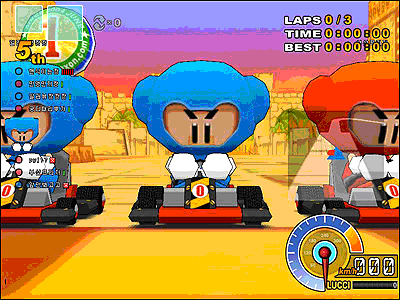

Globally, South Korea has become a bit of a fetish in the (global) games culture phenomenon. Games are a serious business saturating everyday life and many South Koreans prefer their PCs (with online multiplayer games) to TV (Cho 2005). Seoul is an exemplary model of the ubiquity of gaming culture; highlighting that games and the attendant social spaces and cultural knowledges can be part of everyday lifestyles, rather than a mere leisure activity of a subcultural group. With over 20,000 game rooms (known as ‘PC bangs’) scattered across Seoul, three TV channels dedicated to gaming, and pro-league players (professionals that can earn over US$2 million annually) treated as celebrity royalty, South Korea’s prolific designing, production and playing of games seems almost a dream come true for anyone remotely interested in gaming culture. Almost. {#para2}

As a place where gaming is an integral part of social spaces and practices, South Korea has become a focus of global attention – both good and bad. On the one hand, it demonstrates to those passionate about gaming that such an industry has the potential to gain critical mass and be integral within everyday practices and socializing. On the other hand, South Korea has often, especially in Western-centric mass media, attracted the critical eye of the arm-chair, hypodermic, ‘media-effect’ advocates and been used as an example of a culture overwhelmed by modernity. Such incidents as the murder in June 2005 of a 15 year-old player by a 30 year-old player of a multiplayer online game, when the latter mistakenly began to believe the teenager had killed his game character, along with the recent death in August in 2005 of a player after 50 hours of continuous play, provide fuel for simplistic media-effect interpretations. If only it were that simple. If only violence was *just* the product of video games; in turn, if only confusions about what is real and what is a representation were *only* the side-effects of video games.[1] However, it is not that simple. Rather, gaming cultures need to be understood within the sociocultural context they are played; such notions as game play are inflected by the local. Certain games and certain types of game play are adopted by specific communities because they make sense within the cultural context; often South Korea is lauded as an example globally without the specific factors informing the pervasiveness of gaming being entertained, let alone understood. In this way, the culture of gaming needs to be understood as an integral part of technocultures – that is, contemporary cultures are mediated and saturated by technologies and technospaces (Green, 2001) – and subject to the forces of what Doreen Massey dubs ‘locality’ (1991). As Massey argues, the sense of place is defined through representational processes, a practice that is always mediated by the local (1995). {#para3}

One of the terms that are in need of unpacking is game play. In particular, one needs to consider the relationship between play and locality; how what Mizuko Ito dubs communities of co-presence (2003, 2005) are often the microcosm constituting the contested notion of national cultures. As global technologies such as the mobile phone have demonstrated, the global is far from the utopia of McLuhan’s global village. Rather, the choice of games – and the motivations for playing them and via what type of interface (e.g., game consoles as opposed to LAN game) – is becoming more and more culturally specific. In this way, one could argue that whilst players from across the world can play the same games, they choose not to. This sometimes is due to technological differences (for example, the fact that South Korea has one of the most extensive broadband infrastructure affords the possibility for everyone to play online multiplayer games) but it can also be about a game’s relevance, which can be determined by aesthetics and theme. These factors are often constructed through what Benedict Anderson (1983) dubbed ‘imagined communities’. That is, the place of origin of a game, along with its associations with a particular culture constitutes how a player experiences a game. For example, Koichi Iwabuchi (2003) noted that Japanese global products such as Pokémon are odourless in comparison to American products such as Coca Cola. For Iwabuchi, Japanese products are made to be easily customized, easily adapted to another cultural context. This strategy of mixing the local and the global known as glocalisation, was pioneered by Sony (Robertson 1998). Such qualities as cuteness lend themselves, according to Anne Allison (2003), to multiple readings due to their postmodern nature. The pervasive nature of the cute is apparent in the Asia-Pacific region, and whilst Japan has dominated the production of cute and technology in the region, South Korea now presents strong competition. Currently, gaming seems to be taking two distinct directions – one lead by Japan, the other by Korea. And yet, in a Western press presenting itself as ‘global’, and in English language gaming forums, we can see some residual assumptions which align certain types of game play with specific cultures and values (see Chan in this issue). {#para4}

In the case of Korea, with its quick rise into 21st century modernity, and assertive internal policies for technologically connecting itself (both pragmatically via broadband and metaphorically via global projections) to become a global centre of gaming and mobile culture, I argue that we can see a localized form of what Ito calls ‘communities of presence’ and ‘co-presence’ (as in PC bangs) that are being a-contextualised via Neo-Techno-Orientalism. As a Western projected concept, Techno-Orientalism was used by Westerners to devalue the role of Eastern technocultures and Asian ‘satellite’ modernity (Ma, 1999); often this was achieved by arguing that the pivotal role of Asian production (and consumption) of new technologies was a result of their ‘robot-like’, post-humanist ways (Morley and Robins, 1995). This is particularly the case in the ‘cute’ aesthetic and its history in Asian technocultures as noted by Brian McVeigh in his study of the rise of techno-cute (2000). For McVeigh, the use of cute customization sought to make friendly and humanize the coldness of new technology. {#para5}

I argue that there is currently a Neo Techno-Orientalism proponent occurring within the “hyped” discourses surrounding Korean gaming and its export (of both images and actual products) globally as demonstrated by the way in which Asian games are being interpreted elsewhere, especially in terms of cute games and the assumed modes of game play and audience demographic; this new form of transference is not merely a projection on the behalf of the West but also part of the new imaginings attached to Korea’s role in producing and exporting new technologies in the Asia-Pacific region. Most notably, Korea has managed to draw attention away from Japan’s once reigning Gross National Cool (McGray, 2002) and, in doing so, has managed to re-orientate the residual gaze of Techno-Orientalism. However such a concept is no longer just a Western projection whereby Asian technocultures become a default setting for Western ideas of sci-fi as identified by Lisa Nakamura (2002) . Rather, technology industries in places such as Japan and Korea are selling products globally through advertisements that draw on Techno-Orientalist imaginaries identified by Shunya Yoshimi (1999). As Misa Matsuda noted in the case of the global mobile industries (which are quickly converging with gaming cultures), Japan worked actively to align itself as the global centre – often involving a self-perpetuation of Techno-Orientalism – with such innovations as DoCoMo’s i-mode dubbed as the *keitai* (mobile) IT revolution (Matsuda, 2005). After all, as Harmeet Sawhney (2004) notes, i-mode’s tag of mobile phone with broadband was a misnomer, its Internet architecture was more similar to the closed architecture of France’s Minitel system. {#para6}

In opposition to Japan’s focus on mobile convergent devices, Korea’s focus on DMB (Digital Multimedia Broadcasting which has seen the birth of mobile phones with TV) has seen a concurrent rise in the global focus on Korea as mobile gaming centre. The consumption of Korean cultural products – from Korean TV dramas to online multiplayer games – in the Asia-Pacific region seems unstoppable; a current wave of Korean pop has managed to question Japan’s cultural predominance in the region. In particular, markets such as Hong Kong, Taiwan, and Mainland China have become key consumers of Korean popular culture. The rise of new gaming genres as epitomized by the ‘cute’ game *Kart Rider*, which lend themselves to the multi-tasking (domesticity in the public or what Raymond Williams’s dubbed ‘mobile privatization’) characteristic of mobile convergent media, could suggest a threat to the PC bangs as social spaces. However, it is important to note that these PC bangs – or ‘third’ spaces (Chee, 2005) – hinge on the practice of communities of co-presence. That is, co-presence of being both virtually and actually present and being both ‘here’ and ‘there’. {#para7}

Once tied to the stereotypical young or female user in the Asia-Pacific region, the politics of the ‘cute’ are no longer so simplistically categorized – especially as women become more active creators and players of games as is the case in South Korea. It is this endurance of the ‘cute’ and its emergence as a supposedly new burgeoning genre that raises some questions about the changing nature of Korean game play and the social spaces in which it takes place. In order to take up some of these issues I will turn to a case study of the new Korean game, *Kart Rider*, that has managed to do the once unimaginable, surpass the reign of *Lineage*.  *Kart Rider* is an online multiplayer game merging two popular genres – driving and cuteness. The ‘cute’ aesthetic, once identified with low-resolution, highly pixilated retro games such as Mario Brothers, could be arguably seen as no longer an aesthetic but a burgeoning subgenre that plays on the cultural capital of nostalgia. With big Lolita eyes and balloon-like heads, the characters are hyperbolic par excellence. The game is simple in nature, drive the kart as fast as you can and beat the others. It allows for playful game play whereby players can easily socialize simultaneously online and offline as opposed to the serious games such as *Lineage*. *Kart Rider* can be easily accessed by young and old and is a great game to be played in PC bangs where players can be co-present both online and offline. In the rise of DMB technology on the mobile phone (called ‘hand phone in Korea), a game such as *Kart Rider* lends itself easily to media recontextualisation. {#para8}

By exploring the *Kart Rider* phenomenon that has – by no accident – occurred during South Korea’s shift towards convergent mobile gaming devices (Koreans have a history of preferring PCs to consoles), I will seek to contextualise some of the particularities of the Korean gaming industry and how the rise in cute games is being interpreted outside of Korea. By focusing on a forum discussion of *Kart Rider* outside Korea I will explore some the residual Neo Techno-Orientalism that shows that game play – and the consumption/ reception of particular products – are still very much subject to the localities of play culture. In this way, I argue that as cultural products, games and their culture of origin are implicitly tied to politics of consumption/ playing/ reception and this needs to be addressed in the critical discussion of game play culture. Contrary to the media-effects model, I argue that ‘global gaming’ is not homogeneous in the possible responses and effect; technocultures such as South Korea (with its plethora of PC bangs) are subject to the localization through which communities of co-presence replicate traditional forms of sociality. {#para9}

In other words, the communities of co-presence as represented by online multiplayer games and attendant spaces of play are not a space without place. And whilst one may play games from various different cultural contexts, the spaces (from aesthetics to game play) are encoded by cultural particularities as they are also projected with the player’s own micro-imagined communities. In the global industries of gaming culture – especially online multiplayer games – that purport to connect players across different spaces and cultures, place does matter. This importance and persistence of communities of co-presence is addressed by Florence Chee’s study on PC bangs as ‘third spaces’ – in between work and home – predicated on sociality (2005). {#para10}

The game of being mobile: the rise of new technologies and the persistence of place. In South Korea, the Net and mobile telephonic spaces are helping to drive the progress” of Korean forms of democracy Kim 2003: 325). For Korean sociologists Shin Dong Kim (2003) and Haejoang Cho (2004), the rise of a specific type of democracy in South Korea was afforded in part by new technologies such as mobile phones. [4] The South Korean telecommunication company Daum was the first Internet company in Korea and provided the first free email service in 1997. Daum established the first Internet cafes in 1999 and they now boast over 50 million users. The rise of online communities through Internet cafes from 1999 to 2002 was perhaps epitomized by *pyeins* (geeks) using Cyworld (a web community site that literally translates to relationship world, dubbed *cypyeins* as in cy-geeks) but by 2003 the general population were using PCs at home. As John Borland and Michael Kanellos note, in 1995 fewer than 1 percent of South Korean residents use the Internet but by 2004 more than 71 percent of South Korean households subscribed to broadband Net services. {#para11}

Unlike the console-oriented industry of Japan, South Korea has been focused on online multiplayer games accessed via PC, mostly in the context of PC bangs. These PC bangs are social spaces, participating in ‘communities of presence’ (Ito, 2002) and co-presence. For Chee (2005), Korean PC bangs operate as ‘third places’ – places in between work and home spaces that offer psychological comfort and support. Drawing on Brian Sutton-Smith’s (1997) The *Ambiguity of Play*, Chee argues that social play needs to be understood in terms of ‘play culture’. As Chee notes in her ethnographic study, the PC bangs not only offer a place to play games but also a space for comfort and sociality. Gaming culture has become a meaningful part of everyday Korean life. Pro league gamers (professional gamers) are treated like celebrities, and pro-gamer tournaments are social events akin to boy-band concerts full of screaming youthful energy. With many young Koreans still living at home (usually until they are married), PC bangs offer a social space away from the watchful eyes of parents. {#para12}

In her study, Chee interviews both male and female players to convincingly make a case for Korean gaming culture as a social activity, particularly in the context of the third places provided by PC bangs. One female interviewee, who plays about 15-20 hours per week of massively multiplayer online role playing games (MMORPGs) as well as *Ragnarok* and *Kart Rider*, states that her main reason for going to PC bangs is to be with her boyfriend, also a player. Here, her motivations for playing are clearly related to the play culture informing the social play of PC bangs. In one case, Chee interviewed two gamers who, having played *Lineage* together without knowing each other, eventually met offline and fell in love. Here, Chee argues that the games offer a ‘fourth place’ whereby strangers can become intimate and that this can overlap into offline forms of sociality (also see Taylor 2006). However, the co-presence between online and offline, third and fourth places can also have negative ramifications as was the case in June this year in the aforementioned killing of a player in the real after the death of a character. Here we see the co-present investment in avatar – communities of co-presence – is no trivial matter. {#para13}

In Korea, cute avatars provide a vehicle for negotiating co-presence between online and offline spaces. The role of the cute helps to convey the mood and emotions of the user as was noted in a case study of Cyworld users in 2004 (Hjorth and Kim 2005). And, far from eroding the importance of place and actual contact, these avatars help facilitate traditional forms of intimacy. What is quite evident from the outset is the underlying force of traditional forms of sociality that sees PC bangs often not just a place to play online multiplayer games but also, and in some cases more importantly, as a place for connecting socially (Chee, 2005). The use of technology to reinforce forms of intimacy and contact is so prevalent that even co-present (virtual/ actual) spaces such as Cyworld’s virtual community minihompy are about a correspondence between online and offline identity and relationships. The virtual community of Cyworld began as a small independent network and has grown, since its buy-out by South Korean telecommunications giant, SK, to become a mainstream community network used by young and old. Each blog-like template consists of a cyber-room occupied by the user’s avatar, along with folders such as music, writing and photos. Users can invite friends’ avatars to visit their cyber-rooms, and many friends give gifts in the forms of furniture and items of display for the cyber-room. Whilst the avatars can be customized according to the users’ mood, one thing remains prevalent; all avatars are cute. Minihompy adopted and adapted the traditional Korean term *ilchon* to divide users between *ilchon* and *non-chon*. Once used to denote degrees of distance between family members (i.e., your mother would be one *chon* from yourself), Cyworld has re-branded its cyber-rooms with the notion of *chon* and *ilchon* to infer friends and non-friends. *Chons* can gain more access to their fellow *ilchon*‘s information and be invited to visit their cyber-rooms. Non-*chon*s can only gain cursory access. Whilst one could see this as a cynical commercial exercise where not even family ties are sacred and nothing is left un-branded, users of the site see it as an integral part of forming communities that are intrinsically tied to real spaces and contact (Hjorth and Kim, 2005). As minihompy users noted in a survey conducted in 2004, the ‘cute’ aesthetics of their avatars allowed them to convey their offline moods and feelings online. However, there was a marked difference between male and female users with male users sometimes feeling uncomfortable that the cute character was not reflective of their offline identity, whilst female users enjoyed the multiple interpretations offered by cute avatars. {#para14}

Avatars, as Cyworld’s minihompy attests, are quintessential in the investment – both financially and emotionally – of users and their maintenance of co-present communities. This importance of avatars for Korean online communities is, of course, culturally specific. And whilst Cyworld has just launched its highly successful minihompy in Japan, China and the US, it will be curious to see if it takes off elsewhere. In particular, in locations such as the US where communities such as MySpace dominate, arguably Cyworld’s cuteness will only attract young users that would also be the demographic for Gaia and Habbo Hotel. However, in South Korea, over one third of the population (18 million users in a population of 48 million) regularly visit theirs and friends’ minihompys. To return to Ito’s notion, games are ‘communities of *presence*‘ (2002) whereby presence can be denoted through practices of co-presence rather than a necessity to be physically present. The role of the cute is pivotal in the aesthetics of the avatars, playing into what Anne Allison (in the context of the *Pokémon* global phenomenon) characterized as the postmodern qualities of the cute that allow it to be open to polysemic readings, contexts, and re-appropriations (Allison, 2003). The politics of cute culture – as epitomised by the *Kart Rider* success – resurrects questions about sociality, co-presence, and the role of sociotechnology. In particular, to explore the role of the cute entertains issues about the persistence of Techno-Orientalism in the region, as I will demonstrate by an English language forum posting about *Kart Rider*. {#para15}

*
*

*Kart Rider* has been a sensational hit in the Korean market and has topped domestic game ranking since last December, pulling down the famous *StarCraft* from the top position. Now the company estimates more than 2 million individuals play it everyday, and up to 220,000 users are connected simultaneously during peak hours. (Cho, 2005) {#para16}

In *Kart’s Engine Still Hot*, Cho Jin-seo recounts the fast rise of the *Kart Rider* phenomenon in South Korea. In revisiting earlier simple, but just as addictive, games such as *Mario Kart*, *Kart Rider* is symptomatic of a genre of game play that, according to Cho is still an under-explored genre; this genre, for Cho, illustrates that gaming is no longer a male dominated area. Made up of cute type avatars, each of the various racing games can have up to eight gamers competing against each other. Unlike the all-consuming and immersive online multiplayer games such as Lineage and *StarCraft*, *Kart Rider* is meant for in between periods such as office lunch breaks. However beguiling, behind its cute graphics and simple rules and game play are some not-so-simple politics about gendered modes of game play and ‘normal’ forms of social interaction. As I have suggested earlier, the cute graphics of *Kart Rider* are similar to another cyber social network in the form of quasi-home page communities as witnessed in SK’s Cyworld’s minihompy. Like the minihompy’s cute avatars, *Kart Rider* avatars are sold and downloaded. It is the continual need to update and change cute avatars according to mood or moment that is big business for SK Cyworld and Nexon’s *Kart Rider*. In 2004, Nexon made $110 million from avatar downloads and this year it is expecting $250 million. The cute is big business and no longer just the prerogative of young girls. And just because it is cute one shouldn’t necessarily assume it is harmless and non-addictive. As Cho Jin-seo notes: {#para17}

*Kart Rider* popularity sometimes blurs the boundary between on- and off-line worlds. In a recent poll by Empas.com, the game’s (*Kart Rider*‘s) Solid Pro car beat real-world monsters Lamborghini Murcielago and Lotus Elise to be voted the second best sports car in the world, narrowly losing to Porsche Carrera GT. {#para18}

Whilst Cho’s fears about the blur between virtual and real worlds are unfounded as noted by surveyed Cyworld users and their playful relationship to cute avatars, Cho’s argument does resonate with general anxieties around the healthiness of extended online game play and associated anti-social behaviour. In a media-effects model, co-presence is seen as an erasure of difference rather than an elastic dialectic between real and virtual spaces and contact. If we can take the phenomenon of Cyworld’s minihompy as any indicator, virtual representations and spaces have not superseded the real. In the case of Cyworld’s minihompy, these mini-home pages and virtual chat rooms are seen as helping to facilitate face-to-face relations. Arguably, the rise in virtual communities such as Cyworld and cute online gaming could be linked to the growth in female players and female content producers and designers in the industry. {#para19}

In an online English-speaking forum subject about gaming ([https://text.broadbandreports.com/shownews/64953](https://text.broadbandreports.com/shownews/64953)) headed ‘The biggest broadband game you never heard of: *Kart Rider*‘, the discussion turned to the burgeoning gaming industry in South Korea. As one of the most connected (broadband) countries, online gaming culture is a pervasive phenomenon that is imagined and consumed differently around the globe. For cultures without the technologies and connectivity boasted by South Korea, gaming centres can seem like alien spaces akin to dystopian sci-fi film sets with the stories in the media over-citing examples of gaming addicts in Korea. Whilst I recognize that this case study of a forum discussion cannot be taken as indicative of the games industry in general, the forum posting is not un-characteristic. Rather, the overt clashing of cultural identification and interpretation occurring in this forum presents one inroad into understanding the discursive formations of various types of game play. The forum began with a discussion about Korean games with one participant noting that the venerable *Starcraft* had recently been dethroned by Nexon’s *Kart Rider*. The discussion quickly turned to a forum on the role of cute aesthetics in Asia with one posting stating Asians are such weird people. The proceeding posting continued: {#para20}

> Agreed. Asia has Shot Online! too — a MMO golf RPG. Yes, you read that right, a MMO golf RPG. They’ll play anything over there, apparently. (For the record, I played the game and it’s a good game, but… I can’t fathom playing it all the time).
>
> Nexon makes Shattered Galaxy though too (definitely non-cute game), which was a pretty good game until it got to the point nobody playing spoke English anymore.
>
> i played Shattered Galaxy for a long long time long time ago and even back in the beginning it was mostly singapore people playing it. The infamous Singlish i use to know but now have forgotten. {#para21}

This was then followed by a debate that clearly demonstrated the politics of consuming certain game cultures. Here the discussion moves back and forth from a Neo Techno-Orientalist posturing (i.e. Asian relationships towards technology being post-human), to postmodern cultural relativity (reinforcing the ‘postmodern’ nature of cute culture as argued by Allison, 2003). The Neo Techno-Orientalist slurs, in their extreme ignorance, highlight the alignment of certain cultures with specific types of habits and thus modes of game play. What began as a discussion about cute aesthetics becomes a heated debate about types of morality (and lack); and one can’t help but think of the correlation with types of consumption and aesthetics with modes of morality. For a discussion about the relationship between morality and consumption in Asia see Chua Beng Huat’s *Consumption in Asia* (2000) anthology, where he discusses the shift in Asian values – and the correlation between consumption and Western amorality – after the economic bubble burst in 1997. {#para22}

Respondent two replies: {#para23}

> what a racist. what are you going to say when they run the world? hello sir? the Chinese, a Communist country will own America in 20 years thanks to Mr. Bush and his deficit. how about smart. | 2005-06-27 15:29:15 | {#para24}

Respondent one replies: {#para25}

> What makes you think I’m a racist?
>
> They have weird culture and habits. Japanese sex culture is just freaking sick! They eat all kinds of ‘food’ and obviously they have a bunch of weird games that are so extremely popular in Asia but not anywhere else. I wonder why??
>
> They are WEIRD.
>
> I agree with the Bush remark but let’s leave politics out of it | 2005-06-27 15:38:06 | {#para26}

Respondent two replies: {#para27}

> it’s all relative
>
> The funny thing about statements like that is that they usually go both ways, i.e. they (Asians) could easily say the same thing about us Westerners. For example:
>
> “They have weird culture and habits. (obsession with guns, religion and “reality” TV, celebrity worship, paying athletes and celebrities obscene amounts of money while say, teachers get next to nothing) American sex culture is just freaking sick (won’t go into detail)! They eat all kinds of ‘food’ (Twinkies, Thickburgers, purple ketchup, fried candybars, pork rinds, etc.) and obviously they have a bunch of weird games that are so extremely popular in America but not anywhere else. (Football, NASCAR, Beer Pong) I wonder why?? They are WEIRD.”
>
> I just might have sushi for lunch. | 2005-06-29 14:06:45 | {#para28}

Respondent one asserts: {#para29}

> True but I never said western cultures are perfect either. Even though people eat all kinds of stuff you can’t really compare Asian restaurant menus with the ones we prefer.
>
> BTW this is mostly a western website. So we talk about other peoples and don’t care much about their opinions. | 2005-07-03 14:51:25 | {#para30}

New respondent adds: {#para31}

> Asians are such a weird people.
>
> Got that right. | 2005-06-27 18:19:04 | {#para32}

This is then followed by respondent three adding: {#para33}

> Starcraft, I quit playing that game a long time ago.
>
> I think the final thread for me was the backstabbing by asian players who’d insist I sent them a private message laced with epithets. The only joy I had after that was watching the rubes who believed him get backstabbed in turn. | 2005-06-27 11:03:17 | {#para34}

Respondent four adds: {#para35}

> thats why asians like it…..easy to cheat on. | 2005-06-27 11:35:01 | {#para36}

Respondent three replies: {#para37}

> True, most of the cheaters I ran into either spoke no English or pretended to speak no English. | 2005-06-27 11:41:40 | {#para38}

Respondent five taunts: {#para39}

> you guys are just jealous we asians know how to break the system so well.
>
> too bad it means almost every politician in asia is corrupted. | 2005-06-27 14:40:00 | {#para40}

At this point in the forum, one can see that the discussion of games and game play is intrinsically linked to ideas about the ‘imagined communities’ of nation of origin. The forum clearly highlights that the gaming community is far from homogeneous, and that the values attached to types of game play are linked to forces of locality. What began as a discussion about MMO golf RPGturns into a debate about China versus American, English-speakers versus non English-speakers. This raises two interrelated issues, firstly, the role of aesthetics associated with particular games and its linkage between cultural identity and types of ethics (or lack of); secondly, that to talk about the tastes and values of games is to enter a world where conflicting notions of cultural capital collide. As Pierre Bourdieu noted, cultural capital denotes a type of cultural knowledge (1984). However, in Bourdieu’s case, his study was limited to the cultural context of France in the 1970s. In the case of the global gaming industry, there are many forms of cultural capital associated with types of game play that are linked to political, economic, and socio-cultural factors. The initial participant’s slandering of MMO golf RPG was linked to assumptions about hierarchies in the cultural capital of game play that are dependent on which ‘imagined community’ you are situated in. Thus, it is unsurprising that the real agenda of the discussion is uncovered to expose a fear about the Techno-Oriental imaginary of growing economies such as China and South Korea. The forum discussion continues with: {#para41}

Respondent six retorts: {#para42}

> kekekekeke ^_^ | 2005-06-27 12:59:06 | {#para43}

Respondent seven asks: {#para44}

> Show me some pics of this game
>
> I wanna see some in game footage see if I like it. Probably not seeing how asian games try the weird cute hello kitty fashion which is creepy by my standard but what the hell, worth a try. Maybe its like Mario Kart (In a crazy asian hello kitty fashion).
>
> Hey I was in your city today.. hehe
>
> BTW Mario kart with online extension would be great game. was fun playing 4 players on a 27 in tv in the day imagine 16 player rumble over the net. | 2005-06-27 17:30:15 | {#para45}

Respondent two, obviously fed up with the unbridled Techno-Orientalist discussion, adds: {#para46}

> English speakers are clueless about the international gaming world. Nearly 60% of fee based game play on the entire planet goes to Korean based NCSoft, generated by Lineage-1 & Lineage-2. I’ve been playing these games on and off since 1996 and it still amazes me when I walk into a game room internet center here in NYC and they don’t even have Lineage loaded. The Korean’s are 5 years ahead of America when it comes to wireless, and all you can do is scoff at them. Such insecurity is pathetic; no wonder all your outsourceable tech jobs are going to India. BTW, if you think the Korean’s are bad, wait till you go toe to toe with the Chinese…| 2005-06-27 21:52:34 | {#para47}

Respondent one retorts: {#para48}

> They’re not ahead, they’re just different. Because 25% of the population plays one game says what? Here in the USA you have millions of people playing millions of different games…not just a few select ones. What does that mean?… not much. However yu choose to turn it into a USA bash-fest in regard to online gamers. Yes, the Koreans have more PC “bangs” in one square mile than we have Starbucks within all 50 states, but it’s their mentality of working together for one common cause that has made games like Lineage successful over there. …. Is one right and the other wrong?… absolutely not. Why you choose to make such a contrast maybe helps you ward off your own insecurities whatever they may be. I admire what the Koreans have accomplished because they have achieved something very different from us, not better…just different. | 2005-06-27 23:13:55 {#para49}

What can be ascertained from this forum is that the politics of cuteness – around production, consumption and reception of games – resurrects earlier models of Techno-Orientalism (Morley and Robins, 1995; Yoshimi 1999). I am not suggesting that all Western cultures view Asian modernities – burgeoning as gaming communities – through Techno-Orientalist filters, but what this post highlights is that to engage in the discussion of the ‘cute’ is to evoke political and cultural contestation. As current global circuits of consumption, regulation and production demonstrate, there are multiple modernities. In the Asia-Pacific region, one can see many examples of ‘satellite modernities’ (Ma 1999) that are not a version of a Eurocentric modernity. Within a Techno-Orientalist framework the West is seen as human, and the East is seen as robot-like or post-human (Morley and Robins, 1995). This ‘post-human’ view was invoked by the binary postings positioning Asia as homogeneous, weird and amoral (in opposition to the normality and morality of the West). For Shunya Yoshimi (1999), the production and representation (i.e., advertising) of domestic technologies such as the TV and the mobile phone (*keitai*) in Japan has often involved a grappling between innovative technologies and the need to humanize, personalize, and domesticize the new into more salient, remediated genealogies. {#para50}

This need to personalize and customize the technology has often been in the form of what Brian McVeigh dubs ‘technocute’ (2000). For McVeigh, the cute makes warm the coldness of new technology. Often ‘technocute’ has been stereotypically aligned with young female consumption, however, with the rise of the ‘IT *keitai* revolution’, the cute is big business for both young and old, male and female consumers. This has to do with a number of factors, including the role of the cute in the 1970s rise of subversive youth cultures against the dogma of Japanese tradition (Kinsella, 1995), the rise of playful vernacular (creolising hiragana and katakana) akin to emoticons (*emoji*, known as kitten writing) from the pagers onwards, the role of animals in Buddhist and Shinto religion (Kusahara, 2001), and the way in which childhood is imagined differently than in the West (White, 1995). The differing relationship and identification with modes of representation can be also noted by the dominant role of manga and anime in Japanese popular culture that exists as a subcultural activity in the West. In Japan’s re-orientating of itself as a techno-centre, there has been a shift within Japan from the once negative depiction ‘s perception of the prime consumer of emerging forms of technocultures in the form of the male *otaku* (media obsessed geeks) and its female counterpart who was seen as intrinsic to the pager and *keitai* (mobile phone) revolution, the *Kygyaru* (females in their mid twenties that dress in non-conventional ways and are conspicuous consumers). {#para51}

The role of cuteness, as epitomized by *Kart Rider*‘s popularity, has a different role in South Korea. However, as the posting notes, Occidental fusions often problematically deem the cute as a homogeneous aesthetic consuming (and being consumed by) this vast imagined community called Asia. So what can be made of the politics of cute and the pervasive role of avatars in Korean games and the image that is broadcast globally? What can be ascertained from the *Kart Rider* phenomenon and the seemingly East/ West divisions in its interpretation and reception? Most certainly game play, and the surrounding cultures, are subject to the forces of locality (Massey, 1991); highlighting that the spaces we inhabit both in actual game play and the discourses (such as forums) of communities of presence (and co-presence) are governed by a type of contestation akin to Benedict Anderson’s ‘imagined communities’. {#para52}

Whilst for some the rise in such ‘simple’ and casual games could be read as devaluing ‘serious’ games such as *Starcraft*, I would argue the opposite. Rather, the rise of more genres reflects the increase in acceptability and access to gaming cultures in South Korea and is indicative of the importance of avatars (and the ‘postmodern’ possibilities of cute representation) in the politics of co-presence. Whilst some Western participants in the posting seemed to view the ‘cute’ as some weird phenomenon particular to Asian technocultures, we can see that the cute is far from benign in the way that Korean players identify with its playful possibilities. As the aforementioned posting highlights, the politics of cute culture are far from trivial. It is not by accident that the increase in female designers and players has seen the rise in forms of technocute games. Companies such as NCSoft have been active in hiring female designers and currently more than half of their designers are females; however in high management positions, male employees still dominate the ranks. Moreover, the Techno-Orientalist interpretations of the cute games such as *Kart Rider* and MMO golf RPG, Shot Online!highlight that gaming cultures are subject to the social forces of local play cultures. {#para53}

The global rise of gaming cultures from a subcultural leisure activity to an activity that is integral to the lifestyles of technocultures could be read as a homogenizing of cultural spaces and places. However, as the discussions and interpretations of *Kart Rider* on the aforementioned posting highlighted, online multiplayer games are far from demonstrative of a global ‘homogenized’ village. Rather, we are witnessing a redefinition of place and the cultural specificities of game play in the context of social play. The rules of game play are contingent to the force of locality; certain types of games and modes of game play are enforced by the player’s cultural and social contexts. In the case of the pervasive gaming culture of Seoul, which is sold globally, what we can see is that spaces such as PC bangs are affording youth cultures a ‘third space’ in between work and home spaces. {#para54}

As I have suggested in this paper, Seoul as one gaming centre highlights that cultures of play are shaped by social nuances. It is unlikely to be replicated elsewhere. But as the last posting on the forum highlights, it is important to celebrate the differences rather than brand Korean gaming activities as ‘weird’ or ‘exotic’; most importantly, there needs to be a critical discourse surrounding the fetishisation that places Korean gaming culture in a Techno-Orientalist slant. Moreover, one needs to be aware of the agenda of techno-nationalism that has seen locations such as Japan in 1970s and, more recently, Korea, position itself globally as a centre for technology (especially mobile and online gaming). In this paper I have outlined some of the many factors that have led to the importance of gaming – as part of broader discourses and genealogies of play – as a socio-cultural activity in Korea and other Asian countries. In this sense, the cute is not merely child’s play but a way of addressing culturally specific relationships to technology. The politics of the cute can also be a way of entering into the dynamics between game play and the ethics of aesthetics within imagined communities. {#para55}

As the usage of avatars – and ‘cute’ ones at that – in South Korea highlights, the ubiquity of broadband and online presence may reinforce the importance of place and sociality. As Margaret Morse has noted, intimacy and contact has always been mediated – by language, by memories, by cultures (1998). As these communities of presence/ co-presence suggest in the form of PC bangs, sociality is integral to the play cultures of gaming in South Korea. Far from a Heideggerean conundrum, in which as we try to overcome distance, we actually overcome closeness (Arnold, 2003a), gaming spaces are *communities of co-presence*; even if home is located in the ‘third space’ of a PC bang or the less official, and more contingent, space of the mobile devices. {#para56}

## Author’s Biography

Larissa Hjorth is researcher and artist lecturing in the Games and Digital Art programs at RMIT University, Melbourne, Australia. Over the last five years, Hjorth has been researching and publishing on gendered customizing of mobile communication and virtual communities in the Asia-Pacific. Hjorth has published widely on the topic in journals such as Journal of Intercultural Studies, Convergence journal, Fibreculture Journal and Southern Review. Hjorth has been the recipient of an Australia Council Tokyo studio, Asialink Seoul residency, Akiyoshidai International Village Residency as well as receiving grants for cross-cultural art projects from Besen Foundation, Australia Council new media fund, Asialink-Japan Foundation, Pola Foundation and Noruma Foundation. Recently she was awarded $20,000 from the Australian Council Visual Arts Board to further pursue her research into new mobile technologies. Hjorth will be co-convening the International conference on Mobile media with Gerard Goggin in July 2007 (www.mobilemedia2007.net).

Email: larissa.hjorth at rmit.edu.au

## Note

[1] There has been much work critiquing the media effect model, and all one has to do is look at the history of humanity, which has been predicated on violence and the fabrication of childhood (Ariés, 1962), as ‘passive’ and the binary of adults as a European post-abolishment of child labour to see the implausibly of such a position.

The cultures of play are very much invested by projections of what is deemed appropriate in a given culture. It is interesting to note that when the producers of *Sesame Street* were conceiving of the series they worked closely with child psychologists, educators and TV producers. The initial pilots to children audiences had the humans and puppets separated into different scenes. The result was that audience was bored and distracted when the adults were on screen, and interested and absorbed when confronted with the puppets scenes. When the producers suggested that they bring together the adults and puppets in certain scenes, the child psychologists voiced fears along the lines of But then we will have a whole generation that grows up mistaking adults for puppets! Since then many generations of Western children have been subjected to the hyperrealityof *Sesame Street*, and arguably the only locale in which this confusion between puppets and humans takes place is in the arena of politics. However, the broadcasting of *Sesame Street* from the 1970s onwards does coincide with the rise in co-present spaces such as cyberspace and the arguments around effects on corporeality in debates about online/offline presence.

[back]

## References

Allison, Anne. ‘Portable monsters and commodity cuteness; Pokémon as Japan’s new global power.’ *Postcolonial Studies* 6.3 (2003): 381- 398.

Anderson, Benedict. *Imagined Communities: reflections on the origin and spread of nationalism* (London: Verso, 1983).

Ariés, Philip. *Centuries of Childhood: a social history of family life*, trans. Robert Baldick (New York: Knopf, 1962).

Arnold, Michael. ‘On the phenomenology of technology; the Janus-faces of mobile phones’, *Information and Organization* 13 (2003a): 231-256.

Bolter, Jay and Richard Grusin. *Remediation: Understanding New Media* (Cambridge, Mass.: MIT Press, 1999).

Borland, John and Michael Kanellos. ‘South Korea leads the way.’ *CNET News.com* July 28, 2004, [https://news.com.com/South+Korea+leads+the+way/2009-1034_3-5261393.html](https://news.com.com/South+Korea+leads+the+way/2009-1034_3-5261393.html)

Bourdieu, Pierre. *The Logic of Practice*, trans. Richard Nice (Cambridge, UK: Polity Press, 1990)

____. *Distinction: A Social Critique of the Judgment of Taste*, trans. Richard Nice (Cambridge, Mass.: Harvard University Press, 1984 [1979]).

____. *Outline of a Theory of Practice*, trans. Richard Nice (Cambridge, NY: Cambridge University Press, 1977).

Chee, Florence. ‘Understanding Korean experiences of online game hype, identity, and the menace of the Wang-tta’, presented at *DIGRA 2005 Conference: Changing Views – Worlds in Play* (Canada, 2005).

Cho Haejoang, ‘Youth, Internet, and alternative public space’, presented at the Urban Imaginaries: An Asia-Pacific Research Symposium (Lingnan University, Hong Kong, 2004).

Cho, Jin-seo. “Kart’s Engine Still Hot”, *The Korean Times*, 16th of July 2005.

Chua, Beng Huat (ed) *Consumption in Asia* (London: Routledge, 2000).

Crogan, Patrick. ‘Playing Through: the Future of Alternative and Critical Game Projects’, presented at DIGRA 2005 Conference: Changing Views – Worlds in Play (Canada, 2005).

Green, Lelia. *Technoculture: from alphabet to cybersex* (St Leonards, N.S.W.: Allen & Unwin, 2001)

Haddon, Leslie. *Empirical Research on the Domestic Phone: A Literature Review* (Brighton: University of Sussex Press, 1997).

Ito, Mizuko. ‘Introduction: Personal, Portable, Pedestrian’ in *Personal, Portable, Pedestrian: Mobile Phones in Japanese Life* (eds) Mizuko Ito, Daisuke Okabe and Misa Matsuda (Cambridge, Mass.: MIT Press, 2005): 1-16.

____. and Daisuke Okabe. ‘Camera phones changing the definition of picture-worthy’, *Japan Media Review* (2003), [https://www.ojr.org/japan/wireless/1062208524.php](https://www.ojr.org/japan/wireless/1062208524.php).

____. ‘Mobiles and the appropriation of place’, in *receiver* magazine, 2002, 08, [https://www.receiver.vodafone.com](https://www.receiver.vodafone.com) (10 December 2003) n. pg.

Iwabuchi, Koichi. *Recentring Globalization: Popular Culture and Japanese Transnationalism* (Durham, NC: Duke University Press, 2003).

Kim, Shin Dong. ‘The Shaping of New Politics in the Era of Mobile and Cyber Communication’, in Nyiri, K. (ed.) *Mobile Democracy*, (Vienna: Passagen Verlag, 2003).

____. ‘Korea: personal meanings’, in Katz, James E. and Aakhus, Mark (eds.) *Perpetual Contact: mobile communication, private talk, public performance* (Cambridge: Cambridge University Press, 2003).

Kinsella, Sharon. ‘Cuties in Japan’, in Lise Skov and Brian Moeran (eds.) *Women, Media and Consumption in Japan* (Surrey, UK: Curzon Press, 1995): 220-254.

Korean Game Development and Promotion Institute (KGDPI) ‘Korean Online Games Are the World’s Best (From Southeast Asia to the Americas and Europe… Conquering the world)’, *IT Korea journal*, 2004.

Kusahara, Machiko. ‘The Art of Creating Subjective Reality: An Analysis of Japanese Digital Pets’, *Leonardo* 34.4 (2001): 299-301.

Ma, Eric Kit-wai. *Culture, politics, and television in Hong Kong* (London: Routledge, 1999).

Massey, Doreen. ‘Questions of locality’, *Geography* 78 (1993): 142-9.

____. ‘Imagining the world’ in John Allen and Doreen Massey (eds) *Geographical Worlds* (Oxford: Oxford University Press, 1995).

Matsuda, Misa. ‘Discourses of Keitai in Japan’, in M. Ito, D. Okabe and M. Matsuda (eds.) *Personal, Portable, Pedestrian: Mobile Phones in Japanese Life* (Cambridge, MA: MIT Press, 2005): 19-40.

McGray, Douglas. ‘Japan’s Gross National Cool’, *Foreign Policy*, May/June, 2002.

Morley, David. ‘What’s ‘home’ got to do with it?’ in *European Journal of Cultural Studies*, 6.4 (2003): 435-458.

____. and Kevin Robins. *Spaces of Identities: Global Media, Electronic Landscapes and Cultural Boundaries* (New York: Routledge, 1995).

Morse, Margaret. *Virtualities: television, media art, and cyberculture* (Bloomington: Indiana University Press, 1998).

Nakamura, Lisa. *Cybertypes: race, ethnicity, and identity on the Internet* (New York: Routledge, 2002).

Online forum: [https://text.broadbandreports.com/shownews/64953](https://text.broadbandreports.com/shownews/64953)

Sawhney, Harmeet. ‘Mobile Communication: New Technologies and Old Archetypes’, in the *Mobile Communication and Social change* conference proceedings (organized by S. D. Kim, Seoul, South Korea, October, 2004): 10-17.

Silverstone, Roger and Haddon, Leslie. ‘Design and domestication of information and communication technologies: Technical change and everyday life’, in Roger Silverstone and Richard Mansell (eds.) *Communication by Design: The Politics of Information and Communication Technologies* (Oxford, UK: Oxford University Press, 1996).

Sutton-Smith, Brian. *The Ambiguity of Play* (London: Routledge, 1997).

Robison, Robert and David S.G. Goodman (eds.) *The New Rich in Asia* (London: Routledge, 1996).

White, Merry. *The material child: coming of age in Japan and America* (New York: Free Press, 1993).

Yoon, Kyongwon. ‘Retraditionalizing the mobile: Young people’s sociality and mobile phone use in Seoul, South Korea’, in *European Journal of Cultural Studies* 6.3 (2003): 327-343.

Yoshimi, Shunya. ‘Made in Japan: the cultural politics of home electrification in postwar Japan’, *Media, Culture & Society* 21 (1999): 149-171.
