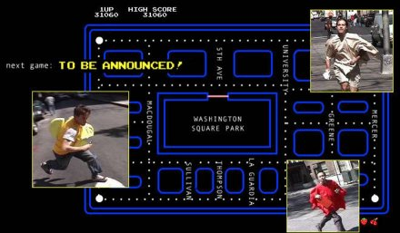
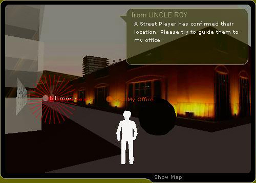
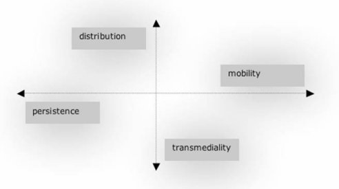
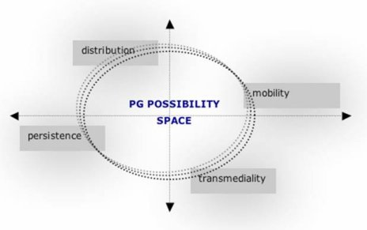
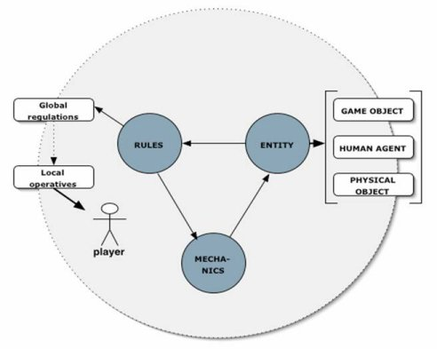
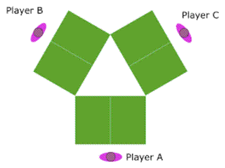
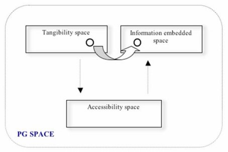
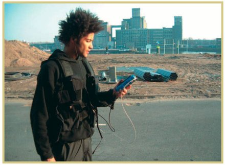
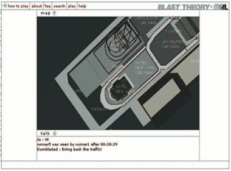
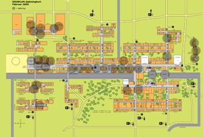

### Introduction

Computer games that move beyond the static screen and into the real, social and tangible world, as well as those that rely on massive networked, virtual spaces are becoming increasingly wide-spread. In *Human PacMan* the player collects virtual bits of cheese in a real, physical space (see Figure 1). *Dance Dance Revolution Ultramix* (2005) is a home version of the popular arcade game, in which the players follow dance instructions on the screen with their feet on touch-sensitive tiles. *Breakout for Two* (Mueller, Agamanolis and Picard, 2002) is a physical interface the size of a large wall that allows two players to play a soccer-like game together, communicating via a body-size videoconference. Both players are kicking a real ball, targeting virtual bricks, similar to the old arcade game *Breakout*, and aiming to break out to the other side, i.e., to the other player (Mueller, Walther et al., 2005). Recent massively multi-player online games, or ‘synthetic worlds’ as they have been called (Castronova, 2005; Liboriussen, in press), such as *World of Warcraft*, *Second Life*, and *EverQuest*, join hundreds of thousands of users in shared quests, mystery solving, and guilding. These games even have their own currencies and real estate markets. Massively multiplayer online games are not pervasive in the sense that they offer an exertion interface or allow the user to play in a physical, real world; and yet they obviously exceed the traditional confines of level-oriented game design. Interestingly enough, contemporary best-selling computer games like *The Sims* and *Grand Theft Auto 3* clearly blur the difference between ‘gaming’ in a closed, rule-based environment (the “board”) and ‘playing” in a much more open, story-driven universe (the “game world”). {#para2}

It is characteristic for these new pervasive games that they expand the gaming space, obscuring the demarcations between the real and the virtual. They also raise questions about the notion of time in games. *World of Warcraft* (WoW) never rests. *WoW* is a persistent-world game. One may pause the game, yet still it continues ‘off-screen’ due to events happening on the servers, or due to other players’ interventions in the game world. Whether or not pervasive gaming (PG) is a sign of the next key shift in computer game business and culture is hard to judge. There seems, however, to be a real need to elucidate the theoretical and analytical impacts of pervasive gaming (see also Walther, 2005a; 2005b). {#para3}

### Pervasive Computing

The term ‘pervasive computing’ is IBM’s re-phrasing of Xerox’s expression ‘ubiquitous computing’. Literally, ‘pervasive’ means ‘totally penetrating’. The word is derived from the Latin *pervasus*, the past participle of *pervadere* (‘to go through, pass through, or pervade’). If something is ‘pervasive’ it means that it is spread throughout our physical environment. In the age of information technology, not only are computers (and the like) everywhere, all the time; we also have access to digital information and networks from almost any location we choose. Wireless technology and the Internet are steps towards increased, seamless communication and the convergence of advanced electronic media. However, this kind of ubiquitous access is largely confined to urban areas. Pervasive computing devices can be embedded in almost any type of object imaginable, including cars, refrigerators, heating systems, clothing, and appliances, not to mention various consumer goods. Pervasive computing technologies connect to worldwide networks without boundaries and provide quick and secure access to a wealth of information and services (Hansmann et al., 2001). In a few years from now, computational devices will have become so naturalised within the environment that it is likely that people will not even realise that they are using computers. Examples of pervasive computing hardware include mobile phones and smart phones, personal digital assistants (PDAs), digital cameras, web cams, interactive whiteboards, interactive TV, laptops, and tablet PCs. On the software side, one could mention groupware systems (a subset of ‘social software’), simulation software, business intelligence systems, SRS (Social Recommender Systems), Instant Messaging, peer-to-peer file-sharing systems, level editors, and much more. When it comes to traditional computer games (*Half-Life*, *Quake*, *Doom*, etc.) it should be noted, however, that while there are a few third-party level editors that are open source, the bulk of software is protected by a proprietary licence. {#para4}

Two essential characteristics of the pervasive computing evolution that relate strongly to pervasive games stand out: {#para5}

(1) the explicitness of *computational tasks*; and

(2) the overall importance of *physical space*. {#para6}

The former implies that actions are carried out in ways that transcend the traditional Graphical User Interface (GUI) . Mobile devices and many forms of wearable or embedded computing shifts our attention from metaphorical data manipulation to simulated, hands-on, and direct interactions with physical objects. This aspect interweaves with the second aspect of pervasive computing, namely, that objects obeying the laws of physics are responsive to digital manipulation, and thus take on a double meaning: they are objects in the outside (nongame) world, yet they can also simultaneously be objects within a simulated world.

A growing number of games already run on mobile devices such as cellular phones or PDAs, but only a few of these devices can sense their physical environment. Massively Multi-Player Online Role-Playing Games (MMORPGs) such as *Everquest* and *The Matrix Online*, clearly aim at being pervasive in the sense of incorporating a wide spectrum of information and communication technologies. However, they do not fully exploit the potential of combining physical and virtual space. {#para7}

In addition, we witness a growth in the design of game systems that use ubiquitous computing techniques to propel forward player experiences that connect objects within the real world with objects of the virtual world. *SuperFly*, by the Swedish game company It’s Alive Mobile is a good example. The player’s aim is to become a virtual celebrity The projects *Can You See Me Now?* and *Uncle Roy All Around You*, both created by the UK performance group Blast Theory, use hand-held, digital devices, GPS location tracking, and online agent technology in an attempt to use location and mobility as game features from within the real world (Figure 2). While one player stays at home and moves a virtual character around a representation of a real city, other players speed around the real streets, trying to hunt down the virtual quarry. These systems do not, however, integrate the production and technological amalgamation of robotics and cybernetics (also called adaptronics), artificial life, and complex adaptive systems in the game design as well as in the game design process. {#para8}

Similarly, the preponderance of hardware and software currently made for the game market is restricted to the field of graphics, game and AI engines, 3D rendering techniques, and real-time motion control, all of which relate more or less to either output interfaces (visual presentation of game worlds) or game mechanics, i.e., any part of the game’s rule system that covers possible modes of interaction during gameplay. In order to increase attention paid to game machinery, beyond the static mode of immobile users and/or stagnant, screen-based interfaces, it is vital to observe the interactions between humans and computers and the mediation of human communication by computers through naturally established interfaces which are, in turn, supported by technology built into our surroundings, or aimed at the mobile user. {#para9}

### Pervasive Gaming Formats

I define ‘pervasive gaming’ as an over-arching concept or activity subsuming the following game formats and technologies (Lindley, 2004): {#para10}

- A *mobile game* is a game using portable technology that takes changes in relative or absolute position/location of the player into account in the game rules. Although this general definition also applies to, say, chess, it still excludes games for which mobile devices simply offer a delivery channel where key features of mobility are not relevant to the game mechanics. Hence, one could distinguish between *mobile interfaced games* and *mobile embedded games*.

- A *location-based game* is a game that includes relative or absolute but static position/location in the game rules.

- A *ubiquitous game* uses the computational and communications infrastructure embedded within our everyday lives.

- *Virtual reality games* are games generated by computer systems with the goal of constructing wholly autonomous and completely immersive game worlds.

- *Augmented reality games* and *mixed reality games* seek to integrate virtual and physical elements within a perceptual game world.

- *Adaptronic games* are games consisting of applications and information systems that simulate life processes observed in nature. These games are embedded, flexible, and usually made up of ‘tangible bits’ that oscillate between virtual and real space.

Following this I will propose a general definition of pervasive gaming: {#para11}

*Pervasive gaming implies the construction and enacting of augmented and/or embedded game worlds that reside on the threshold between tangible and immaterial space, which may further include adaptronics, wearable, mobile, or embedded software/hardware in order to facilitate a ‘natural’ environment for gameplay that ensures the explicitness of computational procedures in a post-screen setting.* {#para12}

However, ‘pervasive gaming’ tends to be used as a buzzword. Some may typify massively multiplayer online games as authentically pervasive games, while others argue that only games that are (at least partly) played out in the real physical and tangible world, i.e., games which use both virtual and augmented reality computing techniques, count as truly pervasive games. How, then, is a pervasive game not a mixed reality or augmented reality game? {#para13}

One answer to this is conceptual, the other technical. It is, indeed, difficult to distinguish precisely between various open-ended or augmented games and truly pervasive games since a main feature of all types (or genres) is systems that holds a constant invitation to transgress boundaries between fiction/reality, physical/virtual, quantifiable/fuzzy, etc. (Brynskov and Ludvigsen, 2006). If we use a more technical approach to differentiate between pervasive games and augmented/mixed reality games, we could suggest that while the latter games are often facilitated by technologies *not necessarily embedded in the physical world*, pervasive games most often include calibration or other forms of locality based measurements (GPS, signal triangulation, etc.). This means, essentially, that the role of physicality as well as the role of physical bodily movement is predominant in pervasive games, not only in the actual play, which involves the mobile user, but also in the design of pervasive game worlds and the technology that supports such worlds. {#para14}

Further, we need to separate *time*, *space*, and *presence* (or immersion): {#para15}

- Computer games can be pervasive in the sense that they belong to a set of persistent games. The game is always on. However, the user may log in and out of the game (and the game world). *EverQuest*, *Guild*, *Ultima Online* or other Persistent World-Games are good examples.

- The pervasiveness factor also implies that the physical and/or virtual play space has been expanded. We must distinguish between Alternative Reality Games that use a wealth of media artefacts and singular technologies (computer, fax machine, snail-mail, PDA, etc.) and games that merge physical and virtual space through other means, e.g., augmented and mixed reality technology. Examples of the latter include games designed in the Mixed Reality Lab in Singapore.[1] Also, a research and design group from University of Glasgow has developed *Seamful Game: Equator*[2] in which the search for wifi areas in the city – usually considered to be an activity outside of the boundaries of the game – is part of the gameplay itself. The lack of informational infrastructure, which is normally concealed and unexplained, is thus entirely present as an in-game feature allowing users to explore and understand it. In any case, pervasive gaming relies on more than just the standard input-output devices (screen, mouse, controller, keyboard, etc.) by incorporating wireless technology, head mounted displays, tracking and positioning systems, etc. into the gameplay.

- Finally, ‘pervasive’ might refer to the (psychological) fact that many games have an immersive quality, sometimes referred to as ‘flow’. Thus, the line separating playing in a real world and participating as a character in a fictional and virtual game world is, in some instances, blurred.

### Inside The Pg Toolbox

***The Four PG Axes*** {#para16}

In order to refine the broad spectrum of the general definition above, we will zero in on four axes – or, rather, zones in a coordinate environment – that together mark what I call the possibility space of pervasive gaming. The four axes can be illustrated thus: {#para17}

- *Distribution.* Pervasive computing is situated at the junction of information technologies and a networked digital environment that is always on, always available, and unobtrusive. Pervasive computing devices are frequently mobile or embedded in the environment and linked to an increasingly ubiquitous network infrastructure composed of a wired core and wireless edges. This combination of embedded computing, dynamic networking, and discrete information-sharing clearly affects and strengthens the distribution paradigm of IT.

- *Mobility*. New challenges for pervasive computing also include mobility, i.e., computing mobility, network mobility, user mobility, and context-aware (smart) and cross-platform services. Of particular interest to PG is the growth of mobile 3G technologies, and technology that allows bridging between two or more Local Area Networks.

- *Persistence*. The persistence factor touches upon the notion of temporality. Persistence means total availability all the time.

- *Transmediality* challenges the traditional model of the relations between sender, message, and receiver, as it emphasises the active role of the user. Patterns of media consumption have been profoundly altered by a succession of new media technologies which enable anybody with internet access to participate in the archiving, annotation, appropriation, transformation, and recirculation of media content (Jenkins, 2003). Transmediality works as unacknowledged support for bits and pieces of media material to create an aura of user-oriented amusement. It further indicates that, currently, no medium can be defined as a self-sufficient application that is based on partial groupings. On the contrary, the dispersal of multiple media spread out over large-scale networks and accessible through a range of devices is a good illustration of how media commune in circular, not linear, forms. This means both the repurposing of content in an intertextual web and the actual structure of media and their interrelations. These media carry information, entertainment, games, role-play, and characters in a non-stop circuit of jointly coupled citations and codes of utilization that can be promptly attuned and functionally altered. [[3]](https://journal.fibreculture.org/issue8/issue8_walther.html)

*The PG Possibility Space* {#para18}

Combining distribution, mobility, persistence, and transmediality we enter what could be called the PG possibility space. This space has the potential as a locale for developing, consuming, and thinking about gaming in the years to come. It is a space that deals in *networking,* given its focus on nonlocality, nonmetric systems, and constant accessibility. It is a space that celebrates the *freedom of device* – games can be played on anything, and game devices may trigger anything, anywhere, anytime. It might be worth pointing out that what currently stands in the way of such convergence are rigid intellectual property regimes, and that these are rather more likely to become more pervasive in years to come. Further, it is a space that favours *nonclosure*; although pervasive games still cling to the law of goal-orientation (closure) to a certain extent, they nevertheless open up new ways of collaborative world building, as well as invite continuous structural expansion. Finally, the PG possibility space embraces transmediality and *circular* *storytelling* as the norm of mediated entertainment. Stories produced and consumed in bits or fragments may very well be the future standard of multi mediated narration. {#para19}

***The Three Key PG Units*** {#para20}

In traditional computer games the player has a double role as both observer of and an actor in the observed representation. Pervasive gaming goes even further; in complicating the coupling of identity and structure, as these games are projected directly into the player’s reality and constitutes a second world within the world.[4] An important consequence of this structural coupling is that real objects become pervasive. They are real due to their tangible and physical qualities, and real in the sense of information-embedded devices open for manipulation, cybernetic control, and input and output feedback – i.e., they can be played with. {#para21}

Games can be divided into three key units that are, however, strongly interlaced: (1) game *rules*; (2) game *entities*; and (3) game *mechanics*. How can we characterise them? How are they tested by the pervasiveness of pervasive games? And how can they be used to describe pervasive games? In the subsequent section I briefly list the basic characteristics of the three game units followed by some reflections on the PG ontology and epistemology. {#para22}

*Game Rules* – A number of definitions for game rules have been suggested. In this context I will stick to Jesper Juul’s generalised model, in which there are six invariant parameters of game rules: {#para23}

- *Rules*: games are rule-based.

- *Variable, quantifiable outcomes*: games have variable, quantifiable outcomes.

- *Values assigned to possible outcomes*: the different potential outcomes of the game are assigned different values, some positive, some negative.

- *Player effort*: players must invest effort in order to influence the outcome (i.e., games are challenging).

- *Players attached to outcome*: players are attached to the outcomes of the game, in the sense that players will be winners and happy if there is a positive outcome, and losers and unhappy if there is a negative outcome.

- *Negotiable consequences*: The same game (set of rules) can be played with or without real-life consequences (Juul, 2006).

It is evident that, with respect to pervasive gaming, some of these rule parameters were altered. Let me narrow the changes down to two issues: {#para24}

- Take, for instance, the vital concept of a variable, quantifiable outcome. To Juul, this means, among other things, that the outcome of a game is designed to be beyond discussion, and that this is an intrinsic token of game rules. This fits perfectly with practically all computer games excluding ‘sandbox games’ like The Sims, MMOG’s, etc.. However, when moving the logic structure of the digital computer into the tangible world, the quantifiability of a rule system seems to shift into a more fuzzy type of interaction between constitutive and regulative rules. In his book, *The Construction of Social Reality*, Searle explains that social rules may be regulative or constitutive (Searle, 1995). *Regulative* rules legalise an activity, whereas *constitutive* rules may create the possibility of an activity. Constitutive rules provide a structure for institutional facts. In the context of explaining the (extended) PG rule system, computation can be regarded as a conceptual framework or underlying system of norms that, in turn, may constitute a possible space for regulative behaviour. In pervasive gaming, constitutive rules are hosted by the virtual domain while the regulative rules spring from the social and physical domain. While the rules of a game may explicitly forbid an acitivity that is perecly legal in the real world, and vice versa, this further means that constitutive rules belong to the set of quantifiable norms, while regulative rules govern *ad hoc* player interaction with the game world. Another way of distinguishing the computational rule logic from the real-time interaction patterns of game-play is to differentiate between *global regulations* (provided by the computer’s state machine) and *local operatives* (controlled by the player’s behaviour with the physical as well as information-embedded game world; see Figure 5).

- Next, we should consider the term *negotiable consequences*. In pervasive gaming, *real-life consequences* are exactly what drive the play experience forward. The entire teleology of game-play, in fact, rests on the outcomes that transpire and are enacted on the physical arena. A game of chess might have severe consequences if played out in real life, but since the movement of pieces across a board merely *represents* physical structures, it follows that the rules of chess apply to the discrete topology of pieces and plane of play, and not the phenomenological experiences that this topology may cause. In the domain of pervasive gaming, it is precisely negotiability that signifies the toggling back and forth between real-life consequences and discrete representations that pushes gameplay forward. Thus, the PG tangibility consequence brings out a level of uncertainty to the gaming phenomenology; this uncertainty becomes part of the rule structure, i.e., it must be inscribed in the computational representation.[5]

*Game Entities* – In line with the object-oriented programming paradigm, I define a game entity as *an abstract class of an object that can be moved and drawn over a game map*. There can be an enormous number of entities in a game: inventory objects in an adventure game; non-playing characters (NPCs) in a FPS (first-person shooter) game; or a text message in a strategy game. Since a game has many entities, the ways that they can interact increase geometrically. {#para25}

Pervasive gaming further adds to the complexity of game entities. A PG entity can take three forms: (a) a *game object*, i.e., any object that can be encountered, seen, or interacted with during game-play; (b) the entity can be a *human agent*, since an essential part of a pervasive game is to collaborate and engage in conflict with flesh polygons; and finally (c) the entity may simply be a *physical object* (see Figure 5). {#para26}

Again, it is the negotiability or uncertainty principle that does the trick. Pervasive game-play implies *contingency handling*, e.g., addressing questions such as, are the passing people on the street NPCs; is the elevator a token of the game’s passage from one level to the next, connected to a network of sensors, or is it simply an element of the building’s non-pervasive construction? {#para27}

*Game Mechanics* – Lundgren and Björk define game mechanics as simply *any part of the rule system of a game that covers one, and only one, possible kind of interaction that takes place during the game, be it general or specific*. A game may consist of several mechanics and a mechanic may be a part of many games (Lundgren et al., 2004). {#para28}

Thus, we can generally define game mechanics as an *input-output engine*. The task of this engine is to ensure a dynamic relation between game state and player interference. Furthermore, the engine is responsible for simulating a direct connection between the I/O system of computational, discrete logic and the continuous flow from initial to final state in a physical setting. In a certain sense, then, game mechanics postulates a deep transport from the laws of computation to the natural laws of physics. Note, however, that the latter laws must be implemented in the algorithmic system of the computer.[6] In pervasive games, the process of simulation (which always includes selection of the aspects of a real-world situation to be simulated) takes place in real time. {#para29}

In relation to PG, the following issues of game mechanics are specifically noteworthy: {#para30}

- *Physically embedded game mechanics*. The frontrunner in pervasive gaming, the Fraunhofer Institut für Angewandte Informationstechnik (FIT), has designed *NetAttack*.[7] The game is presented as a new type of indoor/outdoor augmented reality game that makes the actual physical environment an inherent part of the game itself. The mechanics apply to the outdoor environment where players equipped with backpacks full of technology move around a predefined game field trying to collect items, as well as applying to the indoor setting in which a player sits in front of a desktop computer and supports the outdoor player with valuable information. In order to control the information flow that links physical and virtual space, the various components communicate via events and a TCP/IP-based high-level protocol. A central component guarantees consistency and allows the configuration of the game. Before starting to play the game, the outdoor game area must be modelled and the game levels configured. In other words, modelling the game means embedding the necessary mechanics into physical space.

- *Input-output engine with a dual purpose*. Interaction with tangible objects in PG implies, as noted above, a certain level of fuzziness. Therefore, the input-output engine must be constructed to provide a probability algorithm for the actual interaction as part of the rules; however, the engine must also dictate a global, discrete, and binary rule (state) to the interaction. It is in this respect that PG mechanics could serve a dual purpose: on the one hand maintaining and stimulating the contingency of interactions with real-life objects; on the other hand, structuring the controlled set of actions embedded in the state rules. Hence, the input-output engine becomes a machine that frames both contingency and necessity.

One of the most promising descriptions of games and dynamic complexity are those by Holland (1998). Holland distinguishes among the following descriptions and definitions: {#para31}

- The *state* of the game, i.e., the arrangement of pieces on the board at any point in the play.

- The *state space* of a game, meaning a collection of all arrangements of the pieces on the board that is allowed under the rules of the game.

- The *root* of the tree of moves, which is the game’s initial state.

- The *leaves* of the tree of moves, which are the ending states.

- A game *strategy* that serves as a prescription of right decisions as the game unfolds.

In the design of computer games, a *finite state machine* (FSM) is frequently used to manage the execution threads and if-then-else statements in the course of game-play, i.e., as the tree of moves unfolds. One example of how an FSM functions is the operation of the *damage trigger* (particularly relevant to FPSs).[8] When a damage trigger is transmitted to another entity, the pain function pointer is called, thus triggering a state transition of the affected entity into possibly a death or attack state. The damage inflicted in the game is an input to the FSM, which may act as a trigger for a state transition. In pervasive game universes, possible states and state functions are exponentially multiplied. Each FSM can be considered an autonomous agent in a multiagent system involving trigger mechanisms from both the real and the modelled worlds. {#para32}

**PG Space** {#para33}

The formal architecture of pervasive gaming relies on the interconnection of social domain, virtual domain, and physical domain. Real world properties as well as public, shared or private properties of the social domain must be represented and, to a certain extent, controlled in the virtual domain, i.e., via computers. This domain is, in turn, accessible through a graphical user interface that further represents the game states (Magerkurth et al., 2004). {#para34}

Players may share the same virtual domain while being physically distant from each other. In fact, one can benefit from this by envisioning and constructing new modes of gameplay. The Australian Sports Over A Distance augmented game *Table Tennis For Three* (which I am involved in) supports social interaction familiar from traditional sports between physically remote participants through an interaction setup that is only possible because of the distance: a table-tennis game playable by three players who are in three different locations (Mueller, Walther et al., 2005). {#para35}

But what are the implications of this multiple space setup in relation to pervasive gaming? And how can we formalise the complexity that arises from the merging of different kinds of spatiality in PG? {#para36}

First of all, the perception of space differs according to our perspective, whether from a human level or from a strictly mathematical angle (Walther, 2003b). The mundane space that a human subject inhabits is not by nature geometrical; rather, it is structured in accordance with matter-of-fact actions. In such a spatial environment, the various orientations are related to directions (practical vectors), places, ranges of space, and things, in contrast to dimensions, points, lines, and absolute objects. The space for action is a praxis-architecture – a phenomenological space, we might call it – that is not defined by length, height, and width, but rather by territory, proximity, and distance (Nielsen, 1996). A personal space zeroes in on the required equipment and relations to institute meaning, whereas a geometrical space is continuous and unbounded. {#para37}

Second, the space of every day life is *heterotrophic* in its design of multiple layers with which it constantly confronts us with a surplus of potential strategies for spatial couplings. The space of mathematics is *isotropic*, where all coordinates are evenly spread in all directions. Thus, when a human subject navigates through space it is *contingent* – where to go next? – and *intentional* in the use of space through motives and affects. {#para38}

The point here is that pervasive gaming space mixes isotropic and heterotrophic spaces. The teleological goal structure of a game necessitates a certain amount of *accessibility* by which the user can obtain information about space and proceed from, for example, one level to the next (Walther, 2003a). A PG space must amalgamate physical *metric* space and informational and networked *nonmetric* space and, finally, merge them into accessibility space (Bøgh Andersen, 2002). A metric space consists of a nonempty universe of points together with a family of distance relations that satisfy the axioms of distance (Bricker, 1993). A nonmetric space may be defined as a topological or nodal connected space. Real life as such would not by itself be interesting in a gaming sense. We need to organise and structure the nonteleological and open meanings of mundane space in order to make it playable (or actually game-able). Hence, accessibility is the portal to the information- embedded spatial game world (illustrated in figure 7). {#para39}

*Tangibility Space* {#para40}

An important aspect of PG, the whole idea of playability, is the player’s interaction with physical reality. Tangibility space, however, is not just the sum total of the available, real-time world and its vast amount of objects. Rather, it must be understood as the *heterotrophic organization of potential spatial patterns of behaviour*. This organization of space facilitates a playground, and is often aided by multiple information units located in material objects. These objects can be treated as ‘tangible bits’ (Ishii and Brygg, 1997), elements of reality that can be touched, altered, and manipulated – as in the real, non-game world – but nevertheless still belonging to the virtual realm as they are controlled by digital technology. {#para41}

**Distributed Information Space** {#para42}

To a large extent, the epistemology of PG involves blending physical and virtual space. In spatial terms, this means that the information-embedded space is facilitated by and projected onto the tangibility space. This kind of space is the digital representation of tangibility space. Yet, besides serving as a map of the game-world, it may also function as a phenomenological space in its own right, i.e., it is experience embedded due to real-time changes, tracking of player motion, etc. {#para43}

*Accessibility Space* {#para44}

Finally, we have accessibility space, which, as noted earlier, is the key to the oscillation between embedded information and tangibility in the pervasive game universe. One way of explaining the delicate relation between the triadic space structures is to say that accessibility space *maps* the information-embedded space system that is in turn *mapped* onto tangible reality. {#para45}

**Conclusion** {#para46}

In this article I have tried to construct a conceptual framework to assist in the design and interpretation of pervasive games and pervasive gaming. In many ways, the PG paradigm transcends traditional computer gaming: its epistemology or molecular experience must be built into the ontology or atomic structure of the game map itself; a certain sense of openness, fuzziness, and uncertainty clings to PG; and the complexity of game states and state functions dramatically increases once a system of tangibility and random interaction with physical objects is tied to the virtual control apparatus. Although truly pervasive games and current augmented or mixed reality games often overlap – the virtual/real diametric, the blend of tangible, information, and accessibility space – the essential characteristics of pervasive games is still the focus on *embedded* (or simply physical) technology. In this respect we could call a pervasive game a mobile, context aware, location-based game. A great many challenges await us in the field of post-screen gaming. On the analytical side, it may be rewarding to think of PG in terms of axes, key units, and space modalities, as I have suggested in this context. On the technological side, it may be equally rewarding to focus on the field of adaptronics in computer game design when trying to bring ‘life’ and other modes of self-configuration and adaptation into play. {#para47}

## Author’s Biography

Bo Kampmann Walther is Associate Professor at the Centre for Media Studies, University of Southern Denmark (Odense) in Denmark. His research interests are computer games, new media, contemporary sports, and digital aesthetics. He has written and lectured extensively on these topics. His latest book is a book in Danish about the soccer club Real Madrid and the role of media and globalisation. See www.sdu.dk/hum/bkw for more information.

Email: bowalther at tiscali.dk

## Notes

[1] See [https://www.mixedrealitylab.org](https://www.mixedrealitylab.org.).

[back]

[2] See [https://www.seamful.com/](https://www.seamful.com/).

[back]

[3] A good example of this circular and self-reflexive media ecology is the TV series 24; it is a TV show, an action game, a website, a news forum, mobile content, and much more (Walther, 2005c).

[back]

[4] Thanks to my colleague Lars Qvortrup for this insight.

[back]

[5] An interesting critique of my view on quantifiability and negotiability in pervasive games can be found in Brynskov and Ludvigsen (2006).

[back]

[6] In fact, we could claim that the success of game mechanics rests on the idea that it is possible to simulate computational physics.

[back]

[7] See [https://www.fit.fraunhofer.de/projekte/netattack/index_en.xml](https://www.fit.fraunhofer.de/projekte/netattack/index_en.xml).

[back]

[8] [https://ai-depot.com/FiniteStateMachines/FSM-Framework.html](https://ai-depot.com/FiniteStateMachines/FSM-Framework.html).

[back]

## References

Benford, Steve et.al. ‘Coping with uncertainty in a location-based game’. *EEE CS and IEEE ComSoc* (2003): 1536-1268.

Bricker, Phillip. ‘The fabric of space. Intrinsic Vs. Extrinsic Distance Relations’, *Midwest Studies in Philosophy* *XVIII* 18 (1993): 271-294.

Brynskov, Martin and Ludvigsen, Martin. ‘Mock Games: A New Genre of Pervasive Play’, in John M. Carroll, Susanne Bødker, Julie Coughlin (eds.) *Proceedings of the Conference on Designing Interactive Systems* (University Park, PA, USA, June 26-28, 2006): 169-178.

Bøgh Andersen, Peter. ‘Pervasive computing and space’, in L. Kecheng et al. (eds.) *Organizational Semiotics: Evolving a Science of Information Systems. IFIP TC8/WG8.1 Working Conference of Organizational Semiotics* (Montreal, July 23-25, 2001): 133-152.

Castronova, Edward. *Synthetic Worlds. The Business and Culture of Online Games* (Chicago: The University of Chicago Press, 2005).

Hansmann, Uwe. *Pervasive Computing Handbook* (Berlin: Springer, 2001).

Holland, John. *Emergence. From Chaos to Order* (Oxford: Oxford University Press, 1998).

Ishii, Hiroshi and Ullmer, Brygg. ‘Tangible bits: Towards seamless interfaces between people, bits and atoms’, *The Proceedings of the CHI ’97 Conference* (March 22-27, 1997): 234-241.

Jenkins, Henry, ‘Transmedia storytelling. Moving characters from books to films to video games can make them stronger and more compelling’, *Technology Review*, January 15 (2003), [https://www.technologyreview.com/read_article.aspx?id=13052&ch=biotech](https://www.technologyreview.com/read_article.aspx).

Juul, Jesper. ‘The game, the player, the world: Looking for a heart of gameness’, in Marinka Copier and Joost Raessens (eds.) *Level Up: Digital Games Research Conference Proceedings* (Utrecht University, 2003): 30-45.

Liboriussen, Bjarke. *Worlds of Junkspace: Can there be an Architecture of Dwelling for Synthetic Worlds?* In press.

Lindley, Craig. ‘Trans-reality gaming’, *Proceedings of the Second Annual International Workshop on Computer Game Design and Technology* (Liverpool, UK, Nov. 15-16, 2004).

Lundgren, Sus and Björk, Staffan ‘Game Mechanics: Describing Computer-Augmented Games in Terms of Interaction’, *Proceedings of the 1st International Conference on Technologies for Interactive Digital Storytelling and Entertainment* (Darmstadt, Germany, March 24–26, 2003), [https://www.cs.chalmers.se/~lundsus/lundgren_bjork_game_mechanics.pdf](https://www.cs.chalmers.se/~lundsus/lundgren_bjork_game_mechanics.pdf).

Magerkurth, Carsten. et al. ‘Augmenting the Virtual Domain With Physical and Social Elements’ (2004), [https://www.ipsi.fraunhofer.de/ambiente/paper/2004/magerkurth.carsten.domains.pdf](https://www.ipsi.fraunhofer.de/ambiente/paper/2004/magerkurth.carsten.domains.pdf).

Mueller, Floyd et al. ‘Exertion Interfaces for Sports over a Distance’, *UIST 2002 – ACM Symposium on User Interface Software and Technology* (Paris, France: ACM Press, USA, 2002).

Mueller, Floyd and Walther, Bo Kampmann. *Table Tennis For Three*. In press.

Nielsen, Arno Victor. ‘A space odyssey’, *K & K* 82 (1996).

Searle, John. *The Construction of Social Reality*, (New York: The Free Press, 1995).

Walther, Bo Kampmann. ‘Gaming and playing: Reflections and classifications’, *Game Studies* 3.1 (2003a).

____. ‘La représentation de l’espace dans les jeux vidéo: généalogie, classification et réflexions’, in M. Roustan (ed.): *La pratique du jeu vidéo. Réalité ou virtualité* (Paris: L’Harmattan, 2003b)

____. ‘Reflections On The Methodology Of Pervasive Gaming’, *ACM SIGCHI International Conference on Advances in Computer Entertainment Technology*, Valencia, Spain, 2005a.

____. ‘Notes on the Methodology of Pervasive Gaming’, in F. Kishino et al. (eds.): *ICEC 2005*, LNCS 3711 (2005b).

____. ‘A hard day’s work: Reflections on the interfacing of transmedialisation and speed in 24’, in K. B. Jensen (ed.) *Interface://Politics. The World Wide Web as Democratic Resource and Cultural Form* (Copenhagen: Samfundslitteratur, 2005c): 205-240.

____. ‘Art and Computer Games: A New History’, *Aminima*, 17, (2006): 132-139.
