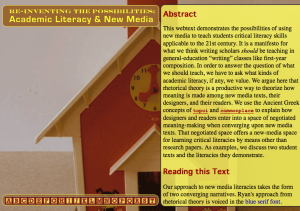

***This in an interactive text—click here to open***. {#para2}

This webtext demonstrates the possibilities of using new media to teach students critical literacy skills applicable to the 21st century. It is a manifesto for what we think writing scholars *should* be teaching in general-education “writing” classes like first-year composition. In order to answer the question of what we should teach, we have to ask what kinds of academic literacy, if any, we value. We argue here that rhetorical theory is a productive way to theorize how meaning is made among new media texts, their designers, and their readers. We use the Ancient Greek concepts of topoi and commonplace to explain how designers and readers enter into a space of negotiated meaning-making when converging upon new media texts. That negotiated space offers a new-media space for learning critical literacies by means other than research papers. As examples, we discuss two student texts and the literacies they demonstrate. {#para4}

