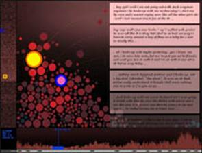
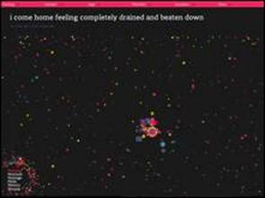
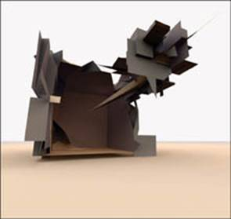
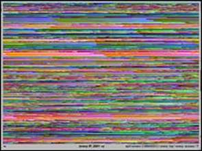
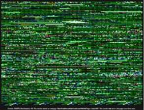
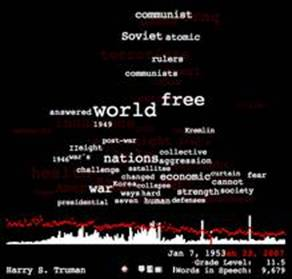
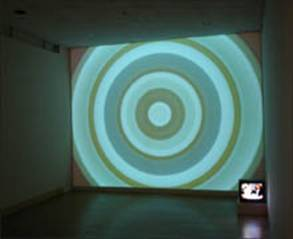

### Introduction

In digital, networked culture, we spend our lives engaged with data systems. Although our experience is shaped by interfaces, friendly surfaces, we are inevitably aware of their functional undersides. The web is increasingly a set of interfaces to datasets. In 2004 Alan Liu observed the page-based paradigm of the web being interrupted by database incursions — what he called ‘data pours’ (Liu, 2004). On the contemporary web the data pour has become the rule, rather than the exception. The so-called ‘web 2.0’ paradigm further abstracts web content into feeds, real-time flows of XML data. {#para2}

In the background of these developments — what Liu characterises as the post-industrial rationalisation of networked culture — is data itself. In this context it is not surprising that new media art has in recent years turned towards data as both subject and material. In 2001, exhibitions such as the Whitney Museum’s *Bitstreams and Data Dynamics* and the San Francisco Museum of Modern Art’s *010101* signalled the emergence of data practice as a key element in new media art. Data art has also attracted some theoretical attention since it came to prominence. Lev Manovich’s 2002 essay ‘The Anti-Sublime Ideal in Data Art’ (Manovich, 2002) has largely set the theoretical agenda, especially in its focus on issues of scale and the sublime (or not) aesthetics of this practice (Jevbratt, 2004). Others have deployed theoretical frameworks from conceptual art (Sack) or postmodern theory (Simanowski, 2005a). While it is informed by these approaches, this paper considers a more basic question. {#para3}

Data art involves a creative grappling with the nature of our now ubiquitous data systems. It draws data out, makes it explicit, literally provides it with an image. It also probes data’s constitution, potential, and significance. In the process of working pragmatically with data — using it as a generative resource, a way of making — data art is involved in the culturally crucial figuration of data and its contemporary domain. This practice is a concrete exploration of what data is, does, and can do, but it also involves a set of assumptions, narratives and ontologies that construct data as an entity in the cultural imagination. That construction is at the core of this analysis. {#para4}

### Data vs Information

Coming to grips with the figure of data is made more difficult by a basic ambiguity in the way the term is used; particularly in relation to art, ‘Information’ and ‘data’ are often used interchangeably. Warren Sack’s paper on ‘Aesthetics of Information Visualisation’ also uses the phrase ‘data visualisation’ (Sack); Simanowski (2005a) uses ‘data’ in general, but interposes ‘information’ without explanation; Manovich’s (2002) analysis of ‘data art’ occurs in the context of a wider project on ‘info-aesthetics’. {#para5}

This blurring of data and information obscures a fundamental distinction — and in turn, a fundamental relation — between the two terms. As Wikipedia’s entry on information states: ‘Information is the result of processing, manipulating and organizing data in a way that adds to the knowledge of the person receiving it’. A recent text on data mining describes that task as ‘discovering useful information in large data repositories’ (Tan et al, 2006: 2). Some data artists recognise the same distinction: Mark Hansen and Ben Rubin, creators of the installation *The Listening Post* (2003), describe their sonification work as ‘exploring the information hidden in data’ (Hansen and Rubin, 2001). This distinction draws on a sense of information as related to context and meaning; following Donald MacKay (1969) and Gregory Bateson, information here is a ‘difference that makes a difference’ (Bateson, 1973: 428) rather than the structural, mathematical formulation of Claude Shannon’s information theory (Shannon and Weaver, 1949). {#para6}

Prising these terms apart, we can begin with a notion of data from empirical science, as a set of measurements extracted from the flux of the real. In themselves, such measurements are abstract, blank, meaningless. Only when organised and contextualised by an observer does this data yield information, a message or meaning. The concepts are converse, two sides of the same thing: data is the raw material of information, its substrate; information is the meaning derived from data in a particular context. This distinction is a central tool in the analyses that follow. In deploying data, these artworks inevitably involve its flip-side, information. Often, data art actively resists, or defers, information; it aims to somehow present us with the data ‘itself’. The implications of that drive, and its manifestations in these artworks, offer a useful critical perspective on data art practice. {#para7}

In the following sections data practice is discussed through a series of labels — indexical, abject, material, and anti-content — and clusters of related work. These labels are discursive devices, rather than exclusive categories; rather than define or delimit this field, they propose aspects of the common project here: the creative figuration of data. {#para8}

### *We Feel Fine* and *The Dumpster*: Indexical Data

Recently a cluster of works have appeared that deal with visualising networked society. Drawing on data from the new ‘social’ web, or blogosphere, they offer us a sense of the unimaginable crowd that now inhabits the network. *The Dumpster* (2006), by Golan Levin with Kamal Nigam and Jonathan Feinberg, is an interactive visualisation of teenage romantic breakups (Levin et al, 2006) (Figure 1). The artists harvested and classified some 20000 blog posts, analysing them to allow comparison; the work’s interface follows the metaphor of the title, as hundreds of coloured circles, each representing a blogged breakup, drop from above and jostle each other. Browsing the breakups displays excerpts of the blog text, and alters the colours of the display to indicate the relative similarity of each breakup to the one currently selected. Sidebars to the interface provide more information on the selected breakup, including date, the gender and age of the author. *The Dumpster* is engaging and dynamic; simulated physics makes the breakup-circles jiggle and bounce; the interface is packed with detail, and the context-based display allows the user to investigate the multivariate relationships between breakups. As Manovich writes in his essay on the work, it encourages an interplay of attention between the individual and the group; ‘The particular and the general are presented simultaneously, without one being sacrificed to the other’ (Manovich, ‘Social Data Browsing’). {#para9}

Along similar lines *We Feel Fine* by Jonathan Harris and Sep Kamvar (2006), bills itself as ‘an exploration of human emotion’ (Figure 2). It constantly harvests hundreds of individual ‘feelings’ from blog posts, analysing them for content and visualising them as a swarm of tiny, independent entities. The work offers six interfaces to the dataset, including relatively conventional statistical devices such as breakdowns by age, location, gender and feeling; as in *The Dumpster* (Levin et al, 2006), the data points remain ‘live’, linking the user to the harvested text and (unlike *The Dumpster*) to the source blog itself, allowing the user to delve further into the context for a particular ‘feeling’. {#para10}

Both these works use their datasets as indexes of reality — specific individuals and events. Both aim to visualise and portray not merely data, but the personal, emotional reality that the dataset refers to. This is made clear in the language used in the works: *The Dumpster* describes itself as ‘a portrait of romantic breakups’ and ‘a slice through the romantic lives of American teenagers’; the dataset for *We Feel Fine* is described as ‘a database of several million human feelings’. This approach begs a dull (but necessary) critique: that these works do not provide an interface to feelings, or breakups, but to texts that refer — or seem to refer — to them. In both cases the datasets are constructed in ways that shape what is included and excluded. *We Feel Fine* searches blog posts for the phrases ‘I feel’ and ‘I am feeling’, then attempts to identify the ‘feeling’ in question. This analysis works well for simple statements, but seems easily fooled; texts involving negation, equivocation or speculation are often misinterpreted. This blog excerpt was identified as feeling ‘better’: ‘I just start to have these looming feelings of inadequecy and fear that in a year, I will be no better off and have nothing else to offer to the professional world’ (Harris and Kamvar, 2006). *The Dumpster*, which uses a fixed, pre-analysed dataset, hits the mark more consistently, but includes texts referring to dreams of breakups, past breakups, and so on. These are critiques of the automated analysis that the works use; but even if the analyses were perfect, the more fundamental representational issue remains. These works rely on a long chain of signification: (reality); blog; data harvesting; data analysis; visualisation; interface. Yet they maintain a strangely naive sense of unmediated presentation. {#para11}

The interface design reinforces this; data points are rendered as swarms of simulated physical entities. They are personified (literally animated) so as to conflate (real, ‘human’) data source with (textual, harvested, analysed, mapped) data point. Along the way the interfaces also create a powerful impression of the nature of their collapsed datasets/referents; as teeming multiplicities displaying what might be called uniform diversity. Data points are ontologically equal but vary within a fixed set of axes or parameters. These systems encode a kind of idealistic humanism of equality and diversity, harmonious multiplicity, and fundamental (emotional) commonality. A process of data harvesting and analysis literally drafts in thousands of participants, as the constituents of this narrative. In both works the artists downplay their own roles, emphasising the data itself as content; as Jonathan Harris writes ‘*We Feel Fine* is an artwork authored by everyone’ (Harris). Both works present the user with a set of tools for navigating and analysing the datasets (and their collapsed referents), also turning over the process of extracting information and meaning from that data. However both works are already rich with information, in their interface surfaces and in the background processes and systems that constitute them. {#para12}

These works construct a notion of data — of its capacities, qualities, and significance — in the ways that they use it. Data here is first of all indexical of reality. Yet it is also found, or to put it another way, given. These works gather existing data from the network, drawing together thousands of elements that are already, unproblematically, ‘out there’. This reinforces the sense of collapsed indexicality; these data points have causes (authors) of their own that in some sense guarantee their connection to reality, or at least defer the question of that connection. Data’s creation — in the sense of making a measurement, framing and abstracting something from the flux of the real — is left out. {#para13}

### Alex Dragulescu: Abject Data

In the indexical paradigm, data is tightly linked to reality, to the ‘real’ of its source. If we maintain faith in that link, or at least accept it pragmatically, data visualisations and interfaces promise new insights into that reality. However another creative possibility is to cut data loose, to explore its self-contained abstraction, and its inherent malleability. This approach is generative — a way of making — and in that sense pragmatic; but it also constructs a quite distinct sense of what data is, and can be. {#para14}

In Alex Dragulescu’s spam works, junk email is processed to generate rich three dimensional forms. The *Spam Architecture* series (Dragulescu, 2005) presents jittery, origami structures; although cleanly virtual, they do have an architectural sense of weight and rectilinearity (Figure 3). It might be significant that they resemble architect’s models: possible buildings, conceptual structures untroubled by pragmatics. The forms are full of legible structure and familiar variation; there is a sense of genre or family that reinforces the architectural allusion, a language of elements and relationships (wall, roof, piercing shard). Yet with no sign of human scale or activity (doors, steps, windows), and broken, angular planes, they also seem somehow corrupt, vaguely menacing. They might be described as uncanny in the Freudian sense; in German unheimlich or ‘unhomely’. {#para15}

Dragulescu adds to the mystery by not revealing the mapping — the process by which the forms are generated from email text. He leaves us to contemplate the artefacts, reading what we can into their structure. Their consistent architectural language could be a product of the spam sources — in which case, we are witnessing the visualisation of the related qualities of those texts, their own ordered alterations, variations on pharmaceutical themes and filter-fooling tricks: somehow seeing spam as a genre. But it’s impossible to tell; that familial quality could be as much, or more, a product of the artist’s own processing. The structure may be given, and the data controlling something more subtle — variation of variation, ineffable statistical properties. Gathering information from these data artefacts is a more speculative process. {#para16}

In the absence of a map, an interpretable process for decoding the forms back to their spam origins, Dragulescu emphasises the juxtaposition of the source and the generated artefact; the two hang together in a kind of cognitive dissonance. To resolve them, conceptually, involves a kind of poetics, a metaphorical relationship. Finding coherence here, drawing together source and artefact, is only too easy: as one reviewer writes, *Spam Architecture*‘s forms ‘clearly evoke the underhand and violent nature of the spam’ (Tanni, 2006); junk structure, automatic style, cardboard housing. Spam is both a literal and figurative resource here: it is a cultural and a digital dataset. It embodies the failures (or perhaps the cost) of frictionless connectivity and techno-libertarian ideals. Unmanageable as content — partly because of the content, but mostly for its sheer quantity — we treat it as a substance, a flood of pollution, a pile of dirty things: sex, drugs, scams. Dragulescu performs a poetic transubstantiation on spam, not to clean it up or purify it, but to draw in, and recast, those associations. {#para17}

*Spam Plants* (Dragulescu, 2006) uses a similar process, but here the poetics seem, if anything, more barbed. The plant forms are luscious, multicoloured, translucent, organomorphic (Figure 4). They fall in line with the tradition of organic generative art and its hedonistic, glowing multiplicity. The images are immediately and accessably beautiful. The juxtaposition of source and artefact is, as a result, more dissonant. On one side is the organic paradigm of ordered variation, richness and coherence. On the other, the digital sludge of hypermodern culture, what the artist refers to elsewhere as ‘abject data’ (Dragulescu, Respam). Again junk turns into structure. {#para18}

There are two, correlated implications. Either junk is structure, or structure is junk. The former is a relatively familiar proposition. There is a rich artistic tradition in drawing attention to the beauty of the discarded or unwanted. An apprehension of structure involves attention, framing, selection: beautiful forms lie waiting all around us, even in the most abject data. Structure as junk is the darker alternative: that what we appreciate as order, form, and coherence is not only ubiquitous and immanent, but mundane, valueless, empty. Dragulescu’s work also suggests a third implication, in which both of these are true: anything is anything, or everything is everything. Dragulescu’s work is a powerful performance of data malleability, its susceptibility to transformation, mapping and munging. As one commentator imagines, in response to this work: ‘You turn digital photographs of your last birthday party into architectural structures; your Ph.D. thesis, exported as an inhabitable object; every bank statement you’ve ever received, transformed into a small Cubist city’ (Manaugh, 2006). {#para19}

Taken together, *Spam Plants* and *Spam Architecture* evoke a sense of data as both structurally rich and substantially, vertiginously empty. In this figuration data is an abstract set of potentials, an array of values waiting to be mapped. A dataset feeds a process, which produces an artefact; the process doesn’t care what the dataset is, or was; whatever it was, now it’s just input: the process (the map) reconfigures the dataset completely, arbitrarily, rewrites it not by altering values but by reprogramming them, altering their potential. The process takes the data as whatever it wants (a wall, a shard, a petal, the difference between this petal and the last), irrespective of what it once was (a word, number, number of characters in a word, difference between this word and the last). Anything is anything. {#para20}

Lev Manovich (2002) has made the same observation about data art: he calls this polymorphism the ‘built-in existential angst’ of both data art and the digital medium in general: ‘By allowing us to map anything into anything else … computer media simultaneously makes all these choices appear arbitrary – unless the artist uses special strategies to motivate her or his choices’. He also hesitantly proposes arbitrary mapping as a criterion of judgment: ‘Maybe in a “good” work of data art the mapping used has to somehow relate to the content and context of data’. Yet as Dragulescu’s work shows, and as already argued, some relation between mapping and data context — or between input and output — inevitably emerges, even when no direct or intrinsic relation exists. The spam/architecture relation becomes part of the new information the work creates. The poetry in Dragulescu’s work indicates that although an infinity of mappings are possible, it is the multitude of choices involved in the crafting of specific mappings that is significant. Even as it points towards the abject polymorphism of data, Dragulescu’s work shows how the data art process (or performance) steps in to generate meaning and information. {#para21}

### Lisa Jevbratt: Data Material

Lisa Jevbratt’s work constructs a very different sense of data. In projects such as *1:1* (1999/2002) and *Infome Imager Lite* (2002-2005), the mapping of dataset to image is straightforward and transparent. Jevbratt seeks to use visual displays to reveal structures inherent in the dataset. In *1:1* databases of sampled web IP addresses are mapped simply to pixel colour values. Several different interfaces or maps are provided, using different rulesets: the ‘top’ interface visualises top level domains (.com, .gov, .mil, .edu, etc); ‘every’ visualises every IP address (Figure 5). As a result we ‘see’ the dataset from several angles, through different filters. We gain a sense of the dataset as separate from the mapping, and the possibility of alternative mappings and their capacity to reveal different structures. Jevbratt articulates this transparency: ‘the visual “look” … is very plain. It is strict and “limited” in order to not impose its structure on its possible interpretations and meanings’ (Jevbratt, 2004). {#para22}

Yet Jevbratt’s work is quite unlike conventional information visualisation: like Dragulescu’s work it is anti-information, in the sense of information as a formed message. Rather than transform data into information, Jevbratt transduces one form of data into another — symbolic or logical into visual. The image artefacts are visual data, prior to information: Jevbratt (2004) writes, ‘they are real, objects for interpretation, not interpretations. They should be experienced, not viewed as dialogue about experience’. Unlike the data-nihilism of Dragulescu’s model, where any information in the data is arbitrary or unreachable, Jevbratt maintains the viability of information, though like many artists she turns its construction over to the audience. {#para23}

*Infome Imager Lite* pushes the transparency of *1:1* a step further, turning over the data gathering and visualisation process to the work’s audience (Jevbratt, 2002-2005) (Figure 6). Visitors can control and launch new web crawlers, and manipulate the mapping used in the visualisation. As in 1:1 the visualisations are themselves interfaces, linking back to the sites crawled. As a result the user is even more tightly bound into the process; at a minimum, the work confronts the user with its parameters and options, and requires an initial URL or web search: an impetus, a context or target. Potentially, the software offers a platform for in-depth experimentation, exploration and visualisation. Where *1:1* is explicitly global and macro, *IIL* is micro, local, contextual. While no less dense, these visualisations are potentially more meaningful than those in *1:1*, since they offer more hooks, more connections with a user’s experience and intention. Set a crawler loose on your home page or blog, and the visualisation that returns is, in Jevbratt’s words, ‘abstract reality’, an image that reads as pure pattern, but has a direct correspondence with personal link networks. Other recent visualisations have focused on connectivity in the new social web (see for example Ben Fry’s blog link visualizations (Fry, 2006). While it hails from a previous web era, *IIL* can present similar information, as the loops, webs and fans of link topology are flattened into sequences and patterns on the image surface; the whole becomes a rich visual texture and a local, concrete ‘abstract reality’. {#para24}

Yet this textural quality also leads back to the inevitable choices involved in mapping data. In *IIL* and *1:1*, one extrinsic structure dominates, to the extent that patterns in the data are literally wrapped around it. The structure is the rectilinear picture plane, a central obsession of twentieth century visual art and a given in digital media culture. In Jevbratt’s visualisations tiles or pixels, corresponding to individual data points, fill in a rectangular grid. The dimensions and proportions of the grid are unrelated to the dataset; and in fact some structures in the data are obscured by that grid. In *IIL* for example, the crawlers gather multiple data points for each web page visited, depending on features of the page’s HTML code; each page may correspond to five, ten or twenty individual tiles. This page-by-page structure is wrapped around the picture plane, row by row, or tiled spiral-wise from the center outwards, in *IIL*. Of course other tiling methods are possible: each URL could be rendered on a single row of the grid. This would distinguish pages and their features more clearly, and make recurring pages and patterns easier to spot. This might be a ‘better’ visualisation; would it be a ‘better’ artwork? Jevbratt’s picture plane mapping is not based on an information visualisation rationale. It is a cultural structure, highly functional information in itself. As the artist says, it connects these works with a whole tradition, it literally frames the data and offers it up to be read in a particular way, as an abstract ‘picture’ (rather than a graph) and also as an artwork. Of course this mapping does ‘impose its structure’, but that imposition only underlines the functional differences between art and data visualisation. {#para25}

This wrapping of data around the picture plane resembles the techniques of ‘data bending’ practices, where data from one media form is transcoded into another, disregarding inherent differences in file format (Whitelaw, 2004). Like databenders however, Jevbratt’s sense of what is significant — what the data contains — is untroubled by this transformation. That content is immanent, and elusive: Jevbratt presents network data as a reservoir of unknown potentials and patterns, hidden information. At its core, Jevbratt’s work pursues the revelation of reality. As she writes, Infome Imager Lite ‘glances down into the subconscious of the Web, hoping to reveal its inherent structure and create new understandings of its technical and social functionalities’ (Jevbratt, 2005). The datastructures of the web, and the data-images that depict them, are substrates for emergence. Jevbratt writes of ‘finding something unexpected’; ‘slowly something emerges that draws attention to itself; something reveals itself … lets us know it has meaning’. We arrive here at Jevbratt’s own data-cosmology: the Infome. The artist uses this term to refer to the totality of ‘all computers and code’ and their (at least potential) network. This complex entity constitutes a dynamic reality that is textual and recursive (self-shaping, self-manipulating). Jevbratt (2005) calls it an ‘environment/organism’, a figure that seems to be more than analogy; she writes of seeking ‘something that shows signs of an awareness’ within it; of hints and traces, ‘openings’ in the data. {#para26}

This data cosmology is presented in strikingly material terms; here too data appears as a substance. Instead of using ‘known visual forms’ or metaphors, Jevbratt (2005) proposes, ‘data can represent itself by being a slice … or “smearing off” on something. The visualisation is an indexical trace of the reality, an imprint, a “rubbing”’. In the same paper she writes of her visualisations as ‘nets’ or ‘webs’ in the sense that they catch or entrap something and make it available to observation. The Infome is real, concrete, not a Platonic ideal or a cyberspace of pure thought, and it is tightly coupled to the societies, cultures and technologies that create it; as Jevbratt shows we apprehend it by working, concretely, in it; writing code, initiating processes that themselves inevitably alter the Infome’s terrain. Jevbratt avoids the epistemological traps of indexicality by treating data as a concrete, but perhaps mysterious trace; the (social, political, institutional) forces that shape that data must somehow be reflected in the ‘abstract reals’ her work produces much as, as Jevbratt suggests, echoes of the Big Bang are present in TV static. {#para27}

### Borevitz And Salavon: Anti-Content and the Artist’s Squint

In Brad Borevitz’s *State of the Union* (2007) the artist takes as his dataset the texts of all 217 State of the Union addresses, and makes an interactive visualisation that is also an interface to the texts themselves (Figure 7). The visualisation is dominated by a text cloud, an array of words that correspond to the most frequently occurring words in each text. The size of a word’s font corresponds to how often it occurs in that address. A word’s position is determined by its location in the document (along the horizontal axis); its vertical position corresponds to its distinctiveness in the entire corpus of addresses, so that more distinctive words are higher. The result is a cloud with a shape and content that conveys a rich and (in one sense) legible impression of each text and its relation to a (historical) corpus. Flicking through the years we seem to see issues, crises and rhetoric come and go; Harry Truman’s 1953 speech forms a cloud headlined ‘communist’, ‘Soviet’ and ‘atomic’; ‘world’ and ‘free’ nestle immediately below, larger (more frequent in the speech) but less distinctive in the entire dataset. Bush’s latest speech is topped by a familiar cluster including ‘Qaeda’, ‘Iraq’, ‘terorrists’ and ‘Shia’. {#para28}

The clouds are striking, but there is nothing aesthetically compelling in the surface of Borevitz’s work; it downplays visual presentation in favour of a dense interface that is functional rather than slick. In most respects the work is a straightforward and transparent — even diligent — data visualisation. It offers a wealth of detail; it makes mappings that reveal patterns intrinsic to the dataset, and explains those mappings and statistical methods clearly; it links directly to the source data. More than most comparable works, State of the Union begs the question of the role of the data artist. Borevitz’s answer is explained in his own writings, and is tied to his motivations in making the work. Borevitz adopts data visualisation in response to contemporary politics. Faced with what he calls iconic language — political speech as unarguable assertion and constructed buzz-phrases — the artist turns to quantitative methods looking for clues. Again, what is sought is hidden information, though here what is hidden is the urgent but impossible question of the causes of what Borevitz calls ‘the sorry state we’re in. He writes: {#para29}

There is something compelling in the urge to empirically examine this particular corpus for clues as to how things have gone horribly wrong. Maybe we can no longer bear to listen to the address, or maybe it has become impossible for us to read it. There are certainly few who would be willing to scrutinize all 3000 pages of our legacy of 214 messages from the president. Perhaps counting is a defense against the spell of iconic language. It may be that counting is simply the automation of a practice that we participate in already, as we measure unconsciously our saturation in the messages of the media–as they work us over completely (Borevitz, ‘The {Sorry} State We Are In’). {#para30}

In treating these texts as a dataset, Borevitz neutralises them as content. As content they tell a story that is all too familiar; historicised, debated, thrashed out in public discourse, they lead to the contemporary dismay that underpins the work. Borevitz uses data practice as a way to abstract or distance this story, and in the process open it up, seek alternative meanings or clues. The process is a double movement: information — data — (prospective) information. Quantitative analysis, the ‘defense’ of counting, is a way to tunnel under the established information contained in the texts. Textual information is turned it back into data: underdetermined and open, it forms the raw material for the prospective construction of new information. Like other artists, Borevitz leaves this construction to the users of the work; the emphasis is on the first half of the movement, on underdetermination. Not in itself, or for its own sake, but directed and targeted at the language of power. {#para31}

Data practice here is a kind of artist’s squint. This technique is used in painting and drawing as a means of perceptual abstraction. Squinting blurs detail, so that recognisable objects are abstracted into visual forms: shape, tone, line. The artist’s squint overturns visual information in order to access its ‘raw data’, before transcribing that data onto paper or canvas. Ironically the aim here is most often realism, the accurate transcription of visual data. To see ‘reality’, discard information and observe data. {#para32}

Much data art follows the same process. Many of Jason Salavon’s works use quantitative methods to decimate information; in *Everything, All at Once* (2001) each frame of a real-time video input is reduced to its single average colour. Well-formed mass media content is decimated to a single, huge pixel, flickering with the rhythms and patterns of televisual language. The soundtrack remains intact, reinforcing the juxtaposition of source and abstraction. In *Everything, All at Once (Part III)* (2005) the same input generates radiating concentric rings of colour, turning those temporal patterns into spatial structures (Figure 8). In Salavon’s amalgamation works (such as *100 Special Moments* (2004)), collections of images are analysed statistically, creating a blurry but recognisable ‘average’ image; again detail is lost, but a concrete, overarching reality is revealed. This process is a kind of post-human artist’s squint, a computational extension of visual perception. {#para33}

Like Borevitz, Salavon uses overdetermined content as source material: the too familiar, the most highly produced, the most redundant and banal. In a deadpan generative strategy, Salavon’s abstractions extract aesthetic pleasure from the mundane. *The Top Grossing Movie of All Time 1×1* (2005) is a compiled colour average of *Titanic*; as one reviewer comments, ‘a useless blockbuster movie had been transformed into something rare and beautiful in its own right’ (Salavon, 2000; Hall, 2002). Yet it also reflects its data sources — the underlying ‘real’ — as an abject, and ultimately empty, mass of generic content. Jevbratt and Borevitz seem more optimistic on the potential for new information to emerge from their data abstractions. Like the squinting painter they seek realism, though in a less immediate or verifiable form: not a reproduction or resemblance, not (yet another) representation; Jevbratt and Borevitz seeks clues, traces, hints of some unknown but imperceptible, immanent reality. {#para34}

### Data Immanence, Data Agency

This work pursues data, more than information. In several different ways it defers, stops short of, or works against information, the formed message or answer, directing us instead to an experience of the data. *We Feel Fine* and *The Dumpster* allow us to browse, sift and sort the dataset, encouraging a mode of exploration and contemplation; they turn their datasets over to the user’s questions and speculations. Dragulescu’s work obliterates or conceals any information in its data sources. Jevbratt presents her images as ‘objects for interpretation, not interpretations’, as data representing itself (Jevbratt, 2005). Borevitz uses statistical methods to grind ‘informative’ political language into data that once again, the user can take as raw material for new information. {#para35}

Data art’s resistance to information is not unique. Underdetermination is a contemporary artistic staple; much recent visual art works to defamiliarise the cultural vernacular of images and objects, undermining their known ‘information’ in order to make them available anew, as data. Ricky Swallow’s wood carvings and Paola Pivi’s inverted readymades come to mind. Like Borevitz and Jevbratt, they allude to something inarticulate and mysterious, but immanent within the material and mundane. {#para36}

Data art reflects a contemporary worldview informed by data excess; ungraspable quantity, wide distribution, mobility, heterogeneity, flux. Orienting ourselves in this domain is a constant challenge; the network exceeds any overview or synopsis, so we construct local subsets and contexts, drawn together with RSS feeds. Social web services like Digg and del.ico.us help provide some overall sense of what is happening ‘out there’. Data art seems to answer the same desire for context, but by different means. If Digg offers a crude transcendence (top ten) approach to data excess, data art moves in the other direction, towards the many rather than the few. It turns towards immersion and sensation; it emphasises openness and intuition, rather than the extraction of value or meaning. Most of all it confronts us with immanence itself, a multiplicity of relations; with structure as potential, latent, and emergent, not given and named. This stance is in turn a kind of self-referential affirmation of the networked society. {#para37}

Manovich uses the notion of ‘data-subjectivity’ to describe the position of the individual in this society: the personal, everyday experience of data immersion and navigation (Manovich, 2002). In part data art contributes to an articulated or overt data subjectivity, offering us figures, images, and narratives of data. But these artists also provide models of what might be called data agency: more than browsing and navigating — being subject to the data flows — data agents munge, analyse, map and display. In some cases this mastery is cryptic, verging on magical: Dragulescu’s works are bravura performances of data transubstantiation. In others the tools of the data agent are literally transparent: Borevitz provides the entire dataset, much of the source code, and complete accounts of the statistical methods used. Jevbratt’s *Infome Imager Lite* is a skills transfer project for data agents: the user is drawn into processes that in *1:1* were the sole domain of the artist. This propagation of data agency is now well underway, supplemented by the data feed ethos of Web 2.0 culture; a growing culture of data practice is evident in communities around the net (Haque; IBM). {#para38}

This nascent data agency will be shaped, inevitably, by the narratives and figures implicit in data practices; and these figures are often problematic. The fundamental issue is the notion of data ‘in itself’, and opposed to information. As much as this work pursues data, it cannot escape information. The data is unreachable in itself, always inflected, at the very least, by its particular, concrete manifestation, no matter how plain. These artists seek to turn the data over to us to explore; yet it arrives already shaped, metaphorically primed, conditioned by the processes that created it, informed by the contexts and genres of its presentation. This is not to say that data art should be somehow more pure or faithful to its datasets, only that it should embrace, and acknowledge, its impurity. Information leaks in, however slight the artist’s intervention; even (or especially) cultural defaults, like the rectangular picture plane of Jevbratt’s visualisations, shape our interpretation of the work in ways that are extraneous to the data. {#para39}

A related problem is the sense of data as pre-existing or given. The prominence of networked data, and the increasing availability of data from social web services, contribute to a sense that data has an independent being and existence. Because it comes from somewhere else, typically in real time, its creation is abstracted: it is naturalised. Yet data always comes from somewhere: it is produced by the process that generates it, and as such it encodes that process, as much as anything else. This severing of data from its creation leads to two related figures. The first is a notion of data as matter or stuff. This figure bizarrely inverts the specific attributes of digital data, as argued previously in relation to tropes of data material in experimental music (Whitelaw, 2003). The second is a sense of data as concrete and objective, rather than contingent and relational. More than a decade ago Phil Agre criticised digital data as ‘obsolete’ and ‘dead, and proposed that ‘we should bring it to life by thinking through all its relationships — both with other data and with the circumstances in the world that it’s supposed to represent’ (Agre, 1994). {#para40}

Agre’s proposal also addresses a third concern, which is the tendency towards data mysticism. Data here becomes a reservoir of potential, a field of the unknown and emergent. Again it seems self-sufficient, rather than part of a wider set of processes; it also slides away from discourse and critique, which are too prosaic to gain any traction. The openness, the deferral of information, and the exploration of immanence that characterise data art can play into this mysticism, though they need not. It must be possible to maintain data’s critical and aesthetic underdetermination while maintaining a sense of its concrete properties, its constitution and context. {#para41}

Finally, the question of the artist’s role is unavoidable here. These works present several alternative constructions of that role, with varying degrees of viability. The general tendency for artists to minimise their agency is questionable, as already argued; but this work does show the value of a practice that selects, frames, and maps data, while seeking to make those processes transparent (as opposed to omitting or erasing them). George Legrady’s recent commission for the Seattle Central Library is a case in point (Legrady, 2005; Simanowski, 2005b). Yet how far can we extrapolate this approach? Does data art become simply an aestheticised (and perhaps functionally impaired) form of scientific data visualisation? Work such as Dragulescu’s indicates another alternative, in one sense a more conventional model of artistic agency, where data is a plastic, abject substance and its creative and poetic transformations come to the fore. Yet that malleability also threatens any significance (however conditional) that the data might have, especially when (as in Dragulescu’s work) data and map are opaquely interwoven. {#para42}

Perhaps we can imagine a middle ground, a contextual approach to data practice that avoids idealising its object or effacing its own process. Manovich (2002) suggests that one of the roles of data art is to reflect on data subjectivity; I would go further and say that data art is involved in the construction of that subjectivity. It involves a practical exploration of data’s potential uses and meanings; it literally offers us images, figures, for data itself. It pulls us away from information, from the well-formed messages that dominate our experience of digital media. By directing us instead towards data, it opens spaces for potential, for the distributed reconstruction of information. Yet in the process it inevitably encodes its own specific metadata — data about data — that can be read out through the artists’ processes, as this paper has demonstrated. This metadata must in turn inform us data subjects, if we are to move past immersion and navigation to a more critical, and active agency. {#para43}

## Author’s Biography

Mitchell Whitelaw is an academic, writer and artist interested in new media art and culture, especially generative processes, data aesthetics and audiovisual practice. His writing has appeared in journals including *Leonardo*, *Digital Creativity* and *Contemporary Music Review*. In 2004 his work on a-life art was published in the book *Metacreation: Art and Artificial Life* (MIT Press, 2004). His current research, spanning data sonification and visualisation, live coding and generative art, is documented on his blog *The Teeming Void* [[https://teemingvoid.blogspot.com](https://teemingvoid.blogspot.com)]. He is a Senior Lecturer in the School of Creative Communication at the University of Canberra.

## References

Agre, P. ‘Living Data’, *Wired* 2.11 (November 1994), [https://www.wired.com/wired/archive/2.11/agre.if.html?pg=1&topic=&topic_set](https://www.wired.com/wired/archive/2.11/agre.if.html).

Bateson, G. *Steps to an Ecology of Mind* (St. Albans: Paladin, 1973).

Borevitz, B. ‘The {Sorry} State We Are In’, [https://stateoftheunion.onetwothree.net/essay.html](https://stateoftheunion.onetwothree.net/essay.html).

Dragulescu, A. ‘Respam’, [https://sq.ro/respam.php](https://sq.ro/respam.php).

____. *Spam Architecture* (2005), [https://sq.ro/spamarchitecture.php](https://sq.ro/spamarchitecture.php).

____. *Spam Plants* (2006), [https://sq.ro/spamplants.php](https://sq.ro/spamplants.php).

Fry, B. ‘Illustrations for New York Magazine’ (2006), [https://benfry.com/linking/](https://benfry.com/linking/).

Hall, E. ‘Gorgeous Information: Playboy, the Golem, and Other Fresh Abstractions’, *The Stranger* (Oct 3, 2002), [https://www.thestranger.com/seattle/Content?oid=12136](https://www.thestranger.com/seattle/Content).

Hansen, M and Ben Rubin. ‘Babble Online: Applying Statistics and Design to Sonify the Internet’, *Proceedings of the 2001 International Conference on Auditory Display*, [https://www.acoustics.hut.fi/icad2001/proceedings/papers/hansen.pdf](https://www.acoustics.hut.fi/icad2001/proceedings/papers/hansen.pdf).

Harris, J. and Sep Kamvar. *We Feel Fine* (2006), [https://wefeelfine.org](https://wefeelfine.org).

Harris, J. ‘We Feel Fine / Mission’, [https://wefeelfine.org/mission.html](https://wefeelfine.org/mission.html).

Haque, U. ‘Environment XML’, [https://www.haque.co.uk/environmentxml.php](https://www.haque.co.uk/environmentxml.php).

IBM, *Many Eyes* [https://services.alphaworks.ibm.com/manyeyes/home](https://services.alphaworks.ibm.com/manyeyes/home).

Legrady, George. *Making Visible the Invisible* (2005), [https://www.mat.ucsb.edu/~g.legrady/glWeb/Projects/spl/spl.html](https://www.mat.ucsb.edu/~g.legrady/glWeb/Projects/spl/spl.html).

Levin, G. Kamal Nigam and Jonathan Feinberg. *The Dumpster* (2006), [https://artport.whitney.org/commissions/thedumpster/](https://artport.whitney.org/commissions/thedumpster/).

Liu, A. ‘Transcendental Data: Toward a Cultural History and Aesthetics of the New Encoded Discourse’, *Critical Inquiry* 31.1 (Fall 2004), [https://criticalinquiry.uchicago.edu/issues/current/31n1.liu.htm](https://criticalinquiry.uchicago.edu/issues/current/31n1.liu.htm).

Jevbratt, L. ‘The Prospect of the Sublime in Data Visualizations’, *Ylem Journal* 24.8 (July/August 2004).

____. ‘The Infome – The Ontology and Expressions of Code and Protocols’, Presentation at *Crash*, London, February 2005 [https://jevbratt.com/writing/crash_jevbratt.pdf](https://jevbratt.com/writing/crash_jevbratt.pdf).

____. *1:1* (1999/2002), [https://128.111.69.4/~jevbratt/1_to_1/index_ng.html](https://128.111.69.4/~jevbratt/1_to_1/index_ng.html).

____. *Infome Imager Lite* (2002-2005), [https://128.111.69.4/~jevbratt/infome_imager/lite/](https://128.111.69.4/~jevbratt/infome_imager/lite/).

MacKay, D. Information, *Mechanism and Meaning* (Cambridge MA: MIT Press, 1969).

Manaugh, G. ‘The architecture of Spam’, [https://bldgblog.blogspot.com/2006/07/architecture-of-spam.html](https://bldgblog.blogspot.com/2006/07/architecture-of-spam.html).

Manovich, L. ‘The Anti-Sublime Ideal in Data Art’ (2002) [https://www.manovich.net/DOCS/data_art.doc](https://www.manovich.net/DOCS/data_art.doc).

____. ‘Social Data Browsing’ [https://www.tate.org.uk/netart/bvs/manovich.htm](https://www.tate.org.uk/netart/bvs/manovich.htm).

Sack, W. ‘The Aesthetics of Information Visualisation’ [https://hybrid.ucsc.edu/socialComputingLab/Publications/wsack-infoaesthetics-illustrated.doc](https://hybrid.ucsc.edu/socialComputingLab/Publications/wsack-infoaesthetics-illustrated.doc).

Salavon, J. *100 Special Moments* (2004), [https://salavon.com/SpecialMoments/SpecialMoments.shtml](https://salavon.com/SpecialMoments/SpecialMoments.shtml).

____. *Everything, All at Once* (2001), [https://salavon.com/EAO/Everthing.shtml](https://salavon.com/EAO/Everthing.shtml)

____. *Everything, All at Once (Part III)* (2005), [https://salavon.com/EAO3/EAO3_inst.php?num=1](https://salavon.com/EAO3/EAO3_inst.php)

____. *The Top Grossing Film of All Time, 1×1* (2000), [https://salavon.com/TGFAT/Titanic.shtml](https://salavon.com/TGFAT/Titanic.shtml)

Shannon, C., and W. Weaver. *The Mathematical Theory of Communication* (Urbana: University of Illinois Press, 1949).

Simanowski, R. “Mapping Art as Cultural Form in Postmodern Times”, [https://www.brown.edu/Courses/GM/GM144-2005/52-lecture-mappingart.doc](https://www.brown.edu/Courses/GM/GM144-2005/52-lecture-mappingart.doc).

Simanowski, R. ‘The Art of Mapping Statistics. Interview with George Legrady’, *dichtung-digital* 2 (2005), [https://www.dichtung-digital.com/2005/2/Legrady/index.htm](https://www.dichtung-digital.com/2005/2/Legrady/index.htm).

Tan, P., Michael Steinbach and Vipin Kumar. *Introduction to Data-Mining* (Boston: Pearson Education, 2006).

Tanni, V. ‘Dragulescu, Spam Architecture’, *Digimag* 17 (September 2006), [https://www.digicult.it/digimag/article.asp?id=624](https://www.digicult.it/digimag/article.asp).

Whitelaw, M. ‘Hearing Pure Data: Aesthetics and Ideals of Data-Sound’, in Arie Altena (ed.) *Unsorted: Thoughts on the Information Arts: An A to Z for Sonic Acts X* (Amsterdam: Sonic Acts/De Balie, 2004), [https://creative.canberra.edu.au/mitchell/papers/HearingPureData.pdf](https://creative.canberra.edu.au/mitchell/papers/HearingPureData.pdf).

Whitelaw, M. ‘Sound Particles and Microsonic Materialism’, *Contemporary Music Review* 22.4 (Nov 2003), [https://creative.canberra.edu.au/mitchell/papers/SoundParticles.pdf](https://creative.canberra.edu.au/mitchell/papers/SoundParticles.pdf).
