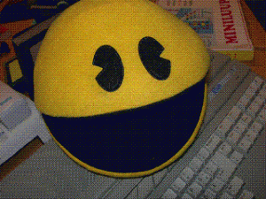
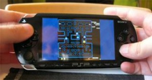
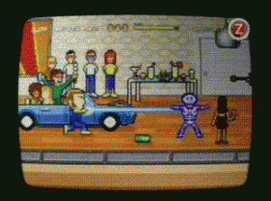
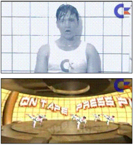
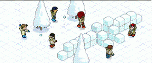
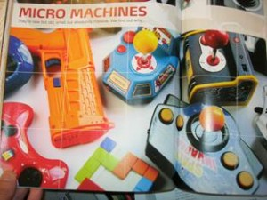
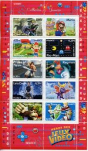
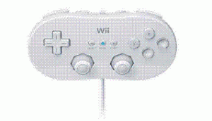

### Introduction

*Retro games. Simultaneously with the console and computer games becoming increasingly impressive both visually and in their dramatics, the old, simple Super Mario Bros, Pacmans and Donkey Kongs have become hits. In the rush hour buses, teenagers roll their Rubik’s cube – the one and only.*

Sanna Leskinen, ‘Mikä mahtaa olla in?’ (‘What would be in?’), Yhteishyvä 3/2006. {#para2}

At the end of the year 2005 the Finnish commercial TV channel MTV3 freshened their appearance. The owl logo of the company, which has been in use for a long time, bended again into new shapes. The owl lived on as a animated figure, who offers services and, particularly, as a stylized eye in the channel sign logos. The sign themes marking the beginnings and endings of commercial breaks place the owl eye into new, culturally recognizable situations, which try to achieve comedy and inventiveness. The owl eye is not just an eye anymore, but appears on screen as a figure varying its forms and roles (see Figure 1). {#para3}

The new owl animations of the MTV3 commercial breaks have, for example, been associated with seasonal festivals and sports, but we can also find indications of the gaming culture. In one of the first commercial break signs a Pong game, a sort of electric ping pong, in which pixel rackets bounce a virtual ball, was being played. Later in the spring of 2006, the logo chased pills reminiscent of the coin up machines of the Namco company and the videogame character Pac-Man from the early 1980s. {#para4}

Even though both themes have been drawn away from the original, many of us can recognize their intermedial reference to 1970’s and 1980’s game classics.[1] Images and sounds from the central features of Pac-Man and Pong have sort of eaten their way into our retina and eardrums. This has taken place due to the fact that they are both among the most recycled games from one device to another. Pong became familiar in the early 1970s arcade games and the late 1970s TV games that spread into households. {#para5}

The importance of Pong has been acknowledged in research and in (semi-)popular literature. In Joystick Nation, which praises the history of games, J.C. Hertz (1997: 14) names the earliest gaming eras as ‘The Pre-Pong Era’ (–1972), and ‘The Pong Era’ (1972–1977), which signifies when the game in question grows to symbolize a whole era of electronic gaming and appears as a central element in the critical period of the gaming culture. Pac-Man, on the other hand, is mentioned in many works concerning the history of electronic gaming as an early personalized videogame character, followed later by characters such as Donkey Kong, Mario and Lara Croft. According to some texts, Pac-Man attracted an increasing number of female gamers into gaming and was conducive to the birth of a whole new game type, the maze. At the beginning of the 1980s Pac-Man spread from arcade halls into home computers, became popular on various consumer goods from back-packs to pillow cases, and was referred to in magazine articles, television shows and pop music hits (Herz, 1997; Malliet and de Meyer, 2005; Kent, 2001) (See also Figures 2, 3, and 8). {#para6}

In no time the yellow Pac-Man character and icon became a sign for the aesthetic digital style of a particular period. It still remains as such, as it appears continuously in new game products and popular culture, e.g. in music and cartoons. According to a study which included a survey concerning the computer memories of Finnish people, it is Pac-Man that stands out as one of the most familiar and best-remembered old games among over 30–year-olds (Aaltonen, 2004). {#para7}

The examples above show how the cultural history of games is present even today. They reveal how the cultural history of games is bending into new shapes and how this thematic recycling is used to gain commercial benefits. Therefore, I argue in this paper that these examples in gaming prove three things: 1) digital culture as a whole is evolving and maturing, 2) one future trend in gaming and digital culture is recycling the past, and 3) for these reasons digital culture as an academic discipline should become even more conscious of aspects of the cultural heritage of technology. In this paper I analyze different aspects of retrogaming in the historical context, looking for answers to the following interconnected questions: Does the change in the computer user groups and gamers explain why retrogaming has become more popular, or why retrogaming as a cultural phenomenon has expanded? Has retrogaming had an influence on the contents of games and the appreciation of gaming? What sorts of different hobbies are associated with retrogaming? How has the increasing interest in retrogaming been used, then, for financial gain? Finally, I discuss how familiarity and nostalgic interest in older technology is incorporated into technological change and innovation. {#para8}

### The Cultures of History Within Gaming

Pac-Man and Pong bring out some features of the gaming culture within the cultures of history. The cultures of history mean the ways of producing and using artifacts, images and information concerning the past. Cultures of history are a kind of modern culture, which takes form from the ways of encountering the past, from traditions, events and the meanings given to the past (Koselleck, 1985; Salmi, 2004; Sivula and Suominen, 2004). {#para9}

Cultural historian Hannu Salmi (2004) distinguishes five ways or means by which the past is among us in the present-day. The past appears as memory, experience, customs, artifacts and commodities. As for the cultures of history within the games, the past is present in a person’s own memories of playing, and, among other things, in the collective memory represented on the Internet and on-line discussion forums. The experience of the history of culture is present, for example, when we play both familiar and new games: we take advantage of our earlier gaming experiences in new gaming situations, because we have learned to recognize the logic, rules, plots and actions associated with the games. Our earlier gaming experiences have taught us to act in a certain way when playing. On the other hand, our earlier experiences have an influence on how we return to familiar games or how we choose new games to play. At this point we can already talk about the customs of the cultures of history in gaming. The customs include the conventionalized habits and routines to play either alone or together, and the tendency to return over and over again to play old games, especially computer games from the 80s (so-called retrogaming), or to purchase familiar games for new gaming devices such as Sony PSP, Nintendo Wii or Microsoft Xbox360. The artifacts connected with the cultural history of games are, for instance, the famous and somehow special game devices and games such as the first coin-up games or home consoles, now presented in museums and private collections. The line between the artifacts and commodities becomes less clear when old devices and game software are bought and sold at Internet auction sites. Various music videos, works of art, books and new editions and revisions of old game products (for instance being bought in online shops for the new generation consoles such as Nintendo Wii and Xbox360) – in some degree commercials as well – are also commodities of the cultures of history (Sivula and Suominen, 2004). {#para10}

The past culture of games, in its many forms, is very central in gaming culture today. James Newman (2004) also draws attention to this fact in his recently published textbook on digital gaming. In a chapter on future gaming Newman mentions three modern trends in gaming: mobile games, on-line games and retrogaming. Thus, a strong rising trend in future gaming in different situations and platforms is the re-use of the old. Newman refers to retrogaming at two levels: firstly, retrogaming means present-day gaming with the genuine, 1970s, 1980s and early 1990s game devices and applications. Secondly, it means the use of emulators in playing the games. On the other hand, Petri Saarikoski (2004: 254), who has studied the history of computer hobbyist cultures in Finland, defines retrogaming somewhat more broadly as a general term for subcultures that appreciate old computer games. This phenomenon includes collecting old games and game devices as well as their active playing. Both scholars see retrogaming as a form of gaming culture that is partly marginal but which is emerging to become more common. Typically the current retrogaming refers particularly to the usage of game devices that were used before personal computers (common since the early 1990’s). {#para11}

According to Newman, retrogaming has, among other things, been advertised as a return to pure, genuine or authentic gaming, and based on Newman’s interpretation one can come to a conclusion: that the idea of retrogaming is a situation in which everything superfluous has been eliminated. We have witnessed a return to the origins, where pleasure and playability are attained with simple facts and where the use of capacity is maximized. This idea has been crystallized, for instance, in a fragment of a review by JP Tiira in the Finnish Pelit-magazine (1992): ‘When we were kids and (Commodore) sixty-four was dynamite, numerous role-playing games were packed into the memory of the old warhorse (…), the secret lay under the cover: the games had that something, which created the genuine feeling of search and adventure, in spite of its usually quite simple graphics’ (Saarikoski, 2004). {#para12}

The word retro, which originates from Latin, refers to a return, a comeback, or something repetitive. Therefore retrogaming hints usually – but not always – at returning, whether it means the consumer’s return or retrogression to childhood, or an intention to (re-)achieve something pure or preferable. It means, most likely, both seeking and yearning for an acquainted set of rules and familiar fictional worlds (Juul, 2006). {#para13}

As a phenomenon, retrogaming is, however, more complicated than a particular modern trend or a return to something, and the aim of this paper is to widen the interpretations of other scholars concerning the meaning of retrogaming. In the next chapter, I will begin with a critical transcription of retrogaming by examining questions of gamers’ ages in relation to their interest in older games and gaming devices. {#para14}

### Middle-Aged Juveniles – Is The Maturation Of Gamers An Explanation For Retrogaming Fashion?

Statistics Finland published a new leisure survey in 2005 which included the consumption of rock music among the middle-aged. Rock, initially a youth culture, has aged with its performers as well as with its consumers. While in 1981 only some 10 percent of 35–44-year-old Finns declared that they listened to rock music, by 2002 this figure rose to 70 percent (Ekholm, 2005). Increasingly, the older age groups also collect records and are more likely to go to rock concerts or play an instrument. Old artists and music records are still popular along with the new ones. {#para15}

One can find a parallel between rock music and digital games as forms of popular culture. Similar middle-ageing can be seen in digital gaming culture, which is probably one reason for the continuous interest towards older gaming products. A good number of those who started to play digital games in the 1980s have not, or at least not entirely, given up on playing games at an older age. According to many statistics, especially the ones introduced by the representatives of the gaming industry, the average age of computer and other digital gamers is on the rise. In 2003 the average age of gamers, according to the organization representing the game manufacturers of the USA (Entertainment Software Association, ESA), was 28 years, and over 40 percent of the gamers were women. According to the same organization, over 35-year-olds are the most eager age group to play PC games and people under 35 years favor console games most strongly. In Japan, adult gaming may be even more common, especially in age groups under 35 years. In Finland, the situation is probably similar to that of the United States and Japan, even though the national and regional differences should not be overlooked and any generalizations of the situation should not be done without accurate data. According to the Statistics Finland leisure survey in 2002, a little over 60 percent of 15–34-year-old people used the computer to play games, some 30 percent played with game devices (i.e. game consoles), and about 20 percent often played with a computer or a game machine (Melkas, 2005). Particularly during the past ten years, the devices used in digital gaming have been established as an essential part of Finnish households. {#para16}

The previous statistics should be studied critically. As the game researcher Markku Eskelinen (2005) states in his report concerning the game industry, observations about the expansion of the field of gamers can be applied to the game industry itself. In Eskelinen’s opinion, the statistical argument regarding the equality between the sexes and across generations fits nicely with the ideal self-image of the game industry. In particular, the statistics presented by various special-interest groups of the game industry do not exactly inform us about how gamers differ from each other (Eskelinen, 2005). For example, according to many independent studies, young boys spend significantly more time playing games and talking about them than young girls do (Suoninen, 2002; Melkas, 2005). Age and the level of education are also important factors in gaming. According to Statistics Finland, in the age group of 15–34 among the higher educated people there are many who do not play at all (Melkas, 2005). Moreover, according to some studies, it still seems that parents play digital games very little either alone or with their children. According to Laura Ermi et al., there is still a gaming gap between parents and children, which has an influence on the attitudes of parents. A gamer adult may even be seen as a threat, being someone who breaks certain limits and forgets his/hers position as an authority (Ermi et al, 2005; Ermi and Mäyrä, 2003). {#para17}

Some interest groups and actors, however, strongly promote the idea of the maturity of gaming. Markku Eskelinen (2005) claims that the gaming industry uses such arguments for statistics and calculation, which justify the image of a big and significant line of industry. Also, according to Eskelinen, it is in the interests of the game industry to appear as a socially responsible servant of the needs of the whole family, in a context where the effects and contents of games still raise suspicions in many households. Eskelinen (2005) questions the ‘commonly articulated wish or supposedly observed trend, according to which the contents of games “mature” as the gamers grow older’. {#para18}

Therefore, it is important to separate the ‘maturing’ of the contents from the possible middle-ageing of gamers. Media culture – also represented by digital games – comprises a certain infantilism, childishness or juvenility that may even have become stronger recently. In his book Mediatajun paluu (Return of Media Sense), Jukka Sihvonen (2004: 17) argues that media culture uses the idea of juvenility to promote production, nourishment and renewal. Sihvonen states, without making any evaluations, that in the heart of media culture there is an individual, defined by ‘boredom, restlessness and egocentricism’. Sihvonen (2004, 114–115) makes yet another point: if viewed from the perspective of their usage, games appear mostly as an instinctive entertainment, and a form of being together based on the drive to compete. Thus, they show the ideological principal of juvenility in media culture (Sihvonen, 2004: 114-115. {#para19}

### Nostalgia In Product-Making

We can also use another word of foreign origin in relation to retrogaming – nostalgia. In gaming cultures it refers to a kind of yearning for earlier gaming situations or games. One can ask, by elaborating upon Jesper Juul’s ideas of gaming, in which sense the yearning focuses on learned rules or fictional worlds constructed in earlier gaming situations, or both together (Juul, 2006). {#para20}

The word nostalgia is based on a Greek word referring to the agony of home-coming. The meaning of the word nostalgia has varied in the course of centuries and it has been used, among other things, to refer to different physical and psychic disorders caused by moving somewhere else from the original home area. In its present meaning, nostalgia is not usually defined on clinical grounds. Melancholy and even actual ‘basking’ in the past is associated with nostalgic reminiscences. {#para21}

In addition to the individual psychological level, the term contains a strong collective – if not even collectivising – dimension (Korkiakangas, 1999; Sallinen, 2004; Koivunen, 2001). In media culture, longing for something old is a mutual event when it refers to such old moments, situations and experiences, which have been shared with friends and family, or even with the nation or ‘the whole world’. Nostalgia has been seen as an explanation to the success of certain kinds of media presentations, such as historical documentaries and fiction series on television, and as a trend in modern culture. A scholar of media studies, Anu Koivunen critiques the above-mentioned explanation for nostalgia, for which it is common, among other things, to include an individual or a single event in greater changes or critical periods in world order or community, or in the differences between generations. These differences are connected, for instance, with people moving to towns from the countryside or the structural changes in consumption or in working life (2001: 224-245). {#para22}

Whether it is a trend or not, the desire for nostalgic basking can be satisfied with various consumer goods. Markku Eskelinen mentions the recent products of Japanese game companies, ‘which with the aid of quite clever pastiche and a slightly increased degree of difficulty attract those parents who play games with their children and who have played similar games already in the 80s’ (Eskelinen, 2005). Thus, scholars refer to a certain consumeristic-simulational product-making of nostalgia, which emerged and strengthened with the rest of the consumer society in the 1960s. The goal of product makers is not solely to benefit from an existing nostalgic relationship of some kind, but also to train towards a nostalgic attitude (Koivunen, 2001). Nostalgia is rendered a tool of consumption, the repetition and simulation of earlier experiences being the aim of nostalgic product-making. {#para23}

As far as games are concerned, and also otherwise, the product-making of nostalgia does not only mean the making of new editions of Pac-mans, Pongs and Super Marios, with extras and digital remastering, as is widely the case with the digitalization of records, movies and television series. Digital cultural production is often, but not solely, about adding extras, giving additional value and making new versions. Although nostalgic sensibility might be the central factor that makes a product more attractive, it is possible to view nostalgia as a much wider phenomenon than retrogaming (Sivula and Suominen, 2004). According to Koivunen, nostalgia is not an explanation but a question, which ‘concerns objects, forms, meanings as well as effects’ (2001). So, we can wonder what kinds of forms nostalgia takes, how it changes and is renewed, to which products it is targeted, how it is being used in making new products within gaming cultures, and who the product makers are. {#para24}

### Gaming Nostalgia in Music Videos

Even in a superficial observation of the gaming culture(s) we crash into a jungle or a complex web of forms and targets of nostalgia. Nowadays, the retro phenomenon associated with nostalgia can, in the first place, be seen as a kind of an aesthetic repetition style of media culture, which refers strongly to the audiovisual styles of the 1980s, and game types and classic game icons such as Pac-man, Pong, Tetris and Mario in particular. These overlapping aesthetic repetition styles are visible in new game products and websites such as the Habbo Hotel ([https://www.habbohotel.fi](https://www.habbohotel.fi)) (See figure 6.) and Aapeli ([https://www.aapeli.com](https://www.aapeli.com)), as well as in game literature and academic studies, pop videos, graphic signs of TV channels and audiovisual representations of digital (dance) music. In this section I will make a preliminary analysis of several few music videos with a retrogaming theme. {#para25}

Besides the songs themselves, the retro aesthetics is revealed and highlighted particularly with the aid of record cover art and music videos, with the artists using retrogaming themes in varying ways. References to older games is a fashion in popular videos (especially popularized around the year 2000), but it also holds potential for a more critical or ironical evaluation of the gaming culture itself. In music videos, retrogaming themes are also used to promote some political issues. (For more complete list of retrogaming music videos and TV commercials, see my web-page, [https://www.tuug.fi/~jaakko/tutkimus/retro-game-videos.php](https://www.tuug.fi/~jaakko/tutkimus/retro-game-videos.php)). {#para26}

Examples of retro aesthetics in music videos include: Junior Senior’s ‘Move Your Feet’, where viewers can identify elements of the colour scheme, speed and images of 8-bit computers (e.g. Commodore 64), or the graphic adventure games for PC by Sierra Online from both sides of the mid-80s; or the video ‘Rock’n Roll High School’ by Teddybears STHLM (see Figure 4) which refers more strongly to the somewhat later game aesthetics of the 16-bit Commodore Amiga. It is also essential, however, how different people divergently place and identify the references of origin through their own experiences; a single origin, be it a certain game or a computer, is not necessarily to be found. {#para27}

Press Play On Tape (see Figure 5), on the other hand, whose name comes from the tape drive starting command shown on the Commodore 64 computer screen, matches confessions of computer love and clashes of boybands in their video ‘Comic Bakery’ (larger than Pop Boyband mix). The clichés have been picked especially from the performances of the Backstreet Boys, but also from other boybands. The result is an intentionally comical pastiche, where the delicate theme of teenage love has been twisted; instead of a girl, the object of emotions is a computer. The video also parodies the use of the auto tuning – the singing-voice converter effect, which became familiar in the performances of Cher, Pet Shop Boys, Daft Punk and various other artists. {#para28}

The piece from Press Play On Tape is an arrangement of the music for a known 1980s Commodore game, Comic Bakery (composed by Martin Galway). On the video, there is a fragment where the artists are wandering in the atmosphere of a 1980s karate game, ‘Way of the Exploding Fist’. Supposedly, this video has not been widely distributed in music channels, unlike the videos mentioned before, some of which have even been awarded. According to the homepage of the Danish band, the video had its premiere in a local pub and has since gained attention in Commodore 64 forums (see [https://www.remix64.com/tune_137100.html](https://www.remix64.com/tune_137100.html)). {#para29}

How can the examples above, and the Press Play On Tape video in particular, be analyzed? It is possible to categorize the latter video as a manifestation of fan culture, which highlights the juvenility mentioned above. Jukka Sihvonen (2004, 174–175) cites the seven theses of juvenility presented by Henry Jenkins in his book Textual Poachers (1992), which seem to be applied to many forms of the consumption and performance of retro culture. Jenkins’ theses, based on the study of Star Trek devotees, are ironic and meant to describe the general view of the social limitations of juvenile fans. Sihvonen notes, that according to Jenkins’ theses, a typical fan is devoted to ‘(a) mindless consumption, (b) cherishing worthless knowledge, (c) idealizing trashy culture and (d) worshipping his/hers idol without having a life. This kind of lack of one’s own experiences makes the fan (e) “feminine” or even asexual (f) an emotionally and intellectually handicapped human being, who has (g) perpetual difficulties in separating reality from fiction’ (Sihvonen, 2004; Jenkins, 1992). The Press Play On Tape video could well be presented as such a product, a mindless consumption and a waste of time, which represents the emotional, sexual and intellectual juvenility and alienation of its makers. {#para30}

Thereafter, however, Sihvonen enters a dialogue between the previous statements and the counter-characterisations made by Jenkins at the end of his book, which aims to refute a stereotypical view of fanhood. According to Jenkins and Sihvonen ‘being a fan requires special (a) forms of receiving and usage, (b) means and equipment of critical and interpreting action, (c) principals of activism that is founded upon consumption and (d) reproduction of traditions and customs. All these put together mean that fanhood concentrated on a particular phenomenon forms (e) a unique, alternative social community” (Sihvonen, 2004; Jenkins, 1992). Indeed, the Press Play On Tape video is actually directed to a certain alternative audience, which reacts to the very many forms and products of media culture with criticism and new interpretations. Moreover, the video exemplifies the potential of spontaneous production, performing and distribution of media. {#para31}

The pop video examples mentioned inform us about a sensitive and versatile relationship with old digital games. Various references to the world of older games and also different ways of narration have been well used in the videos. Although the forms in which the digital game relationship becomes apparent could be criticized, the videos tell particularly about the potential to renew customs and tradition. That ability is not limited to a making of retrogaming music and music videos. In many cases, the question is not so much about seeing and seeking commercial potentiality, but about media producers and certain groups of consumers sharing the gaming experience (or a part of it), and reworking it by using the resources of nostalgia. As Henry Jenkins argues, the fan community does not clearly separate artists from consumers. All fans are potential writers or other kinds of artists, whose talents just need to be noticed, nourished and introduced. Even the most unassuming works enrich the cultural heritage of a wider fan community (Jenkins, 1992). Fans (or devotees of the 80s micro computer cultures in this case) form a social community, outside which the works also have their value, for a common subjective empirical ground is not necessarily needed between the producers and the audience. The 1980s style for other generations, older and younger, is familiar as a fashionable repetition style in particular. In addition to a subculture, retrogaming thus becomes part of the mainstream of popular culture. {#para32}

### Games, devices, watches, clothes…

The aesthetics of retrogaming can also act as an inside joke or a source of inspiration. This seems especially to be the case with the popular virtual environment of the Habbo Hotel. Mikael Johnson (2006) has observed how in research interviews some of the designers of the Habbo Hotel-environment have made references to Commodore 64 games as their central source of inspiration. The interviewed persons have stated that the Habbo Hotel looks retro compared to other web environments (Johnson, 2006). The Habbo Hotel users are young, and for them the 1980’s digital graphics and game perspective do not primarily work through nostalgia. It rather offers a clear, easy and attractively different game environment, without remedial and intermedial references to earlier game aesthetics. The designers, on the other hand, seem to share a nostalgic attraction to the 1980’s game aesthetics, whose isometric perspective originates among others from Knight Lore (1984) for Sinclair Spectrum, Head Over Heels (1987) for Commodore 64 and other devices, and from other similar games (see: [https://www.mameworld.net/retroview/spectrum/knight_loreuser.htm](https://www.mameworld.net/retroview/spectrum/knight_loreuser.htm) and [phttps://linkchecker.stacken.kth.se/c64/06top.html](https://linkchecker.stacken.kth.se/c64/06top.html)). {#para33}

Those consumer goods, which are marketed with the aid of earlier games or as their actual copies, have a different commercial tone. As a long-term computer hobbyist working with digital culture, I am also personally a splendid target for these kind of products. In addition to a DigDug -t-shirt and an Atari Centipede-watch by Fossil, I have in my collection a Plug & Play TV game by Jakks Pacific, which contains five coin-up game classics. This product has many versions, which have all proved commercially successful. Many companies have followed the example of Jakks Pacific. Edge, a central publication in the field of gaming, took notice of this in their October 2005 issue (see Figure 7); Edge introduced dozens of game products, which have sold millions of copies worldwide in places out of the ordinary, such as discount stores. Anson Sawby, marketing director of Jakks who was interviewed by Edge, refers particularly to the middle-ageing of the gamers behind the marketing potential: ‘The market was initially fuelled by people in their 30s or 40s or even 50s… They grew up playing games, but aren’t prepared to splash out on a PlayStation’ (Edge, October 2005). Gamers miss old, well-known games and are not necessarily prepared to adopt new, more complex games. From the previous utterance one could also derive an interpretation that old games suit older gamers better, also in their use of time. Gaming fits the fragmentary, momentary and hectic lifestyle of the information and mobile society in which, as suggested by Jukka Sihvonen and other researchers, there is just not enough time to concentrate on gaming over a long period. {#para34}

The previous examples show that a whole new line of the game industry, which uses a notable marketing segment of the gaming nostalgia in its products, has been born. This line of industry includes new enterprises, but also those (such as Nintendo, Microsoft and Sony) who have been involved longer and have taken retro products into their product-making. And, time after time, there is always something to recycle; after the 1970s and 1980s, the early 1990s products will be targeted. {#para35}

On the other hand, working on and recycling gaming culture themes based on amateur work, which is not primarily about commercial benefit but also about respect to and maintenance of older gaming culture, should be acknowledged. In this case, the idea is not about testing the limits of the marketing potential, but about subjective cultural production and being a ‘true amateur’. {#para36}

### Will to Preserve

According to the Edge, some of the retro game products have been commercialised based on device or programme adaptations made by computer amateurs. Actually, the role of active amateurs or hobbyists in preserving and renewing the retro culture is quite central. Petri Saarikoski has noted that the nostalgia of gaming culture began in the late 1980s, right after the hobbyist computer magazines started to write about the ‘death’ of 8-bit home computers (e.g. Commodore 64, Spectravideo 328, Amstrad CPC, Sinclair Spectrum) (Saarikoski, 2001). It is noteworthy, that at the same time game journalism was also established, and it produced a discourse of the cultural heritage of digital gaming. Game critics showed their expertise by linking the new games along the cultural continuum of the games and, among other things, by comparing these games to earlier ones. {#para37}

The feeling of disappearance and loss of old games brought about a cherishing old gaming culture, and Saarikoski sees this even as an effort by certain amateur groups to separate themselves from the mainstream of amateur work which concentrates on success (Saarikoski, 2001; 2004). The older game types and styles had already been recycled earlier, and the nostalgization of the idealistic early stages of computer hobbyism had begun. Steven Levy (1984), for example, in his well-known book Hackers – Heroes of Computer Revolution, claimed that enthusiastic computer amateurs were enthroned as heroes of the computer revolution. Levy also divided hackers into generations, whose central developing trends at the turning points had been the disappearance of idealism and commercialisation. Besides the idealisation of hackers, the late 1980’s games recycled elements and game types from the 1970s (Saarikoski, 2001). {#para38}

More recently, there have been at least three of four forms of preserving and performing electronic gaming culture: websites, hardware and software collections, exhibitions and historical works. We observe the different forms of preserving particularly via the Internet. There are several sites devoted to old games, containing game histories, timelines, interviews, technical descriptions, downloadable emulator adaptations, pictures and other material. There, amateurs also present their collections of games in a kind of virtual exhibition. Similarly, collecting game products has become apparent in e-mail posting lists, forums and on-line marketplaces (e.g. ebay.com, huuto.net). {#para39}

### Conclusion: Nostalgic Discourse And The Appropriation Of ‘New’ Media Technology

Although ‘nostalgic attitude’ is used for different sorts of commercial purposes, the nostalgic discourse of electronic gaming contains a lot of (self-)critical and (self-)ironic forms of action. It is not just a way of talking, but at the same time both a uniting and separating form of action, a practice interlaced with digital technology. {#para40}

The nostalgic discourse of electronic gaming can also usefully be compared to the nostalgic discourses of other media technologies; it can now be observed that the nostalgic discourse is not necessarily associated with a particular media or decade. Anu Koivunen, for example, has characterized television as a memory machine, whereby referring to the reminiscence of the past that has continued for decades in televisual media. {#para41}

According to Koivunen, nostalgic television series are not examples of a certain post-modern phase, but instead a particular ‘ontological feature’ in the essence of television. In the first place, Koivunen refers to the content of TV programmes, but this ontological feature can also be seen in the design of television sets. Central in at least some models has been an association with something familiar and traditional; furniture, materials or devices that are already familiar from earlier times. This issue could be analysed within a framework, which Andrew Blake (2002) in his analysis of the Harry Potter phenomenon, has named retrolutionarity [24]. According to Blake, retrolutionarity means production of the materials of the future with the methods of the past. {#para42}

Instead of television, the Internet seems to be a kind of a central processing unit of the memory machine in today’s retrogaming. In addition to recollection narration, the Internet also makes many other forms of nostalgia possible. A gamers personal work and their consequent ‘inside’ position are central in this kind of action. However, they are not necessary in a nostalgic experience, although Sihvonen (2004: 13) emphasizes the relationship between the personal work and media, particularly when media is considered as a phenomenon. {#para43}

Articulating some of Koivunen’s ideas, and after presenting a number of examples in this paper, I want to conclude that retrogaming can not simply be described as a phenomenon of some particular phase or as an explanation of the middle-ageing of gaming culture. The nostalgic discourse associated with electronic gaming is rather a resource, which is introduced whenever needed; it is used in time and space in various ways depending on the usage point. Nostalgic discourse can be used to stand out (sub-, counter- and alternative cultures) or to be identified with. The means of standing out and the objects of identification are various as well. Retrogaming thus does not refer only to gaming, but for example to listening and producing music, to clothing or, say, to graphical design. Possibly in the future the 1980s world of electronic games will again become a more marginal hobby, to be replaced by some other more modern forms of retrogaming. {#para44}

Retrogaming (action, practise) and gaming nostalgia (the mode of recollection and recollection discourse itself) are a central part of a more general culture of technology and the cultural adaptation of technology. In many cases the making-nostalgic of a technological device, adaptation or form of action begins right after its introduction, or immediately after design has been launched. Actually, the making-nostalgic – or at least some sort of romanticization – begins even at an earlier stage, when the user considers a novel product in relation to the older one. Highlighting technological renewal and revolution can be seen as a bipolar contrast to nostalgic discourse. Both discourses have their reverse side, and their fears: the fear of revolutionary discourse is technical retrogression and depression; the fear of nostalgic discourse is perhaps the difficulty to control change. {#para45}

In practice, the stages introduced above overlap. It seems that when new technological innovations are introduced, the change and their effects are softened with a sort of rhetoric or discourse of safety: the revolution and coming of the novelties is under control. Different kinds of nostalgic elements are used in representing the revolution (Suominen, 2000; Suominen, 2003). The above-mentioned term, retrolutionary, refers to the same phenomenon, in which there is an effort to control the threat and possibilities of newness by binding them with pleasing experiences of familiarity and related emotions. The new and the old are in constant dialogue in both technological use and discussion (see figure 9). Therefore, (the cultures of) history is a new trend in digital culture and gaming – and at the same time, it is not new. {#para46}

A Swedish historian Peter Aronsson (2005: 13) describes the cultures of history (historiekultur in Swedish) as sources, artefacts, rituals and habits which provide obvious ways to form links between the past, the present and the future. With the uses of history or practising history (historiebruk) Aronsson refers to how bytes or elements of the cultures of history are activated to form particular meaningful practise-oriented entities. The uses of history create meaning, legitimate and ‘handle’ change. The consciousness of history (historiemedvetande) is one’s conception of the nexus of the past, the present and the future. Therefore, in the use or practise of history the cultures of history are stages for the formation of historical consciousness (Aronsson, 2005). In this paper, I have tried to articulate the different forms of the cultures, the uses and the conceptions of history within digital gaming, as a way to show the wide range and importance of this phenomenon. The paper can potentially be used as a base for more empirical or theoretical and focused analyses of the cultures of history in digital gaming. For example, an analysis could make more detailed observations, studying the sources or interviewing gamers and game designers in particular contexts where retrospection appears to be an essential part of the current (and future) gaming culture. {#para47}

## Acknowledgments

Thanks to Salla-Riikka Vesterlund for major parts of English translation of my text and to Erik Rosendahl for some corrections (errors, however, are made by me personally). Many thanks to Anna Sivula, Petri Saarikoski and Riikka Turtiainen for comments on this paper, and special thanks to Tanja Sihvonen for the French gaming stamps.

## Author’s Biography

Jaakko Suominen is Doctor of Philosophy, Acting Professor of Digital Culture and Director of the School of Cultural Production and Landscape Studies at the University of Turku, Finland. Suominen is an author of

two monographs on the cultural history of computing. He has co‑edited five academic books and written about 40 articles. In his studies Suominen has concentrated on the cultural history of information technology and the history of media and technology. Lately, Suominen has released a weblog book (in Finnish, [https://jaasuo.wordpress.com/tietokoneen‑takapuoli/](https://jaasuo.wordpress.com/tietokoneen‑takapuoli/)) focusing on several cultural historical aspects of digitalisation such as retro‑gaming, history of computer love and remediation. Suominen works in a multi‑disciplinary academic community at the Pori University Consortium, which consists of units of five different universities. Suominen has led many co‑operative projects with companies as well as with municipal bodies and non‑profit organizations on different aspects of digital culture. Email: jaakko.suominen at utu.fi. Web: [https://www.tuug.fi/~jaakko/](https://www.tuug.fi/~jaakko/)

## Note

[1] Intermediality means an interaction between two or more media, which can be realized in both the level of media performances and their production. Juha Herkman (2005) divides intermediality in three components: the introduction of other media technologies (e.g. the use of television in a movie), the introduction of persons known from a certain media (e.g. interviews with TV persons in magazines) and the search for synergy in production (e.g. displaying the same news in different media or, say, marketing several products together).] Also, one can call this phenomenon remediation, which means process of refashioning older or familiar media forms (Bolter and Grusin, 2000).

[back]

## References

Aaltonen, Satu. Tunteita, tulkintoja ja tietotekniikkaa. ’Milloin kuulin ensimmäistä kertaa tietokoneista?’ – kyselyn tuloksia (Tiesu-projektin julkaisuja. Kulttuurihistoria, Turun yliopisto, Turku, 2004).

Aronsson, Peter. (2005) ‘En forskningsfält tar form’ in Peter Aronsson and Magdalena Hillström (eds) Kulturarvens dynamik. Det institutionaliserade kulturarvets förändringar (Tema Kultur of samhälle, Skriftserie 2005:2. Linköpings universitet, Linköping).

Blake, Andrew. Irresistible Rise of Harry Potter (London: Verso, 2002).

Bolter, Jay David and Richard Grusin. Remediation: Understanding New Media (Cambridge, MA: MIT Press, 2000).

Ekholm, Jukka. ’Musiikkivalinnat’, in Mirja Liikkanen, Riitta Hanifi and Ulla Hannula (eds) Yksilöllisiä valintoja, kulttuurien pysyvyyttä. Vapaa-ajan muutokset 1981–2002 (Helsinki: Tilastokeskus, 2005).

Ermi, Laura, Frans Mäyrä and Satu Heliö. ’Mediakasvu ja pelaamisen hallinta’, Anja Riitta Lahikainen, Pentti Hietala, Tommi Inkinen, Marjatta Kangassalo, Riikka Kivimäki and Frans Mäyrä (eds) Lapsuus mediamaailmassa. Näkökulmia lasten tietoyhteiskuntaan (Helsinki: Gaudeamus, 2005).

Ermi, Laura and Mäyrä, Frans ‘Power and Control of Games: Children as the Actors of Game Cultures’ in Marinka Copier and Joost Raessens (eds) Level Up – Digital Games Research Conference Proceedings (Utrecht: University of Utrecht, 2003).

Eskelinen, Markku. ‘Pelit ja pelitutkimus luovassa taloudessa’,Sitran raportteja 51 (Helskinki: Sitra, 2005).

Herkman, Juha. Kaupallisen television ja iltapäivälehtien avoliitto. Median markkinoituminen ja televisioituminen (Tempere: Vastapaino, 2005).

Herz, J. C. Joystick Nation. How videogames gobbled our money, won our hearts and rewired our minds (London: Abacus, 1997).

Jenkins, Henry. Textual Poachers. Television fans & participatory culture (London: Routledge, 1992).

Johnson, Mikael. ‘Uses of History in the Design of Habbo Hotel’, in Proceedings of Innovation Pressure Conference, Tampere, 15–17 March 2006.

Juul, Jesper. Half-Real. Video Games between Real Rules and Fictional Words (Cambridge, MA: MIT Press, 2006).

Kent, Steven L. Ultimate History of Video Games (Roseville: Prima, 2001).

Koivunen, Anu. ’Takaisin kotiin? Nostalgiaselityksen lumo ja ongelmallisuus’, in Anu Koivunen, Susanna Paasonen and Mari Pajala (eds) Populaarin lumo – mediat ja arki Toinen, korjattu painos. Taiteiden tutkimuksen laitos, mediatutkimus, julkaisuja A:46 (Turun yliopisto, Turku, 2001).

Korkiakangas, Pirjo. ’Muisti, muistelu, perinne’, in Bo Lönnqvist et al (eds) Kulttuurin muuttuvat kasvot. Johdatusta etnologiatieteisiin,Tietolipas 155 (Helsinki: SKS, 1999).

Koselleck, Reinhart. Futures Past. On the Semantics of Historical Time Translated by Keith Tribe. (Cambridge, MA: MIT Press, 1985).

Levy, Steven. Hackers. Heroes of the Information Revolution (New York: Delta, 1984, 1994).

Malliet, Steven and Gust de Meyer. ‘The History of the Video Game’ in Joos Rassens and Jeffrey Goldstein (eds) Handbook of Computer Game Studies (Cambridge, MA: MIT Press, 2005).

Melkas, Tuula. ’Tieto- ja viestintätekniikan harrastuskäyttö 15–34-vuotiailla’ in Mirja Liikkanen, Riitta Hanifi and Ulla Hannula (eds) Yksilöllisiä valintoja, kulttuurien pysyvyyttä. Vapaa-ajan muutokset 1981–2002 (Helsinki: Tilastokeskus, 2005).

Newman, James. Videogames (London and New York: Routledge, 2004).

Saarikoski, Petri. Pioneerien leluista kulutuselektroniikaksi. Suomalainen kotimikroharrastus tietotekniikan murroksessa 1980-luvun alusta 1990-luvun puoliväliin Yleisen historian julkaisematon lisensiaatintutkielma. (Turku: Turun yliopisto, 2001).

Saarikoski, Petri. Koneen lumo. Mikrotietokoneharrastus Suomessa 1970-luvulta 1990-luvun puoliväliin. [English translation: The Lure of the Machine. The Personal Computer Interest in Finland from the 1970s to the mid-1990s] Nykykulttuurin tutkimuskeskuksen julkaisuja 83. (Jyväskylä: Jyväskylän yliopisto, 2004).

Sallinen, Susanna. ’Koti-ikävä ja nostalgia arjen kokemuksena’ in Päivi Granö, Jaakko Suominen and Outi Tuomi-Nikula (eds) Koti – kaiho, paikka, muutos… Kulttuurituotannon ja maisemantutkimuksen laitoksen julkaisuja IV. Pori: Turun yliopisto, 2004).

Salmi, Hannu. ’Menneisyyskokemuksesta hyödykkeisiin – historiakulttuurin muodot’, Jokapäiväinen historia Toimittaneet Jorma Kalela ja Ilari Lindroos. Tietolipas 177. (Helsinki: Suomalaisen Kirjallisuuden Seura, 2001): 134–149.

Sihvonen, Jukka. Mediatajun paluu. Pistokkeen päässä (Helsinki: Like, 2004).

Sivula, Anna and Jaakko Suominen. ’Elektroninen pelaaminen historiakulttuurina’ [English translation: ‘Playing Electronic Games and the Culture of History’] Lähikuva 2–3/2004, 32–45.

Suoninen, Annikka. ’Lasten pelikulttuuri’, in Erkki Huhtamo and Sonja Kangas (eds) Mariosofia. Elektronisten pelien kulttuuri (Helsinki: Gaudeamus, 2002).

Suominen, Jaakko. Sähköaivo sinuiksi, tietokone tutuksi. Tietotekniikan kulttuurihistoriaa [English translation: Getting Familiar with the Electric Brain, Getting to Know the Computer]Nykykulttuurin tutkimuskeskuksen julkaisuja 67. (Jyväskylä: Jyväskylän yliopisto, 2000).

Suominen, Jaakko. Koneen kokemus. Tietoteknistyvä kulttuuri modernisoituvassa Suomessa 1920-luvulta 1970-luvulle [English translation: Experiences with Machines. Computerised Culture in the Process of Finnish Modernisation from the 1920s to the 1970s] (Tampere: Vastapaino, 2003).
