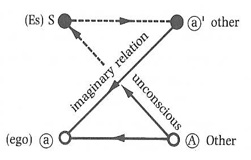
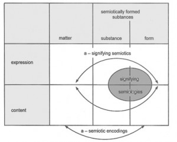

Félix Guattari, writing both on his own and with philosopher Gilles Deleuze, developed the notion of schizoanalysis out of his frustration with what he saw as the shortcomings of Freudian and Lacanian psychoanalysis, namely the orientation toward neurosis, emphasis on language, and lack of socio-political engagement. Guattari was analyzed by Lacan, attended Lacan’s teaching seminars from the beginning, and remained a member of Lacan’s school until his death in 1992. His unorthodox uses of Lacanism grew out of his clinical work with psychotics and involvement in militant politics. Paradoxically, even as he later rebelled theoretically and practically against Lacan’s ‘mathemes of the unconscious’ and topology of knots, Guattari ceaselessly drew diagrams and models. Deleuze once said of Guattari that ‘His ideas are drawings, or even diagrams’ (Deleuze, 2006: 238). His single-authored books are filled with strange figures which borrow from fields as diverse as linguistics, cultural anthropology, chaos theory, and non-equilibrium thermodynamics. Guattari himself declared schizoanalysis a ‘metamodeling’, but at the same time insisted that his models were constructed aesthetically, not scientifically, despite his liberal borrowing of scientific terminology.[1] The practice of schizoanalytic metamodeling is complicated by his and Deleuze’s concept of the diagram, which they define as a way of thinking that bypasses language, as for example in musical notation or mathematics. This paper will explore Guattari’s development of metamodeling as a corrective to Lacan’s increasingly purified structuralism. {#para2}

It is well known that in the Anti-Oedipus Guattari and Deleuze invented ‘schizoanalysis’ as a critique of psychoanalysis (Deleuze and Guattari, 1983). Guattari later defined schizoanalysis as ‘metamodeling’(Guattari, 1996: 122). He understood the term ‘model’—which in French can also mean ‘pattern’—in roughly two ways. In one sense, the model is a learned pattern of behavior inherited unquestioningly from family, institutions, and socio-political regimes, and which in the end functions as a prescriptive norm imposed by a dominant social order. In another sense, and in keeping with the social sciences, a model is a means of mapping processes and configurations. {#para3}

Long before he began characterizing schizoanalysis as metamodeling, Guattari had been highly critical of the role of the first type of model in standard psychoanalytic treatment. For him, a key aspect of psychoanalytic transference is the transference of models, defined as an inherited pattern of social norms. He sees transference in the relationship between mother and fetus. ‘What is transmitted from the pregnant woman to her child? Quite a bit: nourishment and antibodies, for example’. His argument here draws on the notion of message transmission in biological processes. He extends the biological to the social by insisting that ‘what is transmitted above all are the fundamental models of our industrial society’ (Guattari, 1996: 66). In a later essay, he explains that a child in utero would be able to receive a ‘message’ about ‘industrial society’ via the body of a mother, as in the case of morning sickness made more severe by the mother’s stress in the face of power formations at the level of the socius (Guattari, 1984: 164-166). In other words, transference need not be verbal, and physical transmissions (of the mother’s stress affecting the fetus, for example) may carry social messages, such that ‘the message is carried not via linguistic chains, but via bodies, sounds, mimicry, posture and so on’ (Guattari, 1984: 165). {#para4}

In the psychoanalyst’s consulting room, he once again finds a transference of models which takes place non-verbally at an unconscious level: {#para5}

> Regardless of the particular psychoanalytic curriculum, a reference to a pre-determined model of normality remains implicit within its framework. The analyst, of course, does not in principle expect that this normalization is the product of a pure and simple identification of the analysand with the analyst, but it works no less, and even despite him… as a process of identification of the analysand with a human profile that is compatible with the existing social order. (Guattari, 1996: 65-66) {#para6}

Echoing this idea that psychoanalysis functions as a transmitter of mainstream social models, in another essay he declares accusingly that ‘From the start, psychoanalysis tried to make sure that its categories were in agreement with the normative models of the period’. He adds the clarification that in the present historical moment, ‘the dominant models’ are all subordinated to ‘that model of models, capital, and are imposed with the collusion of families, schools, institutions, and even mainstream psychoanalysis’ (Guattari, 1984: 85). Capitalism, that megamachine of subjectifying subjection, or perhaps better, subjection by means of subjectification, depends on the transmission of models, which in turn mold human existence. ‘Capitalist refrains… must be classified among public micro-infrastructures, whose purpose is to regulate our most intimate temporalizations, and to model our relationships to the landscape and to the living world (Guattari, 1979: 111). Psychoanalysis plays a crucial role in capitalist subjectifying subjection because capitalism itself has denuded existing social models and systems of reference. The analyst’s ‘work is… to forge a new model in the place where his patient is lacking one’, a duty made necessary because ‘the modern bourgeois, capitalist society no longer has any satisfactory model at its disposal’ (Guattari, 1996: 65-66). Armed with its models, psychoanalysis ‘arrived in the nick of time, just as cracks were appearing in a lot of repressive organizations—the family, the school, psychiatry and so on’ (Guattari, 1984: 85). In short, the imposition of standard models is oppressive, and yet, paradoxically, ‘individual and collective subjectivity lack modeling’ (Guattari, 1995: 58). {#para7}

To state matters perhaps too schematically, as a practice, psychoanalysis transmits socializing models, even while as a theory, psychoanalysis ‘models’ in the second sense of the term, by mapping the processes and formations of the psyche. For example, for Guattari the Oedipus models in both senses of the word. He and Deleuze fully acknowledges that psychoanalysis did not invent the Oedipus, that ‘the subjects of psychoanalysis arrive already oedipalized, they demand it, they want more’. The Oedipus is imposed by ‘other forces: Global Persons, the Complete Object, the Great Phallus, the Terrible Undifferentiated Imaginary, Symbolic Differentiation, Segregation’ (Deleuze and Guattari, 1983: 121). As much as he dislikes it, Guattari does not even deny the force of the castration complex. He demands instead that psychoanalysis quit supporting the dominant order by inventing models that serve capitalism’s nefarious purposes. {#para8}

Schizoanalysis to the rescue. Guattari declares that ‘Schizoanalysis, I repeat, is not an alternative modeling. It is metamodeling’ (Guattari, 1996: 133). It is ‘a discipline of reading other systems of modeling, not as a general model, but as instrument for deciphering modeling systems in various domains, or in other words, as a meta-model’ (Guattari, 1989: 27). Why doesn’t Guattari merely invent and disseminate an alternate model, rather than proposing the inelegant and potentially superfluous term ‘metamodeling’? Because, as he says, ‘Schizoanalysis does not… choose one way of modeling to the exclusion of another’ (Guattari, 1995: 60-61). This applies to both definitions of modeling, as authoritative prescription or as accurate description. I should perhaps add a third definition of model, that of repeated pattern or skeletal blueprint—in other words, as structure. Guattari objects above all to this third, structuralist, definition of ‘model’, as manifested in the ‘habitually universalising claims of psychological modeling’. Guattari calls instead for a ‘metamodeling capable of taking into account the diversity of modeling systems’ (Guattari, 1995: 22). As he puts it elsewhere, ‘all systems of modeling are equal, all are acceptable, but only to the extent that they abandon all universalizing pretensions and confess that they have no other use than to work at mapping Existential Territories’ (Guattari, 1989: 12). In Guattari’s view, each subjectivity combats alienation (a term he used often in his earliest writing) by constructing its own ‘existential territory’ out of the various semiotic materials and social connections available, holding everything together through means such as the ‘refrain’.[2] This is how, for example, schizophrenics reassemble a functional universe, even though they are completely unable to live according to dominant social models. ‘Thus it’s not simply a matter of remodelling a patient’s subjectivity—as it existed before a psychotic crisis—but of a production sui generis’ (Guattari, 1995: 6). This is how metamodeling functions therapeutically. In a way, says Guattari, ‘subjectivity is always more or less a meta-modeling activity’, or ‘a process of self-organization or singularization’ (Guattari, 1989: 27-28). {#para9}

> [Schizoanalysis] tries to understand how it is that you got where you are. ‘What is your model to you’? It does not work?—Then, I don’t know, one tries to work together. One must see if one can make a graft of other models. It will be perhaps better, perhaps worse. We will see. There is no question of posing a standard model. And the criterion of truth in this comes precisely when the metmodeling transforms itself into automodeling, or self-management [auto-gestation] of the model if you prefer. (Guattari, 1996: 133; translation modified) {#para10}

In other words, as Guattari puts it earlier in the same interview, ‘Without pretending to promote a didactic program, it is a matter of constituting networks and rhizomes in order to escape the systems of modeling in which we are entangled and which are in the process of completely polluting us, head and heart’ (Guattari, 1996: 132). {#para11}

Schizoanalytic metamodeling, then, can be distinguished from standard psychoanalytic and capitalist models in several ways. Guattari’s metamodeling promotes a radical, liberatory politics. It creates a singularizing map of the psyche. It allows one to construct one’s own metamodels. It recognizes, and even borrows from, existing models. It can transform an existence by showing paths out of models in which one may have inadvertently become stuck. Rather than looking to the past, it looks to future possibilities. ‘What distinguishes metamodeling from modeling is the way it uses terms to develop possible openings onto the virtual and onto creative processuality’ (Guattari, 1995: 31). Metamodeling produces, creates, finds new paths. This may be Guattari’s best description of schizoanalysis as metamodeling: {#para12}

> Nothing was further from my intention that to propose a psycho-social model with the pretention of offering it as a global alternative to existing methods of analyzing the unconscious! …my reflection has had as its axis problems of what I call metamodeling. That is, it has concerned something that does not found itself as an overcoding of existing modeling, but more as a procedure of ‘automodeling’, which appropriates all or part of existing models in order to construct its own cartographies, its own reference points, and thus its own analytic approach, its own analytic methodology. (Guattari, 1996: 122) {#para13}

The idea of appropriating ‘all or part of existing models’ best describes what Guattari does with the topologies, schemas, and mathemes of psychoanalysis, as I hope to show in the remainder of this paper. {#para14}

Guattari’s fondness for models and modeling informed his reception of Lacan’s teachings and writings. He was attracted to Lacan’s early uses of modeling, but later repelled by the latter’s growing preoccupation with ‘mathemes’ and topological knots, concepts not introduced into Lacan’s training seminars until 1971-1972.[3] More than fifteen years before becoming obsessed with these formalistic mathematical structures, Lacan was talking about cybernetics and machines, topics which clearly excited his young follower Guattari, who in 1961 sent his teacher/analyst a letter in which he responded in detail to the now-famous 1955 ‘Seminar on the Purloined Letter’.[4] Interestingly, in his letter which later became a journal article, he discusses not Lacan’s famous reading of the Edgar Allen Poe short story, but rather the published seminar session’s introduction, a text which describes variations on the children’s game of even and odds. This text includes mathematically-inspired schemas plotting out a series of binary combinations, with pluses and minuses (representing even/odd or presence/absence), then numbers, then Greek letters, and then circular geometric lines. Jean Oury, director of the La Borde psychiatric hospital where Guattari worked throughout his adult life, recalls that he and Guattari happened to love inventing and playing these types of combinatory games, and that together they made their own even-odd game based on this Lacan lecture (Oury and Depussé, 2003: 199, 203). It appears that Guattari also drew on several other sessions of Lacan’s 1954-55 seminar, which was devoted to Freud’s Beyond the Pleasure Principle and which ends with a lecture on cybernetics, the scientific field devoted to theorizing the most modern type of machine, one based on binary combinatories and which makes use of memory as well as repetition, the very mechanisms of Freud’s repetition automatism.[5] {#para15}

Early on in the course of this year-long seminar, Lacan presented his audience members with a ‘little model’ in order to help them see ‘the meaning of man’s need for repetition. It’s all to do with the intrusion of the symbolic register’. He goes on to explain that ‘Models are very important’ even though ‘they mean nothing’. Humans respond to models because ‘that’s the way we are—that’s our animal weakness—we need images’. The model that he chooses is the adding machine, which is ‘an essentially symbolic creation’ and which ‘has a memory’ (Lacan, 1988: 88-89). But why does he call this use of the image of the machine a ‘model’ rather than a metaphor? And why does he note that models ‘mean’ nothing? I would argue that this is because the model demonstrates a common mode of functionality, rather than designating other kinds of shared qualities. To use terminology that Guattari would develop many years later, the model does not signify, but rather, it ‘diagrams’ (which will be explained later in this paper). Lacan’s adding machine model, like compulsive repetition in humans, operates according to the same mechanisms as the symbolic order itself. It does not ‘mean’ or signify, but rather it incorporates processes. ‘The machine embodies the most radical symbolic activity of man’.[6] {#para16}

By pointing out the machinic nature of the symbolic order, Lacan calls into question man’s freedom to choose, suggesting that humans, like machines, are caught up in an external determinism, of which repetition automatism would be a symptom. ‘It would be very easy to prove to you that the machine is much freer than the animal. The animal is a jammed machine’ (Lacan, 1988: 31). Psychoanalytic treatment is premised upon and made possible by the external determinism to which man is subject, as evidenced by the involuntary return of that which was repressed in the unconscious, in the form of slips of the tongue, dreams, or obsessional behaviors. ‘What is the nature of the determinism that lies at the root of the analytic technique?’, Lacan asks. He replies that analysts ‘try to get the subject to make available to us, without any intention, his thoughts, as we say, his comments, his discourse, in other words that he should intentionally get as close as possible to chance’. This is why Lacan compares cybernetics to psychoanalysis. ‘To understand what cybernetics is about, one must look for its origin in the theme, so crucial for us, of the signification of chance’ (Lacan, 1988: 296). {#para17}

The ‘radical symbolic activity’ shared by humans and calculators alike is demonstrated not only in the determining displacements of Poe’s purloined letter, but also in the game of even and odds that the fictitious detective Dupin explains to the tale’s narrator. Dupin tells the story of a schoolboy who always wins at guessing the number of marbles (two or three) in his opponent’s hand through a technique of identification, by which he manages to think like the other by adopting a similar facial expression. For Lacan, identification belongs to the imaginary order. He thus points out that this identificatory technique would not be available to a machine capable of playing even and odds, and that thus the machine plays the game entirely on the level of the symbolic (Lacan, 1988: 181). Even/odd, presence/absence, Freud’s fort/da from Beyond the Pleasure Principle, the on/off of an electronic circuit, the 0/1 of computerized messages, Pascal’s gambling calculus—cybernetics is the science of machines capable of playing this schoolboy’s game strictly by manipulating symbols. In other words, for Lacan cybernetics is the science of the symbolic order, since ‘Everything, in the symbolic order, can be represented with the aid of such a series’ (Lacan, 1988: 185). {#para18}

Lacan drafts two members of his seminar audience to play even and odds, then records, transcribes, and transcodes the results, according to a set of combinatory rules of his own devising. He first notes the even/odd guesses as pluses and minuses, which he groups into threes. He then transcodes these patterns twice more, first into 1s, 2s, and 3s, then into Greek letters, all according to a set of strict transformational rules. He points out that the resulting patterns are determined by a mathematically limited number of combinational possibilities. He connects the dots to show the restricted trajectory of the symbols which have been subjected to the rules of his game. The short but complicated demonstration is meant to illustrate the mechanistic way that the signifier determines interpersonal relations among subjects. He notes the ‘similarity’ between this demonstration and his famous ‘L-Schema’ (figure 1) which shows the relations between a subject and its O/others.[7] {#para19}

In sum, both humans and machines remember and repeat, and can therefore both play such guessing games. Remembering and repeating are not thinking, however, as Freud had already amply demonstrated. ‘We are very well aware that this machine doesn’t think’, states Lacan. ‘But if the machine doesn’t think, it is obvious that we don’t think either when we are performing an operation. We follow the very same procedures as the machine. The important thing here is to realise that the chain of possible combinations of the encounter can be studied as such, as an order which subsists in its rigour, independently of all subjectivity’ (Lacan, 1988: 304). This rigorous ‘order’ which subsists independently of subjectivity is the symbolic order itself. ‘The passage of man from the order of nature to the order of culture follows the same mathematical combinations which will be used to classify and explain’. Lévi-Strauss calls these ‘mathematical combinations’ the elementary structures of kinship. ‘Man is engaged with all his being in the procession of numbers, in a primitive symbolism which is distinct from imaginary representations’ (Lacan, 1988: 307; Lévi-Strauss 1969). Man too can function as a cybernetic machine. Lacan’s model works. {#para20}

Prior to his seminar on Poe, Lacan had explained the way in which the psyche follows the lead of the numbers in the even/odd game, referring to Freud: {#para21}

> Freud is the first to notice that a number drawn from the hat will quickly bring out things which will lead the subject to that moment when he slept with his little sister, even to the year he failed his baccalaureat because that morning he had masturbated. If we acknowledge such experiences, we will be obliged to postulate that chance does not exist. While the subject doesn’t think about it, the symbols continue to mount one another, to copulate, to proliferate, to fertilise each other, to jump on each other, to tear each other apart. (Lacan, 1988: 184-185) {#para22}

The chain of numbers itself pulls along pieces of repressed affect and memory. What is subjectivity, if not the very intersection of this messy meeting point of signs and signifying residue irrupting from the unconscious? {#para23}

Guattari was clearly fascinated by these copulating, combative, enumerated signs which seem much less structuralist than the signs of Lacan’s later formalisms. It should be noted that these ciphers and symbols ‘drawn from the hat’ are not exactly signifiers, nor are they sterilized of desire by their being caught up in a combinatorial logic. In ‘D’un signe à l’autre’, Guattari develops a hypothesis of sexually reproducing signs, which he then models with a playful series of dots, letters, pluses, and minuses. His game becomes an ambitious genetic search for ‘a prototype sign which, all by itself, can account for all of creation’ (Guattari, 1966: 38). His aspirations, then, far exceed those of the Lacanian project: whereas Lacan merely seeks to demonstrate the constitution of a subject grounded in language, Guattari is looking for the origins of the universe. {#para24}

He begins his essay by breaking down the sign down into constituent parts, and in so doing borrows from Lacan’s June 1961 lecture on Freud’s einen einzigen Zug, or in French the trait unaire, translated into English variously as ‘unbroken line’, ‘single-stroke’, or ‘unary trait’.[8] This lecture was part of Lacan’s 1960-1961 seminar on transference, during which he painstakingly schematized the intersubjective relations involved in one-on-one psychoanalytic treatment. Lacan redefines Freud’s trait unaire as a ‘minimal sign’ which is not yet a signifier. Freud introduced the trait unaire (einen einzigen Zug) in his discussion of the partial identifications of love and rivalry. He hypothesized that a subject caught up in a relation of love or rivalry may identify with a ‘single trait’ of someone else, as for example when someone adopts another’s symptom. Since Lacan considers love and rivalry to be imaginary identifications, and since for him symbolic identification consists in an identification with a signifier, he concludes that imaginary identification consists in the introjection of only a partial signifier, the trait unaire (Lacan, 1991: 417-418). Guattari shows little interest in identification, but he seizes on the notion of the trait unaire as partial signifier, around which he builds an ontology. {#para25}

The value of this trait unaire for Guattari lies in its ‘primordial’ status in relation to the sign (Lacan, 1991: 418). However, it is not primordial enough for him. He wonders at what moment this minimal sign is actually born, noting that a splotch (or blob, blot), a bar, a mark, or a point do not become ‘signifying material’ until ‘they are used in another system’ (Guattari, 1966: 33). Between the almost accidental creation of a splotch and yet prior to the development of Lacan’s minimal sign, or trait-unaire, Guattari locates a ‘sign-point’ or ‘point-sign’ (point-signe), which he defines as unique, undividable, and ‘engendered by two mother splotches processed by the vacuum [vide]’ (Guattari, 1966: 35). This begetting of the sign is thus a ‘phenomenological-mathematical’ (Guattari, 1966: 34) operation, dependent on the notion of the ‘vacuum’ which Guattari seems to borrow simultaneously from philosophy and particle physics.[9] These splotches do not yet signify, but they do copulate and, with the help of the phenomenological-mathematical void or vacuum, produce offspring composed of elementary particles. Guattari decomposes the newborn sign-point by hypothesizing that it has a false interior and several false parts, a cavity and anti-cavities (Guattari, 1966: 35). This strange sign-point is the ‘raw material of the sign, and not a signifier in itself’ (Guattari, 1966: 43). Sign-points can, however, form chains. When, in turn, two sign-points mate, they form the trait-unaire, Lacan’s ‘primordial symbolic term’. This genesis of the sign is what Guattari models in his essay. Three sign-points make up a ‘basic sign’ (signe de base), and a enchaining of basic signs according to strict rules yields a variety of patterns which can be transcribed with pluses and minuses. Guattari is thus borrowing some elements from Lacan’s even/odd game, but he does not seem interested in questions of chance. The former’s manipulations of patterns, which he also winds up linking with geometric lines, eventually lead him back to the sign-point, which he breaks down again, this time into elementary particles charged negatively or positively. {#para26}

After several pages of tedious combinatories, Guattari turns to concrete applications, but on a much grander scale than his teacher Lacan. Whereas the latter is content to model interpersonal relations on the intimate scale of the one-on-one psychotherapy or the family, rarely mentioning society at large, Guattari speaks of the insertion of machinic processes into capitalist production and mass consumption, and the potential effects on human subjectivity. He finds binary enchainment at work in poetry, phonetics, and musical notation. One segment of his game-playing involves a binary encoding based on phonetics, in order to show that a ‘mechanism’ of transcription into pluses and minuses can ‘articulate’ into binary chains ‘any type of ambiguity regarding rhythms, accentuations, intonations, letters, phonemes, morphemes, semantemes, etc’. (Guattari, 1966: 50). He gives a musical example, suggesting that a good musician would be able to recognize the title and composer of a symphony, solely by studying an amateur listener’s careful notation of the sounds produced by the bass drum, cymbals, and triangle during the performance—contingent of course on the listener transcribing enough information. Guattari then connects this semiotic problem of ‘transcription’ and ‘codification’ to the far-reaching consequences of ‘machinic’ processes in contemporary technological society. {#para27}

Guattari thus theorizes components and parentage for Lacan’s trait unaire, suggesting that it is not the most basic signifying entity, then extends the consequences far beyond the interpersonal relationship between analyst and analysand. He wants to build a bigger, better model than Lacan’s cybernetic version of the L-schema (figure 1). Thus the disciple is taking apart his master’s machine model, and scattering the parts all over the place. The tiniest pieces intrigue him the most. In order to better understand them, the disciple turns not to his master’s cybernetics, but to theoretical physics. Guattari observes that physicists machinically manipulate symbolic material in order to produce and reproduce not just symbols, but elementary physical particles. This observation leads him to propose a semiotic theory of the atomic and cosmic universe: {#para28}

> The collective enunciation of theoretical physics… continuously composes and recomposes a gigantic signifying machine in which machines themselves and the signifier are indissolubly intertwined. This signifying machine is capable of intercepting and interpreting all theoretically aberrant manifestations of elementary particles. These particles not only reveal an inability to plausibly explain their behavior, but, in the most recent cases, it seems that their coming into existence depends on the technical-theoretic enterprise itself. (Guattari, 1966: 53) {#para29}

Theoretical enunciation precedes material existence. Guattari has strayed far from the purview of Lacan’s seminar on narcissistic identification, and has begun formulating the basis of his theories of the machine and of a-signifying semiotics, which will resurface again later in my paper. {#para30}

It is now time to examine what I consider to be Guattari’s first drawing of a metamodel—or rather, to put it in terms more consistent with schizoanalysis, his first drawing of a momentary snapshot within a longer-term grand-scale metamodeling project (figure 2). This metamodeling process will swallow up Lacan’s models of the linguistically-dominated psyche. Guattari presented this major cosmic-scale ontological drawing in 1973 at Lacan’s own school, the École Freudienne de Paris, in a paper published as ‘The Place of the Signifier in the Institution’ (Guattari, 1996: 148-157). As a practicing psychotherapist working in a psychiatric institution, Guattari had already spent many years adapting Freudian and Lacanian one-on-one therapeutic techniques to the specific needs of a setting with multiple patients, doctors, nurses, and other service personnel. Implicitly referencing this context, he prefaces his presentation by noting that the position of the signifier in such a setting ‘was not identifiable from the classical analytical perspective’, which is a bold claim to make at Lacan’s own school, given the pains with which Lacan had, as we saw above, mapped the trajectory of the signifier in private, office-bound analysis (Guattari, 1996: 148). The inadequacy that Guattari finds with Lacanian models such as the L-schema (figure 1) is semiotic in nature, since ‘dual analysis and institutional analysis, whatever their theoretical arguments, essentially differ as a result of the different range of semiotic means that one and the other bring into play. The semiotic components of institutional psychotherapy are much more numerous’ (Guattari, 1996: 152). His essay enumerates and maps these additional kinds of ‘semiotic component’ brought into play in the institution. I characterize this drawing and essay as ‘metamodeling’ because they take bits and pieces of other models, in an attempt to solve a specific, singular problem {#para31}

To state the essay’s problematic in simple terms, speech functions differently in different clinical settings. Lacanians and Freudians tend to limit their practices to the medium of language, translating all symptoms into the symbolic register through interpretation. However, while language is the neurotic’s preferred medium of expression, most psychotics express themselves best using non-linguistic semiotic material. The hospital setting thus involves not only many more interlocutors, but also many more substances of expression. Guattari’s grappling with these semiotic issues will continue throughout the 1970s, culminating in L’Inconscient machinique (1979) and the jointly-authored A Thousand Plateaus (1980). Throughout his writing of this period, Guattari focused his metamodeling energies on Lacan’s ‘unconscious structured like a language’ and its corollary algorithm S/s, derived of course from the structuralist reading of Saussure.[10] He denounces the Lacanians’ move ‘to put everything connected with the psyche under the control of the linguistic signifier!’ because not only does this linguistic tyranny fail to recognize the many other modes of expression, but also and especially because according to Lacan himself, to submit to the signifier is to be cut off from the real, which is to say from any capacity for political intervention (CH 5). Psychoanalysts, who ‘have made analysis an exercise in the sheer contemplation of evolving signifiers’, thoroughly miss the mark because, argues Guattari, ‘The psyche, in essence, is the resultant of multiple and heterogeneous components. It engages, assuredly, the register of language, but also non-verbal means of communication’ (Guattari, 1984: 78). {#para32}

Perhaps paradoxically, given his insistence that language not be placed at the top of the hierarchy among the components of the psyche, Guattari begins his analytical remapping of Freud’s topologies and Lacan’s mathemes by undertaking a detailed engagement with linguistics, though with some important caveats. He insists that the study of signs not be limited to language. Just as importantly, he refuses to study signs in isolation, taking a pragmatic approach which foregrounds content and context, which for him means subjectivity, desire, politics, history, and the socius. He therefore constructs a semiotic metamodel which would encompass and traverse not only the psyche, but also the social, economic, and political spheres. The result is a ‘general semiology’—a crazy dream of Saussure’s which Hjelmslev took seriously, says Guattari (2006: 207). This enlarged semiology extends from the analyst’s office to the elementary particles of the universe, in keeping with Guattari’s early ambition of accounting for ‘all creation’ with a theory of the sign. {#para33}

In drawing the place of the signifier, Guattari creates a matrix with headings on the side and top, which intersect to create six squares (figure 2). I have shaded in light gray the heading rows to make the matrix easier to read. The headings correspond to Hjelmslev’s categories (expression, content, form, substance, matter-purport). Guattari adds his own categories (a-signifying, signifying, a-semiotic). In the text of the essay, he uses the matrix to map Peirce’s typology of signs, or, in Guattari’s Hjelmslev-inflected jargon, the Peircean ‘semiotic components’: sign, symbol, icon, index, diagram. The point of the drawing is that whereas the psychiatric institution must engage all six squares of the semiotic matrix (as well as the ‘a-semiotic encodings’ on its periphery), psychoanalysis does its best to limit itself to the egg-shaped area marked ‘signifying semiologies’, which I have shaded in a darker gray. This new theoretical apparatus does not invalidate Lacan’s language-based model, but rather augments it, enveloping his realm of the all-powerful signifier, rather than replacing it. Unlike Lacan’s schemas, Guattari’s enlarged semiotic metamodel includes a place for the real, because Guattari conceives his matrix as integral to ‘a micro-political analysis which would never—or a least never deliberately—let itself be cut off from the real or the social’ (Guattari, 1984: 78). {#para34}

One problem that Guattari finds with a binary system like language is that it, like capitalism, renders everything translatable according to standard of general equivalency. In order to re-differentiate what the structuralists made equivalent in imposing the linguistic model, Guattari proposes his typology of encodings (natural, signifying, and a-signifying) (Guattari, 1977: 253/ 1984: 90). It is fundamental that schizoanalysis recognize the various different kinds of semiotic component, because to acknowledge semiotic difference is to begin resisting the leveling effects of the capitalist axiomatic (Guattari, 1977: 253 & 294). He justifies his resistance to linguistic dominance by observing that genes, insects, birds, dancers, artists, children, mathematicians, galaxies and psychotics engage in many acts of expression that bypass language. They use components other than signifiers, and yet they are not stuck in the Lacanian imaginary either. Furthermore, he argues, ‘It would be ridiculous to suggest that the same system of signs is at work at once in the physico-chemical, the biological, the human, and the machinic fields’ (Guattari, 1984: 133). He therefore envisions a semiotics which can account for signifying speech (parole), as well as scientific signs, technico-scientific machinisms, and social assemblages (RM 248). The very notion of ‘sign’ must be rethought in order to account for the transmission of messages and organizational configurations in the distinct realms studied by biology, language, and physics. Encoding, transcoding, translating, communication, the transmission of messages, expression—these acts are not all equivalent, nor do they all require language, or at least not always. {#para35}

I will begin with the category of semiotic component which takes up the largest area of the matrix. Semiotically formed substances (or signifying semiologies) occupy the four squares of the middle and right-hand columns. This area includes two sub-categories of component, the semiologies of signification which correspond to languages, and the symbolic semiologies which include non-linguistic media of expression such as gesture, ritual, nonsense, sexuality, body marking, song, dance, mime, non-verbal traffic signs, and semaphores. Semiologies of signification, or languages, are confined to the ellipsis encircling the intersection of the four squares of semiotically formed substances. Here within the elliptical boundary line, speech or writing overcodes all other semiotic modes. It is quite possible for humans to occupy the entirety of the four squares on the right of Guattari’s semiotic matrix. This would be the case of traditional or primitive societies, with non-linguistic rituals and markings which are not signifiers. Peirce’s icons and indexes likewise derive meaning without passing through the linguistic signifier. This is the land of polyvocity, as opposed to the strict bi-univocity enforced within the oval alone. Dwelling in the polyvocal terrain does not necessarily mean living without language, for the domain of symbolic signification includes the signifying ellipsis. Rather, it means allowing for multiple substances of expression. {#para36}

The modern social order has not seen fit to let its fully integrated subjects live outside of the ellipsis, according to Guattari’s analysis. The signifying signification at work here is imposed by power formations, he explains. It does not come from deep semiotic structures, as Noam Chomsky’s generative grammar model would seem to suggest. Instead, signification always arises out of an encounter between the formalizations of a given social sphere, and a linguistic machine which systematizes, hierarchizes, and structures, in the service of the law, morality, capital, religion. Power produces signified content, while the linguists make it look like the formalization of signifiers is naturally accompanied by a similar formalization of content. Such is the illusion perpetuated by André Martinet’s notion of ‘double articulation’, claims Guattari (Martinet, 1964: 22-24; Martinet, 1968: 1-35; Martinet, 1969: 169-170). Content consists in an aggregate of relations of force, entailing all sorts of compromises and approximations. Again, the matrix does not entirely negate the work of Chomsky or Martinet, but merely confines them to their small place within a larger general semiology. This, again, is an example of metamodeling. {#para37}

This small egg-shaped domain on the matrix is the confined area which Lacan described so well with his S/s formula—the matheme of the unconscious. Here in the ellipsis, everything is ‘structured like a language’—or at least seems to be, because the signifier creates the clever illusion that all is representation. Viewed from within its contours, which is to say from within the dominant social order of contemporary capitalism, the ellipsis ruled by language seems much bigger than it is. This is because the signifying machine has reduced all strata to two, the formalization of content and the formalization of expression. This is why so many readers of Hjelmslev have confused his categories of content and expression with Saussure’s signifier and signified, which is a misreading, according to Guattari. {#para38}

Anyone dwelling fully within the oval area must show evidence of full accession to the symbolic order, and anyone who needs help getting there must report straight to the analyst’s couch. Psychoanalysts locate their cozy consulting rooms inside the ellipsis of signification, where two subjects—analyst and patient—remain without access to the real, imprisoned within a ‘signifying ghetto’ (Guattari, 1984: 92). While Lacan’s concept of the unconscious ‘structured like a language’ may work for treating neurotics in private practice, Guattari finds this model woefully inadequate in the setting of a psychiatric hospital filled with psychotics, whose screams, cries, gestures, odd behaviors, or even excrement function expressively far outside of the domain of the signifier. {#para39}

Traditional analysts use transference and interpretation to insure that the walls of their consulting rooms lie fully within the bounds of the ellipsis. Should any non-linguistic substance of expression stray into the ellipsis, the analyst would quickly translate it into signifying signification, thanks to the wonders of interpretation. {#para40}

> Children and the mentally ill often express the things that matter most to them without reference to signifying semiologies. Experts, technocrats of the mind, representatives of the medical or academic establishments will not listen to such forms of expression. Psychoanalysis has worked out an entire system of interpretation whereby it can relate everything whatever to the same range of universal representations: a pine tree is a phallus, it’s of the symbolic order and so on. By imposing such a system of translatability these experts take control of the symbolic semiologies used by children, the mad, and others to try to safeguard their economy of desire as best they can…. For the psychoanalyst, it has now become a crucially important question of power: all expressions of desire must be made to come under the control of the same interpretative language. This is his way of making deviant individuals of all kinds submit to the laws of the ruling power, and it is this that the psychoanalyst specializes in. (Guattari, 1984: 168, trans. mod.) {#para41}

To interpret a symptom is to translate a non-linguistic symbol into language, allowing the signifying machine to crush the patient’s intensive multiplicities, so that these intensities can, in the oval office, only be indexed or referenced through connotation, cutting them off from the semiotic sphere, and thereby quashing their political potential (Guattari, 1977: 299-300/ 1984:164-165). Structuralists too prefer life in the ellipsis, because they care neither for intensities, nor for politics, nor for unruly forces (Guattari, 1977: 291-292). {#para42}

Since the psychiatric hospital engages all six squares of the semiotic matrix, it includes within it the signifying ellipsis as well. While it is true that psychotics lack full access to this space due to their failure to accede to the symbolic order, administrators, staff, and visitors all engage in signifying signification whenever they converse or write reports. At the same time, those working in a psychiatric institution cannot afford to pay attention only to the play of signifiers, because in a live-in situation, the doctor cannot dominate the patient simply by manipulating transference. Patients and staff interact constantly, negotiating flows of nutrition, waste, and affect. {#para43}

Though Guattari often seems to prefer the polyvocity of symbolic signification to the bi-univocity of signifying signification, he in fact does not advocate that those living under the reign of global capitalism try to live as primitives. Such a return to a Rousseau-esque state of nature would not even be possible. For one thing, the reign of symbols entails forms of territorialization that in themselves limit freedom, and sometimes even perpetuate cruelty. While multiple forms of expression are unleashed in the right-most four squares of the matrix, this, for Guattari, is still not the best place for unleashing the true creative potential of revolution or of art. What is missing here is the crucial dimension of material flows. In the end, symbols provide no greater access to the real than do signifiers, because they remain mired in substance—the stuff of signification. {#para44}

Guattari credits Hjelmslev with bringing to light a-signifying semiotics and a-semiotic encodings, Guattari’s other two major categories of semiotic component. This, however, entails using Hjelmslev’s concepts in ways he never envisioned (Guattari, 1984: 99). Guattari takes the greatest liberty with the concept of matter (also translated as purport or meaning), which he locates well beyond the semiotic sphere to include material intensities. As the semiotic matrix shows, this domain of the map remains completely cut off from the signifying semiologies of language and symbols, which are confined to the two other columns. Substance (middle column, figure 2) exists only in its formed state. This is where Guattari transforms Hjelmslev’s model into something completely new, by claiming that the a-signifying and the a-semiotic entail bypassing ‘substance’, which Hjelmslev never considered possible, because he thought only in terms of language. Bypassing substance is possible because Guattari places raw un-formed matter, or material flows, in the left-hand column. This column is not involved in the formalization of substance to create signification. He departs from Hjelmslev again by insisting that form animates substance, because he associates form with the abstract machine, the deterritorializing force that makes and un-makes the strata (Guattari, 2006: 212). Form as abstract machine creates the strata of symbolic and signifying signification, the multiple strata of the former and the single stratum of the latter, such that both semiologies of signification actualize, manifest, and capture the de-territorializing force of the abstract machine (Guattari, 1984: 99). This is why Guattari locates creativity in the domain of a-signifying semiotics, about which more in a moment. {#para45}

Guattari’s category of a-semiotic or ‘natural’ encoding takes issue with those who would equate the genetic code with language (figure 2, curved line beneath the boxes).[11] Other examples of natural encoding include endocrine regulation, as well as the message-relaying functions of hormones and endorphins (Guattari, 1977: 263, 304 & 332/ 1984: 97-98, 167 &130). With natural encoding, no translation is possible from one code to another, or from a natural code to a semiotics, because these codes are completely territorialized, confined to a highly specific domain. Linguistic signs cannot directly intervene in the biological, physical, or natural worlds. Jakobson, then, was wrong to confuse biological encoding with language, according to this line of argument (Guattari, 1977: 302). Unlike a human speaker or writer, the genetic code knows neither emitter nor receiver. No one ever ‘wrote’ the genetic codes. No one receives the genetic message (Jacob, 1974: 200; Guattari, 1979: 211). These a-semiotic ‘natural’ chains of encoding do not involve semiotics at all, but instead formalize the arena of material intensities. This is why Guattari draws biological encodings outside of the semiotic matrix, connecting form directly to matter (figure 2). Such encodings do at times appear in the psychiatric institution, for example in conjunction with pharmaceutical treatment. {#para46}

Since it is impossible to return to primitive symbolism, and since man has no access to a-semiotic ‘natural’ encodings, the only hope for the liberation of desire lies in the domain of a-signifying semiotics (figure 2, the two longest curved lines). This is the domain where Guattari locates the ‘diagram’, a concept which he appropriates from Peirce. Examples of diagrammatic or a-signifying semiotics include mathematics, computer encoding, music, economic functions, and art. While these processes may make some use of language, they operate by transmitting ideas, functions, intensities, or sensations with no need to signify any meaning. Guattari’s diagrammatic processes bypass substance (middle column, figure 2), allowing for a direct connection between form (the third column) and matter-meaning (the first column). Form interacts directly on matter, with no recourse to signification (Guattari, 1977: 281/1996: 150-151). The diagram is never located in a semiotic stratum (Guattari, 1977: 353/ 1984: 145). A-signifying or diagrammatic semiotics function whether or not they represent something for someone. It is a matter of producing, reproducing, and engendering by way of a reciprocal relation between material fluxes and the semiotic machine (Guattari, 1977: 281/1996: 150-151). {#para47}

The a-signifying nature of this semiotic component can perhaps be made more clear with the example of mathematics. Even though mathematics has been said to be the ‘language’ of physics, this comparison remains a mere analogy—and a poor one, at that. The problem of comparing mathematics to a language consists in the dual role played by mathematics in a domain like physics: it can articulate either a semiotic process of representation (like language) or a material process of production. ‘We thus wind up with a physico-mathematic complex which links the deterritorialization of a system of signs to the deterritorialization of a constellation of physical objects’.[12] The diagrammatic consists precisely in this conjunction between deterritorialized signs and deterritorialized objects. {#para48}

Among his favorite examples of a-signifying semiotics, Guattari cites the virtual particles of contemporary theoretical physics, echoing some of the observations cited above from the much earlier essay ‘D’un signe à l’autre’. As he points out in his later writing, these particles are in many cases only theoretically formed, discovered through mathematics rather than through experimentation. In some instances, these particles are later detected through observation and experiments, or are produced in particle accelerators. Many particles are not detectable directly, but only by their effects. Their existence may be brief. Guattari insists that this possibility of forming physical particles theoretically (through mathematics) profoundly changes the relationship not only between theory and practice, but also between sign systems and physical entities. ‘Physicists ‘invent’ particles that have not existed in ‘nature’. Nature prior to the machine no longer exists. The machine produces a different nature, and in order to do so it defines and manipulates it with signs (diagrammatic process)’ (Guattari, 1984: 125). This ‘diagrammatic process’ makes use of signs, but not language. He therefore no longer characterizes theoretical physics as a ‘gigantic signifying machine’ (Guattari, 1966: 53), but rather cites the theoretical engendering of physical particles as an example of an a-signifying diagrammatic process. {#para49}

These a-signifying diagrammatic semiotics operate within the mental institution as well, especially when they unleash creative productivity. ‘The institution sometimes succeeds in setting going a-signifying machines that work towards a liberation of desire, in the same way as do literary, artistic, scientific and other machines’. However, outcomes may not always be so positive, especially if the institutional psychotherapist turns to interpretation. ‘The a-signifying and diagrammatic effects, as well as the effects of significance and interpretation, can thus assume far greater proportion than in one-to-one analysis, and can poison every smallest detail of everyday life’ (Guattari, 1984: 77; trans. mod.). Thus one must be cautious, even when operating within the potentially libratory domain of the diagrammatic. Semiotics can exercise powerful forces. {#para50}

Just as modeling can mean mapping, as noted earlier in this paper, so schizoanalytic metamodeling includes cartography, but of a much more overtly political nature than mere social science modeling. With the phrase ‘analytic-militant cartographies’ Guattari invokes the idea that the maps and metamodels of schizoanalysis can show the way toward positive transformation and change—and can indeed even bring about libratory mutations (Guattari, 1996: 132). The political potential of Guattari’s semiotic matrix lies in its refusal to let go of the real, as does Lacan by focusing on a signifier which cannot possibly even ‘represent’ the real. Guattari’s matrix can include the real because it does not confine itself to the domain of representation—in other words, the small ellipsis of language (figure 2).[13] Guattari refuses to accept the primacy of the symbolic order implied in Lacan’s various topological models, because these cleave the symbolic from the real. Forging a path of access to the real opens up political possibilities, whereas blocking out the real shuts down politics. The capitalist and psychoanalytic politics of signification which upholds the tyranny of the signifier in turn preserves the domination of the ruling classes. ‘The result of this is to block the semiotic praxis of the masses–of all the various oppressed desiring minorities–and to prevent their entering into direct contact with material or semiotic fluxes, preventing their becoming connected up to the de-territorializing lines of the different sorts of machinism and so threatening the balance of established power’ (Guattari, 1984: 105). Society would actually function better if the unleashing of a-signifying semiotics made a space for desire, which Anti-Oedipus showed to be the most powerful of all productive forces. ‘Desire, once freed from the control of authority, can be seen as more real and more realistic, a better organizer and more skillful engineer, than the raving rationalism of the planners and administrators of the present system. Science, innovation, creation—these things proliferate from desire, not from the pseudo-rationalism of the technocrats’ (Guattari, 1984: 86). Desire here must be understood as a real material force. I find it instructive that although Guattari rarely uses the phrase ‘desiring machine’ after Anti-Oedipus, he continues to evoke machines as such, especially as he traces a historical evolution of technology which he calls the ‘machinic phylum’, evoking the latest discoveries in evolutionary biology (Guattari, 1989). {#para51}

The very real materiality and historicity of Guattari’s machines make them relevant to current debates in cyberculture studies today. Beginning with the 1966 study cited at length in this paper and continuing up through his 1991 call for a ‘post-media era’ of creative human-technology interaction, Guattari never lost sight of the intimate, intricate interrelations between the history of technology and the history of capitalism (Guattari, 1966; Guattari 2002). Interestingly, even while insisting on the real, material, and socio-political dimensions of machinic processes, Guattari does not deny the semiotic dimension, even though semiotics plays a less visible role in his later work. Indeed, prominent ‘new media’ critics such as Mark Hansen have been criticized for abandoning ‘the semiotic approach in its entirety’, precisely because new media technology ‘is literally built on symbolic logic and a cybernetic methodology’ (Barnet, 2003). Lacan and Guattari immediately recognized the psychoanalytic implications of the symbolic logic of cybernetics. Guattari’s discussions of a-signifying diagrammatic information transmission reveal that the very real intervention of information technology into human subjectivity and interactions comprises not only linguistic, affective, and material dimensions, but also a new way of thinking semiotically without signifying signs. The semiotic specificity of digital transmission can be mapped using Guattari’s matrix. Its contribution to our understanding of cyberculture would be the matrix’s ability to differentiate among the physic-chemical, the biological, the human, and the machinic, while at the same time allowing for intersections and bypasses between and among these disparate domains. Digitization does not in the end turn the world into code, and this point is of the utmost political, social, and existential importance. Guattari’s 1973 matrix shows the coextistence of other forms of semiotization, while at the same time highlighting the libratory potential of the diagrammatic processes exemplified by computer encoding itself. It is not the code which subjugates, but rather the translation of other forms of encoding into one single kind of semtiotic. Creativity necessarily involves a variety of types of semiotic components.In his 1991 article calling for a post-media era, Guattari was primarily concerned with relations between media consumers and mass media products, as well as between media producers and creators. He emphasized the need for greater interactivity, participation, and space for cultural minorities, in order to surpass the current mass-media era (Guattari, 2002). I would add that this would necessitate a schizoanalytic remodeling of subjectivity, the metamodeling blueprint of which must incorporate the creative potential of diagrammatic components of Guattari’s general semiology matrix. {#para52}

## Author’s Biography

Janell Watson is Associate Professor of French at Virginia Tech, USA. She is the author of Literature and Material Culture from Balzac to Proust, and is currently completing a book on Félix Guattari.

## Notes

[1] (Guattari, 1995). This book includes a chapter entitled ‘Schizoanalytic Metamodeling’ (translation modified). Many translators have rendered Guattari’s very ordinary French term modélisation as ‘modelisation’, which is a neologism in English. I instead use ‘modeling’, which better reflects Guattari’s borrowing from standard social science terminology. Métamodelisation and ‘metamodeling’ are neologisms in both languages.

[back]

[2] To cite the jargon typical of Guattari’s later work, schizoanalysis is ‘a transformational modeling such that, under certain conditions, the following can engender each other: Territories of the Self, Universes of alterity, Complexions of Material Fluxes, desiring machines, semiotic Assemblages, iconic Assemblages, intellectualizing Assemblages’ (Guattari, 1989: 74).

[back]

[3] From 1953 until his death in 1981, Lacan presented his teachings as public lectures, choosing a new theme each academic year. The lectures are grouped by year and theme into 27 ‘seminars’. Many of these have been published as individual volumes under the title The Seminar of Jacques Lacan (W.W. Norton), whiles others exist only in manuscript form, and as notes taken by seminar attendees.

[back]

[4] Guattari later published the gist of the letter as an article entitled ‘D’un signe à l’autre’ (‘From One Sign to the Other’), which, to my knowledge, has not yet been translated into English, even though Deleuze considered it one of the two most important essays in the collection Psychanalyse et Transversalité (Guattari, 1966; partially reproduced in Guattari, 1972: 131-150; Deleuze, 2004: 203).

[back]

[5] (Lacan, 1988). ‘Repetition automatism’ refers to recurring psychic phenomena such as the nightmares and flashbacks symptomatic of what today is called post-traumatic stress disorder. Freud had originally characterized dreams and other unconscious manifestations as partaking in a pursuit of pleasure, and thus was surprised when shell-shocked combat veterans reported the uncontrollable repetition of their unpleasant battlefield experiences. In Beyond the Pleasure Principle, he developed the notion of the death drive to account for repetition automatism (Freud, 1961).

[back]

[6] (Lacan, 1988: 74). Lacan defines the ‘symbolic’ or ‘symbolic order’ in relation to the ‘imaginary’ and to the ‘real’. The Symbolic is the order of language, of the imposition of the law of the father, and of human social relations among subjects and their ‘Others’. The Imaginary is the realm of dual relations such as love, hate, or rivalry, which take place on the level of ego and identification. The Real is first defined as that which cannot be represented, but in Lacan’s later work comes to be associated with unbearable jouissance (enjoyment and/or sexual orgasm) or traumatic encounters.

[back]

[7] (Lacan, 2006, 2002: 31, 39-41). This drawing (my figure 1) shows the Subject (S) in relation to the Other (A, for Autre). The point is that two subjects cannot interact directly, but must pass through the imaginary relation which doubles the Subject’s ego (a for autre) with its mirror image (a′), the small other—Lacan’s famous objet petit a. The small ‘o’ other (a′) as specular double functions as the Subject’s object-cause of desire.

[back]

[8] Guattari does not explicitly cite this lecture, but he does refer to Lacan’s trait unaire, and this chapter provides the most extended discussion of it that I have found. (Lacan, 1991: 405-422). On the translation of the term into English, see Evans, 1996: 81.

[back]

[9] Elementary particles are mentioned several more times in this essay (Guattari 1966: 43, 46-47, 55).

[back]

[10] Saussure draws a diagram of the sign with the signified (‘concept’) on the top and the signifier (‘sound-image’) on the bottom, showing these two elements locked in a reciprocal relationship. With his formula S/s Lacan reverses the positions, putting the signifier on the top, capitalizing the S for signifier to further emphasize that it in fact determines the signified (Saussure, 1966: 66-67). For a critical analysis of Lacan’s structuralist reworking of Saussure, see Lacoue-Labarthe and Nancy, 1992.

[back]

[11] The term ‘code’ here is used quite differently than in the Anti-Oedipus, where it referred primarily to social and psychic processes which channel desire. By the late 1970s Guattari had explicitly widened the definition to include not only ‘semiotic systems’ but also ‘social fluxes and material fluxes’ (Guattari, 1984: 288). The semiotic component of ‘natural encoding’ designates the work of codes in material fluxes. Social codes would be classified among the signifiying or symbolic semiologies, depending on whether the context is a traditional or modern society; computer codes would belong to the category of a-signifying diagrammatic components.

[back]

[12] (Guattari, 1984: 123). On this point, Guattari cites theoretical physicist Jean-Marc Lévy-Leblond, who argues that mathematics does not represent or record the concepts of physics, but that instead mathematics operates in a dynamic relationship to physics in the production of concepts (Lévy-Leblond, 1989).

[back]

[13] Throughout his many work, Slavoj Zizek repeatedly makes it clear that Lacan is not all language: there is the real, the gaping hole of the real. Guattari’s point, thought, is that Lacan’s S/s model of language still cannot reach the real, limiting the human ability to intervene in the real. Lacan’s real is a gaping, traumatic hole because he envisions no semiotic means of intervention. Semiotics, for Guattari, can always potentially be harnessed as a machinic mode of direct intervention. The real, for Guattari, is the material, the economic, the political. This implies that if Lacan defines the real as he does, it is because he does not wish to deal with socio-political concerns.

[back]

## References

Barnet, Belinda. ‘The Erasure of Technology in Cultural Critique’, Fibreculture: The Journal (2003), [https://journal.fibreculture.org/issue1/issue1_barnet.html](https://journal.fibreculture.org/issue1/issue1_barnet.html).

Deleuze, Gilles. Desert Islands and Other Texts 1953-1974 (New York: Semiotext(e), 2004).

———. Two Regimes of Madness: Text and Interviews 1975-1995 (New York: Semiotext(e), 2006).

Deleuze, Gilles, and Félix Guattari. Anti-Oedipus: Capitalism and Schizophrenia, vol. 1 trans. Robert Hurley, Mark Seem and Helen R. Lane (Minneapolis: University of Minnesota Press, 1983).

———. A Thousand Plateaus: Capitalism and Schizophrenia, vol. 2 trans. Brian Massumi (Minneapolis: University of Minnesota Press, 1987).

Evans, Dylan. An Introductory Dictionary of Lacanian Psychoanalysis (London, New York: Routledge, 1996).

Freud, Sigmund. Beyond the Pleasure Principle trans. James Strachey (New York: W.W. Norton, 1961).

Guattari, Félix. ‘D’un signe à l’autre’, Recherches 2 (1966): 33-63.

———. Psychanalyse et transversalité: Essais d’analyse institutionnelle (Paris: Maspero, 1972).

———. La révolution moléculaire. (Fontenay-sous-Bois: Recherches, 1977).

———. L’inconscient machinique: Essais de schizo-analyse (Fontenay-sous-Bois: Recherches, 1979).

———. Molecular Revolution: Psychiatry and Politics, trans. Rosemary Sheed (Harmondsworth, Middlesex, England: Penguin, 1984).

———. Cartographies schizoanalytiques (Paris: Galilée, 1989).

———. Chaosmosis: An Ethico-Aesthetic Paradigm trans. Paul Bains and Julian Pefanis (Bloomington: Indiana University Press, 1995).

———. The Guattari Reader, ed. Gary Genosko (Oxford, UK: Blackwell, 1996).

———. ‘Toward an Ethics of the Media’, trans. Janell Watson, Polygraph: An International Journal of Culture and Politics 14 (2002): 17-21.

———. The Anti-Oedipus Papers, trans. Kélina Gotman, ed. Stéphane Nadaud (New York: Semiotext(e), 2006).

Jacob, François. ‘Le modèle linguistique en biologie’, Critique 30.322 (1974): 197-205.

Lacan, Jacques. The Seminar of Jacques Lacan ed. Jacques Alain Miller and John Forrester, Vol. 2, The ego in Freud’s theory and in the technique of psychoanalysis 1954-1955, trans. Sylvana Tomaselli (New York: Norton, 1988).

———. Le séminaire de Jacques Lacan, ed. Jacques-Alain Miller, Vol. 8, Le transfert, 1960-1961 (Paris: Seuil, 1991).

———. Écrits: The First Complete Edition in English, trans. Bruce Fink (New York: Norton, 2006, 2002).

Lacoue-Labarthe, Philippe, and Jean-Luc Nancy. The Title of the Letter: A Reading of Lacan (Albany: State University of New York Press, 1992).

Lévy-Leblond, Jean-Marc. ‘Physique: C, Physique et mathématique’, in Encyclopaedia Universalis (Paris: Encyclopædia universalis, 1989), 270-274.

Lévi-Strauss, Claude. The Elementary Structures of Kinship, trans. James Harle Bell and John Richard von Sturmer, ed. Rodney Needham (Boston: Beacon Press, 1969).

Martinet, André. Elements of General Linguistics, trans. Elisabeth Palmer (London: Faber and Faber, 1964).

———. La Linguistique synchronique: Études et recherches (Paris: Presses Universitaires de France, 1968).

———. La Linguistique: Guide alphabétique (Paris: Denoël, 1969).

Oury, Jean, and Marie Depussé. À quelle heure passe le train… Conversations sur la folie (Paris: Calmann-Lévy, 2003).

Saussure, Ferdinand de. Course in General Linguistics, trans. Wade Baskin, ed. Charles Bally and Albert Sechehaye. (New York: McGraw-Hill, 1966).
