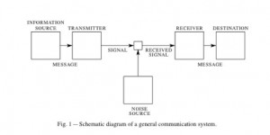

Enmeshed in technical, logistical and even militaristic concepts, transmission is frequently regarded as an inadequate way to think about communication: merely informational (for the one-way imparting of messages or signals only), or anti-social. This is not to suggest that all critics do this, but traces of a negative and even moral judgement regarding transmission can be evident even in the best analyses. {#para2}

Take James W. Carey’s well-known discussion of the ‘transmission’ and ‘ritual’ views of communication. The former is linked to the ‘extension of messages in space’, the latter to ‘the maintenance of society in time’; the former to ‘imparting information’; the latter to ‘the representation of shared beliefs’ (Carey, 1992: 18). Carey takes steps to recognise transmission as an ancient and legitimate mode, and in fact he situates it as culturally dominant, linked as it is to the ‘transmission of signals and messages over distance for the purposes of control’ (15). As if to reclaim the term Carey notes ‘we have been reminded rather too frequently that the motives behind this vast movement in space were political and mercantilistic’ (16). Carey observes that when read against the extension of Christian Europe to the Americas transportation takes on a moral meaning: ‘the establishment and extension of God’s kingdom on earth. The moral meaning of communication was the same’ (16). But there is a sense that a counter-morality creeps into Carey’s work here, that it is the ritual view that is tied to culture. ‘Commonness’, ‘community’, ‘communion’, as well as ‘sharing’, ‘participation’, ‘association’, ‘fellowship’ (18), are all aligned with the ritual view, not transmission. {#para3}

Let us not rehearse the standard concerns with what has been dubbed the informational or, of more significance to us, the ‘transmission model of communication’. Suffice to say that the extension of Shannon’s technical theory into the field of human communication (where the line between signals and meaning blur, where technical functions of encoding and decoding become linked to human actors, leading to a simple and mechanistic conception of communication as one-way transport) has been contested. {#para4}

Instead, let us focus on some more neglected aspects. Such as the way transmission has come to name an entire ‘model’. In this way, an approach that is mainly about the capacity to transmit information has been generalised across the area of communication. The idea of it being a schematic diagram of a general communication system, as represented in the following figure in Shannon’s paper, recedes. {#para5}

Shannon uses the word ‘model’ only once in his Bell System Technical Journal paper. And yet, Daniel Chandler (1994) declares, {#para6}

Here I will outline and critique a particular, very well-known model of communication developed by Shannon and Weaver (1949), as the prototypical example of a transmissive model of communication: a model which reduces communication to a process of “transmitting information”. The underlying metaphor of communication as transmission underlies “commonsense” everyday usage but is in many ways misleading and repays critical attention. {#para7}

It may be that this use of ‘model’ draws from the association of the theory with a diagram, as much as a philosophical edifice. Elsewhere I have attempted to argue against the trend to bind Shannon and Weaver together, exploring their different contributions to the mathematical theory (Maras, 2000). {#para8}

The coding of transmission in negative terms can take other forms, some overt, others more subtle. Some critics see it as reductive. For Chandler (1994), the transmission model is one ‘which reduces communication to a process of “transmitting information”’. I. A. Richards, in a chapter on ‘The Future of Poetry’, shares this view. ‘As Transmission occurs, that which has been living activity (of unimaginable complexity) dies — to become merely physics’ (1968: 166). Transmission here is linked to the engineer’s outlook on communication, further defined as a ‘vulgar packaging view’ (174). ‘The great danger there which a crude use of encode and decode, message and signal would bring in would be a recrudescence of the separation between what is said and the how of saying it’ (173). Richards refuses here a reduction of poets and readers to sources and destinations. He argues against a separation of message and signal engendered by the ‘theory of communication’, in which the message is ‘wrapped up in language like a parcel for transmission’ (Fiske, 1982: 27). Gunther Kress, arguing for the inseparability of ideas of communication and culture, retains the term ‘transmission’ but tries to take it out of a sender to receiver framework that ignores culture and imagines senders and receivers as ‘asocial isolated individuals’. ‘We are formed by cultural meanings and we are transmitters of culturally given meanings’ (Kress, 1988: 13). {#para9}

John Fiske distinguishes between two main schools of the study of communication. The ‘process’ school ‘is concerned with how senders and receivers encode and decode, with how transmitters use the channels and media of communication’ (Fiske, 1982: 2). The ‘semiotic’ school ‘sees communication as the production and exchange of meanings. It is concerned with how messages, or texts, interact with people in order to produce meanings; that is, it is concerned with the role of texts in our culture’. Fiske tries to give these two schools equal standing in his primer, although important differences exist in the way they constitute messages. The process school ‘sees a message as that which is transmitted by the communication process’ (3). It is linked to the figure of the sender and concepts of intention. The semiotic school regards the message as ‘a construction of signs’. ‘The emphasis shifts to the text and how it is “read”’. A legacy of Fiske’s approach is that it becomes difficult, in a categorical sense, to figure transmission as part of the world of semiotics, and awkward to think about process (or rethink process) within the tricky duality of the semiotic and process schools. Transmission, in Fiske’s reading, becomes a stepping-off point for a revised account of communication in terms of ‘structured relationships’ in which ‘producing and reading the text are seen as parallel, if not identical processes’ (4). It is left conceived in narrowly defined terms: combined ‘with matters like efficiency and accuracy’ which underpin the more important concept of the ‘process school’ or ‘process models of communication’ (25). Transmission is irrevocably tied to the ‘transmission of messages’, an approach that, for Fiske, takes ‘the form of the message or the codes used, for granted, whereas the proponents of the semiotic school would find this the heart of the matter’ (31). {#para10}

But these responses to transmission do not exhaust all the possibilities. I want to suggest that in parts of Régis Debray’s work the concept of transmission is put to work in a way that is not fully accounted for by conventional critiques of the term. Transmission in his work is not culture-less, or tied only to messages, or aligned with space, but placed in a relationship to symbolic power, value and authority, and time. Refusing to work solely within communications research, cultural studies, semiology, media studies, the approach Debray outlines, ‘mediology’, wants to study ‘transmissions [sic] as an object unto itself’ (2000: 122). But before I discuss Debray I want to consider some prior deployments of the concept of transmission in the area of media and communications. Firstly, in the work of Wilbur Schramm, who gives it a foundational place in his understanding of the process of communication. Secondly, in the work of Stuart Hall, whose work on encoding and decoding has been central to the understanding of messages in cultural studies. Through a metamethodological study of this work I don’t want to merely repeat the critique of transmission. Instead, I seek to read along the grain of the critique, and look at the deployment of transmission ideas. By disturbing the lines within which transmission may usually be constructed, my intention is look at a different aspect of the modelling and diagramming of communication by exploring the role of concepts of transmission in the construction of communication theories, culture and symbolic power. {#para11}

### How Communication Works: Wilbur Schramm

Wilbur Schramm declares in the Foreword to his 1954 anthology, The Process and Effects of Mass Communication, that what students require is an understanding of {#para12}

> … how the communication process works, how attention is gained, how meaning is transferred from one subjective field to another, how opinions and attitudes are created or modified, and how group memberships, role concepts, and social structure are related to the process. {#para13}

Schramm is relying on the so-called transmission model as the backbone of his understanding of the process. But his description of this process has a historical context, and is embedded in a set of disciplinary problematics. These problems include propagandist use of communications, the commercial conditions of research, the need for a scientific perspective (the latter derived from behaviourist paradigms), and the mis-match between the ‘pseudo-environments’ that citizens impose upon their environment and the real world (see Czitrom, 1982: 123–146; also Mattelart and Mattelart, 1992: 68–69). The term ‘pseudo-environments’ comes from Walter Lippmann, but the fact that Schramm draws on Lippmann as an anchoring point in one of the first major textbooks in the field is significant, for it grounds the study of communication processes in a particular set of issues around perception and meaning, ‘the conditions under which communication tries to modify the “pictures in our heads”’ (Schramm, 1954: 109). These pictures form part of an interpretive process, viewed variously as ‘the end product of the decoding’ to ‘the mediating response in which a stimulus arouses in us’. {#para14}

While the first chapter of Schramm’s text, called ‘How Communication Works’, is grounded in the mathematical theory of communication, it is worthwhile noting that this theory does not blind Schramm to other theories and processes. In a later section called ‘The Meaning of Meaning’, Schramm speaks of the importance of the ‘interpretive process’, and the structuring of experience according to frames of reference in which we make reality meaningful to us. ‘We select, add, distort, relate’ (1954: 110). But the field of communications research did not pursue the path of a generalised ethnography of interpretive processes and the structuring of experience (an area that arguably cultural studies claimed some years later). Instead, its grounding in the communications process led to more functional trajectories. Schramm advises we ‘tend to structure experience functionally — so that it works for us’ (111). ‘In each case, the experience is being perceived in such a way as to work for the perceiver — to match up to his needs, values and expectations’. And this rapidly becomes a practical issue for communicators. ‘Practically speaking, then, these are some of the workings of perception a communicator must expect, and, so far as possible, allow for, as he tries to communicate his meaning’ (111). In this fashion, in Schramm’s work, the communication of meaning forms the framework through which the workings of perception are to be understood. A conception of the process model of communication, supported by the transmission view, forms the set of a number of precepts that communicators should keep in mind: {#para15}

- The receiver will interpret the message in terms of his experience and the ways he has learned to respond to it.

- The receiver will interpret the message in such a way as to resist any change in strong personality structures.

- The receiver will tend to group characteristics in experience so as to make whole patterns. (111–113)

The workings of perception become not the true object of study, but a design problem for the sender. ‘The moral for the communicator trying to get his meaning across is … that one must know as much as possible about the frames of reference, needs, goals, languages, and stereotypes of his receiver, if he hopes to design a message to get his meaning across’ (114). {#para16}

Carey would remind us that ‘getting one’s meaning across’ is a basic precept of the transmission view. In a sense against Carey, Schramm aligns the transmission view with the attempt to establish ‘commonness’ (Schramm, 1954: 3). Schramm notes, ‘at this moment I am trying to communicate to you the idea that the essence of communication is getting the receiver and the sender “tuned in” together for a particular message’. {#para17}

So what are the means by which Schramm grounds his theory, his notion of process, in the transmission view? It is precisely through Shannon’s mathematical theory of communication, presented in diagram form. Schramm advises that communication always requires three elements: ‘the source, the message, and the destination’. ‘First, the source encodes his message. That is he takes the information or feeling he wants to share and puts it into a form that can be transmitted. The “pictures” in our heads can’t be transmitted until they are coded’ (4). This latter statement is crucial. Coding is a prior operation to transmission. Transmission is dependent on it. The type of coding (into written or spoken or other form) will impact on how far the messages travel, and how long they last. {#para18}

At this stage in the history of the field of communications research, any concerns over extending Shannon’s work to human communication are not acute. Schramm suggests ‘it is perfectly possible to draw a picture of the human communication system that way …’. ‘Substitute “microphone” for encoder, and “earphone” for decoder and you are talking about electronic communication. Consider that the “source” and “encoder” are one person, “decoder” and “destination” another, and the signal is language, and you are talking about human communication’ (4). {#para19}

### Encoding and Decoding: Stuart Hall

Other commentators are more circumspect about treating signals and language as equivalents, characterising signals as ‘messages without meaning’ (Roszak, 1988: 25). While critics have noted that the resulting definition of information is counter-intuitive in the sense that it is not information of a kind that informs, but a quantitative measure or construct (24), the message/signal interface points to one of the most generative areas of Shannon’s mathematical theory: the space of encoding and decoding. Shannon explains this aspect of his theory in the following fashion: {#para20}

> A transmitter which operates on the message in some way to produce a signal suitable for transmission over the channel. In telephony this operation consists merely of changing sound pressure into a proportional electrical current. In telegraphy we have an encoding operation which produces a sequence of dots, dashes and spaces on the channel corresponding to the message. In a multiplex PCM system the different speech functions must be sampled, compressed, quantized and encoded, and finally interleaved properly to construct the signal. Vocoder systems, television and frequency modulation are other examples of complex operations applied to the message to obtain the signal. (Shannon, 1948: 2) {#para21}

Shannon’s account of this operation underpins contemporary understandings of compression and recording, and the signal to noise ratio. {#para22}

If Schramm’s approach is transmissive by virtue of the way he makes transmission dependent on coding, it is worth comparing it to a different approach drawing on ideas of encoding and transmission namely Stuart Hall’s famous essay, Encoding and Decoding in the Television Discourse (1973) delivered as a paper for the Council of Europe Colloquy on ‘Training in the Critical Reading of Television Language’. {#para23}

Mine is a restricted engagement with Hall, in the sense it is focused on this one essay. But having said that, the essay, perhaps Hall’s most famous, itself went through different versions. The 1980 version published in Culture, Media, and Language, is called an ‘edited abstract’ of the 1973 version, but it has superseded the first version in a sense, being more widely referenced and available. The 1973 version interests us here because of the way the it draws on key ‘transmission’ concepts like ‘message’, ‘process’ and ‘reception’. Hall has reflected on the ‘model’ in an interview recorded in 1989 and published in 1994, ‘Reflections upon the Encoding/Decoding Model’, and I shall draw on this text also. {#para24}

For Schramm, a crucial aspect of communication is the work of getting the receiver and the sender ‘tuned in’ together for a particular message. This is a task of building up ‘commonness’, and the perpetual risk is of distortion or non-identity in the message. ‘And there is good reason, as we shall see, for the sender to wonder whether his receiver will really be in tune with him, whether the message will be interpreted without distortion, whether the “picture in the head” of the receiver will bear any resemblance to that in the head of the sender’ (Schramm, 1954: 4). Interestingly, Hall’s starting point is very similar to Schramm’s: ‘the question of the encoding/decoding moments in the communicative process’ (Hall, 1973: 1). But the emphasis is difference. For Hall, ‘communication between the production elites in broadcasting and their audiences is necessarily a form of “systematically distorted communication”’. Distortion is not a risk, but implicit in the system. {#para25}

The take up of encoding and decoding, and ideas of the communication process, both important aspects of the mathematical theory, operate differently in Hall’s theory. Although both theorists draw on encoding/decoding ideas, Schramm uses the concepts to seal meaning into the message, while Hall uses them to open out the construction of messages as meaningful within the rules of discourse. Hall’s is not a program for getting the receiver, the audience, to ‘receive the television communication better, more effectively’ (Hall, 1973: 1). {#para26}

At the same time, contra Schramm, language cannot be treated as more or less like a signal. For Hall, language opens outwards to a concern with ‘“social relations” of the communication process’ on the one hand, and ‘“competences” (at the production and receiving end) in the use of that language’ on the other. The symbolic form of the message, the transformation of event into story and language (and the rules underpinning that transformation), is a key concern for Hall. The focus on symbolic form means that Hall tends not to conceive of communication exchanges occurring in a vacuum, but sees production, circulation and reception in a circuit. {#para27}

Another aspect of Hall’s approach is that, as Michael Gurevitch and Paddy Scannell note, Hall in a sense decouples decoding from encoding and makes them independent. ‘The receivers of messages are not obliged, on this view, to accept or decode messages as encoded’ (Gurevitch and Scannell. 2003: 239–240). Encoding and decoding are not points or stages in the communication process, but what Hall calls ‘determinate moments’ out of which key elements are formed: ‘the apparatus and structures of production issue, at a certain moment, in the form of a symbolic vehicle constituted within the rules of “language”. It is in this “phenomenal form” that the circulation of the “product” takes place’ (1973: 2). This focus on the phenomenal form of the signal takes Hall beyond a strict understanding of the mathematical theory of communication, whose intention is in a sense to strip form away in order to produce pure signals. Perhaps in response to this, Hall modifies his terminology, and suggests that ‘the “message-form” is the necessary form of the appearance of the event in its passage from source to receiver’. Signals no longer travel through vacuous channels, but make passage through a ‘meaning-dimension’ or ‘mode of exchange of the message’, which form moments. ‘The “message form” is a determinate moment, though, at another level, it comprises the surface-movements of the communication system only, and requires at another stage, to be integrated into the essential relations of communication of which it forms only a part’. This leads Hall to speak of ‘institutional structures’, ‘networks of production’, ‘organised routines and technical infrastructures’ as part of the broader circuit. It is as though the frames of reference discussed by Schramm are developed more widely in terms of the institutional structures of broadcasting. Interestingly, the dominant metaphor is not transmission but that of ‘yield’. ‘In a determinate moment, the structure employs a code and yields a “message”: at another determinate moment, the “message”, via its decodings, issues into a structure’ (3). {#para28}

While the framing of the communication system is different to Schramm’s, I want to suggest that a transmission framework persists as a substrate throughout Hall’s text. Not simply in terms of the ‘technical infrastructure’ Hall writes into his diagram of communication, but in terms of tools to think with. While Hall draws on concepts of encoding and decoding, he is not using them to solve the problem of processing of messages into signals per se. He uses the concepts instead to discuss the discursive and symbolic nature of messages. This results in a mixture of signaletic and semiotic frameworks in his work. In some respects, (alongside his interest in Marx and Althusser) it is as though Hall is working off, building on or improvising (in the jazz sense) from an understanding of communication linked to transmission. In other words, there is a kind of ‘dependency’ on transmission concepts, and a conversation going on with transmission theory. The concepts of encoding and decoding are perhaps the most noticeable examples of this, but so is the persistence of concepts of ‘message’, ‘noise’ (16), and most importantly the concept of a communication process. ‘Production and reception of the television message are, not, therefore, identical, but they are related: they are differentiated moments within the totality formed by the communicative process as a whole’ (3). Hall, like Schramm, leaves room for perception: ‘Before this message can have an “effect” (however defined) … it must first be perceived as a meaningful discourse and meaningfully de-coded’ (Hall, 1973: 3). But in this passage he also keeps in place an informational notion of the message. Hall does not fall into a narrow effects or direct-influence paradigm here, and hastens to add that it is the ‘set of de-coded meanings which “have an effect”’. And even if there are traces of the idea of messages having an effect (however defined), the process of encoding is aligned with the idea of a meaningful discourse, a process (as has been mentioned) of ‘yielding’ and ‘realisation’ rather than sheer transmission of signals. {#para29}

Hall’s encoding/decoding model is read, and explicitly presented, as a distancing from the linearity of the sender/message/receiver model. In other words, it is read against the transmission theory. Gurevitch and Scannell emphasise that while Hall’s use of the terminology of encoding and decoding looks like a throwback to ‘the Shannon and Schramm models’, that impression is misleading (2003: 239). To suggest that Hall is working off a transmission framework, or that there is a conversation with transmission theory going on in this work, seems from this perspective unlikely; if not a kind of heresy given his theoretical opposition to an idea that content is something pre-formed that is then transmitted. Indeed, in his discussion of the activities of the media group at the Birmingham Centre for Contemporary Cultural Studies Hall highlights the importance of a ‘break’ with ‘direct influence’ and ‘media as trigger’ ideas linked to a ‘stimulus-response model with heavily behaviourist overtones’ (Hall, 1980: 117). This model stood in the ‘dominant’ position. Hall also emphasises the importance of getting away from ‘the notions of media texts as “transparent” bearers of meaning’ that underpin content analysis. Alongside an emphasis on more active conceptions of the audience and reading, and a focus on ideology away from ideas of ‘mass culture’, any suggestion of a link to transmission seems odd. {#para30}

But Hall himself gives some basis for this view. In his ‘Reflections upon the Encoding/Decoding Model’, Hall explains that his essay was positioned against the ‘traditional empirical, positivistic models’ of the Centre for Mass Communications Research at the University of Leicester. That is, against a ‘particular notion of content as preformed and fixed meaning or message which can be analysed in terms of transmission from sender to receiver’ (Hall, 1994: 253). Hall imagines his essay as an interruption to a view that looks at communication in terms of the perfect transmission of meaning. He also describes it going ‘against the grain’ of a ‘rather overdeterminist model of communication’. Hall is vague in his characterisation here, but we can assume it relates to the way meaning is fixed through singular acts of encoding. In light of this critical stance, the opening of the 1980 version of the essay is significant. There, Hall presents an image of a traditional mass communications that constructs communication ‘in terms of a circulation circuit or loop’, leading to an idea of ‘sender/message/receiver’. But he goes on to say that it is ‘possible (and useful) to think of this process’ in another way. His focus is on doing this ‘in terms of a structure produced and sustained through the articulation of linked but distinctive moments — production, circulation, distribution/consumption, reproduction’ (Hall, 1980: 128). But the link to the process (beyond negative critique) is nevertheless forged. In their reading Gurevitch and Scannell speak of Hall incorporating the notion of production into an ‘encoding/decoding framework’, a formulation which leaves a place for transmission concepts. {#para31}

A closer reading of the 1973 text can give us a better sense of why Hall would feel it not only possible but useful to think the process another way. But reading the 1973 text closely some thirty-five years on is not a straightforward task. The text is situated not only within a set of pre-existing debates but within a range of intertexts: as well as its other versions there is work exploring the empirical aspects of Hall’s model, such as David Morley’s, and a small sub-literature around the Encoding/Decoding model, teasing out issues of signification, preferred reading, and links to concepts of articulation. Of course, Hall’s own reflection is part of this intertextual field. Significantly, the version being reflected on by Hall in 1989 is the 1980 version, as this contains the references to Marx he mentions being outlined in the ‘opening paragraph of the paper’ (1994: 254, 261). This tendency to move away from the 1973 version is significant in terms of our interest in transmission. In his reflection Hall stresses, ‘I don’t want a model of a circuit which has no power in it. I don’t want a model which is determinist, but I don’t want a model without determination’ (1994: 261). And in this desire, even though Hall demonstrates a complex investment in the idea of a model, he still wants one. The statement also captures a particular sense of a determining circuit without power that is linked to traditional mass communication research. This image of the ‘circulation circuit’ is at the start of the 1980 version of the essay, but not present in the same way in the 1973 version, where the focus is on systematically distorted communication and countering an ideal of more effective reception (what we might dub the early Schrammian paradigm). The 1980 version starts with how traditional mass communications has imagined the process according to a particular image (the ‘circulating circuit or loop’), but in 1973 the idea of a communication process is treated with greater respect, aligned positively with social relations. The 1980 text foregrounds concepts of discourse, and production, and problematises notions of the process through the idea of social relations of production and reproduction in a way different to the 1973 version (see Hall, 1994: 255, 260). In 1973, Hall mentions ‘essential relations of communication’ (1973: 2) but in 1980 he speaks more of ‘social relations of the communication process’. {#para32}

A comparison of the first pages of the two versions of the essay is interesting (see Appendix One). Gurevitch and Scannell note that the 1973 version is ‘topped and tailed’ in the 1980 text (2003: 238). But what is especially of interest is the way the remaining passages from the 1973 text undergo modification. The 1973 text focuses on a specific area of ‘practices of production and circulation in communications’. There is ‘something distinctive about the product’. The 1980 text ‘highlights the specificity of the forms in which the product of the process “appears” in each moment’. The forms rather than the product are a focus. The earlier version has more of an ‘exchangist’ feel typical of the ‘circulation circuit or loop’ Hall talks about. In line with this, ‘The “object” of production practices and structures in television’ in 1973 ‘is the production of a message’ (1973: 1). In 1980 this is qualified to ‘meanings and messages in the form of sign-vehicles’. In 1973 Hall urges us to ‘recognize that the symbolic form of the message has a privileged position in the communicative exchange’ (1973: 2), but later ‘we must recognize that the discursive form of the message has a privileged position in the communicative exchange (from the viewpoint of circulation)’ (1980: 129). {#para33}

In terms of messages, what we are talking about is what Hall would call the ‘discursive form’ of sign-vehicles (1980: 128). This is in keeping with a more structural tenor of the 1980 piece. But note that in 1973 the term ‘phenomenal form’ is used, which grounds the sign and the concept of forms back into the subject or receiver. And this leads to a key point, that the 1980 version actually specifies ‘the moment of production/circulation’ as a moment. The key passage is as follows: {#para34}

> The apparatuses, relations and practices of production thus issue, at a certain moment (the moment of ‘production/circulation’) in the form of symbolic vehicles constituted within the rules of “language”. It is in this discursive form that the circulation of the “product” takes place. (1980: 128) {#para35}

But in 1973, the ‘moment of production/circulation’ isn’t specified. We can suggest that this is because Hall maintains an idea of the communication process and imagines the receiver within the circuit. {#para36}

> The apparatus and structures of production issue, at a certain moment, in the form of a symbolic vehicle constituted within the roles of “language”. It is in this “phenomenal form” that the circulation of the “product” takes place. (1973: 2) {#para37}

Consistent with this, in 1973 Hall suggests that: {#para38}

> It is also in this symbolic form that the reception of the ‘product’, and its distribution between difference segments of the audience, takes place. (1973: 2) {#para39}

This is different to: {#para40}

> But it is in the discursive form that the circulation of the product takes place, as well as its distribution to different audiences. (1980: 128) {#para41}

The further Hall moves from the traditional mass communications position, the more he is forced to account for circulation in theoretical terms. In the 1980 version, discursivity conditions circulation. It provides the forms in which circulation happens. In the 1973 version we are talking about plain reception. Other phrases support the idea that the some circulating circuit is important to Hall. The 1973 text links production to ‘initiating the message’, and maintains an idea of completing the circuit. ‘Once accomplished, the translation of that message into societal structures must be made again for the circuit to be completed’. In the 1980s version the notion of completing the circuit is highly qualified: ‘Once accomplished, the discourse must then be translated — transformed, again — into social practices if the circuit is to be both completed and effective’. And, in a new passage, Hall brings in the concept of articulation to do the heavy work. {#para42}

> If no “meaning” is taken, there can be no “consumption”. If the meaning is not articulated in practice, it has no effect. The value of this approach is that while each of the moments, in articulation, is necessary to the circuit as a whole, no one moment can fully guarantee the next moment with which it is articulated. Since each has its specific modality and conditions of existence, each can constitute its own break or interruption of the ‘passage of forms’ on whose continuity the flow of effective production (that is, ‘reproduction’) depends. (1980: 128–129). {#para43}

Here, the concept of articulation (along with that of discourse) effectively provides a new infrastructure for understanding the way the different moments in the system are understood. The concepts of process, reception, symbolic form, become less crucial. {#para44}

This reading is not deconstructive to the extent that there is some irreparable flaw in Hall’s argument. It is rather to suggest that in thinking about communication, we make use of the tools we have, which can include theories of transmission. Rather than focus on Hall’s essay in terms of the ‘interpretation of texts’ (Gurevitch and Scannell, 2003: 238), I am focusing on the communication theory aspect. My suggestion that Hall may be working off a transmission framework could be read as a developing or evolving process of writing against transmission. And interestingly, even in the reflection, he mentions that a definitive version of the ‘Encoding/Decoding’ hasn’t been written yet (1994: 261). Gurevitch and Scannell describe it as a ‘text in transition’ (2003: 238). {#para45}

Reading Hall’s essay, a strong impression comes across that he thinks little of mass communications research. He situates his essay historically against a fairly narrow conception of ‘communication studies’ (Hall, 1994: 271). Although Gurevitch and Scannell warn us of the dangers of linking Schramm and Hall, revisiting the theme of transmission in Hall’s essay in the context of more traditional theories such as Schramm’s can, however, lead to some interesting findings. For example, regarding the way transmission is a critical departure point but also structures the terms of discussion, and initially provides conceptual mooring points for Hall’s essay; even if in the later development of the article he lets go of these mooring lines like a ship heading out to sea. In relation to the 1973 version of the essay, there is a sense that it is in dialogue with a version of Schramm’s approach. It becomes an extended reflection on ‘the a-symmetry between source and receiver at the moment of transformation into and out of the “message-form”’, an elaboration of distortion and misunderstanding as they arise ‘from the lack of equivalence between the two sides in the communicative exchange’ (Hall, 1973: 4). This lack of equivalence is a problem inherited from mass communications theory. There are moments where transmission punches through in Hall’s essay, such as when he wonders about studies of violence, ‘how many other, crucial kinds of meaning, were in fact transmitted whilst researchers were busy counting the bodies’ (7). Or again: ‘I have been trying to suggest … how an attention to the symbolic/linguistic/coded nature of communications, far from boxing us into the closed and formal universe of signs, precisely opens out into the area where cultural content, of the most resonant but “latent” kind, is transmitted’ (11). At the same time, there are moments when semiotic language penetrates into the communication process such that ‘visual signifiers’ are ‘decoded’ (11), or when de-coding is linked to the work of reading and broader semiotic work (14), leading eventually to Hall elaborating the four ‘ideal type’ positions for decoding for which is paper is best known. Hall opens up a new area he call’s ‘meta-codes’, particularly a ‘professional code’ which ‘broadcaster’s employ when transmitting a message which has already been signified in a hegemonic manner’ (16). {#para46}

### Debray and Transmission

A close reading of Hall’s encoding-decoding essay shows more than just a critical relation to the transmission view. An analysis of this potentially ‘positive’ relation to transmission is not always teased out, perhaps obscured by a contemporary orthodoxy that says transmission is an inferior model. But uses can be made of transmission, especially in particular kinds of semiotic situations, such as those where message trans-decoding occurs across diverse communities of receivers, and within constructed flows typical of television. As Umberto Eco indicates, ‘things are completely different when we consider a message transmitted to an undifferentiated mass of receivers and channelled through the mass media … within a communicative code … not shared by all receivers’ (1980: 133). {#para47}

Following discussion of two Anglo-American cases, Régis Debray’s deployment of the concept of transmission provides an example of a different approach, which I shall attempt to delineate here, focusing on his Teachers, Writers, Celebrities (published in France in 1979, in English in 1981), but drawing also on, Media Manifestos (published 1994, in English 1996), and Transmitting Culture (1997, in English in 2000). {#para48}

Some general aspects of Debray’s work are worth noting. Firstly, Debray does not construct his approach in what he terms orthodox ‘academic compartmentalisations’. He has sought to develop his ‘mediological’ perspective as a sub-discipline of the Human Sciences in its own right. In general terms he has explained that this is because ‘mediological ambition is too fervent about religion, art, and the immobilisation of time to call on information and communication sciences so disdainful of the antique’ (2000: 123). He declares that he would be concerned if his mediological work was found in the ‘media studies’ section of bookstores (8) — admittedly, as we shall see, there is a real sense that when Debray speaks of media it is not in a sense that media studies might normally engage with. Secondly, Debray’s explicit engagement with other national scholarly traditions of media, communications and cultural studies in the works mentioned above is minimal. This is, for readers not familiar with the French academic scene, at times frustrating, and at points weakens his assertions: such as when he hopes that one day analysis of the concept and the practices corresponding to the term ‘mass media’ will ‘reveal the radical heterogeneity of the universes in question’ (Debray, 1981: 86). Thirdly, and related to the second point, Debray’s work, which spans many approaches (including the history of technology), reads as argument with and against semiology and signification (1996: 143–145; also 2000: 119–120). Yet his engagement with semiology doesn’t look at how this perspective might be adapted in different contexts (Hall would be a case in point). But these same quirks lead to some unusual and inventive deployments of concepts such as transmission. {#para49}

We should, before proceeding, distinguish between Debray’s deployment of the concept of transmission in his work, and his own comments on transmission. The latter are elaborated most explicitly in Media Manifestos, where he presents a three-fold challenge to the notion of an act of communication, conceived in terms of a sending and receiving pole, allowing for coding and encoding (Debray, 1996: 44–45). Firstly, against the view that the act is instantaneous, Debray suggests ‘transmission is a historical process’, defined by a ‘thick temporality’ that conditions the sending of all messages, and the idea of sending messages itself. Secondly, against a view that the act is interpersonal, he insists that ‘transmission is a collective process’, involving many people on the line, between the points, but also historically structured ‘personified social organizations’, or ‘collective individuals’, at either end of the line. Debray in later work broadens this idea: ‘cultural transmission begins where interpersonal communication ends’ (2000: 98). Thirdly, against the notion that the act of communication is peaceful (supported we can say by ideas that communication is about tuning in, sharing, or community), Debray states that ‘transmission is a violent collective process’. Transmission on this understanding is a combat against noise, inertia, other addressees, other transmitters. It relates to systems of authority and relations of domination. Debray states, ‘to transmit is to organize, and to organize is to hierarchize. Hence also to exclude and subordinate — necessarily’ (1996: 46). While many commentators question the suspect linearity of the transmission view, Debray challenges the assumed horizontality of the standard diagram. The poles of communication are at different heights, ‘placed at uneven levels by an institutional relation of inequality’ (47). Somewhat cryptically Debray concludes, ‘transmission is thus not communication’. {#para50}

Another noteworthy comment on the idea of transmission appears in Transmitting Culture. There Debray goes against the idea that the signal is simply carried by the channel. By contrast, Debray argues that ‘Transport by is transformation of. That which is transported is remodelled, refigured, and metabolised by its transit. The receiver finds a different letter from the one its sender placed in the mailbox. … To transmit should not be considered merely to transfer’ (2000: 27). In this sense, Debray, like Hall, challenges an idea of a message in which content is fixed. {#para51}

Turning to Debray’s earlier work, we can explore how he puts the concept of transmission into operation, keeping in mind that it predates the publication of Media Manifestos. In broad terms Teachers, Writers, Celebrities is a work about the intellectual field and its modification through different institutional arrangements. He is interested in how the position and role of the intellectual is transformed through French cultural history. The book attempts to chart the rise of an alliance between the intelligentsia and a ‘new mediocracy’ ‘with which indeed it is beginning to merge’, ensuring it ‘a monopoly in the production and circulation of events and values, of symbolic facts and norms, over an increasingly wide area’ (Debray, 1981: 1). In terms of concepts of transmission, his starting point is not then concepts of encoding and decoding. His problem is not Schramm’s (identity between source and destination, or attunement between sender and receiver), nor Hall’s (structural non-identity between acts of encoding and decoding, even if they share an interest in symbolic form). In some ways his interest is in a more basic and sociological version of the concern about getting a message across, albeit against the backdrop of a discussion of symbolic value and power. Debray’s discussion is not focused on the sender as abstract actor, but on the intellectual as defined and constructed under particular material conditions. In Teachers, Writers, Celebrities he is interested in how the media world or ‘cycle’ transforms those conditions. {#para52}

As a way of understanding this transformation of conditions, we can suggest that Debray’s analysis of the media has two main aspects. {#para53}

Firstly, he is concerned with the means of communication themselves. Debray is worried about access and bottlenecks across the ‘mass mediatic network’, ‘whose gangways and decision-making centres remain inaccessible to the intellectual workers at the base’ (90). In this sense, Debray draws on ideas of transmission to account for the operations of the mass media. As such is he interested in channels and their control and the fact that ‘mass communication is a one-way process’ (1981: 103). ‘The rarefaction of the means of mass communication — or in plain language, the bottleneck — has inevitably displaced the site of intellectual power into the sphere of the mass media’ (121). This results in what he characterises as a ‘new deal, a new game and new stakes: the growing supremacy of the press over literature, and journalists over authors’ (10). {#para54}

This leads to a second set of concerns around the transformation of fields by the field of the media. {#para55}

> We are seeing something more serious that [sic] the mere displacement of one institutional hierarchy (in the university: assistant lecturer, lecturer, senior lecturer, full professor) by another external to it (in the media: freelancer, columnist, sub-editor, leader writer, editor-in-chief). We are seeing the university corps and, at a more structural level the intellectual corps, voluntarily relinquish its own logic of organization, selection and reproduction and adopt the market logic inherent in the workings of the media. (46) {#para56}

Here, Debray pursues a point also made by Bourdieu, that the televisual, journalistic field has a transformational effect on other fields of cultural production (Bourdieu, 1998: 2). But he perhaps goes further in postulating the impact of the means of communication, and their institutional arrangement, on the ‘material conditions of the existence of thought’ (Debray, 1981: 13). {#para57}

> What is giving way, almost without realizing it, is, perhaps, a system of thought in which information could inform its supports rather than the reverse; a cultural technology in which the needs of production could still, at certain privileged points in the system, have the upper hand over the imperatives of distribution. … How will the richness of the old messages resist the homogenization of supports, which aligns the content of thought with the demands of a single market? (92) {#para58}

In a classic political economy framework, Debray is outlining control of production by distribution. But in a different sense, it has to do with the autonomy of thought within the system. {#para59}

Debray’s discussion predates much of the interest in networked cultures and new media, although he increasingly speaks of computers and networks in later work. This is not the place in which to evaluate all of Debray’s claims, such as when he suggests that the ‘mass media are a machine for producing simplicity by eliminating complexity’ (94). Nor can we look in detail at his broader thesis about the interactions between the academic, publishing, and media systems. What we can suggest is that Debray’s interest in the material conditions of communication and intellectual work (fields), and attunement to institutions and arrangements of cultural authority and power (apparatuses), gives his analysis of the transmission of symbolic value a very different cast to conventional discussion of transmission in mathematical engineering terms, and in semiotic-linguistic terms. His focus is not the intentions of the sender, nor the hegemony of dominant codings, but the dynamics of influence and symbolic power, including a ‘new kind of medium which, not content with transmitting influence, superimposes its own code on it’ (140). {#para60}

‘Without a channel, there can be no transmission and, a fortiori, no reception’ (147). In some ways, Debray here is using transmission to re-open a set of issues around control and power that early communication research attempted to analyse and unpack. But unlike early US studies of influence in the political process, Debray’s work is not premised on a unitary notion of communication process or focused on interpersonal communication (see Czitrom, 1982: 135¬–136). Indeed, the concept of the ‘mediasphere’ emerges as something of an alternative vehicle for the concept of transmission to that of ‘process’. He desires to {#para61}

> proceed as if mediology could become in relation to semiology what ecology is to the biosphere. Cannot a “mediasphere” be treated like an ecosystem, formed on the one hand by populations of signs and on the other by a network of vectors and material bases for the signs. (Debray, 1996: 109) {#para62}

This concept of the mediasphere is important to consider as without it Debray’s analysis could easily fall into a kind of functionalism: here is the system, and this is the role of intellectuals with in it. And at times he fosters this perception, such as when he suggests ‘the media work automatically’ (Debray, 1981: 148). But a broader conception of the intellectual as mediator or intermediary conditions this view (21). For Debray the transmission of influence depends on ‘operational intermediaries’ who facilitate the organisation of the intellectual corps and its creativity (154–155). This idea opens up the need for an analysis of the symbolic order, the production of consensus, and mechanisms of promotion, rank, and social capital (217). In Media Manifestos, this idea is taken further. Concepts of ideology give way to practices of organisation. Debray replaces the word ‘communication’ with ‘mediation’. The communicator becomes the mediator. ‘The Word cannot transmit itself without becoming Flesh, and the Flesh cannot be all love and glory; it is blood, sweat and tears. Transmission is never seraphic because incarnate’ (Debray, 1996: 5). {#para63}

Transmission in Debray’s work operates at the nexus of a range of issues: the ‘getting across’ of ideas, mediation, capturing thought, transmission of culture, and influence and inheritance. Religion, politics, disciplines, representations are all sites of analysis. His studies have an over-arching interest in a notion of putting theory into practice that has its roots partly in Debray’s interest in Marxism (see 102). Debray is interested in social ideas, but also ‘the plots that weave them with their milieu …’ (108). At times transmission is a focus of critique, and at others a vehicle for his ideas about politics and ideas. And indeed this points to an apparent paradox of Debray’s work: he builds a theoretical apparatus on transmission but also links the term to combat and degradation. In his critique of the ideal of truth he writes, ‘A material system of transmission necessarily degrades information’ (84); but as well as being an argument for a more complex materialism it points to an ambiguous relation to transmission. There is no doubt that transmission indicates and opens up a field of analysis for Debray, but it is also a concept that is consistently re-worked by him. His discussion of noise and feedback at times occurs squarely in the informational frame (129). At other times, he modifies this frame. An insight of mediology is that ‘a message’s efficacy is not inherent to it but the factor of a certain milieu of transmission or mediasphere’ (122). But at the same time he suggests that the idea of ‘the transmission of ideas as a translation of idealities across an inert and neutral technologic ether’ needs to be given up (121). These two statements are not inconsistent, but between them the concept of transmission plays a different role in indicating the space of messaging and system of communication. This different role has to do with pragmatic-mediological questions on the one hand — where Debray looks at ‘go-betweens’ and the relations of communication (see 138) — and a functionalism where transmission helps anchor the system such that he can speak of ‘the mediative function’. {#para64}

### Beyond the Process and Semiotic School Distinction

If it can be said that a tension between the ‘process’ and ‘semiotic’ schools persists in our ways of thinking about communication, structuring the very terrain of this thinking, then we can suggest that a particular violence against the concept of transmission is part of this landscape. {#para65}

This is not to suggest that ‘semiotic’ arguments to do with the non-identity of practices of encoding and decoding, the role of language and discourse, or the cultural orientation of actors, are unimportant. Nor is it to say that a critique of transmission is unnecessary. Or that an understanding of what Jacques Derrida has called the ‘postal principle’, implicit in transmission systems, and sometimes obscured by them, is irrelevant. On the contrary, this principle structures the ‘sites of passage or of relay among others, stases, moments or effects of restance’, and makes any idea of destination and correspondence dependent on systems of address based on identity (Derrida, 1987: 27). These systems structure and place conditions on the addresser, the addressee, the form of message and code, various go-betweens, and thus contribute to the fragility of the idea of a destination. Re-theorising this principle through the concept of writing Derrida writes, ‘There is no destination … within every sign already, every mark or trait, there is distancing, the post, what there has to be so that it is legible for another, another than you or me …. The condition for it to arrive is that it ends up and even that it begins by not arriving’ (29). {#para66}

In suggesting that a violence against transmission is part of our intellectual landscape, I want to contend that the critique of transmission as an image of communication carries with it baggage that is still to be unpacked (not least of which has to do with the construction of the mathematical theory into the ‘transmission model’). Transmission has become caught up in the challenge laid down by the ‘semiotic paradigm’ to ‘the lingering behaviourism which has dogged mass media research for so long’ (Hall, 1973: 5), as well as concerns about collusion of educators and cultural policy makers with the ‘re-signification’ of dominant interests in the ‘communicative chain’ (19), but its place in the critique has not always been fully developed. At times ‘the transmission model’ seems to stand as the key problem, while at others it is incidental to a behaviourism that is deemed more dangerous. At times it is the enemy, at others collateral damage. {#para67}

Once we start looking at the critique of transmission, rather than falling in behind it, particular interesting phenomena emerge. The deployment of concepts of transmission and message, encoding and decoding, is one significant area of interest here, a convergence between communication engineering, the sociology of media, and linguistics that has been discussed by Mattelart and Mattelart (1992: 44). The way Fiske’s work in particular gives us a rather a-historical picture of the development and precepts of the process model is also important here, especially in relation to the development of Schramm’s position (see below). But also important are practices of transmission. These are often obscured by an emphasis on the working system as a whole. As Debray asserts, ‘human beings have always transmitted their beliefs, values and doctrines from place to place, generation to generation’ (2000: vii). The critique of transmission has opened up an important questioning of the nature of content, process and the meaning of communication itself. It has provided crucial alternative frames of inquiry, beyond the effective and efficient transfer of messages. In doing so, engaging with transmission is central to contemporary critiques of technology, information, progress, propaganda and culture, all areas in which transmission takes on special force. But, while transmission as an image of communication may not capture all aspects of cultural exchange and persistence (and dissemination, or diffusion could form alternatives here), it is important to continue to stay awake to the mode in which things do get transmitted: some things explicitly so (packaged), and some less explicitly so; some tied to intentions, and others not. {#para68}

The task of working out what might persist, and what doesn’t, involves arguably some concept of transmission. In Transmitting Culture this leads Debray to provocatively put to one side communication and its linguistic, immaterial base, and ‘differentiate the material act of transmitting from communication’ (2000: 1). In doing so Debray seems to distance himself from theorisations of transmission that might link it to radical concepts of the vehicular, trace, and writing, such as that explored by Derrida in ‘Signature, Event, Context’. There Derrida examines communication as understood ‘in the restricted sense of the transmission of meaning’ in relation to writing as a means of communication (1982: 310), and as a general condition of all communication (relating to marks, traces, spacings, the play of absence and presence). Debray orients transmission towards the material dimension of bodies, sounds, perfumes and ritual, of buildings and flags, of power and motion carried across by mechanical and physical means. This axis relates to transportation through space, but Debray also links it to transportation through time. Echoing an Innisian/Carey distinction between media with a bias toward space or time, ‘if communication transports essentially through space, transmission essentially transports through time’ (Debray, 2000: 3). But, intriguingly, Debray inverts Carey so that transmission relates to time rather than space. Also, we should recall here that Debray adds another aspect to this idea of transportation discussed earlier, that ‘transport by is transformation of’, that the message is transformed in transit. {#para69}

Debray’s study challenges one of the assumptions guiding our discussion, that transmission is an image of communication. It is for this reason, worth dwelling further on how Debray defines a different realm for transmission. He explains, {#para70}

> The contrast is thus stark, to my way of thinking, between the warmer and fuzzier notion of communication and the militant, suffering nature of the struggle to transmit. Here the communicational fiction of the lone individual producing and receiving meaning gives way to people establishing membership in a group (even if only one they seek to found) and to coded procedures signalling that group’s distinction from others. There is a sense in which the natural environment communicates information about itself to me through visual, tactile, olfactory and other senses. Even more can I say that animals give off or send out messages …. But I cannot speak of animals, nor of my physical surroundings, as transmitting per se. Everything is a message, if you will — from natural to social stimuli or from signal to signs — but these messages do not necessarily constitute an inheritance. … At most, one can define an act of transmitting as a telecommunication in time, where the machine is a necessary but not sufficient interface and in which the network will always mean two things. For the pathway or channel linking senders and receivers can be reduced to neither a physical mechanism (sound waves or electric circuit) nor an industrial operating system (radio, television, computer) as it can be in the case of diffused mass information. The act of transmitting adds the series of steps in a kind of organizational flowchart to the mere materiality of the tool or system. The technical device is matched by a corporate agent. If raw life is perpetuated by instinct, the transmitted heritage cannot be effective without a project, a projection whose essence is not biological. Transmission is duty, mission, obligation: in a word, culture. (2000: 4–5) {#para71}

In this passage, it is interesting that channels, senders and receivers remain familiar touchstones. But several other steps are intriguing and make this scenography strange. Here, unlike Debray’s earlier work, transmission is not just about the mass media. It is about culture, but understood in a particular way. ‘Transmitting means organizing’ (15). It is distinguished from the natural environment, non-biological in nature, and linked to organisational practices and a corporate agent. The technological context is broader in this conception, less a system and more akin to a technics in Lewis Mumford’s sense, an ensemble of technology and human behaviour (Mumford, 1963). And the connection between ethnos and technics, and the capacity of the human sciences to think about technology, becomes a growing interest for Debray (2000: 54). Finally, the problem of influence in Debray’s work is redefined around inheritance, and ‘telecommunication in time’. His concept of culture and transmission merge around this project or projection, which opens up a political dimension to transmission, but also provides Debray with a way to suggest that not just any message is transmitted, it has to do with acts of mediation and transformation between ages, groups, and generations. Debray asks, ‘how to avoid the pitfalls of seeing things everywhere transmitted?’ (8). He responds by concentrating on the perpetuation of symbolic systems: ‘on religions, ideologies, doctrines and artistic productions’ (9). The areas serve to frame the more general interest in ‘the processes, agents, and vectors that ensure thought’s transmission’ (66) {#para72}

Attempting to differentiate transmitting from communication is a formidable task, and interestingly Debray casts doubts on a complete separation (2000: 7). By way of clarification he explains he is interested in the ‘varieties of organized materials required to materialize organizations’ including instruments of communication and their semiotic, material, distributive base (12). This allows him to suggest for instance that ‘a modification of the networks of communication has the effect of altering ideas’ (23). {#para73}

But, back to the differentiation of transmission and communication: in the UK and US, culture and communication have been linked together and united in a critique of transmission (see Kress, 1988; Carey, 1992). In the US, a particular combination of forces made the institutionalisation of the concept of transmission (along with those of process and flow) a priority for the emerging discipline of communications research in the post-World War Two period. And with it came a dependence on particular acts of communication, ideas of effective transmission of the message, feeding into a concept of the communications process available for scientific study. For Schramm, reflecting in 1972 on his earlier work in the 1950s, Stimulus–Response psychology, and the tools of content and effect analysis were key to the study of human communication. ‘We felt that Shannon’s information theory was a brilliant analogue which might illuminate many dark areas of our own field’ (Schramm, 1972: 7). {#para74}

Tracking the place of transmission in communications thinking involves being attentive to variations in the field, and different frames of engagement. Schramm’s own work provides an illustration of the importance of this. We can recall that in the 1950s Schramm’s introduction to his anthology was called ‘How Communication Works’, which said something about the capacity of the new discipline to explain the process and its workings in toto. In the 1970s, the introduction becomes ‘Nature of Communication Between Humans’, a more modest, and descriptive (or non-normative) exercise. In the 1950s it was possible to regard Shannon’s model or a derivative of it as an adequate picturing of the communication process. In the 1970s this was no longer the case. Characterising what he terms the ‘Bullet theory of communication’ Schramm notes, ‘in the early days of communication study, the audience was considered relatively passive and defenceless, and communication could shoot something into them, just as an electric circuit could deliver electrons to a light bulb’ (1972: 9). ‘Thus by the middle 1950’s the Bullet Theory, if you will pardon the expression, was shot full of holes. If anything really passed from sender to receiver, it certainly appeared in very different form to different receivers’ (10). Privileging concepts of relationship over receivership, and interaction over action, Schramm tries to capture the concerns of earlier decades in which Shannon’s theory was held to have real explanatory power. ‘We had been concerned with “getting the message through”, getting it accepted, getting it decoded in approximately the same form as the sender untended — and we had undervalued the activity of the receiver in the process’ (11). The term ‘transmission’ is not as prominent in the 1970 text. Instead, Schramm looks at definitions that foreground the idea of the ‘transfer of information’. Moving away from a sheerly linear concept of the process of communication — and in the process complicating Fiske’s distinction between process and semiotic schools — Schramm begins to conceive of the message as not transmitted, but having a life of its own. Anticipating Hall he writes, ‘Furthermore, the meaning is probably never quite the same as interpreted by any two receivers, or even by sender and receiver. The message is merely a collection of signs intended to evoke certain culturally learned responses …’ (Schramm, 1972: 15). {#para75}

We can suggest that in the work of revisionism that Schramm does in the 1970s transmission is downplayed, more circumscribed, but also linked to a somewhat embarrassing past position. The diagram representing the mathematical theory no longer has the same central status in the theory. Shannon’s ‘engineering’ approach certainly appears in a section on ‘How does it work’ that looks at a range of attempts to model or diagrammatise the process. Schramm’s focus is not on getting the message across as it was in the 1950s but feedback as a kind of interaction. Following this discussion, Schramm notes that ‘we have not yet introduced the framework of social relations in which we said all communication necessarily functions’ (27). This reads as a highly significant gap or omission. And with the introduction of his framework, Schramm places transmission in a specific place in his idea of the function and goals of communication. It comes into play in a limited way for the communicator whose purpose is informational and instructional rather than persuasive and entertaining (36–37). {#para76}

### Metamethodological Conclusions

Metamethodological analyses are by their nature open-ended, attentive to variations and modulations in their area. As such, while comparison of cases can be informative, conclusions can be provisional — not just because the terrain of analysis might be uncertain, but because ‘the environment’ is one of the terms often opened to question (see Debray, 1996: 111). In lieu of a set of final findings, we can perhaps return to Fiske’s point that against the tendency to take messages and the codes used for granted, we consider this the heart of the matter. {#para77}

But there are today questions as to whether semiology and signification is the sole means to approach these codes. For Debray, transmission should be connected to particular ‘practices of organisation’ in which processes are subject to forces, fields and apparatuses that shape the material conditions of the existence of thought. Debray’s own challenge to signification theories is important in terms of Hall’s encoding/decoding theory and where it goes. For Hall, poststructuralism (especially the work of Roland Barthes) opened up new possibilities. {#para78}

> Barthes’s notion of textuality … is no longer amenable to the identification of those clearly distinguished analytic moments of encoding and decoding. I can only describe this spatially. It flattens out my circuit. Instead of a circuit, which has a clearly distinctive movement around, of an expanded kind, it kind of lays reading and the production of meaning side by side. It makes it lateral rather than a circuit. (Hall, 1994: 272) {#para79}

And with this development, transmission arguably becomes a less crucial and interesting term. But it is this lateral flattening effect that Debray reacts to when he criticises semiological attempts to explain communication and transmission through signification. {#para80}

While this essay has not sought to examine all aspects of Debray’s approach, his approach is unique in going against the grain of Carey’s time/space formula and aligning transmission with time instead of space. It also cuts across a tendency in cultural studies to place transmission and culture in different corners from one another. Schramm and Hall both have a prominent position in the transmission literature because they are re-modellers of communication. One line of remodelling seeks to control. The other attempts to interrupt the process to tease out the moments at which power operates. Both relate to symbolic power and how it is exercised, circulates, and operates (Schramm through a focus on intention, and Hall through the concept of hegemony). Debray’s uniqueness is in writing a critical exploration of transmission into this questioning of symbolic power to show that power doesn’t just operate linearly and horizontally, but vertically and transversally across different fields and apparatuses. {#para81}

What is interesting for our purposes is how Debray negotiates in his own context the semiotic and process school duality, while retaining an interest in transmission. As if speaking of Shannon’s model itself, he writes, {#para82}

> At the entry to the “black box” there are sonorities, letters, faint traces; at the exit: new legislations, institutions, police forces. To dismantle this “box” is to analyze what we shall call a fact or deed of transmission, or to produce the rules of transformation from one state into another …. The structural stability of languages and codes is one thing, the quaking of a stable structure by an event of speech or word, or by any other symbolic irruption, is another’ (Debray, 1996: 10–11). {#para83}

In this sense, Debray negotiates a place for both rules of transformation and communicators. But to situate Debray as a neat hybrid of Hall and Schramm would be to underestimate his own mediological method, which lays down its own challenge to any metamethodological discussion of the theories of communication. Debray might ask, to what are we standing above? How have we drawn the line between method and metamethod? This essay has shadowed Debray’s mediology to the extent it looks at the relations between ‘higher social functions’ (in this case those of the communication theorist) with the ‘technical structures of transmission’ (Debray, 1996: 11). But it is necessary to say that in a sense Debray arrived first, tracing the contributions of Eco, and Barthes, the semiological tradition in France in Media Manifestos. In a different guise, especially when dealing with academic contents and contexts, metamethodology may indeed merge with a version of Debray’s mediological method. Perhaps not the research program in culture and technology implied in Transmitting Culture, tracking diachronically how founding ideas were founded, and synchronically how systems and technologies dislodge traditional domains (2000: 99), but closer to the ‘case-by-case determination of correlations, verifiable if possible, between the symbolic activities of a particular group … its forms of organization, and its mode of grasping and archiving traces and putting them into circulation’ (1996: 11). {#para84}

## Acknowledgements

My thanks to the anonymous fibreculture journal reviewers of this essay for their comments and suggestions.

## Author’s Biography

[Steven Maras](https://sydney.edu.au/arts/media_communications/index.php) lectures in media and communications at the University of Sydney.

**Appendix One – A comparison of excerpts from 1973 and 1980 versions of Stuart Hall’s ‘Encoding/Decoding’ essa**

<table border="0" width="701"> <tbody> <tr> <td width="345" align="left" valign="top"> 
 <a href='#para88' id='para88'> - 88 - </a>
<em>Excerpt from ‘Encoding/Decoding’ (1980) </em><em>by Stuart Hall</em>
 <a href='#para89' id='para89'> - 89 - </a>
Blue text indicates passages from 1973 version, incorporated into 1980 version.
 <a href='#para90' id='para90'> - 90 - </a>
<em>Source</em>:
 <a href='#para91' id='para91'> - 91 - </a>
Hall, Stuart. ‘Encoding/Decoding’, in Stuart Hall, Dorothy Hobson, Andrew Lowe and Paul Willis (eds.) <em>Culture, Media, Language: Working Papers in Cultural Studies, 1972–79</em> (London: Routledge, 1980), 128–138.
 <a href='#para92' id='para92'> - 92 - </a>
Traditionally, mass-communications research has conceptualized the process of communication in terms of a circulation circuit or loop. This model has been criticized for its linearity — sender/message/receiver — for its concentration on the level of message exchange and for the absence of a structured conception of the different moments as a complex structure of relations. But it is also possible (and useful) to think of this process in terms of a structure produced and sustained through the articulation of linked but distinctive moments — production, circulation, distribution/consumption, reproduction. This would be to think of the process as a ‘complex structure in dominance’, sustained through the articulation of connected practices, each of which, however, retains its distinctiveness and has its own specific modality, its own forms and conditions of existence. This second approach, homologous to that which forms the skeleton of commodity production offered in Marx’s <em>Grundriss </em>and in <em>Capital</em>, has the added advantage of bringing out more sharply how a continuous circuit — production–distribution–production — can be sustained through a ‘passage of forms’. It also highlights the specificity of the forms in which the product of the process ‘appears’ in each moment, and thus what distinguishes discursive ‘production’ from other types of production in our society and in modern media systems.
 <a href='#para93' id='para93'> - 93 - </a>
The ‘object’ of these practices is meanings and messages in the form of sign-vehicles of a specific kind organized, like any form of communication or language, through the operation of codes within the syntagmatic chain of a discourse. The apparatuses, relations and practices of production thus issue, at a certain moment (the moment of ‘production/circulation’) in the form of symbolic vehicles constituted within the rules of ‘language’. It is in this <em>discursive</em> form that the circulation of the ‘product’ takes place. The process thus requires, at the production end, its material instruments — its ‘means’ — as well as its own sets of social (production) relations — the organization and combination of practices within media apparatuses. But it is in the <em>discursive</em> form that the circulation of the product takes place, as well as its distribution to different audiences. Once accomplished, the discourse must then be translated — transformed, again — into social practices if the circuit is to be both completed and effective. If no ‘meaning’ is taken, there can be no ‘consumption’. If the meaning is not articulated in practice, it has no effect. The value of this approach is that while each of the moments, in articulation, is necessary to the circuit as a whole, no one moment can fully guarantee the next moment with which it is articulated. Since each has its specific modality and conditions of existence, each can constitute its own break or interruption of the ‘passage of forms’ on whose continuity the flow of effective production (that is, ‘reproduction’) depends.
 <a href='#para94' id='para94'> - 94 - </a>
Thus while in no way wanting to limit research to ‘following only those leads which emerge from content analysis’, we must recognize that the discursive form of the message has a privileged position in the communicative exchange (from the viewpoint of circulation), and that the moments of ‘encoding’ and ‘decoding’, though only ‘relatively autonomous’ in relation to the communicative process as a whole, are <em>determinate</em> moments. A ‘raw’ historical event cannot, <em>in that form</em>, be transmitted by, say, a television newscast. Events can only be signified within the aural-visual forms of the televisual discourse. In the moment when a historical event passes under the sign of discourse, it is subject to all the complex formal ‘rules’ by which language signifies. To put it paradoxically, the event must become a ‘story’ before it can become a <em>communicative</em> <em>event</em>. In that moment the formal sub-rules of discourse are ‘in dominance’, without, of course, subordinating out of existence the historical event so signified, the social relations in which the rules are set to work or the social and political consequences of the event having been signified in this way. The ‘message form’ is the necessary ‘form of appearance’ of the event in its passage from source to receiver. Thus the transposition into and out of the ‘message form’ (or the mode of symbolic exchange) is not a random ‘moment’, which we can take up or ignore at our convenience. The ‘message form’ is a determinate moment; though, at another level, it comprises the surface movements of the communications system only and requires, at another stage, to be integrated into the social relations of the communication process as a whole, of which it forms only a part.
 <a href='#para95' id='para95'> - 95 - </a>
From this general perspective, we may crudely characterize the television communicative process as follows. The institutional structures of broadcasting, with their practices and networks of production, their organized relations and technical infrastructures, are required to produce a programme. Using the analogy of <em>Capital</em>, this is the ‘labour process’ in the discursive mode. Production, here, constructs the message. In one sense, then, the circuit begins here. Of course, the production process is not without its ‘discursive’ aspect: it, too, is framed throughout by meanings and ideas: knowledge-in-use concerning the routines of production, historically defined technical skills, professional ideologies, institutional knowledge, definitions and assumptions, assumptions about the audience and so on frame the constitution of the programme through this production structure. Further, though the production structures of television originate the television discourse, they do not constitute a closed system. They draw topics, treatments, agendas, events, personnel, images of the audience, ‘definitions of the situation’ from other sources and other discursive formations within the wider socio-cultural and political structure of which they are a differentiated part. Philip Elliott has expressed this point succinctly, within a more traditional framework, in his discussion of the way in which the audience is both the ‘source’ and the ‘receiver’ of the television message. Thus — to borrow Marx’s terms — circulation and reception are, indeed, ‘moments’ of the production process in television and are reincorporated, via a number of skewed and structured ‘feedbacks’, into the production process itself. The consumption or reception of the television message is thus also itself a ‘moment’ of the production process in its larger sense, though the latter is ‘predominant’ because it is the ‘point of departure for the realization’ of the message. Production and reception of the television message are not, therefore, identical, but they are related: they are differentiated moments within the totality formed by the social relations of the communicative process as a whole.
 <a href='#para96' id='para96'> - 96 - </a>
…
 
 </td> <td width="346" align="left" valign="top"><em>Excerpts from ‘Encoding and Decoding in the Television Discourse’ (1973) </em><em>by Stuart Hall</em>
 <a href='#para97' id='para97'> - 97 - </a>
<em>Source</em>:
 <a href='#para98' id='para98'> - 98 - </a>
Hall, Stuart. <em>Encoding and Decoding in the Television Discourse</em> (Birmingham: Centre for Contemporary Cultural Studies, University of Birmingham, Occasional Paper, Media Series: SP No. 7, 1973).
 <a href='#para99' id='para99'> - 99 - </a>
… However, it is worth reminding ourselves that there is something distinctive about the product, and the practices of production and circulation in communications which distinguishes this from other types of production.  The ‘object’ of production practices and structures in television is the production of a <em>message</em>: that is, a sign-vehicle, or rather sign-vehicles of a specific kind organized, like any other form of communication or language, through the operation of codes within the syntagmatic chain of a discourse. The apparatus and structures of production issue, at a certain moment, in the form of symbolic vehicles constituted within the rules of ‘language’. It is in this ‘phenomenal form’ that the circulation of the ‘product’ takes place. Of course, even the transmission of this symbolic vehicle requires its material substratum — video-tape, film, the transmitting and receiving apparatus, etc. It is also in this symbolic form that the reception of the ‘product’, and its distribution between difference segments of the audience, takes place. Once accomplished, the translation of that message into societal structures must be made again for the circuit to be completed.  Thus, whilst in no way wanting to limit research to ‘following only those leads which emerge from content analysis’, we must recognize that the symbolic form of the message has a privileged position in the communicative exchange: and that the moments of ‘encoding’ and ‘decoding’, though only ‘relatively autonomous’ in relation to the communicative process as a whole, are <em>determinate</em> moments. The ‘raw’ historical event cannot in that form be transmitted by, say, a television news-cast. It can only be signified within the aural-visual forms of the televisual language. In the moment when a historical event passes under the sign of language, it is subject to all the complex formal ‘rules’ by which language signifies. To put it paradoxically, the event must become a ‘story’ before it can become a <em>communicative</em> <em>event</em>. In that moment the formal sub-rules of language are ‘in dominance’, without, of course, subordinating out of existence the historical event so signified, or the historical consequences of the event having been signified in this way. The ‘message form’ is the necessary form of the appearance of the event in its passage from source to receiver. Thus the transposition into and out of the ‘message form’ or the meaning- dimension (or the mode of exchange of the message) is not a random ‘moment’, which we can take up or ignore for the sake of convenience or simplicity. The ‘message form’ is a determinate moment, though, at another level, it comprises the surface-movements of the communications system only and requires, at another stage, to be integrated into the essential relations of communication of which it forms only a part.
 <a href='#para100' id='para100'> - 100 - </a>
From this general perspective, we may crudely characterize the television communicative process as follows. The institutional structures of broadcasting, with their practices and networks of production, their organized relations and technical infrastructures, are required to produce a programme. Production, here, initiates the message: in one sense, then, the circuit begins here. Of course, the production process is framed throughout by meanings and ideas: knowledge-in-use concerning the routines of production, historically defined technical skills, professional ideologies, institutional knowledge, definitions and assumptions, assumptions about the audience and so on frame the constitution of the programme through this production structure. However, though the production structures of television originate the television message, they do not constitute a closed system. They draw topics, treatments, agendas, events, personnel, images of the audience, ‘definitions of the situation’ the wider socio-cultural and political structure of which they are a differentiated part. Philip Elliott has expressed this point succinctly in his discussion of the way in which the audience is both the ‘source’ and the ‘receiver’ of the television message. Thus circulation and reception are, indeed, ‘moments’ of the production process in television and are incorporated, via a number of skewed and structured ‘feed-backs’, back into the production process itself. The consumption or reception of the television message is thus also itself a ‘moment’ of the production process, though the latter is ‘predominant’ because it is the ‘point of departure for the realization’ of the message. Production and reception of the television message are, not, therefore, identical, but they are related: they are differentiated moments within the totality formed by the social relations of the communicative process as a whole.
 <a href='#para101' id='para101'> - 101 - </a>
…</td> </tr> </tbody> </table>

(back to the body of the article)

## References

Bourdieu, Pierre. On Television and Journalism (London, Pluto, 1998).

Carey, James W. Communication as Culture: Essays on Media and Society (New York: Routledge, 1992).

Chandler, Daniel. ‘The Transmission Model of Communication’ (1994), [https://www.aber.ac.uk/media/Documents/short/trans.html](https://www.aber.ac.uk/media/Documents/short/trans.html).

Czitrom, Daniel J. Media and the American Mind: From Morse to McLuhan (Chapel Hill: University of North Carolina Press, 1982).

Debray, Régis. Media Manifestos: On the Technological Transmission of Cultural Forms, trans. Eric Rauth (London: Verso, 1996).

Debray, Régis. Teachers, Writers, Celebrities: The Intellectuals of Modern France, trans. David Macey (London: New Left Books and Verso Editions, 1981).

Debray, Régis. Transmitting Culture, trans. Eric Rauth (New York: Columbia University Press, 2000).

Derrida, Jacques. Margins of Philosophy, trans. Alan Bass (Brighton: Harvester Press, 1982).

Derrida, Jacques. The Post Card: From Socrates to Freud and Beyond, trans. Alan Bass (Chicago: University of Chicago Press, 1987).

Eco, Umberto. ‘Towards a Semiotic Inquiry into the Television Message’, in John Corner and Jeremy

Hawthorn (eds.) Communication Studies: An Introductory Reader (London: Edward Arnold, 1980), 131–149.

Fiske, John. Introduction to Communication Studies (London: Methuen, 1982).

Hall, Stuart. Encoding and Decoding in the Television Discourse (Birmingham: Centre for Contemporary Cultural Studies, University of Birmingham, Occasional Paper, Media Series: SP No. 7, 1973).

Hall, Stuart. ‘Encoding/Decoding’, in Stuart Hall, Dorothy Hobson, Andrew Lowe and Paul Willis (eds.) Culture, Media, Language: Working Papers in Cultural Studies, 1972–79 (London: Routledge, 1980), 128–138.

Hall, Stuart. ‘Introduction to Media Studies at the Centre’, in Stuart Hall, Dorothy Hobson, Andrew Lowe and Paul Willis (eds.) Culture, Media, Language: Working Papers in Cultural Studies, 1972–79 (London: Routledge, 1980), 117–121.

Hall, Stuart. ‘Reflections upon the Encoding/Decoding Model: An Interview with Stuart Hall’, in Justin Lewis and Jon Cruz (eds.) Viewing, Reading, Listening: Audiences and Cultural Reception (Boulder, Westview Press, 1994), 253–274.

Gurevitch, Michael and Paddy Scannell, ‘Canonization Achieved? Stuart Hall’s “Encoding/Decoding”’, in Elihu Katz, John Durham Peters, Tamar Liebes, and Avril Orloff (eds.) Canonic Texts in Media Research: Are There Any? Should There Be? How About These? (Cambridge, UK: Polity Press, 2003), 231–274.

Kress, Gunther (ed.), Communication and Culture: An Introduction (Kensington: New South Wales University Press, 1988).

Maras, Steven. ‘Beyond the Transmission Model: Shannon, Weaver, and the Critique of Sender/Message/Receiver’, Australian Journal of Communication 27.3 (2000): 123–142.

Mattelart, Armand and Michèle Mattelart. Rethinking Media Theory, trans. James A. Cohen and Marina Urquidi (Minneapolis: University of Minnesota Press, 1992).

Mumford, Lewis. Technics and Civilization (New York: Harcourt, Brace, 1963).

Richards, I. A. So Much Nearer: Essays Toward a World English (New York: Harcourt, Brace and World, Inc., 1968).

Roszak, Theodore. The Cult of Information: The Folklore of Computers and the True Art of Thinking (London: Paladin Books, 1986).

Schramm, Wilbur (ed.). The Process and Effects of Mass Communication (Urbana: University of Illinois Press, 1955).

Schramm, Wilbur and Donald F. Roberts (eds.). The Process and Effects of Mass Communication, revised edition (Urbana: University of Illinois Press, 1972).

Shannon, Claude E. ‘A Mathematical Theory of Communication’, The Bell System Technical Journal 27 (July, 1948): 379–423, (October, 1948): 623–656. [https://cm.bell-labs.com/cm/ms/what/shannonday/paper.html](https://www.aber.ac.uk/media/Documents/short/trans.html).
