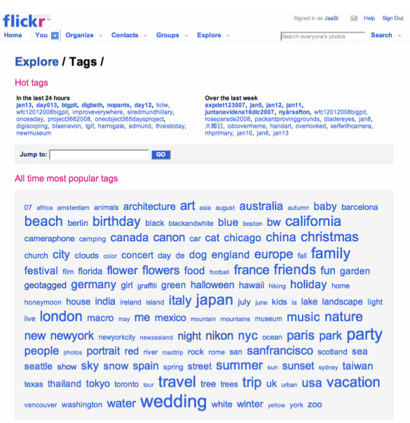
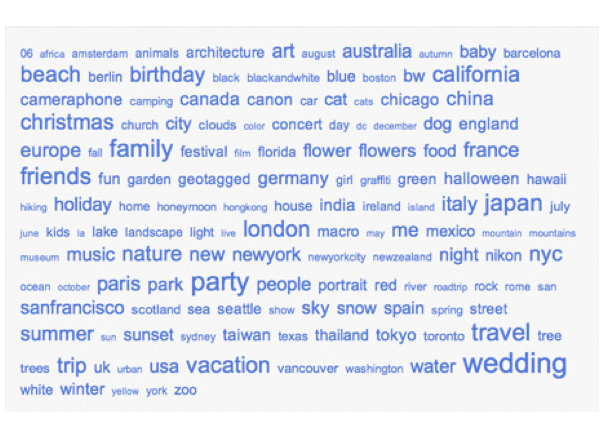
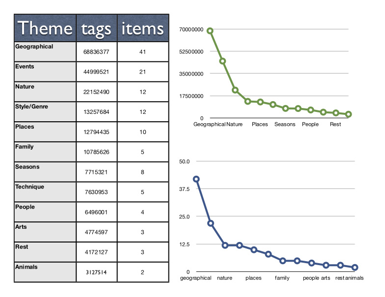
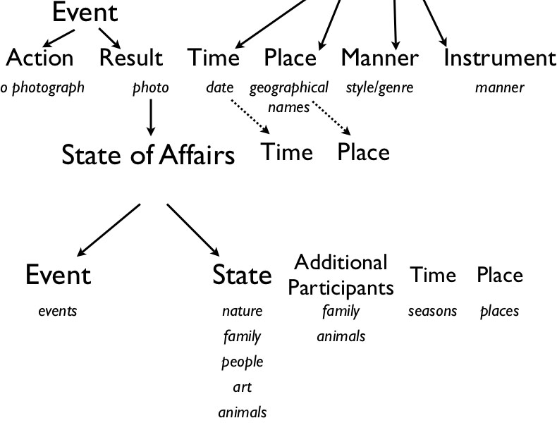

### Folksonomies as chaotic systems

The core “meme” of Web 2.0 from which almost all other memes radiated was: ‘You control your own data’ (O’Reilly, 2005, 3).[1] Key instruments for this user control are tagging systems that allow users to freely assign keywords of their own choosing to Internet resources of their own making as well as to documents produced by others. Tags are used for making Internet resources retrievable for personal use, but in so-called social networks tags are also accessible for others. Of course, as freely chosen keywords tags do not necessarily follow prefixed taxonomies or classification systems. But going by the maxim that interaction creates similarity and similarity creates interaction, the idea – or hope – is, however, that the tagging practices of individual users will eventually converge into an emergent common vocabulary or folksonomy. (Merholz, 2004; Shirky, 2005; Vander Wal, 2005b; Mika, 2007).[2] {#para3}

It is far from clear, however, that free tagging systems will eventually yield controlled vocabularies, since different users apply keywords in very different ways and the choices users make are always influenced by many and very different factors. Most often mentioned in the literature are the design of a tagging system, the incentives for users to tag resources, the purposes for which users tag resources, and the nature of the tagged object (Vander Wall, 2005b; Marlow et al, 2006; Golder & Huberman, 2006). {#para4}

These and possibly still other dimensions are as many incentives for idiosyncratic, ambiguous, and inconsistent uses of tags. Therefore many researchers recommend to curb or channel the choices of individual taggers by eventually offering only the most popular tags as options to choose from (Merholz, 2004), or by designing supportive tagging systems that suggest the use of some tags rather than others. Left to themselves, free tagging systems seem to be too wild and too chaotic for any order to emerge. But are these free tagging systems really as “feral” as they seem to be, or do they only look uncontrolled because one has been looking for order in the wrong place? {#para5}

What follows is the result of what new media practitioners like to call “rapid prototyping”. By way of a proof of concept , I have done a quick-and-dirty analysis of Flickr’s tag cloud. The concept was: if folksonomies encourage users to tap into their own vernacular, everyday natural language must somehow “guide” the tagging practices of users of tagging systems. Flickr was choosen because it offers a “narrow” and “blind” tagging system that only allows owners to tag their pictures and does not come up with recommended tags (like Del.ic.ious, for instance), and because Flickr presents its visitors with a tag cloud in which the hundred and fifty most popular tags are listed. Moreover, Flickr also offers clusters in which the tags from the tag cloud co-occur with other, often less popular tags. Flickr, that is, has been so kind as to do a lot of preliminary work for this rapid research project. This also means, however, that the choice of Flickr was partly arbitrary: if not Flickr but another “social site” had offered such a wonderful tagging system, that other site would have been choosen. Flickr’s tag cloud, then, has been choosen because it may teach us something about tagging systems and folksonomies, and not – or not primarily – because of what tags may tell us about pictures. {#para6}

### Tags: the “unknown knowns”

The most discussed problems with free tagging systems are polysemy, homonymy, synonymy, different levels of categorization, and spelling mistakes.[3] In the case of polysemy, a single tag is used with different related meanings, as when music is used to tag a sound track, a video of a rock concert, a blog about a musician, a picture of a musical instrument, or a file with a musical score. In the case of homonymy, a single tag may have totally unrelated meanings: rock for instance may refer to a stone formation or a genre in pop-music, and apple can be used to refer to a fruit, to New York City, to the former record company of The Beatles, or to the Macintosh computer. In the latter case apple is synonymous with, indeed, macintosh computer, just as fall is synonymous with autumn. Different users can also tag similar objects at different levels of categorization: pets, for instance, can be tagged with the superordinate term animals or with basic-level terms like cat and dog, and geographical locations can be tagged with the name of a continent (europe, asia), a country or state (england, california), or the name of a city (london, paris, la). Spelling is another notorious problem, also known as “meta noise”: the name of the city of York only appears in Flickr’s tag cloud because many users tagged their pictures with New York or New York City without realizing that Flickr interprets these strings as two or three separate tags. Other examples are tags such as san and de that are parts of composite city names like San Francisco, San José but also of the canine species San Bernardino, and Rio de Janeiro or proper names like danny de conte. {#para7}

It is not hard to see that these problems even affect the reliability of the tag cloud as an accurate representation of the popularity of tags or the relative numbers of pictures tagged with terms from the tag cloud. Pictures of New York City, for instance, are labeled with five different tags (nyc, newyork, newyorkcity, new and york). If one would add these, New York and not London would appear as the most popular city in the tag cloud. Since there are also many users who use all available spellings, the frequency of tags referring to New York does not say very much about the actual number of New York photos on Flickr. {#para8}

Notions like polysemy, homonymy, synonymy, and levels of categorization only scratch the surface of the semantic problems with tags. Does a tag like england, for instance, mean that the tagged picture shows something from or about England, or does it simply mean that the picture has been taken in England (see Rattenbury et al., 2007)? And what about color terms? Tags like blackandwhite obviously designate stylistic features of a photo, but do tags like red, green, or blue designate properties of the photographed objects, or salient properties of the photo itself? Why is there a tag girl in Flickr’s tag cloud, but not a tag boy? Problems like these do not arise from any ambiguity, polysemy or homonymy of the terms used as tags: there is nothing ambiguous about terms like england, green, or girl.[4] Rather, these ambiguities arise from the different relations these terms entertain with the tagged resources. Since these relationships are not explicitly marked by the tags, the collection of tags in Flickr’s tag cloud turns out to be even messier than it already was through the known semantic ambiguities. But again, is it? It’s time to try and chart these yet “unknown knowns.” {#para9}

### Tags: labels or parts of speech?

As the discussions of polysemy, homonymy, synonymy and levels of categorization already suggest, tags have been mostly discussed as separate, individual items. Tags, that is, have been quite literally taken as “labels” that “name” or categorize the objects they have been attached to and tags have been consequently discussed in terms of problems of reference. Several factors encourage this nominalist approach. {#para10}

First of all, the vast majority of tags – at least of those used on Flickr – are proper and common nouns and adjectives and these word classes are typically used to identify persons, places, objects and properties. This suggests that naming and referring are the most important functions of tags: they “point” towards the entities they label. This encourages the application of a “picture theory” of language: words “mirror” real world objects or states of affairs and the meaning of a word (or any linguistic expression) consists of its truth conditions (Wittgenstein, 2001; Ayer, 1987). This is, moreover, reinforced by comparisons of folksonomies with professional expert classification systems like the Dewey Decimal Classification designed to explicitly and unambiguously organize the information of particular knowledge domains (see Vander Wall 2005b; Shirky 2005). {#para11}

Second, an obvious corollary of the previous factor is the absence of verbs, adverbs, and prepositions and present and past participles in Flickr’s tag cloud. Verbs are the cement of linguistic constructions: they constitute the core of a sentence to which every other sentence part is directly or indirectly related. Verbs determine the number of arguments that appear in a linguistic construction (they “project” their argument structure), like Agent, Patient, Indirect Object, Instrument, etc (see Fillmore, 1968; Jackendoff, 1990; Kay, 1997). Prepositions also serve to express the relationships between sentence parts, e.g. location (in, on, at, under, above), time (before, after, while), instrument (with, through), manner (like, as), path (along, over), destination (to, into, towards), etc. In the absence of verbs and prepositions, lexical items become like the loose bricks of a building project: they seem not to fulfill particular functions within a construction, and the only relationship that seems to exist between them is their relative size. Since tags seem not to participate in linguistic constructions, triads like the signifier-concept-referent or user-tag-resource relationships are the most relevant structural relationships that remain: tags look like the entries of a dictionary (Golder & Huberman, 2006; Mika, 2007). {#para12}

Thirdly, tags are part of asynchronous and asymmetrical processes of sharing and communication. Through tags, the user communicates with a tagging community at large rather than with other individual users, since the feedback he or she gets on his or her tags comes mainly through the records of the tags previously fed into the system by millions of other users (Mathes, 2004: 9). This “communication through metadata” de-contextualizes the lexical items used as tags and deprives them of a pragmatic context in which their meanings can be gauged and negotiated (Tonkin, 2007: 116). The linguistic symptom of this decontextualization is the absence of articles, demonstratives and quantifyers that, together with verbal markers like modals and tense, “ground” the content of an expression with respect to the speech event. Articles, demonstratives and quantifiers serve to identify a particular instantiation of the type evoked by a noun as the intended referent, whereas modals and tense locate the process evoked by a verb with respect to the moment in time of the speech event and the speaker’s conception of reality (see Langacker, 2008: 259). Without context and grounding elements, the user is left with the “dictionary meanings” of the tags rather than with interpretations derived from the linguistic constructions, discursive frames, and pragmatic contexts in which lexical items normally participate. The clusters of tags provided by Flickr suggest that Flickr’s designers are aware of this problem since these offer the user a first aid to figure out in which semantic fields tags operate and thus to minimally “recontextualize” tags. {#para13}

Fourthly, nominalist and objectivist approaches to language tend to consider polysemy and homonymy as deviations from normal – or rather, normative – word meanings that are or ought to be unequivocal and clearly defined. However, in natural language polysemy is not deviant but default: lexical items that are used with any frequency tend to almost always have multiple, related meanings that have been conventionalized in various degrees (see Langacker, 2008: 37). Meanings are not, as objectivist semantics would have it, independent sense units that “interpret” the abstract symbols of a syntactic string. Conventional meanings are, on the contrary, abstracted from the various usages in which lexical items have been encountered. And rather than clear-cut classificatory or referential descriptions, meanings of lexical items are portals to open-ended domains of knowledge with regard to certain types of entities. Words, that is, do not have meanings, but are cues to meaning, and those meanings are “protean” rather than neatly defined (ibid.; see also Elman, 2004: 306; Evans, 2006:493). After all, if this were not the case, philosophers of language would never have felt compelled to take up the challenge to purify and logify language into what positivist philosophers called “verifiable statements” (see Ayer, 1987). The semantic problems diagnosed in folksonomies are a strong indication that users of tagging systems apply their skills, experience with and knowledge of everyday language usage to their tagging practices: tags, that is, are more like words in natural languages than items in a glossary. {#para14}

The nominalist approach tends to look at folksonomies as an interesting experiment in alternative, spontaneously and collaboratively created popular taxonomies, the success of which is largely measured by the standards for expert taxonomies. This validation can go both ways: folksonomies are either seen as “feral” hypertexts that need to be tamed by curbing the liberty of the taggers through synonym and homonym control and recommendation systems, or they are promoted as anarchic systems in which individual users can trace their personal profiles and signatures (Rafferty & Hidderley, 2007; Walker, 2005; Vander Wal, 2005; Shirky, 2005). Both approaches, however, see tags as labels for entities that make up either the objectivist “ontologies” of professional taxonomists or the private ontologies of individual users, who tend to be much sloppier and much more idiosyncratic in their use of terms than the professionals (see Mika 2007). Most research of tagging systems focuses on the ternary relationship between tagger-tag-resource in order to extract the “local” ontologies that emerge from the myriads of interactions between individual user-tag-resource triangles within social networks like the Flickr community. {#para15}

In practice, however, tags hardly ever come as isolated items since most users follow Flicker’s recommendation to use more than two tags (“but not too many” – see Hogan, 2006: 5) in order to increase the retrievability of their pictures by other users. This justifies the assumption that for the users the tags they add to their pictures are somehow related, and since these users are not professional archivists or experts but “ordinary folks” who tap into their knowledge of everyday language for the categorization of their pictures, they very likely bring to bear more of their linguistic competence to their tagging practices than just their knowledge of word meanings (Tonkin, 2007: 116). They may be “speaking” rather than mere “labeling.” Natural languages do not carve up the world the way expert taxonomists do, nor do linguistic expressions simply “mirror” the states of affairs they are expressions about. The question, then, is whether there is more in the tag cloud than mere words?[5] Does something like a “collective intelligence” leave its traces in a tag cloud like Flickr’s and if so, what does it look like? {#para16}

### Photos and Folksonomies: Flickr

Flickr provides an interesting case for a first tentative search for a hidden order in the keywords with which Flickr users tag their photos. Flickr offers a narrow tagging system, that only allows owners to tag their uploaded pictures, and only owners can give other users permission to tag these pictures as well. Flickr’s tagging system is, moreover, blind: it does not recommend tags to the user. Therefore one may assume that the tags of Flickr users express what those users had in mind when they tagged their pictures. However, Flickr presents its users with a so called tag cloud, an alphabetically listed collection of the 150 all time most popular tags in which the size of the tags reflects the relative frequency of their use (fig. 1). {#para17}

Users who want to increase the visibility of their photos can select tags from this tag cloud. A tag cloud is an indication of, as well as a condition for, a power law effect: a tag cloud may create a positive feedback loop that makes ‘the rich get richer’ (Shirky, 2003). The relative stability of Flickr’s tag cloud over a longer period of time seems to confirm this: the tag cloud printed by Müller-Prove (2007) (fig 2) is not very different from the collection of tags one year later. Indirectly, then, a tag cloud may function as a recommendation system. {#para18}

Whether or not the tag cloud is instrumental in creating a consensual vocabulary over time is an empirical question. However, the tag cloud represents only a very small portion of the vast amount of tags users have at their disposal and actually use. The amount of tags available to Flickr’s users is not only virtually co-extensive with the lexicon of the English language, but there are also many non-English speaking users who tag their pictures in their own language.[6] Moreover, none of the tags from the tag cloud appears in the list of the “hot tags” of “the last 24 hours” published on the same web page, which suggests that most Flickr members who uploaded pictures in the previous 24 hours did not use the tag cloud as a guide for tagging. Finally, the tag cloud does not appear on the personal pages through which members access Flickr. Nor does it appear on Flickr’s upload page or in the uploading software. These are some strong indications that most Flickr users tag their photos blindly. {#para19}

The tag cloud, then, offers a glimpse into the most frequent and most common tagging practices of Flickr’s users. Moreover, if one follows the tags in the tag cloud, Flickr presents the user with clusters of tags with which the most popular tags are most frequently combined. This offers a first indication of the semantic fields in which these tags most often operate. Finally, the tags of all publicly accessible photos are public as well: Flickr’s tagging system is blind and transparent at the same time. And, last but not least, with the tag cloud and clusters, Flickr has already done quite a lot of preliminary work. {#para20}

### Categorizing tags

How to bring order into the hundred and fifty tags in Flickr’s tag cloud? A ranking of the tags according to the frequency of their use does not yield much more information than the graphical design of the cloud itself already provided. If one plots the frequency of use in a graph, the typical shape of the power law shows up, but the order of the tags is too random to derive any conclusion from this (or it should be that weddings in new york and ensuing trips from new york to japan are the most popular events among the users of Flickr). However, if one attempts to categorize the tags themselves, more interesting results emerge. {#para21}

The first thing to notice is that the by far largest category of tags are proper nouns that name continents, countries, states, and cities (see also Mathes, 2004: 4): 41 out of the 145 tags or 28% of the tags in the tag cloud belong to this category of geographical names. Due to the semantic difficulties outlined above, other categories are less obvious and less easy to identify. There are, for instance, a number of other common nouns that refer to locations as well, like beach, museum, zoo, river, street, park, etc. As with pictures tagged with geographical names, pictures tagged with proper nouns like these can be pictures of the sites mentioned through the tags, or pictures taken at those sites. The lack of a “grounding” article, moreover, makes it unclear whether the tags refer to specific sites (e.g., the zoo in Berlin) or more indefinitely to indicate the kind of site (as in We went to the/a zoo). {#para22}

A look at the clusters in which such tags appear – and a random sample of pictures tagged with these proper nouns – shows that in most cases the focus of these pictures is not on the sites mentioned but rather on the activities for which the mentioned sites provide a setting. The same goes for temporal tags like christmas, holiday, or halloween: these are on a par with tags like birthday and honeymoon, which are almost always added to pictures of activities that are undertaken at the times mentioned by the tags.[7] Nouns like these, then, are largely used to metonymically refer to activities typically undertaken on the times and sites mentioned which at least partly explains the absence of verbs in the tag cloud.[8] More generally, events are often talked about metaphorically as objects, as in going to the concert (Lakoff and Johnson, 1980: 30-31; Zack and Tversky, 2001: 7) Rather than categorizing such tags as ‘places’ or ‘times’, it seems to make more sense to categorize them as Events. This category turns out to contain 22 tags or 15% of the tags in the tag cloud (fig. 3). {#para23}

Following the same procedure, the remaining 82 tags or 57% of the tag cloud can be distributed over ten more categories: nature (12 or 8.28%), style/genre (12 or 8.25%), places (10 or 6.9%), family (5 or 3.45%), seasons (8 or 5.5%), technique (5 or 3.45%), people (4 or 2.76%), arts (3 or 2 %), animals (3 or 2%), and rest (3 or 2%). The categories style/genre and technique contain tags that mention either properties of the photos themselves, like its most salient colors or whether it is black-and-white, or the cameras and lenses used for making the pictures. Categories like these are, of course, to be expected on a site that is exclusively dedicated to photography (see Mathes, 2004: 4). {#para24}

It is interesting to observe that there is a strong correlation between the number of tags in each category and the aggregate frequency of use of the tags of these categories (fig. 4). Even more interesting is that the distributions of frequency of use and number of tags of each category follow a power law: geographical names were used 69 ml. times, events 44.5 ml. times, nature 22 ml. times, and style/genre 13 mil. times.[9] After the steep decline of the curve from geographical names through events to nature, the graph flattens out to gradually approach the bottom line (see also Guy & Tonkin, 2006). {#para25}

Besides geographical names and events, there is one other category that does not appear in the tag cloud but which is added to all pictures uploaded to Flickr: the date and time the picture was taken, which is automatically registered by almost all of today’s digital cameras, included in the metadata of the picture, and published on Flickr under the “additional information” that comes with every public picture. Time, then, geographical names, and events are by far the most frequently occurring categories of tags, followed by the moderately frequently used category nature, which is in turn followed by low frequency categories. Geographical names and events “catch” 43 % of all tags in the tag cloud, whereas the remaining 57% of the tags are distributed over the other 10 categories. {#para26}

### Events, states, and satellites

The predominance of the categories time, geographical names, and events intuitively makes sense: whatever a picture shows, it must have taken place at some time and at some geographically identifiable location, and whatever takes place, chances are that it is some event or other. Time, setting, and event belong to the most basic components of what constitutes a scene in human experience, and these experiential components are reflected in and expressed by conceptual and linguistic structures (Goldberg, 1995: 39; Langacker, 1991: 294-295). The prevalence of the tag categories time, geographical names, and event, then, suggests the working of a basic, if not archetypical argument structure in which time, geographical location, and event are the elementary roles.[10] If these elementary and therefore most frequently occurring roles in a conceptual and semantic argument structure can be called nuclear arguments, other tag categories in the “long tail” of the power law distributions that occur much less frequently than the former ones, can be called satellite arguments: they may but do not need to occur as optional complements and specifications of the scene designated by the nuclear arguments. Tags like family and summer, for instance, may be used to specify that the event of going to the beach on the 7th of January in Santa Catarina in Brazil was with the family and in the summer (fig. 4). {#para27}

***(reproduced with the kind permission of the Elena Langdon and the photographer, Alan Stone Langdon)***

In the argument structure, the tags from the categories family (family) and seasons (summer) fill the complementary satellite argument roles of additional participant and specification of time (Siewierska, 1991: 55, 72). {#para28}

It is clear, however, that not all tag categories in the long tail can be dealt with in this way. Tags from the categories style/genre and technique do not necessarily qualify or refer to events depicted by the photos, and photos tagged with tags from the categories places, people, or arts do not necessarily depict events at all, whereas tags from the categories nature and seasons are often combined with tags from the categories style/genre to tag pictures like close-ups of flowers or insects that can hardly be qualified as events. The same applies to many pictures tagged with urban or street, or portrait or cat (there is nothing eventful about a picture of a sleeping cat, for instance). Moreover, tags from the category events have been used only about 2/3rds of the times geographical names have been used, which suggests that the latter function as a nuclear argument with other argument roles than events. Events typically are scenes in which something happens, that is, events are dynamic situations in which some change, movement, or transformation takes place. But there are, of course, also situations in which no significant changes occur and that are therefore not events but static states. Since the latter are as basic to human experience as the former, events and states are themselves subcategories of the more general category of state of affairs (Siewierska, 1991: 43). The set of nuclear arguments must hence be slightly modified: the nuclear argument roles time and geographical names occur either with the argument role event or with the argument role state, which are both subcategories of the encompassing argument role state of affairs. {#para29}

Some problems remain, though. Ambiguities in the senses of tags with place names are not solved by attaching them as argument roles to states, since in many cases the tags do not refer to an event or state depicted in the picture, but rather to the place where the picture has been taken. Similarly, tag categories such as style/genre or technique do not necessarily qualify properties of objects, persons, or sites depicted in the picture, but rather properties of either the photograph itself or the manner in which the photograph was taken. This suggest that there is one event that does not appear in the tag cloud because it is hardly ever being mentioned by Flickr’s users, but that is presupposed not only by those who tag their pictures with tags from the categories style/genre, technique, or geographical names that do not refer to sites in the picture, but by all users, as well as the designers of Flickr who added the rubric “Additional Information” to every public picture. It is, of course, the event that brings the photo’s themselves into being: the very act of photography itself, which takes as nuclear argument roles the photographer (usually the owner of the account where the picture was uploaded), the photograph which is the result of the act of photography, the point in time at which the picture was taken (always part of the “additional information”), and as optional satellites the place where the picture was taken, the manner in which it was taken or executed (or “processed” with, say, Photoshop), and the instrument with which it was taken (nikon, canon, macro).[11] The complete picture of the argument structure underlying Flickr’s tag cloud looks like fig. 5. {#para30}

Some interesting observations can be made. First of all, given the instantaneous nature of the “photographic act,” the time and place at which the picture was taken is usually the same time at which the state of affairs depicted in the photograph took place. The events or states depicted in the photo thus normally “inherit” the time and place arguments of the higher level action of making the photo. Therefore, a picture taken in England will almost always show an event or state of affairs that has taken place in England, although the scene depicted in the photo is not always necessarily about England. Since the point in time at which a picture was taken is also automatically inherited by the depicted states of affairs, tags from the category seasons are more or less redundant. However, they often serve the less redundant function of metonymically referring to states or events that are typical for a particular season (e.g., landscape, snow, beach, hiking, etc.). They may therefore appear in the argument role of states, just as holidays, christmas, or halloween are tags that metonymically refer to events. {#para31}

Tags from some categories like seasons, family, animals, and places appear at more than one place in the argument structure. Family members or animals, for instance, can fulfill the argument role of additional participants in events,, but they can also be the “subject” or “theme” of, say, portrait photography. In the latter case, as the focal “objects” or “experiencers” of the act of photography – which they “undergo” (e.g. “I photographed X”) – and as non-agentive subjects of the picture’s content (e.g., “here’s X”) which with portrait photography is usually static rather than dynamic, they fit into the role of a “minimal” or “zero”-participant of a state. The particular meaning of a tag, that is, depends as much if not more on its role in an argument structure rather than on its lexical meaning, or rather, this lexical meaning is itself a function of the argument structure in which it is embedded plus, of course, the encyclopaedic linguistic and extra-linguistic knowledge the lexical item used as a tag gives access to (Evans, 2006: 492). Again, many of the observed problems with the semantics of tags, like polysemy, arise from the lack of markers of syntactic and semantic functions and relations rather than from presumed intrinsic ambiguities of the used lexical items. According to cognitive linguistics, there are simply no such things as fixed, intrinsic meanings. Since meanings are a function of the utterance and utterance context in which lexical items are used, and every use always entails a slight shift of its meaning, polysemy is the prevalent property of most commonly used lexical items. Fixed and intrinsic meanings are the turf of expert languages in which the meanings of symbols are explicitly – and artificially – defined and have to be acquired during a inevitable period of learning. {#para32}

Tagging systems like Flickr’s, on the other hand, allow users to rely on their everyday linguistic competence and common “folk” knowledge about the world. Polysemy, homonymy, different levels of categorization, and one could add ambiguity, idiosyncrasies, inexactness, and even incomprehensible or misplaced use of lexical items are therefore not temporary problems that will be overcome by the massive and intense interactions and exchanges between the creators of a folksonomy, but they are at the heart of the major resource folksonomists tap on: natural language. Natural languages provide users with a number of means to constrain the semantic potential of lexical items and to coordinate their efforts to get their intentions across. Since these are absent from tagging systems as we (still) know them, one either has to learn to live with the semantic problems inherent in folksonomies, or find ways to force them to evolve into something like a taxonomy. To bet on a spontaneous transformation from a polysemous, ambiguous and messy folksonomy into a more monosemous, less equivocal and neat vocabulary is not a very realistic option. However, although Flickr’s tag cloud does not display anything like a hierarchical structure in which key terms and tags are related through the parent-child and sibling relationships that characterize classical taxonomies, this does not mean that the tag cloud is a flat and random collection of items. The structures that emerge from the myriads of interactions of the members of the Flickr community turn out to be very similar to the argument structures that govern the semantics of natural languages. {#para33}

### Tag-elese, a language without grammar

Superficially Flickr’s tag cloud looks like a chaotic and random collection of words, but a closer analysis of the tags reveals that the tag cloud is amazingly highly and complexly structured – although maybe not in the way a librarian, an archivist or a lexicographer would go about it. It turns out that the hundred and fifty tags from Flickr’s tag cloud can be distributed over a relatively small number of categories, and those categories in turn fit the slots of a semantic argument structure that is in almost all respects similar to the semantic argument structure found in natural languages. The arguments of this semantic structure themselves operate on two different levels of state of affairs. At one level, the arguments structure the event through which a photo comes into being: the photographic act, which takes place at a certain location, at a certain time, is taken in a certain manner and with a particular instrument. At another level, the argument structure organizes the conceptualization of the state of affairs represented by the photo: a state or event that obtained at a certain time and a certain location, possibly with additional participants, specifications of times and places, or characteristics of the photographed objects (e.g. color). {#para34}

Several factors obscure this hidden order underneath the surface of Flickr’s tag cloud. First of all, the way tags are presented in the tag cloud already suggests that there is no order since an alphabetical list is a conventional and convenient way of flagging the absence or deliberate refusal of any order whatsoever. Moreover, the tag cloud relates tags only by their size, but does not group or categorize them in any way. Clustering takes place “one click away” from the tag cloud, but in those clusters appear tags that are not part of the tag cloud, and the clusters are statistically but not semantically motivated. The tag cloud and its satellite clusters do not provide any clue to any sort of non-arbitrary order. {#para35}

Second, there is no straightforward, one-to-one relationship between tags, tag categories, and arguments. A single tag can be a member of more than one category, and a single category can appear in more than one argument. Christmas, for instance, can be categorized as an event, but it can also be used as an iconic representation of one of the seasons. Place names that can be used to metonymically refer to events can obviously also be used to name places, and a tag like architecture can be a member of the category Places as well as of the category art. The category Places, in turn, appears in the argument role of State, but can also function as a specification of Place. Argument structure and tag categories, that is, provide frameworks within which tags acquire their meanings. In this respect, tag categories and argument roles function in ways very similar to grammatical classes and parts of speech in natural language. An event, for instance, can often be referred to with a verb (e.g., explode) or a noun (explosion), and in He kissed Mary and He gave Mary a kiss it does seem to make a difference whether the receiver of this token of affection grammatically is a direct object or an indirect object. This commutability of tags and tag categories, however, is obscured by the presentation of tags as single, isolated items without structural relationships with other units in the tag cloud. This has as a consequence that difficulties in assessing the intended meaning of a tag are ascribed to polysemy as a kind of an inherent semantic failure of lexical items used as tags. In contrast to the lexical items in everyday language, that is, tags do not appear in other lexical items and grammatical elements with which words usually combine into higher-order constructions such as sentences, but as loose, separate items that get attached to a picture in no particular order. If there are no discernible clues to any sort of structure underlying the tag cloud, then there are no incentives to look for one either and one has no other option than to take a nominalist approach to tags. {#para36}

This leads to a third, and even more fundamental factor that veals the hidden semantic order in Flickr’s tag cloud. As mentioned above, this tagging system – which is certainly not unique in this respect – only allows one to submit single words as tags. This has much more far reaching consequences than the prominent presence of York among Flickr’s hundred and fifty most popular tags, the odd lost preposition such as de or the problems users have with the tagging of places with composite names. Generally, it discourages the use of any item that presupposes or requires another item in order to become meaningful. A prime victim of the tagging practices fostered by Flickr’s system are verbs: verbs profile processes that involve one participant in the case of intranstive verbs, and two participants in the case of transitive verbs, and often require complements in order to make sense. An expression like hit is virtually meaningless if it can not be made clear who did the hitting and who or what underwent it. A verb like walk is not very illuminative either, if one doesn’t know who walked where to. This applies a fortiori to auxiliary verbs and copula. Have, be, can, must, will, shall, may only express very schematic meanings that need other verbs (or nominals in the case of copula) to express the processes they are used to modalize. Neither does it make much sense to enter articles, demonstratives or quantifiers into the tagging system, since these would simply share the fate of the preposition de: they would get separated from the nouns whose referents they are meant to help identify and wind up as free-floating elements in the tag cloud. It is no coincidence that the only pronoun in Flickr’s tag cloud is me because it is the only pronoun that identifies the person in a picture as the same person who tagged it. Other pronouns become meaningful either in a speech event (you, we) or through anaphoric reference, which presupposes an antecedent for which the tagging system makes no allowances. {#para37}

The discouragement of the use of combinatorial elements, and especially verbs, has even more consequences, because the “tagging-per-single-world” requirement quite literally beheads taggers of their capacities to bring some order in their tags. In English and in many other languages, verbs often are what linguists call the “heads” of a clause: the other parts of a sentence (subject, object, indirect object, prepositional phrases, adverbs, etc) are functionally dependent on the verb. These functions are not only marked by inflections, case markers, and other elements, but also by the word order of a sentence. In English and in other SVO (subject-verb-object) languages, the noun that precedes a verb is a subject, and the noun that follows it an object. If one takes away the head, one takes away the vault that keeps the construction together, because there is no longer a rationale for a specific word order. The seeming absence of order in Flickr’s tag cloud is thus a consequence of linguistic choices the system forces upon the users as much if not more than the semantic blindness of the system that aggregates the tags. {#para38}

And here one sees the emergence of a fundamental contradiction in tagging systems like Flickr’s and folksonomies in general. On the one hand, folksonomy tagging systems invite users to freely draw on the resources of their own vernaculars, which they happily and massively do. But at the same time, these tagging systems deprive the users of the use of those grammatical elements of a natural language that specify relations, contextualize lexical items, identify referents, express the ontological and epistemological status of the scenes in the pictures they want to verbally tag. By denying – or at least discouraging – the use of articles, demonstratives, quantifiers, modals, copula, inflexions, case markers, pronouns and even word order, tagging systems like Flickr’s enforce a severe degree of de-grammaticalization on the way users can bring to bear their everyday linguistic skills on tagging. Ironically, advanced computer applications that claim to foster “collective intelligence” and promote the “wisdom of the crowds” force their users to resort to “speak” a language that in almost every respect is similar to so-called pidgin languages. Pidgin languages develop in communities where people from different linguistic backgrounds need to communicate with each other without having a common lingua franca at their disposal. In situations like these, as they occurred in Caribbean at the turn of the 19th century, for instance, a “makeshift” language arises which serves as the basic means of communication. Pidgin languages have a couple of features that seem to be relevant for folksonomies. First, they are syntactically severely impoverished. Because they lack ‘morphology, articles, gender/classifiers, case markers, pronouns/agreement, speech-act markers, tense-aspect-modality, complementizers and subordinators’, T. Givón (1989: 246-248) tags pidgin languages as a ‘pre-grammatical mode’ (see also Jackendoff, 1993: 131; Pinker, 1994: 33). And as in Flickr’s tag cloud, pidgin languages are also characterized by an almost complete absence of verbs. {#para39}

This is, of course, not to say that tags actually constitute a pidgin language, because there are also obvious differences between tagging practices and pidgin languages. Most importantly, English functions on the Internet as a common language for both native speakers and users from non-English speaking communities. The ‘de-grammaticalization’ in tagging systems does not occur for a lack of a common language, but is a consequence of the limitations imposed by the tagging system. However, if “Tagelese” is in any way to be considered a language, the only known language systems it can be compared with are indeed pidgin languages. To give an example, the argument structure of Flickr’s tag cloud shows that as in pidgin languages, in Tagelese the process of degrammaticalization pushes even beyond the level of syntax and affects the level of argument structure as well. The absence of verbs, for instance, induces at a syntactic level the absence of subjects and (direct and indirect) objects, which correlates at the level of argument structure with the absence of the argument roles Agent and Patient. In the tagging system events tend to be reified and represented by nouns (concert, show, festival, football, etc.) or by the names of places and times at which they took place. However, nouns do not have subjects or objects but usually appear in those grammatical roles themselves. In the absence of a verb – or in the presence of a noun that expresses a reified process – the Agent and Patient roles are “periphrastically” expressed by means of prepositional phrases (e.g. the picture of X, the picture by X; compare the beating of X; the beating by X). But a tagging system has no use for prepositions, and since it it does not favor the use of verbs either, there is no room for Agent and Patient roles at the level of argument structure. Agent and Patient roles are therefore “demoted” to the argument role of Additional Participant for which, however, the system does not allow any special syntactical markers. {#para40}

As speakers and hearers in pidgin languages, the users of Tagelese must infer the intended role of the noun from contextual clues (such as other tags with which a tag co-occurs, and of course the tagged picture). Paradoxically, an asynchronous and disembedding and hence de-contextualizing medium like Flickr’s website enforces a context- and feedback dependent mode of information processing on its users that is very similar to that of pidgin languages (see Givón, 1989: 248) {#para41}

Pidgin languages tend to develop into more syntactically complex, fullfledged “creole” languages within two or three generations (Jackendoff, 1993: 35; Pinker, 1994: 34). It is, however, not very clear whether Tagelese is in the first stages of the creation of pidgin-like language and on its way to become a more elaborate language system, or whether the current state of Tagelese is a symptom of an opposite development towards a further impoverishment. Is the argument structure in Flickr’s tag system a sign of an incipient process of grammaticalization or is it the vestige of a degenerating language system? Is there a linguistic structure emerging where there previously was none, or is the argument structure as it currently appears in Flickr’s tag cloud what remains of a fully fledged language like English when users are deprived of elementary syntactic devices? Whether the argument roles are the starting points of a process of “creolization” or the last points of resistance against a process of “de-creolization”, the argument roles themselves seem to be the “strange attractors” around which the processes of grammaticalization and/or de-grammaticalization evolve. Whatever may turn out to be the case, the tagging system itself is a major player in this process, either as an impediment to further creolization or as a cause for further de-creolization. {#para42}

As ‘pre-grammatical modes of language’, tagging systems have no elements of grammar that function as what Givón (1989: 248) calls ‘automatizion clues’ that can be ‘used in information processing via language.’ When Givón observes that processing in the pre-grammatical model is ‘relatively slow,’ ‘more analytic, demanding more attention,’ ‘relatively more feedback-dependent,’ ‘less certain’ and ‘more ambiguous’ (ibid: 248-249) it seems as if he is commenting not on pre-grammatical language modes, but on twenty-first century tagging systems. The notorious and by now familiar problems of polysemy, homonymy, ambiguity, idiosyncrasy, inexactness – other terms used to say that it can be damned hard to find out what a tag stands for – and so on do not stem from a lack of structure, because the argument structure of natural languages transpires in the tag cloud. The meanings of tags turns out to be dependent on membership of a tag category and the role in the argument structure. The problem resides in the absence of grammatical elements to mark and express these argument roles. Tag systems, that is, quite literally embody the paradoxical formula with which the founding father of film semiotics, Christian Metz (1983: 72), once characterized cinema: as a langage sans langue, a language without grammar. {#para43}

The name “tag cloud” seems to be an appropriate choice to designate an inventory of the most frequently used tags in a tagging system like that of Flickr or other “social networking” sites. As a cloud it looks like an amorphous, unpredictable and chaotic phenomenon. But as a cloud it turns out to be a complex system in which through the myriads of interactions of its smallest component parts, and through its interactions with its environment, ordered patterns emerge that evolve around a few “strange attractors.” In the tag cloud, these strange attractors are the argument structures of the semantics of natural everyday language – the language of the common “folks”. However, given the limitations these tagging systems artificially impose on the deployment of basic linguistic devices, it remains to be seen whether these “folksonomies” will be allowed to “creolize,” or whether they will be pushed further on the way of de-grammaticalization and fall apart into the random collections of mostly meaningless (or too meaningful) items that tag clouds according to many already are. {#para44}

But this, of course, raises an interesting question. Assuming that Tagelese were allowed to develop into a more elaborate and complex language system, could it go anywhere else than towards the English language as we know it? Tags would most likely evolve into captions, become something like the “lexias” of the good old hypertexts or maybe even (mini-) blogs. In other words: a fully fledged Tagelese could hardly be anything else than a replication of linguistic and communicative forms and formats that are already there. After all, the most powerful, rich, complex, sophisticated, flexible, and effective folksonomies that actually exist are natural languages. {#para45}

The only viable alternative to this development is a finetuning, differentiation and sophistication of the vocabularies of Tagelese. Something like this already seems to take place. Tagelese would then evolve into a kind of a glossary for specific uses at particular sites on the Internet (since there is no guarantee that the process of differentiation, articulation, and sophistication would evolve in the same manner at each site). This could be the outcome of a further de-grammaticalization of Tagelese whereby the increasing impoverishment of syntactic and semantic structures would be compensated by a higher degree of sophistication, and differentiation of the Tagelese lexicon (or rather, as a language without a grammar, Tagelese would be co-identical with a lexicon). In that case, folksonomies would indeed become taxonomies of the crowds. However, even if the specific meanings tags acquire within particular tagging systems will have been generated by the numerous interactions of masses of users, they will have to be learned by newcomers and candidate users will have to adapt their own language usages to the meanings consensually ascribed to the tags that constitute the lexicon of the members of the community of a social site. {#para46}

If this process were to occur, however, the very limits of a system that started out as an alternative to authoritarian, expert driven and hierarchical taxonomy would have pushed a user generated folksonomy towards a system that looks suspiciously much like a taxonomy itself. {#para47}

### Cities, girls, and gardens: what about “collective intelligence”?

If it is true that folksonomies offer a peek into the “collective intelligence” or “the wisdom of the crowds” that created them, what, then, does Flickr’s tag cloud tell us about the “collective mind” of the Flickr community? Although answering this question would require an article by itself, some brief observations and suggestions for further research. {#para48}

Although one of the often mentioned problems with free tagging is that users tag similar objects at different levels of categorization, almost all tags in the tag cloud are nevertheless terms that designate basic level categories, while there are only a very few generic level terms (animals, europe, landscape) and no subordinate level category terms. This is in line with findings of cognitive linguists that this ‘basic level’ is the cognitively and linguistically most salient level of categorization, because it is the level at which people conceptualize things as perceptual and functional gestalts, usually interact with entities, is the level with the most commonly used labels for category members, and the level at which most common knowledge is organized (Lakoff, 1987: 46; Taylor, 1991: 48 Zacks and Tversky, 2001: 5). The massive presence of basic level category terms in the tag cloud suggests that there is not really a problem of different levels of categorization, but rather that folksonomies operate along a logic that differs from that of classical taxonomies in which basic level categories have no special status. On the contrary, since generic and specific levels of categorization usually are the domains of the expert knowledge of professionals and specialists, the massive prevalence of basic level categories is a strong indication that the tag cloud is a repository of non-expert, common sense and everyday “folk” wisdom. {#para49}

“Folk wisdom”, however, is not necessarily impaired by ambiguity and inexactness. It is true that tagging systems like Flickr’s do not allow users to specify meanings by expressing structural relations, be they linguistic or taxonomic. Inexactness, ambiguity, idiosyncrasy and other sources of confusion may affect tags at the level of individual usage, but at the collective level of the tag cloud one can observe a process of subtle differentiaton and specification. It appears that seemingly synonymous tags express often subtle differences in meaning. The tags city and urban, for instance, are both used to tag photos of urban scenes, and there is, not surprisingly, a great overlap in the clusters in which they appear: both share clusters with tags like street, architecture, building, night, sky, as well as a cluster with the different spellings of and alternative names for New York (nyc, newyorkcity, manhattan). The tag urban, however, but not the tag city, also appears in the clusters graffiti, wall, streetart, stencil, brick and decay, abandoned, rust, old. The tag city, on the other hand, but not urban, appears in a cluster bridge, river, water. City seems to be an unmarked term used to tag common pictures of bright cityscapes and city life, whereas urban is a marked term that designates the more picturesque, dark, and romantic aspects of the big city. Urban apparently evokes the city as a sort of Baudelairian “forest of symbols” whereas city evokes a more neutral – or modernist, Corbusier or Mies van de Rohe like – conception of the city. Since both terms carry different connotations they are not entirely interchangeable. This is an example of the processes of differentiation, sophistication and semantic “finetuning” that might function as a counterforce against enforced “de-grammaticalization.” {#para50}

Another remarkable phenomenon is the occurrence of a tag girl, but not of a male equivalent. The tag boy only appears in one of the “girl clusters” together with the tags child, children, kid, kids, cute, boy, baby, love. The other girl clusters, however, contain tags like portrait, face, eyes, smile, hair, blue, red, blackandwhite and beach, bikini, summer. As the quite strong presence of tags from the style/genre category in these clusters suggests, girls but not boys are favorite candidates for the role of patient of the photographic act (or, to be more precise, for the role of additional participant in the reified and nominalized event of the photographic act). The almost fetishistic fragmentation of girls’ bodies and faces into partial objects like eyes, smile, hair might suggest that the exercise of photographic skills, suggested by tags like blue, red, blackandwhite, etc. might function as a decoy to distract the attention of other Flickr users to the use of the medium away from the “message,” the actual focus of interest. These cluster suggest a sort of inverted or should we say, perverted, McLuhanism. The absence of boys in Flickr’s tag cloud might give a clue to the predominant sexual orientation in the Flickr community. But then again, this is eventually a matter for empirical research. {#para51}

However, Flickr photographers do not only exercise their photographic skills and equipment on girls. The tags flower and flowers occur in clusters with tags that designate colors but also mention the equipment and style with which the pictures have been taken (macro, closeup, canon). As the remarkable presence of tags from the categories style/genre and technique in the flower clusters suggest, flowers are – as are girls – favorite subjects for photographic studies (indicated by the tags that fill the argument roles of manner and instrument). The only place that occurs in the flower clusters is the garden, which in turn suggests that Flickr photographers find their favorite “patients,” girls and flowers, mostly in the familiar surroundings of their homes and gardens. A deeper analysis of the tags, their roles in the argument structure, and their co-occurence with other tags at finer grained levels might eventually yield a sort of a virtual portrait of the Flickr user. However, more interesting than compiling a statistical average which only yields a virtual, imaginary and probably highly illusionary picture of Flickr’s “collective mind” are the differences and differentiations that drive the processes of semantic specification. Neither the differentiation of urban as a marked space versus city as an unmarked, default space nor the “rewriting” of the meaning of girl as a favorite photographic object are part of the “dictionary meaning” of these lexical items. Taxonomies and even “folks taxonomies” or controlled vocabularies are not very likely to capture these contextually and pragmatically – and therefore always more or less allusive and floating – meanings. Anyway, there is no guarantee that a folksonomic lexicon would look like the OED.[12] {#para52}

### Say Cheese!

Folksonomies are not “feral” systems. The tag cloud turns out to constitute a Tag-elese, a “language without grammar” that evolves around argument roles that cannot be syntactically expressed. There are signs that the lack of basic grammatical devices is compensated by a process of semantic differentation and specification, which in turn, because it evolves in an uncontrolled manner, might reveal a few things about the collective mind of the Flickr community. A psychanalytic “free floating” attention will probably not suffice to uncover the collective “unconscious” of this and other social site communities on the Internet. Statistics and linguistics will have to do the job. {#para53}

Finally, whether a tagging system like Flickr’s will ever settle into something like a controlled vocabulary is very doubtful (Peterson, 2006: 4). Folksonomies might not be exactly “feral” animals, but seen from a taxonomist’s point of view, they are and will remain quite different beasts.[13] As ordinary language always was for positivist philosophers of language. {#para54}

## Author’s Biography

Jan Simons is Associate Professor in New Media at the Department of Media Studies at the University of Amsterdam. His research interests are the role language plays in understanding media, and the cross-overs between old and new media, in particular film, photography and digital media. His latest book is Playing The Waves: Lars von Trier’s Game Cinema (Amsterdam: Amsterdam University Press, 2007).

## Notes

[1] This is an extended version of a paper presented at the conference Videovortex: Responses to YouTube, 18-19th of January 2008 in Amsterdam, Netherlands. See: [https://mastersofmedia.hum.uva.nl/2008/01/19/video-vortex-jan-simons-on-the-narrative-of-tagging/](https://mastersofmedia.hum.uva.nl/2008/01/19/video-vortex-jan-simons-on-the-narrative-of-tagging/). Accessed on 01/22/2008. The title of this article is an tribute to Lakoff, 1987.

[back]

[2] This hoped for eventual convergence of myriads of individual interactions goes by several names like “collective intelligence,” “collective mindset,” “collective ontologies,” “wisdom of the crowds,” etc.

[back]

[3] There are, of course, many more problems with tags, such as unlikely compounds (TimBernersLee, sometaithurts, handsclawsandallkindsofpaws), personal tags (mydog, me, natasja), or one-offs (billybobsdog) (Mathes, 2004; Guy and Tonkin, 2006).

[back]

[4] Of course, place names can be polysemous as well. The tag iraq, for instance, may be used for pictures of sites in Iraq or taken in Iraq, but also to tag pictures of a demonstration against the war in Iraq (Mathes, 2004: 10).

[back]

[5] Because the particular meaning of lexical items is almost always dependent on the particular constructions in which they appear, there is, according to linguistic schools like Construction Grammar (Goldberg, 1995), Cognitive Grammar (Langacker, 1987, 1991), and Functional Grammar (Siewierska, 1991) no strict demarcation line between the syntax and the semantics of a language. Polysemy, for instance, often arises from the different constructions in which a lexical participates.

[back]

[6] In a sample of about 3000 tags taken from Flickr, 45% of the tags were valid English dictionary words. But 50 % of the tags in their sample came from “unknown languages”, i.e. languages other than Spanish, French, Portuguese, German and British English (Guy and Tonkin, 2006).

[back]

[7] This is, of course, another source of ambiguities. A couple might tag all the pictures they took on their honeymoon with ‘honeymoon’, including those taken at a baseball match or those of the motor bikes on which they made a trip through the States. For other users than this couple and their relatives and friends, for whom the pictures are probably primarily mentioned, this categorization doesn’t make any sense.

[back]

[8] It is, of course, hard to imagine how festivities like Christmas or a birthday party could be visualized otherwise than through the activities or events that are typical for them. However, the photographs on Flickr do not serve to illustrate or exemplify the festivities mentioned by the tags, but the tags serve to provide some information about the picture. For the owners of the pictures it must be of some importance to clarify that the activities or events shown in the picture happened on a Christmas, a birthday party or a honeymoon.

[back]

[9] Again, the frequency of the use of a particular category of tags does not say anything about the popularity of photographic themes: users may, for instance, tag a single picture with more than one geographical name, like london, england, europe, or santa catarina and brazil.

[back]

[10] Langacker (1991: 294-294) calls these elementary argument structures conceptual archetypes: “Certain recurrent and sharply differentiated aspects of our experience emerge as archetypes, which we normally use to structure our conceptions insofar as possible. Since language is a means by which we describe our experience, it is natural that such archetypes should be seized upon as the prototypical values of basic linguistic constructs.”

[back]

[11] As the time and date at which the picture was taken, information about the camera that was used to take it is also included in the meta-data that Flickr automatically adds to a picture as “Additional Information”.

[back]

[12] Differences and incompatibilities between folksonomies and expert classification systems have been explained by differences in underlying “philosophies”: professional taxonomies are based on Aristotelian principles of classification, whereas folksonomies appear to be based on ‘philosophical relativism,’ since the choice of lexical items depends on the interests, perspectives, purposes and knowledge of the individual user rather than Aristotelian metaphysics (Peterson, 2006: 3).

[back]

[13] ‘In practice, a representation designed for information management and retrieval purposes is typically influenced by concerns other than cognitive or neural realism. Computability, for example, is a primary concern. An optimal representation may therefore be far from realistic’ (Tonkin, 2007: 115).

[back]

## References

Ayer, A.J. Language, Truth and Logic (Harmondsworth, UK: Penguin Books, 1987).

Doan, Bich-Liên, Joemon, Jose and Massimo Melucci. (eds.) Proceedings of the 2nd International Workshop on Context-Based Information Retrieval (Roskilde, Dk: Roskilde University, 2007).

Elman, Jeffrey L. ‘An Alternative View Of The Mental Lexicon’, Trends in Cognitive Sciences 8(7) (2004): 301-306.

Evans, Vyvyan. ‘Lexical Concepts, Cognitive Models and Meaning-Construction’, Cognitive Linguistics 17(4) (2006): 491-534.

Fillmore, Charles. ‘The Case for Case’ in Emmon Bach & Robert T. Harms (eds.) Universals in Linguistic Theory. London, New York, Sydney, Toronto: Holt, Rinehart, and Winston (1968): 1-90.

Givón, Talmy. Mind, Code and Context: Essays in Pragmatics (Hillsdale, N.J. and London: Lawrence Erlbaum Associates, 1989).

Golder, Scott and Huberman, Bernardo A. ‘The Structure of Collaborative Tagging Systems’, Journal of Information Science 32(2) (2006): 198-208.

Guy, Marieke and Tonkin, Emma. ‘Folksonomies: Tidying Up Tags?’, D-Lib Magazine 12,(1)1 (2006), [https://www.dlib.org/dlib/january06/guy/01guy.html](https://www.dlib.org/dlib/january06/guy/01guy.html).

Hogan, Mél. ‘Tag, You’re ‘It’: Preserving the Photographic Personal Archive Through Flickr.com’, (2006) [https://www.docam.ca/Pedagogie/Seminaire_2006/Mel_Hogan.pdf](https://www.docam.ca/Pedagogie/Seminaire_2006/Mel_Hogan.pdf).

Jackendoff, Ray. Semantic Structures (Cambridge, Ma.: The MIT Press, 1990).

Jackendoff, Ray. Patterns in the Mind: Language and Human Nature (New York & London: Harvester Wheatsheaf, 1993).

Jenkins, Henry. Convergence Culture: Where Old and New Media Collide (New York: New York University Press, 2006).

Kay, Paul. Words and The Grammar of Context (Stanford, Cal.: CSLI Publications, 1997).

Lakoff, George and Johnson, Mark. Metaphors We Live By (Chicago: Chicago University Press, 1980).

Lakoff, George. Women, Fire, and Dangerous Things: What Categories Reveal About The Mind (Chicago: Chicago University Press, 1987).

Langacker, Ronald. Foundations of Cognitive Grammar. Vol. 1: Theoretical Prerequisites (Stanford, Cal.: Stanford University Press, 1987).

Langacker, Ronald. Foundations of Cognitive Grammar. Vol. 2: Descriptive Applications (Stanford, Cal.: Stanford University Press, 1991).

Langacker, Ronald. Cognitive Grammar: A Basic Introduction (Oxford and New York: Oxford University Press, 2008).

Lévy, Pierre. Collective Intelligence: Mankind’s Emerging World in Cyberspace (Cambridge, Ma.: Perseus Books, 1997).

Marlow, Cameron, Namaan, Mor and Boyd, Danah Boyd. ‘HT06, Tagging Paper, Taxonomy, Flickr, Academic Article, ToRead’, Proceedings of the Seventeenth Conference on Hypertext and Hypermedia New York: Association for Computing Machinery (ACM) (2006). See: [https://www.danah.org/papers/Hypertext2006.pdf](https://www.danah.org/papers/Hypertext2006.pdf).

Mathes, Adam. ‘Folksonomies – Cooperative Classification and Communication Through Metadata’, (2004) [https://blog.namics.com/2005/Folksonomies_Cooperative_Classification.pdf](https://blog.namics.com/2005/Folksonomies_Cooperative_Classification.pdf).

Merholz, Peter. ‘Metadata for the Masses’, (2004) [https://www.adaptivepath.com/ideas/essays/archives/000361print.php](https://www.adaptivepath.com/ideas/essays/archives/000361print.php).

Metz, Christian. Essais sur la Signification au Cinéma. Tome 1. (Paris: Klincksieck, 1983).

Mika, Peter. ‘Ontologies Are Us: A Unified Model of Social Networks and Semantics’, Journal of Web Semantics: Sciences, Services and Agents on the World Wide Web 5(1) (2007): 5-15.

Müller-Prove, Matthias. ‘Taxonomien und Folksonomien: Tagging Als Neues HCI-Element’, i-Com 1 (2007). [https://www.mprove.de/script/07/icom/index.html](https://www.mprove.de/script/07/icom/index.html).

O’Reilly, Tim. ‘What is Web 2.0: Design Patterns and Business Models For The Next Generation of Software’. (2005) [https://www.oreillynet.com/lpt/a/6228](https://www.oreillynet.com/lpt/a/6228).

Peterson, Elaine. ‘Beneath the Metadata: Some Philosophical Problems With Folksonomies’, D-Lib Magazine 12(11) (Nov 2006), [https://www.dlib.org/dlib/november06/peterson/11peterson.html](https://www.dlib.org/dlib/november06/peterson/11peterson.html).

Pinker, Steven. The Language Instinct (New York: William Morrow and Company, 1994).

Rafferty, Pauline & Rob Hidderley. ‘Flickr and Democratic Indexing: Dialogic Approaches to Indexing,’, Aslib Proceedings: New Information Perspectives 59(4/5) (2007): 397-410.

Rattenbury, Tye, Good, Nathaniel and Namaan, Mor. ‘Toward Automatic Extraction of Event and Place Semantics from Flickr Tags’, SIGIR 2007 (July 23-27, Amsterdam) (2007).

Siewierska, Anna. Functional Grammar London and New York: Routledge, 1991).

Shirky, Clay. ‘Power Laws, Weblogs, and Inequality’, Clay Shirky’s Writings About the Internet: Economics & Culture, Media & Community, Open Source (2003) [https://shirky.com/writings/powerlaw_weblog.html](https://shirky.com/writings/powerlaw_weblog.html).

Shirky, Clay. ‘Ontology is Overrated: Categories, Links, and Tags’, Clay Shirky’s Writings About the Internet: Economics & Culture, Media & Community, Open Source (2005) [https://shirky.com/writings/ontology_overrated.html](https://shirky.com/writings/ontology_overrated.html).

Taylor, John R. Linguistic Categorization: Prototypes in Linguistic Theory (Oxford: Clarendon Press, 1991).

Tonkin, Emma. ‘Between Symbol and Language-In-Use’, Doan, Bich-Liên, Joemon, Jose and Massimo Melucci. (eds.) Proceedings of the 2nd International Workshop on Context-Based Information Retrieval (Roskilde, Dk: Roskilde University, 2007): 113-119.

Vander Wal, Thomas. ‘Folksonomy Definition and Wikipedia’, (2005a) [https://www.vanderwal.net/random/entrysel.php?blog=1750](https://www.vanderwal.net/random/entrysel.php).

Vander Wal, Thomas. ‘Explaining and Showing Broad and Narrow Folksonomies’, (2005b) [https://www.personalinfocloud.com/2005/02/explaining_and_.html](https://www.personalinfocloud.com/2005/02/explaining_and_.html).

Walker, Jill. ‘Feral Hypertext: When Hypertext Literature Escapes Control’, in Proceedings of the Sixteenth ACM Conference on Hypertext and Hypermedia, (Salzburg, Austria, Sept 2005), Hypertext ’05 (New York, NY: ACM Press, 2005): 46-53.

Wittgenstein, Ludwig. Tractatus Logico Philosophicus (London and New York: Routledge, 2001 [1922]).

Zacks, Jeffrey M. and Tversky, Barbara. ‘Event Structure in Perception and Conception’, Psychological Bulletin 127(1) (2001): 3-21.
