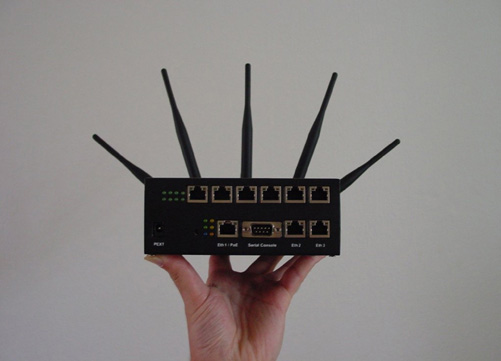
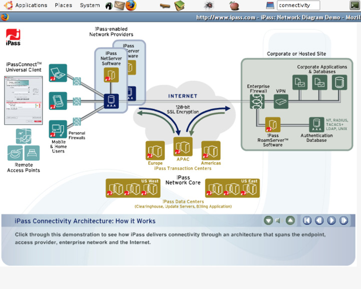
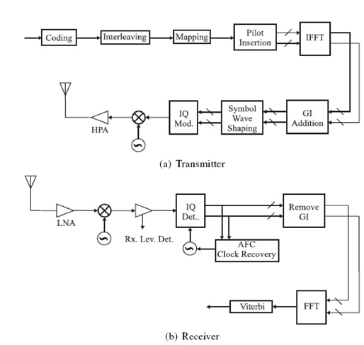

Wireless networks are in some ways very unpromising candidates for network and media theory. They are certainly not the most visible hotspot of practices or changes associated with media technological cultures. However, wireless networks persistently associate themselves into the centre of media change. Their connectivity, intermittent, unstable and uneven as it often is, lodges in many of the overlaps, overflows and outgrowths badged as convergence, mobile media, and pervasive or ubiquitous computing. The forms of wireless convergence are various, common and familiar. They are currently occurring in the form of the so-called ‘fixed-mobile’ convergence that seeks to connect different infrastructures to each other (e.g. Wi-Fi and cellular phone networks in the form of the iPhone and many other mobile phones). It might not be going too far to say that wireless networks are the very substrate of network media convergence today. We could think of wireless networks as prepositions (‘at,’ ‘in,’ ‘with,’ by’, ‘between,’ ‘near,’ etc) in the grammar of contemporary media. Because of their pre-positional power to connect subjects and actions, wireless networks act conjunctively, they conjoin circumstances, events, persons and things. {#para2}

Taking wireless networks as bundles of conjunctive relations seriously means also developing alternatives to phenomenological, existential or socio-psychological accounts of experience. What does it mean to approach wireless networks in terms of the somewhat troublesome concept of experience, with all its associations with subjectivity? Via William James ‘radical empiricism,’ this paper argues for a different account of experience. Attached to wireless networks of all kinds, there is a broadly shared experience of ‘wirelessness’. The fabric of wirelessness is woven of several decades of media-technological change. This experience is very much entangled with things, objects, gadgets, services, and with indistinct positional feelings and practices. Wirelessness is a contemporary mode of inhabiting places, relating to others, and indeed, having a body. Above all, and this is a key point for any discussion of wireless networks, it is also a composite comprising diverse or divergent cross-hatched processes that generate transitions and create expectations of more change to come. Because it is principally conjunctive and generates conjunctions, the structure of this experience is diffuse, multiple and unstable in outline. There is no pure experience of wirelessness. Feelings of wirelessness are ‘verbalised’ in a mass of images, projects, products, enterprises, plans and politics concerning networks and communications infrastructures. Wireless networks such as Wi-Fi are quite heavily mediatised as convergent. So much media phosphoresces around the infrastructures that it is difficult to isolate wirelessness as such. What makes wirelessness as a form of experience particularly elusive is that the subject of wirelessness is not very obvious. Wirelessness is not a strongly personal or intimate zone of experience. The layers, intensities, resistances and trajectories of the wireless subject, the one who lives wirelessness, have a somewhat impersonal and ephemeral character. In the light of all these variations in tendency and directions, wirelessness also interrupts convergence, it places detours on the path to any limit point where all differences coalesce. {#para3}

### Experiences of rapid transition

The feeling of wirelessness is strongly animated by a schema of rapid transition to connectivity. In its many variations, wirelessness, like 1990s schemas of the virtual, seems to augur the onset of another wave of de-materialization, albeit in a slightly more down-to-earth, practical, located, field-tested and service-planned form. How can we critically appraise the schema of rapid transition of wireless network connectivity, with the effects of convergence it creates? In taking up the challenge of thinking wirelessly, this paper experiments with a type of empiricism, although not a particularly scientific or even social scientific empiricism. The empiricism at stake here is not that of social science or science in general. It is, although the term might sound a bit ambitious, radical empiricism. Radical empiricism is usually associated with the American pragmatist philosopher, William James (James, 1996). Radical empiricism remains empiricist in the sense that it holds that knowledge comes from experience rather than being innate (for example, a product of reasoning). However, the lightly structured account of experience proposed (in James, 1996), as we will see, seeks to conceptualise a certain overflowing, excessive, or propagative aspect of experience. It focuses closely on change taking place, on the continuous reality-generating effects of change, and on the changing nature of change. As James writes, ‘change taking place’ is a unique content of experience, one of those ‘conjunctive’ objects which radical empiricism seeks so earnestly to rehabilitate and preserve (161). In this respect, it is not typical empiricism. Brian Massumi has developed this strand of James work in his account of the *transcontextual* aspects of experience (Massumi, 2002). In reflecting on James account of experience, Massumi describes the streamlike-aspects of experience: we become conscious of a situation in its midst, already actively engaged in it. Our awareness is always of an already ongoing participation in an unfolding relation (Massumi, 2002 13, 230-1). Experience overflows the borders and boundaries that mark out the principal lived functions of subjectivity-self, institution, identity and difference, object, image and place. {#para4}

Wirelessness comes bundled with two or so decades of network-media technological change. The point of adopting a radical empiricist approach is to slow down that experience of change (convergence) enough to present the many transitions it depends on, to become conscious of what it means to be engaged in that situation. Adding an extra word to James’ phrase ‘radical empiricism’ to make radical network empiricism is meant to highlight the challenge of conceiving of empiricism under network media conditions. Under those conditions, the limits of experience are frequently re-drawn, the outlines of the subject, personhood, group and collective blur and crosshatch, and above all, are permeated by more or less intense awareness of the process of change. {#para5}

What would this mean in relation to wireless networks and to wirelessness? The image of *Slupr* (Hoekstra, 2007) gives pause for thought. {#para6}

This slightly ridiculous, non-commercial device is a wireless access point with five antennae, designed to allow connection to numerous wireless networks simultaneously. In a literal way, the design of the device embodies not only a geek-ish delight in hyper-connectivity, but a literal-minded attempt to summon up one facet of convergence, bandwidth. Being slightly playful in response, we could say that those five antennae embody one of the theoretical mainstays of James radical empiricism: {#para7}

> [O]ne and the same material object can figure in an indefinitely large number of different processes at once. (James, 1996, 125) {#para8}

Things themselves belong to diverse processes. Slupr, with its appetite for open wireless networks in the neighbourhood, seeks to figure in a large number of different processes at once; that is, to connect to five different wireless access points. More importantly, for our purposes, James writes, {#para9}

> experience is a member of diverse processes that can be followed away from it along entirely different lines. (James, 1996, 12) {#para10}

Like objects, experience for James figures in diverse processes. In particular, experience can be followed into things as well as into perceptions, feelings, affects, memories, and signs. If we accept that experience and things are deeply coupled in the ways suggested by James, wirelessness too is a composite experience, a member of diverse processes. These processes do not always belong entirely to human subjects (in the form of users, technicians, engineers or others). At certain points, experience is no longer ours, it goes beyond the turn that constitutes human experience, and takes on impersonal or pre-individual aspects. The effects of convergence generated in wirelessness could derive from entirely different lines, from diverse processes, or, in short, divergence. In the light of James’ expanded notion of experience as expanding and diverging, we would need to ask: what are the diverse processes that wirelessness belongs to? A radical network empiricism that lived up to its promise would have to invent ways of engaging with the diverse, divergent lines that inform experiences ranging from the infrastructural to the ephemera of mediatised perception and feeling. {#para11}

### Tendencies and transitions: what proportion of unverbalized sensation remains?

In a sense, transition lies at the core of any experience for James. He writes: {#para12}

> Our experience, *inter alia*, is of variations of rate and of direction, and lives in these transitions more than in the journey’s end. The experiences of tendency are sufficient to act upon. (James, 1996, 69) {#para13}

This sounds incredibly general, a truism that is hard to disagree with. He is saying we inhabit transitions more than ends in general, just like people say, rightly perhaps, that the journey is more important than the destination. For instance, convergence as experience of transition is lived more fully, richly, diversely than any end or limit point can express. The feeling of being in transition is, for James, what gives consistency to any experience, what allows it to flow. This feeling of change, transition or tendency is the core of what we experience as acting or being acted upon. Empiricism is radical to the extent that it manages to hold onto ‘the passing of one experience into another’ (50). {#para14}

James, I think, is saying more. Experience relies on variations of rate and direction, and these variations are lived as the passing or transitioning of experience, and the sense, hopeful or not, of more to come. The living in transitions depends on variations in rate and direction. This variation or even substitution resonates quite strongly with the constantly churning transitions associated with wirelessness. Take for instance, the waves of change associated with Wi-Fi as it has moved through different versions in the last five years. In each version 802.11a, 802.11b, 802.11g and now 802.11n, wireless networks changed. There were changes in rate as the rate of information transfer increased (sometimes by large factors). There were variations in direction. The processes of setting up connections altered slightly, especially in relation to encryption and security controls. The access points or wireless routers connected to the telephone or wired network, the network cards, and the antennae still look more or less the same, or became less visible. Yet many more gadgets (phones, cameras, music players, televisions, photoframes, radios, medical instruments, etc) appear to be wireless. Often transitions between these different networks are only distinguishable on the basis of small changes in feelings of connectivity, in an experience of celerity, in the rather minute and flickering visibility of network icons, signal strength icons; on other occasions requests to authenticate or pay for a connection entail larger variations in direction. {#para15}

If we take seriously James’ idea that the fabric of experience is lived in variations, then wirelessness takes on a different character. Rather than being directed towards the endpoint of endless, seamless, ubiquitous connectivity of all media, we might begin to attend to ways in which wirelessness alters how transitions occur in experience. When wireless hotspots are set up in cafes, hotels, trains, aircraft, neighbourhoods, parks, and homes, they promise to alter transitions, or to introduce, as James puts it, ‘variations in rates and direction.’ However, for various reasons, this is quite a difficult thing to contain or control. At what scale or level of transition can passing be re-shaped? In what ways can the transitions be lived? {#para16}

In what might seem like a detour into the realms of Psychology or Philosophy 101 mind experiments, we can imagine some of the facets of lived transition by returning to James’ own account of what it means to know a thing. James describes sitting in his library in 95 Irving Street, Cambridge, Massachusetts and imagining Memorial Hall, a landmark building at Harvard University: {#para17}

> Suppose me to be sitting here in my library at Cambridge, at ten minutes walk from “Memorial Hall,” and to be thinking truly of the latter object. (54-55) {#para18}

He asks himself – how could having the name or even an image of the thing in mind ever be said to constitute knowledge of the thing. What is interesting and useful in James’ answer is his insistence on the role of special experiences of conjunction (55) in giving the name or image of Memorial Hall its knowing office. A special experience of conjunction could include walking to Memorial Hall along with the reader (I can lead you to the hall, and tell you of its history (55-6)). What is made during that imagined walk would be a series of felt transitions, that act as intermediaries. The tissue of experiencing these transitions – out of the library onto the street, the street signs, the tower of the Hall gradually coming into view – connects the starting point of the knower to the known. The knower – James in the library thinking of Memorial Hall – connects with perception of a thing by undergoing these felt transitions. There is no other way, at least on a radical empiricist account, of knowing a thing. {#para19}

Now, suppose James sat in a library at Cambridge today imagining Memorial Hall. He could try to conduct special experiences of conjunction through wireless networks. For the imagined 10 minute walk, he might substitute a series of felt transitions to Memorial Hall that went via his laptop through his home wireless network or other available networks in the precincts, accessing web pages, blogs, webcams, and geobrowsers that showed images, directions, maps, descriptions, history and contact details for Memorial Hall. But that point is fairly obvious. We don’t need James to tell us that wireless networks open up different paths for experience to thread along since that is inevitable with networked media. However, in that series of felt transitions from library to Memorial Hall, he may well encounter variations in rate and direction. Although it would be impossible for him to be aware of all the intermediary relations and transitions that have to occur for a wireless-mediated knowing of the Hall, one question that might come up would be which network to connect to. It could be any of the following, and there are no doubt many others: {#para20}

> Cambridge, Massachusetts, United States {#para21}
>
> 9 Wi-Fi Hotspots found {#para22}
>
> 5 providers {#para23}
>
> All locations matching your search criteria {#para24}
>
> 802.11b Wi-Fi, Ethernet {#para25}
>
> Boston Marriott Cambridge {#para26}
>
> Cambridge MA 02142 {#para27}
>
> The Charles Hotel in Harvard Square {#para28}
>
> Location Type: Hotel / Resort {#para29}
>
> One Bennett St {#para30}
>
> Cambridge MA 02138 {#para31}
>
> Location Type: Hotel / Resort {#para32}
>
> Harvard Square Hotel {#para33}
>
> 110 Mt. Auburn Street {#para34}
>
> Cambridge MA 02138 {#para35}
>
> The Inn At Harvard {#para36}
>
> Location Type: Hotel / Resort {#para37}
>
> 1201 Massachusetts Avenue {#para38}
>
> Cambridge MA 02138 {#para39}
>
> Location Type: Hotel / Resort {#para40}
>
> La Luna Caffe {#para41}
>
> 403 Mass. Ave {#para42}
>
> Cambridge MA 02139 {#para43}
>
> The UPS Store 0681 {#para44}
>
> Location Type: Cafe {#para45}
>
> 955 Massachusetts Ave {#para46}
>
> Cambridge MA 02139 {#para47}
>
> Location Type: Store / Shopping Mall {#para48}
>
> FREE {#para49}
>
> Rebecca’s Cafe (Main & Hayward) {#para50}
>
> 802.11g Wi-Fi {#para51}
>
> 290 Main Street {#para52}
>
> Cambridge MA 02142 {#para53}
>
> Location Type: Cafe {#para54}
>
> Marriott Boston Cambridge {#para55}
>
> 2 Cambridge Center {#para56}
>
> Broadway & 3rd Street {#para57}
>
> Cambridge MA 02142 {#para58}
>
> 6 providers {#para59}
>
> Location Type: Hotel / Resort {#para60}
>
> 802.11b Wi-Fi {#para61}
>
> JiWire Certified Residence Inn Boston Cambridge Center {#para62}
>
> 2 providers {#para63}
>
> 6 Cambridge Center {#para64}
>
> 802.11b Wi-Fi, Ethernet {#para65}
>
> Cambridge MA 02142 {#para66}
>
> Location Type: Hotel / Resort {#para67}
>
> ([https://wi-fi.jiwire.com/browse-hotspot-united-states-us-massachusetts-ma-cambridge-52188.htm](https://wi-fi.jiwire.com/browse-hotspot-united-states-us-massachusetts-ma-cambridge-52188.htm)) {#para68}

Even after he found what networks were accessible from his library, James would need to undergo a series of felt transitions as he attempted to access available networks. He might be asked to authenticate himself with a user name and password, he might be asked for network encryption keys (WEP passwords) for the Charles Hotel network, he could be offered the chance to enter credit card numbers to pay for a hour or a day’s connection at the UPS Store, or he could see, listed on a screen, half a dozen open wireless networks in the vicinity. These could range from a slight, habitual awareness of the need to enter once again the same old user name and password details, through frustration at not being to connect to a network that should work, to guilty, secretive pleasure at gaining access to a network that belongs to someone else, hoping that they don’t notice. Relations are of different degrees of intimacy (44), he might say to himself. Supposing James were an affluent Harvard professor, he might have an iPass subscription that allowed him to access many networks in his vicinity. The felt transitions would go via some of this: {#para69}

In short, his movements towards the known thing, Memorial Hall, would pass through an externalised series of transitions. In connecting to any of these networks, the transition from unconnected to connected, from unassociated to associated could be felt in many different ways. {#para70}

The point of this updated variation on James account of a word or image is to simply adumbrate what happens to conjunctive relations today, and hence to the flow of experience under network conditions. There is no experience of convergence, connectivity, or flow that does not go through diverse conjunctive relations, through the transitions that allow knowing, or doing to be felt. These transitions and the feeling of them are crucial to what James calls nature or whatness. These felt transitions are neither spontaneous, random nor completely ordered. The patterns, means and trajectories of this passing must include variations in rate and direction, otherwise wirelessness as experience of connectivity or convergence disintegrates. {#para71}

No doubt, the means by which sensations of transition are arranged are highly complex, and themselves work on multiple scales. But the passing of experience effected by transition can take very circuitous routes. Experience has many different scales, ranging from the impersonal to the personal, from singular to general. On any scale we imagine, wirelessness is not pure flow or pure sensation of transition. It is shot through with temporary termini, with snags, resistances, with circularities and repetitions. Pure wirelessness does not exist. Rather, as James puts it, {#para72}

> … experience now flows as if shot through with adjectives and nouns and prepositions and conjunctions. Its purity is only a relative term, meaning the proportional amount of unverbalized sensation which it still embodies. (94) {#para73}

We might understand many of the circuitous conjunctive relations present in wirelessness as attempts to organise, channel and protract the unverbalized sensation of transition. Although the conjunctive relations it promises and promotes are on the less intimate end of the scale of conjunction (with, near, beside), they are accompanied by adjectives and nouns and propositions that are no less vital to the flow of experience, and that often tend to be much more personal or intimate. What shoots through the flow of experience – ‘experience now flows as if shot through with …’ – complicates that flow considerably. This twist or detour in flow is not restricted to wirelessness. However the difference between James’ imagined walk to Memorial Hall as way of knowing and his accessing wireless networks to find directions and information points to a relatively little attended aspect of experience under network conditions. {#para74}

### The antenna and the algorithm as sites of divergence?

It is possible to order conjunctive relations in terms of inclusiveness and intimacy. As James writes, ‘[w]ith, near, next, like, from, towards, against, because, for, through, my – these words designate types of conjunctive relation arranged in roughly ascending order of intimacy and inclusiveness’ (45). Under network conditions, as for instance in wirelessness, it seems that this order of intimacy and inclusiveness becomes unstable. With or near can become confused with my or for. And it is precisely this instability in ranking that invite many different material and semiotic attempts to inject verbal, visual, commercial, legal orders into the conjunctive flow. It might seem that all these transitions lie quite a long way away from wirelessness. How can it be brought closer to home? Let’s imagine that James has a Slupr in his library in Irving St: ‘suppose me to be sitting in my library with my Slupr’ he might write. Where are the ‘verbalizations’ that shoot through experience? The thing that sits in the library flashes its lights. We could understand this flashing, for instance, in terms of certain hardware aspects of wirelessness. In order to envision the diversity of processes associated with wirelessness, we could do worse than attend to the antennae sticking out of Slupr. Antennae, we might say, visibly differentiate wireless and wired networks. Any ‘change taking place’ in the experience of wirelessness depends on antennae. {#para75}

Antennae are deceptively simple bits of infrastructure. Close to the antennae, sometimes only millimeters away, lie semiconductor chips on which much depends. Together chips and antennae gather many different things together. As components in consumer electronics, they have life-cycles, quite rapid-ones in the case of networks such as Wi-Fi as it moves through different versions (802.11a,b, g, and now n are some of the standards). They derive from international standards produced by the IEEE (Institute of Electrical and Electronics Engineers), and these standards themselves reflect spectrum licensing arrangements in various countries. In important respects, however, beneath the churn of competition and innovation, the basic architecture of wireless chips used in Wi-Fi, Wi-Max, Bluetooth, GSM/3G or wireless USB varies very little. The algorithmic techniques they use to process signals are surprisingly aligned or convergent at a technical level. Even between major competing wireless technologies such as GSM 3G and CDMA2000 there are relatively few algorithmic variations. Often the algorithms are nearly the same, only applied at a different frequency or in a slightly different order. So the competition between different forms of wireless network that is happening all around us, and the proliferation of networks at different scales ranging from the bluetooth networks draped around individual bodies through to the planetary scale networks of satellite-based wireless systems, including broadcast systems like DVB, share algorithmic processes to a large extent. In fact, some of the same algorithm processes are widespread in other important domains of new media such as the video compression that underlies DVDs and video streaming (the Fast Fourier Transform, for instance). {#para76}

The algorithms of wirelessness are intricately packed with mathematical nuances, tricks, shortcuts, optimisations and variations. Their density and complexity respond to the complicated conjunctions that wireless signals encounter. Algorithms are designed to allowed information to move around amidst crowded, noisy, constantly interrupted electromagnetic environments, deeply saturated with many forms of interference and obstacle (bodies, buildings, changes in atmospheric conditions due to weather, other devices, etc). This introduces extraordinary convolutions into algorithms. Technically speaking, wireless networks usually suffer from ‘severe channel conditions.’ What I find resonant about these algorithms is that they are ways of making networks hang together under very imperfect signal propagation conditions. In order to handle that, all contemporary forms of wireless network do one thing: they build *conjunctive relations* into the bitstream. {#para77}

Figure 3 shows first of all that wireless signal processing has many components. All these components need not delay us here if we just attend to one symptomatic box nearest the top left in the transmitter labelled ‘coding’ and one at the centre bottom of the receiver labelled ‘Viterbi’. These two boxes are complementary. They are designed with each other in mind. In the first box, ‘coding,’ the process known as ‘convolutional coding’ turns the pure bitstream, the very substrate of convergence, the data to be transmitted, into a complicated logistical problem. In convolutional coding, a network of relations (the ‘convolutions’) is imprinted onto the series of bits comprising the transmitted bitstream. Convolutional coding changes the data in the bitstream. It is no longer just a series of bits that represent data (text, speech, image, code, etc). It is also a series of bits that expresses relations between what came before and what comes next. In other words, conjunctive relations have been embedded in it in a form that can be represented as a kind of network. Like all networks, points in this network are characterised by greater and lesser proximity. Some paths through the network are shorter than others. At the bottom centre of the diagram, in the box labelled ‘Viterbi’, the wireless receiver turns the convolutionally coded bitstream back into a plain bitstream. It ‘solves’ the logistical problem imposed by the convolutional coding. In a version of the ‘travelling salesman problem’ (Cormen and Cormen, 1990, 969-974), the coding and decoding process introduces the metaphor of the logistical network into the bitstream itself. Convolutional coding along with Viterbi decoding applies the mathematical models developed in World War II and Cold War operations research to optimise the routing of people and goods to the very structure of the bitstream itself (for more detail, see (Mackenzie, 2006)). The key point here is that the bitstream that seems to flow smoothly through the channels of wireless networks in fact comprises constantly shifting networks of relations between bits. It is as if networks have been algorithmically curled inside the fabric of network connectivity, the bitstream. This is a very curious technocultural achievement by any standards. In the interests of making wireless networks of various kinds, the mathematics of logistical networks have been used as the model or the underlying strategy for propagating signals under ‘severe channel conditions’. The very epitome of network connectivity, the wireless network, depends on a model or metaphor of a network. A model of network, a mathematical metaphor concerned with logistics, is folded into the very heart of the relation of the wireless link-node structure.[1] {#para78}

What matter of concern could this algorithmic process of convolutional coding coupled to Viterbi decoding respond to? The algorithmics of wirelessness centre on the maintenance of a bitstream amidst severe channel conditions. In other words, there are many possible relations, circumstance and events impinging on communication. The generation of a stream-like consistency in experience in information flow under such conditions depends on developing forms of conjunctive relation that can flow around, under or between many other signals and physical structures. However, the convolutions and complications of the digital signal processing in wireless networks can also serve as a useful reminder of what radical network empiricism implies about the conditions of possibility of wirelessness. We have already seen that James regards experience as a ‘member of diverse processes.’ This is because it is replete with variations that take it in many directions at once. These variations and tendencies enable experience to flow. How, one could ask, does experience come to belong to ‘diverse processes’? We have already seen that experience owes more to transitions than to ends. However, James argues something more specific about these transitions. Radical empiricism, he writes, takes conjunctive relations at their face value, holding them to be as real as the terms united by them’ (107). Conjunctive relations concern proximity, distance, intersectionality, detour, immediacy or delay. In language, conjunctive relations are expressed by particles such as ‘with,’ ‘between,’ ‘before,’ ‘far’, and ‘so forth.’ These relations are experienced constantly, and in fact, James’ claims, we live far more in these relations than in the disjunctive relations associated with things or entities. As James writes, {#para79}

> While we live in such conjunctions our state is one of *transition* in the most literal sense. We are expectant of a ‘more’ to come, and before the more has come, the transition, nevertheless, is directed *towards* it. (237) {#para80}

Wireless things make conjunctions, the aspect of experience that generates expectation of more-to-come, into the principle of their operation. By capitalising on conjunctive relations, it becomes possible for networking to handle ‘severe channel conditions’ or the presence of many others. When conjunction becomes the modus operandi of what counts as the physico-material infrastructures of a contemporary media formation, then how could we not experience or expect ‘more to come’? {#para81}

This can be viewed from a practical standpoint. There are millions of wireless transmitters and gadgets in the world today because algorithmic processes such as Viterbi decoding permit antennae to proliferate. The radio-frequency antennae used in wireless networks distinguish them from other kinds of networks. These small antennae are plainly ubiquitous, and without the somewhat manic and convoluted signal processing driving those antennae, there would be no wirelessness. Without wireless networks in their urban, rural, domestic versions, mobile media would not converge. The promise of convergence has deeply infrastructural roots in wireless signal processing. Yet this infrastructural root is hard to grasp since it is purely relational, and the relations it concerns are conjunctive in character rather than substantive. This is not to say that algorithmic signal processing is the ground of wirelessness. The insistence on conjunctive relations in radical empiricism points us in a different direction that is intimately interwoven with experience, albeit a somewhat impersonal, pre-individual dimension of experience. {#para82}

Many people would probably say that they have no interest in, let alone experience of, the algorithmic processes driving antennae in wireless networks such as Bluetooth or Wi-Fi. Does media theory need to think about antennae and algorithms? Should it begin to conduct research into the cultural life of antennae? This is not the point. Rather, as James says: {#para83}

> To be radical, an empiricism must neither admit into its constructions any element that is not directly experienced, nor exclude from them any element that is directly experienced. For such a philosophy, *the relations that connect experiences must themselves be experienced relations, and any kind of relation experienced must be accounted as ‘real’ as anything else in the system*. (James, 1996, 42) {#para84}

The key point here is that ‘the relations that connect experiences must themselves be experienced relations.’ James at work in his wireless library, and all the billions of wireless chips in their algorithmically driven handling of conjunctive relations together construct experiences filled with conjunctive relations. But in what sense are the algorithmic processes of wireless networks a part of the expanded experience of wirelessness? {#para85}

### The feeling of convergence as experienced relation

There are various dynamics associated with antennae that connect them with experience, or more precisely, that concern experienced relations in wirelessness. Many of these relations are experienced directly in the form of ‘more to come.’ For instance, recently, much attention has been given to the overflow of radio-frequency waves in wireless networks in schools and homes. This attention echoes long-standing uncertainties around radio-waves and electrical fields associated with electric power networks, and mobile phone masts. Wi-Fi seems to make some people sick (Hume, 2006). A recent episode of BBCs *Panorama* Wi-Fi Revolution describes this overflow as the martini-style internet, fast-becoming unavoidable, but there is a catch: radio-frequency radiation, an invisible smog. The question is, is it affecting our health? (BBC, 2007) (00.55 – 01.07). This is one form of relation in wirelessness – the way in which bodies close to networks experience themselves as sensitive to and affected by exposure to an increasing density of signals, a density that attests to the very efficacy of wirelessness in handling so many different relations of proximity. In James terms, conjunctive relations between bodies and antennae are an essential part of wirelessness. While these conjunctive relations (with, and, near, between, behind) are often seen as accidental components of experience, in radical empiricism they are counted as real as anything else. {#para86}

Another form of overflowing relationality is perhaps most central to wirelessness. Wireless networks create zones of indistinct and equivocal spatial activity. The fuzziness of hotspots, the ways in which people become attuned to signal strengths as they move around in wireless networks, and the alterations in everyday habits associated with wireless networks form primary components of wirelessness as experience grounded in conjunctive relations. The different basic topologies of wireless networks – star, mesh – as well as the many different levels of access associated with them, and the many different attempts to limit or open up access, attest to this sense of equivocal proximities. There have been many events in the last five years associated with this equivocal proximity. It began with publicity about war-chalking, the short-lived practice of indicating the presence of nearby wireless networks. It continues in the many wireless mapping projects to be found online, ranging from industry-sponsored maps to war-driving or war-flying maps. It disables distinctions between public and private. In the last five years, there has much debate, somewhat inconsequential on the whole probably, about the ethics and legality of accessing open wireless networks. High-profile cases have occurred. The conviction of a teenager in Singapore (Chua Hian, 2007), the theft of 45 million customer records from wireless networks at TkMaxx stores in the USA (Espiner, 2007), and the general trend towards criminalisation of any ‘unauthorized access’ to wireless networks (for instance, using a wireless network at a coffee-shop without paying (Leyden, 2007), (Simone, 2006)) suggests that this topological overflow leads to many kinds of uncertainties about what properly constitutes a network when its edges tend to blur. Nor is this always criminalised. Rather, it increasingly forms part of the basic business model of many service providers: if the Wi-Fi network is open, people will buy more coffee, etc. {#para87}

These symptoms of antenna awareness – affecting bodies at a cellular or physiological level, as things in variations, and as equivocal proximities – are experienced unevenly, and many of them cannot be verified. When people experience wirelessness as overflowing change, they have a sense of what the wireless algorithms in their many semiconductor implementations are working on: expanding and multiplying relations, continually propagating signals outwards, overflowing existing infrastructures and environments at many points and on different scales. They are strangely composite or mixed experiences of indistinct spatialities. They trigger various attempts to channel, amplify, propagate, signify, represent, organise and visualise relations. {#para88}

### Wirelessness as hybrid object of research

In a sense everything I have been discussing here – the algorithms and antennae, the various overflows (spatial, thing, body, private-public), and the transitions between different versions of Wi-Fi or other wireless networks – concern how the passing of one experience into another, is subject to re-organisation in wirelessness. {#para89}

A radical empiricist concept of experience touches on such questions at several points. In its insistent grounding of experience in transition, it names that aspect of wirelessness that entails constant change. According to radical empiricism, we have an experience of transition because conjunctive relations vary in degrees of intimacy and proximity. The conjunctive relations of wirelessness necessarily include a variety of overflows. Those overflows are themselves at core the very sensation of becoming-wireless. Yet they themselves are not pure or aligned with each other. They are exposed to many forms of verbalisation. Wirelessness as a contemporary mode of experience is not pure in any sense. It is not reducible to phenomenological, existential or even psychological modes of understanding. As we have seen, it envelops diverse processes, including those that are normally understood as belonging to objects, transactions, devices, gadgets, brands and infrastructures. If we look at some of the distinguishing features of those things, antennae and signal processing stand out as what makes wireless media different from, say, gaming consoles or cameras (although these, of course, are becoming increasingly wireless – e.g. Wii). The wireless antennae and algorithms seek to generate certain conjunctive relations (with, to, for) that hold experience together. They intensively re-order signals in the name of a connectivity that can tolerate interference or the presence of many others. Yet, once we begin to go into wireless media practices, it seems that the kinds of conjunctive relations they recruit are not easily controlled, corralled or limited. They overflow in equivocal proximities – into other things, into living bodies, and across legal, physical, social boundaries. These overflows all affect transitions. They constitute changes in the ways that transitions happen. {#para90}

There is no ground for wirelessness, not even the mostly unfelt reaches of electromagnetic spectrum. Instead, the radical empiricist account of experience allows us to say that the most intimate and most impersonal can sometimes come close to each other. Things and sensations are not at opposite poles of experience. This almost brings us full circle. We have glimpsed the mediatised, materialised, contested, commodified, politicised, normalised, and ignored kaleidoscopic cascade of changes associated with wireless networks. Many of these changes seek to connect or align what was previously separated or misaligned. But in almost every attempt to converge, they disturb the rankings of conjunctive relations between impersonal and personal, between remote and intimate. The flow of experience has to be re-configured. {#para91}

## Author’s Biography

Adrian Mackenzie (Centre for Social and Economic Aspects of Genomics, Lancaster University) researchs in the area of technology, science and culture. He has published books on technology: *Transductions : bodies and machines at speed*, London: Continuum, 2002/6; *Cutting code: software and sociality*. New York: Peter Lang, 2006; and *Wirelessness: Radical Empiricism in Network Cultures*, MIT Press, 2008, as well as articles on media, science and culture. He is currently working on practices, ethics and politics of collaboration in biology.

## Note

[1] Shifts between metaphorical and literal invocations of the term ‘network’ have constantly beset network media theory. Often the very notion of a network has been an aspiration or an expectation rather than something given. The concept of network has been generalised as a key figure of recent organisational change, and this has usually been done by saying that wherever there are patterns of relations, they make up a network. I think contemporary work with networks would benefit from treating the rapid oscillation between literal and metaphorical invocations of ‘the network’ as a real aspect of contemporary experience, not as something to be regulated or controlled. Algorithmic and signal processing aspects of the wireless networks provide a useful limit test case here. Surely there are no literal-figurative instabilities here? Surely these are the real, actual networks? However, in the case of the Viterbi decoder, it seems that networks metaphorise themselves even at this level. If the invocation of network cannot be regulated even here, there is no hope of controlling the performativity of the concept of networks.

[back]

## References

Akay, Enis, and Ender Ayanoglu. ‘High Performance Viterbi Decoder for Ofdm Systems’, paper presented at the Proc. *IEEE VTC Milan*, Italy 2004.

BBC. *Wi-Fi: A Warning Signal*, 2007.

Chua Hian, Hou. ‘Asiamedia :: Singapore: Wi-Fi Thief’s Sentence Lauded as ‘Practical”, (2007). [https://www.asiamedia.ucla.ed/article.asp?parentid=62202](https://www.asiamedia.ucla.ed/article.asp).

Cormen, Thomas H., and Thomas H. Cormen. *Introduction to Algorithms*. 1st ed. (Cambridge, Mass.: MIT Press, 1990).

Espiner, Tom. ‘Wi-Fi Hack Caused Tk Maxx Security Breach – Zdnet Uk’, (2007). [https://news.zdnet.co.uk/security/0,1000000189,39286991,00.htm](https://news.zdnet.co.uk/security/0,1000000189,39286991,00.htm).

Hoekstra, Mark. ‘Slupr: The Mother of All War-Drive Boxes’, 23 May 2007 (2007). [https://geektechnique.org/projectlab/781/slurpr-the-mother-of-all-wardrive-boxes](https://geektechnique.org/projectlab/781/slurpr-the-mother-of-all-wardrive-boxes).

Hume, Mick. ‘Wi-Fi Phobia: It Makes Me Sick’, 24 November (2006). [https://www.timesonline.co.uk/tol/comment/columnists/mick_hume/article647886.ece](https://www.timesonline.co.uk/tol/comment/columnists/mick_hume/article647886.ece).

iPass Inc. ‘Ipass Network Diagram’, (2007). [https://www.ipass.com/technology/index.html](https://www.ipass.com/technology/index.html).

James, William. *Essays in Radical Empiricism* (Lincoln: University of Nebraska Press, 1996).

Leyden, John. 2007.

Mackenzie, Adrian. ‘Convolution and Algorithmic Repetition: A Cultural Study of the Viterbi Algorithm’, in Robert Hassan and Ron Purser (eds) *24/7 Network Time* (Palo Alto: Stanford University Press, 2006).

Massumi, Brian. *Parables for the Virtual* (Durham, N.C: Duke University Press, 2002).

Simone, Ty. 2006.
