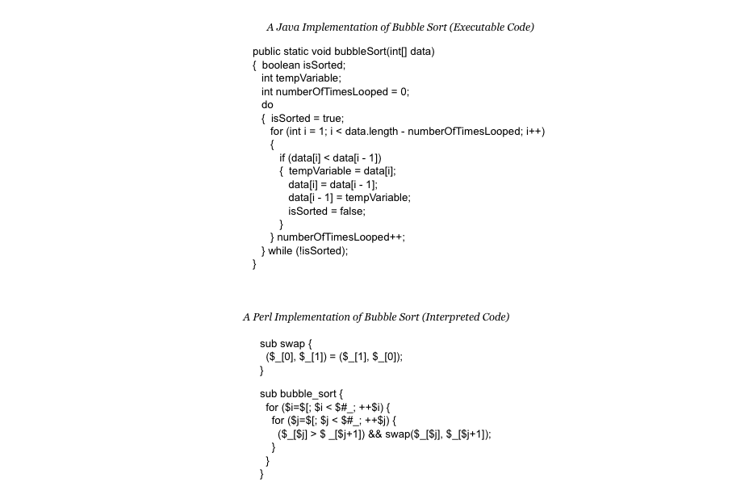
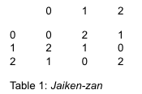
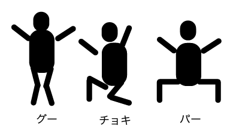
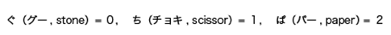

### A Turning towards Code

Over the past thirty years there has been an increasing interest in the social and cultural implications of digital technologies and “informationalism” from the social sciences and humanities. Generally this has concentrated on the implications of the “convergence” of digital devices and services, understood as linked to the discrete processing capabilities of computers, which rely on logical operations, binary processing and symbolic representation. In this paper, I suggest that a “grammar of code” might provide a useful way of thinking about the way in which digital technologies operate as a medium and can contribute usefully to this wider debate. In using the term “code” I include computer software source code, associated executables, and static data structures and I want to build on previous work by authors such as Manovich (2001), Hayles (2004), Fuller (2004) and Mackenzie (2006) who all identify the importance of looking at computer software. I also want to connect with interesting debates that are currently taking place between practitioners and theorists within *software studies* and *critical code studies*, on the importance of “reading” and “writing” code – see Manovich (2001) and Marino (2006). Here, though, I would like to concentrate on the performative aspects of code, especially when the code is translated (either as an executable or into another state). Code is usually written by programmers to be ‘run’, and when it is executed it operates as a discrete final state machine (FSM) usually with some form of symbolic performativity associated with it – in other words, a useful heuristic is that code usually does *something* to *something* (although this is contested by some critical code studies theorists such as Marino (2006)). It performs functions and processing; from airline booking systems, banking processing, real-time military calculation, to the ‘idle task’ process that keeps the CPU ‘busy’ when no other process is running (e.g. process zero in Linux). Code is thus strongly linked to activity within the domain of the digital computer, and indeed, within computer programming generally – good software writing is linked heavily to ‘running code’ (although see arguments about “code poetry” and “software art” discussed by Mackenzie 2006:32). {#para3}

Currently theorising code is made difficult by the extremely mutable and plastic form of computer code, not to say complications that arise with regard to appropriate methodologies and approaches for understanding the way in which code is produced, circulated and consumed. Rather than directly engage with these methodological questions, in this paper I aim to contribute towards developing a grammar of code, in as much as Stiegler (2007) discusses the importance of an understanding of the ‘…*systematic discretization of movement* – that is to say, of a vast process of the *grammaticalization of the visible’* (Stiegler 2007: 148-149, original emphasis). Where Stiegler is interested in the discrete image, in this paper I am interested in the way in which the dynamic properties of code can be understood as operating according to a grammar reflected in its materialisation and operation in the lifeworld – the discretisation of the phenomenal world. As part of that contribution I wish to develop some tentative Weberian ‘ideal-types’, where I understand an ideal-type to be an analytical construct that is abstracted from concrete examples. The ideal-types I discuss in this paper are intended to help make “code” more clear and understandable; to develop an understanding of the kinds of ways in which code is manifested; and by helping to reduce ambiguity about “code” by providing a means to develop adequate descriptions that contribute to understanding code’s historical characteristics (see Morrison 1997: 270-273). {#para4}

Due to limits on space, in this paper I only develop the ideal-types as fairly abstract concepts, but one could certainly imagine developing a grammar to include computer code structures such as: objects, classes, variables (of different types), methods, namespaces, conditionals, interfaces and so forth. This could then become useful for understanding code-in-itself, social dynamics mediated through code, cultural artefacts produced through the use of code and perhaps suggest interesting relations between what Latour (1992) calls ‘delegation’, the encoding of particular imperatives and values, and ‘prescription’, that is the reverse application of imperatives back onto us as human beings. In the discussion below, for example, I directly link this sense of delegation and prescription to the “reading” and “writing” of computer code. {#para5}

To develop this argument and to demonstrate the importance of understanding code as performative and processual (rather than as a static artefact), I undertake a media-specific analysis (Hayles 2004) by an examination of what Bolter and Grusin (1999) called reverse remediation. To do this, I outline a short comparison of digital and code based analysis of digital technology to develop a notion of atomic versus articulatory aspects to computer code. I initially propose seven heuristic ideal-types as a contribution to developing ways of conceptualising and researching code, namely: *digital data structure, digital stream, delegated code, prescriptive code, commentary code, code object* and *critical code* (section 1). I then apply these ideal-types to the work of the Japanese composer Masahiro Miwa whose innovative ‘Reverse-Simulation music’ models the operation of basic low-level digital circuitry for the performance and generation of musical pieces, that is, in the articulatory expression of code (section 2). Finally I look at the implications of this approach and the ways in which the ideal-type grammar could be extended and developed. {#para6}

### 1 – Coding Code

First I would like to develop the ideal-types that I wish to apply throughout the paper by theorising the different forms of “code”. For example, the term “digital code” or the “digital” is often used to broadly refer to the digital collection of 0s and 1s that can be used to store functions for operating a computer (i.e. machine-code) and alternatively for storing information (i.e. binary data). These different forms of data structure are stored in the memory of the computer or hard disc in the encoding of binary data – as rows of 0s and 1s in patterns and grids. However, ‘digital’ is also related to the discrete way in which computers, and digital technology in general, translate the analogue continuous phenomenal world into internal symbolic representational structures. These structures are limited to specific sizes that are ‘fitted’ to the external world by a translating device such as an analogue-digital converter. So I would like to introduce the ideal-type of the *digital data structure* as the static form of data representation. So to take an example, music when represented within the computer is translated from its analogue waveform (which is a continuous wave) and quantized into discrete ‘chunks’. In the case of CD technology, which uses Pulse Code Modulation (PCM), the chunks (bytes) are 16 bits wide, that is, they are able to represent only 65535 different values within the wave, that are sampled at 44,100 times per second. In translating between the external world and the internal symbolic representation, information is lost as the 65535 values are a grid, the *digital data structure*, placed over a smooth waveform. When translated, or played back through a digital-analogue converter, those with keen ears (and expensive audiophile equipment) are able to hear the loss of fidelity and digital artefacts introduced by errors in translation between the two (i.e. back from *digital data structure* to analogue sound). The digital encoding of analogue information (such as in the ripping of an old vinyl LP) is the transfer from one medium of storage (continuous grooves in vinyl) to another (discrete values that can *represent* waveforms).[1] Something of the detail is always lost when moved from the phenomenal world to the discrete world of the computer. This highlights the importance of a focus on the materiality as different embodiments fix data in different ways. Similarly, in any transmission, digital data is broken down to its most basic level as a string of 0s and 1s and chopped into neat packets of data and sent through a network, rather like little parcels sent through the post. This is in marked contrast to the analogue modulation required to send continuous signals that have live end-to-end connection (think of the mechanical switching technologies in old telephone networks), rather than the virtual ‘connection’ of network technologies like digital mobile telephony. {#para7}

Here I think it is useful to think of the ideal-type of the *digital stream* as the flow of static computer *digital data structures* as flattened one-dimensional flows of 0s and 1s. When computers store media content to a hard disc or other medium, the media is encoded into binary form and it is written to a binary file as a *digital stream*. Similarly when data is transmitted across networks or through other mediums (such as radio). Within the *digital stream* file there are markers (such as the file-type discussed below), structural forms and data patterning that provide an encoding that allows the computer to bring the data back to its original depth as a *digital data structure*. To do this the computer relies on standard file and data structures to decode these binary files. When the file lies on the hard disc its functionality remains inert and static as a *digital stream*, for the file to become usable requires that the computer re-read the *digital stream* back into the computer and re-create the hierarchical structure. In a similar way, we take delivery of 2D flat-pack furniture from Ikea (the *digital stream*) and are required to read the instructions (the file structure) to piece together and rebuild the 3D wardrobe (the *digital data structures* located inside the computer memory) prior to being filled with clothes (or ‘run’ on the computer). Therefore any *digital stream* presented to the computer is always already overcoded with meaning. For example, to take a trivial example of the ‘file-type’, the computer uses the last three characters of the filename to decode the type of file that it is dealing with and hence how to operate upon the file (e.g. which parent application it should be opened in conjunction with). Thus the last three characters ‘doc’ are indicative of a file that is a *digital stream* that should be interpreted as a *digital data structure* word-processing file and therefore should be opened with the Microsoft Word application. The characters ‘gif’ in contrast mark the file as a *digital stream* that is interpreted as a *digital data structure* ‘graphics interchange file’ image file encoded with an algorithm developed by Compuserve. On the other hand, file-type ‘exe’ indicates to Microsoft Windows applications that it is an executable *prescriptive code* file (see below) that can be ‘run’ by the computer and can then be given control of the processor (‘app’ is the Apple Macintosh equivalent, Unix uses a different system of permissions to achieve the same effect). {#para8}

The flexibility of being able to render information, whether audio-visual or textual, into this standardised *digital stream* form allows the incredible manipulation and transformation of information that computers facilitate (e.g. Unix uses a *digital stream* of text as the ubiquitous universal format in the operating system). This stream format also enables the access, storage and relational connections between vast quantities of data located in different places, such as demonstrated through search engines like Google. This translational quality of digital representation and storage (albeit at an often degraded resolution within *digital data structures*) is something that highlights the strong remedial qualities of digital representation. {#para9}

Whereas the static atomic form of digital data storage, representation and transmission generally has a passive relationship with technology, it is with computer code that one is involved with action and articulation within the computer, particularly where the code is unfolding and performing particular functions. Code can be understood as the mechanism that operates upon and transforms symbolic data, whether by recombining it, performing arithmetic or binary calculation or moving data between different storage locations. As such, code is operative and produces a result (sometimes at the end of a number of sub-goals or tasks), often in an iterative process of loops and conditionals. Therefore, developing the notion of code as an active agency within the computer brings us to the next two ideal-types, code as *delegated code* and as ‘autonomous’ *prescriptive code*. {#para10}

Code has a dual existence, as *delegated code* residing in a human-readable frozen state that computer programmers refer to as ‘source code’ and as *prescriptive code* that performs operations and processes. For example, in computer programming, to explain the way a particular piece of code is to function, and to avoid talking about a particular instantiation of a programming language, algorithms are written out in ‘pseudocode’. That is in a non-computer, non-compilable language that is computer-like but still contains enough natural language (such as English) to be readable. That is, the algorithms allow the process to be described in a platform/language independent fashion, which can be understood as a pre-*delegated* code form. So for example, a common computer programming method, the *bubble sort* could be outlined thus: {#para11}

In this example, the bubble sort is a simple sorting mechanism that takes a vertical list of numbers and puts the elements that make it up in order by running in a loop which compares each number in turn with the one above and swapping them around in the list if one is bigger than the other. Essentially the smaller numbers ‘float’ to the top and the larger ones ‘sink’ to the bottom (e.g. bubbles float to the top). {#para12}

To enable programs to be written more quickly by programmers, an abstraction of the underlying machine is used that is not dissimilar to pseudo-code. These are the contemporary programming languages, often known as third-generation languages (3GL), in which the human programmer or coder is usually required to write, for example C++, Java and Basic.[2] It is at this level that the *delegated code* is written by the programmer as these highly abstracted languages use a formalised syntax and are usually constructed around simplified English keywords. Together with symbols and punctuation, programs are written in a structured syntactical style made up of statements, loops and conditionals by the programmer to construct the logical operation of the program (see above). This pseudo-code would then be implemented as *delegated code* in specific computer languages; here the examples are Java and Perl;[3] {#para13}

*
*

Source code is usually understood as the concretisation of general algorithms instantiated into particular programming languages in plain text files. Computer programmers write source code as a script of delegated actions that are to be performed by the program. Here, then, we might think of the ideal-type of source code as *delegated code*. For example, the mechanical process required to move a unit of data from point A to point B. {#para14}

> swap(A[j], A[j+1]) {#para15}

*Delegated code* is written in preliminary documents that contain the logic of program operation. But, in addition to the controlling logic of the *delegated code* program flow, the source code will often contain a commentary by the programmer in a special textual area usually delimitated by special characters. These comments assist both the programmer and others wishing to understand the programming code and I introduce the ideal-type *commentary code* to describe these areas. These textual areas are used to demonstrate authorship, list collaborators and document changes – thus source code offers a hermeneutic and historical record in *commentary code* in addition to the processing capabilities of the explicitly *delegated code* within the file. However it is important to note that as human-readable text files, the *delegated code* is also open to interpretation by different ‘readers’, whether human or machine (see Marino 2006 for a discussion of this). {#para16}

For the computer to execute the source code as human-readable *delegated code* it would need to be translated into an executable, that is, machine-readable *prescriptive code* (see Stallman 2002: 3). At machine level, executable code, as *prescriptive code*, is represented digitally as a stream of 0s and 1s and is very difficult for humans to write or read directly. To the human eye this would look like long streams of 0s and 1s without structure or meaning, hence they are often referred to as machine-readable files (insinuating the inability of humans to understand them directly in contrast to human-readable files). Indeed, the mythology of expert programmers and hackers dates back to the times when this was one of the only means of programming computers (Levy 2001). The production of computer code at this low level would be prohibitively complex, time-consuming and slow for all but the smallest of programs. The programmer simplifies the act of programming by abstracting the code implementation from the actual machine hardware. So, when the bubble-sort *delegated code* is compiled into *prescriptive code* it is translated into the 0s and 1s that a computer can understand. When complied the program can then run the bubble-sort correctly for the appropriate hardware, in this case taking an unsorted list of numbers in a *digital data structure* and re-ordering them. {#para17}

The further the programmer is positioned from the atomic level of 0s and 1s by the programming language, the further from the ‘metal’ – the electrical operation of the silicon. Therefore the programmer is not required to think in a purely mechanical/electrical fashion and is able to be more conceptual. At the humanised level of abstraction of third generation languages, *delegated code* can become extremely expressive and further abstraction is made easier. Away from thinking in terms of *digital data structures* or *digital streams,* the programmer begins to think in terms of everyday objects that are represented within the language structure, so rather than deal with 0s and 1s, instead she might manipulate another ideal-type which I will call *code objects* – such as ‘cars’ or ‘airplanes’ which have related properties such as ‘gas tank’ or ‘wing span’ and functions (i.e. methods) such as ‘accelerate’ or ‘open undercarriage’. There is a growing use of the relatively new concept of the discrete ‘object’ within computing. It is used as a monad containing a protected internal state, methods and interfaces to its external environment. This ‘object’ is used within the source code as a technique called *object-oriented programming,* as an abstraction where it is deployed as a visual metaphor for users to manipulate digital artefacts (see Scratch n.d), and also as an active process within a network of programs, users and other objects. Nonetheless, at some point the abstractions manipulated by the programmer within *delegated code* will have to be translated into the necessary binary operations for the correct functioning of the *prescriptive code*. {#para18}

Finally, I want to introduce the ideal-type of *critical code*, which is code that is written to open up existing closed forms of proprietary computer code, providing users the ability to read/hack existing *digital streams* and hence to unpick the *digital data structure.* This could be where software lock-in has become a particular problem, such as with using Microsoft Word documents, or proprietary data formats. But I also want to include code that is designed to hack existing closed proprietary code – often encoded as *prescriptive code*, such as DeCSS, which by careful examination of DVD *prescriptive code* opened up the DVD format for GNU/Linux users (Mackenzie 2006: 28-29). Equally the recent *Jailbreak* software for unlocking the Apple iPhone and iPod Touch, hacks the *prescriptive code* that controls the phone with the intention of opening the hardware and software platform up to the developer/user. *Critical code* is drawn from the concept introduced by Fuller (2004) of ‘Critical Software’ but is contrasted to p*rescriptive code* in the normative content of the *delegated code.* That is, that the *delegated code* is written against the normal performative software development aims of efficiency, modularity or reusability and instead has an implied ethic or good. I am thinking particularly of free software and open source projects here such as the GNU/Linux operating system (see Berry 2004; Chopra and Dexter 2008: 37-71). Therefore a requirement of *critical code* would be that the source/executable would be available for inspection to check the delegated processing that the code undertakes. If the source were unavailable then it would be impossible to check the p*rescriptive code* to ensure it was not bogus or malicious software and it could not then be *critical code.* {#para19}

Now I want to turn to the articulation of code through its remediation in cultural works beyond its use in the technical sphere. The aim is two-fold, firstly to apply these ideal-types to unpack the way in which cultural appropriation of the language of new media is taking place; and secondly to look at the application of code in cultural practices. Although, computers’ increase in power and speed have facilitated a greater abstraction and distance from the ‘metal’ for programmers, below I discuss a composer who ironically, seeks to get closer to the basic operations of computer technology as part of his compositional approach. {#para20}

### 2 – Reverse Remediation

Masahiro Miwa is a Japanese composer who has been experimenting with a form of music that can be composed through the use of programming metaphors and frameworks. {#para21}

> [Reverse-Simulation Music] experiment seeks to reverse the usual conception of computer simulations. Rather than modelling within a computer space the various phenomena of the world based on the laws of physics, phenomena that have been verified within a computer space are modelled in the real world, hence the name, reverse-simulation. (Miwa 2003) {#para22}

In 2007 he presented his new compositional ideas of ‘Reverse-Simulation Music’ at *Prix Ars Electronica*, an international competition for Cyber Arts. Miwa explained his new approach to ‘Algorithmic Composition’ and how he was interested in using the possibilities of algorithmic methods to demonstrate the relationships between music and technology, and music and the human body. He described the technique as a ‘new musical methodology’ that he has used as the conceptual basis for several compositions (Miwa 2007). He explained that in 2002 he had originally outlined the approach as a relatively abstract idea for composition but that it has undergone iterations and developments over the past five years (discussed below) and in the last two years it has been materialised in practice, both as composition and performance art. Miwa has now released pieces for solo performance, choir and large ensembles based on these concepts. {#para23}

In these pieces, Miwa argues that action, not sound, whether by musicians or dancers, is regulated by algorithmic rules. Miwa (2007) outlines the development of his compositions as: (i) Rule-based generation, where the model is developed in the computer – which is analogous to *delegated code;* (ii) Interpretation, where it is materialised in actions for the musicians or performers – analogous to *prescriptive code;* and (iii) Naming, where a narrative is developed that gives meaning to the actions of the musicians/performers – analogous to *commentary code.* {#para24}

In a similar fashion to computer programming, Miwa has developed the Reverse-Simulation music pieces by creating *delegated code* models that are constructed on computer programs such as *Max/MSP*, a graphical environment for music, audio, and multimedia composition. After the logical and mathematical structure has been explored they are materialised into algorithmic rules for the musicians that they learn and follow mechanically. Miwa’s first piece of Reverse-Simulation music was the piece *Matari-sama* (2002).[4] This is a simple piece for eight players who ring bells and castanets based on defined rules which are outlined in a *delegated code* algorithm for the performance of *Matari-sama* (Miwa n.d): {#para25}

> - 8 players are to sit in a circle, each player facing the back of the player in front.
>
> - Each player holds a bell in his or her right hand and castanets in the left.
>
> - According to the rules of “suzukake”, players are to ring either bell or castanets by hitting the next player’s shoulder after they have been hit themselves.
>
> Rules of “suzukake”: {#para26}
>
> - Ring the bell by tapping on the next player’s right shoulder.
>
> - Ring the castanets by tapping on the next player’s left shoulder.
>
> Depending on which instrument he or she has played, the player is said to be in “bell mode” or “castanet mode”. This mode determines which instrument the player will use for the next turn according to these rules: {#para27}
>
> When the player is in “bell mode”: play the same instrument. {#para28}
>
> - A player who is in “bell mode” and is hit by a bell will ring a bell and stay in “bell mode”.
>
> - A player who is in “bell mode” and is hit by castanet will ring a castanet and change to “castanet mode”.
>
> When the player is in “castanet mode”: play different instrument. {#para29}
>
> - A player who is in “castanet mode” and is hit by a bell will ring a castanet and stay in “castanet mode”
>
> - A player who is in “castanet mode” and is hit by a castanet will ring a bell and change to “bell mode” (Miwa n.d)

Miwa (2007) explains that these rules are defined through the use of what is called an XOR gate – one of computers most basic logical operations.[5] In *Matari-sama*, each player acts as an individual XOR gate using their left hand with a castanet to signify a binary ‘1’ output and a bell in the right hand to signify a ‘0’. The musician’s hand being played (either a castanet or bell) would be combined with the instrument of the player behind to create the ‘input’ for the XOR operation, the ‘output’ would then remain through a loop to be re-inserted back into the input of the next repetition of the circle. In addition, each musician has a one-bit memory or state, that is, they remember playing either a bell or castanet and there ‘hold’ the state in a ‘castanet’ mode or a ‘bell’ mode ­- analogous to 0 or 1 in binary. The musicians sit in a circle of eight players playing their ‘output’ (bell or castanet) onto the back of the player in front, and the piece creates a closed circle of repeated operations (or ‘loop’) which plays out patterns on the castanets and the bells. {#para30}

> The patterns that arise from these local rules and made audible by the bells and castanets are not a “composition” per se and are not in any way an improvisation either. Matari-sama is a concert of players who have gathered to guide sonic diversity without a score proper. In other words, it is music that concerns itself only with pure collective action (Miwa n.d). {#para31}

In order to understand the behaviour of the XOR gate and to optimise it for this compositional piece it was first modelled on a computer using software and six loops were developed from experimenting with the initialisation patterns. *Matari-sama* is a form of performance piece that does not call on sight-reading of score. Miwa claims that it requires neither memorisation nor any improvisation by the musicians involved except for a one-bit memory (the player remembering playing last bell or castanet) (Miwa 2007). In other words, when the initial state has been set for the musicians to play from, everything that follows in the musical development derives from the repetition of the simple rules derived from the XOR gate. {#para32}

> In the case of an 8 player ensemble, it will take 63 cycles (504 individual steps) to return players to their states at the beginning of the performance (castanet or bell state). That is to say that the piece forms at 63-cycle loop. There are two exceptions to this, one of which being the case where each player starts in bell (0) state, in which case the loop lasts only one cycle (Miwa n.d). {#para33}

Here the musicians are acting as if they were running ‘autonomous’ *prescriptive code* performing as individual logic gates performing logic operations based on the internal logic operations defined by XOR. As such they are not open to investigation, and as the piece develops in complexity from the number of loops repeated, the audience will find it increasingly difficult to understand the underlying code operations taking place. The state of the musician (bell/castanet), for example, is internalised by the player and in any case most people in the audience will not understand the operation of a XOR gate. But crucially, it should be possible, at least theoretically, to follow through each step of the process unfolding, rather as one would if debugging computer software. {#para34}

In this case Miwa claims that the code is running to an exact and limited *prescriptive code* which the composer has defined drawing on the knowledge of low-level computer programming. However there are differences that are being introduced with the translation from an XOR gate to that of a processing subject (i.e. the musician). The first is that generally speaking, XOR gates do not have any memory capacity; they supply an electrical output (0 or 1) depending on the inputs. The second is that internally, the one-bit memory that Miwa is assuming is hardwired back into the input of the XOR gates of his piece is not usually found in XOR gates. The XOR gate that Miwa is modelling then is actually only very loosely based on a ‘real’ XOR gate – it is probably more profitable to think of it as a model of a XOR gate which has been extended for the purposes of his composition. Thus the XOR gate in Miwa’s schema is in fact more like a *code object* containing state and methods, which communicates with the other *code objects* in the piece based on the passing of a *digital stream*, which in this case consists of only one-bit of information (castanet or bell). Further, in attempting to ‘reverse simulate’ the operations of these logic gates there is also the problem of synchronising them (called boot-strapping within computer science). In other words how does the process start? As currently wired, the circuit of *Matarisama* requires an outside agency to start the process running. There is also the question of timing, what external agency supplies the ‘clock speed’ of the ‘thread’ that is running within the circuit of the musicians? There is also a radical instability introduced into the initial state of the musicians as we are not told their initial state (0 or 1) as it is not defined in the *delegated code* of the piece. {#para35}

There are further problems with how we know which of the *code objects* (i.e. musicians) has the focus of processing (as it would inside a logic circuit). Indeed, it is performed as if the piece acts like mechanical clockwork and that is how it looks to the audience, but there are many unwritten assumptions regarding that claim that the musicians are not thinking or improvising and ‘it is music that concerns itself only with pure collective action’ (Miwa n.d). It is interesting to note that the music generated sounds like an idealised version of what one would assume the internals of computer circuitry might be. This perhaps points to where the reverse remediation of the *Matarisama* piece begins to break down when subjected to critical scrutiny – the *delegated code* of *Matarisama* is unlike computer code in that it is does not run autonomously but is mediated through the human musicians. In some ways the piece becomes a representation of some idealised form of computer code, or perhaps computer-like code. It is interesting to note that computer programmers seldom program in the form of logic gates any more (see above discussing the abstraction of code from *digital streams*) yet here the composer has chosen to ‘write’ at that level. It is paradoxical to note that the closer one tries to get towards the operation of the *Matarisama* circuit, the more unstable and unlike a logical circuit it becomes and the more like higher-level interacting *code objects*. Indeed, the hermeneutic abilities of the musicians and performers become more critical as they fill in the compositional ‘lack’. This also means that in practice it is impossible for an audience to reproduce the piece and predict its final output (in contrast to computer based *prescriptive code*). {#para36}

As part of the development of the piece, *Matarisama* was also realised in a form that was neither human nor computer, *Matarisama-Doll (Ningyo)*. Instead it was modelled on a water-based model that has a one-bit memory which was presented at the *Ars Electronica* festival in 2003 (Miwa 2007). In this form it is again reminiscent of *prescriptive code* as the rules underlying the composition are delegated into the hardware (in this case the pulleys, wheels and weights) that are not very clear in operation to the viewer. In this form the piece is performative rather than compositional and demonstrates the way in which the logic of digital technology could be delegated to material objects. However again here the autonomy of the *prescriptive code* is suspect, as agency is supplied via the continual input of the human user/spectator. {#para37}

In 2003, a similar performance, *Muramatsu Gear “Le Sacred u Printemps”* (2003) was developed where a group of seventeen women form a circle called a lifecycle. Inside this circle a smaller group of five men rotate around the circle and come face-to-face with one of the woman. In the piece, the men turn around like a gear and perform an XOR operation with the woman they happen to face. Depending on the output of the operation made when they clapped hands the women would sing a particular note. The women’s singing voices (as a musical note that is taken as an ‘output’ of the circuit) was then transcribed into an orchestral piece into musical score, in this sense the *prescriptive code* is outputting a *digital data structure* that can later be played back by an orchestra. The players of the orchestra are no longer required to simulate logic gates, instead they play the piece according to how it has been transcribed – they are assumed to be passive players. Here the *digital data structure* encoded into the score is now human readable and printed onto paper that is distributed to the players. The complexities of the piece thus become clearer to both the musician (who presumably could now introduce another layer of interpretative flair into the piece) and to a listening audience that can obtain the score for examination or may be able to understand the piece due to the norms of orchestral layout and our familiarity with the way orchestras are organised. Nonetheless the ‘output’ encoded in this score represents a discretisation of musical complexity to a limited range of signifiers (depending how the translation was organised). {#para38}

In developing this method of algorithmic composition, Miwa experimented with new forms of logic operation to progress from the use of XOR gates. During 2004, during a workshop, Miwa developed a new operation called the ‘Jaiken’. The *Jaiken-zan* is represented by the operation ‘A – (6 – (A+B) ) MOD 3’ (Miwa 2007). This is represented in a table as: {#para39}

Out of this workshop in 2004 the piece ‘*Jiyai Kagura*‘ was created, that was composed by members of the workshop ‘Making the imaginary folk entertainment’. In this piece an imaginary folk culture is explored through the use of playing the Japanese ceremonial drum, the Ogaki. In a similar way to *Matarisama*, the musicians each play turns on the drum based on performing a logic operation on the last action of the previous musician combined with the ‘input’ of a separate dancer/singer whose pose is representative of her internal state (see Figure 1). {#para40}

With the *Jaiken-zan* one might immediately note the change from the base 2 numeral system (i.e. binary- bits 0 and 1) used in the previous pieces, to the base 3 numeral system (i.e. ternary or trinary- trits 0, 1 and 2). Here is perhaps the best evidence that Miwa is not working in any conventional way with binary logic circuits, and certainly not within the standard binary system used within digital computers. The *Jaiken-zan* now has three ‘inputs’ and three ‘outputs’ which are matched to three different sounds (or actions within performance) based on a table that Miwa (n.d.) refers to as stone, scissor and paper (see Figure 2). A cursory glance at the map of the structure (see Miwa n.d) shows that the human compositional rules are a simplified version of the *Max/MSP* version. {#para41}

The *Jaiken-zan* operation was also used to develop: (i) the piece *Jaiken-beats* (2004), a piece for hand clapping which was performed in 2006 at the Computing Music IV conference in Cologne; (ii) a silent piece, *‘Jaiken-bugaku’* (2004), where the performers only move around based on the logic gate operations defined in this formula and which creates a visual sense of the logic operations; (iii) screen music for a film by Shinjiro Maeda *Music for ‘Hibi’* (2005), performed by the members of a workshop at ‘Possible Futures, Japanese postwar art and technology’ using shakers as representations of the logic outputs; (iv) and lastly, *Jaiken-zan* was used to develop a possible form for a game that might be played by children called *Shaguma-sama* (2005) which relies on a drum beat to set the time of the piece (analogous to the computer processor clock which organises the timing of the logic gates) and which used hopping and, hand movements and singing to represent the logic operations. With the *Jaiken-zan* pieces, the discretisation of musical performance is foregrounded in this compositional strategy (three ‘inputs’, three ‘outputs’ from each performer). Only certain forms of ‘dance’ are allowed and the generation of sounds is equally limited to the stone, scissor and paper types. {#para42}

The piece, *‘369’ homage for Mr. B* (2006), written for string orchestra was also written through the use of the *Jaiken-zan* logic gates. Again in this piece the *digital data structure* was output from the computer simulation of the *Jaiken-zan* and transposed into score. The hermeneutic transfer of the tenary output into conventional musical score is elided in his descriptions, which seem to indicate a simple one-to-one translation, yet as we have seen through the entire analysis, the interpretative moment of the human actors is strangely backgrounded in Miwa’s pieces (see Miwa 2007). {#para43}

### Coda

In this paper I have introduced the ideal-types: (i) *digital data structure*, (ii) *digital stream*, (iii) *delegated code,* (iv) *prescriptive code*, (v) *commentary code*, (vi) *code object* and (vii) *critical code*. Using them, I have explored the rule-based compositional work and claims of the Japanese composer Masahiro Miwa. Miwa has used computer-based concepts, such as logic gates, binary and processing operations and translated them into performance pieces and musical compositions. I argue that these ideal-types assist in showing that the translation between atomic and articulatory code, and the materiality of the code matters. In this case, the computer-based *Max/MSP* code translated into human-readable code for the human actors (based on idealised notions of atomic binary computer logic gates). In subjecting Miwa’s work to close critical scrutiny I have also outlined the extent to which his compositions are not based on a passive cloning of conventional circuitry, but rather is a creative re-interpretation. Additionally I raise questions about Miwa’s claim to bypass human interpretation and the way in which this form is understood and interpreted by audiences. If the performed music is not really an implementation of a ‘programmed’ form of composition, then it is not truly a ‘Reverse-Simulation’, more accurately it might be termed ‘reverse simulacra’. {#para44}

More importantly, these ideal-types bring to the foreground the discretisation that takes place in both computer code and in cultural work that draws on this form. That is, that a simplified model is constructed when writing *delegated code* that consists of discrete states that computer-based circuits can process. In the work of Miwa, ideal-types can help to understand the way in which his work is centred on delegating limited compositional circuits that are then prescribed back onto performers and musicians. This cultural practice is interesting because of the simple initial states and relations that Miwa has chosen to model and apply. The ideal-types highlight the translational work that is backgrounded in trying to implement these circuits in cultural practice. {#para45}

Although the ideal-types introduced in this paper are of a relatively high level of abstraction, I argue that they are useful to develop our understanding of the way in which computer code is an important part of our cultural milieu. The prescription of discrete states from code applies to a large portion of our lives; think of traffic lights, digital dashboards, home heating systems and television volume controls. We need to develop a richer grammar to understand the way in which code represents and articulates our phenomenal world. Developing and extending these ideal-types would contribute toward a better way of understanding historical examples of code in practice. Ideal-types could be used to look at a number of ways in which computer code has prescribed qualities that are becoming naturalised and help to highlight these changes by opening them up to critical scrutiny. {#para46}

More work is needed on understanding computer code and our current tools and methodologies are limited in trying to unpack its production, meaning, circulation and reception. Continuing the development of a grammar of code and enumerating the discretisation that takes place within the symbolic processing of computers and digital technology gives us a useful way of speaking about code which might contribute to our better understanding its limitations, prescriptions and potentials. {#para47}

## Author’s Biography

David M. Berry is a lecturer in the Department of Media and Communication at Swansea University. He writes widely on issues of code and media theory and his other work includes *Copy, Rip, Burn: The Politics of Copyleft and Open Source*.

## Notes

[1] Sometimes referred to as ‘de-materialisation’, that is the transfer from a physical expression or container to a representation within binary data on a computer system. This is usually stored as 0s and 1s on a magnetic storage device such as a computer hard drive but can also by optically stored as binary pits on an optical storage device such as a CD or DVD.

[back]

[2] Java is a programming language which was developed by Sun Microsystems and is owned and controlled by the corporation. The patents, trademarks and copyrights of crucial parts of the Java system are asserted by Sun. Recently Sun has announced that it intends to re-license the Java language under the Gnu GPL (in fact it intends to dual-license it for commercial works) possibly in 2007 (LaMonica 2006). Perl was written by Larry Wall and dual-licensed under both the Artistic Licence (also written by Larry Wall) and the Gnu GPL.

[back]

[3] Most languages now are Object Oriented Programming languages (OOPs). This means that they have a formal structure that is in contrast to the older Procedure/Data division (that still tends to inform more media scholarship on the subject) and instead relies on an Object/Method division. In practice this means that the software developer attempts to create a model of the world within the computer that is directly constructed from real objects – such that a car modelled in an OOPs language would create a Car object, with the same properties and functions of its real-life equivalent. The idea is to make it easier to model the complexity and multiple relationships of the real-world objects and to provide a means of testing that is more intuitive. So in our car example, the engine in the computer modelled object could not run at a negative speed, nor could it consume a negative quantity of petrol.

[back]

[4] Matarisama, or Omatarisan as it is known to the local of the Matari Valley is a traditional form of art practised as an offering of thanks by the unmarried men and women of the village at the end of the harvest festival each year (Miwa 2007).

[back]

[5] An XOR gate is a digital logic gate that performs an operation on two sets of input called an exclusive disjuntion. In this gate for an input output pair there is the following one bit output: (i) 0 and 0 = 0; (ii) 0 and 1 = 1; (iii) 1 and 0 = 1; and finally (iv) 1 and 1 = 0. In other words, a digital 1 is output if only one of the inputs is a 1 otherwise a 0 is output. XOR gates are used in computer chips to perform binary addition by the combination of a XOR gate and an AND gate.

[back]

## References

Berry, D. M. ‘The Contestation of Code’, *Critical Discourse Studies* 1(1) (2004): 65-89

Bolter, J. D. and R.A. Grusin. *Remediation: Understanding New Media* (London: MIT Press 1999)

Chopra, S. and S. Dexter. *Decoding Liberation: The Promise of Free and Open Source Software* (Oxford: Routledge, 2008)

Fuller, M. *Behind the Blip: Essays on the Culture of Software* (London: Autonomedia, 2004)

Hayles, N. K. ‘Print Is Flat, Code Is Deep: The Importance of Media-Specific Analysis’, *Poetics Today* 25(1) (2004): 67-90.

Latour, B. *Where are the Missing Masses? Sociology of a Door,* April1992, [https://www.bruno-latour.fr/articles/article/050.html](https://www.bruno-latour.fr/articles/article/050.html).

Levy, S. *Hackers: Heroes of the Computer Revolution* (London: Penguin, 2001).

Mackenzie, A. *Cutting Code: Software and Sociality* (Oxford: Peter Lang, 2006)

Manovich, L. *The Language of New Media* (London: MIT Press, 2001)

Marino, M. C. ‘Critical Code Studies’, (2006), [https://www.electronicbookreview.com/thread/electropoetics/codology](https://www.electronicbookreview.com/thread/electropoetics/codology).

Miwa, M. (n.d) ‘The MATARISAMA’, [https://www.iamas.ac.jp/~mmiwa/XORensemble.html](https://www.iamas.ac.jp/~mmiwa/XORensemble.html).

Miwa, M. (n.d) ‘The Jaiken-Operation’, [https://www.iamas.ac.jp/~mmiwa/jaikenop.html](https://www.iamas.ac.jp/~mmiwa/jaikenop.html).

Miwa, M. ‘*Matarisama*, performed by The Method Machine “The Computing Bodies”‘, (Yokohama 2004) at the 11th Festival in Kanagawa Contemporary Arts Series. [Video]

Miwa, M. ‘*Bolelo by Muramatsu Gear Engine for Orchestra* played by New Japan Philharmonic Orchestra at Suntory Hall’, Tokyo (2003a) [https://www.iamas.ac.jp/~mmiwa/mgear.mov](https://www.iamas.ac.jp/~mmiwa/mgear.mov).

Miwa, M. ‘A definition of Reverse-Simulation Music founded on the three aspects of music’, (2003b) [https://www.iamas.ac.jp/~mmiwa/rsmDefinition.html](https://www.iamas.ac.jp/~mmiwa/rsmDefinition.html).

Miwa, M. ‘*“Jiyai Kagura”.* Composed by members of the workshop “Making the imaginary folk entertainment”‘, Sendai Mediatheque, Sendai (2004). [Video]

Miwa, M. ‘J*aiken-bugaku*. Performed by Time Travellers Ensemble. Exploration of Time at Yamaguchi Center for Arts and Media (YCAM)’, Yamaguchi (2005). [Video]

Miwa, M. ‘*Jaiken-beats*. Performed in 2006 at the Computing Music IV conference in Cologne’, 2004 [Video]

Miwa, M. ‘*Music for ‘Hibi*‘, performed by the members of a workshop at ‘Possible Futures, Japanese postwar art and technology’. Intercommunication Center (ICC). Tokyo (2005). [https://www.youtube.com/watch?v=AWGZMuUHXP4](https://www.youtube.com/watch).

Miwa, M. ‘*Shaguma-sama*‘. Composed and performed by members of the workshop ‘Folk Entertainment in the Future’ at Yamaguchi Center for Arts and Media (YCAM). Yamaguchi (2005). [Video]

Miwa, M. ‘*369′ homage for Mr. B*. (Played by the New Japan Philharmonic Orchestra at Suntory Hall, Tokyo, 2006) [Video]

Miwa, M. ‘Reverse-Simulation Music’, *Cyber Arts 2007* (Prix Ars Electronica, 2007). [DVD]

Morrison, K. *Marx, Durkheim, Weber: Formations in Modern Social Thought* (London: Sage, 1997)

Scratch (n.d) ‘Scratch, Imagine, Program, Share’, [https://scratch.mit.edu/](https://scratch.mit.edu/).

Stiegler, B. ‘The Discrete Image’, in J. Derrida and B. Stiegler *Echographies of Television* (London: Polity, 2007): 147-163.
