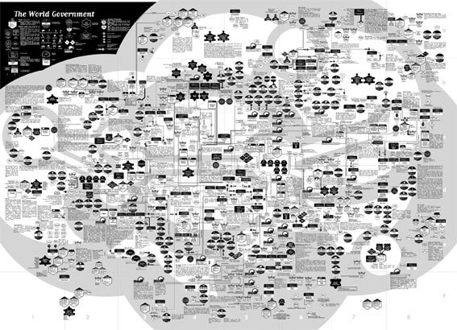
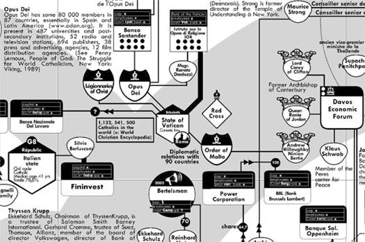
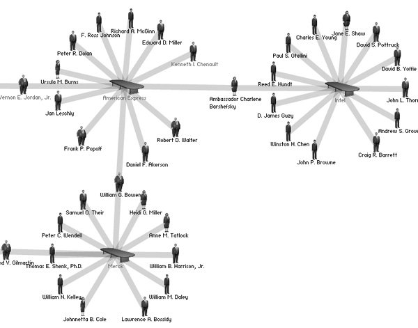
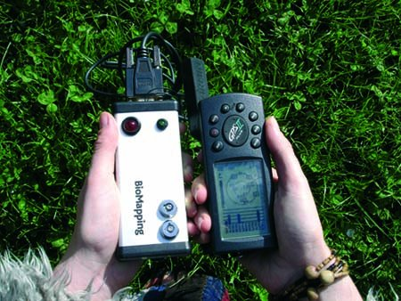
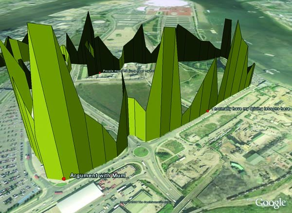
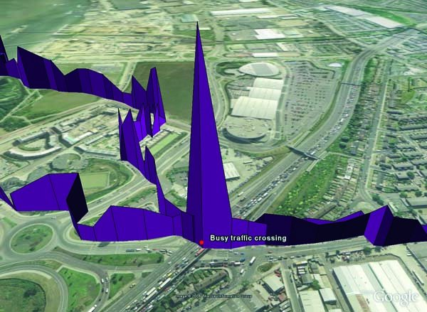

> ‘What terrifies you most in purity?’ I asked
>
> ‘Haste,’ William answered.
>
> —Umberto Eco, *The Name of the Rose* {#para2}

### Introduction

Every entity, be it human or non-human, leaves traces as it struggles against entropy. Whether an entity’s existence is projected as being, becoming, or having, it inevitably involves a spatial locatedness. That is, it can be approached as a thing leaving spatial traces, or annotations, which in turn can be observed, or tracked. Even the journey of the smallest grain of sugar, from a plant in a plantation to a human sensation in a morning coffee, is a spatial phenomenon of mind-boggling complexity, involving an enormity of *other* entities. Until very recently the banality of this realisation served no further purpose, as all those *other* entities and the logistics of their relations receded in an invisible and mute background, never to be found again. While a mute and invisible background is a simple matter of fact (or a pure externality as economists term it), a visible locale endowed with a multitude of voices becomes a matter of concern not to be ignored. {#para3}

The emerging practices of locative media mapping have been preoccupied with re-approaching spatiality as the locale of heretofore unseen relations and transforming it from a matter of fact to many matters of concern, sometimes at the cost of great controversy. Whenever independent or corporate-funded locative media projects utilise network techniques to map entities, collectives or locales, they expose hitherto hidden or ignored logistics and relations. However, more often than not, they are met with critique ranging from accusations of sell-out to naiveté regarding the dangerous implications of tracking and annotation. All new media mapping projects[1] attempt to trace network entities in one way or another, yet the controversy starts when the movements of those entities, or their lack, become visible. {#para4}

This article suggests that two divergent approaches to space (*spatial projections*) would condition differently the entities perceived to form, or exist within, that space. In other words, the problem of movement can be depicted as a function of the spatial projection employed. It follows that an investigation of spatial projections would probably reveal the conceptual horizon of a mapping approach and the types of entities visible to it. Therefore this text constructs the arguments around locative media as originating from two divergent spatial projections, resulting in two forms of mapping: one for which a map is always an extraction from or a revealing of spatiality (*unveiling*), and another for which a map is always an addition to a process of performing spatiality (*attaching*). Projects from locative media and counter-cartography are used to illustrate those positions. {#para5}

In particular, the article argues that a spatial projection approaching networks as a priori homogenous topoi makes itself blind to the entities and logistics performing the *effect* of homogeneity. It is suggested that the mapping approach resulting from this spatial projection tends to display spaces of total convergence and homogeneity, a depopulated landscape of subjects and things without attachments. It is argued that the alternative projection would approach spatiality as a performative effect, therefore repopulating the resulting maps with all the entities and attachments involved in the performative process. The article concludes that when a spatial projection allows the tracing of the logistics of performativity, it may see little but see it very well. It suggests that perhaps the controversy around locative media can subside only when mapping efforts concentrate on tracing the intensities of performativity, rather than mistaking its effects for an already present context. {#para6}

### Spatial projections

Proponents of Actor Network Theory (ANT) such as John Law (2002) and geographers such as Nigel Thrift (1996) have long argued that there are two basic approaches to space. One sees space as a container pre-existing the entities within it, and can be recognised as the projection familiar to Euclid, Descartes and what – for lack of a better word – could be termed as “the common sense opinion”. Space here plays the role of a referential context – each entity within it is a priori defined by its reference to the spatial context – serving as an absolute determinant of the relations performed within. In other words, space is viewed as always primary to any relations that might be observed. The second approach in turn, sees space as a performative effect of the relations between entities, and could be described as the projection familiar, for example, to many indigenous peoples, to the special theory of relativity, and to some academics in the social sciences. For this projection, entities and their inter-attachments come first, and space comes second. In other words, the relational attachments between entities perform the space, not vice versa. While the first projection sees space as a static referential *context*, the second sees space as a dynamic relational *effect*. {#para7}

The two projections result in wildly divergent approaches to spatial entities (subjects and things), their movement, and the traces they leave. The former projection produces imagery preoccupied with a totality where convergence and inter-linking are taken as the natural state of affairs,[2] while heterogeneity and autonomy are rare flowers to be explained and tended. The latter projection in turn produces imagery unable to see beyond the local (even if it seems to represent something global), where convergence is a rarity to be explained, autonomy from attachments does not exist, and heterogeneity is the rule. {#para8}

For the former spatial projection, a map represents relations *in reference* to a context, which is, for example, an already existing politics or an a priori topos. For the latter in turn, a map is a tracing of the relations performing the politics or the topos, which in this case is not an a priori context but an effect of performativity. The only movement that the former projection can detect is the referential jump from an object to its context, while the latter in turn sees all manner of circulations and shifts being performed by, and in their turn performing spatial relations. In other words, the difference between the two spatial projections is best observed in the types of moves they are able to see and display. {#para9}

The former projection is capable of detecting a referential movement from an object to a frame, which I term as *unveiling*, because it aims to display the hidden context *in reference to which* an entity is defined. The latter in turn captures something akin to a relational movement between circulating frames, which I term as *attaching*, because – contrary to displaying a reference to a context – it produces an interface between two forms of circulation. {#para10}

### Mapping as unveiling

The increased importance of cartography for new media practitioners and various critical approaches to modernity is connected to the effects of information networks on representations of space and time. The unprecedented ability to map various topoi (and spatial relations) stems from the proliferation of fluid information networks, which multiply and perpetuate both traces of and potentialities for tracking and annotation.[3] Yet simultaneously the fluidity of these networks makes network maps less and less stable. The more traces and annotations there are, the less explanatory and revealing maps seem. Efforts at mapping networks of power concentration seem to be the hardest hit by this paradox. Finally there are tools available to uncover, map and display the doings and dealings of the powerful, but, somewhat counter-intuitively, efforts to map network structures of domination are not really effective.[4] {#para11}

Obviously the circulation of entities within those networks is too fluid for the projection, and therefore the resulting map is too poor an interface to assess the relations of those in power. It is, again, a problem of movement. It is my contention that this problem is generated by the inability of the cartography of unveiling to see, or even look for, the logistics of performativity. It constantly mistakes barely stabilized effects for total contexts and so makes itself blind for the entire range of actors, intermediaries and mediators who produce those effects.[5] {#para12}

Two examples of what I term *mapping as unveiling* are provided by the range of cartography projects of *Bureau d’Etudes*,[6] and Josh On’s *They Rule*.[7] *Bureau d’Etudes* is a collective producing a series of mapping projects, aiming at charting and exposing hidden structures of global power and domination (see figures 1-2). *They Rule* in turn, is an interactive database mapping tool on the web, created by Josh On, and visualizing the links between the ‘old boy’ communities of corporate America based on membership in Fortune 500 boards of directors (figure 3). {#para13}

 {#para14}

Both projects can be characterized by the epistemological outlook that networks have become the dominant structures of power, and that this power is largely invisible (Holmes, 2006a: 20). Furthermore, their epistemology leads them to see network mapping either as critical and dissenting or as established and dominant (Holmes, 2006a: 20). As Brian Holmes argues, the objective and aesthetics of dissident cartography is to dissolve social hierarchies ‘by a deliberate twisting or counter-application’ (Holmes, 2006a: 22) of network technologies against the instrumental logic of the established cartographies. {#para15}

This goal is believed to be achieved with the help of both static network maps and dynamic energy diagrams which respectively display structures of network power and show potential openings for action. The projection takes it as an a priori condition that there is a “normalised” and “dominant” way to use maps, which, according to Brian Holmes, produces maps of domination and power. Concomitantly, the mirror opposite of the “normalised” use is the autonomous practice, which through an exercise of Situationist detournement re-appropriates the tools of power. The counter-cartographers in this scenario are believed to “denormalise” the predominant order ‘with the very tools that consolidate the control society’ (Holmes, 2006a: 25). {#para16}

Meanwhile, the established and dominant cartographies and the global networks represented by them are seen as forces of imperial infrastructure. When presented with this totalizing formation, the counter-cartographer’s goal is ‘an inscription of the individual, a geodetic tracery of individual difference’ (Holmes, 2004). The role of mapping in this epistemology is to locate a subject who has been lost in Manuel Castells’ “space of flows”, and to allow the subject to regain her capacity to act and struggle. This is achieved, as Holmes theorises, through the “twisting” and “denormalising” of the established attachments so as to free the subject (and the thing) from links of domination and position her in a state of pure autonomy. Therefore at its deepest level the cartography of unveiling is in a two-pronged search, on the one hand for a subject-identity and on the other, for knowledge that will bring empowerment and the ability to act. Its goal is nothing less than ‘to go beyond representation, to rediscover and share the space-creating potentials of a revolutionary imagination’ (Holmes, 2003). {#para17}

Accordingly, after all the attachments of dominance have been cut away, the subject is supposed to establish a relation to the a priori spatiality now free from instrumental logic. In this epistemology, the subject is presented with a total space, alone and without attachments or intermediaries, while the goal of mapping is to constantly capture this totality.[8] ‘The force of these maps is in any case to represent a totality which demands specific analysis in order to grasp its potential to function as a whole’ (Holmes, 2006b). Perhaps this epistemology is borne out of the belief in a logic of total surveillance (Manovich, 2006), permeating an equally total imperial infrastructure and demanding an appropriately total alternative? {#para18}

Indeed, some theorists would go as far as suggesting that the instrumental logic supposedly permeating those networks of domination and control ‘accords strategic primacy to space and simultaneously downplays time’ (Fusco, 2004). Accordingly, practices of locative media, examples of which will be discussed below, are accused of succumbing to the logic of homogeneity because of their interest in all kinds of topologies, which, after all, according to the cartography of unveiling, are always-already under the spell of total domination.[9] In her critique of locative media, Coco Fusco directly suggests that the very act of viewing the world as a map ‘eliminates time, focuses disproportionately on space and dehumanizes life’ (Fusco, 2004). {#para19}

By adding ‘to the studiable and modifiable skein of means to achieve powers, an un-studiable, invisible, immovable, homogenous world of power in itself’ (Latour, 2004a: 225), this projection simply re-inscribes an a priori state of convergence and homogeneity to each and every mediated interface to the world. By substituting the heterogeneous and messy rhizome of modifiable effects for a pure homogenous context the cartography of unveiling commits the sin of haste and overlooks all those others, all the mediators performing the attachments it is so impatient to denounce and severe. {#para20}

In addition, it is important to find out how these so called “networks of power” operate. There seems to be an underlying assumption that a network structure is a homogenous, static and total topos, which contextually by itself enables all subsequent claims of action. All the branches of a messy, heterogeneous rhizome are a priori expected to lead to a common referential root. When looking at the *They Rule* or *Bureau d’Etudes* maps one could ask, {#para21}

> What if we introduced a suitcase of money into this structure? Which path might it take? With path shown, would we have to redraw the map, perhaps fade out some nodes or remove them? Once the map is redrawn continually, “structure” (in the historical sense) may or may not emerge. We may or may not have history “layers” to turn on an off (Rogers, 2006).[10] {#para22}

More importantly, how do we know what is the intensity of the links, who and what performs them, how many mediators, how many intermediaries, at what cost? The unveiling epistemology cannot afford to display such detail, because if it does, it will not deal with a totality anymore. Instead of dealing with a totally homogenous imperial infrastructure it will have to deal with unstable techniques.[11] {#para23}

> We now understand why critique, whether high-brow or popular, cumbersome or miniaturized, costly or cheap, brave or facile, sees nothing but lies everywhere. It still longs for a full, wholesome reality and finds only strands, paths or channels that it doesn’t know how to follow, objects that it can’t see how to fathom, stumbling at each step on the same abysmal distance between words and things, past and present (Latour and Hermant, 2006). {#para24}

The unveiling impulse leads to maps from the top down, ‘attempting to understand the systems they represent from above or from the outside’ (King, 2006: 49). The image produced by such an epistemology is probably best illustrated by a dialogue from the English TV series *Blackadder* in which the character ‘General Melchett’ looks at the back of a war map, erroneously thinking it is the actual image, and exclaims: ‘God, it’s a barren featureless desert out there, isn’t it?’ (Shardlow, Fletcher and Boden, 2002). {#para25}

The cartography of unveiling is willingly blinding itself by occluding the entire process of summing up, stabilizing and upholding a rhizome. Unfortunately, by occluding this process for the sake of constantly presenting a total view, it ends up presenting a view from nowhere. The maps of unveiling are similar to panoramas, in that they see *everything* from all sides, and yet, as panoramas they see nothing ‘since they simply *show* an image painted (or projected) on the tiny wall of a room fully *closed* to the outside’ (Latour, 2005: 187). {#para26}

> There is no way to “be” simultaneously in all, or wholly in any, of the privileged positions structured by gender, race, nation, and class. The search for such a “full” and total position is the search for the fetishized perfect subject of oppositional history (Haraway, 1991: 22). {#para27}

However, network situations and identities are never stable enough to fit the straight and totalizing roles prescribed to them by a cartography of unveiling. To the contrary, the entire system of constantly re-deployed techniques holds together not one homogenized mass but a plethora of differences. The effort of mapping should be precisely to avoid homogenization, to avoid the appearance of “the masses”, and instead look for the tiny conduits along which an *image of the masses* flows. Arguably the cartographer does not unearth the occult connections between power networks, but, to the contrary ‘it is the format of the map that (dramatically) organizes these networks’ (Rogers, 2006). {#para28}

Instead of searching for the subject without ties (Latour, 1999), or for the Heideggerian Ding,[12] isolated in their purity of being free from attachment, perhaps what is needed is a concept of mapping agency (and identity) that opens up possibilities for finding connections within social worlds where actors always fit oddly, at best. If there is a totality, it does not present itself as a fixed frame, as a constantly present context. Instead, ‘it is obtained through a process of summing up, itself localized and perpetually restarted, whose course can be tracked’ (Latour and Hermant, 2006). {#para29}

Therefore if new media cartographers agree that the goal is to map difference, trace heterogeneous attachments, and annotate desire, perhaps it is necessary to be blind to all totalities while being attuned to the moves of all those *others* who produce the difference, attachments, and desire. {#para30}

### The problem of movement

As Bruno Latour argues in an influential essay on formalism and time (Latour, 1997), the difference between spatio/temporalities does not lie in an illusionary bifurcation between domination and autonomy, but in the intensities of performative spacings and timings. These intensities are a function of the relation between the two simultaneous vectors of transportation and transformation. Latour illustrates this relation with the example of two travellers, one sitting comfortably in a bullet train, the other hacking her way through a jungle. Both travellers move, yet they exist in radically different spaces and times. According to Latour, that is because while the first is transported without any visible transformation, that being in turn delegated and handled by a large support network of rail institutions, electrical power stations, technicians and machinery, the second traveller undergoes transformations with every step. While she has to undergo a series of transforming trials provided by the wilderness of the jungle, the former traveller can revel in the effects of a seamless flow of speed.[13] {#para31}

What differentiates the flow of the train passenger’s movement from the discrete spacings of the jungle-explorer is not some fundamental difference between the “domination” techniques employed by the former and the “autonomous” living body of the latter, but the intensity, the ratio of transformation-to-transportation resulting from their movements. It is, accordingly, these intensities, which produce the timings and spacings, and not the other way around. The effect of speed is therefore the result of how much transformation an object undergoes during the trial of transportation. If the network transporting it is stable enough and allows someone or something else to transform instead, then the effect of seamless transportation without transformation occurs. The speed and seamlessness of internet flow is precisely such an effect (Celletti, Leong, Mitew and Pearson, 2008). {#para32}

Latour’s argument can be illustrated otherwise through the famous Königsberg bridge problem, and Leonhard Euler’s solution to it (Biggs, Lloyd and Wilson, 1976).[14] Time, the event as duration, was flattened by Euler into a series of spatial relations distinguishable in just two variable states – nodes and edges (Andrasfai, 1977). Edges designate an action, a movement from one spatial end-state to another. However, movement through what and at what cost? This question exposes an illusion of movement through a container-like Euclidean space, of transportation without transformation. Once such a container-like space is taken for granted, then every quality with which one chooses to endow it gains a total presence. Moreover, all types of movement in this space become unproblematic because they bear no costs. {#para33}

As long as one does not need to negotiate countless mediators, to account for transformations, to exhaust resources in upholding a network, one’s movement consists of rapid zooms, of revolutionary jumps. As an example, picture the manoeuvres of an army. For the performative projection, an army would seem as the rare effect of long and perilous logistical chains which have to be tended and repaired, while for the cartography of unveiling an army would resemble some fantastic entity consisting of lightning-fast avant-gardes, pure domination free from any attachment. The cartography of unveiling takes a rare effect for an unproblematic and a priori homogeneous given, thus obfuscating an entire world of spatial complexities. However, the logistics of transportation *and* transformation become visible only through a projection attuned to the performativities of movement. {#para34}

When one wants to see a panorama of a series of bridge crossings, to create an imaginary observation point, one has to perform a magic trick similar to Euler’s: flatten time into its surface-plaits and pretend for the sake of the panorama that the entire projection is somehow a purely spatial, topological phenomenon. This means that any and all visualisations of network space produce a summing-up, an un-folding to some extent, of what is a purely relational performance of attachments. As long as it is remembered that what is seen is the effect of a trick of projection, one is safe. However, when pushed to a ludicrous extreme this effect gives birth to illusions of panopticon and total convergence, and allows mistaking a rare effect of relationality – the appearance of an always local referential frame, for a main feature of the projection. {#para35}

Therefore mapping networks has to be thought as the inscription of movement *qua* transformation. The reification of presence and absence, which the cartography of unveiling first takes for granted, and then sees as the emanation of a new form of control, is in fact the *effect* of the process consciously undertaken by Euler, to trace a particular movement, to perform it spatially in a cascade of surfaces. Why this spatial performance of temporality? Without it one is blind to transportation *and* transformation. If you want to see the crossing of multiple bridges *at once*, you have to transform them from stone, water and humans into dots and lines, and then transport them into a room on a sheet of paper where you can finally see them all. This process of summing up however has to be understood as such, and never mistaken for an emanation of homogenous instrumental logic. {#para36}

When Michel Serres humorously refers to air travel by quipping ‘my address is A340; DJ298; 14F’ (Serres, 1995: 64) he alludes precisely to this process. Passengers in airplanes are a good example of the relational and performative nature of spaces and charts; again, the key to a map is in movement. A transportation lasting only a couple of hours and virtually no trials, will take days and a multitude of trials if undergone on foot, outside of the networks of circulation whose tiny interfaces produce addresses such as 14F. Therefore the question of importance concerns the logistics permitting circulation without transformation (Latour, 1987: 237). At no point should one take immutability and homogeneity for an always-existing granted framework. Once we direct our studies in this direction we see actors, intermediaries and events which otherwise would always already be hidden from us. {#para37}

When we compare an airplane passenger and an intrepid explorer using her own two feet to cross the same distance, we are not comparing two *subjective* perspectives of time-space, and neither are we comparing two *objective* displacements *through* time-space. Instead, the difference is between the amount and intensity of other members of the assembly involved in the displacement. In the case of the airplane passenger those others are stable and invisible intermediaries involved in a constant offsetting of the transformation that is being generated by the displacement – that is why the passenger located at 14F is steeped in the boring and uneventful time of airline food, the murmur of the couple in the row behind and the distant buzzing sound of the engines. Not so the intrepid explorer whose every step is a trial defined by mediators with their own terms. {#para38}

If we start tracing and mapping what allows and upholds the uneventful trip of passenger 14F, we will discover international agreements, standards, time zones, bureaucracies, humongous technical assemblages, corporations, oil rigs, refineries, ships, little humans with flags running on the tarmac of airports, infrastructures, radio towers and so on and so forth. These are the long and perilous logistical chains from the army example used earlier. {#para39}

The smooth ride of passenger 14F gives the illusion of time and space that are fixed and container-like, and from this flows out the perspective in which mapping functions as either a simple measurement of homogeneity, or as its radical detournement. Meanwhile, the travails of the intrepid explorer, her constant negotiation with mediators, leave the taste of a lived time and populated colourful local space – in rapid contrast to poor 14F who can only think of herself as an individuality diminished to a mere number. If these conclusions were someone’s starting point, then instruments, clocks, and maps start looking like unnecessary additions to, or hegemonic extractions from, an already fully-formed and lived time and fully immanent space. Yes, the airplane passenger is steeped in sameness, while the explorer has to deal with nothing but difference, yet those are caused by the qualitative and quantitative relations between intermediaries and mediators. It is entities acting as mediators that make the space-time homogenous or not, and it is them that our mapping has to trace and annotate. {#para40}

Only a mapping tactic that opens its eyes for the intensities performed by heterogeneous entities, neither subjects nor objects, will be capable of displaying the full spectrum of logistics upholding an otherwise impossibly ephemeral homogeneity. How to approach mapping through complexity, uncertainty, and flux while retaining the capacity to trace, annotate, and know? More importantly, how to approach it *without haste*? {#para41}

### The thread of Daedalus

Perhaps the most legendary map ever made, in both senses of the word, was the one given by the mythical master-craftsman Daedalus to Ariadne, helping the Athenian hero Theseus escape the labyrinth and kill the Minotaur. When Ariadne, in love with Theseus and condemned to die in the maze, asked Daedalus, builder of the labyrinth, for help, he gave her a ball of thread. He did not give her a parchment with a plan of the labyrinth carrying a big red sign ‘and here is the EXIT’, but a simple thread. The thread is crucially a method for tracing and annotating space, both dynamically in real time, and slowly, that is taking account of every step and every turn. It opens potentialities for action and is a storage technique allowing the retracing of past movements through space. The thread is an interface for accessing space *and* time, transportation and transformation. Following a thread is slow, but it is the only way to track and represent spatially (and temporally) all topological shifts of the actor. {#para42}

The trickery of Daedalus leads to a different conceptualisation of a map – not as a static representation of spatial power relationships, or a hegemonic extraction of difference, but as an interface for the construction of agency in space. The moment one shifts from representations of total power to the construction of local agency, the cartography of unveiling becomes absurd. As a result, however, the cartographer finds herself surrounded by actors and intermediaries she was never able to see before. The shift could be traced directly back to the two divergent spatial projections described in the beginning of the article. The thread of Daedalus leads to a performative conception of space and movement. ‘We create space in the process of travelling through it and in creating narratives of journeys we simultaneously construct knowledge’ (Turnbull, 2002: 133). {#para43}

### From knowing space to spacing knowledge

Such a performative understanding of spatiality is not limited to the locative media projects described below, and has indeed been observed by anthropologists in recent discussions of indigenous wayfinding (Ingold, 2000; Turnbull, 1991, 2000). Being in the world entails movement, and movement entails knowing and performing the surrounding spatiality: {#para44}

> In wayfinding people do not traverse the surface of a world whose layout is fixed in advance (…) Rather they “feel their way” through a world that is itself in motion, continually coming into being through the combined action of human and non-human agencies. I develop a notion of mapping as the narrative re-enactment of journeys made, and of maps as the inscriptions to which such reenactments may give rise (Ingold, 2000: 155). {#para45}

The performative approach to space appears first as the granting of powers of spatial enactment to entities, and second as the readiness to perceive the multiple forms of spatiality emanating from the formation and circulation of objects. In other words, first one needs to have a projection allowing entities to perform spaces, and second to be able to trace the movements of entities through various spatialities. Admittedly, while some relations would be well understood within the confines of Euclidean space, and others within the confines of network space, still others would be visible only through the juxtaposition of various spatial projections (Law, 1999: 3). As John Law argues, the process of performing an entity appears to be also the process of performing its spatial protocol of movement – what he terms as ‘spatial conditions of im/possibility’ (Law, 2002: 92). These conditions concern the formatting of movement in space, the protocol of im/possible shifts that an entity can perform in the process of its spatial travails.[15] {#para46}

> One can no more know in places than travel in them. Rather knowledge is regional: it is to be cultivated by moving along paths that lead around, towards or away from places, from or to places elsewhere (…) all knowledge systems including science are integrated laterally rather than vertically (…) we know as we go, from place to place (Ingold, 2000: 229). {#para47}

Therefore, and this is an important element of the argument, movement is the component allowing to register the variation between transportation and transformation, while simultaneously performing the entire texture, or setting, of displacement. This simultaneity could be thought of as the cause permitting the double move of tracing and annotation.[16] When we move, we perform the surrounding spatiality, that is, we annotate the space with a performative presence, while simultaneously the spatiality performs us, by constraining and channelling our movements and assembling potentialities of attachments, thus allowing a tracing and subsequently knowing. Knowing, and mapping is after all an interface to spatial knowledge, is therefore deeply attached to moving through space, to spacing.[17] {#para48}

For example, the Ongee tribe from the Andaman Islands bases its entire navigation skills and spatial knowledge on performative movement rather than fixed locations (Pandya, 1990: 793). The topography of their territory does not exist for them as an a priori context waiting to be explored, traced and annotated, a total referential frame to which they can relate, but literally emerges through the practice of movement. Their maps are {#para49}

> not of places in space but of movements in space. Movements from one locality to another and the sequence in which movements are accomplished become direct representations of changes in places in a space. For the Ongee, movement alone defines and constructs space: space does not define and construct movement (Turnbull, 2002: 136). {#para50}

In other words, similarly to one of the two spatial projections described at the beginning, they see space as a performative effect of the relations between entities. Furthermore, a spatial projection capable of detecting the intensities produced through movement would not make an a priori ontological difference between the networks of command and control supporting global corporations and the complex travails of indigenous fishermen. Similar to the scenario of the airplane passenger and the jungle explorer, the difference between control networks and Ongee fishermen is not one of pure concentrated domination versus pure autonomy, but one of ratios of transformation to transportation, immutability to displacement. Networks of command and control are much more stable than the networks of the Ongee not because of some inherent instrumental logic, but because they enrol an immensely larger number of immutable mobilities, the cost of whose circulation in turn is offset by yet *other* performative relations. {#para51}

### Mapping as attaching

Therefore the essential starting point of a cartography of attachments is that ‘if space is performative, it has a history, and if knowledge is performative it is spatial’ (Turnbull, 2002: 137).[18] This approach, although it relies on the tracing and performing of multiple attachments, does not preclude the emergence of a general picture, a “big map”, but reaches it through as many heterogeneous paths as possible. In performing and imagining different spatial settings, ‘it allows far more differences to be explained than when a single meta-narrative is applied after studying just one of them’ (Martin, 2005: 299). {#para52}

The cartography of attachments would see maps as inscriptions on space, as extensions and stratifications of space (Tuters, 2005). This realization applies especially to the technique of the grid: for the cartography of unveiling the grid is a hegemonic extraction of instrumental logic out of lived space, it is the symbol of domination; for the cartography of attachments, however, the grid is simply an architectural convention, a negotiation, an agreement.[19] {#para53}

> In order to bring the distant and the large to your table top you need perspective geometry, reproducible and combinable representations, a grid and the agreement of your fellows (Turnbull, 1989: 26). {#para54}

The grid does not mark the frame along which the individual moves, and neither is it an interface for referential relations of power and domination: it is simply ‘the interface between two forms of circulation’ (Latour and Hermant, 2006). That is, it is the interface between at least two different spatial performativities. Yes, it simplifies, but that is also why it allows augmenting and performing spatialities we could not imagine before.[20] {#para55}

The complexity of this projection brings the realization that rather than fighting an illusionary “imperial grid” new media cartographies need to rapidly multiply interfaces for accessing and tracing performativity, they need matrices for accessing spatial semantics.[21] ‘What there is high up there, underneath and everywhere are intensities looking for expression’ (Rolnik, 2005). {#para56}

In the context of convergence, and new media approaches leading towards or away from it, one could argue that for a projection capable of tracing the logistics of spatial performativity, convergence would always constitute a rare effect rather than a predetermined Omega point or a stable equilibrium. Nothing, of course, prevents new media projects from deriving a total image of a performative topos; it is still useful after all, to see a setting from all sides, but it should by now have become obvious that this is an *effect* achieved because ‘we are inside a room in which the illusion is mastered, and not outside’ (Latour and Hermant, 2006). In other words, if a map is total, it is because it is very local. If it unveils, it should be understood that it unveils very little, if it discovers a context, this context is very small and circulating along paths one needs to trace. Tracing the modalities of an entity allows establishing the logistics behind a setting, that is, not only its locale, and not only who or what belongs, but how the entire assembly changes in time, what transformations does it undergo under trials during movement. {#para57}

If the cartography of attachments approaches performative space through a particular prism, it is as an interface. Maps then would not be viewed as representations of space, but as ways to open an interface – just as Daedalus’ thread opened up the labyrinth for Theseus. This projection allows realising that homogeneity is so rare, so expensive, and so hard to stabilise, that it needs to be explained. {#para58}

> If it is no longer a question of opposing attachment and detachment, but instead of good and poor attachments, then there is only one way of deciding the quality of these ties: to inquire of what they consist, what they do, how one is affected by them (Latour, 1999). {#para59}

In fact, taking spatial homogeneity for granted would in most cases amount to blinding oneself to all the difference percolating and performing the topos.[22] Annotating and tracing simultaneously, the cartography of attachments allows thinking space and time, knowledge and the body, as one continuous percolation.[23] {#para60}

> every room has an accessible history
>
> every place has emotional attachments you can open and save
>
> you can search for sadness in New York (Russell, 2003) {#para61}

One example of what this article means by cartography of attachments is provided by the work of Dutch location-media artist Esther Polak. In her *Amsterdam Realtime* (AR) mapping project several inhabitants of Amsterdam carried PDA’s (personal digital assistants) with an embedded GPS (global positioning system) receiver that traced their movement in the city in real time over a number of weeks.[24] Their movement literally aggregated and performed the city in real time, or in other words, provided a glimpse at just how different a spatiality Amsterdam presents to a taxi driver and a student. AR also demonstrates how a network extends surfaces into time; it allows time and movement to become a series of surface traces in an ever-expanding present of cohabitation. It shows maps as interfaces between knowledge and experience (van Weelden, 2006: 26), memory and potentiality. {#para62}

The *MILK* project, a collaboration between Esther Polak and Latvian artist Ieva Auzina, used GPS to trace the actors involved in the production, transportation, and distribution of cheese.[25] The main actor, cheese, undergoes a series of transformations in its movement from grass, to milk, to cheese, and *MILK* manages to account for all of them. From a Latvian farm, to a local factory, a truck on a long road, a Dutch cheese warehouse, an Utrecht market, and finally the plate of a particular human, the spatiality is performed through movement and transformation on the part of all participants. Instead of the invisible space of flows of global capitalism, we have the fragile journey of milk in which cheese is the main actor and every human is an intermediary. There is no social, technical or natural space here; there is only the circulation of actors and attachments which the project traces, while never losing sight of the intermediaries and mediators performing this ephemeral yet stable spatiality. {#para63}

The action in this cartographic exercise is brought in by the intermediaries. Remove the intermediaries and one ends up with a Borges map.[26] Trace what mediates, who attaches and how many intermediaries there are, and the resulting map becomes a mediator for the construction of agency in space. {#para64}

Another example of mapping the performance of spatiality is provided by the *Real Time Rome* (RTR) project created by the MIT SENSEable City Lab as a contribution to the 2006 Venice Biennale.[27] The project aggregated data from cell phones, buses and taxis in Rome to trace dynamically and in real time the intensity and rhizomatic topology of human locatedness in the city. The essence of RTR is movement characterized by the visibility of the intensities of transformation and displacement. {#para65}

> The more network mapping tells us about connectivity, the more we find we are actually studying versions of metadata. Network mapping tells us that connectivity is not virtual at all (van Weelden, 2006: 29). {#para66}

Approaching spatiality as a performative process also allows tracing topologies of desire and affect. For example, Christian Nold’s *Biomap* project performs topology as an emotional plait. It consists of a tool recording the Galvanic Skin Response (a handheld indicator of emotional arousal) and the GPS location of the person wearing it.[28] This allows charting a map of individual and collective emotions and desires in space. *Biomap* shows that space is always also performed as affect. It demonstrates that ‘a map is not a copy of a space but a way of opening up space through information’ (van Weelden, 2006: 28), it is a way to add potentialities to space (Figures 4-6). {#para67}

Another observation suggested by the Ongee fishermen example is that perhaps we in the West have grown accustomed for too long to read space as a grid of latitudes and longitudes, while forgetting how this compromise came to being, and why.[29] Critical approaches to mapping have tirelessly searched for a lived, performative space, free from the homogeneity and domination of Cartesian projections, while simultaneously forgetting that the topoi surrounding us have never stopped being lived and performative. There is no dialectic of instrumental flows and lived places – just circulations of attachments, all the way up and down, opening potentialities in spatial interfaces. The cartography of attachments shows spaces as negotiated alliances around which rules of cohabitation spring up; it creates an image {#para68}

> whose aesthetics can be said to rely upon a range of characteristics ranging from the quotidian to the weighty semantics of lived experience, all latent within the ground upon which we traverse (Bleecker and Knowlton, 2006). {#para69}

Unlike state maps, annotated with “official” points of interest, or unveiling maps upholding a dialectic of domination and oppression, these immersive maps permit users to inscribe space on their own. The focus of this cartography is the production of space; in it maps are inscriptions on, extensions and stratifications of space. They are preoccupied with the tracing of associations of attachments, and therefore the more centred they are on the individual actor as a “producer of space” the better.[30] {#para70}

### Conclusion

It is the “producers of space”, or “knowing locations” as John Law terms them, already long ago declared lost in networks of flows and timeless time, which locative media is preoccupied in finding. True, ultimately, that is the goal of counter-cartography as well. However, as I argued, what differentiates the two practices and justifies the dichotomous relationship between *mapping as unveiling* and *mapping as attaching* are the spatial projections within which they operate. The positing of a homogeneous and a priori spatiality obfuscates the entire field of attachments, which conspire to produce the *effect* of homogeneity. This article hoped to demonstrate that the cartography resulting from such a projection has all the characteristics of a panorama, which *displays* everything and yet sees nothing. {#para71}

Furthermore, by juxtaposing two spatial projections and the mapping approaches they effect, this article does not suggest that counter-cartography is not critical enough and in need of an even more autonomous “new critique”. On the contrary, it argued that the problem originates with the spatial projection that sees only totalities in need of unmasking, rather than effects in need of tracing and explaining. It was argued that this stance is a priori incapable of perceiving that homogeneity and domination are not a context out of which the individual in search of autonomy has to extricate herself, but, to the contrary, are a rare and ephemeral effect of an aggregate that has to be constantly upheld. {#para72}

The most serious problem with this projection is that – while reifying presence and absence – it makes it impossible to see, trace, and understand how spacings are produced, how difference emerges and recombines itself in the networks of circulation we have been always building. While taking rare effects as always present givens, it blinds itself to the enormous heterogeneity of the world outside. When it encounters global networks of command and control, it would always find it hard to explain the cost of exercising stability and would instead take them for granted features of the landscape to be traced and eventually resisted. After all, if connectivity and convergence are taken as an a priori state then stability is a one-off expense. {#para73}

Indeed, the haste to which the opening quote alludes has nothing to do with speed, or time and similar banal associations, and everything to do with the iconoclastic impulse impatient for purity from attachments, which makes itself blind to the richness and complexity of the world, so as to be able to perceive everywhere only the caricature dichotomy of autonomy and domination. {#para74}

The cartography of attachments in turn was found to display very little but to see it well, because it allows tracing the logistics of performativity, that is, the series of spacings involved in any given space. When tracing attachments one never encounters the subject or the thing alone; the thing, the slab of cheese, is always attached to humans, and so in an endless chain. It is my contention that new media cartographies can only hope to unlock the enormous complexity of network topologies if they literally repopulate their maps with the rich performativities of subjects never detached from things. Counter-cartographies can be successful, as I hoped to show, only when they stop mistaking the effects for already-present contexts and instead concentrate on tracing how, through what transformations, detours, assemblies, and alliances are those effects produced. Or, in the words of Bruno Latour: ‘the critic is not the one who debunks, but the one who assembles’ (Latour, 2004b: 246). {#para75}

## Author’s Biography

Teodor Mitew is finishing a Doctoral Degree in Internet Studies at Curtin University of Technology in Perth. His thesis analyses network politics from the perspective of actor network theory and the work of Michel Serres. He is also a trained historian with a Masters degree from the Jagiellonian University in Krakow. His research interests lie in philosophy of technology, science studies, history of ideas, and pragmatist philosophy.

## Notes

[1] A general term denoting mapping projects from locative media to Brian Holmes’ ‘counter-cartographies’ (Holmes, 2006a).

[back]

[2] As is to some extent suggested by Albert-László Barabási’s network theory. See his *Linked: The New Science of Networks* (2002).

[back]

[3] This is also the reason why surveillance has become such a thorny issue for locative media practices.

[back]

[4] As the political philosopher and new media theorist Noortje Marres observes with regards to network mapping: ‘the disruptive power of the exposure of these activities to the public, today seems especially low’ (Marres, 2003: 54).

[back]

[5] The importance of the logistics of performativity for understanding network assemblages has also been suggested by the work of geographer Nigel Thrift (1996; 1999; 2006), and urban sociologist Mimi Sheller (2001; 2004) among others.

[back]

[6] [https://utangente.free.fr/index2.html](https://utangente.free.fr/index2.html)

[back]

[7] [https://www.theyrule.net/2004/tr2.php](https://www.theyrule.net/2004/tr2.php)

[back]

[8] As philosopher of science Isabelle Stengers has argued, the belief in a total and homogenous spatiality (or power, with a capital letter) always transforms the rhizomes and networks into trees.

> [Each] branch is “explained” by its relation to another branch, one closer to the trunk, and, indeed to the roots, that is, to the site – occupied by a “logic” if not by actors – from which all the rest can be denounced as puppets, acted on beyond their intention and their plans (Stengers, 2000: 123).

[back]

[9] The argument between locative media and critical cartography has been raging for some time, with theorists from the latter camp accusing locative media projects of nothing short of a “sell-out”. According to Mark Tuters and Kazys Varnelis, locative media projects generally fall under one of two mapping practices, ‘either annotative – virtually tagging the world – or phenomenological – tracing the action of the subject in the world’ (Tuters and Varnelis, 2006). I would suggest, however, that annotation and tracing amount to two sides of the same move.

[back]

[10] Richard Rogers is one of the founders of the Govcom foundation ([https://govcom.org/](https://govcom.org/)), creators of the Issuecrawler web-mapping software ([https://www.issuecrawler.net/](https://www.issuecrawler.net/)). The Issuecrawler is a link-analysis tool, which visualizes the entities performing a particular issue online.

[back]

[11] Perhaps the desire for a total autonomy from all attachments perversely results in imagining a total enemy against whom one can take a symmetrically total position?

[back]

[12] Heidegger’s dream of a thing (as opposed to objects) pure from the instrumental logic, supposedly pervading human technics (Heidegger, 1967; 1977).

[back]

[13] The problematic of stability through transportation is perhaps best captured in the concept of ‘immutable mobiles’ developed by Latour in his groundbreaking work *Science in Action: how to follow scientists and engineers through society* (1987).

[back]

[14] The seven bridges of Königsberg (then in Prussia, now Kaliningrad in Russia) connected two islands and the banks of the river flowing through the city. A popular pastime of the citizens was to find a route crossing all bridges exactly once. What started as a pastime became a famous mathematical problem only solved by Leonhard Euler in 1736, when he proved that such a route is mathematically impossible. His solution to the problem gave birth to graph theory and topology (and therefore the very concept of a network consisting of nodes and edges). Out of the infinite amount of spatialities performed by the citizens of Königsberg Euler focused only on the act of crossing a bridge, thus re-presenting the burghers’ morning walk as a linked series of nodes and edges.

[back]

[15] In the sense that, while an entity such as a car or a corporation remains stable in the network space of its internal relational composition, it simultaneously is mobile in *another* performed space (i.e. Euclidean). The ‘conditions of im/possibility’ to which Law refers, are in this case the result of relations between the spatialities occupied by an entity.

[back]

[16] This argument also applies to the illusionary dichotomy between mapping and being mapped. If knowledge entails movement then tracing (that is – mapping), and annotation (that is – leaving traces to be mapped), are the same manoeuvre viewed from two opposite angles. They both constitute Daedalus’ thread. This is not to exorcise the daemons of so called cartography of power, but to point out an entirely different way of understanding and performing spatiality.

[back]

[17] A similar understanding of performative spatiality has been developed in the work of architects Shusaku Arakawa and Madeline Gins. They develop the concept of a ‘landing site’ that simultaneously is performed by and performs the body (Arakawa and Gins, 1994, 1997). They argue that the body cannot be thought outside of its performative world, and a landing site ‘expresses the field of action connecting the body with space’ (1994: 14).

[back]

[18] Philosopher Adrian Cussins uses the notion of “cognitive trails” to express this spatiality of knowledge (Cussins, 1992). A cognitive trail is a technique to avoid the tired epistemological bifurcation into things and words; it is a ‘travelling account of understanding and representation that does not opt for an epistemological grounding in either of the two standard alternatives, thought or experience’ (Cussins, 1992: 654).

[back]

[19] The spatial aspect of knowledge can be illustrated through the mnemotechnical invention of Simonides of Ceos, also known as *Ars Memoriae* (Kittler, 2002). It consists of imaginary locations (loci) tied to a particular memory. The act of remembering performs an architecture in order to retrieve a knowledge.

[back]

[20] The concept of ‘augmented space’ originates with Lev Manovich, who argues that information networks allow the transformation of physical space into a dataspace ‘extracting data from it (surveillance) or augmenting it with data (cellspace, computer displays). (…) Thus augmented space is also monitored space’ (Manovich, 2002). The cartography of attachments however would riposte that performative space has always already been dataspace (and thus monitored, annotated, traced, etc), and information networks finally allow us to see the traces of performativity better than ever before.

[back]

[21] McCullough calls this agenda a ‘situated semantics’ (McCullough, 2006), a piling up of annotated layers of space one upon another, thus both enriching performativity and allowing for better tracing of intensities.

[back]

[22] As in the *Interestmap* social network mapping software, whose creators quickly discovered that mapping “persons” gives much richer results than mapping “users” (Liu and Maes, 2005). Another example comes from the location-based game *Uncle Roy All Around You*, which combines street and online players while using an actual city as a canvas-in-performance (Benford et al., 2006).

[back]

[23] Or as the makers of another location-based game – *Asphalt Games* insist, ‘hybrid games such as ours acknowledge that spatial knowledge becomes social, and the social can become spatial’ (Chang and Goodman, 2006).

[back]

[24] [https://realtime.waag.org](https://realtime.waag.org)

[back]

[25] [https://milkproject.net/](https://milkproject.net/). *MILK* won the 2005 Golden Nica award at the Ars Electronica exhibition, and was also exhibited by Bruno Latour and Peter Weibel in their *Making Things Public* exhibition at ZKM (2005).

[back]

[26] Borges famously mocked the concept of mapping as representing space in his short story *On Exactitude in Science* (1975), describing an imaginary country whose scientists produced a map of its territory on a scale of 1:1. Naturally – since the map was such a precise representation that it actually was the territory – the citizens quickly realised that they might as well just follow the territory and ignore the map. Borges’ point was that a map is never a *representation of* but a *key to* a topos.

[back]

[27] [https://senseable.mit.edu/realtimerome/](https://senseable.mit.edu/realtimerome/)

[back]

[28] [https://biomapping.net/](https://biomapping.net/)

[back]

[29] On the epic, almost mythical, struggle to establish a stable technique of finding one’s relative position away from known locales, see John Law’s magisterial exploration of early European navigation (1987, 2001).

[back]

[30] In this context it seems somehow off the mark to critique locative media for their implications for privacy and surveillance, from a position based in a projection unable to trace those same moves, let alone lend itself to the risk of surveillance misuse. It is akin to first making oneself blind to the logistics of networks, and then reproaching locative media for being able to see and trace those logistics. Perhaps if locative media maps seem ambiguous and outside of the sterile autonomy domination loop, it is because the traces to be mapped are themselves ambiguous?

[back]

## References

Andrasfai, B. *Introductory Graph Theory* (Bristol: Adam Hilger, 1977).

Arakawa, S., and M. Gins. *Architecture: Sites of Reversible Destiny* (London: Academy Group 1994).

Arakawa, S., and M. Gins. *Reversible Destiny-Arakawa/Gins* (New York: Guggenheim Museum 1997).

Barabasi, A. L. *Linked: The New Science of Networks* (Cambridge, MA: Perseus Publications 2002).

Benford, S., M. Flintham, A. Drodz, N. Tandavanitj, M. Adams, and J.R. Farr. ‘The Design and Experience of the Location-Based Performance Uncle Roy All Around You’, *Leonardo Electronic Almanac* 14.03 (2006), [https://leoalmanac.org/journal/Vol_14/lea_v14_n03-04/roy.asp](https://leoalmanac.org/journal/Vol_14/lea_v14_n03-04/roy.asp).

Biggs, N. L., E.K. Lloyd, and R.J. Wilson. *Graph Theory 1736 – 1936* (Oxford: Clarendon Press, 1976).

Bleecker, J., and J. Knowlton. ‘Locative Media: A Brief Bibliography And Taxonomy Of Gps-Enabled Locative Media’, *Leonardo Electronic Almanac* 14.03 (2006), [https://leoalmanac.org/journal/Vol_14/lea_v14_n03-04/jbleecker.asp](https://leoalmanac.org/journal/Vol_14/lea_v14_n03-04/jbleecker.asp).

Borges, J. L. ‘On Exactitude in Science’, in J. L. Borges (ed.) *A Universal History of Infamy*, trans. N. T. de Giovanni (London: Penguin Books 1975).

Celletti, M., S. Leong, T. Mitew and E. Pearson. ‘The Question Concerning (Internet) Time’, *New Media & Society* (upcoming) (2008).

Chang, M. and E. Goodman. ‘Asphalt Games: Enacting Place Through Locative Media’, *Leonardo Electronic Almanac* 14.03 (2006), [https://leoalmanac.org/journal/Vol_14/lea_v14_n03-04/changoodman.asp](https://leoalmanac.org/journal/Vol_14/lea_v14_n03-04/changoodman.asp).

Cussins, A. ‘Content, Embodiment and Objectivity: The Theory of Cognitive Trails’, *Mind* 101 (1992): 651-688.

Fusco, C. ‘Questioning the Frame: Thoughts about maps and spatial logic in the global present’, *In These Times*, 16 December (2004), [https://www.inthesetimes.com/site/main/article/1750/](https://www.inthesetimes.com/site/main/article/1750/).

Haraway, D. ‘The Actors are Cyborg, Nature is Coyote, and the Geography is Elsewhere: Postscript to “Cyborgs at Large”‘, in C. Penley and A. Ross (eds) *Technoculture* (Minneapolis, MN: University of Minnesota Press, 1991).

Heidegger, M. *What Is a Thing?*, trans. W. B. Barton Jr. & V. Deutsch (Chicago: Gateway Books 1967).

Heidegger, M. *The Question Concerning Technology, and Other Essays*, trans. W. Lovitt (New York: Garland Publishing 1977).

Holmes, B. ‘Imaginary Maps, Global Solidarities’, *Piet Zwart Institute* (2003), [https://pzwart.wdka.hro.nl/mdr/pubsfolder/bhimaginary/](https://pzwart.wdka.hro.nl/mdr/pubsfolder/bhimaginary/).

Holmes, B. ‘Drifting Through the Grid: Psychogeography and Imperial Infrastructure’, *Springerin* 3.04 (2004), [https://www.springerin.at/dyn/heft_text.php?textid=1523&lang=en](https://www.springerin.at/dyn/heft_text.php).

Holmes, B. ‘Counter Cartographies’, in J. Abrams and P. Hall (eds) *Else/Where: Mapping New Cartographies of Networks and Territories* (Minneapolis, MN: University of Minnesota Design Institute, 2006a).

Holmes, B. ‘Flowmaps, The Imaginaries of Global Integration’, *Piet Zwart Institute* (2006b), [https://pzwart.wdka.hro.nl/mdr/pubsfolder/bhflowmaps/](https://pzwart.wdka.hro.nl/mdr/pubsfolder/bhflowmaps/).

Ingold, T. *The Perception of the Environment: Essays on Livelihood, Dwelling and Skill* (London: Routledge, 2000).

King, J. ‘The Node Knows’, in J. Abrams and P. Hall (eds) *Else/Where: Mapping New Cartographies of Networks and Territories* (Minneapolis, MN: University of Minnesota Design Institute, 2006).

Kittler, W. ‘The Dioskuroi: Masters of the Information Channel’, *Configurations* 10 (2002): 111-127.

Latour, B. *Science in Action: how to follow scientists and engineers through society* (Milton Keynes, UK: Open University Press, 1987).

Latour, B. ‘Trains of thought: Piaget, Formalism and the Fifth Dimension’, *Common Knowledge* 6.3 (1997): 170-191.

Latour, B. ‘Factures/Fractures: From the Concept of Network to that of Attachment’, *Bruno Latour resource site* (1999),

[https://www.ensmp.fr/~latour/articles/article/76-GB-RES.html](https://www.ensmp.fr/~latour/articles/article/76-GB-RES.html).

Latour, B. ‘Nonhumans’, in S. Harrison, S. Pile and N. Thrift (eds) *Patterned Ground: entanglements of nature and culture* (London: Reaktion, 2004a).

Latour, B. ‘Why Has Critique Run Out of Steam? From Matters of Fact to Matters of Concern’, *Critical Inquiry* 30.2 (2004b): 225-248.

Latour, B. *Reassembling the Social: An Introduction to Actor-Network-Theory* (Oxford: Oxford University Press, 2005).

Latour, B., and E. Hermant. *Paris: Invisible City* (2006), [https://www.bruno-latour.fr/virtual/EN/index.html](https://www.bruno-latour.fr/virtual/EN/index.html).

Law, J. ‘Technology and Heterogeneous Engineering: The Case of Portuguese Expansion’, in W. E. Bijker, T. P. Hughes and T. J. Pinch (eds) *The Social Construction of Technological Systems: new directions in the sociology and history of technology* (Cambridge, MA: The MIT Press, 1987).

Law, J. *Materialities, Spatialities, Globalities* (1999), [https://www.comp.lancs.ac.uk/sociology/papers/Law-Hetherington-Materialities-Spatialities-Globalities.pdf](https://www.comp.lancs.ac.uk/sociology/papers/Law-Hetherington-Materialities-Spatialities-Globalities.pdf).

Law, J. *On the Methods of Long Distance Control: Vessels, Navigation, and the Portuguese Route to India* (2001), [https://www.comp.lancs.ac.uk/sociology/papers/Law-Methods-of-Long-DIstance-Control.pdf](https://www.comp.lancs.ac.uk/sociology/papers/Law-Methods-of-Long-DIstance-Control.pdf).

Law, J. ‘Objects and Spaces’, *Theory, Culture & Society* 19.5-6 (2002): 91-105.

Liu, H. and P. Maes. *InterestMap: Harvesting Social Network Profiles for Recommendations* (2005), [https://web.media.mit.edu/~hugo/publications/papers/BP2005-hugo-interestmap.pdf](https://web.media.mit.edu/~hugo/publications/papers/BP2005-hugo-interestmap.pdf).

Manovich, L. *The Poetics of Augmented Space: Learning from Prada* (2002), [https://www.manovich.net/DOCS/augmented_space.doc](https://www.manovich.net/DOCS/augmented_space.doc).

Manovich, L. ‘The poetics of urban media surfaces’, *First Monday* Special Issue 4 (2006), [https://www.firstmonday.org/issues/special11_2/manovich/](https://www.firstmonday.org/issues/special11_2/manovich/).

Marres, N. ‘As power becomes traceable: raising the stakes on critique’, *Next 5 Minutes* 4 (2003), [https://www.n5m.org/n5m4/dox/n5m_reader.pdf](https://www.n5m.org/n5m4/dox/n5m_reader.pdf).

Martin, A. ‘Agents in Inter-Action: Bruno Latour and Agency’, *Journal of Archaeological Method and Theory* 12.4 (2005): 283-311.

McCullough, M. ‘On Urban Markup: Frames Of Reference In Location Models For Participatory Urbanism’, *Leonardo Electronic Almanac*, 14.03 (2006),

[https://leoalmanac.org/journal/Vol_14/lea_v14_n03-04/mmccullough.asp](https://leoalmanac.org/journal/Vol_14/lea_v14_n03-04/mmccullough.asp).

Pandya, V. ‘Movement and Space: Andamanese Cartography’*, American Ethnologist* 17 (1990): 775-797.

Rogers, R. ‘Why Map? The Techno-epistemological outlook’*, Piet Zwart Institute* (2006), [https://pzwart.wdka.hro.nl/mdr/pubsfolder/whymap/](https://pzwart.wdka.hro.nl/mdr/pubsfolder/whymap/).

Rolnik, S. ‘Sentimental Cartography’, posting to Submap blog (2005), [https://distributedcreativity.typepad.com/submap/2005/03/sentimental_car.html](https://distributedcreativity.typepad.com/submap/2005/03/sentimental_car.html).

Russell, B. ‘Headmap Manifesto 3 Redux’, *Banff New Media Institute* (2003), [https://www.banffcentre.ca/bnmi/programs/archives/2003/wireless_laboratory/presentations/wireless_head_map_banff.pdf](https://www.banffcentre.ca/bnmi/programs/archives/2003/wireless_laboratory/presentations/wireless_head_map_banff.pdf).

Serres, M. *Angels: a modern myth*, ed. Philippa Hurd (Paris: Flammarion, 1995).

Shardlow, M., M. Fletcher and R. Boden. *Blackadder* (England: BBC Wordlwide, 2002; 1989).

Sheller, M. *The Mechanisms of Mobility and Liquidity: Re-thinking the Movement in Social Movements* (2001), [https://www.comp.lancs.ac.uk/sociology/papers/Sheller-Mechanisms-of-Mobility-and-Liquidity.pdf](https://www.comp.lancs.ac.uk/sociology/papers/Sheller-Mechanisms-of-Mobility-and-Liquidity.pdf).

Sheller, M. ‘Mobile publics: beyond the network perspective’, *Environment and Planning D: Society and Space* 22 (2004): 39-52.

Stengers, I. *The Invention of Modern Science*, trans. Daniel W. Smith (Minneapolis: University of Minnesota Press, 2000).

Thrift, N. *Spatial Formations* (London: Sage, 1996).

Thrift, N. ‘The Place of Complexity’, *Theory, Culture & Society* 16.3 (1999): 31-69.

Thrift, N. ‘Donna Haraway’s Dreams’, *Theory, Culture & Society* 23.7-8 (2006): 189-195.

Turnbull, D. *Maps are territories, science is an atlas: a portfolio of exhibits* (Geelong, Victoria: Deakin University, 1989).

Turnbull, D. *Mapping the World in the Mind: An Investigation of the Unwritten Knowledge of the Micronesian Navigators* (Geelong: Deakin University Press, 1991).

Turnbull, D. *Masons, Tricksters and Cartographers: Comparative Studies in the Sociology of Scientific and Indigenous Knowledge* (Amsterdam: Harwood Academic Publishers, 2000).

Turnbull, D. ‘Construction of Places and Objects, Spaces and Knowledges: The Case of the Maltese Megaliths’, *Theory, Culture & Society* 19.5-6 (2002): 125-143.

Tuters, M. ‘Locative Space: Situated and Interconnected’, posting to Network Publics blog (2005), [https://netpublics.annenberg.edu/?q=mtuters/blog/locative_space_situated_and_interconnected](https://netpublics.annenberg.edu/).

Tuters, M., and Varnelis, K. ‘Beyond Locative Media’, posting to Network Publics blog (2006), [https://netpublics.annenberg.edu/locative_media/beyond_locative_media](https://netpublics.annenberg.edu/locative_media/beyond_locative_media).

van Weelden, D. ‘Possible Worlds’, in J. Abrams and P. Hall (eds) *Else/Where: Mapping New Cartographies of Networks and Territories* (Minneapolis, MN: University of Minnesota Design Institute, 2006).
