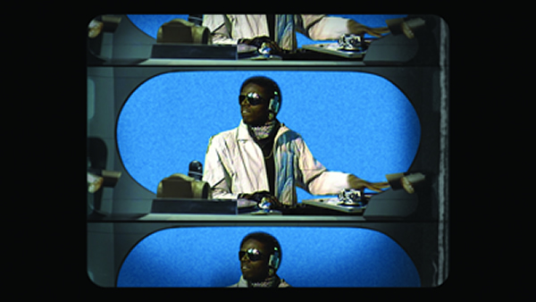
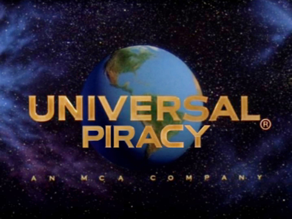
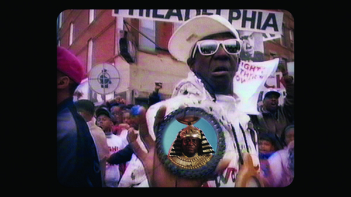
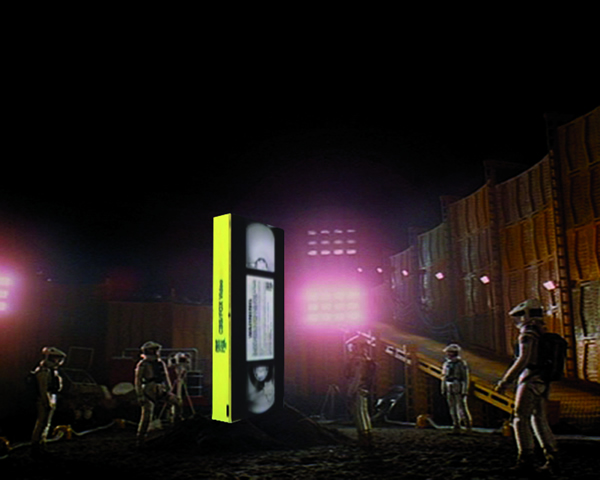
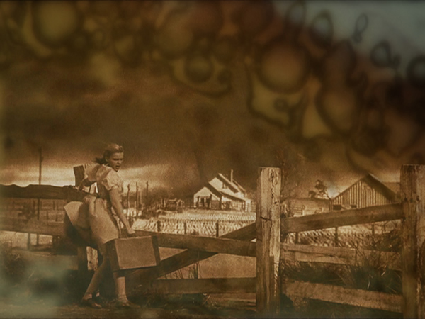
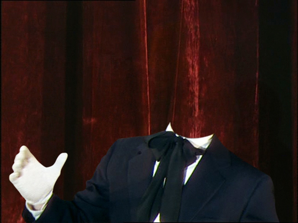
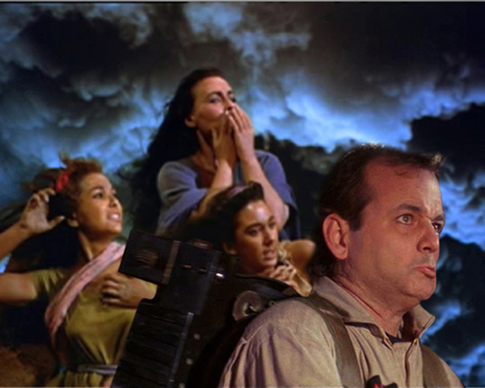
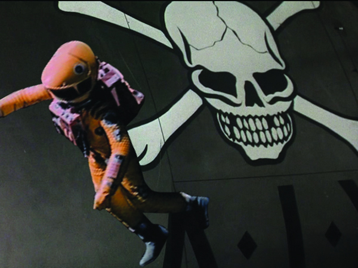
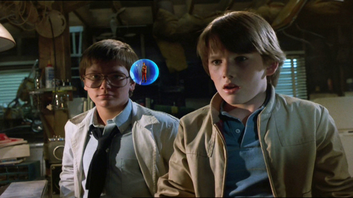
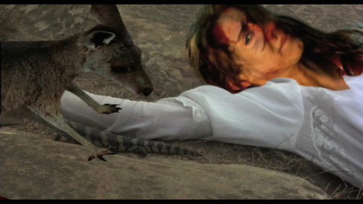

Screenshot: ‘Astro Black: A History of Hip-Hop (Episodes 0-2)’ (2007-08) Soda_Jerk

> Pop Art’s ability to mash highbrow and lowbrow culture paved the way for Pop Tronic’s essentially mono-brow outlook… Pop Art strayed from Pop Tronics by whoring itself to generative creative arts such as painting. This violates the Zero Originality Clause of Pop Tronic which states “Under no circumstances must the Pop Tronicist stray from the sanctioned triad of operations: Copy, Cut and Collage.” (Soda_Jerk, 2009)

**1.**

In this article I want to reflect briefly on a number of themes to do with the cultural modulation of post-digital remix culture in the context of Australian contemporary art. In particular, I focus on some key figures who have contributed to a particular aesthetics and politics of audio-visual remix. In linking these artistic precursors to current forms of remix, I want to draw out some of the differences and specificities of ‘local’ versions of a phenomenon that is often figured as a ‘global’ and not especially variegated practice. I argue that this identifiable history of Australian media artists working with found film footage and the appropriation of televisual sources finds its ultimate expression in contemporary practices of remix that both connect to and remain distinct from global remix. In particular, I suggest that the ‘zero originality clause’ proposed by the artistic duo Soda-Jerk is a logical outcome of the more provocative strategies employed by a range of Australian artists during the 1980s and 1990s.

My interest here is in the particular historical development of an Australian remix practice that leverages the personal recording and public distribution systems made possible by the intersection of distinct technical/cultural systems. Since the 1960s, a significant number of Australian artists have used the cathode ray screen and the institutions of television as a particular kind of source material for visual artworks. The tele-cine practice of many Super 8 filmmakers in the 1980s can be seen as an extension of this earlier practice. The appearance of low-cost VHS viewing, recording and distribution systems in the same period gave rise to new ways of engaging in the flow of images and sounds that were circulating in the cultural sphere. More recently, the social practices surrounding the domestication of video have coupled with the increasing availability of digital video systems, allowing artists to process and reconfigure audio-visual material in increasingly sophisticated ways.

Screenshot: ‘Pixel Pirate II: Attack of the Astro Elvis Video Clone’ (2002-2006) Soda_Jerk

At the same time, I am interested in matching this techno-cultural realm with the discourses of appropriation that were circulating in the fields of contemporary art in Australia at the end of the 1970s and throughout the 1980s. This is particularly resonant in the neo-pop writings and provocations of Paul Taylor in Melbourne, and in the works and ideas of some members of the Sydney Super 8 Group. While there are many others who engaged in similar discourses during the 1980s, I limit my discussion here to these two particular instances.

For Taylor, the contemporary artist’s ‘wryly sophisticated … quotation from the past … detaches itself from its cultural history and inspires instead a pleasure in its dislocation… In turning to the echelons of popular culture as a major artistic source and in an adoption of *bricolage* or surreptitious quotation as a basic structure’, contemporary Australian artists could inhabit a ‘second degree’ realm which for Taylor represented the most striking and vital aspect of contemporary art practice in the early 1980s. (Taylor, 1984: 159) This contradictory pleasure in dislocation, erasure and detachment (by way of the triad ‘copy, cut and collage’) is arguably at work in many of the remix artists I refer to in this article.

**2.**

Before I turn to the specifics of Australian remix, I need to sketch out some of the general conditions that characterise remix culture and certain aspects of the history of video art. Today it has become commonplace to say that the explosion of remix works is due to the unlimited potential of computers to read, write and redistribute a wide variety of media.  In this sense, all of the systems of distribution, viewing and production have converged in the form of the personal computer. According to Lawrence Lessig, in this new ecology of read-write media, anybody can ‘remix, or quote, a wide range of “texts” to produce something new… The quotes get mixed together. The mix produces the new work — the “remix”.’ (Lessig, 2005 69) While this is largely true, it tells us little about how emerging forms of digital video (and of remix in particular) are either distinct from or related to earlier forms and socio-cultural contexts or artistic practice.  Nor does the discourse of convergence tell us how they connect to the specific cultural practices of particular regions or periods.

Lessig in particular has done much to advance debates about the legal and technical frameworks surrounding the explosion of remix culture. His most recent book on the subject, *Remix: Making art and commerce thrive in the hybrid economy*, goes some way to delve into the cultural conditions of remix. Quoting the British artist Candice Breitz at length, Lessig focuses in on what Breitz calls the ‘absorptive logic’ of creative practice:

> Artists who work with found footage, for example, blatantly reflect on the absorptive logic of the creative process. But I would argue that every work of art comes into being through a similar process, no matter how subtly. No artist works in a vacuum. Every artist reflects — consciously or not — on what has come before and what is happening parallel to his or her practice. (Lessig, 2005; 8 )

Screenshot: ‘Astro Black: A History of Hip-Hop (Episodes 0-2)’ (2007-08) Soda_Jerk

This absorptive process pre-supposes an engagement with not just cultural meaning, but its codification as well. As Eduardo Navas puts it, ‘no matter what form it takes, the remix … depends on recognition of a pre-existing cultural code. The audience is always expected to see within the object a trace of history.’ (Navas, 2008) These cultural codes are central to the intelligibility of cut’n’copy works. The remixer attends to and depends upon the succession of generations who have contributed to the production of works and to the circulation of meanings associated with (popular and unpopular) cultures — especially as we find them in their recorded formats. Privileging the fragment over the whole in a persistent and sustained fashion, audio-visual remixers fashion new works out of the core components of older pieces. Their meaning and use is largely determined by the extent to which audiences can connect to the cultural codes that artists absorb and re-animate.

While the act of borrowing is a basic organisational strategy for remix practice (as it is for other artistic practices), an essential aspect of this strategy is to do with the dynamic dialogue that takes place between audiences and producers across diverse historical and cultural frameworks. (Amerika, 2009; Adema, 2008; Barth, 2000) The multi-authored entry on remix in Wikipedia reveals that this approach ‘points to ways of working with information on higher levels of organization, pulling together the efforts of others into a multilayered, multi-referential whole which is much more than the sum of its parts’. We can see this especially in audio cultures, whose recombinatory logic has been adapted in different ways by audio-visual culture. (Miller 2004; Adema, 2008) To quote DJ and theorist Paul Miller, this networked creativity could be thought of as ‘cybernetic jazz’:

> Sampling is a new way of doing that’s been with us for a long time: with found objects… The mix of the old associations. New contexts from old. The script gets flipped, gauges evolve and learn to speak new forms, new thoughts. The thought becomes legible again … [like] jazz, cybernetic jazz, nu-bop, ILLbient — a nameless formless, shapeless concept given structure by the rhythms. (Miller 2004, 22)

Such a conceptual bass-line could also be traced through the European avant-garde filmmakers of the 1920s, the Situationists’ strategies of *détournement,* through William Burroughs’ cut-up works of the 1960s. While these disruptive artistic practices challenged the assumptions of mainstream cinema and culture, they did not directly threaten their hegemony. However, as audio-visual ‘objects’ are transferred into digital formats, archives and networks, these same strategies enacted in the networked digital realm do pose a significant challenge. Private corporations, public institutions and content-producing artists are all involved in a new set of questions concerning the ability to sample, quote, and remix in the context of the read-write world.

Screenshot: ‘Pixel Pirate II: Attack of the Astro Elvis Video Clone’ (2002-2006) Soda_Jerk

**3.**

While we don’t know how current struggles over copyright and the technological ability to copy and re-use practically any digital file will end up, it is clear that the stakes of remixing are high. (See Lasica, 2005for an excellent account of the corporate tensions between Hollywood, Silicon Valley and prosumer production.) Matt Mason uses the term ‘Punk Capitalism’ to describe this ‘new set of market conditions governing society. It’s a society where piracy, as the co-chair at Disney recently put it, is “just another business model.” A society where the remix is changing the way production and consumption are structured, rendering the nineteenth-century copyright laws we use obsolete.’ (Mason, 2008)

Although they are integrally connected, the current flashpoints surrounding piracy and re-use of AV materials tell us little about the cultural practices that underpin the debate around remix. The source materials for remixers are in fact ‘everywhere’ (in a philosophical and literal sense) and hence are implicated in a broad range of systems that exceed the commercial ones designated in most debates about copyright and control. As Mark Amerika puts it, ‘the sum total of source material everywhere is never finally summed up, as there is always the next instance or occasion of becoming that our bodies faithfully execute (remix, postproduce) without our even thinking about it, even though an experiential version of the thought itself may cross our minds.’ (Amerika, 2009)

The history of video art sits oddly with the emerging logic of remix as defined thus far. While there are many instances of video artists who use appropriation and cut-up as part of their aesthetic repertoire (e.g. Christian Marclay, Candice Breitz, Douglas Gordan, Dara Birnbaum, Antonio Muntadis, or George Barber), the present retelling of this history in books and its presentation in museums, galleries and art events is often disconnected from the far-reaching changes underway in today’s networked media world. This is worth noting, as it is quite different to the approach of early video artists to information networks.

Screenshot: After the Rainbow (2009) Soda_Jerk (Post-production with Sam Smith)

When artists first took to making video in the 1960s, its radical form and function was often predicated on the ease of access to the means of production. For a couple of thousand dollars anybody could buy a portapak and start making videos. As Kate Horsfield reminds us in ‘Busting the Tube: A Brief History of Video Art’, groups such as the Radical Software collective of the 1970s saw beyond this to another immense shift in political and cultural power:

> Power is no longer measured in land, labour, or capital, but by access to information and the means to disseminate it. As long as the most powerful tools (not weapons) are in the hands of those who would hoard them, no alternative cultural vision can succeed. Unless we design and implement alternate information structures which transcend and reconfigure the existing ones, other alternate systems and life styles will be no more than products of the existing process. (Horsfield, 2006: 9)

We have to remind ourselves that this was written in 1970, to remember that the radical approach to the emergence of the ‘information society’ has been a long time coming. In the 1970s and 1980s, it was the one-way ‘tube’ of commercial mainstream television that artists felt needed to be busted by video practice. And while the dissemination of video art in alternate information structures has certainly been growing and transforming over the past thirty years, the reconfiguration of television as a one-way read-only communication device was high on the agenda.

At the end of the 1960s, video artists proposed a radical approach to the emergence of the ‘information society’. They saw the potential for far-reaching changes to mainstream media models. With their focus on process over products, their ‘alternate cultural vision’ was squarely aimed at disrupting the easy fit between the read-only communication networks of broadcast television and the circuit of commodity-consumption. In the 1970s and 1980s, video art practice sought to challenge the one-way tube of commercial television. According to Stephen Jones, Nam June Paik’s reformulation of the tele-visual image was made possible by his manipulation of their internal circuitry, a literal disassembling of TV’s image. ‘Paik undermined the illusionistic function of television by literally tearing it apart and re-constructing it into forms whose potential would be realized over subsequent decades. Thus it becomes clear that video art is the disassembly of television — reverse engineering the code of the culture machine and uncovering its intention.’ (Jones 2008, 84)

Screenshot: ‘The Invisible Man’ (work in progress) Soda_Jerk

The rise and fall of the video festival circuit and the organizations devoted to the preservation and distribution of video art made perfect sense in this context. But despite all the valiant efforts to distribute alternative videos by alternate means, their impact was stunted by the physicality of the networks. The video image may have been wrenched from its commercial televisual framework, and broken out of it’s domestic box, but the objects [tapes] and viewing contexts remained. Under the conditions of digital reproduction and distribution via the internet, these limitations have been significantly reduced.

I would argue that the most radical proponents of video art were always concerned with critiquing the source materials of ‘mainstream culture’ and establishing alternative networks of communication based on Paik’s principle of ‘open circuits’ and ‘participation TV’ (Horsfield, 2006; Jones, 2008). An understanding of this historical context is helpful in highlighting the potentials to be found in today’s web-based networks that privilege ‘sharing’, ‘participation’ and ‘openness’. The sample-based remix culture of contemporary AV practice forms one of the important links between earlier frameworks for ‘reading’ and ‘writing’ culture with contemporary social and technological frameworks. As Helle Porsdam reminds us, the ‘reader becomes the writer in the world, and the writer becomes a reader. For as cultures get spread without a distributor standing in the middle, the way cultures get made and remade changes.’ (Porsdam, 2006: 18)

The open source movement and Creative Commons protocols currently represent the most developed alternative to corporate modes of production and distribution. Using distributed, shared and non-proprietary tools artists might well achieve the alternative networks of distribution envisaged by artists since the 1960s and now mutating into their broadband offspring. The radical challenges to television, art and culture made by video artists in the 1960s and 1970s hence find their echo today in the principles of remix, Free Software, Open Source, Creative Commons, Open Content and other emerging principles of participatory culture.

Screenshot: ‘Pixel Pirate II: Attack of the Astro Elvis Video Clone’ (2002-2006) Soda_Jerk

**4.**

At this point I’d like to return to the way that Australian media artists have been engaged in found-footage strategies — as evidenced by work made over the past three decades and included in the 2006 retrospective exhibition ‘SynCity: Remixing three generations of sample culture’. Presented by d/Lux Media Arts with the Australian Centre for Photography and curated by Mark Titmarsh, the exhibition and catalogue presents an important compendium of works and writings associated with the rise of remix culture in Australia. This set of resources demonstrates how emerging forms of digital video and remix relate to certain aesthetic forms of Australian artists in the 1980s and 1990s.

While SynCity dates the precursors to contemporary remix to the early 1980s, there is a pre-history that is worth mentioning here. Before remix emerged as an identifiable practice, video artists had used a variety of media-specific source materials for their own evolving purposes. In Australia, the earliest video works dislocated AV materials from their initial screen-base by way of re-recordings from video screens and television monitors. According to recent research done by media artist and historian Stephen Jones, the ground-breaking work of Stan Ostoja-Kotkowski was generated by means of recording the output of television screens as early as 1962, when he ‘began fiddling with an old TV set. He found he could introduce extra contrast and put the picture out of alignment and out of synchronisation. These experiments led to his interest in electronic images and, in 1962, to his first development of ‘electronic painting’ by photographing the manipulated television screen.’ (Jones, 2009) While not at all a found footage strategy, his work points to the direct manipulation of television as both signal and object.

This disassembly and manipulation of the television set certainly ran parallel to the well-known work of Nam June Paik, but it also connected to another approach to the making of electronic images from the stuff of television. David Perry’s *Mad Mesh* from 1968 similarly was created from faulty components in an ABC television camera, transforming the clear signal of broadcast into “a sort of formless irregular moiré pattern … [and] mesh patterns combined on the film’ (Jones, 2008: 88).

This practice of pointing a camera or other recording device towards a screen to produce second-degree images and sounds may have been unusual in the 1960s, but by the early 1980s it became common practice in Super 8 filmmaking and video art practice. As television signals reached saturation in domestic contexts, consumer quality video recording devices began to augment the practice of artists and independent filmmakers. The appearance of VHS and Betamax video cassette recorders into the domestic market in the early 1980s gave artists new opportunities to work with found footage and re-filming techniques. It also marked one of the turning points in copyright debates about fair use. The so-called Betamax case in 1984 is often hailed by activists as the Magna Carta of the technology age — and Hollywood is still looking for ways to overturn the decision. (Lasica, 2005: 110)

In the independent media art context however, the VCR and the cathode ray tube presented readily available source materials for second-degree art practice. Both film and televisual programs could be recorded in an unprecedented way, and many artists began to use their growing private collections as part of their own work. ‘Using refilmed fragments from broadcast television and personal archives of video taped “moments”, Metaphysical TV was created by a handful of artists form around 1982 until 1989.’ (Frost, 2006: 28) While the group was never really formalised, it included Mark Titmarsh (who termed the coin in his 1986 article ‘Metaphysical TV or how to make film with the hammer’ in Sydney art theory publication *On the Beach*), Gary Warner, Michael Hutak, Stephen Harrop and Andrew Frost.

Screenshot: ‘Pixel Pirate II: Attack of the Astro Elvis Video Clone’ (2002-2006) Soda_Jerk

While the works of Metaphysical TV were not always made entirely form found footage, this  Super 8 appropriation technique can also be found in the video practice of artists such as Philip Brophy, Ian Haig, Ian Andrews, Greg Ferris, and Severed Heads. The ease with which large portions of film and television could now be cut and reassembled into new forms gave rise to a wide variety of cut-up and collage forms that relate directly to contemporary remix practice. While the technological enabling device of the VCR and video monitor made this new practice possible, these works were also modulated by a culturally specific aesthetic position that valued the dislocative power of quotation and bricolage as means of engagement in artistic practice. Philip Brophy quoted by Paul Taylor in 1980 puts it this way: ‘I feel you can’t make anything without it having meaning that is already there. You can’t really do pure things because you’ve got a whole history behind you. In that sense its redundant for us to bother…’ (Taylor, 1984: 167)

**5.**

I want to focus this discussion now on the practice of two Sydney-based remix artists heavily featured in SynCity.  Working exclusively with found material, Soda_Jerk (Dan and Dominique Angeloro) follow the post-pop line and amplify it to its logical conclusion. Their video project*Pixel Pirate 2: Attack of the Astro Elvis Video Clone* (2002-2006) is an hour long narrative remix video comprised entirely of samples pirated from over 200 existing film and music sources. Made in collaboration with Sydney artist Sam Smith *Pixel Pirate 2* is a sci-fi /biblical epic/romance/ action flick that raises many questions about copyright law and the logic of remix.

According to a catalogue essay by Dan Angeloro, ‘what was once conceived as a tactical assault on commodity culture has for many, become a commonplace way of consuming culture. While most visual remix artists continue to ask themselves “why remix?”, online remix culture seems to have deleted that question with a simple “why not”.’ (Angeloro, 2006: 25)

Why not indeed. This inversion of the question is highly (re)productive. The concept engineer Kodwo Eshun has suggested that remixers are the sex organs of the sample: that by copying and consuming media we help it to multiply and disseminate.  While it can be argued that there is cultural bias against the cut-up techniques that find their way into contemporary art and pop culture (samples are seen as easy rip-offs), remix can also be framed as continuation of the audio-visual reconfigurations that characterise post-pop, Super 8 and video art practice in Australia. Like Philip Brophy and others in the 1980s, for Soda_Jerk the sampled image/ sound contains the germ of an idea that comes from a particular cultural moment. Once it is sampled, captured, it can be mutated into something new. They playfully refer to this practice as Pop Tronics in their tongue-in-cheek manifesto cited at the start of this article. This is precisely how their Zero Originality Clause functions.

Screenshot: ‘‘The Phoenix Portal’ (2005)’ (2002-2006) Soda_Jerk

In the video work, *The Phoenix Portal,* (also made in collaboration with Sam Smith in 2005) the River Phoenix of the film *My Own Private Idaho*is made to time-jump back to 1985 in order to visit his younger self in the film *The Explorers*. In this sense, Soda_Jerk engage in a process that they refer to in the language of time travel. According to an interview conducted with the author, ‘When you rent a video or DVD you are essentially hiring a fragment of alternative space-time and creating a portal between this other-time and the present. And if you’ve seen the movie before, then those viewing time-zones are also switched on.’ For Soda_Jerk, celebrity ‘childstars’ have the potential to generate even more of a temporal mash-up because the passage of real time is inscribed on their bodies as they age over the years in front of the camera.

Ever since Vannevar Bush came up with the idea of a universal globally accessible library of everything that could be recorded, searched by his Memex system and then amplified to the ‘reader’, the idea of the hyperlinked media archive has been steadily expanding. Archives, collections, and holdings all used to be highly restricted in terms of physical access. Private holdings of VHS recording, Blockbuster and now the availability of vast amounts of film and television via legal and illegal methods has significantly changed our relationship to these cultural objects. As Helen Garvery has suggested, remix videos on the web (like her example of scrapbooks from the 19th century) are the result of elaborate circuits of recirculation. ‘Even when copyright locks down the right to reproduce texts, readers have the option of moving those old texts to new contexts, creating a new tier of private circulation: clipping texts out of newspapers, pasting them into scrapbooks, or today into Web pages, and circulating this new compiled version.’ (Garvery, 2003: 208)

At the same time digitization comes bound up with erasure, disappearance and loss. Digital archives are proliferating, but can they contain all of history? One way to understand the project of Soda_Jerk is in terms of a subcultural preservation-as-erasure. There is a bent kind of historiography at work in their engagement with remix culture. But Soda_Jerk also like to think that the potential reality of time travel means that the remix artist is not only preserving a record of culture for future generations, but also for those of the past.

While the legal definition of ownership of digital images and sounds is extremely problematic, remixers turn such concepts upside down. You should only ‘own’ an archive say Soda-Jerk, ‘in the sense of “girlfriend, you own it”, and not in the sense of an exclusive claim on shared culture’. As a remixer, you ‘own it’ when you use the sample in a way that is worthwhile. It’s about knowledge and threading up connections between shared culture and audience. According to Soda_Jerk, ‘the randomness of sampling means that you can’t help but develop a kind of obsessive gambling mentality. It’s addictive. Sometimes you might go through ten videos in a night without finding anything of use, and another time you might land a few gold samples in a period of minutes. If we faced up to the insane amounts of wasted time involved with sample-hunting, we’d never be able to go through with it. So instead, we endorse the delusion that the jackpot is always just about to drop.’ (interview with author)

The practice and process of remix artists like Soda_Jerk emphasises the participatory nature of engagement with AV culture as it defines itself through its existence in all kinds of private and public archives and networks (from Blockbuster to Bittorrent). As Darren Tofts succinctly puts it, their ‘distributed and relational modes of art represent different ways of conceptualising communities, but they do so at the expense of some historically entrenched assumptions to do with the social nature of participation in the artifacts of cultural production.’ (Tofts, 2005)

**6.**

Videos circulate and are remixed, mashed up and broadcast over the web at an ever-increasing rate. They are being blown-up, torn apart, ripped, mixed and burned to such an extent that there is no going back to the stability of analog media forms (if ever there were such a state). If images and sounds are coming unstuck, they also open up a new space for the renegotiation of their associated history and critical context. In this sense, the old televisual models have indeed been ‘totally busted’ by the movement towards user-generated video inaugurated by video art of the 1960s, found footage artists of the 1980s and remixers of the 1990s. This same process has also extended into myriad online experiments that allow users to upload, download, edit and remix a wide variety of audio-visual materials.

In an insightful review of Mark Amerika’s book *Meta/Data*, Andrew Murphie notes how such ‘frameworks for writing, reading, publishing and distribution have multiplied into a seeming infinity. It becomes possible to write, even more than the French New Wave with their cinema-pen, with images, sounds, text and code. More importantly, one can write with the bleeds between them. Writing itself expands to encompass the act of living in the new social networks.’ (Murphie, 2007: 36)

The digital era hence shifts the emphasis from modes of *production* to modes of *circulation* and *re-sourcing*. In this sense, a dynamic history of remix needs to capture the miscellaneous bits that ‘bleed’ our memories, archives and works*.* Under such a rubric, the emergence of remix culture can be seen and defined as a never ending story, in which (digital) culture colludes with acts of erasure even as it reinstates disappearing fragments of AV culture.

Screenshot: ‘Picnic at Wolf Creek’ (2006) Soda_Jerk

In the Australian context, dislocation, detachment and erasure can be seen as some of the hallmarks of remix video, found footage, and sample-based practice. As theorist Ann Finnegan notes, remix video ‘owes as much to erasure and an original transformed into a psychic underside as it does to the collage idea of building things up. Less a postmodern collision or ironic juxtaposition of elements, scratching … accommodates a steady bleeding through of an ‘original’ understory to the dominant canopy.’ (Finnegan. 2006; 41)

Following on from this, we could say that remixers work both for *and* against collective forgetting by engaging in transformative acts that scratch away at collective memory. The remix artist’s wryly sophisticated engagement and detachment from their cultural history inspires a pleasure in its dislocation. This contradictory pleasure in dislocation, erasure and detachment is arguably at work in many of the remix artists I refer to in this article. Here, the differences and specificities are not so much to do with the ‘absorptive logic’ of the creative process. Instead this partial history of Australian media artists working with remix and appropriation of televisual sources both connects to and remains distinct from the characteristics of global remix, the logical outcome of the more provocative strategies employed by a range of Australian artists during the 1980s and 1990s.

## Author’s Biography

Ross Rudesch Harley [aka stereopresence]  is an artist, writer, and educator in the field of new media and popular culture. His work crosses the bounds of media art practice, cinema, music, design, and architecture. Ross is Professor and Head of the School of Media Arts, College of Fine Arts at the University of New South Wales.

## References

Adema, Janneke. ‘Schyzophonia. On Remix, Hybridization and Fluidity’, *Open Reflections* blog (2008),[https://openreflections.wordpress.com/2009/03/22/schyzophonia-on-remix-hybridization-and-fluidity/](https://openreflections.wordpress.com/2009/03/22/schyzophonia-on-remix-hybridization-and-fluidity/).

Amerika, Mark. ‘Ocean of Data’, *Professor VJ* blog (2009), [https://professorvj.blogspot.com/](https://professorvj.blogspot.com/).

Angeloro, Dan. ‘Thoughtware: contemporary online remix culture’, in *SynCity: Remixing three generations of sample culture* (Sydney: d/Lux/Editions, 2006), 18-25.

Finnegan, Ann. ‘Acts of Erasure: The psychoanalysis of sampling’, in  *SynCity: Remixing three generations of sample culture* (Sydney: d/Lux Editions, 2006) 40-45.

Frost, Andrew. ‘Intelligent Dolphin: From metaphysical TV to remix culture’, in  *SynCity: Remixing three generations of sample culture* (Sydney: d/Lux Editions, 2006), 28-40.

Garvey, Helen. ‘Scissorising and scrapbooks: Nineteenth-Century reading, remaking, and recirculating’, in Gitelman, Lisa and Pingree, Geoffrey (eds.), *New Media 1740-1915* (Cambridge, Mass.: MIT Press, 2003), 207-229.

Horsfield, Kate. ‘Busting the Tube: A Brief History of Video Art’, in Horsfield, K and Hilderbrand, L, (eds,)  *Feedback: The Video Data Bank Catalogue of Video Art an Artist Interviews* (Philadelphia: Temple University Press, 2006), 7-17.

Jones, Stephen. ‘Participation TV: Notes on Early Australian Video Art’, in *Video Logic* (Sydney: Museum of Contemporary Art, 2008), 83-99,

Jones, Stephen. ‘Light becomes the medium’, *Meanjin* 68.1 (2009), [https://meanjin.com.au/editions/volume-68-number-1-2009/article/light-becomes-the-medium/](https://meanjin.com.au/editions/volume-68-number-1-2009/article/light-becomes-the-medium/).

Lasica, J.D.  *Darknet: Hollywood’s War Against the Digital Generation* (Hoboken, NJ: John Wiley & Sons, 2005).

Lessig, Lawrence. *Remix: Making Art and Commerce Thrive in the Hybrid Economy* (Hoboken, NJ: John Wiley & Sons, 2005).

Mason, Matt. *The Pirate’s Dilemma: How Youth Culture is Reinventing Capitalism* (New York: Free Press, 2008).

Miller, Paul. *Rhythm Science* (Cambridge, Mass: MIT Press, 2004).

Murphie, Andrew. ‘Extreme writing: digital lifestyle practice’, *Realtime 80* (Aug-Sept 2007): 36.

Navas, Eduardo. ‘The bonds of repetition and representation’, *Remix Theory* (2008), [https://remixtheory.net/?p=361](https://remixtheory.net/).

Porsdam, Helle. *Copyright and Other Fairy Tales: Hans Christian Andersen and the Commodification of Creativity* (Cheltenham: Edward Elgar Publishing, 2006).

Soda_Jerk. ‘This is pop tronic’ (2009), [https://www.sodajerk.com.au/sj/poptronic.html](https://www.sodajerk.com.au/sj/poptronic.html).

Taylor, Paul. ‘Australia “new wave” and the “second degree”‘, in Taylor, Paul (ed.). *Anything Goes: Art in Australia 1970-1980* (Melbourne: Art & Text, 1984).

Tofts, Darren. ‘Tch tch tch & beyond: anticipating distributed aesthetics’ *fibreculture* 7 (2005),[https://journal.fibreculture.org/issue7/issue7_tofts.html](https://journal.fibreculture.org/issue7/issue7_tofts.html).
