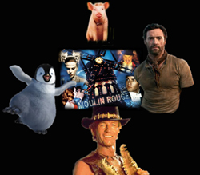
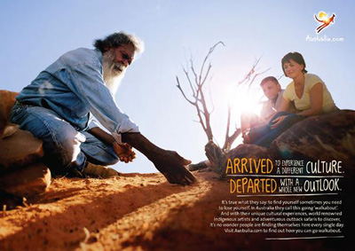
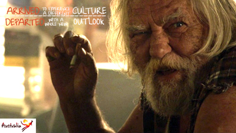
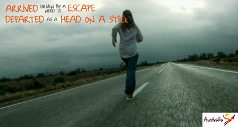
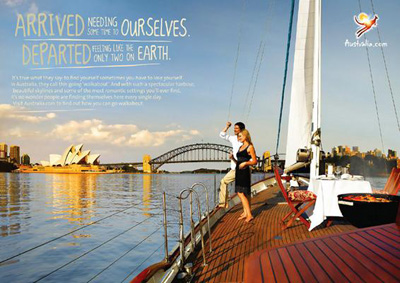
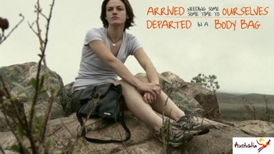
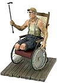
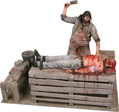
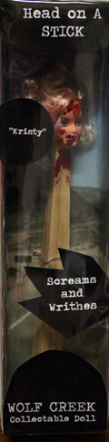
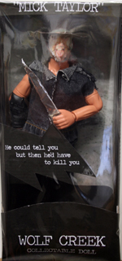

‘What the reader sees will not be what he hears’ {#para2}

*James Joyce may have said this of Finnegans Wake* {#para3}

‘Since we have already said everything, the reader must bear with us if we continue on a while. If we extend ourselves by force of play. If we then *write* a bit…’ {#para4}

*Jacques Derrida, Dissemination, 1981:65* {#para5}

<table border="0" cellspacing="4" cellpadding="4" width="100%"> <tbody> <tr> <td width="59%" valign="top" bgcolor="#FFFFFF"><strong> Script</strong>  <a href="https://www.youtube.com/embed/qBe84QgVU6A">https://www.youtube.com/embed/qBe84QgVU6A?feature=oembed</a>  <strong>  </strong>
 <a href='#para6' id='para6'> - 6 - </a>
Don&#8217;t get me wrong. Australians make a lot of very fine and worthy films. In the torrid vernacular of Baz Luhrmann&#8217;s <em>Australia</em> The Movie,
 <a href='#para7' id='para7'> - 7 - </a>
<em>Crickey, you&#8217;d have to be a drongo not to know that Aussies make a shitload of bloody ripper flicks &#8211; strewth, they&#8217;re bonza mate, they&#8217;re really fair dinkum yarns with the best scenery and actors and stories that this bloody great big brown land has to offer. They&#8217;re absobloodyfuckinlutely faaaaannnntastic. Mate. Cobber. </em>
 <a href='#para8' id='para8'> - 8 - </a>
The only problem is nobody actually seems to want to see them. Now, none of the following will be news to most of you but for the sake of the argument let&#8217;s look at some figures.
 <a href='#para9' id='para9'> - 9 - </a>
Australian-produced feature films have accounted for an average of just 5.1 per cent of gross takings at the Australian box office in the past 15 years. That&#8217;s $511 million out of a total of $10.5 billion. Only once in that period did the Australian share reach 10 per cent and that was in 1994, and largely due to the success of <em>The Adventures of Priscilla, Queen of the Desert</em> and <em>Muriel&#8217;s Wedding</em>. In 2001, a record $63.4 million was spent at the box office on local features, including <em>Moulin Rouge</em>, <em>Lantana</em>, <em>The Man Who Sued God</em> and <em>Crocodile Dundee in LA</em>, but this still represented only 7.8 per cent of the total box office for that year. In 2007, the Australian box office share was 4 per cent (that&#8217;s $36 million), a decrease from 4.6 per cent (or $40 million) in 2006.
 <a href='#para10' id='para10'> - 10 - </a>

 <a href='#para11' id='para11'> - 11 - </a>
Of the Top 50 films in <em>Australia</em> of all time, ranked by total reported gross Australian box office as at January 2008, only 5 were Australian: <em>Crocodile Dundee, Babe, Happy Feet, Moulin Rouge and Crocodile Dundee II</em>.
 <a href='#para12' id='para12'> - 12 - </a>
<em>Australia</em> has now joined this list. To date, it&#8217;s grossed $A36.78 million at the Australian box office. Since it&#8217;s release late last year, Australia has overtaken Babe&#8217;s long-standing box office figure of $A36.77 million set in 1995, and is surpassed only by Crocodile Dundee&#8217;s record $A44.7 million set in 1986.
 <a href='#para13' id='para13'> - 13 - </a>
Not withstanding this, Australians do seem to make a lot of good films that unfortunately seem to fail at the box office. You just have to watch the self congratulatory, nauseatingly feel good, look at us mum aren&#8217;t we clever AFI Awards ceremony with its bevy of &#8220;international&#8221; stars who are just so glad to be home to know that there are many critically acclaimed Australian films doing the rounds at any given time. The problem is that very few Australians have actually seen them.
 <a href='#para14' id='para14'> - 14 - </a>
Which of course leads us to ask, and it&#8217;s a question that has been asked <em>ad nauseum</em> in the Australian media much to the disdain of Australian filmmakers, what&#8217;s the point of a national cinema if the nation actually isn&#8217;t interested in it. Forget about making an impact on the rest of the film going world (and, as Phil Brophy sagely points out, the international market cares as much about you as you do about Finnish historical drama), if a national cinema is meant to be telling Australian stories for Australian audiences so that we can see our national identity reflected back to us then does that mean we&#8217;re a bunch of crocodile hunting, cattle droving transvestites who raise talking pigs and cute dancing penguins and who secretly desire to live in a garret in Paris while they go blind on Absinthe and eventually die from tuberculosis or maybe anorexia?
 <a href='#para15' id='para15'> - 15 - </a>
According to Robert Miller, a self described &#8216;film industry insider who has just managed to get over his heroin addiction, lives with his gay Indigenous lover and their adopted, mentally handicapped Lebanese daughter in a prejudiced outback town, that, through a series of misadventures will learn to love them shortly&#8217;, the blame for the failure is threefold. Australian films are failing to connect with audiences, they&#8217;re poorly marketed to the Australian public and they mostly pander to critics who prefer films that are worthy rather than entertaining. He argues:&lt;
 <blockquote><a href='#para16' id='para16'> - 16 - </a>
There&#8217;s nothing intrinsically wrong with making &#8220;worthy&#8221; films about &#8220;serious&#8221; subjects. I think that&#8217;s fine if you have a real industry (not one almost entirely subsidised) that produces a good mix of artistic and commercial movies. But if &#8220;worthy&#8221; is all we&#8217;re making, the well is poisoned. A situation is created where most of the cinema-going public consider the &#8220;made in Australia&#8221; tag to be a setback. The term &#8220;Australian film&#8221; unfairly becomes synonymous with &#8220;pretentious wank-fest&#8221; (which would in turn make the AFI awards the great incestuous industry circle-jerk).
 <a href='#para17' id='para17'> - 17 - </a>
If you&#8217;re going to drop $16 on a ticket, do you want to come out of a cinema feeling worse about yourself and your country than when you went in? (Miller, 2008)
</blockquote> <a href='#para18' id='para18'> - 18 - </a>
Good question. If you&#8217;ve spent all day working on the production line at Holden in Broadmeadows, wondering if you&#8217;ll have a job next week and who&#8217;s going to pay the mortgage, do you really want to go and see a film that makes you feel crap?
 <a href='#para19' id='para19'> - 19 - </a>
But I think his second point is more telling. Apart from <em>Australia</em> (the movie not the country) when was the last time you saw an Australian film marketed on Australian television for any length of time and with any kind of panache. For all the angst ridden criticism levelled at Luhrmann over the content of his film, and there has been plenty of it, more Australians have seen his film than have seen most of the rest of the Australian films made in the last 12 months put together. This is despite reviews of Baz&#8217;s film like Peter Conrad&#8217;s in <em>The Monthly</em> which self indignantly complains:
 <blockquote><a href='#para20' id='para20'> - 20 - </a>
What should have been a vindication for our undiscovered country has turned out to be a calumny; instead of signalling our proud independence, the film portrays us as timid, imitative colonials, still searching for an empire to which we can belong. The blame needs to be shared around: the failure of Luhrmann&#8217;s Australia is Australia&#8217;s failure too. (Conrad, 2009) 
</blockquote> <a href='#para21' id='para21'> - 21 - </a>
This! from a man who has spent the last 30 years teaching at Oxford University.
 <a href='#para22' id='para22'> - 22 - </a>
Now I&#8217;m not saying that <em>Australia</em> is a great film. But really what do we actually expect from Australian films. As Phil Brophy points out in his review of the film:
 <blockquote><a href='#para23' id='para23'> - 23 - </a>
&#8220;Australia is inevitably an easy target &#8211; but using a narrow-gauge shotgun is an ineffective critical strategy when aimed at the nationalist mirage within which Australian cinema&#8217;s self-image has shimmered for over quarter of a century. A wide-spray Uzi handled by a blind drunk is a better tactic. Don&#8217;t shoot the film or the filmmakers: shoot the whole context within which they are positioned.&#8221; (Brophy, 2009) 
</blockquote> <a href='#para24' id='para24'> - 24 - </a>
This got me thinking. What if we were to apply Luhrmann&#8217;s clearly successful marketing strategy to a film that, while successful in relative terms, still made 13 million dollars less on worldwide release than the Australian Tourism Export Commission put into Baz&#8217;s film. 
 <a href='#para25' id='para25'> - 25 - </a>
<em>Wolf Creek</em> opened on 151 screens around Australia on November 3, 2005 and, considering the mere 1 million dollar budget used to make the movie, went on to be a financial success. It was also nominated for numerous awards, including 7 AFI awards, 5 Inside Film Awards and the Grand Jury Prize at the Sundance Film Festival. An amazing double whammy for an Australian film.
 <a href='#para26' id='para26'> - 26 - </a>
For those of you who haven&#8217;t seen <em>Wolf Creek</em>, here is a short précis. Three young travellers set out from Broome to travel across the top end of Australia to Cairns. The two women, Kristy and Liz, both British, and their male companion, an Australian named Ben, stop at a meteorite crater called Wolf Creek. There is some romantic intrigue and then their car breaks down. They&#8217;re rescued by a seemingly benign outback type called Mick who tows them to his camp with the promise of fixing their car and getting them back on the road. Turns out he&#8217;s not as benign as they thought and what follows is described by critic Roger Ebart as &#8216;a sadistic celebration of pain and cruelty&#8217;. In what is clearly an homage of sorts to Tobe Hooper&#8217;s classic horror film <em>The Texas Chainsaw Massacre</em>, the not so benign Mick, after drugging his young victims, then proceeds to attempt to torture, mutilate and dismember them. 
 <a href='#para27' id='para27'> - 27 - </a>
Needless to say, the car never gets fixed. 
 <a href='#para28' id='para28'> - 28 - </a>
<em>Wolf Creek</em> is a well made genre film that Guardian critic Peter Bradshaw described as a &#8220;swaggeringly nasty film which deserves an audience outside the horror fanbase&#8221;. (Bradshaw, 2005) 
 <a href='#para29' id='para29'> - 29 - </a>
What sets <em>Wolf Creek</em> apart from other genre films, however, is director Greg McLean&#8217;s canny use of local character to make this not just a horror film but a distinctly <em>Australian</em> horror film. The landscape, the characters, the tourist culture, local crime stories and outback mythology are all used as narrative building blocks. As Jim Schembri rightly argues in his review of the film &#8216;It&#8217;s solid proof that genre, when used skilfully, can enhance rather than obliterate a film&#8217;s cultural fingerprint.&#8217; (Schembri, 2005) And as an Australian film that could be read as offering an antidote to the patronising tendency to romanticise aboriginal culture in Australian film, <em>Wolf Creek</em> also shows us the dark face of the outback mythology of the benign laconic bushman. As one indigenous critic, Tyson Yunkaporta noted, &#8216;the larrikin exterior is stripped away to reveal the hideous doppelganger lurking beneath Australian identity&#8230;the audience are unaware of the shadowy Mick Dundee doppelganger that lingers at the core of their identity, pricking their conscience and giving them the heebie-jeebies at the thought of being stranded alone in the haunted outback, alone with the truth of their ancestors and the angry spirits of murdered Aboriginal multitudes&#8217;. (Yunkaporta, 2006) 
 <a href='#para30' id='para30'> - 30 - </a>
So what might an <em>Australia</em> style marketing campaign look like when applied to <em>Wolf Cree</em>k?
 <a href='#para31' id='para31'> - 31 - </a>
Well, first you&#8217;d need a major investor like ATEC. But I&#8217;m not sure how they would respond to ads like this.
 <a href='#para32' id='para32'> - 32 - </a>
<em>Australia</em>
 <a href='#para33' id='para33'> - 33 - </a>

 <a href='#para34' id='para34'> - 34 - </a>
<em>Wolf Creek </em>
 <a href='#para35' id='para35'> - 35 - </a>

 <a href='#para36' id='para36'> - 36 - </a>
<em>Australia</em>
 <a href='#para37' id='para37'> - 37 - </a>
<em></em>
 <a href='#para38' id='para38'> - 38 - </a>
<em>Wolf Creek</em>
 <a href='#para39' id='para39'> - 39 - </a>

 <a href='#para40' id='para40'> - 40 - </a>
<em>Australia</em>
 <a href='#para41' id='para41'> - 41 - </a>

 <a href='#para42' id='para42'> - 42 - </a>
<em>Wolf Creek</em>
 <a href='#para43' id='para43'> - 43 - </a>

 <a href='#para44' id='para44'> - 44 - </a>
Maybe a merchandising strategy like that used so successfully by other horror films like these.
 <a href='#para45' id='para45'> - 45 - </a>
 
 
 <table border="0" cellspacing="3" cellpadding="3" width="100%"> <tbody> <tr align="center" valign="top"> <td width="22%"> </td> <td width="40%"></td> </tr> </tbody> </table> 
 <a href='#para46' id='para46'> - 46 - </a>
In fact, I whipped up a few of my own at home.
 
 <table border="0" cellspacing="3" cellpadding="3" width="100%"> <tbody> <tr align="center" valign="top"> <td></td> <td></td> </tr> </tbody> </table> 
 <a href='#para47' id='para47'> - 47 - </a>
But in keeping with the car breakdown theme, I though the RACV might make a good partner. They have a long association with horror and suspense as the following clearly demonstrates.  <a href="https://www.youtube.com/embed/pfHvKV1dtn8">https://www.youtube.com/embed/pfHvKV1dtn8?feature=oembed</a>   
 <a href='#para48' id='para48'> - 48 - </a>
And I was surprised to find that the RACV were in fact already one step ahead of me  <a href="https://www.youtube.com/embed/SveNqMl0wAQ">https://www.youtube.com/embed/SveNqMl0wAQ?feature=oembed</a>
 <a href='#para49' id='para49'> - 49 - </a>
Clearly what Australian national cinema needs is not more Aussie stories about Aussie heros and outback adventures &#8211; they just need a cracking good ad campaign.</td> <td width="2%" valign="top" bgcolor="#CCCCCC"></td> <td width="39%" valign="top" bgcolor="#FFFFFF"><strong>Inscription</strong>
 <a href='#para50' id='para50'> - 50 - </a>
How does one link the different registers within which critique is possible &#8211; in which &#8216;research functions, by way of allegory, as the <em>inventio </em> for an expressive text (thus producing both scholarship and art)&#8217;? (Ulmer, 1991) This question lies at the heart of any attempt to understand reflexive remix practices as research and research as a mode of reflexive remix. <a class="sidenav2" href="#1">[1]</a> It was also the driving force behind the &#8220;paper&#8221; I delivered at the <em>B for Bad Cinema Conference</em> at Monash University which sought to explore questions of national identity, genre filmmaking and national cinema. <a class="sidenav2" href="#2">[2]</a> The &#8220;paper&#8221; took the form of a multi-channelled media performance, in defiance of (and with the full intention of disrupting) the tendency at such academic events to deliver in person a mode of writing that only distinguishes itself from other kinds of academic writing by virtue of being &#8216;read aloud&#8217;.
 <a href='#para51' id='para51'> - 51 - </a>
This writing (the writing that you are reading now, whenever that may be) takes place both before and after its own inscription as an event, as the performance of what was written and which can be viewed (performed, read) again in this space as a supplement to its performance. It is not meant to explicate that performance but rather to draw attention to its status as, what Greg Ulmer has named, a discourse of &#8220;immanent critique&#8221; &#8211; &#8216;a reasoning capable of operating within the machines of television and computing, in which the old categories (produced in the book apparatus) separating fiction and truth are breaking down.&#8217; (Ulmer, 1991) Similarly, the &#8220;paper&#8221; of which this writing speaks was itself driven by the same desire to work through the problem of what happens to criticism when it embraces reflexive remix, not as an object of study, but as a legitimate critical strategy within academic discourse.
 <a href='#para52' id='para52'> - 52 - </a>
Following Ulmer&#8217;s remixing of Derrida&#8217;s ideas regarding grammatology, the performance of the &#8220;paper&#8221; makes use of the figure of the <em>mise en abyme</em> &#8211; a &#8216;reflexive structuration by means of which a text shows what it is telling, does what it says, displays its own making, reflects its own action&#8217;. (Ulmer, 1991) In doing so, it is capable of exposing the ideological quality of the research drive, the will to power in knowledge. A conference paper traditionally attempts to display the presenter&#8217;s mastery of a field of research, to present &#8220;findings&#8221;, to attest to the presenter&#8217;s status as &#8220;expert&#8221;. <a class="sidenav2" href="#3">[3]</a> This &#8220;paper&#8221; takes the ready-made topics for debate about national cinema and national identity as a starting point to demonstrate the recursive nature of such discussions and their almost inexorable critical status. It playfully remixes current discussions of these issues, not in an effort to resolve them but to make something new with them &#8211; to solve them in the sense of the term that derives from the Latin word <em>solvere </em> (to loosen, release, unbind). In this sense, where the will to power in knowledge manifested in academic research is usually driven by an ideology of mastery (to command, to demonstrate supremacy in order to gain authority or dominion), the driving ideological force behind the &#8220;paper&#8221; and reflexive remix practice in general is comedy, an incongruity or contrast in the object, and a shock or emotional seizure on the part of the subject.
 <a href='#para53' id='para53'> - 53 - </a>
The use of the joke as a scholarly tool and as a key driver of reflexive remix culture responds to the tendency within academic writing (and culture in general) towards what Ulmer (and others) describes as &#8216;the melancholy seriousness that has been associated traditionally with the emotional experience of academic work&#8217; and the &#8216;nostalgia that Jameson and others have identified as the predominant emotion of culture in the period of late capitalism.&#8217; (Ulmer, 1989: 61) <a class="sidenav2" href="#4">[4]</a> Ulmer is drawing here on Jacques Derrida&#8217;s observation that claims to neutral objectivity rest upon the authority of the scientific model of knowledge which aims to exclude the non-serious (Ulmer, 1989: 61). However, this ideological exclusion of the non-serious, the jest, the pun, the joke, cannot be kept on the borders of critique without exposing the contradiction inherent in the claim for seriousness that this model of knowledge purports to uphold. Derrida writes:
 <blockquote><a href='#para54' id='para54'> - 54 - </a>
The necessity assumed by classical theory of submitting itself to the very normativity and hierarchy that it purports to analyse, deprives such theory of precisely what it claims for itself: seriousness, scientificity, truth, philosophical value. Because (&#8230;) theory claims to be serious, it is normed by part of its object and therefore not impartial. It is not scientific and cannot be taken seriously. (Derrida, 1977: 211)
</blockquote> <a href='#para55' id='para55'> - 55 - </a>
Derrida is not of course saying that we shouldn&#8217;t take theory seriously. He is merely demonstrating that the exclusion of the non-serious, the joke, from philosophical discourse cannot be logically sustained. Wittgenstein, too, suggested &#8216;that the &#8220;wit&#8221; in his name might lead us to expect that a good philosophical work could be written that consisted entirely as jokes&#8217; (Ulmer, 1989: 62) If we consider the etymology of the word &#8220;theory&#8221; from its Greek origins in <em>theorein</em>, which means &#8220;to look at&#8221; and its frequent association with spectatorship, as in &#8220;looking at&#8221; a theatre stage, then reflexive remix practices, which often rely heavily on the joke to make sense of them, could be said to <em>perform</em> legitimate scholarly critique. They treat serious ideas by way of the jest.
 <a href='#para56' id='para56'> - 56 - </a>
The &#8220;paper&#8221;, as an example of reflexive remix, also draws on Marshall McLuhan&#8217;s articulation of the power of analogy and the analogical mind to reinvigorate critique through the restoration of arts of exposition and interpretation (grammar) and persuasion (rhetoric) to a trivium dominated by logic (dialectic), which he began in the Nashe thesis, and which formed the basis for many of his future works.<a class="sidenav2" href="#5">[5]</a> McLuhan believed that the truth or non-truth of an assertion is, in the mind of the analogist, inextricably linked to the <em>ways </em> in which that assertion is made. This transgresses a &#8216;fixed set of co-ordinates that most educated Westerners have inherited from Aristotle&#8217;. (Kuhns, 1996) For McLuhan, truth to the analogist is a creative act: &#8216;a ratio between mind and things, made by the shaping imagination&#8217;. (Kuhns, 1996) In other words, the performance of the &#8220;paper&#8221; is not <em>adorned</em> by rhetoric and exposition &#8211; they form an integral part of its argument. But this can be said of all writing as Derrida designates it:
 <blockquote><a href='#para57' id='para57'> - 57 - </a>
And thus we say &#8220;writing&#8221; for all that gives rise to inscription in general, whether it is literal or not and even if what it distributes in space is alien to the order of the voice: cinematography, choreography, of course, but also pictorial, musical, sculptural &#8220;writing&#8221; (&#8230;) All of this to describe not only the system of notation secondarily connected with these activities but the essence and content of these activities themselves. (Derrida, 1976: 9)
</blockquote> <a href='#para58' id='para58'> - 58 - </a>
The application of rhetorical strategies and the careful consideration of the manner of exposition in terms of the performance of the &#8220;paper&#8221; do not come after the meditation on the dialectics of the argument. This is what McLuhan meant when he spoke of the power of the analogical mind to reintegrate the trivium under electric conditions. The &#8216;shaping imagination&#8217; of the analogist recognises the interdependence of grammar, logic and rhetoric in the delivery and reception of persuasive arguments. And he anticipated, along with Derrida, an ideo-picto-phonographic writing that could not only draw upon multiple writing instruments &#8211; the word, television, cinema, computing technologies and so on &#8211; but could draw on gesture and oratory and the use of rhetorical tropes such as allegory, hyperbole, paradox, alliteration, pun, enigma, satire and invective. Dismissed as superficial (as in &#8216;to be found on the surface&#8217;) in traditional scholarly writing, rhetoric and exposition assume their position alongside dialectic in helping us to convey and make sense of complex ideas in reflexive remix practices.
 <a href='#para59' id='para59'> - 59 - </a>
Donald Theall, speaking about the work of Joyce (whose writing is also remixed throughout the writings of both McLuhan and Derrida), alludes to this when he discusses &#8216;the poetic&#8217; in <em>Beyond the Word: Reconstructing Sense in the Joyce Era of Technology, Culture and Communication</em>. (Theall, 1995: 11) The poetic, as Theall uses the term, refers to inventive cultural productions whether they are achieved in language, another medium or a mixture of media. While recognising the ambivalence that permeates all intense poetic activity throughout history, Theall argues that
 <blockquote><a href='#para60' id='para60'> - 60 - </a>
[t]he poetic emphasis on the complexity of assemblage, with its corresponding intensity (for the poetic work embraces a complexity of the surface and a density of the depth of the work), generates new ways of seeing, sensing, and understanding. Since the poetic work invites discussion, judgement, and understanding rather than closure, it permits exploration and evaluation; it may even have a value when the artist is a conscious propagandistic agent. (Theall, 1995: 243-244)
</blockquote> <a href='#para61' id='para61'> - 61 - </a>
This precisely conveys the work that the performance of the &#8220;paper&#8221; as reflexive remix and reflexive remix practice in general seeks to do. If academic activity is meant to not only open up new ways of seeing, sensing and understanding the world but to also <em>propagate</em> those ideas (at a conference, on a Youtube channel, in an academic journal), then this &#8220;paper&#8221; makes and marks a gesture towards that ambition.
 <a href='#para62' id='para62'> - 62 - </a>
&#8216;In the beginning was the gest he jousstly says&#8230;&#8217; James Joyce, <em>Finnegans Wake </em>
 <a href='#para63' id='para63'> - 63 - </a>
&#8216;The death of the book is not the end of language: it continues&#8217; John Cage, <em>For the Birds </em>
 <h1>Author&#8217;s Biography</h1> <a href='#para64' id='para64'> - 64 - </a>
Lisa Gye lectures in Media and Communications at Swinburne University. Her areas of research interest include social media, remix culture and cultures of production.
 <h1>Notes</h1> <a href='#para65' id='para65'> - 65 - </a>
[1] I&#8217;m using Eduardo Navas&#8217; idea that remix can be categorised in three ways &#8211; extended remix, selective remix and reflexive remix. The latter &#8216;allegorizes and extends the aesthetic of sampling, where the remixed version challenges the aura of the original and claims autonomy even when it carries the name of the original; material is added or deleted, but the original tracks are largely left intact to be recognizable.&#8217; <a class="sidenav2" href="https://remixtheory.net/?page_id=3" target="_blank">https://remixtheory.net/?page_id=3</a> <a class="sidenav2" href="#back1">[back]</a>
 <a href='#para66' id='para66'> - 66 - </a>
[2] <em>B for BAD cinema: aesthetics, politics and cultural value </em> conference, Monash University, Melbourne, April 15-17, 2009. <a class="sidenav2" href="#back2">[back]</a>
 <a href='#para67' id='para67'> - 67 - </a>
[3] Interestingly, the etymology of the work &#8220;expert&#8221; is derived from the Latin <em>experientia</em> which derives from the Greek verb <em>peirao </em> (try, attempt, test, get experience) from which we also get the word &#8220;pirate&#8221;. <a class="sidenav2" href="#back3">[back]</a>
 <a href='#para68' id='para68'> - 68 - </a>
[4] Ulmer also quotes Michel Serres &#8211; &#8216;At its birth, knowledge is happy, delivered natively from all culpability. It is perhaps happy by nature. However, in the institutions which direct it, exploit and transmit it, for the individuals it overwhelms it fosters in fact the death instinct. Throughout my youth I believed I discerned on the walls of amphitheaters or on the brows of the learned the hideous word &#8211; sadness alone is fruitful. How the change came about I don&#8217;t know. By whatever means its own nature might be restored it is urgent on pain of death to respond to this question.&#8217; (Quoted in Ulmer, 1989: 61) <a class="sidenav2" href="#back4">[back]</a>
 <a href='#para69' id='para69'> - 69 - </a>
[5] McLuhan, Marshall <em>The place of Thomas Nashe in the Learning of His Time </em> Phd Thesis, Cambridge University, 1943 (unpublished). <a class="sidenav2" href="#back5">[back]</a>
 <h1><strong>References</strong></h1> <a href='#para70' id='para70'> - 70 - </a>
Bradshaw, Peter &#8216;Wolf Creek review&#8217; <em>The Guardian</em>, 16 September, 2005. <a class="sidenav2" href="https://www.guardian.co.uk/culture/2005/sep/16/3" target="_blank">https://www.guardian.co.uk/culture/2005/sep/16/3</a>
 <a href='#para71' id='para71'> - 71 - </a>
Brophy, Philip &#8216;Targeting Australia: Comment on the film by Baz Lurhman&#8217; <em>Real Time, </em>No. 89, Sydney, 2009.
 <a href='#para72' id='para72'> - 72 - </a>
<a class="sidenav2" href="https://www.philipbrophy.com/projects/rstff/Australia_C.html" target="_blank">https://www.philipbrophy.com/projects/rstff/Australia_C.html</a>
 <a href='#para73' id='para73'> - 73 - </a>
Conrad, Peter &#8216;Gone with the Wind:An Australian Fiasco&#8217; <em>The Monthly</em>, February, 2009
 <a href='#para74' id='para74'> - 74 - </a>
<a href="https://www.themonthly.com.au/epublish/1/46" target="_blank">https://www.themonthly.com.au/epublish/1/46</a>
 <a href='#para75' id='para75'> - 75 - </a>
Derrida, Jacques. <em>Of Grammatology </em>trans. Gayatri Chakravorty Spivak (Baltimore: Johns Hopkins University Press, 1976)
 <a href='#para76' id='para76'> - 76 - </a>
<em>____. Dissemination </em> Translation, Annotation, and Introduction by Barbara Johnson (Chicago: University of Chicago Press; London: Athlone Press, 1981).
 <a href='#para77' id='para77'> - 77 - </a>
____. <em>Limited Inc </em> trans. Samuel Weber and Jeffrey Mehlman (Evanston, IL: Northwestern University Press, 1988).
 <a href='#para78' id='para78'> - 78 - </a>
Ebart, Roger &#8216;Wolf Creek review&#8217;
 <a href='#para79' id='para79'> - 79 - </a>
<a class="sidenav2" href="https://rogerebert.suntimes.com/apps/pbcs.dll/%20article?AID=/20051222/REVIEWS/51220004/1023" target="_blank">https://rogerebert.suntimes.com/apps/pbcs.dll/</a>
 <a href='#para80' id='para80'> - 80 - </a>
<a class="sidenav2" href="https://rogerebert.suntimes.com/apps/pbcs.dll/%20article?AID=/20051222/REVIEWS/51220004/1023" target="_blank">article?AID=/20051222/REVIEWS/51220004/1023</a>
 <a href='#para81' id='para81'> - 81 - </a>
Kuhns, Bill. &#8216;The War Within the Word: McLuhan&#8217;s History of the Trivium&#8217; <em>McLuhan Studies </em> 1:1, 1996. <a class="sidenav2" href="https://www.chass.utoronto.ca/mcluhan-studies/v1_iss1/1_1art6.htm" target="_blank">https://www.chass.utoronto.ca/mcluhan-studies/v1_iss1/1_1art6.htm</a>.
 <a href='#para82' id='para82'> - 82 - </a>
McLuhan, Marshall. <em>The place of Thomas Nashe in the Learning of His Time </em> Phd Thesis, Cambridge University, 1943 (unpublished).
 <a href='#para83' id='para83'> - 83 - </a>
Miller, Robert &#8216;How Many Aussie Movies Did You See This Year?&#8217; New Matilda, 31 December, 2008.
 <a href='#para84' id='para84'> - 84 - </a>
<a class="sidenav2" href="https://newmatilda.com/2008/12/31/how-many-australian-movies-did-you-see-year" target="_blank">https://newmatilda.com/2008/12/31/how-many-australian-movies-did-you-see-year</a>.
 <a href='#para85' id='para85'> - 85 - </a>
____. &#8216;Dropping Box Office Bombs&#8217; New Matilda, 2 January, 2009.
 <a href='#para86' id='para86'> - 86 - </a>
<a class="sidenav2" href="https://newmatilda.com/2009/01/02/dropping-box-office-bombs" target="_blank">https://newmatilda.com/2009/01/02/dropping-box-office-bombs</a>.
 <a href='#para87' id='para87'> - 87 - </a>
Schembri, Jim &#8216;Wolf Creek review&#8217; <em>The Age</em>, November 3, 2005.
 <a href='#para88' id='para88'> - 88 - </a>
<a class="sidenav2" href="https://www.theage.com.au/news/film-reviews/wolf-creek/2005/11/03/1130823331626.html" target="_blank">https://www.theage.com.au/news/film-reviews/wolf-creek/2005/11/03/1130823331626.html</a>.
 <a href='#para89' id='para89'> - 89 - </a>
Theall, Donald. <em>Beyond the Word: Reconstructing Sense in the Joyce Era of Technology, Culture and Communication </em>(University of Toronto Press, 1995).
 <a href='#para90' id='para90'> - 90 - </a>
____. <em>James Joyce&#8217;s Techno-Poetics </em> (University of Toronto Press, 1997) <em>. </em>
 <a href='#para91' id='para91'> - 91 - </a>
Ulmer, Gregory. <em>Applied grammatology: post(e)-pedagogy from Jacques Derrida to Joseph Beuys </em> (Baltimore : Johns Hopkins University Press, c1985).
 <a href='#para92' id='para92'> - 92 - </a>
____. <em>Teletheory : grammatology in the age of video</em> (New York : Routledge, 1989)
 <a href='#para93' id='para93'> - 93 - </a>
____. &#8216;Grammatology Hypermedia&#8217; <em>Postmodern Culture </em>1:2, 1991. 
 <a href='#para94' id='para94'> - 94 - </a>
<a class="sidenav2" href="https://serials.infomotions.com/pmc/pmc-v1n2-ulmer-grammatology.txt" target="_blank">https://serials.infomotions.com/pmc/pmc-v1n2-ulmer-grammatology.txt</a>.
 <a href='#para95' id='para95'> - 95 - </a>
____. <em>Heuretics: The Logic of Invention </em> (Baltimore, John Hopkins U.P., 1994).
 <a href='#para96' id='para96'> - 96 - </a>
____. &#8216;One Video Theory (Some Assembly Required)&#8217; in Penny, Simon <em>Critical Issues in Electronic Media </em> (New York: State University of New York Press, 1995)</td> </tr> </tbody> </table>

 {#para97}

 {#para98}
