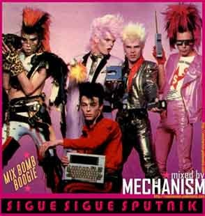
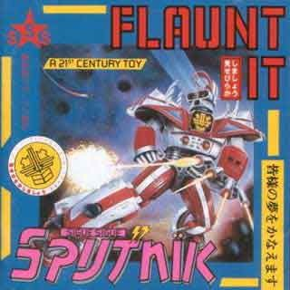
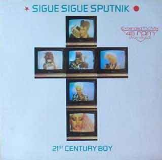
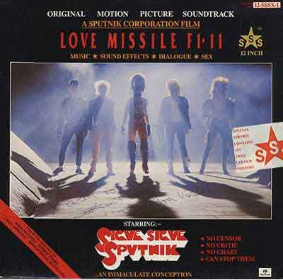

### Psycho maniac interblend, shoot it up!

Ever since punks were spotted walking through the rain soaked dystopic future streets in Ridley Scott’s *Bladerunner*(1981), a certain image of punk has been associated with ‘the future’; a kind of futuristic punk chic that also clearly owes something to the future agro of Alex in *A* *Clockwork Orange* (1971) and the *Class of 1984* (1982), where punks ruled the roost in a high school teen movie set in the year of Orwell’s famous novel. We also recognise the post apocalyptic mohawked road warriors of *Mad Max 2* (1981) and not to mention countless other mid-eighties sci-fi video fare, where the futuristic punk with heavy eyeliner and day glow hair has made an appearance.

The images of this punk-inspired look from an already exhausted dystopic future must have activated the imagination of Tony James, the guitarist from UK punk band *Generation X*. While Malcolm McLaren is often credited for shaping the image of UK punk in the form of the *Sex Pistols*, it was Tony James who reshaped and re-fitted punk into a remixed, recombinant new wave Sigue Sigue Sputnik.

*These days* Sigue Sigue Sputnik (*SSS)* are often ignored and relegated to the receiving end of jokes by smug comedians who make fun of the 80s, citing the likes of *Flock of Seagulls* and bad 80s hair. Even back in 1986 The*New Musical Express* in particular seemed to loath *SSS*. Perceived  as a giant manufactured media hoax, a scam, a vacuous collection of fashion models posing as musicians, ‘WOULD YOU PAY &#1?$3&* 4 MILLION FOR THIS CRAP?’ screamed one *NME* cover in February 1986. *SSS* deserve more credit frankly. Their music and media constructed image was highly unique and perverse at the time and can be identified as one of the critical morphologies of an unacknowledged micro history of remix and sample culture.

James was clearly influenced by McLaren’s own manipulation of the media and Situationist sensibility. With a high dose of camp humour and cynicism James set to work on what was to be the ultimate remix band of the 1980s. With the *Sex Pistols* iconic call of ‘No Future’, *SSS* was a look and music of the future beamed back in time, *Terminator*style, to the present of 1986. It is *Bladerunner* in particular, with its massive billboards, future product placement, Tokyo inspired neons, faceless multi conglomerate corporate interests and advertising for off-world colonies, where*SSS* could very comfortably find themselves.

Taking their name form a mid 80s Russian street gang meaning ‘burn burn satellite’, *SSS* was a satellite transmission of a multitude of signals. Their moniker of the sputnik, an off- world defunct Russian satellite transmitting and receiving information, is entirely apt for *SSS*. Images and messages from the past are picked up and remixed in the future via satellite communications for consumption in the present. There is also something appropriate and fitting in the origin of the band’s name being derived from a Russian street gang laundering  stolen money, which seems to sit so well for *SSS*. The notion of stealing, appropriating and re-using the material of others for their own purposes. It comes as no surprise given that one of *SSS’s* many media catchphrases was ‘Fleece the world’.

Indeed everything about *SSS* was about remixing pre-existing genres, fashions and iconography.  They are the bastard child of Ziggy Stardust  and David Bowie’s Starman. *SSS* was the band who fell to earth to an unsuspecting public, their overloaded image of excess literally cannibalised from a vast range of others. They were a a hyper bricolage of drag queens*,* T-Rex and glam rock, to *Mad Max* and the quiff and pelvic gyrations of a futuristic Elvis, *ID*magazine fashion spreads and New Wave hair- gelled gender – bending she males, to Russ Meyer’s oversexed Ultra Vixens, to Japanese manga and anime, to John Waters, and Divine and Jayne Mansfield, to the video game Hacker, to 50s rocker Eddie Cochran, the trash culture of The Cramps and to the cable TV pirate and sci-fi sex.  Like classic rock on retro radio stations, the references and combinations just keep on coming.

### Death wish crazy, crazy

*SSS* represented a certain look of punk inspired glam taken to its logical conclusion, appropriating the hacker, the information pirate and the video nasty along the way. This was futuristic cyber punk with an extreme appetite for pop culture. Inspired by the comic book sci-fi fictions and themes of a post apocalyptic society, overpopulation, the breakdown of institutions, to multi-national corporations controlling the populace to wanton mayhem, destruction and ultra violence.

The often tired and overused icons of remix culture, from Elvis to B grade movies were given the Sputnik overhaul, no longer appearing as appropriated imagery of cool and camp kitsch. This was sci-fi Elvis 1990, Elvis reinvented into the future as if he had survived all those fried peanut butter sandwiches. A steady diet of early VHS and Betamax sci-fi movies helped pave the way for members of *SSS* to appear like they had just walked off the set of the 80’s post apocalyptic sci-fi exploitation flicks mentioned previously.

*SSS* were possibly one of the first pop culture incarnations of cyberpunk in all its clichéd, overstated and over saturated glory, the children of William Gibson’s *Neuromancer* (1984). *SSS* plugged into the obsessions of early technological developments from portable VHS video cameras and recorders, brick sized mobile phones to Atari computer games, Sony walkmans and of course the sampler. In their own way *SSS* were precursors to the contemporary fixation and insatiable appetitive for all things digital. Their modus operandi was consistently to appear on the cutting edge of everything before it happened.

*SSS* positioned themselves as ultra capitalist, satirical media whores giving new meaning to the word hype. They bizarrely and self consciously fused their own image with super, over hyped corporate advertising and capital expenditure [The hype around *SSS* at the time was that they signed a contract with EMI for 4 million pounds in 1986]. SSS conflated both the real and a more playful futuristic scenario, in which the corporation controlled and over determined every conceivable emergent youth subculture, as commodified, pre-packaged, and force-fed to the consumer.

*SSS* produced the ultimate remix album of 1986,  *Flaunt it*.  The vinyl LP was packaged in a box that resembled more a futuristic Japanese toy, [labeled 21st century toy] than a music album. If *SSS* looked like no other band, their album also didn’t look or sound like any other album. Auctioning off space in between tracks for advertising, *Flaunt it*contains ads for ID Magazine [with it’s own slogan ‘A cliché crush up of the 21st century’, perfectly describing the*SSS* recombinant sensibility] and studio line from [L’Oréal](https://en.wikipedia.org/wiki/L%27Oréal). In vinyl space they didn’t sell to advertisers *SSS* put together their own mock adverts next to brief interstitials and corporate messages from Sputnik headquarters:

> Sex, technology, excitement, records, films, products, real estate and video games, Sigue Sigue Sputnik provide all this and more. Let Sputnik world enterprises handle your ultimate fantasy, for further information contact the Sputnik corporation…Pleasure is our business (*Flaunt it)*

### Firebomb boogie dance on dance on

Tony James’ initial plan for *SSS* was never to actually play and release music, but simply to insert themselves into the hype machine that was the UK music press at the time. The idea of a virtual band that existed only through its media constructions is fascinating considering this was the mid 1980s. *SSS* were Ziggy-inspired future legends, cyber punk superstars for the new millennium who could barely play a note. However after James assembled the members of *SSS* based on their appearances, they quickly coined the phrase ‘The fifth generation of Rock and Roll’ and went about fusing their overloaded image with a sound to match the hype.

SSS famously edited a VHS mash up of  found video material to accompany their first demo *Love Missile F1-11, producing* a remix of *The Terminator* *Desperate Living, Assault on Precinct 13* and other assorted sci-fi movies and material from TV, complete with dialogue and gunfire from the original footage. A move that set the tone for the *SSS*sound, which heavily re used and appropriated material via the first generation of samplers. Their use of the sampler and its stuttering, repetitive sequencing is so overused on *Flaunt it* that the album almost functions as a technical demonstration of the sampler itself.

In 1985, TV and movie references went flying from spaghetti westerns to *Dirty Harry* as the explicit use of the sampler could be heard in the tracks of ex *Clash’*s Mick Jones’ *Big Audio Dynamite* (*BAD*). It’s no surprise that Jones was instrumental in refining the sputnik sound.  He apparently gave Tony James a Roland Synth guitar (renamed Space guitar 2000) that could trigger a sequencer which helped lay the foundations for *SSS*. The sampler is of course the perfect technology for *SSS*, for they were exactly that – a sampler, a technological device for digitally recording and sampling pre-existing sounds made flesh. The samplers in the mid 1980s were particularly appropriate, since their limited sampling capabilities of only a few seconds, gave way to a barrage of sound bites, micro samples and blip verts. *SSS’s* own brand of music, had something also in common with that other underrated remix artist of the early 80s – *Adam Ant* and his branding of his own ‘ant music’. *SSS* played self consciously in 1986 with what music would sound like coming out of a nightclub in the 21st century.  Like *Kraftwerk*, their brand of futurism extrapolated the present and the past into the future.

*SSS’s* sound also clearly owes a great deal to the New York No Wave  of Alan Vega and Martin Rev’s *Suicide*. So much so, in fact, that many of the songs on *SSS’s Flaunt it* almost appear as if they are channeling and remixing Rev’s distorted, repetitive drum machine.

*SSS* were part of that other technological revolution in the early 1980s, video. The ability of early VHS recorders to record, overdub, erase and re-combine broadcast TV seems to infuse much of the *SSS* mindset. Like experiencing cable TV for the first time with its hundreds of potential options, possibilities and re-combinations. *SSS* fell in love with the new electronic landscape. Cable, broadcast, pirate and Sputnik TV, *SSS* were indeed a hijacked satellite transmission from another time and place.

To complete the hybridised mash up that was *SSS*, disco producer Giorgio Moroder produced *Flaunt it*, who was known more for his driving, pulsating disco anthems such as Donna Summers *I feel love*. Moroder, also well known for his film soundtracks, approached *Flaunt it* like an unfolding sci-fi movie sound score starring *SSS*. Much of the publicity at the time for the album saw *SSS* in ads for constructed and fictitious sci-fi movies. Just like their visually overloaded image, *SSS’s* mutant strain of new wave Electro Disco No wave Pop Punk Glam provided a juicy cross section of musical styles and subcultures happening all at once. Just as *SSS* were all about representations, their music too attempted to represent as many genres as possible.

This idea of multiple references occurring simultaneously is at the heart of the brilliant perversity of *SSS.* It is this inventive intertextual, hyper mixed- sampledelica and the spaces which it produces in between, through an onslaught of pop cultural signposts, that guarantees such a dense and hybrid offspring. Everything, every move, every sample, every outfit is a reference, is a signifier of something else. With lyrics on *Flaunt it* that sound more like provocative pop advertising slogans, *High tech sex and rockets Baby, Intravenous USA* , *hips and lips and beauty queens, SSS*inserted themselves into the vernacular of sub cultural catch phrases and future speak of 1986.  Apart from lyrics,*SSS* delivered out the sound bites for the media in the form of *Pure sex, pure style, The future is now*, *I am the ultimate product! Affordable firepower!*

Excessive, and hysterical, everything came under fire for *SSS*, from the image of the band, to record companies, to music, to branding, to the video clip and marketing. Their video clip for *Love Missile F1-11 (*[https://www.youtube.com/watch?v=pk30a0qsVIk](https://www.youtube.com/watch)*) sees members of the band arriving in Limousines together with their clip for 21st century boy which sees them leaving the scene in their sputnik helicopter in an overblown image of superstardom. The sale of sputnik T-shirts and paraphernalia, all before anyone had heard their music, was based on how they appeared in the press. SSS* was remix before remix, before there was a name for this thing called sample culture. They anticipated *YouTube* mash ups and the ‘digital revolution’ with its oversold and over hyped ‘must have’ accoutrements of iPods, mp3’s, laptops and iPhones. *SSS* were the greatest parody of the digital revolution before it even happened.

SSS’s obsessive appropriation and recombinant hyper mix approach, was perhaps a sign of the heady days of the 1980s where notions of original authorship took a backseat to the collision and implosion of disparate cultural forms reconfigured and rearranged into new combinations. True to their name *SSS* was a satellite that eventually burnt out and existed only for a brief moment, releasing only one more album with the original lineup, *‘Dress for Excess*‘ (in 1988). However *SSS* have now bizarrely reformed in a variety of incarnations and permutations, one version in the late 1990s with *Sputnik: Next Generation* and again in 2001 with the perfectly titled *SSS* album *Piratespace*. In 2003 the remix came full circle with David Bowie undertaking a cover of *SSS’s* *Love missile F1-11.*

*SSS* have also have undertaken – you guessed it –  a number of remixes of other artists works.  In 2004, sputnik vocalist Martin Degville formed Sputnik2  a solo project  with a variety of other collaborators. Finally in 2002 SSS’s*Love Missile F1-11* was featured in the video game *Grand Theft Auto*; a fitting choice for the leaders in grand theft audio.

At times *SSS* now receive the ‘they are so bad they’re good’ variety of critical appraisal, reducing them to 80’s kitsch and bad taste. However this is missing the point entirely. The perception and appreciation of *SSS* has shifted over the years, from outright derision by the musical press to critical acclaim. As one *NME* writer in 2001 put it:

> ‘The year 2001, horror of horrors, actually finds the group strangely relevant. By some time-lapse glitch in the universe, the world that Sputnik foresaw has come to pass and their revenge, while sweet, has a sad undertow.’ (Dele, 2001)

In 1992, U2 toured the world with the Sputnik-inspired series of concerts, *Zoo TV*. Appearing very much like it was 1986 and *SSS* were at the helm, including hyped up pop slogans, cannibalised satellite TV broadcasts and sensory overload all of which was very reminiscent of *SSS*.

*SSS* were indeed ahead of the game, as their official Sputnik website exclaims, ‘History will prove us right’. They need to be written back into history in the context of contemporary remix culture. It is with hindsight some twenty years later that the real importance of *SSS* can now be seen and heard. A Google search for *SSS* reveals a vast collection of information and fan sites devoted to the group. Indeed It was many of these fans which inspired James to reanimate the sputnik Frankenstein monster in the late 1990s. In their own way, *SSS* have found their ultimate home as a digitised entity, forever re-circulating in orbit in cyberspace.

## Author’s Biography

Ian Haig works at the intersection of visual arts and media arts. His work explores the strangeness of everyday reality. His practice focuses on the themes of the human body, devolution, mutation, transformation and psychopathology. He lectures in Media Arts in the School of Art at RMIT University.

## References

Fadele Dele, ‘Sigue Sigue Sputnik: 21st century boys: The best of/Piratespace’, *NME*, 12 February, 2001.

Sputnik World website,[https://www.sputnikworld.com](https://www.sputnikworld.com).

New Musical Express,[https://www.nme.com](https://www.nme.com).
