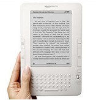
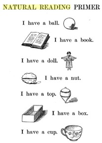
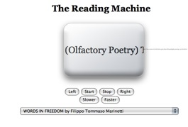
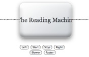

‘Take any text speed it up slow it down run it backwards inch it and you will hear words that were not in the original recording new words made by the machine different people will scan out different words of course but some of the words are quite clearly there and anyone can hear them words which were not in the original tape but which are in many cases relevant to the original text as if the words themselves had been interrogated and forced to reveal their hidden meanings.’ *William S. Burroughs, The Invisible Generation*

People got their opinions

Where do they come from?

Each day seems like a natural fact

And what we think changes how we act.

*Gang of Four, ‘Why Theory’*

In the epigram above, the post-punk band, Gang of Four, explains why we need theory because ‘each day seems like a natural fact,’ but, in fact, what seems natural is based on a world-view or ideology. Changing ‘what we think changes how we act,’ and the deconstruction of naturalization and cultural mythologies allows one to see this process where the everyday reality looks both inevitable and the most rational state of affairs.

Using a type of grammatological approach, and borrowing from William Burroughs discussion of adding speed and movement to texts, this essay interrogates the supposedly natural connection between voice and reading or de-coding texts. Burroughs, in the epigram above, suggests that one can *desediment* any text by putting the text ‘under erasure’ to borrow Jacques Derrida’s phrase, usually thought of as ornamental or distortions of the text.

As Derrida explains in *The Paper Machine*, ‘The page remains a screen. . . . by carrying us beyond paper, the adventures of technology grant us a sort of future anterior; they liberate our reading for a retrospective exploration of the past resources of the paper, for its *previously* multimedia vectors’ (Derrida, 2005: 47). The new media technology allows the mechanized vectors of reading to appear. The turntablist desidiments listening, grown scaled-over and practically deaf through habits of how to spin a record, and a reading machine would do the same for the reading that only appears in retrospect as always already there.

Scratching, a [turntablist](https://en.wikipedia.org/wiki/Turntablism) technique, produces a distinctive [sound by](https://en.wikipedia.org/wiki/Sound) moving a [vinyl record](https://en.wikipedia.org/wiki/Vinyl_record) back and forth on a [turntable](https://en.wikipedia.org/wiki/Phonograph) while simultaneously manipulating the [crossfader](https://en.wikipedia.org/wiki/Crossfader) on a DJ mixer. Much scholarship has examined the strategies and impact of montage in sampling and re-mix. For various reasons, it is more difficult to talk about scratch-effects because it concerns ‘reading the illegible,’ a phrase coined by Craig Dworkin to describe visual poetry experiments (Dworkin, 2003)..

To appreciate reading outside of literacy, we need to run an experiment: deconstruct what we think of as natural reading. Using the Gang of Four lyrics, we could title the experiment, reading seems like a natural fact, but changing how we think, changes how we read. There is a risk here-with all the concern about literacy it is heretical to suggest learning to read scratch effects, learning to untangle reading from its naturalization-and a parodic effect easily missed.

The experiment might begin with the minor cultural myth stated in a dialogue.

‘Is reading a natural fact?’

‘It’s not a composition practice, but a physiological and cognitive ability or skill, right?’

‘You can apply sampling and remix to texts and composition, but reading and listening are natural facts. You can deconstruct Plato, but you can’t deconstruct the process of reading, can you?’

‘What if someone had built a scratch machine that changed reading into something besides the foundation of alphabetic-print culture literacy? What if someone today built an online e-version of the machine to allow for the simulation of the interaction and engagement with the material conditions of reading-as-a-technology, with more in common with scratch remix than sounding out words?’

‘What would a primer for this mechanic reading look like?’

The target for the comparison, natural reading primers, offers a clue.

Lew Anna Ball, in her *Natural Reading Primer* (Ball,1906), presumes a one to one correspondence between word and line-drawing, a strict delineation between the alphabetic and the image, and the innateness of these relationships as the foundation of natural reading. What if a cubo-futurist wrote a primer for a mechanical reading that parodied Ball? What if Hugo Ball wrote this primer? How does that change the reading? (Ball, 1906: 5)

What if the mechanical process of reading, a reading machinicity, had already long ago undergone a transformation using scratch techniques, allowing for variations of eye scanning beyond the confines of traditional literacy?

Quickly glossing the scratch process, and placing it in a specific historical development, will highlight the analogy between listening and reading under erasure or via desedimentation or through scratching.

DJ Herc, whose name first appeared from his friends who thought his large muscular frame resembled Hercules, backed into the musical innovation of scratching. He was DJ-ing parties for his sister, first in their home’s basement, and he noticed that the crowd really liked the instrumental bridges and beats; they could really dance to those. So, he simply wanted to find a way to extend those sections. When he pulled back on the disc, he could play parts over again. He noticed, to everyone’s delight, that the scratch created a beat in itself, and the sound supplemented the particular song. The technique is not an anything goes disruption of the record being played; instead, the processing of the music had a series of steps and corollary effects. Grandmaster Flash and DJ Herc, through a creative competition, advanced scratching to a genre of music eventually embraced by a mainstream popular music that threatened music label moguls, who resisted any change from which they did not directly, and immediately, draw a profit.

This essay looks at that machine, and draws the explicit line from scratch techniques to de-reading; that is, scratch is not an ornamental value distorting the text, but rather a crucial way of reading, uncovering the ghosts of meanings lurking in plain sight. The turntablists are sometimes thought of as producing something to dance to rather than a poetics or demonstrating how to read. In large part, because of scratching’s beginnings at basement parties, and the later controversies over copyright, effaced the fact that scratching puts the music under erasure and processing it both beyond recognition, when the music plays backward at a high rate, and as a citation and repetition of recognizing a piece of music, when the music repeats small fragments over and over again. Certain musical parts seem stressed through the repetition, and others seem transformed when played backward.

What if instead of learning to read the ‘natural’ way, one learned by scratching? What if those musicians spinning vinyl records were the future of literacy efforts?

Recently, our culture has produced electronic reading machines, but forcefully banish any turntablist techniques at least at the level of the individual line. One can electronically flip the pages to produce a flickering, but the effects are limited. We do not yet have a turntablist of e-readers. To find a corollary to the scratching in music, we need to study avant-garde experiments that sought to use scratching as reading.

Bob Brown (1886-1959) invented a reading machine sometime in the first two decades of the twentieth century.

He announced the machine to the world with a series of publications in the early 1930s: ‘Without any whirr or splutter writing is readable at the speed of the day – 1931 – not 1450, without being broken by conventional columns confined to pages and pickled in books, a READIE runs on before the eye continuously – on forever in-a-single-line-I-see-1450-invention-movable-type-Gutenberg’ (Brown, 1931:184).  The significance of Bob Brown’s eerily prophetic *The Readies*looks now like a media experiment in scratch techniques. He includes plans for an electric reading machine and strategies for preparing the eye for mechanized reading. There are instructions for preparing texts as ‘readies’ and detailed quantitative explanations about the invention and mechanisms involved in this peculiar machine.

Brown writes about the machine’s potential to change how we read and learn. In 1930, the beaming out of printed text over radio waves or in televised images had a science fiction quality–or, for the avant-garde, a fanciful art-stunt feel. Today, Brown’s research on reading seems remarkably prescient in light of text-messaging, electronic text readers, and even, or especially, electronic music re-mixing and turntablists’ scratching. His description of the machine’s operation sounds much like Burroughs’ much later explanation, in the epigram to this experimental essay, of his reading strategy: ‘Extracting the dainty reading roll from its pill box container the reader slips it smoothly into its slot in the machine, sets the speed regulator, turns on the electric current and the whole 100,000, 200,000, 300,000 or million words spill out before his eyes . . . in one continuous line of type . . .  . My machine is equipped with controls so the reading record can be turned back or shot ahead . . . magnifying glass . . . moved nearer or farther from the type, so the reader may browse in 6 point, 8, 10, 12, 16 or any size that suits him.’ (Brown, 2009: 29).

Brown’s machine, as well as his processed texts for it, suggested a shift toward a different way to comprehend texts. That is, the mechanism of this book, a type of book that resembles the turntablist’s rapidly shifting direction, speed, and repetition of the text rather than slowly flipping the pages of a book. Punctuation marks become visual analogies. For movement we see em-dashes (–) that also, by definition, indicate that the sentence was interrupted or cut short. These created a ‘cinemovietone’ shorthand system. The old uses of punctuation, such as employment of periods to mark the end of a sentence, disappear. The result looks like a script for a turntablist’s performance. It suggests the following directions: at each – pull/push/tap the recording. Reading machine-mediated text becomes more like watching a continuous series of flickering frames or listening to music played backward or scratched.

I’m not the first to recognize the scratch-potential in Derrida’s work. One Professor Burt came to an otherwise somber symposium of important Derrideans, like Professor Peggy Kamuf, the Marion Frances Chevalier Professor of French and Professor of Comparative Literature and English at USC, and gave his presentation dressed, and talking like, Flavor Flav, with a big clock around his neck. Burt’s talk was greeted with deafening silence. Burt shocked the audience by explaining, ‘For in absenting our speakers awhile, my aim has been to commemorate and conjure up the spectre of Shock Derrida in these remarks.  . . . I hope we can keep open our ears and hear the party in the aftershocks of Jacques Derrida’s de-parti-ng. So let me officially begin this first session of the final day of our conference by closing with a thanks and a shout out  …’ (Burt, 2006, n.p.).

The readies sought to illuminate the form of a process rather than the form of a medium. The mechanical poetics of scratching techniques magnify reading as a cultural technological medium without a single essential form. Using punctuation in this way–as a visual score rather than cues for reading aloud–moves reading from interpreting words in connection with an author’s voice to emphasizing design, aesthetics, and movement. Scratching does not efface expressivity.

So, his machine added speed or motion to the still text. One could unwind a spool of text, magnifying it as it passed under the viewer, and read all works of literature very quickly. Because the text unrolled, one could roll it backwards as well.

By building a simulation of Brown’s machine, a whole array of possibilities appears that one would never consider without the simulation. Simulation becomes paradoxically the best way to understand the material conditions of reading as a technological process. It also immediately allows for the machine to appear in the context of scratching

‘Why?’

Because before building the simulation, one simply read the prepared texts, but after playing with the simulation, one notices the effects of moving the text backward and forward quickly until it becomes a flickering blur — at very high speeds the text seems to jerk or flicker and most interestingly the direction of movement becomes difficult to determine. It seems to reverse direction. The careful scholarship on Brown’s readies always focuses on the way he prepared the texts and how it relates to broader concerns of the modernist poets, and avant-gardists, who participated. (North, 2005; McGann, 1993; Rothenberg, 2000; Dworkin 2003). If we focus on the machine and the scratching, then it produces an entirely different reading. Brown saw the machine much like the one Burroughs envisions or a turntablist might use.

A simple reading machine which I can carry or move around, attach to any old electric light plug . . . equipped with controls so the reading record can be turned back or shot ahead . . .  . (Brown, 1930: 28)

A screen grab can produce one frozen moment, but not the visual-scratching effect, and it is that effect that may mark an unforeseen aspect of reading. The discontinuous, hyperlinked, and multilinear reading always already existed in book and codex. One could flip back and forth, and one could approximate the hyperlinking remix using a montage strategy as demonstrated here.

It is much more difficult to reproduce or even approximate the motion, scratch, jerking, flickering, and visual effects produced or illuminated with Bob Brown’s machine. Those supplemental aspects are, in Derrida’s phrase, *always already* part of reading. The supplement (movement, visuality, mechanicity) to traditional notions of literacy usually remain part of an implicate process. The reading machine is not simply a new conduit for the same supposedly natural process. It highlights what Derrida calls the ‘virtual multimedia’ of reading print on paper (Derrida, 2005: 47).

**Scratch Reading Machine (Saper, 2009: [readies.org](https://readies.org/))**

Paul Saenger, in *Space Between Words*, defends ‘the thesis that the separation of words, which began in the early Middle Ages, altered the physiological process of reading and by the fourteenth century enabled the common practice of silent reading as we know it today’ (Saenger, 1997; ix). Without word separation or punctuation (scripture continua), reading requires enormous effort and one had to read aloud so that one could hear and unconsciously choose/invent the delineation and punctuation among a long continuous string of words. The scratch reading machine moves us back to that ancient practice of reading. Saenger explains that, ‘The reintroduction of word separation by Irish and Anglo-Saxon scribes marks a dramatic change in that relationship and constitutes the great divide in the history of reading between antique cultures and those of the modern Occident’ (Saenger, 1997: 12).

What does it mean to simulate an experience of reading, an experience that heightens the scratch-effects lurking in so-called natural reading, but not brought to the surface without the machinicity — without the speed-mechanism (an analogy for the turntable), the reading machine, the DJ readie (suggesting groupie or fan of reading as a mechanical process as well as Bob Brown’s readies and all that his term suggests about the shift in reading he prepared for)? The answer involves an epistemology of doing: using the machine to read and experience reading via a machine. The simulation suggests that with the increasing prevalence, even omnipresent and [to some critics] epidemic, use of text(ing) machines, something outside or beside traditional literacy, the scratch- meaning. becomes foregrounded. Brown’s machine, and its connection to modernist poetics, puts the natural process of reading under erasure or scratch (simply by adjusting the speed, direction, and layout).

What does it mean to apply a term usually thought of in terms of composition (music, media, writing) to a cognitive process of a subjectivity? Almost all the secondary literature on reading and literacy focuses on the process as a crucial component of an individual’s maturation into responsible and fully-conscious subjectivity and, even, good citizenship. By shifting the terms of the debate, the frame of how one defines reading, the process now resembles composition rather than reception. Reading as something more akin to scratching and the turntablist’s DJ-ing suggests a subject formation as a bricoleur-in-motion. Eyes spinning, jumping, and blurring are best understood in the actual experience of the simulation of the reading machine. One can almost imagine dancing to the reading experience.

## Author’s Biography

Craig Saper is Professor of Texts and Technology in the English Department at the University of Central Florida. He is the author of *Networked Art* (2001) and *Artificial Mythologies* (1997).  His most recent book is *Imaging Place*(2009), edited with W.F. Garrett-Petts and John Craig Freeman.

## References

Ball, Lew Anna.  *Natural Reading Primer* (New York: Ginn and Company, 1906).

Brown, Bob, et al. *Readies for Bob Brown’s Machine* (Cagnes-sur-Mer: Roving Eye Press, 1931).

Brown, Bob. *The Readies* (Bad Ems,: Roving Eye Press, 1930).]

Brown, Bob. *The Readies*. Ed. & Afterword, Craig Saper in the series Literature by Design: British and American Books 1889-1930 (Houston, TX: Rice University Press, 2009).

Burt, Richard. ‘Derrideath’, *A Conference to Celebrate the Legacy of Jacques Derrida*, University of Florida, Gainesville FL, October 9th-11th. 2006.

Cavallo, Guglielmo, Chartier, Roger  and Cochrane, Lydia G.. *A History of Reading in the West. Studies in Print Culture and the History of the Book* (Amherst, Mass: University of Massachusetts Press, 1999).

Derrida, Jacques. *The Paper Machine*. trans. Rachel Bowlby (Palo Alto, CA: Stanford University Press, 2005).

Dworkin, Craig Douglas. *Reading the Illegible*(Evanston, Ill.: Northwestern University Press, 2003).

Fischer, Steven R. *A History of Reading Globalities* (London: Reaktion, 2003).

Johnson, Frederick Charles. *The Historical Record*, v. 2 and3 (Wilkes-Barre: Press of the Wilkes-Barre Record, 1888).

McGann, Jerome J. *Black Riders: The Visible Language of Modernism* (Princeton, NJ: Princeton University Press, 1993).

North, Michael. *Camera Works: Photography and the Twentieth-Century Word* (New York: Oxford University Press, 2005).

Rothenberg, Jerome, and Clay, Steven. *A Book of the Book: Some Works & Projections About the Book & Writing*(New York: Granary Books, 2000).

Saenger, Paul. *Space Between Words: The Origins of Silent Reading* (Stanford, CA: Stanford University Press, 1997).

Saper, Craig. ‘The Reading Machine’. 22 May, 2009, [https://www.readies.org.](https://www.readies.org.)
