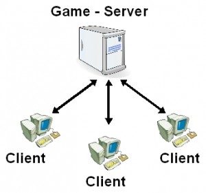
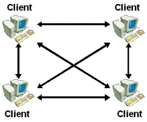
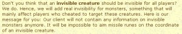
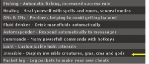
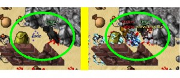
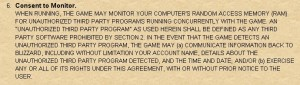

In this paper we ask the question, how can we define cheating in Massive Multiplayer Online Role-Playing Games (MMORPGs)? It is important to clarify immediately that what is at stake here is the way we study the phenomenon of cheating, how we conceptualise it and how we research it in MMORPGs. In particular, the focus is the difference between defining, or reducing, a phenomenon to its essential traits as opposed to defining it on the basis of the process that has generated it (see for discussions Latour, 1987 and 2005; Lash, 2002; DeLanda, 2002 and 2006). The rationale behind the opening research question is that much of the literature has defined cheating in online games via a restricted set of essential traits: in particular, as the player(s) actions that modify the game to obtain unfair advantages over other players. On the contrary, we propose that cheating should be conceptualised as what unfolds – the result(s) – from the empirical interrelations of several elements that compose MMORPGs, and not just from player behaviour. We provide a new perspective on cheating in MMORPGs, which suggests that cheating is the result of a dynamic process and interrelations between a range of elements. {#para3}

In this paper, we study cheating by using the concept of assemblage as proposed by DeLanda (2002 and 2006), following Deleuze and Guattari (1987). This concept takes a realist stance emphasising that social and natural phenomena should be conceptualised as the dynamic result of the empirical and historical relations among empirical elements, rather than thorough listing their essential traits or making timeless classifications. In this paper we analyse the following elements of MMORPGs and their relationships (but we are aware that the list is not necessarily conclusive): the game architecture, the game code and the game legal documents. Moreover, we focus on how these elements are interleaved with players, games companies and also companies offering cheating solutions. For us, cheating in MMORPGs possesses a mobile and permeable boundary where these different elements, and the players and companies strategies embedded in them, compete and / or cooperate – always in some form of relations with each other – in the process of stabilising or destabilising what is cheating in MMORPGs. We support this proposition by mainly providing empirical examples from ongoing research of the online game *Tibia* ([https://www.tibia.com](https://www.tibia.com/)), a 2D, medieval fantasy MMORPG developed and distributed by CipSoft, since 1997. Tibia has an estimated 300,000 players and is played on more than 70 servers in Germany and the USA. {#para4}

The assemblage approach seeks also to specify what is defined as the structure of spaces of possibilities (DeLanda, 2002): a differentiation between what is possible in principle in an assemblage (the virtual) and which of these possibilities is really actualised. [1] In our search for a theoretical resource that captures the empirical and sociotechnical negotiations and struggles for control around cheating in MMORPGs the concept of assemblage has proved to be a key resource. We believe that by embracing this concept we will be able to unveil the dynamics that are unleashed by the virtual/actual articulation of cheating in MMORPGs. {#para5}

We are convinced that a more complete understanding of the processual nature of cheating in MMORPGs as assemblage is useful not only in itself, but also for our understanding of other related concepts like ‘counterplay’ and ‘transgressive play’ (Aarseth, 2007). In particular, we discuss the concept of counterplay – which is at the centre of this special issue – and link it with the virtual and actual aspects characterising cheating in MMORPGs as assemblage. The concept of counterplay suggests we think about play as negotiated power relations exercised by the materiality of software and a range of other artifacts. In our conceptualisation of cheating we attempt to explore the range of artifacts and actors involved in MMORPGs as assemblage and the continual renegotiation of the assemblage interrelations. {#para6}

This paper is organised as follows: firstly, we briefly describe MMORPGs; secondly, we describe the importance of studying cheating and criticise the mainstream definitions of cheating in MMORPGs; thirdly, we describe our approach based on the concept of assemblage; fourthly, we provide some examples of cheating as the result of the MMORPG’s assemblage; fifthly, we discuss our contribution to the concept of ‘counterplay’. In the conclusion, we provide a new definition of cheating in MMORPGs based on our findings. {#para7}

 {#para8}

### MMORPGs in a Nutshell

MMORPGs are a successful sub-sector of the digital games industry [2] whereby players participate in a persistent virtual world (Bell, 2009) that requires continuous customer support from the game developer (Kerr, 2006). MMORPGs are sophisticated technological systems, that in most cases use a client-server architecture (see figure 3) and rely upon complex computer code. MMORPGs are also ‘deeply social’ worlds (Castronova, 2005; Taylor, 2006) where millions of players cooperate, compete and trade online. {#para9}

MMORPGs have a number of specific characteristics. Firstly, an MMORPG is considered persistent because it is an online world that continues to function even after individual players have logged out and stopped participating. This is different from traditional digital games played by a single person or small groups, whereby the game ceases to function after the player(s) has logged out. {#para10}

Secondly, in MMORPGs players usually assume a fictional role. For example in *Tibia*, players are allowed to choose between four different roles (Knight, Paladin, Sorcerer or Druid) all of which allow different types of gameplay. A character’s role determines her characteristics in many ways and different roles allow different types of gameplay, of attack and combat with both monsters and other characters. Knights for instance have particular abilities with melee weapons (such as swords or axes) and, therefore, are strong in close combats. By comparison, Druids are better at casting spells and healing. {#para11}

A third characteristic relates to the advancements that are obtained by players. In *Tibia*, one of the main activities carried on by players is that of killing monsters. There are several different types of monsters in *Tibia*, [3] by killing these monsters players can increase their level / experience points and in so doing increase their overall game ranking. Moreover, monsters often carry items such as gold pieces or weapons that can be looted by players. {#para12}

Finally, solving quests either alone or in teams of players is also a common activity in MMORPGs such as *Tibia*. In *Tibia*, the successful completion of quests provides players with special items such as magic weapons or amulets. In many MMORPGs, players can organise themselves into guilds: groups that share the same goals. For example, in *Tibia*, players can form guilds and take part in wars between guilds. The rewards for winning guild wars in Tibia lie in the ability to exercise forms of domination over a server. {#para13}

 {#para14}

### Defining Cheating: This is the Problem

Several studies have pointed out that the complex social and technical nature of MMORPGs makes these games potentially open to a range of disruptive practices (see for an overview ENISA, 2008), that include fraud (Bardzell et al., 2007), harassment (Foo and Koivisto, 2004), or social conflicts (Smith, 2004). In our research, we are particularly interested in the practices and consequences of cheating in MMORPGs and for virtual environments more generally. Specifically, this paper has emerged from an interdisciplinary research project, composed of computer scientists and social scientists, that focuses on the design of services and applications for the Future Internet. Our research on cheating aims to contribute an in-depth understanding of the social intricacies of cheating in MMORPGs in particular, and social behaviour in online environments in general. {#para15}

Understanding cheating practices is of paramount importance for understanding online gaming practices (Consalvo, 2007). Indeed, cheating in a MMORPG is a highly controversial phenomenon that deserves attention, insofar as it is perceived by the developers, publishers and many players to be a threat to the social experience and economic viability of a game. For others, cheating can be justified because it offers the potential to generate large amounts of real and virtual money, or to more easily progress up in the game rankings. {#para16}

Any new study of cheating in MMORPGs must critically engage with the mainstream definitions of cheating. In particular, there are two main bodies of literature on cheating in digital and online games: the technical / computer science literature (for example Yan and Randell, 2005) and the media / game studies literature (for example Consalvo, 2007). Elsewhere (De Paoli and Kerr, 2010) we have described how the first type of literature focuses mostly on cheating as an outcome of poor security design, whereas the second emphasises mostly the cultural aspects and the idea that cheating is often proof of player power. Although these two types of literature possess clearly different goals and methods, both often share a common definition of cheating. {#para17}

We can see this by reading some mainstream definitions of cheating in digital and online games. For instance, Salen and Zimmerman (2003) in their work on the design of digital games argue that ‘the cheater surreptitiously takes actions that are not proscribed by the rules, in order to gain an advantage’ According to Parker (2007: 2) in his work on cheating in videogames, ‘we can agree that a cheater cheats in order to have a better chance of achieving their goals whatever they are’. Brooke et al. (2004) in their work on the definition of healthy “Virtual Societies” argue that cheating can be defined as ‘gaining some unfair advantage over other participants’. Smith (2004: 5) in his work on the social conflicts in online multiplayer games argues that ‘behavior labeled as cheating typically gives the cheater an unfair advantage over opponents and/or runs contrary to the spirit of the game’. And the list of publications sharing similar definitions of cheating can easily go on (for example Yan and Choi, 2002 or Webb and Soh, 2007). {#para18}

If, for a moment, we leave aside the few existing exceptions to this debate (see the section Discussion) [4], we can easily conclude from these examples of cheating definitions that most of the existing literature defines cheating as a practice where someone obtains unfair advantages. This is the fundamental trait of cheating, without which this phenomenon would not be what it is: obtaining an unfair advantage over other players is the “essential trait” of cheating activities. In other words, if unfair advantages over other players are not obtained by doing certain activities, then what we have is not cheating, but something else. {#para19}

We are aware that, especially in media studies the debate on cheating revolves around the controversial nature of this phenomenon. [5] For example, the work by Consalvo (2007), clearly points out that the definition of cheating is something that gets culturally negotiated by players, cheaters and the anti-cheating industry. However, Consalvo’s book also strongly supports an understanding of cheating in terms of “unfair advantages”: for instance the whole of chapter 4 and the conclusions in chapter 7 discuss how players negotiate the meaning of cheating as “obtaining unfair advantages”. {#para20}

It is also worth nothing that the literature providing classifications and typologies of cheating (for example Yan and Randell, 2005; Webb and Soh, 2007) also possesses an essentialist view, insofar cheating is characterised by listing in timeless classifications the various types of cheating exploits and motivations to cheat. In MMORPGs, this includes using software that tampers with the game client, the exploitation of design flaws and game bugs and even social engineering. {#para21}

### The Essential Traits of Cheating

The words “essential traits” play a crucial role in this discussion. Indeed, we believe that mainstream definitions of cheating convey an essentialist view in which what constitutes or does not constitute *cheating is defined in advance*. If we adopt this definition of cheating, we already possess a causal explanation or interpretation about cheating in MMORPGs that prefigures the empirical dynamics thorough which this phenomenon unfolds. Indeed, we already know, even before we do our empirical research, what we are looking for: all the elements that give unfair advantages to players and perhaps the motivations that induce players to cheat. Contrary to current definitions / classifications that only focus on a limited set of essential traits of cheating, we propose to focus on the interrelation processes among the elements of MMORPGs from which cheating unfolds, in order to go beyond the definition of cheating as what provides “unfair advantages”. {#para22}

At this point, we want introduce an example that will allow us to rethink the definition of cheating, and in so doing illustrate some of the limits of essentialist definitions and also elaborate on the productive contribution of our approach. In particular, we adopt a strategy which is common in the sub-discipline of Science and Technology Studies (STS), in which didactic empirical examples are used to illustrate complex theoretical issues and concepts (some relevant examples are in Latour, 1991 and 1992). The example we provide here relates to the direct experience of one of the authors. {#para23}

The Trentino region, in the north part of Italy, is an area characterised by an alpine environment with relatively high mountains and a wide distribution of forests. In the Trentino territory, there are several naturally formed alpine lakes that are populated by wild trout. In these lakes, fishermen can fish recreationally if they posses their own fishing equipment such as the fishing rod, the hooks, the fishing reel with the fishing line and so on. Moreover, fishermen must possess a local fishing license that gives them the right to fish. The existence of fishing licenses implies the fishermen’s acceptance of specific regulations. Indeed, fishermen must abide by the rules that are set by the local fishing authority to regulate fishing activities. There are, of course, several different rules with different purposes such as the rule that sets the maximum daily catch at 6 trout, or the rule that sets the minimum length in centimeters for keeping a trout. Fishermen that are caught violating the rules (e.g. with more than 6 trout) will incur a fine and a temporary ban from fishing. {#para24}

An interesting rule for fishing in natural lakes in Trentino says that it is possible to fish only by using natural baits, for example, worms or insects. Thus it is forbidden to use artificial baits, often referred to as fishing lure (see figure 2 for some examples). [6] What is more important, however, is that among fishermen it is common knowledge that trout are keenly attracted by the colors and the movements of these artificial baits when they are used in lakes. Therefore, catching fish by using artificial baits is certainly easier compared to the use of natural baits that by contrast require more time and are less attractive for trout. While most fishermen certainly abide by the fishing rules, this is not always the case. Indeed, some fishermen use artificial baits anyway, hence violating the rules. Those fishermen that use artificial baits in natural alpine lakes not only violate the local fishing rules, they also obtain what we can recognise as an unfair advantage over other fishermen and perhaps over the fish as well. {#para25}

### Rethinking Cheating

The fishing example supports the proposition about the limits of defining cheating on the basis of some “essential traits” and, in particular, as “obtaining unfair advantages over other players”. If we apply this definition to the fishing example, we can easily decide that the action that brings an unfair advantage to the fishermen is that of using the fishing lure. At this point, we might explore the reasons why a fisherman uses the fishing lure to violate the regulation, or list the characteristics of the lure and why they are unfair (as in media studies). Or we might argue for more guards and other forms of control in order to detect and punish those fishermen that use the lures (as in computer science). But it is clear that according to mainstream definitions of cheating we do not need to take into account all those things that do not necessarily bring unfair advantages to cheating fishermen. For example, the use of the fishing rod is common to cheating and non-cheating fishermen, so using the fishing equipment (the rod, the reel with the line and so on) in general does not bring an unfair advantage and, therefore, falls outside the definition of cheating. The same can be said for the lakes and the trout, as these do not change from cheating fishermen to fair fishermen. Why should we take into account the lake if the problem is, for example, preventing the use of the lure? What does the lake add to the motivations of using the lure rather than natural baits? {#para26}

We think that it is exactly here that there is a problem with current cheating definitions and classifications. Understanding cheating just as “what brings unfair advantages” might be limited for our empirical and theoretical investigations. On the contrary, adopting an approach that focuses on the process of cheating, allows us to include in our investigations and discussions more elements and their inter-relational dynamics. For example, one cannot use the artificial bait without using the fishing rod, and certainly it does not make sense to use it without the lake and fish. Here, some of the limits with current cheating definitions have become clear: we cannot isolate the essential traits of cheating (i.e. what brings unfair advantages and the motivations behind the use of these elements) from everything else as it is the interrelations among things that is important (the artificial baits, the rod, the lakes, the trout, the fishermen, the regulations and the guards), even if each single element does not specifically provide unfair advantages. By defining cheating as what gives unfair advantages we risk investigating just a small fraction of the problem (the artificial bait) leaving outside all the remaining elements (the lake, the fishing equipment and so on) and more important their interrelations. Hence, we think that cheating in MMORPGs should be seen as the final outcome that unfolds from the relations among the various elements and include especially those elements which do not directly account for the unfair advantages. The issue now is to attempt to investigate cheating in MMORPGs by applying this conceptual approach. {#para27}

### Assemblage Theory

The artificial bait example provides us with a new way of approaching cheating. There are at least two elements that we need to take into account: first that conceptualising cheating requires a non-essentialist approach (for example we cannot reduce cheating to just an analysis of the artificial baits) and second we need a concept that can grasp the relations among the various elements and what unfolds from these relations (cheating is one of the outcomes of the interrelation among elements – the lake, the fishermen, the equipment and so on – even if they do not bring unfair advantages). A good candidate for solving at once these two problems is the approach known as assemblage theory (DeLanda, 2002 and 2006). [7] {#para28}

According to DeLanda (2006) the concept of assemblage allows us to think about the relations between a whole and its parts. For example, recreational fishing can be seen as a whole composed of different parts, including the fishermen, the trout, the fishing equipment and so on. Hence, the concept of assemblage provides a way to conceptualise the relations among these elements and their outcomes. DeLanda (2006) clarifies that the relations among elements of an assemblage are not necessary, as in a “system”. Indeed, the concept of system, in both natural and social sciences, is also based on a conceptualisation of the relations among elements that form a whole (the system). The relations among parts of a system are necessary and, as a consequence, the failure of one relation leads to the failure of the whole system. For example, the organs that compose a human body (e.g. heart or brain) are elements of a system (the body) that are in necessary relations with one another (if one organ fails to function the whole system is likely to fail). In social sciences, the concept of “social system” draws on a parallelism with natural systems, in which social institutions (for example, religion or economy) are necessary for the integration of societies (Parsons, 1951). For example, the lack of ethical norms might lead to anomie in society (Durkheim, 1951) and to a disintegration of the social system. {#para29}

In assemblage theory, the relations among parts are conceptualised differently: the elements enter into the whole via contingent (non-necessary) relations. In other words, the relations can change at any time and the parts can withdraw from one assemblage and enter into other assemblages even with different roles. For example, recreational fishing is composed of several elements like the fishing equipment, the lake with the trout, the guards that enforce the rules and so on. Each of these elements is fundamental for the fishing activities, but their role is at the same time contingent. For example, the use of artificial baits is against the rule when used in natural lakes, but it is allowed in artificial lakes. In addition, people from local communities can use the lakes for different purposes, for example as a source of drinking water. This means that the relationships among elements need to be approached from an historical and empirical point of view, rather than from a pure theoretical point of view as is done with the concept of system. The roles and the relationships of the elements composing an assemblage cannot therefore be deduced in advance, but relates to a ‘structure of space of possibilities’. This notion, according to DeLanda (2002 and 2006), specifies that the capacities / roles of an assemblage and its composing elements are not given in advance. For example, the lake can be used for fishing in one assemblage and as a source of drinking water in another assemblage. Hence, this structure of space of possibilities is a virtual space: a real set of relations that have not been yet actualised into something concrete. Therefore, how the elements enter into relations and the outcomes of the assemblage is something that unfolds thorough empirical and historical processes. {#para30}

The problem now is how can we account for the empirical dynamics of the assemblage? The following section addresses this problem. {#para31}

### The Assemblage Dimensions

An assemblage is conceptualised along two fundamental dimensions (DeLanda, 2006): a material / expressive dimension and a territorialisation / deterritorialisation dimension. These dimensions refer to the specific role or capacity that an element may play while entering into relationships with the other elements. These roles may also come in mixtures: the same elements can play a mixture of different capacities. {#para32}

In the first dimension, these capacities may go from a pure material to a pure expressive. DeLanda (2006) seems to follow Deleuze and Guattari (1987) in arguing that the material / expressive dimension of the assemblage is similar to the difference between a set of laws for regulating an order (discipline) and materially exercising such an order (punish). Indeed, Deleuze (1984) discusses how in Foucault’s (1977) book *Discipline and Punish* the interrelations between the Penal Law (called ‘abstract machine’ by Deleuze), and the actual exercise of the Law (for example in the ‘concrete machine’ of the modern prison), effectively illustrate the expressive / material dimension of the assemblage. For Deleuze and Guattari (1987: 88), this dimension is the articulation between the semiotic aspects (for example, a statement describing the body) and the material aspects (the body itself and how the body is treated) of the assemblage. {#para33}

The relation between the Law and its material exercise also illustrates the virtual / actual unfolding of the structure of space of possibilities. The Law is a real element which aims at virtually regulating the exercise of certain functions / activities, such as regulating fishing activities. For example, the Law prescribes that someone caught fishing with artificial baits in a natural lake in Trentino will incur a fine and a ban from fishing. The Law virtually sets a range of possibilities regarding what is possible (fishing with natural baits) and what is not possible (fishing with artificial baits). However, only in certain cases does the Law get actualised in the form of concrete punishments, for example when the guards catch a fisherman that violates the rules. In this example, the virtuality of the Law as the field of possibilities, is actualised in a concrete case. {#para34}

Finally, it is important to clarify that the relations between the material and expressive capacities are symmetrical, meaning that each can influence the other. This reflects a functional versus a non-functional capacity, as for example in the difference between a city infrastructure (material) and a city skyline (expressive) (Harman, 2008). Hence certain elements or whole assemblages, such as a city, can exercise both material (more functional) and expressive (non-functional) capacities. {#para35}

The second dimension of the assemblage relates to the territorialisation / deterritorialisation capacities of the elements. According to DeLanda (2006: 13), territorialisation is a process that ‘increases the internal homogeneity of the assemblage’ and that induces a stabilisation of the relations within an assemblage. On the contrary, deterritorialisation does the opposite, decreasing the homogeneity of the assemblage and destabilising the relations among the elements. As before, the elements can play also a mixture of territorialisation / deterritorialisation capacities. {#para36}

This dimension territorialisation / deterritorialisation, according to DeLanda, relates to a spatial process, such as the difference between a face-to-face communication (territorialisation) and a computer mediated communication (deterritorialisation). Another example is when an organisation operates within the boundary of a specific building(s) (territorialisation) or operates far away from this building (deterritorialisation). For example, as researchers we currently work with our colleagues in a university which is territorialised into the campus buildings. However, when we travel abroad to attend conferences and meet with colleagues from other universities, we have a form of deterritorialisation of the university that from a specific centralised location, moves to various other locations all around the world. {#para37}

This dimension of the assemblage also relates to non-spatial dynamics. DeLanda (2006) argues that territorialisation can be a process which excludes a certain category of people from the membership of an organisation or a group: this creates homogeneity among the members of that organisation. For example, in certain areas only local people / residents might be entitled to exercise recreational fishing, hence the group of fishermen in that area might become quite homogeneous. In our view, the territorialisation excludes and homogenises not only people but also the possible courses of actions / relations within an assemblage. For example, forbidding the use of artificial baits in natural lakes creates homogeneity of baits, only natural ones can be used to fish. In other words, territorialisation can be a process that homogenises the structure of the space of possibilities and the range of actions within the assemblage (in other words one can only fish using natural baits). On the contrary, deterritorialisation can be a process that increases the possible courses of actions / relations. In conclusion, along this second dimension we can have a process of stabilisation / consolidation (territorialisation) and of destabilisation / dissolution (deterritorialisation) of the assemblage. In the following sections, we provide empirical examples that support our approach to cheating in MMORPGs based on assemblage theory. {#para38}

### The MMORPGs Assemblage

In a recent paper entitled ‘The Assemblage of Play’, Taylor (2009) explores some aspects of the concept of assemblage for game studies. Taylor does not refer directly to DeLanda’s assemblage theory, and she admits just a loose relation with both Deleuze and Guattari (1987) and Latour (2005). This paper by Taylor is interesting for our work because it connects the notion of assemblage with MMORPGs. Taylor asserts that the nature of MMORPGs is particularly complex as it involves a range of different elements such as the legal structures, the game companies, players, technologies and so on and so forth. In particular, Taylor emphasises the crucial importance of what she calls ‘the interrelation’ of these elements and the outcomes of these interrelations. She asserts that ‘in the space of interrelations lie the dynamic processes of play’ (Taylor, 2009: 332). Therefore, for Taylor, “play” is what unfolds from the MMORPGs assemblage. Having introduced the assemblage theory by DeLanda we can certainly paraphrase Taylor and argue that ‘in the space of interrelations lies the dynamic process of cheating in MMORPGs’. {#para39}

The composite nature of MMORPGs and the interrelation between various elements identified by Taylor can be easily traced. To play a MMORPG a player has to acquire or download the software client and install it on a computer. During the installation process the player has to accept several legal documents such as the End User License Agreement (EULA) or the Terms of Service (ToS). The acceptance of these documents by the player enacts a legal relationship between her and the publishing company. After the client installation, in order to play the player must connect the client to the game server and only at this point can she play the game. In most cases, the player will also navigate the Internet searching for guides, walkthroughs or other paratexts that relate to the game (Consalvo, 2007). Here we already see an initial set of relations between heterogeneous parts – ranging from the player, to the software, to the licenses – that constitutes the MMORPGs assemblage. In what follows, we will describe the role of three crucial elements of the MMORPGs assemblage for cheating: the game architecture, the code and the legal documents. We will also describe how these elements are interleaved with the practices of players, game companies and companies offering cheating software. {#para40}

What we can call the code level is an important element of the MMORPG assemblage. The code level includes, among other things: the game client, the game code executed on the server, the anti-cheating software as well as the software used by cheaters. The cheating code [8] includes so-called “bots”: computer programs that operate through artificial intelligence routines to automate certain game tasks, such as the action of killing and looting monsters. Bots act as automated player agents (Golle and Ducheneaut, 2005; Joshi, 2008) in what is known as ‘Away From Keyboard’ (AFK) play: the bot can play the game in place of the human player. {#para41}

Textual artefacts, such as scientific papers and patents, have a crucial role in shaping the use of technologies (see Latour, 1987). In this regard, ‘software legal documents’ are no exception because they play an important role in shaping software users and developers practices (Humphreys et al., 2005; De Paoli et al. 2008). These documents play a crucial role within the MMORPGs assemblage too. {#para42}

A further crucial element of the MMORPGs assemblage is the ‘architecture’ (see for a discussion Castronova, 2005, chapter 3): the way computers involved in the game communicate and network with each other (see Smed et al. 2002). {#para43}

These elements (the code, the legal documents and the architecture) and their interrelations can be analysed using the material / expressive and the territorialisation / deterritorialisation dimensions of the assemblage. Moreover, it is important to focus on the structure of the space of possibilities that is enacted by the assemblage from which the qualities of the virtual emerge (what is possible in principle but not yet actualised) and the actual (what is concretely actualised). {#para44}

The data in this paper draws upon ongoing participant observation (Atkinson and Hammersley, 1994) in the MMORPG *Tibia* combined with data gathering and analysis of the official *Tibia* website and forums and the websites and forums of companies offering cheating programs for *Tibia*. [9] Most of the examples we present focus on the use of bots in *Tibia*, a practice that involves the illegal manipulation of the game code and the manipulation of communications among computers. We are convinced that botting is a practice which is revealing of some of the dynamics of cheating as assemblage, as it involves the interrelation of several MMORPGs elements, including: the game and cheating code; the legal documents with their enforcement and violations; the game architecture and its possible exploitation; but also the strategies and actions of fair players, cheaters and game and cheating companies. Indeed, *Tibia* was chosen as a case study because CipSoft, (2009a), the *Tibia* developer and publisher, has conducted an anti-cheating campaign against the use of bots since January 2009. In our analysis, we have devoted our attention to forum posts directly related to the *Tibia* anti-cheating campaign. We also use some empirical data related with the anti-cheating tool used in *World of Warcraft* (WoW), developed and published by Blizzard Entertainment ([https://www.worldofwarcraft.com](https://www.worldofwarcraft.com/)) in 2004, that we collected during a pilot study on cheating in MMORPGs (conducted from September-November 2008). In general, the pilot served to identify recurrent themes in the cheating phenomenon (e.g. the role of anti-cheating tools) as well as familiarising us with the technical and colloquial vocabulary of MMORPGs. {#para45}

### Architecting Cheating in MMORPGs

We begin by describing the role of the game architecture: how computers involved in the game communicate with each other. The most common architecture used in MMORPGs is the client-server, which consists of a centralised server with several clients (the players’ machines) connected to it (see figure 3). One of the crucial characteristics of this architecture is that most of the game code is executed on the server, whereas the client only controls a small fraction of the code. In this set-up, the communication among computers involves a client sending a request to the server, the server validating, or not, the request, and then the server sending the request to all other target clients. For example when a *Tibia* character such as Talah Teon (Figure 1) kills a monster (such as a Slime), this action must be: first, validated by the server and second the outcome of this action (the increase in level obtained by Talah Teon) is communicated back by the server to all the other clients. In addition, because the server must validate all the requests made by the clients, it can also deny certain actions (for example deny Talah Teon the right to enter the house of an enemy guild). {#para46}

One of the reasons why the client-server architecture is preferred by game developers is because by executing a large part of the game on the server (including taking the most important game decisions), it is possible to keep the gaming activities under control (Kabus et al., 2005). Other architectures are considered less secure in terms of controlling the game, such as the peer-to-peer (Figure 4) where players depend on other players’ machines for accurate information (Barron, 2001). {#para47}

The argument that the client-server is the best choice for MMORPGs security highlights a virtual / actual dynamic. Indeed, there are a number of architectures available to developers in terms of how to manage an MMMORPG including: the client-server, the peer-to-peer, and a mix of the previous two. However, the client-server architecture is used in most MMORPGs, including *World of Warcraft* and *Tibia*. Here we have the actualisation of one of the (at least) three existing architectures. For example, by adopting the client-server architecture for *Tibia*, CipSoft has actualised a specific possibility in which the architecture has a role in shaping the practice of gaming: the *Tibia* client must connect to one of the *Tibia* servers in order for the player to play the game, moreover most decisions about the game (e.g. validating the killing of a monster) are taken on CipSoft servers and later are communicated back to other clients. {#para48}

The choice of the client-server architecture implies a terrritorialisation in which there is an attempt, by games developers and publishers, to reduce the range of possible cheating actions by exercising tight control on the execution of the game code. In other words, it is quite difficult for players / cheaters to, for example, modify and exploit the code of the software stored, executed and manipulated on the server, whereas by contrast it is relatively easy to exploit the code stored and executed on the client. This observation is valid in general: all the game information and code controlled and executed on the player machines – including files, memory, drivers, services and so on – can in principle be manipulated illegally (Pritchard, 2000). {#para49}

Therefore, the client-server architecture possesses a specific spatial territorialisation capacity in which the game code is executed on the company machines in centralised spaces, rather than being deterritorialised onto the player’s machines and spread all around the world. In technical terms, this is often referred to as ‘centralisation’, the idea that access, resources, and data security are controlled almost exclusively via the server. {#para50}

However, the spatial territorialisation of the architecture (the centralisation) can never be total and some information is always stored or manipulated by the clients. Indeed, for performance reasons not all the game states can reside on the server. [11] For example, Hoglund and McGraw (2008: 142) describe the organisation of the data structure [12] of a MMORPG’s character, and state that ‘clearly these data must be stored on the game server, but sometimes the client program controls the values directly’. If the client controls some of the values of the character’s data structure, then an expert programmer could easily manipulate these values to obtain an unfair advantage (for example, increasing a specific skill of that character, by manipulating the values that refer to the skill). Another example comes from Online Real-Time Strategy games where sometimes it is possible to illegally manipulate the client information that controls the “unexplored areas” of the map (Pritchard, 2000). This can bring an unfair advantage by allowing a player to know the location of enemy units. {#para51}

What follows (figure 5), is an example of centralisation taken from an official *Tibia article*. This message was released by CipSoft (2009b) with a patch / update for the game software client. It is clear that CipSoft decided to move information on invisible monsters from the clients to the servers. Invisible monsters [13] are creatures that can shoot *Tibia* characters without revealing where they are and for this reason it is difficult for players to detect where the damage has come from. Prior to the game client update, information on the location of these creatures was controlled directly by the client. This, as CipSoft admits, made this information open to manipulation for cheating purposes. {#para52}

What we have here is clearly a spatial territorialisation that seeks to reduce the possibility of cheating by moving information on ‘invisible monsters’ from the deterritorialised game clients to the centralised game servers. {#para53}

The decision to territorialise the invisible monsters was taken by CipSoft to counteract certain specific forms of exploitation that cheaters could pursue by using bots. For instance, cheating bots for *Tibia* known as BlackDProxy (see figure 6), TibiabotNG and Elfbot allow the identification and easy killing of invisible monsters. The territorialisation of the monsters from *Tibia* clients to the servers caused a deterritorialisation (i.e. a destabilisation) of the ‘invisible monster display’ feature of the bots, which became useless. This then triggered a counter process of territorialisation with an attempt by *Tibia* cheaters to circumvent the obstacle by operating a re-stabilisation of the ‘display invisible monsters’ feature of bots. For example, players who use Elfbot created a workaround that allows the bot to automatically identify the location of invisible monsters, even if their information is not manipulated by the client anymore. This workaround uses some of the game spells [14] to initially detect the position of an invisible monster that then can be targeted by the bot. Figure 7 shows the identification of an invisible monster by using the spell ‘Ice wave’ (left side) and the subsequent killing of the now identified invisible monster (‘Stalker’) by Elfbot (right side). {#para54}

### Enforcing the Rules and Controlling Users

When players install the software client on their computers, they are asked to accept several documents including the EULA, the ToS and often other documents such as the Game Rules or Privacy Agreements (Castronova, 2005; Kane, 2009). [15] The legal documents reflect the architecture of games: the software client falls under the EULA while the software that runs on the server falls under the protection of the ToS. The acceptance of these documents is mandatory for players, in order to play the game: in this way software licenses impose a structure of space of possibilities, some of which get actualised, for example by certain elements of the code, such as the anti-cheating tools. {#para55}

An analysis of legal documents is of paramount importance for understanding how cheating unfolds from the MMORPGs assemblage. These legal documents have several implications for both players and game companies, including requiring players to give away some of their rights (Castronova, 2005; Kane, 2009). Often licenses and other legal documents contain terms which aim to regulate and prevent a range of practices including the exploitation of bugs, the use of third party software or the reverse engineering of the client. For example, *Tibia*’s rule number 3 entitled ‘Cheating’ forbids bug exploitation, hacking and so on (CipSoft, 2009d). *Tibia*’s rule 3c, ‘Using Unofficial Software to Play’ (Figure 8) states that players are not allowed to manipulate the client program, nor are they allowed to use external software to play. {#para56}

Legal documents do not just contain rules that aim to virtually limit player actions, they also contain rules that virtually define the punishments that will be given to players if rules are violated. In *Tibia*, for example, the Extended Service Agreement says that CipSoft (2009c) can exclude (temporarily or permanently) players from the game whenever they break *Tibia* rules. Again it is important to emphasise the virtual nature of these regulations: they compose a space of possibilities that find an actualisation only in concrete cases. For instance, during 2009 CipSoft made several mass bans (see for an example figure 9) as part of its anti-cheating campaign. [16] Most of these bans focus on the use by players of bots, in violation of *Tibia* Rule 3c. These bans are, therefore, an example of the actualisation of both the *Tibia* Rules (that forbids the use of external software) and the Extended Service Agreement (that establishes the punishment). {#para57}

There is a further element of the virtual / actual qualities of the legal texts: the discrepancy that can exist between the expressive player (i.e. the semiotic players defined by the license) and the material player in flesh and blood. For example, the *Tibia* Rule 3c defines the expressive player as a person that does not manipulate the game client nor uses additional software to play. We have mentioned before the existence of the *Tibia* bots whose use is clearly a violation of Rule 3c. Indeed, an analysis of the forums of companies selling bots for *Tibia* shows that there are several *Tibia* players that use bots to play the game. This is also well known by the *Tibia* community and it is often a topic of discussion on the official forums. [17] {#para58}

One way that game companies can implement their EULAs and ToS is by creating and deploying anti-cheating tools [18]. These anti-cheating tools are software devices that automatically enforce the terms of legal documents. In this regard, these tools operate as material elements of more expressive elements (the legal documents): these tools materially enforce what legal documents discipline. In particular, Consalvo (2007, Chapter 6) identifies and describes three different types of tools: (1) tools that seek to prevent cheating (for example by means of encrypted communication between server and clients), (2) tools that seek to render cheating ineffective (for example by disconnecting the cheater once detected) and finally, (3) tools that seek to detect the use of third party software (such as bots) that tamper with software clients and that, as an outcome, enable game companies to ban the cheaters on the basis of the detection. {#para59}

Anti-cheating tools also possess territorialisation capacities: they facilitate both the prevention and the punishment of certain cheating practices such as the use of bots, and to a certain extent they allow game companies to stabilise the fairness of games. During the *Tibia* anti-cheating campaign, CipSoft has introduced a new anti-cheating tool. However, it is not so easy to establish how this tool works, as all the information is kept secret by CipSoft. Therefore, in order to understand the territorialisation capacities of anti-cheating tools we will briefly analyse the role of the Blizzard anti-cheating tool known as ‘the Warden’ (Blizzard, 2005). Indeed, this anti-cheating tool is quite well documented and this will allow us to support our approach. When the player connects the client to the *World of Warcraft* server, the Warden is downloaded on the fly from Blizzard servers onto the user’s client machine. A Warden is downloaded and runs approximately every 15 seconds. The Warden is composed of small portions of code that are dynamically assembled at each download (the portions of code assembled are slightly different each time). This means that each Warden is different from one another and, therefore, it is difficult to create (cheating) code that can circumvent it. Indeed, if a cheater “captures” a Warden and creates a software countermeasure, then this measure will not be effective because the next Warden(s) downloaded onto the users’ machines will be different from the captured one (Hoglund and McGraw, 2008). Here we have an example of how an anti-cheating tool participates in the cheating assemblage by territorialising (reducing the effectiveness and hence increasing the homogeneity) the cheating code that can be used with the game: because each Warden is unique it is very difficult to develop countermeasures and workarounds. {#para60}

Anti-cheating tools are controversial parts of the MMORPGs assemblage: the particularly intrusive nature of the Warden means that it cannot be reduced to its role of counteracting cheating. Indeed, the Warden operates like spyware (Terdiman, 2005), scanning the RAM [19] of player machines and doing other intrusive actions such as making screenshots of the user’s computer screen and sending them back to the game servers. Among other things, the Warden searches for code which is executed on the users’ machines and compares it with a dictionary of *World of Warcraft* known cheating code, which is maintained on Blizzard servers. If the code executed on the user machine matches some of the cheating code in the dictionary, then this is considered an illegal action that triggers possible punishments such as a ban or even deletion of an account. It is clear here that the Warden coupled with a dictionary of know cheating codes – which is maintained by Blizzard – actualises a substantial boundary between detected and undetected cheating code. Interestingly, in this case, the Warden operates a double movement of territorialisation-deterritorialisation. Indeed, the control over possible illegal actions (as defined in legal documents) is not in the first instance exercised on the company servers, but it is deterritorialised onto the players’ machines: the Warden continuously monitors what is happening on users’ machines and only at a second stage it reports the information back to the server, hence operating a territorialisation. {#para61}

We have described how among other things, tools like the Warden scan the users’ machines searching for cheating code. The Warden exercises control over the players’ machines as a consequence of the players’ acceptance of the legal documents including a ‘Consent to Monitor’ clause. [20] There is a material / expressive relation between the Warden and the Consent to Monitor. The Warden materially exercises monitoring and other forms of control (a digital form of Foucauldian panopticon or what Braman calls panspectron), whereas the Consent to Monitor clause is the crucial term that disciplines the monitoring, by legally entitling the game company to a right to control the players’ machines. This is an example in which a game EULA demands players to give away some of their rights. {#para62}

As already noted, a further example of the role of anti-cheating tools comes from *Tibia*. In this game, an anti-cheating tool was introduced at the beginning of 2009 as part of CipSoft’s anti-cheating campaign, in order to counter-act the use of bots and third party software. {#para63}

MMORPGs are often affected by the existence of third party companies that produce and sell bots that automate gameplay. For instance, a well known example from *World of Warcraft* is the software ‘glider’ (see for a discussion Consalvo, 2009: 412-413). Two “cheating companies” called respectively BlackDtools (producer of BlackDProxy) and NGSoft (producer of TibiaBot NG and Elfbot) create bots for *Tibia*. From the point of view of *Tibia* cheating companies, the anti-cheating tool has clearly introduced a deterritorialisation: the tool has destabilised existing programming practices and market relations between these cheating companies and cheaters (De Paoli and Kerr, 2010). Before the introduction of the anti-cheating tool the relationships among cheating companies and their customers were quite stable: the use of bots in *Tibia* was almost undetected by *Tibia* Game Masters and generally unpunished by CipSoft. Moreover, before the introduction of the tool the market for bots was flourishing. The anti-cheating tool has, however, broken this stability by making the bots detectable. Moreover, *Tibia* bot customers are now asking for the creation of undetectable bots and the *Tibia* cheating companies are trying to create them: clearly a territorialisation that seek to stabilise relations again (Figure 11). To date, however, the cheating companies appear to have failed to develop undetectable bots. {#para64}

### The Expressive Capacity of Anti-Cheating Measures

There are several strategies that game developers can use to restrict illegal gameplay actions. We have briefly described anti-cheating tools and their material capacity to implement the expressive capacity of legal documents, particularly in relation to bots. We have also described the territorialisation capacity of anti-cheating tools as a way to reduce the range of possible players cheating practices. A further territorialisation capacity of anti-cheating measures comes from the introduction of design elements into the gameplay that seek to restrict cheating, (Consalvo, 2007). For example, in *Tibia* ‘Antibot Intelligent Monsters’ (AIMs) [21] have been introduced to counteract the AFK play and the use of bots. These AIMs possess special features: they look like ordinary monsters, they have the same name as ordinary monsters, but they can cause greater damage to *Tibia* characters compared to normal monsters. Moreover, AIMs heal very fast making them almost impossible to kill. The role of AIMs is also expressive given that they result from the execution of game code on the game server. These monsters are indeed expressive outcomes (non-functional) of the material code (functional) that implements them. This consideration shows that anti-cheating measures do not necessarily exercise a material role, as anti-cheating tools do. {#para65}

If *Tibia* (human) players encounter one of these AIMs they must try to escape from them because AIMs inflicts great damage and can easily kill even powerful characters. By contrast a character automated with AFK features has a greater chance of getting killed by these AIMs. Indeed, characters played by bots will automatically attack these AIMs and stick on them because they cannot distinguish an AIM from an ordinary monster. In most cases the AIMs will kill characters controlled by the bot. {#para66}

The introduction of AIMs triggered an innovation process by *Tibia* cheaters who created workarounds [21]: small scripts that allow bots to recognise AIMs. There is a double territorialisation / deterritorialisation at work here. A solution to the problem of AIMs is simply to write a script that will induce the bot to ignore a monster if the attack has lasted for more than a certain fixed time (say for example 15 seconds): IF (‘Attack.Last  > 15 Seconds’ & ‘Monster = Still Alive’) THEN (‘Withdrawn From Attacking’ & ‘Escape’). Another workaround takes advantage of the consideration that often AIMs possess a different speed compared to ordinary monsters. A simple script can detect the speed difference and induce the bots to ignore the AIMs. The code in this case possesses a territorialisation capacity. These scripts allow the bots to ignore the AIMs and they stabilise cheating activities. However, the introduction of the scripts for ignoring the AIMs is also a deterritorialisation: these scripts made AIMs almost a useless anti-cheating measure. {#para67}

### Towards Future Studies of Cheating: Counterplay as Imbroglio

This special issue of Fibreculture invites authors to consider how the concept of ‘Counterplay’ might be used to ‘investigate the controversies that surround certain insurgent actions or innovations in gaming communities’. We are of the opinion that the investigation of cheating in MMORPGs based on the concept of assemblage is a useful approach in itself but that it can also contribute conceptually to our understanding of counterplay. The concept of assemblage can be used to investigate the outcomes of the interrelation among elements composing a virtual world over time and thus can contribute to an emergent understanding of what might constitute ‘counterplay’. However, in order to appreciate this contribution we will need to clarify a few aspects and highlight how counterplay might differ from other, perhaps, similar concepts. In particular, the concept of counterplay may be overly suggestive of player resistance (counter-play) and subversive forms of play and this aspect will need to be tempered conceptually if we are to develop counterplay in relation to assemblage. Indeed, in this paper we have rejected this type of a priori judgment, arguing for the study of interrelations among elements of the MMORPGs assemblage, rather than purely the study of player actions and motivations. {#para68}

Previous work has examined forms of play which deviate from the design and script of the game. One of the concepts deployed to grasp this is that of ‘transgressive play’, defined as an act by a player which signals an attempt to rebel against the rules of the game (Aarseth 2007). Most examples of subversive play styles and exploitation of design flaws focus on how players subvert the “ideal player” imagined and scripted by the game designer. In a similar vein, Atkins (2003: 49-50) talks of the pleasures of transgressing and subversive play. The focus of this work is, therefore, on acts which may, or may not, become pervasive but are deviations from the game rules and the ideal player as envisaged by the designer. Sundén (2007: 2) develops this concept of ‘transgressive play’ further and argues that transgressive play is play as innovation, and that while games position ideal players, players are also positioned by the wider game culture. Her work focuses on how gay and lesbian players adopt forms of ‘queer play’ to subvert the regulations and design of online games. Transgressive play, however, fails for us to capture the dynamism of the matrix of interrelations in MMORPGs as assemblage and focuses too much on individual player acts. {#para69}

A different approach proposed by Kücklich (2009), attempts to engage with the heterotopic nature of the gamespace which involves both the ruled and unruled spaces. For Kücklich, we need to account for not only the antagonisms within the game but also the wider social, political and cultural contexts in which these antagonisms are embedded. He proposes that we view cheating as a ‘de-ludic’ practice [22] which brings to the fore the machinic agencements of digital gameplay but which includes more than the player and the technological, and takes us into a ‘de-territorialised’ gamespace. This deterritorialisation admits and opens up the linkages between the real and the virtual. Unlike the previous authors, he suggests that cheating is more than an attempt to assert identity but rather is an attempt to refuse to accept constraints and an attempt to rearrange the entire topology of a game (Kücklich, 2009:165). As such it can be to varying degrees a political act. The notion that the user and the machine are in a reciprocal relationship which is shaped by wider contexts than the games rules has much in common with our approach even if the author has failed to deploy the concept empirically so far. {#para70}

What these works highlight is an attempt by academics to capture the struggle between the real game player and the game text with its rules and embedded script based on an ideal or implied player. While this relationship may be conceptualised as a struggle for control, or as antagonism, the renegotiation of rules and the struggle for control is also a key pleasure of playing games (Marshall, 2002). Without overstating the control of the player or their ability to resist rules it is clear that the various elements of the MMORPGs assemblage are not static but are continually being reshaped according to contingent interrelations amongst them. “Play” (Taylor, 2009) as well as “cheating” (this paper), are what unfolds from the interrelations and from MMORPGs as assemblage. We believe that the practices that we have documented so far are more than transgressive in that they have implications for the entire topology of the game well beyond the immediate game space. Indeed, playing with, as well as within the game space, is done by players, game publishers and third party companies. Hence, we propose that any understanding of counterplay must go beyond descriptions of individual and perhaps marginal player acts in games to other elements including the game architecture, legal documents and code and other players including the game companies and the technology. {#para71}

In particular, we support the idea that cheating emerges from the dynamics unleashed by the ‘intertwined qualities of the virtual and the actual, which work to mobilise a series of subjects, objects and things toward a variety of ends’, as stated in the ‘Counterplay’ call for papers. This is precisely what the assemblage approach to the study of cheating in MMORPGs allows us to capture: (1) the non-essentialism and (2) what unfolds (the outcomes) from the MMORPGs assemblage. {#para72}

Indeed, it should be clear by now that we cannot regard cheating in MMORPGs as just what brings unfair advantages to cheaters. Elements such as the “architecture”, the “code” in its various forms (including the game code, the anti-cheating tools and bot programs) and the “legal documents” do not bring unfair advantages to cheaters per se. However, it is from their interrelation and their ability to play at the same time material and expressive capacities (in a *Discipline and Punish* like relation), and territorialisation and deterritorialisation capacities, that several elements of cheating unfold. The virtual / actual relations between the game rules, their applications and enforcement, and their violation by cheaters, are an outcome of the interrelation among the code, the legal documents and the architecture. The control exercised by games companies on the players’ machines also unfolds from the interrelation of anti-cheating tools, legal documents and the architecture. Anti-bot monsters (AIMs), as a form of anti-cheating measures, also emerge from the relations between the materiality of the code executed on the game servers and the expressive capacity of AIMs to be part of the gameplay. {#para73}

We opened this paper by asking how can we define cheating in MMORPGs? This paper has discussed the limits – and especially their essentialist view – of current mainstream definitions of cheating. This has left us, however, without a concrete definition that can be used in future empirical and theoretical investigations. It is important, therefore, to conclude by attempting to provide a new definition of cheating in MMORPGs and online games, based on the concept of assemblage. {#para74}

It is clear that when we speak about cheating in digital games we use the English meaning of the word “cheating”. The Oxford English Dictionary (OED) gives several definition of cheating [23] including ‘to act dishonestly or unfairly in order to gain an advantage’. [24] This definition is the same essentialist definition adopted in much of the current literature on cheating in games. However, the translation of cheating into other languages conveys slightly different meanings that can be useful for our purposes. The Italian translation of cheating as *barare*, means to act dishonestly for obtaining unfair advantages, especially when playing games such as card games. However, in Italian we can also translate the English word “to cheat” as *imbrogliare* (verb) or *imbroglio* (noun). The word imbroglio is also used in English and the OED defines it as ‘a state of great confusion and entanglement; a complicated or difficult situation (esp. political or dramatic); a confused misunderstanding or disagreement, embroilment’. The OED definition of imbroglio just grasps some aspects of the meaning of the word imbroglio in Italian where it has instead an ambivalent meaning (i.e. both and at once) of (1) an entanglement and confusion of different things as well as that of (2) tricking someone with the clear purpose of obtaining something which was not supposed to be obtained in the first place. In particular, it is thanks to the imbroglio as the entanglement, confusion (in the sense of making things looking like something else) and manipulation of different things that tricks can succeed. Moreover, depending on the situation, these imbroglios can provide legal or illegal advantages. We think that the word imbroglio can constitute the basis for the new definition of cheating in MMORPGs based on the concept of assemblage that we are looking for. {#para75}

The term imbroglio to define cheating in MMORPGs finds also an important ally in the work of the sociologist Bruno Latour where he conceptualises the relationships between what he calls human and non-human entities by rejecting essentialist approaches based on dualist views. Latour (1999: 204) uses the phrase ‘sociotechnical imbroglios’ in order to describe the human and non-human seamless web as well as to replace the Cartesian subject-object dualism. The use of the word imbroglio made by Latour is very close to our own, but certainly more general. Indeed, a sociotechnical imbroglio is for Latour: non-essentialist because it rejects essences such as subject or object and is based on the interrelations (actor-networks) and entanglement of heterogeneous human and non-human entities, such as the laboratory which is composed of technical apparatuses and human scientists. The outcomes of these sociotechnical imbroglios (when successful) are for Latour (1987: 128-129) functioning machinations (tricks in our terms): working technologies or indisputable matters of fact. {#para76}

We suggest that the word imbroglio can provide a new starting point for studies of cheating in MMORPGs. This word encourages us to see cheating as assemblage: the entanglement – as interrelation – of different elements, whose purpose is to obtain a successful trick as result (non-essentialism). The fishing example is again useful here to understand the point. Fishing is a form of imbroglio in which the fish is induced to eat the bait (artificial or natural) by a trick: the fish is made to believe that the baits are food rather than a dangerous trap. Fishing is based on the entanglement of all the fishing elements including the fishermen, the trout, the fishing equipment and so on. Moreover, depending on the situation (artificial or natural lakes) certain forms of imbroglio (the artificial baits in relation with other fishing elements) are considered to be illegal or not. {#para77}

The *Tibia* case is full of imbroglios too. The *Tibia* AIMs are a form of imbroglio in which the *Tibia* bots are tricked by an interrelation of elements that includes: the executed (monsters) code, the monsters that look like ordinary monsters during game play, and the limits of the bots’ artificial intelligence routines that cannot recognise the imbroglios. The imbroglio lies in the fact that bots cannot distinguish between an ordinary monster and an AIM. A further example of imbroglio comes from bots where computer code (including the bots as well as the game code) and legal documents are deeply entangled to make the automatic player agent act like a human player agent. In so doing an imbroglio is perpetrated as, among other things, the bot wants to make other players (but also anti-cheating tools or Game Masters) believe that there is a human player playing the character. Therefore, if the general perception is that a human is playing (instead of a bot) then there is no violation of the legal documents. {#para78}

To conclude, defining cheating in MMORPGs as imbroglio and adopting an assemblage approach provides a useful alternative perspective to conceptualise cheating in MMORPGs and a contribution to building the concept of counterplay. The consideration that our use of imbroglio is limited to a specific area, that of cheating in MMORPGs, compared to the use of this word made by Latour (which is instead general), does not undermine our initial intuition. On the contrary, it makes the use of this concept even more relevant as a possible basis for our future empirical and theoretical investigations. Indeed, we will be able to study cheating in MMORPGs as imbroglio by relying on approaches that share a similar non-essentialist view. This includes conceptual frameworks such as assemblage theory (DeLanda, 2002 and 2006), Actor-Network-Theory (Latour, 1987 and 2005) and the Critique of Information (Lash, 2002). Indeed, “cheating as imbroglio” is a definition that offers a new starting point for studying the inter-relational dynamics of cheating in MMORPGs and what unfolds – the general outcomes – of these interrelations. {#para79}

### Notes

[1] Virtual here is not used as in ‘virtual reality’ but as the field of possibilities. See section ‘The Assemblage Theory’ of this paper.

[2] For statistics on major MMORPGs: [https://www.mmogchart.com](https://www.mmogchart.com/)

[3] List of monsters: [https://tibia.wikia.com/wiki/Creatures](https://tibia.wikia.com/wiki/Creatures)

[4] An alternative is the work by Kücklich (2007 and 2009) that sees cheating as a methodological tool for digital games research.

[5] See for a discussion Kücklich (2007).

[6] The reason for this rule is that these artificial baits could damage those fishes who evade capture.

[7] Another approach could be the Actor-Network Theory, or ANT (Latour, 2005). In this paper we prefer the Assemblage Theory because it does not force us to take the point of view of some actors (e.g. engineers) as in ANT.

[8] This includes technical instruments (e.g. decompilers) and techniques (e.g. reverse engineering).

[9] Official Tibia forums [https://forum.tibia.com/forum/?subtopic=communityboards](https://forum.tibia.com/forum/); Cheating companies forums: [https://www.blackdtools.com/forum/](https://www.blackdtools.com/forum/) and [https://forums.tibiabot.com/](https://forums.tibiabot.com/)

[10] These posts have been collected using the Firefox archiving software Scrapbook [https://amb.vis.ne.jp/mozilla/scrapbook/](https://amb.vis.ne.jp/mozilla/scrapbook/)

[11] A state refers to all the values of memory, registers and other component of the computer that change during the execution of a program.

[12] The data structure is a way of storing and organising computer data.

[13] See [https://tibia.wikia.com/wiki/Invisibility](https://tibia.wikia.com/wiki/Invisibility).

[14] Spells are magical syntaxes that can be cast by characters. Some spells (e.g. Ice Wave) damage monsters, others are meant to heal one’s character and so on. See [https://tibia.wikia.com/wiki/Spell](https://tibia.wikia.com/wiki/Spell)

[15] *Tibia* legal documents:  [https://www.tibia.com/support/?subtopic=legaldocuments](https://www.tibia.com/support/).  *World of Warcraft* legal documents [https://www.worldofwarcraft.com/legal/](https://www.worldofwarcraft.com/legal/)

[16] 10 mass bans so far with the (temporary) ban of almost 50000 accounts.

[17] See for example: [https://forum.tibia.com/forum/?action=thread&threadid=1978162](https://forum.tibia.com/forum/)

[18] Several anti-cheating tools are used by game companies. A well known example is  ‘Punkbuster’. See:  [https://www.evenbalance.com/](https://www.evenbalance.com/)

[19] Random Access Memory is a writable and volatile computer memory.

[20] The EULAs of other MMORPGs contain similar terms: ‘Runescape’ (Rule 7), ‘Warhammer’ (EULA term 2G) and ‘The Age of Conan’ (EULA term 5). In *Tibia*, the Privacy Policy allows the use of anti-cheating tools [https://www.tibia.com/support/?subtopic=legaldocuments&page=privacy](https://www.tibia.com/support/)

[21] See: [https://forums.tibiabot.com/showthread.php?t=101002](https://forums.tibiabot.com/showthread.php)

[22] For Kücklich, ‘de-ludo’ should be understood in terms of its Latin roots which means, amongst other things, to cheat.

[23] Including: betraying someone else (like a wife betraying her husband), or confiscating someone else’s property.

[24] [https://www.askoxford.com/concise_oed/cheat?view=uk](https://www.askoxford.com/concise_oed/cheat)

### Acknowledgments

The authors would like to acknowledge the support of the Irish Higher Education Authority under the PRTLI 4 programme and their partners on the ‘Serving Society: Future Communications Networks and Services’ project (2008-2010).

We would also like to thank the two anonymous reviewers for their insightful comments.

## Authors’ Biographies

*Stefano De Paoli* is postdoctoral researcher at the National University of Ireland Maynooth, where he works on a research project on the Future of the Internet. Stefano has worked in Science and Technology Studies since 2004 focusing on an investigation of software licenses. Recently, his research interest has embraced Massive Multiplayer Online Games with a focus on cheating and cheating prevention. More on Stefano (including publications list) at [https://www.nuim.ie/nirsa/people/postdocs/stefano_de_paoli.shtml](https://www.nuim.ie/nirsa/people/postdocs/stefano_de_paoli.shtml)

Email: Stefano.depaoli at nuim.ie

*Aphra Kerr* is a lecturer in the Department of Sociology at the National University of Ireland Maynooth.  Her research focuses on the regulation, production and consumption of digital media and digital games. Her publications include ‘The Business and Culture of Digital Games’ (Sage 2006). Aphra was a founding member of the Digital Games Research Association (DIGRA) and is an academic member of Women in Games (Europe). She established and runs the industry and community website [www.gamedevelopers.ie](https://www.gamedevelopers.ie/).

Email: Aphra.kerr at nuim.ie

## References

Aarseth, Espen. ‘I Fought the Law: Transgressive Play and The Implied Player’ in *Situated Play, Proceedings of the DiGRA 2007* (Tokio, JP, 2007), [https://www.digra.org/dl/db/07313.03489.pdf](https://www.digra.org/dl/db/07313.03489.pdf)

Atkins, Barry. *More than a game. The computer game as fictional form* (Manchester: Manchester University Press, 2003).

Atkinson, Paul and Hammersley, Martyn. ‘Ethnography and participant observation’, in N. K. Denzin, Norman. K. and Lincoln, Yvonna. S. (eds.) *Handbook of Qualitative Research* (Thousand Oaks, CA: Sage, 1994): 248–261.

Bardzell, Jeffrey., Jakobsson, Markus., Bardzell, Shaowen., Pace, Tyler., Odom, Will., and Houssian, Aaron. ‘Virtual Worlds and Fraud: Approaching Cybersecurity in Massively Multiplayer Games’ in *Situated Play, Proceedings of the DiGRA 2007* (Tokio, JP, 2007), [https://www.digra.org/dl/db/07311.42219.pdf](https://www.digra.org/dl/db/07311.42219.pdf)

Barron Todd. *Multiplayer game programming* (Roseville: Prima Publishing, 2001).

Bell, Mark V. ‘Toward a Definition of Virtual Worlds’, *Journal of Virtual Worlds Research* 1.1 (2008), [https://journals.tdl.org/jvwr/article/download/283/237](https://journals.tdl.org/jvwr/article/download/283/237)

Blizzard Entertainment. *World of Warcraft* (2004),https://www.worldofwarcraft.com/index.xml.

Blizzard Entertainment. ‘A Statement on Our Hack-Scanning Process’, (2005), [https://web.archive.org/web/20051211091852/https://forums.worldofwarcraft.com/thread.aspx?fn=blizzard-archive&t=33&p=1&tmp=1](https://web.archive.org/web/20051211091852/https:/forums.worldofwarcraft.com/thread.aspx)

Braman, Sandra. *Change of State: Information, Policy, and Power* (Cambridge, MA:  MIT Press, 2006).

Brooke, Philip. J., Paige, Richard. F., Clark, John. A. and Stepney, Susan. ‘Playing the game: cheating, loopholes, and virtual identity’, *ACM SIGCAS Computers and Society* 34.2 (2004),  [https://portal.acm.org/citation.cfm?id=1052791.1052794](https://portal.acm.org/citation.cfm)

Castronova, Edward. *Synthetic worlds: The Business and Pleasure of Gaming* (Chicago: Chicago University Press, 2005).

CipSoft. *Tibia* (1997), [https://www.tibia.com](https://www.tibia.com/)

CipSoft. ‘Where Will Cheaters Go From Here? ‘, 2009a, [https://www.tibia.com/news/?subtopic=latestnews&id=910](https://www.tibia.com/news/)

CipSoft. ‘Second Patch Teaser: Stamina, Experience Counter and More’, 2009b, [https://www.tibia.com/news/?subtopic=newsarchive&id=945&fbegind=29&fbeginm=2&fbeginy=2009&fendd=29&fendm=3&fendy=2009&flist=11111111](https://www.tibia.com/news/)

CipSoft. ‘Extended Service Agreement’, 2009c,

[https://www.tibia.com/support/?subtopic=legaldocuments&page=extendedagreement](https://www.tibia.com/support/)

CipSoft. ‘Tibia Rules’, 2009d, [https://www.tibia.com/support/?subtopic=tibiarules](https://www.tibia.com/support/)

Consalvo, Mia. *Cheating: Gaining advantage in videogames* (Cambridge, Mass.: MIT Press, 2007).

Consalvo, Mia. ‘There is No Magic Circle’, *Games and Culture* 4.4 (2009): 408-417.

DeLanda Manuel. *Intensive Science and Virtual Philosophy* (London: Continuum, 2002).

DeLanda Manuel. *A New Philosophy of Society: Assemblage Theory and Social Complexity* (London: Continuum, 2006).

Deleuze, Gilles and Guattari, Felix. *A Thousand Plateaus* (London: Athlone, 1987).

Deleuze, Gilles. *Foucault* (London: Athlone, 1988).

De Paoli, Stefano and Kerr, Aphra. (2010), ‘ ”We Will Always Be One Step Ahead of Them”: A Case Study on the Economy of Cheating in MMORPGs’ in *Journal of Virtual Worlds Research* 2.4, [httpss://journals.tdl.org/jvwr/article/view/865](httpss://journals.tdl.org/jvwr/article/view/865)

De Paoli, Stefano., Teli, Maurizio and D’Andrea, Vincenzo.  ‘*Free and open source licenses in community life*‘, *FirstMonday*, 13.10, (2008), [https://firstmonday.org/htbin/cgiwrap/bin/ojs/index.php/fm/article/view/2064/2030](https://firstmonday.org/htbin/cgiwrap/bin/ojs/index.php/fm/article/view/2064/2030)

Durkheim, Emile. *Suicide: A Study in Sociology*. (Glencoe, IL: The Free Press, 1951 – Original work published 1897).

ENISA. ‘Virtual worlds, real money security and privacy in massively-multiplayer online games and social and corporate virtual worlds’. (2008), [https://www.enisa.europa.eu/pages/02_01_press_2008_11_20_online_gaming.html](https://www.enisa.europa.eu/pages/02_01_press_2008_11_20_online_gaming.html)

Foo, Chek Y. and Koivisto, Elina. M. ‘Defining grief play in MMORPGs: player and developer perceptions’, in *Proceedings of the 2004 ACM SIGCHI international Conference on Advances in Computer Entertainment Technology* (New York, NY: ACM, 2004): 245-250.

Foucault, Michel. *Discipline and Punish: The Birth of the Prison* (London: Penguin, 1977).

Golle, Philippe and Ducheneaut, Nicolas. ‘Preventing bots from playing online games’ *Compt.* *Entertain*. 3.3 (Jul. 2005), [https://portal.acm.org/ft_gateway.cfm?id=1077255&type=pdf&coll=GUIDE&dl=GUIDE&CFID=58484236&CFTOKEN=67331407](https://portal.acm.org/ft_gateway.cfm)

Harman, Graham. ‘DeLanda’s ontology: assemblage and realism’, *Continental Philosophy Review*, 41.3 (2008): 367-383.

Hoglund, Greg and McGraw, Gary. *Exploiting Online Games: Cheating Massively Distributed Systems*. (First Addison-Wesley Professional, 2008)

Humphreys, Sal., Fitzgerald, Brian., Banks, John.  and Suzor, Nic. ‘Fan based production for computer games: User led innovation, the ‘drift of value’ and the negotiation of intellectual property rights (IPRs)’, *Media International Australia*, 114 (2004): 16-29.

Joshi, Rahul. ‘Cheating and Virtual Crimes in Massively Multiplayer Online Games’ *Technical Report RHUL-MA-2008-06* (Department of Mathematics, Royal Holloway, University of London, 2008), [https://www.ma.rhul.ac.uk/static/techrep/2008/RHUL-MA-2008-06.pdf](https://www.ma.rhul.ac.uk/static/techrep/2008/RHUL-MA-2008-06.pdf)

Kane, Sean F. ‘Virtual Judgment: Legal Implications of Online Gaming’ *IEEE Security & Privacy* 7.3 (May 2009): 23-28.

Kerr, Aphra. *The business and culture of digital games: gamework/gamplay* (London: Sage, 2006).

Kabus, Patric., Terpstra, Wesley. W., Cilia, Mariano and Buchmann, Alejandro. P. ‘Addressing cheating in distributed MMOGs’ in *Proceedings of 4th ACM SIGCOMM Workshop on Network and System Support For Games* (New York, NY: ACM, 2005): 1-6.

Kücklich, Julian.  ‘Homo Deludens – Cheating as a methodological tool in digital games research’, *Convergence*, 13.4 (2007): 355-367.

Kücklich, Julian.  ‘A Techno-Semiotic Approach to Cheating in Computer Games: Or How I Learned How to Stop Worrying and Love the Machine’, *Games and Culture* 4.2 (2009): 158-169.

Latour, Bruno. *Science in Action, How to Follow Scientists and Engineers through Society* (Cambridge Mass.: Harvard University Press, 1987).

Latour, Bruno. ‘Technology is Society Made Durable’, in Law, John (ed.) *A Sociology of Monsters* (London:  Routldege, 1991): 103-131.

Latour, Bruno. ‘Where are the missing masses? The sociology of a few mundane artifacts’, in Bijker, Wiebe and Law, John (eds.) *Shaping Technology/ Building Society* (Cambridge Mass.: MIT Press, 1992): 225-258

Latour, Bruno. *Pandora’s Hope* (London: Harvard University Press, 1999).

Latour, Bruno. *Reassembling the Social: An Introduction to Actor-Network Theory*. (Oxford: Oxford University Press, 2005)

Lash, Scott. *Critique of Information*. (London: Sage, 2002).

Marshall, David P. ‘The New Intertextual Commodity’ in Harries, Dan (ed.) *The New Media Book* (London: BFI, 2002): 69-81.

Parker Jim. ‘Cheating by Video Game Participants’, *Loading…* 1.1 (2007).

Parsons, Talcott. *The Social System* (Glencoe: Free Press, 1951).

Pritchard, Matt. ‘How to Hurt the Hackers: The Scoop on Internet Cheating and How You Can Combat It’, *Gamasutra* (July 24, 2000), https://www.gamasutra.com/features/20000724/ pritchard_pfv.htm

Salen, Katie and Zimmerman, Eric. *Rules of Play: Game design Fundamentals* (Cambridge Mass.: The MIT Press, 2003).

Smed, Jouni., Kaukoranta, Timo and Hakonen Harry. ‘Aspects of networking in multiplayer computer games’, *The Electronic Library* 20.2 (2002): 87-97.

Smith, Jonas. H. ‘Playing Dirty – Understanding Conflicts in Multiplayer Games’, *5th Annual Conference of The Association of Internet Researchers*, (The University of Sussex, 19-22 September, 2004), [https://jonassmith.dk/weblog/uploads/playing_dirty.pdf](https://jonassmith.dk/weblog/uploads/playing_dirty.pdf)

Sundén, Jenny. ‘Play as Transgression: An Ethnographic Approach to Queer Game Cultures’, in *Breaking New Ground, Proceedings of the DiGRA 2009* (Brunel University, UK, 2009), [https://www.digra.org/dl/db/09287.40551.pdf](https://www.digra.org/dl/db/09287.40551.pdf)

Taylor, T. L. *Play Between Worlds: Exploring Online Game Culture* (Cambridge, Mass., The MIT Press: 2006).

Taylor, T.L. ‘The Assemblage of Play’, *Games and Culture* 4.4 (2009): 331-339.

Terdiman, Daniel.  ‘Game players say Blizzard Invades Privacy’, in *CNET News*, 2005, [https://news.cnet.com/Game-players-say-Blizzard-invades-privacy/2100-1043_3-5830718.html](https://news.cnet.com/Game-players-say-Blizzard-invades-privacy/2100-1043_3-5830718.html)

Yan, Jeff. Y. and Choi, Hyun-Jin. ‘Security Issues in Online Games’, *The Electronic Library*, 20.2 (2002): 125-133.

Yan, Jeff. Y. and Randell, Brian. ‘A systematic classification of cheating in online games’ in *Proceedings of 4th ACM SIGCOMM Workshop on Network and System Support For Games* (New York, NY: ACM, 2005):  1-9.

Webb, Steven.D.and Soh, Sieteng. ‘Cheating in networked computer games: a review’, in *Proceedings of the 2nd international conference on Digital interactive media in entertainment and arts*. (New York, NY: AMC, 2007): 105-122.
