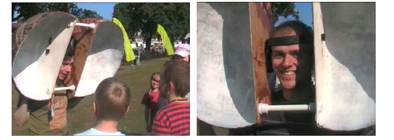
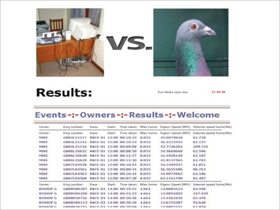
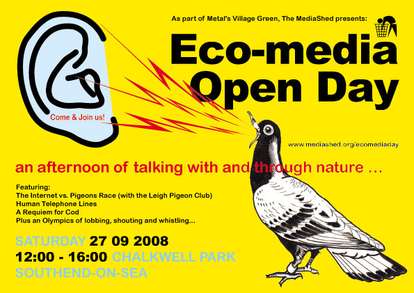
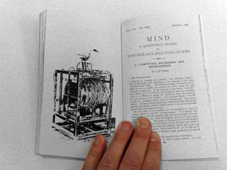
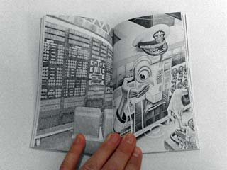
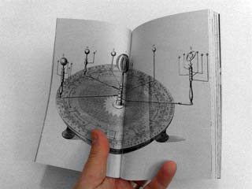
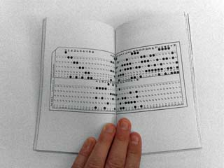
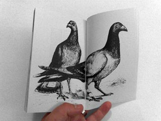

---

> Just as capacities of thought, of being, are made in lived bodies, in complex and delicately conjoined tissues and processes, and just as powers are inherent in all matter, materialism also requires that the capacities of activity, thought, sensation, and affect possible to each composition whether organic or not are shaped by what it is, what it connects to, and the dimensions of relationality around it. (Fuller, 2005: 174) {#para1}

> Now more than ever, nature cannot be separated from culture; in order to comprehend the interactions between ecosystems, the mechanosphere and the social and individual Universes of reference, we must learn to think ‘transversally.’ (Guattari, 2000:43). {#para2}

In addition to the realisation that theory should be seen as situated practice, we can also consider practice as theory. Practices are in themselves theoretical excavations into the world of ‘things’, objects of (cultural) research conducted in a manner that makes the two inseparable. Practices probe, investigate, track, interrupt, intervene and question. Practices point towards the primacy of the experiment as a formation inseparable from theory. Practices are theories in the very dynamic mode that makes ‘theories work.’ As Karen Barad notes, ‘as a result, method, measurement, description, interpretation, epistemology and ontology are not separable considerations’ (2007: 121).  What we know and how we know about it cannot be separated into non communicating spheres. {#para3}

Practical projects such as Harwood, Wright and Yokokoji’s Eco Media (Cross Talk) have developed new modes of thinking media (ecology) through a tracking of the intensities of the medium itself. However, in this case the medium is understood in a very broad sense to take in the ecosystem as a communication network of atmospheric flows, tides, reproductive hormones, scent markers, migrations or geological distributions. It allows tides and parasites as much as bodily fluids and the nose to become media (See Harwood, Wright and Yokokoji, 2008). The project(s) do not focus solely on the ecological crisis that has been a topic of media representations for years, but they seem to engage with a more immanent level of media ecology in a manner that resembles Matthew Fuller’s (2008) call for ‘Art for Animals.’ Media is approached from the viewpoint of the animal and the perceptions, motilities and energies (they mention for example wind) that escape the frameworks of human media. In this context I find their rhetorical question concerning non-human media intriguing: ‘Can “natural media” with its different agencies and sensorium [sic]  help to rethink human media, revealing opportunities for action or areas of mutual interest?’[1] {#para4}

Despite their eye on the age-old media of nature, such a project is emblematic of concerns that stem from a high-tech network culture. Non-human media of an eco-mediatic kind share with high tech protocols and technologies a processuality and heterogeneous mixture of bodies.[2] What this article addresses is the project of media ecology as a practice of theory and the topological continuity from nature to media. Through practical probings, the project exposes a different take on media that renegotiates the cultural underpinnings of media theory and expands it towards regimes of perception, motility and circulation of non-human speeds and spatialities. In other words, I want to expand on the notion of medium through taking into account such ecological underpinnings that can be seen as prisms through which to understand non-human energies. Some of the scholarly work on biodigitality has already suggested the notion of biomedia as a very fundamental recontextualisation of the biological with the technological (Thacker, 2004: 5-6), where biomedia refers to the various passages between regimes of the biological body and technologies of new media such as software algorithms and databases. For writers such as Georges Canguilhem (1994: 317, quoted in Mackenzie, 2002: 195), biological life as a process of heredity has always preceded the human media technologies of engraving, writing and printing by its own methods of transmission of messages, implying life itself as a process of mediation of kinds. However, I will focus less on such contexts of the biodigital or biological heredity and more on other regimes where the ecological and even biological is recontextualised as pertinent to considerations in media studies. As we will see below, this also extends to ideas related to media archaeology where the connection is most clearly made through Garnet Hertz’s Dead Media project that extends Bruce Sterling’s original dead media idea into even more emphasised politico-ecological contexts. {#para5}

### Contract/Transduct

What are media? How do you recognise something as a medium? We could think of media studies as a discipline that not only produces media professionals but teaches us what media is. Usually it is a noun—this is the safer way to introduce media in undergrad curriculums and when trying to make sense of the digital economy, for example; media are the entities that you find in media studies checklists as print, cinema, TV, radio and new media which itself boasts a long list of media forms from network media to mobile media. {#para6}

An alternative would be to approach media in the active sense of doing—something that mediates; a turn from considerations of what is technology to what is technical. This is something that media studies does not always achieve and other fields of knowledge are as useful in teaching us such processual passages. Adopting an idea from Bruno Latour (2002), we can in this manner think of media in terms of action. Media are an action of folding time, space and agencies; media are not the substance, or the form through which mediated actions take place but an environment of relations in which time, space and agency emerge. This is also an idea that we find in Deleuze and Guattari’s (1994) emphasis on art as the creation of ‘a new space-time’, or to an extent part of Whitehead’s process ontology in which ‘[a]ctual entities, then, are not primordially located in space and ordered by time. Rather, spatial location and temporal sequence are themselves generated through the becoming of these actual entities’ (Shaviro, 2009: 61). {#para7}

In other words, if we take seriously such ontological premises, media are also less a matter of mediation and communication between humans, than a milieu of engagement, or relationality for the objects, vectors, agencies and processes that enter into its sphere. It is a ‘pulse of emotion’ as Whitehead calls it, ‘both a fresh creation of spacetime and an immediate perishing […]’ (Shaviro, 2009: 61.). Such an understanding of media as an ecology seems to be at the heart of Matthew Fuller’s conceptualisation of the topic, and his expansion of media studies into the processes, forces and the weird materialities of technological objects. Media are contractions of forces and through forces bodies are born. Rather than just being solids, such bodies are processes and defined by their internal and external milieus in which they resonate (Fuller 2005: 71). Borrowing from ideas clearly related to both Simondon and Whitehead, Fuller is able to convey an approach to media that sees them in terms of energetics and materiality. Media function as an ecology in the sense that they are formed through circulations of energies, functions and so on, as well as the fact that they redistribute the forces that are not only technological in their existence but also aesthetic, economic and chemical. (Fuller, 2005: 56). In this sense, while media are themselves formed of ‘synthesis and layering’ (Fuller, 2005: 171), they also feed further possibilities of contracting forces. {#para8}

As a method, such an approach to media technologies shows its usefulness in the context of contemporary digital culture. Already Simondon suggested that we can decipher genealogies of objects  which show how they have been formed through evolutionary layering, the placing and displacing of functionalities and that this applies not only to organisms but also to mechanical machines. Simondon’s displacement of hylomorphism has informed the more contemporary work of Latour, Deleuze, Guattari and in relation to media ecology, Fuller. Despite their internal differences, all these writers build on the foundation of Simondon’s thought. For example, Simondon is crucial in this context for having insisted both that it is not only the human being but the machine as well that carries within itself dynamics of thought (1989: 58); and that the technical object is always accompanied by its associated milieu. Such ideas have been put directly into contact with media theory by Mackenzie who argues that Simondon’s notion of transduction articulates together (I would add in an ecological manner) ‘human collectives and non-human forces’ (2002: 205). Technologies are always already about articulations of the living and the non-living in their ensemble (or assemblage) nature. Mackenzie’s way of showing the interdependencies of the practices of technicity underlines this processuality, which stems from the collective nature of the bodies and individuations involved. Bodies are collective right down to their intensive formation but also in their relationality, where they form through individuation from (and back to) milieu relations. Such relations are always topological in their essence: continuously folding milieus, insides and outsides, a line that ties together natures and technologies. {#para9}

The idea of media as a contraction and folding of time and space underlines the insight that time and space are not just solid and stable backgrounds for action or communication. They are themselves in continuous movement and mutation and are attached to the relations in which they are formed. Nature and media are subsequently to be understood not as distinct ontological regimes but both are to be seen in terms of processuality and becoming in the manner that the recent Deleuzian wave of theory has suggested. This can also be understood through Whitehead’s ontology of event/pulsation as well as Simondon’s concept of individuation. This ontological becoming is furthermore conceptually connected to the intensive, inexhaustible milieus which ontogenetically afford individuation. According to Simondon (Ibid: 58), the associated milieu is a field of potentiality  that affords the mutational qualities of an individual whether human, animal or technological. Potentiality, the realm of the virtual, is a futurity that is enveloped in the present. {#para10}

The notion of milieu is here crucial. It enables a different approach to that of the notion of environment considered only as a Newtonian, stable background; milieus are dynamic potentialities, becomings. For Simondon, individuation happens only through the milieu in which the formation of the individual is always via the baggage that it carries along with itself – this also applies ‘after’ individuation. Jean Yves-Chateau notes this active sense of the milieu for Simondon – which is in fact not far removed from the ideas of the early 20th Century ethologist Jacob von Uexküll except that it now also applies to technologies. Von Uexküll himself already developed the notion of ethological relationality that was later continued in wider ontological contexts by Deleuze and Guattari and some writers   have suggested that von Uexküll could already be contextualised in terms of a wider machinology that subsequently moves beyond nature-culture distinctions (Ansell-Pearson, 1999: 188; cf. Parikka, 2010: 57-93) {#para11}

For both von Uexküll and especially for Simondon, the milieu is not only external to the individual but also an associated and internal milieu through which the individual is born. Neither is it an objective in the sense of disinterested environment, or geographical place, but a lived milieu. (Chateau, 2008: 67-70). Milieus do not stay at a distance, but entangle with bodies. This is the reason why Simondon is of special interest to further considerations of ‘technologies of lived abstraction’ especially from a radically non-human perspective of technological individuation [3]. Such ideas of the milieu are applicable not only to nature but also media ecologies – and furthermore not only to humans, but to subjectivities of various kinds. Media ecological methodologies and excavations are in a good position to map such subjectivities that do not follow the normal definitions of subjectivities based in consciousness, morals, or for example human sociality, but in a more radical material relationality and sociabiality. {#para12}

### Eco Media as Cross Talk

What such a milieu perspective allows us to do is to approach media technologies as much more than their determined, intended or standardised uses. It provides an understanding of the inexhaustible potentialities of such assemblages. Matthew Fuller approaches art in this vein as an opening up of standard objects: {#para13}

> If a standard object is understood to have a specific set of qualities and affordances in one context, one set of dimensions of relationality, how can we use this constrained understanding of its capacities in another? Media are experimented on, not simply in terms of their affordances as standards, but also in terms of what may be mobilized or released when they come into odd conjunction with another scale, dimension of relationality, or drive. (Fuller, 2005: 172) {#para14}

This furthermore questions the whole status of the ‘medium’ and for Harwood, Wright and Yokokoji points towards the scale of the material in media ecologies that cannot be neglected: {#para15}

> ‘Medium’ is approved in art vocabularies. ‘Material’is rejected. Mediums in art shed their materiality by absorbing, and thereby conveying, the artist’s mental, moral, spiritual, imaginary, and intellectual transmissions. When ecology joins art, materiality sheds its banal connotation and asserts its place beside the elevating role of medium. (2008: 14) {#para16}

In this sense, setting up relations across scales (such as media extending towards nature) can be seen at the core of such an understanding of art as creating new material dimensions of relationality. Instead of seeing it as metaphorics of bringing together two incompatible series through a linguistic act, it is a topological transduction of forces, where the art process is a catalyst of potentials. It is in this sense that I want to approach the Eco media project through its potential for ‘cross talk.’ Art and media ecology as cross talk remind us of the non-human roots of both art and media, and hence extend the work of experimentality as an exposition of potentialities to what we have usually thought of as ‘solids’ – nature. Cross talking is therefore a topological method in art. {#para17}

The Eco Media project is introduced as a certain system of contraction of potential forces of nature. It can be seen as a laboratory for experimentation but one that does not rely on creating restricted spaces for animals or natural processes, but instead tries to tap into their functioning in the wild. In their research report Harwood, Wright and Yokokoji write how: ‘By teasing out the nascent media already operating as transmissions of chemicals and energies – atmospheric flows, reproductive hormones, scent markers or geological distributions – we plan to finds [sic] ways to integrate “natural media” with human media as “eco media” ’ (2008:1). Recognising how this possibly could have been applied to a large amount of work done in the natural, life and environmental sciences, the project focused more closely on specific field studies. Can the human being become a bloodhound as the experiments with stereo olfactory devices and proper training suggest (drawing on an idea by scientists at University of California Berkeley)? Can software successfully ‘record, generate and layer’ bird calls to create places of exploration for non-human communication (a project by tEnt [Tanaka Hiroya + Cuhara Macoto] titled CALL <-> RESPONSE [2007] that the Eco Media refers to)? How does the human body extend itself into a machinic receiver  through ‘Eco-Ears, ‘a pair of head mounted domes which function like a stereo ear trumpet […] based on a design from the First World War when they were used to listen out for approaching aircraft or artillery’ (Harwood, Wright and Yokokoji, 2008: 7)? {#para18}

The methodological point of the project is introduced as creating ‘points of “cross talk” ’ that are relays through which to establish communication between human and non-human media. This is done through experiments that themselves consolidate the already existing potentials between such realms, in which the modes of perception might have certain points of commensurability and the projects are in a crucial position in order to match such points and make them resonate. It reterritorialises ecological processes as media technological (cf. Thacker, 2004: 81). {#para19}

As a practical experiment, the Eco Media project also taps into the ways we have imagined media and media theory since their beginnings. Here I am referring to the modern conceptualisations of what media are and where they stem from—roots that are more or less branded by anthropocentrism. Such key 20th Century claims as Marshall McLuhan’s that every media is an extension of already existing human faculties can easily be tracked back to the 19th Century enthusiasm for the anthropological origins of media culture.[4]However, it would remain insufficient to just point towards this theme of non-human or post-human media; instead, as noted above, the Eco Media project wants to ‘explore to the extent to which “animal media”, its agencies and its sensorium can rethink human media, especially with respect to the organic origins of media’ (Harwood, Wright and Yokokoji, 2008: 1). [5] {#para20}

The crucial singularity in their project lies with the methodology of cross-talking that despite the somewhat human-centred idea of ‘talking’ aims to establish connections across various regimes of enunciation and expression: processes usually too fast or slow, loud or silent, big or small for human perception. As they frame it, in terms of practical experiments, one of the crucial questions is that of scale: ‘many natural processes are beyond human scales of perception, too long or too quick’ (Harwood, Wright, Yokokoji, 2008: 17). What the project aimed to establish was the realisation of a whole new media sphere that ‘passes through’ humans without us consciously realising it. The milieu here becomes much more than an environment of natural processes; it becomes as they argue a media network and hence reveals the modalities of expression that can be translated into human media: {#para21}

> This project would try to find processes in the natural world (‘natural technics’) that could function as carriers of signals or messages. Because these processes would be in the form of materials or forces that were common to the habitats of animals, this held the prospect of these messages being accessible to the non-human realms – hence the title of ‘Cross Talk’. (1) {#para22}

The project itself is more interesting as the establishment of a field of its own rather than any one particular project that was realised under it. It included the mapping of earlier projects and related contexts, field studies on the human organism with references to Georges Bataille and the media historical experiments of Alexander Graham Bell, as well as the Eco-media Open Day held at Southend-on-Sea, Saturday 27 September, 2008. The Open Day could be seen as a community oriented exercise in ‘archaic media’ that were set against very different modes and even scales of communication media. This was most evident in The Great Internet vs. Pigeons Race that set the carrier pigeons of the Leigh pigeon club the apparently impossible task of racing against the Internet **to deliver packets of information** (Fig 2). Funnily enough, the pigeons won due to a failed internet connection. Natural media Olympics tested the affordances of shouting, whistling and lobbing, for example, as effective modes of using the body and its vocal and motile skills as media. {#para23}

I want to point out how we can understand Cross Talk as a focus on lived relationality, or the primacy of relations; a perspective that is also useful for a wider consideration of media ecologies. Fuller establishes this point about relationality when he argues for the potentiality of art to make new scales sensible. This can be seen as a political invention of scales and relations – Fuller (2005: 132) mentions the general strike and internationalism as such events of rescaling and relations- and we could easily extend the idea to media ecological considerations as does Fuller: ‘A dimension of relationality, the combinatorial arrangement of such relations, can further be said to provide a means toward describing, actuating, or multiplying the powers of an element within a composition’ (Fuller, 2005: 131). Relationality here becomes not only an ontological fact of assemblages (that relations are external to the components they connect and hence have a dynamism and reality of their own (DeLanda, 2006: 10-11)), but also a tool for excavating the arrangements of relations. In short, if you want to understand an arrangement, such as a media technological assemblage, look at its relations and compositions. {#para24}

In this sense, media ecological objects are also processes and ‘compositional dynamics’ as Fuller argues referring to Whitehead (2005: 131). Objects are far from inert ‘things’ but instead consist of various dimensions of relationality. Relationality is here less a matter of communicating content than a weaving in and out of scales and incorporating them into its assemblage (See Fuller, 2005: 132). The Cross Talk mode of communication is in this sense communication as a topological weaving of various scales of perception, motility and sensation into a joint assemblage in which human media are able to touch animal and natural media. {#para25}

Methodologically the project outlines the themes of how such transversal communication across scales can be also brought to bear on recent ecological contexts. The project does less a work of analysis than the invention of these points of proximity for ‘new catalytic nuclei capable of bifurcating existence’ (Guattari, 1995: 18). Furthermore, it is a testing ground for what they call ‘species-centric assumptions’ concerning media such as security, privacy and the public, and for how such notions can be tested through new transpositions. (Harwood, Wright, Yokokoji, 2008: 16). Indeed, they also mention how this idea extends their previous work with free media that involves projects of community inclusion and experimentation with open formats and free technological infrastructures. [6] Through methods that range from the documentation of the stages of the project, its practical methods and the key questions raised within it, and by means of correspondence as well as public presentations, the project worked to bring such fields as ecology, biosemiotics, zoosemiotics, socio-biology as well as ethology in touch with concerns that are relevant both for the technological assemblages of contemporary media and also for the aforementioned political economy of media (Ibid., 17). Aesthetics turns into politics and the relations of perception and modes of organisation extend into a reconsideration of how we might think human media as well. {#para26}

Through such mediation, media ecology refers to taking natural ecologies not only as the object of research but also as a mode of understanding the ontological processuality of the world. Furthermore, the ecological perspective can be seen as a tool for creating transversal connections between regimes of enunciation and action (Genosko, 2009: 67-68). It points towards the over- and inter-lapping of the biosphere with the mechanosphere to use Deleuze-Guattarian vocabulary (Genosko, 2009: 83-84). Since the 1990s, partly inspired by the McLuhanesque underpinnings of media as environments of perception, the new immersive digital environments spurred the discourse of networks as environments (see Morse, 1996: 203) and as a third environment of sorts that enables the appropriation of value in a similar manner to the way that capitalism had turned ‘first’ nature into a standing in reserve for exploitation (see Wark 1994). In addition to such ideas, it is the biological that has increasingly been negotiated through technological assemblages. This can be seen as a biopolitical appropriation of the creative forces of nature (See Parikka, 2008; 2010) as well as the increasing informational intensification of  natural milieus with such technologies as Radio Frequency Identification Tags (RFIDs) (van Kranenburg, 2008). In both examples, it is more a case of new entanglements of bodies of heterogeneous kinds than the mere indication of the metaphorics of immersive natures online. {#para27}

Cross Talking in this sense is a mode of transversal connectionism. For Guattari, the notion of transversal communication emerged from the innovative practices at the La Borde institute, where the relations between patients and staff was reshuffled on a continuous basis, consolidating such new transversal connections that cut across hierarchical and horizontal power relations. Genosko has suggested the notion’s usefulness for a wider politico-ontological methodology that should be taken into account in the context of transdisciplinary knowledge. This means establishing ‘new connections between science-society-ethics-aesthetics-politics’ (Genosko, 2002: 200), which reshuffle the roles of such institutions or regimes of enunciation by bringing them into new proximities.[7] {#para28}

If Cross-Talking is about transversal communication between the biosphere and the mechanosphere, where nature and artifice blend into each other on a plane of immanence that affords communication and creation beyond ‘fidelity to relations of species and genus’ (Ansell Pearson, 1999: 161), then such experimental projects as Eco Media can be seen as the creation of a sort of Universe. Such platforms of experimentation draw on contemporary media cultural concerns such as those associated with free media. However, these practices are recycled via nature and so the messy entanglements of nature and culture are acknowledged. In this sense, eco art does not mean simply an art that engages (solely) with natural ecology, but one that involves existential territories of subjectification that are based not on closed models but on practices that are inclusive, creative and that track the precarious singularities of the assemblages involved (Guattari, 2000: 51-52). The Eco Media project tracks and maps such singularities of nature but also catalyses them through considerations relevant to contemporary media culture. {#para29}

Various recent art projects extend ecology not as a theme of naturalisation but quite the opposite: with an eye on the continuous individuation of forces considered natural. [8] What is curious about the Eco Media project in this sense is that its task of expanding modes of expression transversally reaches out towards media history as well and hence involves what I would call a media archaeological dimension. In other words, its specific form of *imaginary media* not only maps past media ideas that never existed, but also a creative imaginary of media outside the human realm. The next section will focus on this idea. It will also discuss another related project that can be seen as both media archaeological and media ecological in its orientation before arriving at some conclusions. {#para30}

### Media Ecology as Imaginary Media

The notion of imaginary media has acted as one of the important revitalisations of the discourse of media studies of recent years. Scholars such as Eric Kluitenberg (2006) have worked to promote the intellectual and practical possibilities of thinking media outside of its current actualised examples and to include a variety of discourses and phenomena under the much broader umbrella of media studies in the imaginary mode. Imaginary media is related in this sense to media archaeology, a common ground for both being a special focus on the past as a resource for rethinking and regrounding the way we approach modes of perception, sensation, and the creation of media. In the hands of writers such as Siegfried Zielinski (2006), the idea of a *longue durée* of media culture turns also into a qualitative rethinking of temporality that draws much more from paleontological ideas á la Stephen Jay Gould than a linear understanding of history in the 19th Century mode. Evolution turns out to be less about master plans and progress, than about a multiplicity of variations. This notion of temporality as based on variations and percolations instead of arrows or cycles (see Serres and Latour, 1995: 58-59) has implications for the way we approach the ontology of technology as well. Moving away from an anthropomorphic-McLuhanite perspective, Zielinski suggests that we should reconsider the deep time ontology of technology as ‘deeply inhuman’ (2006: 6). [9] {#para31}

The inhumanity at the heart of the media archaeology of technology also extends towards media ecological contexts. The Eco Media project also contextualises itself as part of a much wider media archaeological lineage, with specific nods towards earlier precursors that have used natural bodies as vehicles for communication. However, both this project and Garnet Hertz’s Dead Media project that will be introduced as a parallel enterprise of relevance to media ecology, produce quite a refined understanding of what imaginary media are. They both highlight that the topological continuity of media ecological projects not only weaves together nature and media technology, but also introduces the imagined into potentiality and potentiality into the actual. {#para32}

As a ‘change in focus’, the Eco Media project proposed to look at such things as bodily fluids or bodies as conduits for communication, from spit to Alexander Graham Bell’s 19th  Century experiments of using human bodies to transmit phone calls (Harwood, Wright, Yokokoji, 2008: 3). This was not conceptualised as a straightforward historical excavation but as a return to ‘experimental historical forms’ (Ibid: 8) and practical exercises such as using archived recordings of cod breeding from 1971 (National Sound Archives) and replaying the sounds to ‘young codlings as they entered the Thames Estuary’ (Ibid: 7). The performance piece by Graham Harwood and Matthew Fuller extended the usability of archives in a slightly similar way to the sound artist Mira Calix’s use of archived insect noises from the Museum d’Histoire Naturelle in Geneva. [10] For the Harwood-Fuller experiment, the context was different, however, and the piece which was performed as part of the Eco Media field day in 2008, extended the transmission of archive material to an audience of non-humans. {#para33}

The project’s final report includes an appendix that works as a dip into the field of media history revealing the multiplicity of bodies of communication: from pigeons to magnetism, from horses to using phenomena such as light for communication and media, from the bodies of monks wired up by Jean-Antoine Nollet in 1746 to a variety of materials like woodcuts and selenium (as used by Paul Nipkow in 1884 for his early TV systems). Indeed, the history of media can be seen as a work of probing the qualities of materials in order to find out what different bodies can do; what are their qualitative affordances in terms of the communication with and contraction of the world; how can matter circulate energy and meaning? {#para34}

Does this suggest the idea of media history as a history of affordances? Could we look at media technologies as active furnishings of ‘what-ever-can-be-done’ in terms of seeing, hearing, moving and relating, for example? In this sense, the notion of media archaeology expands beyond human media and the contexts of the Eco Media project, which extend transversally not only toward nature but also towards history, become understandable. As flagged above, similar projects of interfacing and transversal communication have been proposed by others as well. I want to pay special attention here to Garnet Hertz’s Dead Media initiative (2009) that deals with very similar issues at the crossroads of media archaeology and ecology. It borrows the name from Bruce Sterling’s classic excavations, begun in the 1990s, into the zombies of media history–the dead that refuse to go away, as well as Sterling’s attempt to create an indexical archive for such dead technologies. In the context of the growing eco crisis, Hertz updates dead media research, according it a much stronger ecosophical interest. {#para35}

Under the umbrella agenda of ‘how to creatively repurpose and reuse electronic waste’, media ecology becomes an active mode of trying to come up with new uses for dead media and media archaeological ways of tapping into the ecological crisis. Hertz’s project (https://www.conceptlab.com/deadmedia/) is about the active contextualisation of creation through three fields of interest;: {#para36}

- 1) ‘Repurposing’ as a creative and artistic methodology that re-uses the ‘leftovers’ of the information technology boom and addresses the problems of electronic waste (chlorinated solvents, brominated flame retardants, PVC, heavy metals, plastics and gases). I would also see this as the creation of a new temporality in terms of detaching the cycle of consumption from the short-spanned individualised human time of ‘use-worthy’ technologies and extending it towards non-human dimensions.

- 2) In terms of extending beyond individualised use, the project also addresses ‘community and artistic production’ as the context for dead media. Through DIY methodologies and circuit bending, a whole new realm of understanding and extension of the use of media technologies is opened. With some similar ideas to Mediashed’s free media projects that Eco Media also continued, this stream of Dead Media interest is seen by Hertz as the creation of new communities forming around the opening up of archaic technologies.

- 3) The third area of interest makes the connection to media archaeological themes clearest. ‘Innovation through analysis of media history’ points towards an active reframing of the temporalities of media evolution. Instead of a linear conception of past media understood as bypassed presents, time is implicitly understood in such a media archaeological context as a continuous relocation and reallocation of potentialities. Time is not a flow from the past to the future via succeeding presents but a continuous shifting of emphases, which in this case means tapping into past media as a reservoir for the sustainability of a future. According to Hertz, this points towards the usefulness of obsolescence: ‘In other words, the history of technological obsolescence is cheap R&D that offers fascinating seeds of development for those willing to dig through it. This lab encourages the study of obsolescence and reuse in media history as a foundation for understanding the dynamics of media change’ (https://www.conceptlab.com/deadmedia/).

Both these projects are at the conceptual and practical cross-roads of media ecologies and media archaeology. They summon an imagination of media that is not only imaginary in the Lacanian sense of projecting an imaginary unity and hopes onto media technologies, or in the sense of looking for media that did not actually exist. Imaginary media becomes a creative exercise in the same manner that any *preservation* of nature can become an active creation that does not have to rely on ideas of the originality of nature as a substance. Nature is instead an affordance and a creative process: a *natura naturans* as it was for Spinoza. This we could understand in terms of the new materialist understanding of media in which modes of perception, affect and engagement with the phenomenological modalities of media experience are about very concrete, physical ways of modulating the human sensorium. But it can also be seen as a way of transversally connecting beyond categorical differences between nature and culture, technology and nature etc. {#para37}

As well as pointing towards Spinoza, the notions of a non-bifurcated nature and a creative organism can be connected to the revitalisation of Whitehead’s ideas in cultural theory (Thrift, 2008: 228). Whitehead’s process philosophical ideas are also useful in rethinking biology as something that is ‘able to innovate, to produce original answers to changing conditions’ (Ibid.). In addition to Whitehead, we could point towards the just as important revitalisation of Darwin for cultural and media theory (Grosz, 2008), as well as the growing interest in accounts that bypass the hylomorphic schemes of Western metaphysics (Simondon, 2007; Parisi, 2004). {#para38}

Media become in such projects less a human endeavour of mediating messages than a mode of contracting forces to create new space-times. Such space-times are as much about the ‘natural’ (modes of perception, physiology, contracting natural phenomena) as they are about the ‘cultural’(artifices). Or more accurately, they reveal the artifice at the core of the supposedly natural in the sense of how composition and the event operate across any ontological bifurcations. Through projects such as the Eco Media divisions between nature and artifice become secondary and methodological approaches to tinkering with topological passages between such regimes are the driving force in creating transversal links. As noted, in the Guattarian understanding of transversality, such a method involves local connections in new regimes of proximity with neighbouring practices and discourses. In an age where through biodigital practices even such grounding agendas as what counts as life are under question, it is natural that the answers to ‘what counts as media’ are not easy. Indeed, what we find in Eco Media is not a list of technologies, but methodologies and questions with which to try out what *could* act as a medium; what flows, what carries, what bends time and space. The same goes for Dead Media as Garnet Hertz understands it: its less a static check list of media, than, through lists and exercises, a mode of probing the ways in which zombie media can interrogate the fuzzy borders between living and obsolescent media; a question which in itself involves multiple ecologies from the political to the environmental, from social questions of usability to questions of the economics of capitalist media dedicated to producing death (through the short life-cycles of media and the closed media assemblages that are often increasingly harder to open up and circuit bend). {#para39}

For Fuller (2005), one of the tasks of media ecologies is to carve out unaccounted for potentialities from standardised media objects. The examples of media ecology analysed above point towards such a potentiality but with a specific nod towards a creative reuse of history. At the same time, the use of history summons a new mode of temporality that is reminiscent of a media archaeological agenda; time becomes a rewiring of potentialities, not a stable archive of collected past presents. This supports wider reconsiderations of the place of nature in current technoculture where nature has been turned from an object of stability and stillness into a mode of becoming of heterogeneous bodies and relations, alongside an interest in the economic possibilities of the intensities of bodies (See Thrift, 2008: 56-74). The supposed ‘stillness of nature’ turns out to be a multiplicity teeming with potentials that are increasingly also the motor for the production of value for the capitalist exploitation of lived bodies. Media ecological projects have in this sense to be aware of the contexts of capitalism in which ‘ecologies’ are produced. {#para40}

To conclude, I would like to wrap up some of the key features of media ecology as read here especially through the Eco Media-project and the Dead Media project. Media ecology involves an expansion of media to include a number of processes, objects and modes of perception, motility and relationality that are not usually seen as media in its modern, cultural sense; in this expanded mode, media becomes an ethological relationality rather than merely a technological object. Hence, media ecologies can take its cue as much from flows and streams of nature or the modes of perception of animals as from conventional media technologies. Media ecology is topological. {#para41}

Media ecologies engage in a transversal communication that ties together the aforementioned media of nature to considerations of current media culture. Media ecologies can bring such dispersed practices into proximity through experimental takes, methods, field days and the like that engage in rethinking human-centred notions of security and ownership, for example, that characterise the contemporary media sphere. With the Eco Media project, this is combined with an expansion of the notion of free media. {#para42}

In our take, media ecologies act as a sort of imaginary media;  not in the sense of media of imaginary things but imagination as the extension of the potentialities of media. Through the projects, we could get a glimpse on the idea of media history as a reservoir of R and D, as Garnet Hertz has labelled it in the wake of media archaeological research, which poses not only the demand to rethink temporality in a less linear way but also the political-economic ties of media in the midst of the current eco crisis. {#para43}

### Acknowledgements

A thank you to the anonymous referees for their feedback and to other peer-reviewers of drafts as well. A big thanks to Michael Goddard for his help in editing and to Garnet Hertz and the Mediashed/Eco Media team for the permission to use the images.

### Endnotes

[1] CrossTalk, unpublished Summary Paper. Downloaded from: https://mediashed.org/ecomediaday

[2] This is evident for example in the experience of wirelessness, which can be approached through the meshwork of hotspots and relations, transitions and conjunctions that link lived, experiencing bodies (Mackenzie 2008).

[3] For more on ”technologies of lived abstraction”, see the Montréal based Senselab-series: https://senselab.ca/events/technologies-of-lived-abstraction/

[4] A key figure here is Ernst Kapp whose very similar theories to McLuhan’s have remained the vague reference point for a variety of more recent theoretisations of what media are. To put it briefly, Ernst Kapp (1877: 21) introduced his famous theories of technology as an extension of the human species in 1877 in *Grundlinien einer Philosophie der Technik: Zur Entstehungsgeschichte der Cultur aus neuen Gesichtspunkten*. Ernst Kapp, *Grundlinien einer Philosophie der Technik: Zur Entstehungsgeschichte der Cultur aus neuen Gesichtspunkten*. In this early theoretical example influential on later cyborg media theories and ideas of organ projection, Kapp conceptualised technology as based on the human body.  The human being is the measure of all things (*Der Mensch das Maass der Dinge*), a proposition that was meant as a continuation of the Kantian theme of perceptual worlds. (See also Parikka, 2010: 9-11, 76).

[5] As Simondon argues, this idea of nature and animals teaching humans arts and skills was already a Renaissance theme (e.g. Giordano Bruno) (2004: 68).

[6] See their Mediashed Website at https://mediashed.org/. When finishing this final version of the article the Mediashed-server was down and waiting to be replaced.

[7] In studies of science and technology, perspectives that connect nature and culture (or technology) in a continuum have already been developed. I am here thinking of Luciana Parisi’s highly original take on differentiation and sexual difference, which also draws on Guattari’s notion of transversality and mixed semiotics. Parisi herself uses this to point out that the discursive and the material are in no instance disconnected and that semiotics is always mixed: it consists of both asemiotic encodings (such as processes of nature, flows, genetic material) as well as regimes of signification (Parisi, 2004: 71). Parisi points out in her text the usefulness of Simondon’s notion of individuation for a mixed semiotics, or an assemblage-approach but I want to remain here with the ecological contexts – or more specifically eco-art.

[8] Naturally Eco Media is not the only project to do this kind of work of catalysing ‘natural’ bodies through technological contexts. Natalie Jeremijenko’s ideas have produced similar passages of ‘Cross-Talk.’ OOZ ( ) creates interfaces for human-animal interaction which are also aimed at deterritorialising human-centred political ideas in a similar fashion to Eco Media’s Free Media underpinnings. It also taps into modes of animal communication exploring such interfaces through a technology that can bring such techniques into contact with the modes of perception humans occupy. We could see various entanglements of the human body with electronic media as similar creations of novel assemblages. It is a matter of revealing the body of the human itself as milieu of collectivities and a multiplicity of teeming potentialities; an invisible ecology. Guattari writes: ‘The term ”collective” should be understood in the sense of a multiplicity that deploys itself as much beyond the individual, on the side of the socius, as before the person, on the side of preverbal intensities, indicating a logic of affects rather than a logic of delimited sets.’ (1995: 9) Ulrike Gabriel’s digital art piece ‘Breath’ catalyzes breathing through sensors that map its speed, depth and regularity onto a externalised representation through an algorithm; this is however less a representation, than a more of individuation of the breathing that conjoins the milieu of electronic media, and brings forth a new body, a new milieu complex, a new assemblage of bodies in/through technology (cf. Shanken, 2009: 170). In terms of flows of a different ecological scale but perhaps pointing towards some similar themes as Eco Media, the Milk Project is an interesting mapping of international flows of food. It tracks the movement of milk from Latvia to the Netherlands using GPS technologies that are visualised. The movement of milk is informationalised, visualised and backed up with photographs and sound recordings of the people involved. This presents a different kind of flow that involves ‘nature’ but also various political, economic and technological networks that facilitate the movements. See https://www.milkproject.net.

[9]‘The paradigm of technology as an organ was a crutch used in the development of mechanics; similarly, the organic becoming technology is now a poor prosthesis in the age of electronics and computation. Technology is not human; in a specific sense, it is deeply inhuman’ (Zielinski, 2006: 6). In terms of Zielinski’s position, this ontological statement does not resonate with his actual methodology that turns quickly in his *Deep Time of Media* into an excavation of past male geniuses and hence reintroduces a very human-centred position for media history.

[10] Mira Calix*, 3 Commissions*. Milkfactory site at https://www.themilkfactory.co.uk/

### References

- Ansell Pearson, Keith. *Germinal Life. The Difference and Repetition of Deleuze,* London: Routledge, 1999.

- Barad, Karen. *Meeting the Universe Halfway. Quantum Physics and the Entanglement of Matter and Meaning*, Durham & London: Duke University Press, 2007.

- Canguilhem, Georges. ‘The Concept of Life.’ In *A Vital Rationalist: Selected Writings from Georges Canguilhem*, edited by Francois Delaporte, trans. Arthur Goldhammer, Zone Books: New York, 1994, 301-320.

- Chateau, Jean-Yves. *Le vocabulaire de Simondon*, Paris: Ellipses, 2008.

- Delanda, Manuel. *A New Philosophy of Society. Assemblage Theory and Social Complexity*, London and New York: Continuum 2006.

- Deleuze, Gilles and Guattari, Félix. *What is Philosophy?* Trans. Graham Burchell and Hugh Tomlinson, London and New York: Verso, 1994.

- Fuller, Matthew. *Media Ecologies. Materialist Energies in Art and Technoculture,* Cambridge, MA and London, England: The MIT Press, 2005.

- Fuller, Matthew. ‘Art for Animals’, in Bernd Herzogenrath (ed.) *Deleuze/Guattari and Ecology,* Basingstoke: Palgrave 2008, 266-286

- Genosko, Gary. Félix Guattari. An Aberrant Introduction, London and New York: Continuum, 2002.

- Genosko, Gary. *Félix Guattari. A Critical Introduction*, London: Pluto Pres, 2009.

- Guattari, Félix. Chaosmosis. *An Ethico-Aesthetic Paradigm*. Trans. Paul Bains and Julian Pefanis, Bloomington & Indianapolis: Indiana University Press, 1995.

- Guattari, Félix. *The Three Ecologies.* Trans. Ian Pindar and Paul Sutton, London and New Brunswick, NJ: The Atholone Press, 2000.

- Harwood, Wright, Yokokoji. ‘Cross Talk: using the natural environment as “eco media” ’-unpublished Summary Paper, March 2008.

- Kapp, Ernst. *Grundlinien einer Philosophie der Technik: Zur Entstehungsgeschichte der Cultur aus neuen Gesichtspunkten*, Braunschweig: Druck und verlag von George Westermann, 1877.

- Kluitenberg, Eric. (ed) *The Book of Imaginary Media*, NaI Publishers: Rotterdam, 2006.

- Latour, Bruno. ‘Morality and Technology. The End of the Means.’ Trans. Couze Venn. *Theory, Culture & Society*, Vol. 19, No. 5-6, 247-260, 2002.

- Mackenzie, Adrian. *Transductions. Bodies and Machines at Speed*, London: Continuum, 2002.

- Mackenzie, Adrian. ‘Wirelessness as Experience of Transition.’ the *Fibreculture Journal,* issue 13 2008, https://.fibreculture.org/issue13/issue13_mackenzie.html

- Morse, Margaret. ‘Nature Morte: Landscape and Narrative in Virtual Environments’, in Mary Ann Moser and Douglas MacLeod (eds) *Immersed in Technology: Art and Virtual Environments*, Cambridge, MA: The MIT Press, 1996.

- Parikka, Jussi. ‘Insect Technics: Intensities of Animal Bodies’, in Bernd Herzogenrath (ed) *An [Un]Likely Allience: Thinking Environment[s] with Deleuze/Guattari*, Newcastle: Cambridge Scholars Press, 2008, 339-362.

- Parikka, Jussi. *Insect Media. An Archaeology of Animals and Technology*. Minneapolis: University of Minnesota Press, 2010.

- Parisi, Luciana. ‘For A Schizogenesis of Sexual Difference’ *Identities. Journal for Politics, Gender and Culture*, vol. III, No.1, Summer 2004, 67-93.

- Serres, Michel, with Bruno Latour. *Conversations on Science, Culture and Time.* Trans. Roxanne Lapidus, Ann Arbor: The University of Michigan Pres, 1995.

- Shaviro, Steven. *Without Criteria. Kant, Whitehead, Deleuze and Aesthetics*, Cambridge, MA: The MIT Press, 2009.

- Simondon, Gilbert. *Du mode d´ecistence des objets techniques,* Paris: Aubier, 1989.

- Simondon, Gilbert. *Deux Leçons sur l´animal et l´homme,* Paris: Ellipses, 2004.

- Simondon, Gilbert. *L´individuation psychique et collective,* Paris: Aubier, 2007.

- Thacker, Eugene. *Biomedia,* Minneapolis and London: University of Minnesota Press, 2004.

- Thrift, Nigel. *Non-Representational Theory: Space, Politics, Affect*. London: Routledge, 2008.

- van Kranenburg, Rob. *The Internet of Things: A critique of ambient technology and the all-seing network of RFID,* Institute of Network Cultures Notebooks: Amsterdam, 2008.

- Wark, McKenzie.’Third Nature’ *Cultural Studies* vol 8(1), 1994, 115-132.

- Zielinski, Siegfried. *Deep Time of the Media: Toward an Archaeology of Seeing and Hearing by Technical Means*. Trans. Gloria Custance. Cambridge, MA: The MIT Press, 2006.
