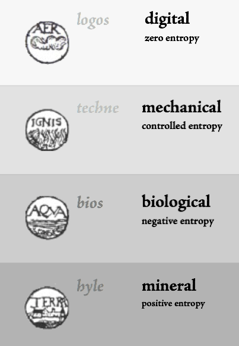

---

### Introduction

> Language is not life; it gives life orders.
>
> Life does not speak; it listens and waits.
>
> — Gilles Deleuze and Felix Guattari A Thousand Plateaus. (1987: 76) {#para1}

After the age of the *machinic*, the *bios* reenters the zeitgeist*.* Cybernetics and hacker culture in the 80s, the ‘network society’ in the 90s, the dot-com bubble around 2000 and the ‘long tail’ of the metadata of Web 2.0 marked the evolution of the *digital phylum.* In the last decade, a different conurbation of forces—climate change and energy crisis, ‘pop genetics’ and protests against GMOs, bioterrorism hysteria and bioethical crusades—started to sediment a new episteme concerned with the living. This affected the technological discourse too. If, according to Michel Foucault, modern biopolitics was about the management of populations and corporeal discipline, then since WWII a new interest has emerged around the microscopic scale of the *bios*—around the cell as the unit of life. Cultural mediators have been gathering in the interstice of this shift, developing the missing theoretical tissue between digital code and genetic code, between media art and a new controversial *bioart*. {#para2}

Two main questions arise concerning this cultural shift. First: To what extent can biological models be employed to describe the mediascape as a new sort of ecosystem? To what extent, for example, can the metaphor of ‘media ecology’ be grounded in a properly biological paradigm? This question has relevance for political debate too, as *biomimetic* figures inspired by digital networks begin to be applied to new political concepts: see, for instance, the figure of the swarm applied to the postmodern notion of the *multitude* (Hardt and Negri, 2004, and also Parikka, 2008; Thacker, 2004). Conversely, a second question addresses the biological from the point of view of the digital. If ‘code’ is the universal semiotic form that is common to human language, computers and DNA, to what extent can cybernetic and digital models be applied to the biological? The history of *bioinformatics* started shortly after the discovery of DNA in the 1950s, accommodating quite a strict reductionism between ‘digital code’ and ‘genetic code.’ What are the consequences of a computer-based understanding of cellular reproduction for the sphere of ecology and biodiversity? {#para3}

Schematically, the question is how to apply the forms of the *bios* to the *techne*? And conversely, how to apply the forms of the *techne* to the *bios*? In answer to the first question this essay tests the homogeneity of the *biomimetic continuum,* which supposes the mediascape as an extension of the biological realm (like in the notion of the machinic formulated in Deleuze and Guattari, 1987)*.* Responding to the second question, this essay analyses the *biodigital continuum*, which takes binary code as a universal grammar from the Turing Machine to DNA, and then reduces the *bios* to a computable *logos.* Or, as Kelly (2002) puts it in his logocentric manifesto ‘God is the Machine’: computation can describe all things, all things can compute, all computation is one. The general purpose of this essay is to clarify the notion of ‘media ecology’ from the perspective of these two continua which consciously or unconsciously trouble its definition. {#para4}

Sliding along the different typologies of the continuum that cut across the physical, biological, technological and cognitive domains (*hyle, bios, techne, logos* in Greek archetypes)*,* this essay starts by positing the cell as the unit of life as opposed to the code as the unit of life*.* Reversing the dominant paradigm of the ‘genetic code’ is considered a necessary move in opening the biopolitical field of the cell, to ground a visceral materialism and eventually to outline, a new ‘ecology of biotechnologies.’ {#para5}

The first part of the article presents a basic ‘bestiary of the invisible’ to demonstrate paradigms of (microscopic) life which do not follow genetic logocentrism. Through authors such as Freud, Serres and Margulis, a new energetic diagram of the cell is advanced, calling for a general metabolics of organic life in opposition to the dominant partisan genetics*.* Trying to debunk the fatal opposition between code and energy, the second part of the article introduces DNA as an extension of the cellular body. Deleuze’s notion of the fold is employed to recognise ‘genetic code’ as a folding of organic matter in on itself with no intervention of any external grammar. This incestuous relation between linguistics and genetics is traced back to Erwin Schrödinger’s seminal book *What is Life?* precisely, Schrödinger’s notion of negative entropy is finally taken up as a key concept to clarify the four different regimes of entropy that compose the physical, biological, technological, and cognitive domains. {#para6}

Inspired by the post-structuralist paradigm of Deleuze and Guattari, this essay nevertheless advances a critique of their notion of the machinic continuum. Against the enthusiasm of new media scholars and activists, the mineral, organic, technological and informational domains cannot be so smoothly compared, translated and coupled with each other as they belong to different entropic regimes. Only the recognition of the frictions and accumulations of energy surpluses occurring between these different ontological strata will make possible the imagining of a new ecology of machines. {#para7}

### The Cell as the Unit of a New Biopolitics

Since its discovery, the cell has been an arena of diverse scientific and ethical interpretations of ‘life’ and has progressively become an agitated battlefield for religion, politics and business. In the 1950s the discovery of DNA shifted the focus to the very core of the cell nucleus and to the very abstract level of the genetic ‘code.’ Afterward the newfound layer of the ‘code’ merged quickly with the *digital phylum* and shifted the biopolitical debate towards sequencing computers, genome databases and ultimately new media art and culture. {#para8}

During this evolution, the very ‘flesh’ of the cell was left behind by genetic reductionism and its cultural translations. Against the mechanistic and allegedly neutral paradigm of genetic code, in this essay the biopolitical field of the cell is enlarged, magnified in its metabolism and framed again as the unit of life. This approach may seem to go back to pre-DNA biology and in fact it underlines the importance of the cellular *Umwelt* and the need to develop a new micro-ecology. For instance, a congruous notion of genetic ecology or the ecology of biotechnologies is yet to come and the branch of microbial ecology is unable to evade its disciplinary realm. Outside of the *imperium* instituted by the DNA age and its intensive *bioethics*, the microscopic space of the cell still lacks a cartography of its extensive ecology. {#para9}

The discovery of DNA opened a new dimension of knowledge, but proportionally also unveiled and expanded the ratio of the unknown. The human genome has been entirely mapped but the so-called ‘junk DNA’ (95% of all DNA) still has an unknown function. At a higher biological scale, the human body keeps on carrying its secrets. The human body is made of tens of trillions of cells and in the intestine 100 trillions of bacteria and friendly parasites live as a ‘forgotten organ.’ The scale of the unknown and everyday relations with micro-organisms should be the first argument to suggest an ecology of the invisible. {#para10}

Missing an epistemological method to explore the invisible dimension of the *bios*, pre-scientific narratives may become useful again. Bestiaries were used in the Middle Ages to describe and classify ordinary, exotic and often imaginary animals. They were books of mythologies and superstitions but they kept open the dimension ofwonder. Their rudimentary zoology and botany often incarnated and protected pagan beliefs against clerical normalisation. Today entering unexplored dimensions of the *bios*, a bestiary of the invisible, of the infinitely small, of genetics itself is advanced here to underline again the *living,* breathing behind the genetic code. {#para11}

More precisely this ‘bestiary of the invisible’ focuses on unicellular organisms such as bacteria, yeasts and organelles as they constitute the raw subjects of biotechnologies and occupy the same scale as, for instance, cloned embryos and stem cells—that is, the scale of new biopolitical domains. Specifically, here the focus is on single-cell *prokaryotic* organisms, which do not possess a distinct nucleus containing chromosomes like superior *eukaryotic* organisms and reproduce in a more primitive, often asexual, way. This choice is justified in order to show an alternative microscopic organism (like *prokaryotes*) that skips the DNA-centric scheme of popular genetics (concentrating only on *eukaryotes*). {#para12}

More importantly, instead of applying transcendental schemes to the *bios* (from Freudian psychoanalysis to Foucauldian biopolitics or mainstream biology itself), this bestiary starts from the cell as unit of life to follow its reproduction and multiplication from below without artificial external intervention. Taking the cell as the unit of life is considered a less ideological postulate than the notion of code when reading the history of thought up until contemporary media studies. A ‘bestiary of the invisible’ is necessary precisely to demonstrate how ‘even the microbiological is ultimately a mirror of the human’ (Roof, 2003: 343). {#para13}

### Protista: The Inorganic Continuum beyond Psychic Life

Sigmund Freud began his career by studying the nervous systems of crayfishes and sectioning hundreds of male eels looking for their penises at the Trieste zoological station. However, the foundations of psychoanalysis were influenced more by the hard science of physics than by ‘softer’ disciplines such as biology. The concept of psychodynamics (itself inspired by Gustav Fechner’s psychophysics) was proposed by German physiologist Ernst Wilhelm von Brücke, Freud’s supervisor at University of Vienna. Together with Hermann von Helmholtz (one of the formulators of the first law of thermodynamics), Brücke supposed that all living organisms were systems governed by the law of energy conservation (Brücke, 1874). If the human body follows the laws of physics, so does the mind: such a ‘thermodynamic’ psychology grounded psychic life on a conservative equilibrium of energy. {#para14}

The ‘hard physics’ approach to the mind was however mitigated and modulated by the theories of evolution of the time. The perception of a continuum between the laws of *res extensa* (inorganic matter) and the laws of *res cogitans* (mind) found its conciliation in the realm of biology: the missing link between the inorganic and organic world was to be found within the cell and its evolution into a more complex organism. In fact, Freud took the recapitulation theory developed by the German biologist Ernst Heinrich Haeckel to expand his inorganic continuum at the level of the mind and, once again, applied the laws of inorganic matter to psychic life. {#para15}

In his famous ‘recapitulation theory’ Haeckel stated that the embryonic development of an individual organism (its ontogeny) follows all the stages of the evolutionary history of its species (its phylogeny). If ‘ontogeny recapitulates phylogeny’, the stages of the human embryo have to recapitulate and resemble the stages of fish, amphibian, mammal, monkey, etc. (Haeckel, 1867, 1879). This *biomorphism* (similarity across different domains or species of the living) was quite primitive and deterministic but useful for reinforcing Freud’s continuum and reversing Haeckel’s vitalism in favour of the power of the inorganic matter over life. In his essay *Beyond the Pleasure Principle,* Freud defines the death drive of the unconscious as a manifestation of the ‘desire’ of the cell to go back to a previous stage of its evolution—that is, the stage of inorganic matter. Every cell of our organism is meant to carry this death-wish, this drive towards to the inorganic (*Thanatos*) together with its reproductive instinct (*Eros*): {#para16}

> It seems, then, that an instinct is an urge inherent in organic life to restore an earlier state of things which the living entity has been obliged to abandon under the pressure of external disturbing forces; that is, it is a kind of organic elasticity, or, to put it another way, the expression of the inertia inherent in organic life. […] If we are to take it as a truth that knows no exception that everything living dies for *internal* reasons — becomes inorganic once again — then we shall be compelled to say that ‘*the aim of all life is death*’ and, looking backwards, that ‘*inanimate things existed before living ones.*’ (Freud, 1920:30) {#para17}

Freud took the unicellular organism protista as a universal sign of the dualism between Eros and Thanatos. Probably he was also inspired by Haeckel’s beautiful drawings of life forms published in *Kunstformen der Natur* between 1899 and 1904. Through those books, Freud probably fell in love with the protista and put them at the basis of his psychodynamics*.* As Roof brilliantly remarks: {#para18}

> For Sigmund Freud, the protist is an instrumental interspecies example of the wider truth of his psychodynamic formulations. Standing (or swimming) at the base of the complex ontogenetic/phylogenetic architecture of Freud’s thought, the protist and its twin the “germ-plasm” are primal, deathless reference points for Freud’s thinking about life processes. The protist is both tabula rasa and antediluvian archetype that proves the elemental antiquity and universality of the drives (death and pleasure) and instinct (sexuality) governing vital impulses. […] At the same time, the protist is the anthropomorphized subject of a psychoanalysis as Freud interprets its impulses, demonstrating how even the microbiological is ultimately a mirror of the human. (Roof, 2003:343) {#para19}

### Yeast: Mythology and Ecology of the Parasite

Freud’s diagram of the cell is still dialectical (Eros vs. Thanatos) and trapped in a familial *Mittel Europa* of closed curtains and the studio sofa. Whereas Freud split the unicellular organism between the inorganic death drive and the organic pleasure principle, French philosopher Michel Serres has proposed a synthesis in the asymmetrical figure of the *parasite*, which he elevated to a universal and anti-dialectical form of the *bios*. {#para20}

Contrary to Freud, Serres addresses decay and death as components of life and his dystopian ecology includes the invisible fermentation and proliferation of all micro-organisms. Similar to Freud, Serres reverses pedestrian vitalism and describes nature and society as a chain of asymmetrical relations. Where vitalism puts the double arrow of cooperation, Serres unveils the third arrow of a parasitic exchange: {#para21}

> A human group is a simple relation of order, irreversible like the flow of the river. One feeds on another and gives nothing in return. […] Man is a louse for other men. Thus man is a host for other men. The flow goes one way, never the other. I call this semiconduction, this valve, this single arrow, this relation without a reversal of direction, “parasitic”. […] We parasite each other and live among parasites. (Serres, 1982: 5-10) {#para22}

Serres finds the parasitic relation at every scale of the living. Nature is but a never-ending chain of parasites eating each other down to the invisible ones: ‘What does man give to the cow, to the tree, to the steer, who give him milk, warmth, shelter, work, and food? What does he give? Death.’ And again: ‘The fruit spoils, the milk sours, the wine turns into vinegar, the vegetables rot, the stores of wheat are filled with rats and weevils. Everything ferments, everything rots. Everything changes.’ After death microbes decompose our body and bring it back to nature: *putrefaction is life*. This unseen world of bacteria, fungi and yeasts is also part of our food chain: they breathe with us and eat with us too (in our intestinal tract). Serres places a parasite at the beginning of evolution too. Here Freud’s protista are found again at the base of evolution, yet in the role of a parasite. {#para23}

> Irreversible living time begins with the introduction of a parasite. In the common vicinity of what is called inert and what is called living, a virus reproduces in a parasitic fashion. It is not uninteresting that it has been called a [bacterio]phage. Throughout classification and throughout evolution, the parasite is there, protozoan, metazoan, present as if to keep up the continuity of the course of life. (Serres, 1982:188) {#para24}

Serres’ biomorphism escapes the deterministic space of science and highlights the general economy of micro-organisms and their Umwelt. At another scale, his expanded biomorphism also recognizes a role for micro-parasites in the genealogy of Western mythologies and religions. The ‘holy covenant’ was metaphorically the alliance with the microscopic and the ever-proliferating world of yeasts in the form of fermented food and beverage. Fermentation techniques and domestication of the yeast indeed saved humankind from viruses and noxious bacteria. According to Serres, ambrosia (the first alcoholic drink of humankind made out of honey) became the ‘nectar of the gods’ and symbol of immortality since fermentation was also good for sanitising water and enriching it with nutrients. Similarly, yeast is seen as the divine agent that during the Last Supper guaranteed the miracle of turning water into wine and hence giving a ‘new life’ to humankind. Aside from the metaphysical figure of the parasite, here Serres, more prosaically, incarnates the alliance between man and microcosm into the common yeast of beer and bread *Saccharomyce cerevisiae*: {#para25}

> Ambrosia is found among the Hindus as much as it is here; it is the brew that saved the human population of the Fertile Crescent, and from even further East of Eden, from certain infectious diseases found in the lakes and backwaters. Beer, wine, and bread**,** foods of fermentation, of bubbling, foods of decay, appeared as safeguards against death. These were our first great victories over parasites, our rivals, obtained, as might be expected, for reasons and intentions that were completely different from those that made them triumph *de facto.* From the Olympians to the Last Supper, we have celebrated the victory to which we owe our life, the eternity of phylogenesis, and we celebrated it in its natural spot, the table. {#para26}
>
> Here the question discovers its model. I shall no longer die from eating bread; my son will no longer die from drinking the wine or the brew of the gods. The chain that was eating us has been abolished. Take this line literally: your ancestors drank water from Jacob’s well, and they died. They died from it, as the water was no longer potable. Drink the water changed into wine and the wine changed into the brew of immortality; you will be free of parasites. Of mortal, deadly putrefaction. We must then pass from the model to the ecosystem. We are not different from the animals that were eating us, the small animals that were killing us. We eat ourselves; we kill each other. (Serres, 1982:183) {#para27}

If Freud condemned the life of the cell into the death drive to the inorganic, Serres unveils the role that microbes have behind the narratives and desires of humankind for immortality. Whereas Freud posited inert matter beyond the metabolism of pleasure, Serres finds the *bios* proliferating behind the *mythos.* {#para28}

  {#para29}

  {#para30}

### Mitochondrion: The Endosymbiotic Theory of Evolution

The endosymbiotic theory was first formulated by the Russian botanist Konstantin Mereschkowsky around 1905 and then expanded and rearticulated by Lynn Margulis (1970). After being dismissed by mainstream biology, the theory is today a part of the orthodoxy of evolutionary theory and very popular among scholars of *post-humanities*, as it assumes cooperation between microorganisms as an engine of evolution instead of  Darwinian competition. As Margulis put it in a telling article: ‘Life did not take over the globe by combat, but by networking (i.e., by cooperation)’ (Margulis and Sagan, 2001: 11). {#para31}

The endosymbiotic theory postulated that mitochondria and plastids, which are organelles of eukaryotic cells, were originally separated organisms. Mitochondria are the ‘cellular power plants’ generating most of the cell’s energy supply (as adenosine triphosphate, or ATP) by burning oxygen. Chloroplasts capture light, conserve its energy into ATP and liberate oxygen (a process known as photosynthesis). Mitochondria developed from proteobacteria, chloroplasts from cyanobacteria. These proto-organelles were very simple organisms that happened to be ingested by bigger cells and never digested. Once inside, they developed an energetic symbiosis with the host cell and constituted a new life form. {#para32}

Endosymbiosis occurs between organisms of very different scales too and even between humans and viruses. Examination of the results from the Human Genome Project brought some evidence for the endosymbiotic theory, as some portions of the human DNA have a bacterial or viral origin. This strongly supports the idea that symbiotic—and in fact *parasitic*—relationships are a driving force for evolution in all organisms. By bringing symbiosis within the cell itself, the hegemony of genetic code on evolution is undermined. New organisms are formed on the basis of conviviality—that is by sharing the same energy ‘feast’ (*convivium* in Latin)—and they exchange their genetic code only afterwards. The theory of endosymbiosis expands furthermore Serres’ parasitic continuum*.* Usually symbiotic relations occur between organisms of the same scale, for example between animals or between microbes. Endosymbiosis points to a relation between different scales of the living and opens up the continuum of energetic exchanges from microcosm to macrocosm. Also the ‘civilisation of the yeast’ (as in ‘civilisation of iron’) and its techniques of fermentation are forms of *endosymbiosis* or *exosymbiosis* with microorganisms (which become an extension of the human digestive tract). {#para33}

This simple bestiary of three microorganisms (protista, yeast, mitochondrion) and their expanded *Umwelten* (pleasure principle, yeast civilisation, endosymbiotic evolution) are meant to highlight the *energetics* driving the cell before any genetics*.* The dominant episteme of the (genetic) code fails precisely at describing the energetic ecosystem of the cell and at developing a consistent ecology for the microcosm. However, energy cannot be taken as a further idealistic or deterministic concept. Seen from the perspective of energy, the organic continuum appears as a landscape of many asperities: energy emerges as a web of irregular processes of condensation and accumulation. Symbiosis and parasitism are in fact not linear exchanges of energy but vortical movements of accumulation. Georges Bataille defined life in relation to such a surplus of energy. {#para34}

> Neither growth nor reproduction would be possible if plants and animals did not normally dispose of an excess. The very principle of living matter requires that the chemical operations of life, which demand an expenditure of energy, be gainful, productive of surpluses. (Bataille, 1988: 27) {#para35}

Bataille unveiled that energy is never a linear measure but implies always accumulation and excess. Whereas Margulis found an energetic parasitism within the cellular structure, Erwin Schrödinger will be introduced in the next section to highlight an asymmetrical surplus accumulation occurring similarly at the very chemical level of the cell. {#para36}

### Organic Chemistry and the Barrier of Cell Metabolism

The distinction between organic and inorganic compounds is quite a recent one. Ancient Greek culture was often referring to the doctrine of *hylozoism*, a more urbanised and intellectual variety of animism, for which all matter was considered a living and sentient being—whereas, on the contrary, modern scientific determinism ended up applying the laws of physics to all life, including psychic life (as seen in Freud). The primacy of the living in relation to the inanimate was gradually reversed over the centuries. If the Golem of Prague is the most recent incarnation of an ancient alchemic ambition to infuse clay with life, the first official invasion by the ‘hard’ sciences into the superior realm of the biological occurred with the laboratory synthesis of urea by Friedrich Wöhler in 1828. Today the genetic alchemist Craig Venter claims to have built a synthetic organism completely from scratch: *Mycoplasma laboratorium*. However, like any other genetically modified organism, his patented artificial bacterium will ‘depend for its ability to replicate itself and metabolise on the molecular machinery of the cell into which it has been injected, and in that sense it will not be a wholly synthetic life form’ (Pilkington, 2007). {#para37}

Modern physics has rendered less and less rigid the separation between organic and inorganic forms. Nobel laureate Ilya Prigogine, for instance, found that phenomena of self-organisation and autocatalysis are not life-specific but belong to any matter in states far from equilibrium such as ultra-hot magma or ultra-cold gas (Prigogine, 1977; Prigogine and Stengers, 1984). Inspired by Prigogine, and Deleuze and Guattari’s famous chapter ‘The Geology of Morals’ in *A Thousand Plateaux*, Manuel Delanda has introduced a sort of ‘geological’ model into biology. His essay with its unequivocal title ‘Nonorganic Life’ gives philosophical coordinates to further secularise the origin of life, now towards inanimate matter and in the process to institute an inorganic continuum (DeLanda, 1992). In Delanda, as well as in Deleuze and Guattari, life appears as only one stratum of this inorganic continuum. Indeed, similarly to a geological stratification*,* ‘the strata are extremely mobile’, (Deleuze and Guattari 1987: 502) , and there is no natural primacy of one over the other, of the organic over the inorganic domain, for instance: ‘If one begins by considering the strata in themselves, it cannot be said that one is less organized than another. […] There is no fixed order’ (1987: 69). They recognise ‘inter-stratic’ exchanges but only in the form of ‘transcodings’ and ‘intermixings.’ This ‘geological’ model, developed by Deleuze and Guattari as a foundation of a new materialism, with its ideal continuity, fluidity and mobility of all the domains (mineral, biological, technological, semiotic) had an enormous influence on contemporary thought. It is reflected in their notion of the *machinic,* influenced Delanda’s notion of the living and also deeply affects the current understanding of biotechnologies and ‘media ecology.’ {#para38}

Nevertheless, despite scientific progress and the attempts at a conceptual harmonisation between physics and biology, a crucial organic barrier still remains intact: laboratory synthesis of the simplest aromatic ring of organic compounds is highly energy-expensive when not impracticable. Via photosynthesis, for instance, nature fixes and accumulates solar energy into the molecular bonds of sugars and carbohydrates, in this way initiating the food chain. Other organisms then feed on plants, plankton and algae, and parasite this energy supply. The structure of sugar molecules is quite simple but chemistry fails to imitate the virtuous metabolism behind them. The fixation of solar energy into carbon rings is indeed a challenge to the second law of thermodynamics as vegetable cells do accumulate energy against its spontaneous dissipation (Erwin Schrödinger considered this process the enigma of life metabolism and called it ‘negative entropy’). The industrial synthesis of complex molecules (from plastic and drugs to biofuel) still relies on aromatic rings, as found in nature, as primary ingredients, or by-products of yeast and bacterial fermentation. {#para39}

Delanda’s seminal contribution is a description of self-organisation phenomena that pertain to *each* stratum of reality from mineral magmas and the food chain to the evolution of languages (i.e. the inorganic, organic, semiotic flows described in DeLanda, 1997). However, a model for energy accumulation and surplus asymmetries that occur across and between those strata is still missing. In the typically postmodern homogeneous space of contemporary thought, frictions, asymmetries and barriers of energy that occur between the inorganic, organic, technological and semiotic strata are not accounted for. {#para40}

What modern physics and philosophy are keen to describe in the spectrum running between chaos and order are forms of dynamic equilibrium—but these nevertheless still remain primarily forms of equilibrium. Cell metabolism and its elegant, enigmatic and controlled energetic asymmetry still lack a status within much of these disciplines. Between the deterministic laws of physics and the combinatory code of genetics, philosophy still has to contextualise a new metabolics—with a new discipline to conceptualise and measure the surplus and the accumulation of energy taking place across the biological domain and more importantly within the economy and society. {#para41}

### Schrödinger’s Cell: Code-script and Negative Entropy

In a prophetic text of the DNA age, Erwin Schrödinger’s *What is Life?*, the notions of genetic code and cell metabolism were still discussed together. In his book Schrödinger advanced the idea that a chromosome contained an ‘aperiodic crystal’ in the form of a ‘code-script’, inspiring later on the discovery of the double-helix shape of DNA. Still it is very rare that ‘popular geneticists’ and ‘theoreticians of life’ remember the theory of negative entropy articulated in the same text. {#para42}

Measuring cellular metabolism and its exchanges of energy between inside and outside, Schrödinger comes to the conclusion that life does not follow the second law of thermodynamics, which states that any system of energy dissipates heat and tends to a final equilibrium and uniform temperature (Freud’s death drive was an application of this law to psychic life): everything burns and eventually cools down. On the contrary, aside from consuming energy, cell metabolism is also able to accumulate it: {#para43}

> What then is that precious something contained in our food which keeps us from death? That is easily answered. Every process, event, happening, call it what you will; in a word, everything that is going on in Nature means an increase of the entropy of the part of the world where it is going on. Thus a living organism continually increases its entropy or, as you may say, produces positive entropy and thus tends to approach the dangerous state of maximum entropy, which is death. It can only keep aloof from it, i.e. alive, by continually drawing from its environment negative entropy which is something very positive as we shall immediately see. What an organism feeds upon is negative entropy. Or, to put it less paradoxically, the essential thing in metabolism is that the organism succeeds in freeing itself from all the entropy it cannot help producing while alive. (Schrödinger, 1944:70) {#para44}

The renowned reaction of photosynthesis transforms solar energy and stores it in the carbon rings of sugar and cellulose. This flow of energy feeds the whole ecosystem all the way up to predatory animals and the civilisation of machines too (‘fossil fuel’ was indeed living matter once). Going upstream, this flow of energy continuously challenges the law of entropy, which is the tendency of the mineral world to dissipate energy. Schrödinger freezes the enigma of life itself in the formula of negative entropy. Even if entropy can be measured in physical and mathematical terms, Schrödinger recognizes here one of the limits of science. {#para45}

How can the two fundamental intuitions of *code-script* and *negative entropy* (that is, *information* and *energy*) be put into a new relation with each other? Schrödinger was aware of the limits of the language metaphor that he introduced (and that would soon occupy the whole stage of biology). Genetic code is indeed a strange ‘language’: {#para46}

The term code-script is, of course, too narrow. The chromosome structures are at the same time instrumental in bringing about the development they foreshadow. They are law-code and executive power—or, to use another simile, they are architect’s plan and builder’s craft—in one. (Schrödinger, 1944: 22) {#para47}

A chromosome is architect and craftsman in one, Schrödinger notices. Yet this image is not precise enough. Semiotically speaking, as Deleuze and Guattari (1987) also argue*,* there is no semiotic relation in genetic transcoding. If the linguistic triad *expression*, *content* and *object* is made of the same substance, then no relation of reference—no *sign*—is possible. The logical impasse relies on the fact that DNA is made of the same amino acids that it is meant to shape. Following Schrödinger’s allegory, the architect and craftsman would be made of the same bricks of the house to be built. {#para48}

To escape such a neurotic impasse, Deleuze (1988; 1993) applied the elegant notion of the fold to genetic code. As in a baroque sculpture, inorganic matter can form itself into the most sophisticated shape simply by folding and refolding, with no need for external or transcendental intervention. The cell membrane separates organic from inorganic as a fold of the inorganic itself, which establishes an inside and an outside: {#para49}

> An organism is defined by endogenous folds, while inorganic matter has exogenous folds that are always determined from without or by the surrounding environment. (Deleuze, 1993: 10) {#para50}

‘Life’ starts from this first separation. In primitive cells a second fold occurs later in the shape of genetic memory (sometimes wrapped in a further third fold: the nucleus). Reproduction is a fold and break of the cell membrane itself, and so on, following the transformations of morphogenesis. If the cell membrane is the first fold of organic matter, in order to preserve a positive balance of energy, the appearance of the second fold of genetic code (and subsequently all the folds of morphogenesis) can be understood as a further medium developed to preserve energy through reproduction. In this sense, code itself is a medium of energy surplus and Weismann’s continuity of the germ-plasm or Dawkins’ theory of the ‘selfish gene’, for instance, are reversed. {#para51}

### From Popular Genetics to an Ecology of Genetics.

> An organism’s physiology and behaviour are dictated largely by its genes. And those genes are merely repositories of information written in a surprisingly similar manner to the one that computer scientists have devised for the storage and transmission of other information-that is, digitally. —The Economist, ‘Drowning in data’, 26 June 1999. {#para53}

The Central Dogma of molecular biology first enunciated by Francis Crick in 1958—genetic information goes from DNA to RNA to protein and never flows back—has now been debunked by genetic research: epigenetic processes and horizontal gene transfer are widely demonstrated. If the supremacy of DNA over cellular reproduction is contested, however, the metaphors of language and code still maintain a dominant position, especially in ‘popular genetics’ and its superficial account in the mass media. The abuse of a ‘language talk’ in genetics has being criticised by many biologists and scholars (Roof, 2007; Kay, 2000; Syed, Bölker and Gutmann ,2008; Griffiths, 2001; Smith, 2000; Godfrey-Smith, 2000). However, the purpose of this essay is not to discuss genetic reductionism but to track the different typologies of the continuum that make it possible to switch and apply metaphors, paradigms and protocols across different domains. {#para54}

More recently, following the progress of bioinformatics and through the mediation of the code metaphor, ‘digital talk’ has reinforced the ‘language talk.’ The abovementioned quote from *The Economist* condenses a digital continuum for the masses in a few lines. Yet the roots of biodigitalism are old. In 1948 Cybernetics was ambitiously conceived by Norbert Wiener (1948) as the discipline of ‘control and communication in the animal and machine.’ As the science writer Matt Ridley put it: {#para55}

> Genes are just chunks of software that can run on any system: they use the same code and do the same jobs. Even after 530 million years of separation, our computer can recognize a fly’s software and vice versa. Indeed the computer analogy is a good one. (Ridley, 1999: 24) {#para56}

These interpretations are also very common within the circles of so-called ‘bioart’ and critical thought. Once a continuum between the domain of DNA and the digital was established, other forms of new media culture flowed along this conveyor belt: hackers became *biohackers,* digital divide became the *biodigital divide*, etc. (Thacker, 2005). Alex Galloway and Eugene Thacker, for instance, describe organisms as ‘biological networks’ in their recent book *The Exploit*: {#para57}

> The widespread use of computer databases (GenBank), Web-based gene-finding algorithms (BLAST), and automated genome sequencing computers demonstrates the principle of base pair complementarity *in silico*, in addition to the in vitro and in vivo. In short, the increasing integration of cybernetics and biology has resulted in an informatic view of life that is also a view of life as a network. (Galloway and Thacker, 2007: 51) {#para58}

In their reading, the basic grammar of nucleic acids makes possible a continuum between different substrates and their interoperability: {#para59}

> As an informatic principle, as a concept concerning “informed matters,” base pair complementarity can operate across different material substrates, be it in the living cell, in a petri dish or test tube, or, more recently, in a computer. (Galloway and Thacker, 2007: 51) {#para60}

The notion of biological networks is valuable as it opens up the narrow horizon of the code to a more flexible ‘system theory’ or ‘network theory.’ However, it still represents a relational and non-energetic paradigm. There is no space for ecology and for an extended notion of cellular within the followers of the Code. Concerns about biohazard and genetic pollution, for instance, are very low among the supporters of the ‘new economy’ of biotech. A decade after the dot-com crash, *The Economist* writes enthusiastically about the potential of the new generation of biohackers: {#para61}

> Many of the world’s great innovators started out as hackers—people who like to tinker with technology—and some of the largest technology companies started in garages… But what about biology? Might biohacking—tinkering with the DNA of existing organisms to create new ones—lead to innovations of a biological nature? The potential is certainly there. (The Economist, ‘Hacking goes squishy’, 5 September 2009) {#para62}

### Four Regimes of Entropy and Metabolism

The etymology of ‘organism’ points back more to energy than to ‘organisation’: the Greek word for tool or instrument, *organon* comes from *ergon,* that means energy — a notion that is paradoxically missing in all the linguistic and digital based interpretations of the cell. The energetic regime of an organism, however, neither resembles the thermodynamics of technology nor the thermodynamics of inert matter. Schrödinger clearly distinguished two worlds separated by the fold of the cellular membrane. One follows the standard laws of thermodynamics, the other is able to reverse the energy arrow and accumulate energy *against* its dissipation. Despite the fact that *hyle* and *bios—*inorganic and organic matter— are made of the same atoms, their energy is organised in a different way and some molecules, like the carbon rings of sugar, are produced only beyond the ‘barrier’ of organic synthesis. {#para63}

The first massive violation of the domain of natural entropy occurred with the introduction of the heat engine that launched the industrial revolution. A heat engine is basically a device that converts thermal energy to mechanical output, nevertheless burning and dissipating more energy than what is actually transformed. Industrial machines are designed to perform work and release energy in a constant and controlled flow — *techne* is domesticated entropy. They are energetically closer to the inorganic world than to living matter. They consume more than nature and consume nature itself: after a few centuries their polluting by-products have visibly altered the biosphere. {#para64}

The informatic revolution introduced a further and different entropic regime. Computers consume little energy compared to mechanical engines (although obviously the former work in partnership with the latter). More precisely, a Turing machine, being an abstract machine, does not refer to any material substratum and consumes almost zero: it runs in an ideal and virtual space at zero entropy. Digital networks are purely mathematical spaces: no gravity, no friction, no entropy whatsoever. The ethics and aesthetics of the digital, its Free Culture and Remix Culture, are possible thanks to such a virtually zero-energy engine. Swarm intelligence and peer-to-peer cooperation are easier to operate in this environment, and new cognitive monopolies like Google are easier to establish. Compared to industrialism, the age of information has obviously a diffent kind of an environmental impact. The domain of the digital code—the sphere of *logos—*is an (almost) zero-entropy domain. {#para65}

If the energetic perspective of cellular metabolism replaces the physics of inorganic states, a parallel terminology can be introduced. Entropy is in itself a *negative* notion as it measures disorder, and negentropy can be reversed into a *positive* measure of energy accumulation if seen from the perspective of cellular metabolism. It follows that the normal regime of the living is *metabolic* (the ability to fix energy), inorganic matter is *antimetabolic* (spontaneously dissipating energy), mechanical machines are *parametabolic* (as they consume organic energy in a controlled way) and Turing machines are (almost) *ametabolic*. {#para66}

These four different regimes of entropy and metabolism change the morphology of the machinic continuum introduced by Deleuze and Guattari and later articulated by Delanda. Their landscape is injected here with the notion of energy surplus and their ‘geology’ gets coloured by a stratification of four different densities of energy. Whereas in Deleuze and Guattari strata are sliding over each other, here movements are more viscous. A post-structuralist materialism should include the rule that strata can be compared and combined only on the basis of their entropic density, they can be ‘double-articulated’ and composed in a language precisely on the basis of their different density, but then they can never be *homogenised* into one another. {#para67}

What Deleuze and Guattari call an ‘isomorphism of forms’ among the strata is disfigured by passing through different regimes of energetics (Deleuze and Guattari, 1987: 51). The laws of the positive entropy *hyle* cannot easily describe the negative entropy *bios*, as the ametabolic *logos* fails at imitating the lively metabolism of the *bios.* And so on. Any geology needs a tectonic. {#para68}

### Conclusions: Tectonics of the Machinic Continuum

The general equation of photosynthesis is quite simple and the enzyme chlorophyll is well known, yet the whole process is still mysterious: carbon dioxide + water + light = sugar + oxygen, the formula states. Or: 6CO2 + 6H20 + light = C6H1206 + 602. Similar to the ‘inventors’ of perpetual motion machines *,* some scientists tried to extract chlorophyll from plant cells to discover unsurprisingly that it stops functioning outside its environment. Today DNA can be easily manipulated, but not even one molecule of kitchen sugar can be synthesised in as elegant a way as plants and algae do. Curiously, *genetics* (the study of cellular reproduction) seems to cover a simpler domain when compared to metabolics (the study of cellular energy cycle). Yet life’s activity appears to be more about *trans-energetic* processes than *trans-coding* processes. Photosynthesis remains ahead of genetics as the real chemical barrier to working with life. It marks a clear layer of matter that features a different organisation and a higher density of energy. {#para69}

Deleuze and Guattari’s notion of machinic continuum was especially conceived to fight those ‘sub-religions’ of separation that fetishise a particular stratum, such as the fundamentalisms of linguistics, vitalism and scientific determinism. However, Deleuze and Guattari’s stratification recounts no particular cases of resistance or friction: {#para70}

> It is difficult to elucidate the system of the strata without seeming to introduce a kind of cosmic or even spiritual evolution from one to the other, as if they were arranged in stages and ascended degrees of perfection. Nothing of the sort. The different figures of content and expression are not stages. There is no biosphere or noosphere, but everywhere the same Mechanosphere. (Deleuze and Guattari, 1987: 77) {#para71}

Even if they declare that ‘there is no vital matter specific to the organic stratum, matter is the same on all the strata’, they recognise a specific ‘abstract Animal’ which composes and decomposes the molecules of the inorganic substratum into the organic one (Deleuze and Guattari, 1987: 51). From the point of view of the entropy balance, the machinic continuum of Deleuze and Guattari, however, breaks in new asperities, and new tensions become visible along the faultlines of the major strata. Tectonic forces are active in the background. The diverse strata that have been mentioned in this article start to collide like continental plates. Delanda’s  *continuum* of ‘non-organic life’ encounters an obstacle growing from below, in cellular metabolism itself: the laws of physics that Delanda relies on can describe the emergent properties of self-organisation, but not the accumulation of energy surplus. At the same time, descending from above, the biodigital continuum of popular genetics and biohackers stops at the same level: code cannot explain the metabolism of energy and obliterate it. The plane of immanence discovers its own tectonics of tensions, frictions and asymmetries. {#para72}

This tectonic model composed of the four main strata of different energetic densities clarifies the initial questions of this essay: how to apply the forms of biology to the mediascape, how to inject *bios* into *techne*? Conversely, how to apply the forms of the digital to the biological, to convert the forms of *techne* into *bios*? The fallacies of code reductionism (describing life metabolism from the abstraction of the digital) and the biodigital continuum have already been mentioned. Biodigitalism has its specular twin in a sort of *digital vitalism.* Indeed before the rise of bioinformatics, the pseudo-science of memetics tried to apply genetics to culture. In his book *The Selfish Gene*, the evolutionary biologist Richard Dawkins (1976) used the term ‘meme’ to describe a unit of human knowledge analogous to the gene, imagining that similar processes of biological replication were happening in the noosphere as well. More recently and in less deterministic fashion, also via a Guattarian reading of media ecology, scholars have tried to describe the mediascape as an ecosystem and recognise forms of life specific to the digital. As Jussi Parikka writes: ‘biological creatures like viruses, worms, bugs and bacteria seem to have migrated from their natural habitats to ecologies of silicon and electricity’ (Parikka, 2005). Deleuze and Guattari believed indeed that ‘cultural or technical phenomena [may provide] a fertile soil, a good soup, for the development of insects, bacteria, germs, or even particles’ and that the industrial age may be defined as ‘the age of insects’ (Deleuze and Guattari, 1987: 77). {#para73}

Along such a biomimetic continuum, the strong definition of Artificial Life attributed to John von Neumann went further when claiming how life can also be understood outside a particular medium. A similar reading, however, is found in Delanda’s neomaterialism, where phenomena of self-organisation, coagulation and sedimentation are abstracted and translated among different domains. Deleuze and Guattari have been interpreted in different ways when they describe the isomorphism of the continua: {#para74}

> A semiotic fragment rubs shoulders with a chemical interaction, an electron crashes into a language, a black hole captures a genetic message, a crystallization produces a passion, the wasp and the orchid cross a letter… There is no ‘like’ here, we are not saying ‘like an electron,’ ‘like an interaction,’ etc. The plane of consistency is the abolition of all metaphor; all that consists is Real. (Deleuze and Guattari, 1987: 77) {#para75}

Their poetic gloss outlines a zero gravity space embraced by a homogeneous density of energy. On the contrary, if a machinic ecosystem has to be conceptualised in relation to the digital space, it has to be through the exploration of a zero-entropy frontier in its connections with a negative-entropy motherland. Instead of forcing *biomimesis*, such an investigation should track *biomorphism,* that is, the stratification and transmission of energy surplus through frictions, asymmetries and condensations. The machinic paradigm is to be rebooted on an entropic notion of energy instead of the ontology of endless flows. {#para76}

This new diagram of entropy also clarifies the biomimetic models exported to politics and in particular the model of the *swarm*. Why are ‘swarms’ so easy to constitute on digital networks? Because they grow in a zero-entropy space. To what extent then can they be exported offline to reinforce a real political organisation? Any biopolitics of networks should measure the different densities of energy and entropy as they affect the gradient of cooperation and exploitation, organisation and monopoly online and offline. If Delanda proposed the introduction of a *stratometer*, a conceptual instrument to measure rigid structures, supple structures and ‘lines of flight’, the landscape of entropy deserves a *surplusmeter* to sound the asymmetrical accumulations of energy across nature and networks but in particular across the domain which affects our lives the most: the economy (DeLanda, 2005; Eliot, 2004). Surplus accumulation emerges then as the basic diagram of biomorphism. {#para77}

### Biographical Note

Matteo Pasquinelli (PhD, Queen Mary University of London) is a writer, curator and academic researcher. He wrote the book *Animal Spirits: A Bestiary of the Commons* (2008), co-edited *C’Lick Me: A Netporn Studies Reader* (2007) and edited *Media Activism* (2002). He writes frequently on French philosophy, Italian *operaismo* and media culture. Website: www.matteopasquinelli.com

### References

- Bataille, Georges. The Accursed Share, vol. 1 (New York: Zone, 1988).

- von Brücke, Ernst Wilhelm. Vorlesungen über Physiologie [Lectures on Physiology], 2 vol. (Vienna: 1873-1874).

- Dawkins, Richard. The Selfish Gene (Oxford: Oxford University Press, 1976).

- DeLanda, Manuel. ‘Nonorganic Life’, in Jonathan Crary and Sanford Kwinter (eds). Zone 6: Incorporations (New York: Urzone, 1992).

- DeLanda, Manuel. A Thousand Years of Nonlinear History (New York: Zone Books, 1997).

- DeLanda, Manuel with Protevi, John and Thanem, Torkild. ‘Deleuzian Interrogations: A Conversation’, unpublished, 2005, www.dif-ferance.org/Delanda-Protevi.pdf

- Deleuze, Gilles and Guattari, Félix. A Thousand Plateaus: Capitalism and Schizophrenia vol. 2, trans. Brian Massumi (Minneapolis: University of Minnesota Press, 1987).

- Deleuze, Gilles. Foucault, trans. Sean Hand (Minneapolis: University of Minnesota Press, 1988).

- Deleuze, Gilles. trans. The Fold: Leibniz and the Baroque trans. Tom Conley (Minneapolis: University of Minnesota, 1993).

- Economist. ‘Drowning in data’ (26 June 1999).

- Economist. ‘Hacking goes squishy’ (5 September 2009).

- Eliot, Albert. ‘A Thousand Marxes’, Mute, online magazine (21 January 2004), www.metamute.org/A-Thousand-Marxes

- Freud, Sigmund. Beyond the Pleasure Principle (London: Hogarth Press, 1920).

- Galloway, Alexander and Thacker, Eugene. The Exploit. A Theory of Networks (Minneapolis: University of Minnesota Press, 2007).

- Godfrey-Smith, Peter. ‘On the Theoretical Role of Genetic Coding’, Philosophy of Science, n. 67 (Chicago University of Chicago Press, 2000).

- Griffiths, Paul E. ‘Genetic Information: a metaphor in search of a theory’, Philosophy of Science, n. 68 (Chicago: University of Chicago Press, 2001).

- Hardt, Michael and Negri, Antonio. Multitude: War and Democracy in the Age of Empire (New York: Penguin, 2004).

- Haeckel, Ernst. Generelle Morphologie der Organismen (Berlin: Georg Reimer, 1867).

- Haeckel, Ernst. Anthropogenie. (Leipzig: W. Engelmann, 1879).

- Haeckel, Ernst. Kunstformen der Natur (Leipzig: Verlag des Bibliographischen Instituts, 1904).

- Kay, Lily E. Who Wrote the Book of Life? A History of the Genetic Code (Stanford: Stanford University Press, 2000).

- Kelly, Kevin. ‘God is the Machine’, Wired magazine, December 2002, www.wired.com/wired/archive/10.12

- Margulis, Lynn. Origin of Eukaryotic Cells (New Haven: Yale University Press, 1970).

- Margulis, Lynn and Sagan, Dorion. ‘Marvellous microbes’, Resurgence 206: 10–12, 2001.

- Parikka, Jussi. ‘The Universal Viral Machine: Bits, Parasites and the Media Ecology of Network Culture’, CTheory, 15 December 2005, www.ctheory.net/articles.aspx?id=500

- Parikka, Jussi. ‘Politics of Swarms: Translations between Entomology and Biopolitics’, Parallax, 14:3 (2008).

- Pilkington, Ed. ‘I am creating artificial life, declares US gene pioneer’, The Guardian, 6 October 2007, www.guardian.co.uk/science/2007/oct/06/genetics.climatechange

- Prigogine, I. and Nicolis, G. Self-Organization in Non-Equilibrium Systems (New York: Wiley, 1977).

- Prigogine, Ilya and Stengers, Isabelle. Order out of Chaos: Man’s new dialogue with nature (London: Flamingo, 1984).

- Ridley, Matt. Genome: The Autobiography of a Species in 23 Chapters (London: Fourth Estate, 1999).

- Roof, Judith. ‘From Protista to DNA: Freud’s Psychoanalysis of Single-Celled Organisms’. In: Cary Wolfe (ed.) Zoontologies: The Question of the Animal (Minneapolis: University of Minnesota, 2003).

- Roof, Judith. The Poetics of DNA (Minneapolis, MN: University of Minnesota Press, 2007).

- Schrödinger, Erwin. What is Life? The Physical Aspect of the Living Cell, (Cambridge: Cambridge University Press, 1944).

- Serres, Michel. The Parasite, trans. Lawrence R. Schehr (Baltimore: Johns Hopkins University Press, 1982).

- Smith, Bradon. ‘The Price of Metaphor is Eternal Vigilance: Language Metaphors in Popular Genetics’, The International Journal of the Humanities, vol. 6, n. 10.

- Smith, John Maynard. ‘The concept of information in biology’. Philosophy of Science, n. 67 (Chicago University of Chicago Press, 2000).

- Syed T., Bölker M. and Gutmann, M. ‘Genetic information or the indomitability of a persisting scientific metaphor’, Poiesis & Praxis: International Journal of Technology Assessment and Ethics of Science, vol. 5, n. 3-4, September 2008.

- Thacker, Eugene. ‘Networks, Swarms, Multitudes’, CTheory, 18 May 2004, www.ctheory.net/articles.aspx?id=422

- Thacker, Eugene. The Global Genome: Biotechnology, Politics, and Culture (Cambridge, Mass: MIT Press, 2005).

- Wiener, Norbert. Cybernetics: Or Control and Communication in the Animal and the Machine (Cambridge, Mass: MIT Press, 1948).
