---

> ‘… unceasingly we are bombarded with pseudorealities manufactured by very sophisticated people using very sophisticated electronic mechanisms. I do not distrust their motives; I distrust their power. They have a lot of it. And it is an astonishing power: that of creating whole universes, universes of the mind. I ought to know. I do the same thing. … However, I will reveal a secret to you: I like to build universes that do fall apart.’ —Philip K. Dick (1995: 262) {#para1}

One of the most curious characteristics of computing processes and the medium of the digital is that they evoke, reinforce, produce and nourish two disparate positions of understanding us and the world: the reductionist, generalised and objective; and, the situated, partial and multiple. The first looks at and constructs the world in terms of what is known and can be described, while the latter embraces the unknown, uncertain and messy.  Often, the two polarise along the border between objective knowledge, stripped of its body and deprived of our bodies, and situated knowledges, emerging from embodied processes and enacted, experienced or known in embodied ways. In this article, we will explore how the latter, the situated, indeterminable, always partial, is produced and made tangible by digital processes, and how these processes always unfold in—and rely on—embodied, specific and experiential conditions. As researchers, working across digital media, installation and computational creativity, we encounter, think, and experiment with these processes through our creative practice. Like Philip K. Dick, we, too, like to build realities that are unstable. The discussion will revolve around the specifics of four installations: two, so-called, virtual environments, *Uzume* and *Maya–Veil of Illusion*, and two robotic environments, *On Track* and *Zwischenräume*. [1] [2] [3] [4]. {#para2}

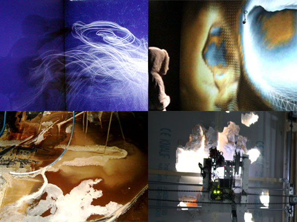

*Uzume* (2002) is a virtual environment in which participants become bodily immersed in a three-dimensional, human-scale dataspace. *Maya* (2004), a tele-immersive installation, extends the data space and the participants’ presence across two remote, networked sites. The coded instructions that produce *Uzume*’s chaotic time-space and *Maya*’s noisy, elastic data passage are shaped by corporeal processes; from the participants’ movements to the machine’s sensing and processing hardware. Introducing mechanic and robotic agencies, the installations *On Track* (2009) and *Zwischenräume* (2010) expand the material simulation of coded terrains into the messy milieu of our physical environment. *On Track* presents an unusual mix of materials whose interferences and interactions propel the orchestrated degeneration of a gooey, hiccupping choreography. *Zwischenräume’s* intrinsically motivated auto-destructive evolution relies on the machine being structurally coupled with its environment. The specificities of these artworks are anchored in the material in both the works’ specific conditions of embodiment, agency and performativity, as well as the audiences’ aesthetic experience as they become bodily involved—playfully exploring, solicitously courting or more or less unwittingly complicit. Mitchell Whitelaw’s concept of transmateriality puts forward that ‘the digital is, of course, always and inevitably embodied; that concepts like ‘data’ are functional abstractions for describing the propagation of material patterns through material substrates’. However, the material patterns and the sensations and aesthetics they produce, ‘are profoundly shaped by data acting as if it were symbolic and immaterial’ (2008). This conjunction is exactly where our investigation, both here and in our works, aims to inject itself. Our methods of intervention into this operational complot foster the qualities of the unstable, slippery and incomplete by, for example in *Uzume* and *Maya*, deploying non-linear dynamic systems and coupling of data and body or, in *Zwischenräume*, by provoking the collision of transmaterial forces through the structural coupling of machine and architectural environment. We look at the relationship between the machine agents, their enacted reality and its embodied, temporary inhabitants as a material ecology that evolves through mutual perturbations, rather than pre-scripted illusory control. Ecology here refers to a dynamic mingling of processes, matter, beings and things, and their co-evolution (Fuller 2003, also see Varela 1979 and Bennett 2010). The processes developed and propelled in these works manifest in entanglements and perforations of the contact surface or sheet of induction, where digital materialities and natural materials collide. It is where ‘embodied interaction and engagement … enter the fray’, as Anna Munster puts it, where bodies—human or machine—affect and are affected by other bodies, where it gets messy, and ‘conflicting proximities of body and machine’ (2006:160) emerge. What is particular about the artworks we discuss here is that the fray is not an inevitable consequence, but a desired aim. Transductions, transmaterial flows and transversal relations are at play within all four artworks: whether emerging from or propelling the interplay between internal dynamics and external forces, the enactment of agencies (human and non-human), or the performative relationships unfolding over time. We will explore these concepts from within the works; understanding them as investigative playgrounds for material thinking, able to produce alternate, multiple and slippery ways of knowing. {#para3}

### Locating the Virtual in Corporeal Processes and Material Specificities

The virtual environments *Uzume* and *Maya–Veil of Illusion* foreground the materiality of the virtual by rendering their actualised space semi-stable, constantly on the verge of becoming other. Both aimed to challenge common assumptions about the non-physicality of ‘virtual realities’ and how it legitimises a determined control over the body’s messy and noisy conditions. *Uzume* was implemented for a four to six wall CAVE Virtual Reality (VR) System. The CAVE allows users to experience real-time generated, three-dimensional data spaces. Participants are required to enter a cube the size of a small room, defined by 4 to 6 projection screens, and to be coupled to the VR system by means of a head sensor, mounted on a pair of LCD shutter glasses, and, commonly, one to two hand sensors. The immersive, spatial interface of the CAVE was essential for *Uzume*’s development, for it allows the interface room to be simultaneously inhabited by a digital data space and the participants’ body and the digital space to be sculpted by the body’s movements. It seems fair to say that the medium of VR has long lost its initial fascination, and yet interesting to this exploration is its dynamic coupling of body and data, which enables, according to Mark Hansen, ‘a production of space in the body, or better, a bodily spacing’ (Hansen, 2004:162). [5]. Most CAVE environments exceed the physical bounds of the virtual reality theatre, while its limited physically inhabitable space becomes the vehicle to travel through the virtual surrounds. Often, the means of navigating this vehicle is a handheld joystick-like hand sensor, whose buttons also provide the interface for interacting with objects, avatars and any other behaviours inscribed into the world. In contrast, *Uzume*’s environment is bound to the physical limits of the CAVE theatre and participants need to move around inside this small room and gesture with their two hand sensors to interact with the virtual space. The most unusual characteristic of this space is that none of its behaviours are scripted; its dynamic nature makes it appear wilful, eluding any control, even the illusion of control. {#para4}

Capture: {#para5}

::: embed
https://player.vimeo.com/video/29127696
:::

*Uzume* by Petra Gemeinboeck, Roland Blach and Nicolaj Kirisits, video documentation extract.

Immersed in *Uzume*, an abstract, dynamic and sensitively responsive environment surrounds the visitor. Its whirly, transitory nature is based on spatial representations of the temporal behaviour of nonlinear, chaotic systems: strange attractors. [6]. As the participants move around inside the projection space (while their gaze and movements are constantly fed to the computational system), they traverse the attractors’ parametric fields that are mapped around their body and thus affect the environment’s current state. The behaviours adapt over time based on the system’s history and the interplay between its internal dynamics and the constant stream of data supplying the participant’s position and movements. Each line materialising the attractors’ trajectories is connected to an invisible particle grid that also reacts to the participants’ presence. The effect is similar to moving in a viscous medium, gently warping the whirly lines when moving inside them. This elastic connection also made it possible to slowly push and pull the chaotic entities. Thus, the environment responds sensitively in endless fluid variations to each individual visitor. Due to the indeterminability of the system’s response, communicating with *Uzume* is similar to pursuing a dialogue without knowing the language of the other: although we can make sense of the other’s gestural language, we are always subjected to the uncertainty of our interpretation; the actual meaning is never revealed, never completely decoded, never fully confirmed. While *Uzume*’s environment grows increasingly familiar during the process of this dialogue, it is never the same, never known, but rather perpetually surprises, confuses and provokes its human inhabitant. Every movement of the participant causes a myriad of changes in the whirling environment: in shape, scale, density, speed, position, and even the potential for change (computation of new trajectory points per frame). *Uzume* continuously adapts to the curiosity and playfulness of its human opposite, and, at times, it appears to unfold like an extension of their bodies. Yet it’s not only the whirling trajectories that adapt; over time the participants ‘learn’ to interpret their expressivity as gestures and dispositions that reflect the history of their encounter. There’s a transversal agency at work, a constant reconstitution of relations that can only emerge from such an unscripted, irreproducible dance of forces. {#para6}

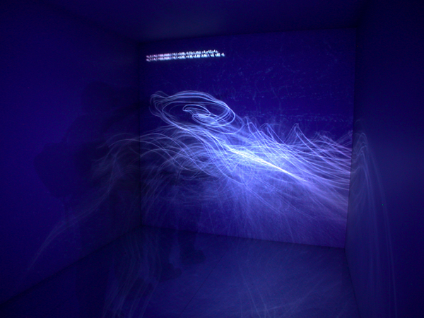

The work’s dynamic material enactment was inspired by Henri Bergson’s notion of motion that precedes space: ‘Space is not a ground on which real motion is posited; rather it is real motion that deposits space beneath itself’ (Bergson, 1991:217). *Uzume*’s space only unfolds in conjunction with an experiential body that implicates its temporal movement, and body, space and time are inescapably coupled to one another in this evolution. Immersed in the abstract ‘nothingness’ of this virtual reality, it is our bodies that constitute the performative intersection, along whose contours the negotiation between the real and the virtual unfolds. ‘What’s on the screen is an icon. What’s behind it is a set of permutations and algorithms and logical possibilities. None of these things are the virtual. It seems to me that the virtual is that slipperiness of experience. It has to do with the relation and what happens in between’ (Dove and Massumi, 1999:30). A technological interface such as the CAVE allows for coupling the body with algorithmic permutations and logical possibilities. And yet, in *Uzume*, the connections in-between happen where it becomes slippery and at the same time specific. {#para7}

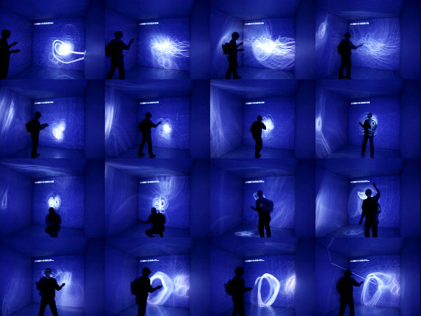

The medium’s objective to simulate a space inhabitable by human bodies through the discrete manipulation of supposedly immaterial data opens up an intriguing conundrum. *Uzume*’s chaotic nature pushes this impossible relationship by binding its material expressions to an evolutionary path always specific to its history and open to external forces. *Uzume*’s inhabitants often either moved in concert with the environment’s whirly movements, as if aiming to trace them, or attempted to intervene with and shape them by forcibly gesturing with their sensors or devoutly pushing and pulling the multiple contours of their surrounds. Thus, the intangible environment certainly has a material affect, and the specificities of this material affect ground virtual realities in embodiment, which, according to Katherine Hayles, ‘always is contextual, enmeshed within the specifics of place, time, physiology and culture, which together compose enactment’ (1999:196). An ‘art with feedback’ evolves in a field of complex dynamics between all actors involved: the computational agent(s), human participants as well as the environment(s) they share. [7]. The realisation of the computational system, or agent, includes the interface with the machine’s hardware and software, its expressive and performative potential, as well as its porosity, that is, the degree to which it is able to relate to the other actors. The participants’ embodiment brings with it a history of social, gendered, and cultural experiences, which together shape their experience, expectation, degree of affectedness, etc. Coupled, the participant and computational system mutually affect each other and are embedded within the material conditions of their shared environment, its spatial configuration, air circulation, or lighting condition, etc., all interacting with and affecting the nature of the installation and the agents’ place within. While this complex interplay is at work in all CAVE environments, questions of materiality, specificity, and embodiment have not featured prominently in the history of Virtual Reality. The installation *Maya-Veil of Illusion* (*Maya*)*,* likewise, uses stereoscopic, real-time projection systems; here the system networks two sites to span a shared virtual space in-between. The tele-immersive installation is concerned with the illusion of control and remote presence within the context of shared virtual environments. Immersed in *Maya*, participants are networked and mapped to one another, which allows them to ‘step through the looking glass’ and to be present on the ‘other side’. Yet *Maya*’s ‘veil of illusion’ takes on the role of a tactile transformer in-between, interfering with and, thus, unveiling the promise of fidelity. {#para8}

Capture: {#para9}

::: embed
https://player.vimeo.com/video/29072313
:::

*Maya–Veil of Illusion* by Petra Gemeinboeck, video documentation extract.

The (multi-)inhabitation of shared environments exposes the obscure nature of remote data transfer. It is not clearly comprehensible for a participant where the (apparently) incoming data has arisen, where outgoing data is being sent, and how it is transformed en-route. Naturally, the fidelity of the space as a shared experience is thus brought into question: how can a shared virtual experience be trusted when it is constructed from such intangible and malleable stuff as streams of binary digits? In *Maya*, the detachment of the data from its inhabitants, and the material noise this produces, drives the dynamic process that literally shapes and reshapes the shared space it spans. *Maya* presents a fluidly-dynamic mirror surface; a two-way mirror, whose two sides are split apart to produce an elastic and only apparently transparent looking glass on each remote site. A three-dimensional skin-like membrane of interconnected particles shapes the surface. It transforms based on a physical simulation of force fields, aiming to make tangible the specific material conditions (and impossibilities) of shared virtual environments. *Maya*’s elastic boundary alludes to the performative act of traversing to the other side: ‘boundaries are set and specified in the act of passage’ (Massumi, 1993). Performing as the avatar that participants share on both sites, the veil also acts as a performative boundary in-between that enacts the transversal and the transmission of data. It is an avatar that not only mediates but also proactively co-shapes the participants’ remote dialogue. As the participants move towards the screen, *Maya*‘s virtual veil extends and seems to allow one’s body imprint to reach to the ‘other side’. Yet the more one tries to touch the other, the more the digital body distorts, gets entangled with the other bodies, and eventually becomes other. The work interfaces with its participants based on a transduction from light to force: to detect, track and interpret participants, a camera eye captures the light-reflection of the environment, thus reading and reinterpreting the participants as varying luminance values. Due to the stereoscopic display of the three-dimensional veil, the veil appears to bubble and swell into each participant’s space, so that the participant’s touch, re-enacted by the digital passage effectively colonises the other side. {#para10}

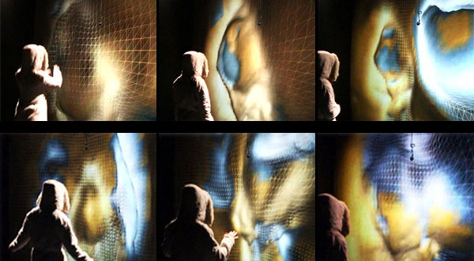

The work problematises the system as a transparent extension of our bodies. *Maya*’s only apparently transparent veil marks the ends of an imaginary passage that takes on the role of a third, unknown performer in-between. The system’s internal dynamics introduces the forces that continually reconstitute the veil and its transversal agencies, whereas the material specifics of digital processing and transmission determine the local differences on each remote site: while *Maya*’s two sides evolve based on the veil’s force play, each side differentiates itself from the other based on the local system’s interpretation of both local and remote inputs. The deviations between the two sites result from—in fact, exploit—the situated materiality of the two systems: network delays, caused by noise in the network and necessary delays in compensating for them, varying light conditions at each physical site, and the differences in integral time steps of the local computing process. As such, *Maya*’s passage from one side to the other makes the transmaterial tangible; both sides of the passage would perfectly mirror each other, if their digital material wasn’t anchored to physical. The resulting rippling and bubbling interlacing fragments, mirroring different places, reminds of something that suffers from ‘disturbances of memory and the failures of recognition’ (Deleuze, 1985:55). {#para11}

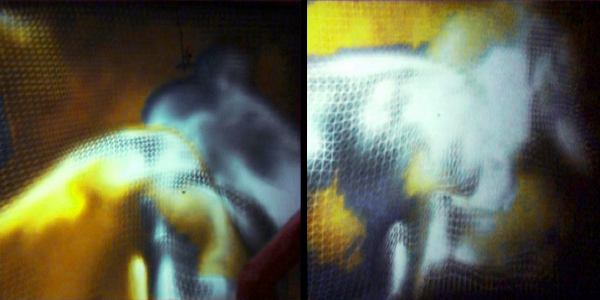

To reveal and make tangible the system’s reinterpretations of and interferences in the participants’ communication, *Maya* also presents an unusual spatial constellation: The environment is programmed as to enable participants to ‘enter’ the veil from any remote location, and yet, conceptually, the passage and its two end surfaces need to be displayed on one site. The two mirror sides are turned inside out and positioned opposite of each other to materialise the passage in-between. This, perhaps paradoxical, locally installed shared environment allows for participants to experience the situated materiality of data networking processes and to become aware of and explore the transmutations in-between. {#para12}

### Hiccupping Performers and Suspicious Machine Agents with a Hammer

The works *On Track* and *Zwischenräume* extend our discussion linking dynamic systems with the concepts of specificity, embodiment and slipperiness. However the dynamic relations of these machinic assemblages evolve in the unforeseeable interplay between the materialities that constitute them. In fact, their core aim is to performatively enact this dynamic interplay by materially manifesting the ways in which it affects all agents involved. In contrast to *Uzume* and *Maya*, which evolve based on the mutual relationships between human bodies and the dynamic system and its material enunciation, *On Track* and *Zwischenräume* only interact with people in the sense that the audience is part of the environment that the machine agents are embedded in and intervening with. {#para13}

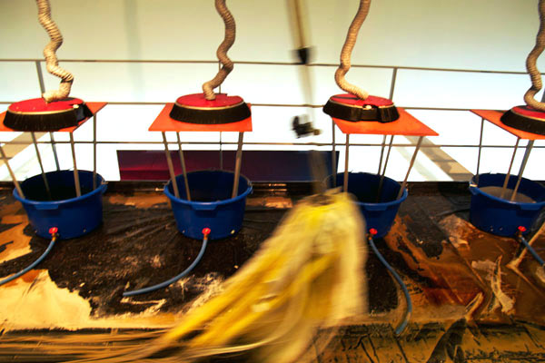

The slippery, smelly performance of *On Track* by *In Serial* emerges from the interactions and interferences between a mechanical mop, a troupe of robotic brushes and spilling viscous fluids. The unusual mix of materials and approaches that characterizes this work’s poetically messy articulation is the result of the coming together of four artists from different backgrounds. [3]. The work develops an ironic lens through which to look at human endeavour, its overly complicated mechanisms and procedures, and their vulnerability to a slipperiness already built in. A disaster-prone scenario unfolds as the protagonists—apparently set to clean—spill, interrupt and hinder each other, creating an ever more slippery mess in intricately choreographed ways. *On Track*’s machinery materialises notions of the recurrent, futile and instable in an assemblage of four interacting actors (some of which already are complex assemblies themselves), at whose core lie repetitiveness, interference, constraint and deterioration. A slowly swinging mop is joined by a troupe of autonomous robotic brushes that bring a nervous, teetering energy to the scenario. Opposing and extending the mechanic and pendulous, the robotic brushes bear something more human; laden with intent and sensation, they perform complex choreographed agitations. The dialogue between the two, carried through infrared signals, only serves to interrupt the robot’s movements and thus to interfere with the brushes’ impossible assignment. To propel the narrative of slippage and hindrance, two further ‘systems’ were in play. Five large industrial buckets are filled with viscous liquids, latex, fish glue, and other slimy substances. The buckets are leaking and supply an ongoing provocation for the mop that with each swing, mixes them together with pigments to create a congealing trail of puddles and crust. The robots themselves are trapped on platforms mounted above the buckets. Confined by their elevated cells, they are abandoned to gesture restlessly and in frustration, teeter at the precipice. Doing so, they are constantly rocking the buckets, thus they unknowingly contribute to the creeping mess (Gemeinboeck et al, 2010). {#para14}

::: embed
https://player.vimeo.com/video/29073524
:::

*On Track* by *In Serial*, video documentation extract.

*On Track* *performs* the issues that it seeks to critique rather than *representing* them. Rather than being representational, according to Irit Rogoff, ‘[p]erformance comes into its own in the name of an unease, in the arena of a promise of something that is yet to come, yet to be articulated and of agency yet to be recognized, yet to be named’ *(*1998). The work’s performance continuously forms—and breaks—where all its actors collide. Following Andreas Broeckmann’s definition of the machinic as an aesthetic principle, it seeks ‘process rather than object, … dynamics rather than finality, … instability rather than permanence’ (1997). While the constant material collisions lead to a big, gooey mess overall, many of the traces of the transductive forces produced in this assemblage of material processes can be found at the rim of the programmed, mechanic and the other materials, whether crafted (wooden platforms) or stirred (fluids and pigments). The motions of the brushes, for instance, constantly chafe against the lacquered wood and the increasingly tattered surface causes the robots to slip. It is where the programmed and choreographed meet the messy and unknown, that ‘other ways of knowing’ (Maharaj, 2002) can unfold: where movements deviate, stutter and synchronization slips, and the fluids coagulate. The installation *Zwischenräume* (*Interstitial Spaces*) is part of a series of machine installations that embed autonomous robots into the skin of our built environment to investigate the performative potential of material agency. The creative research project deploys robotics as a medium, consisting of a collective of autonomous, embodied and intrinsically motivated agents capable of enacting and communicating their evolving desires in embodied ways by re-sculpting their environment. It understands the robotic medium and its specificity as a ‘product of interaction between different elements in an assemblage of material processes’, rather than in the sense of purity or norm. (Maras and Sutton, 2000:102). {#para15}

Capture: {#para16}

::: embed
https://player.vimeo.com/video/29072313
:::

Zwischenräume by *robococo* (Petra Gemeinboeck and Rob Saunders), video documentation extract.

This first work, *Zwischenräume,* embeds a group of autonomous robots into the architectural fabric of the everyday life, as both a sculptural manifestation of and investigative lens into the politics of surveillance. Perforations of electronic monitoring and remote control, commonly perceived as immaterial, are made tangible in the form of an autonomous sculptural ‘un-walling’ process that marks and wounds our environment. Incorporated into the wall itself, a collective of robots punches holes to inspect what’s outside, signal each other, and conspire. Each robot, moving across the plane of the wall, is equipped with a hammer, surveillance camera, and a contact microphone. The architectonic environment serves as the agents’ body, and also becomes their milieu for communication and intervention: producing cracks, holes and scars, they develop strategies to survey, provoke, and conspire. Intrinsically motivated to explore the environment and study its inhabitants, the agents process movements, colours and faces to create an adaptive model of the surrounds (Gemeinboeck and Saunders 2011). In contrast to the agents or agential spaces previously introduced, these self-motivated agents don’t only respond to changes in their environment but also proactively intervene. The hammer is not only used to create holes for the camera eye to see but also becomes an instrument for signaling each other. They network audible and tangibly with each other by rhythmically knocking against the wall; which, even though more gently executed, inflicts serious injuries to the wall’s skin over time. The sculptural practice developed in *Zwischenräume* turns the wall of the gallery into a medium for intervention; re-constituting the space of the gallery as an event. The need to exploit the audience’s ignorance and confusion makes the staging of this intervention immanently site-specific. Ideally, the existing architecture is mimicked to house the robots that then (appear to) break through the, taken for granted, security offered by a familiar wall. The aim is to engage the audience in the intimate complicity that connects us with the machinic ecologies we create. Thus, it is the spectacle of the intervention into the architectural fabric that we are interested in, rather than the spectacle of the intervening machinery. In the first exhibition, the surveillance machinery transformed a cozy living room scene into a capricious, suspicious voyeur [9]. {#para17}

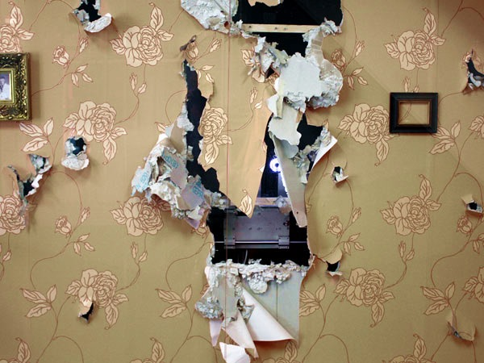

The means of marking and wounding our environment have been adopted from two military references that, once entangled, have shaped the material forces of this embodied surveillance. The work develops a political relationship between the stealthy invasion of digital surveillance and urban combat tactics in which Israeli soldiers were literally instructed to walk through private walls to ambush their enemies (Weizman, 2006). In *Zwischenräume*, the forceful penetration of the wall enacts the haptic force of surveillance as it is most powerfully demonstrated in DARPA’s project ‘Combat Zones That See’ [8].. Our work embodies surveillance’s transmaterial force of seeing, or as Brighenti (2010:185) puts it, ‘the gesture that seizes’ by literally carving the machinic gaze into the fabric of our built environment. Making the gaze tangible, exposes the politics of transmateriality: Mitchell Whitelaw’s notion of transmateriality where data acts *‘as if it were* symbolic and immaterial’ (2008) becomes political in digital surveillance, where the ‘*acting as if’* is intentionally exploited. Surveillance relies on the illusion under which the extraction of data, the flow of data, and the extracted, transferred data itself are perceived as symbolic and immaterial. The intangibility of data flows allows digital surveillance to operate in the first place, while, arguably, the (extracted) data disguised as symbolic and immaterial helps securing the public’s indifference. {#para18}

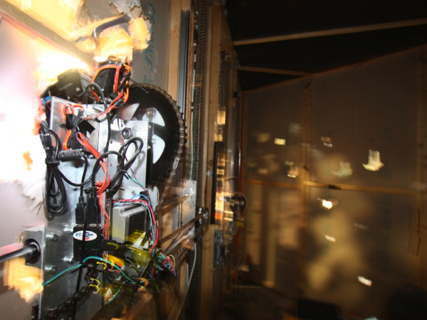

Beneath *Zwischenräume*’s surveillance narrative lies a broader critical investigation of the relations, dependencies, and tensions between what is often perceived isolated as technology, nature, culture and society. The installation almost literally enacts the drama played out between cultural and physical forces, and this force play is not only propelled but also motivated by the machines’ desires. As it problematises the paradoxical ground common to both, intervention and surveillance, it not only makes tangible the surreptitious powers of digital control, increasingly perforating our everyday life (Crandall, 2005; De Landa, 1998; Haraway, 1991), but also highlights the scale to which our cultural identity, the need to affect and control our natural environment, and technological innovation condition and consequently constitute each other. In the work, these relations of interdependency are played out in the feedback loop between the environment, with its specific material conditions, cultural context, and inhabitants, and the specifics of the agents’ agency, resulting from their autonomy and embodiment. Looking, reflecting and acting become mutual processes that propel the relationship between the machinic inhabitants and their human environment, as much as between the human inhabitants of the machinic environment. The agents’ embodiment (as part of the wall) evolves based on their interactions, and consequently, their agency affects processes out which they are themselves emergent. This performative entanglement resonates with Karen Barad’s argument that agency is ‘a matter of intra-acting; it is an enactment, not something that someone or something has’ (2003:826-7). {#para19}

### Partial, Material and Situated Knowledges

The work’s transmaterial flows and affects, transformation of agencies, and the constitution of transversal relations happen where different agents, human and non-human, meet; where data and bodies dynamically couple and affect each other. In the following we will take a closer look at how these transmaterial minglings and congealing agencies produce multiple perspectives and alternate situated knowledges. The works’ specific material enunciations, the ways in which they dynamically couple with bodies, and the transversal relations they produce, cut across and challenge some old and long-engrained boundaries, separating mind from body, human from nonhuman, and culture from nature. These demarcation lines and their underlying Cartesian ontology also brought upon us the distinction between matter and information (see Hayles 1999), which has deprived the digital of its materiality and in many ways defined the medium’s potential. The way, in which the artworks and their experimental playgrounds outplay these boundaries, is by deliberately producing unstable conditions and embroiling matter, processes, and human actors in this maelstrom of constant becoming. Davis has depicted the productive effect of Philip K. Dick’s radical and often destructive interferences: ‘In a world of manufactured illusions, the gremlins of entropy—malfunctions, interference, decay—can paradoxically liberate us by gouging holes in the smooth surface of simulation; these corrosive gaps create the space for breakthroughs and insights, imaginative or real’ (2005). The ‘gremlins’ of our works are the slipping logics of nonlinear systems or distributed agential forces of colliding materials: *Uzume*’s chaotic habitat and *Maya*’s noisy and bubbling data passage, *On Track’s* messy mix, and *Zwischenräume*’s forceful inscriptions of the machines’ gaze. All four release, what may appear as wilfulness, an agency unintended or an ‘other’ that unsettles our expectations and assumptions. At the same time, they open up a space for a different set of questions and relations that seek, in Donna Haraway’s words, ‘perspective[s] from those points of view, which can never be known in advance, which promise something quite extraordinary, that is, knowledge potent for constructing worlds less organized by axes of domination’ (1991:192). {#para20}

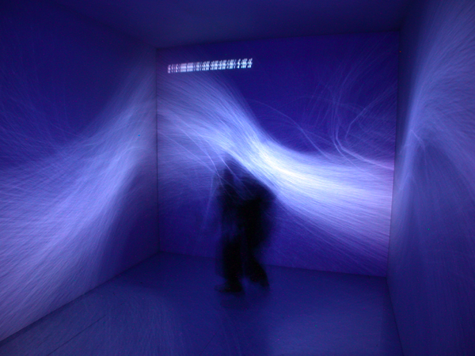

Both, *Uzume* and *Maya* intervene into standard data-body or body-data-body transductions by making them fragile, slippery and indeterminable. *Uzume’s* materiality unfolds in the continuous process of becoming-body, that is, the between of a series of differentials, the interval. Derrida calls it ‘spacing’: ‘the becoming-space of time or the becoming-time of space (temporization)’ (1982:13). The attractors’ abstract mathematical space of possibilities becomes the basis for the induction of time, out of which ‘tangible’ space emerges. Space, as we experience it in *Uzume,* appears like a trace, a living trace, always flowing and never forming an encrusted surface. It is, to borrow from Elizabeth Grosz, ‘neither clearly space nor time but a kind of leakage between the two, the passage of the one into the other’ (2001:110). *Maya*’s becoming-body, on the other hand, is of folding, a turning inside out. Bound to and bouncing off the boundaries of the passage, that which was coming from outside (remote) suddenly appears to emanate from the inside (local). The inversion of forces closes the passage. It only opens, violently, at the point at which the membrane’s force play becomes unbalanced and eventually unstable. The force field collapses, shattering the mirror surface and resolving the passage into black nothingness. Yet the confines of this passage are not immediately imaginable or accessible. To traverse this spacing boundary requires one to understand that there is no passage. This is how we arrive at Alice’s Wonderland: ‘By sliding, one passes to the other side, since the other side is nothing but the opposite direction. … It is by following the border, by skirting the surface, that one passes from bodies to the incorporeal (double)’ (Deleuze, 2001:10). {#para21}

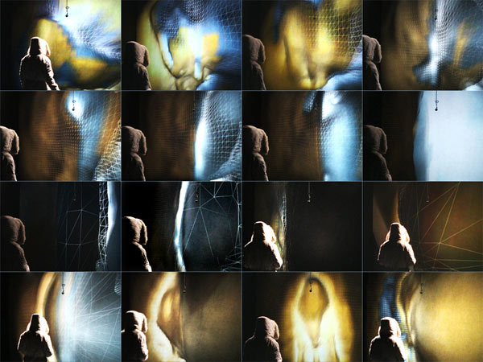

Notions of the ‘virtual’ may be re-enacted by the material enunciations of a (VR) system, but they are certainly not fabricated by technology. Rather, we imagined *Uzume* and *Maya* to be an ‘encounter between bodies that releases something from each and, in the process, releases or makes real a virtuality’ (Grosz, 2001: 69). Any existing relationships and with it, any assumptions and expectations from the works’ authors and co-authoring audience, are constantly probed, unfixed and renewed. Their specific material manifestation is, in Erin Manning’s words, ‘a transmutation of process-becoming-form’ (2009:126), always partial, multiple, and impossible to reproduce, rather than the enactment of a reality that reproduces and reaffirms what is already known. What the artworks are able to do is to open this uncertain spacings and fragile entanglements up to us to insert ourselves, and render them an intensive embodied experience. Locating a digital aesthetics, Anna Munster talks about ‘the way in which digitality provides a set of lived circumstances in which our senses encroach upon us in a different way’ (2001). Similar to the ‘virtual’, Guattari’s notion of the ‘machinic’ as an assemblage of heterogeneous forces in a continuous state of becoming and transforming each other, affords us a perspective that is as much imaginary and experimental as it is technical. His abstract machines install themselves transversally to all heterogeneous machine levels, the material, cognitive, affective and social (Guattari 1995:35). Rather than simply (re)forming matter, they open up a milieu for experimentation. They are, as Manning puts it, ‘processes (of) in-formation, continually, rhythmically recasting the heterogeneous processes out which they themselves are emergent’ (2009:105-6). The concept of the machinic opens up an arena in which to locate both, the body-system couplings in *Uzume* and *Maya* and the disaster-prone entanglements of *On Track* and *Zwischenräume*. All their heterogeneous processes always unfold in the present; without the comfort of rehearsal. *On Track* and *Zwischenräume* challenge a view of machine performers whose agency is bound by their material embodiment, and provoke us to explore them as an ‘immanent, collective entanglement of material enunciations that operate on, shape, and transform the world’ (Salter, 2010:xxxiii). The works open up the transversality of assemblages that owe their agential forces to the vitality of the materialities and dynamic spatio-temporal relations that constitute them (Bennett 2010: 34-5). On Track’s fragile alliances of agents, whether mechanical-programmed or fluid-gooey, are partly choreographed and preprogrammed and partly emerge from the interferences between agents themselves. Aside from the leaking and mixing of liquids and the abrasions of surface materials, the agents don’t actually transform in this ‘dance’. Rather, their agential forces are released in the undeterminable interplay between different movements, rhythms and material interferences. Causing hiccups, leaks and failures, the system’s entropy increases, and it’s the agency of the interlinked agents that undergoes transformation. Infrared signals broadcast by the ever-passing mechanic mop cause the robots to stutter, and—together with tiny rounding errors in their internal clock—their synchrony dissolves. The buckets leak, rocked by the robot brushes and their sudden, breaking rhythms, and fluids coagulate around puddles. The mop keeps mixing and dispersing the fluids until they turn into a sticky, smelly amalgamate, and it itself gets stuck. {#para22}

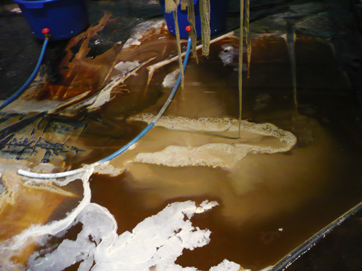

Matthew Fuller, using the concept of the ‘machinic phylum’ as a lens into complex medial systems, brings forward the ecology-making forces of the dynamic and nonlinear. ‘[S]timulating each other to new realms of potential’, they produce ‘[n] ot a whole, but a live torrent in time of variegated and combinatorial energy and matter’ (2003:171). [10]. *Zwischenräume*, an installation that literally injects itself into the environment, evolves based on the tension between the static, discrete and the dynamic, adaptive. This heterogeneous process, however, does not animate what is otherwise without agency, but rather intervenes into the wall’s agency and performativity. It disrupts and diverts the trajectory of the environment’s material history and renders it negotiable. Coupling the machines’ autonomous agency with the structural agency of the wall opens up a space for Barad’s ‘congealing of agency’ (2003:828), where the different agential forces not only co-evolve but perform together; a material mingling that transversally affects the cultural agency of the architectural boundary and links to the political agency of both, erecting a wall and breaking it. {#para23}

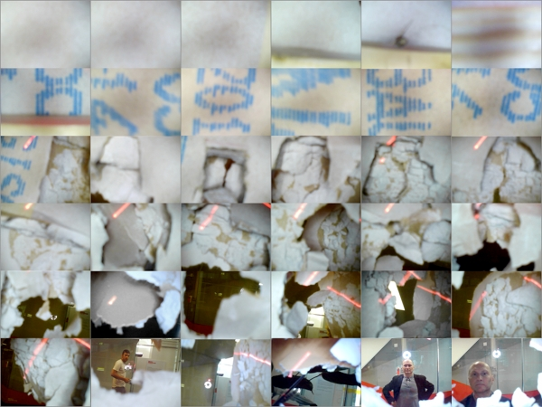

The works’ transversal relations unfold with the dynamic and emergent forces, situated in a specific material and cultural context. That’s where it gets slippery. The deterritorialising effect is two-fold: One, the forces perpetuate across digital and physical terrains and willfully cut across the boundary between human and nonhuman agency. The coupling of data and body in *Uzume* and *Maya* provide intimate glimpses of untamed digital wildernesses and discomforting views upon our everyday illusions of control. The collision of programmed choreographies and material contingencies in *On Track* creates a stage for entropy to be played out. *Zwischenräume*’s enactment of autonomous agencies and material tensions manifest as open wounds in once trusted borders. The second challenged territory is that of control and hierarchical views. Rather than offering the comfort of repetition and security of control, the works put us in a position, where we have to abandon control over the process and its effects. Both the authors, by setting this process in motion, and the audience, by becoming collaborators, accomplices or intervenors, are caught up in this dynamic lattice of relations of interdependency. We are placed inside this unfolding process, rather than operating from a safe position outside that provides control and overview. There is no outside position. But there are new alliances to be made. Conventional production of knowledge separates the subject from the object and distances the process of production from its specific context. In contrast, the unscripted, situated and potentially messy enables a production of knowledge that, as Sarat Maharaj’s puts it, wires ‘into transformative interaction’ and gets ‘into shaping matters, into conductivity with experience’ (2002:80). It is by exploiting the noise in the system and by seeking the specific, indeterminable and irreproducible that the thinking with and deploying of digital technologies can open up new perspectives and engender new aesthetic experiences. The contingencies, slippery passages and series of transforming possibilities enabled in this heterogeneous process, to borrow from Erin Manning, ‘produces not simply a change of state; it invents a new process’ (2008). What we here produce and encounter are not so much answers, causes and effects that will always be the same, but rather questions, deviations and ‘unexpected openings’ (Haraway, 1991: 196) that will always be different. At the heart of our four works (systems), is that they need to happen, or be executed, to use a more technical term, in real-time for us to know what they do, what *can* happen. ‘Mapping [themselves] during take-off’ and constantly re-mapping themselves en-route, what results ‘cannot be spelled out in advance of the processes of [their] making’ (Maharaj, 2004). Whether it is the non-linear dynamics in *Uzume* and *Maya* or the unforeseeable results from the material interactions in *On Track* and *Zwischenräume*, without them being enacted, that is, situated in space and time, relating to the environment, and becoming-body in response, precipitate, we cannot know which of the many possible performances they will produce, which relations they will create during the process. This unfolding in real-time, that is, the time of our bodies, and in real space, that is, the space we share with them, their actions within our environment and interactions with our bodies, makes them specific. {#para24}

### Biographical Note

 *Petra Gemeinboeck* is Senior Lecturer in Interactive Media Arts at the College of Fine Arts, University of NSW. Petra’s practice in machine performance, interactive installation, and virtual environments explores the ambiguities and vulnerabilities in our relationships with machines, making tangible the desires and politics involved. Her works have been exhibited internationally, including the Ars Electronica, Thessaloniki Biennale, Archilab, MCA Chicago, ICC Tokyo, OK Center for Contemporary Art, and the Centre des Arts Enghien at Paris.

*Rob Saunders* is Senior Lecturer in Design Computing at the Design Lab, University of Sydney. With a background in Artificial Intelligence, Rob’s research centres around creative application of computing and the computational modelling of creativity. Using techniques from machine learning, robotics and surveillance he explores the role of curiosity in creative processes and develops models of creative systems at individual, social and cultural levels.

### Notes

- [1] *Uzume* (2002), by Petra Gemeinboeck and Roland Blach. Nicolaj Kirisits has composed the real-time soundscape. [https://www.impossiblegeographies.net](https://www.impossiblegeographies.net)

- [2] *Maya–Veil of Illusion* (2004) by Petra Gemeinboeck. [https://www.impossiblegeographies.net](https://www.impossiblegeographies.net)

- [3] *On Track* (2009) by *In Serial* (Linda Dement, Petra Gemeinboeck, PRINZGAU/podgorschek and Marion Traenkle); the robotic performance was developed in collaboration with Rob Saunders. [https://www.inserial.net](https://www.inserial.net)

- [4] Zwischenräume (2010) by robococo (Petra Gemeinboeck and Rob Saunders). [https://www.robococo.net](https://www.robococo.net)

- [5] The aim of this article is not to introduce a critical account of ‘Virtual Reality’ and its technologies. For a critical discussion of virtual reality within an artistic, theoretical and technical context see earlier writings of Petra Gemeinboeck (2001-2009).

- [6] The trajectory of an attractor represents the series of successive states through which a dynamic system proceeds over time. Strange attractors are semi-stable, ‘living’ on the borderline between instability (that is to blow up to infinity) and stability (collapsing into a singular equilibrium point) and show the unique property that they never travel through space on the same trajectory. As dynamic systems are sensitive to their initial conditions, very small differences in initial values result in very different behaviours. The chaotic property makes it essentially impossible to make any long-term predictions about the behaviour of a dynamic system.

- [7] In 1964, Stanislaw Lem, a science fiction author and researcher in cybernetics, has developed the vision of an artificial reality system: the ‘Phantomatic’. The system was capable of creating mutual connections between ‘the artificial reality’ and its recipient. In Lem’s words, ‘the Phantomatic is an art with feedback’ (translated by author).

- Lem, Stanislaw. Die Entdeckung der Virtualität (Frankfurt am Main: Suhrkamp, 1996), p. 158.

- [8] DARPA stands for U.S. Defense Advanced Research Projects Agency. Their project ‘Combat Zones That See’ embeds thousands of cameras into the urban terrain, aiming for surveying and analysing the moves of each resident based on state of the art artificial visual intelligence: [https://en.wikisource.org/wiki/DARPA_Solicitation_Number_SN03-13:_Pre-Solicitation_Notice:_COMBAT_ZONES_THAT_SEE_(CTS](https://en.wikisource.org/wiki/DARPA_Solicitation_Number_SN03-13:_Pre-Solicitation_Notice:_COMBAT_ZONES_THAT_SEE_(CTS))

- [9] The first exhibition took place in the Schauraum Angewandte, located in the Electronic Avenue of the MuseumsQuartier in Vienna, Austria, June 8–July 27, 2010. As the gallery space was bounded by glass walls and a wall with a large window, it was necessary to stage the environment to be intervened, as well as the intervention itself. The small, transparent gallery space was turned inside out and transformed into a private, living room scene oriented towards the public space outside the gallery (see figure 8).

- [10] Matthew Fuller refers here to Manuel De Landa’s account of Deleuze and Guattari’s concept of the ‘machinic phylum’.

### References

- Barad, Karen. ‘Posthumanist Performativity: Toward an Understanding of How Matter Comes to Matter’, in: *Signs: Journal of Women in Culture and Society* 23.1 (2003), 801-831.

- Bennett, Jane. *Vibrant Matter* (Durham: Duke University Press, 2010).

- Bergson, Henri. Matter and Memory, trans. Paul, Nancy, Margaret and Palmer, W. Scott (New York: Zone Books, 1991).

- Brighenti, Andrea Mubi. ‘Artveillance: At the Crossroads of Art and Surveillance’, in: John McGrath and Robert Sweeny (eds.) Special Issue on Surveillance, Performance and New Media Art, *Surveillance & Society* *7.2* (2010), 175-186.

- Broeckmann, Andreas. ‘Remove the Controls. Machine Aesthetics’ (1997), [https://framework.v2.nl/archive/archive/node/text/default.xslt/nodenr-70381](https://framework.v2.nl/archive/archive/node/text/default.xslt/nodenr-70381)

- Crandall, Jordan. ‘Operational Media’, Arthur and Marilouise Kroker (eds.) CTheory (June 2005), [https://www.ctheory.net/articles.aspx?id=441](https://www.ctheory.net/articles.aspx)

- Davis, Erik. ‘Philip K. Dick’s Divine Interference’, https://www.techgnosis.com/pkdnet.html (2005, originally posted on the nettime).

- Deleuze, Gilles. [*The Logic of Sense*](https://www.kurssikirjat.net/bookdetails.php) (London and New York: Continuum, 2001. Originally published in 1969).

- Deleuze, Gilles. *Cinema 2: The Time-Image*, trans. Tomlinson, Hugh and Galeta, Robert (London: Althone Press, 1985)

- De Landa, Manuel. *War in the Age of Intelligent Machines* (New York: Zone Books, 1998).

- Derrida, Jacques. *Margins of Philosophy*, trans. Bass, Alan (Chicago: University of Chicago Press, 1982).

- Dove, Toni and Massumi, Brian. ‘The Interface and I: A Conversation between Toni Dove and Brian Massumi’, *Artbyte: The Magazine of Digital Arts 1* (Feb.-March 1999), 30-37.

- Fuller, Matthew. *Media Ecologies* (Cambridge, MA: MIT Press, 2005).

- Gemeinboeck, Petra, Saunders, Rob. ‘Zwischenräume: The Machine as Voyeur’, in *Proceedings of the* *first International Conference on Transdisciplinary Imaging at the Intersections between Art, Science and Culture* (Transdisciplinary Imaging Conference 2011 Sydney, 2011), 62-70.

- Gemeinboeck, Petra, Traenkle, Marion, Dement, Linda, PRINZGAU/podgorschek, Saunders, Rob. ‘On Track: A slippery Mechanic-Robotic Performance’, *Leonardo: Journal of the*

- *International Society for the Arts, Sciences and Technology* *43.5* (Cambridge, MA: MIT Press, 2010).

- Grosz, Elizabeth. *Architecture from the Outside. Essays on Virtual and Real Space* (Cambridge, Mass.: The MIT Press, 2001).

- Guattari, Felix. *Chaosmosis* (Bloomington and Indianapolis: Indiana University Press, 1995).

- Hansen, Mark B. N. New Philosophy for New Media (Cambridge, MA: MIT Press, 2004).

- Haraway, Donna J. Simians, Cyborgs, and Women: the Reinvention of Nature (New York: Routledge, 1991).

- Hayles, N. Katherine. *How We Became Posthuman: Virtual Bodies in Cybernetics, Literature, and Informatics* (Chicago: University of Chicago Press, 1999)

- Sarat Maharaj, ‘Unfinishable Sketch of “An Object in 4D”: Scenes of Artistic Research’, in: Annette W. Balkema and Henk Slager (eds), *Artistic Research, L&B*, Volume 18 (Amsterdam/New York: Lier en Boog, 2004).

- Maharaj, Sarat. ‘Xeno-Epistemics: Makeshift Kit for Sounding Visual Art as Knowledge Production and the Retinal Regimes’, Okwui Enwezor et al (eds.), *Documenta XI Platform 5* (Ostfildern: Hatje Cantz, 2002), 71-84.

- Manning, Erin. Relationscapes: Movement, Art, Philosophy (Cambridge, Mass.: MIT Press, 2009).

- Manning, Erin. ‘Creative Propositions for Thought in Motion’, *Inflexions 1.1* (2008).

- Maras, Steven and Sutton, David. ‘Medium Specificity Re-Visited’, *Convergence: The Journal of Research into New Media Technologies* 6.2 (Summer 2000), 99-113.

- Massumi, Brian. ‘Everywhere You Want To Be: Introduction to Fear’, Massumi, Brian (ed.): *The Politics of Everyday Fear*. Minneapolis: University of Minnesota Press, 1993), 3-38.

- Munster, Anna. *Materializing New Media: Embodiment in Information Aesthetics* (Dartmouth College Press, 2006)

- Munster, Anna. ‘Digitality – approximate aesthetics’. Arthur Kroker and Marilouise Kroker (eds.), *CTheory* (March 2001), [https://www.ctheory.net/articles.aspx?id=290](https://www.ctheory.net/articles.aspx)

- Rogoff, Irit. ‘How to Dress for an Exhibition’, M. Hannulan (ed.), *Stopping the Process? Contemporary View on Art and Exhibition* (Helsinki: Nordic Institute for Contemporary Art, 1998).

- Salter, Chris. *Entangled: Technology and the Transformation of Performance* (Massachusetts, London: The MIT Press, 2010).

- Varela, Francisco J. *Principles of Biological Autonomy* (New York: Elsevier, 1979).

- Weizman, Eyal. ‘Walking Through Walls: Soldiers as architects in the Israeli-Palestinian conflict’, Radical Philosophy 136 (March/April, 2006), 8-22.

- Whitelaw, Mitchell. ‘Notes on Transmateriality’. Blog entry, 7 March (2008), https://teemingvoid.blogspot.com/2008/03/notes-on-transmateriality.html
