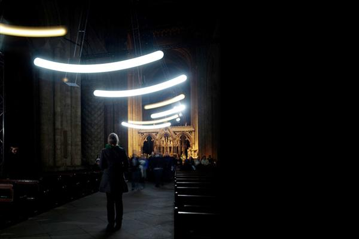

In order to do so I will focus directly on London-based art and design practice United Visual Artists, or UVA. Founded in 2003, UVA's work spans architectural and responsive installations, public art, live performance and moving image.

---

> In the electric age all former environments whatever become anti-environments. As such the old environments are transformed into areas of self-awareness and self-assertion, guaranteeing a very lively interplay of forces.
>
> – Marshall McLuhan {#para1}

  {#para2}

 {#para3}

*
* {#para4}

This article initiates a course of research that takes as its focus the transdisciplinary practice of United Visual Artists (UVA). At the heart of UVA’s distinctive art and design practice is a prevailing interest in testing the spatio-temporal relations that exist between site, the performed work and audience perception. Concentrating primarily on the example of their kinetic light and sound sculpture, *Chorus*, the following text will investigate the aesthetic conditions that underwrite the work’s exhibition. By doing so, this enquiry will speculate on how the integration of digital processes and spatial practice embodied by this particular artwork operates *transductively* as part of its framing as a mediated exhibition experience. {#para5}

Having set out a proposition in previous research for *curatorial design—*as a practicable application or method for curating developed in response to the emergence of what I have described as the *multimedial museum*—this foray into the work of UVA is being undertaken with the aim of furthering my investigative research into the relationship between virtuality and the art of exhibition. [1] In saying this, it is crucial from the outset that any such definition of the virtual not be delimited to the capacity of digital media and associated information and communication technologies to produce new, artistic forms of illusionism. Rather, the experience of virtuality needs to be understood as determined by its embeddedness in the real world, along with the capacity of social space to produce protocols for viewing and routines of audience engagement. {#para6}

It follows then that this enquiry into UVA’s design-based media practice will serve as a means to engage with how aesthetic conditions arise from the intersection of digital mediation and spatial practice. More directly, this particular investigation of their work will use *Chorus* as a focal point to interrogate how its exhibition might be shown to function analogously as a form of exhibition architecture: {#para7}

> … conceived as situated at the intersection of the material and the virtual, as fundamentally mutable, continuously negotiating, adapting to, and interacting with equally dynamic and mutable physical, social and technological environments (Blau, 2010: 38-39). {#para8}

While the intent of this critical observation by architectural historian Eve Blau was directed at broadly characterising the disposition of practices represented in the most recent iteration of the Architecture Biennale at Venice [2], its indirect inference reiterates the relevance and currency of investigating the character of mediated aesthetic transactions promoted by UVA’s transdisciplinary practice. As ‘new and emerging technologies of communication and information transfer continue to widen the cognitive gap between modes of knowing the world—between information and experience—and to multiply their contradictions’ (Blau, 2010: 39), I believe that it is timely to look more closely at how UVA’s productions negotiate the transversal relationship between mediacy and spatiality. As this text will show, closer examination of the curatorial design associated with the exhibition of a series of iterations of *Chorus* has implications that I believe not only extend our understanding of current media art practice but also can be used to turn critical attention towards *programme architecture*, as a modus of contemporary curation formed from the mediation of perceptual and social relations. {#para9}

In recent efforts to flesh out an expanded historiography of contemporary media art, numerous commentators have been drawn to the experimental artistic practices of the 1960s because of their apparent anticipation of contemporary concerns. These include the transformative effects of technology on human relations and electronic media’s integration across all levels of social and cultural interaction. Of particular interest, the closely connected theorisation of *intermedia* and *systems aesthetics* have been viewed as particularly useful aesthetic programmes that extend the conceptualisation of virtuality, particularly as it has been articulated previously in techno-arts rhetoric of the 1990s. The latter, Mitchell Whitelaw (1998) has noted: ‘amount[ed] to a kind of anti-systems practice… [that overlooks] the system, the concrete infrastructure, for a frantically overproduced internal space’. Whereas—according to Edward A. Shanken’s recent interpretation of the short paper from which Whitelaw’s observation is extracted—a systems-based approach precipitates a way of understanding the *transmateriality* of digital technology. [3] In order to understand the aesthetic condition of virtuality as inextricably linked and situated in the real world demands: {#para10}

> … a turn outwards… [that] raises questions about the intervention of art in the world… of agency… that threatens to spill out into everyday life… so as to evaporate completely, or rather to become imperceptible. (Shanken, 2009) {#para11}

As a reflection of the infiltration of information and communication technologies across all levels of society, new media art might be said to characterize the cultural expression of our technological times. Given the disparate range of artistic approaches that the term encompasses, it has proven more productive for commentators to approach their definition of the “art form” via “processes” that are exhibited through actualisation, rather than as medium-specific attributes. In doing so, creative practices employing technology become linked with a historical lineage of practices that emphasise the dematerialization of the art object. [4] Given the variable, distributed and collaborative natures most commonly ascribed to new media art, ‘no matter the form of the artwork, the medium never matters as much as the context’ (Graham & Cook, 2010: 83). Redefining social engagement of the audience with art, such processes challenge standardized, normative modes of interpretation and means of “publication” through exhibition. Strategically, by defining “(the art formerly known as) new media” as sets of behaviours, this opens up a way of thinking about the implications that works utilizing digital technologies raise for a more general ‘understanding of the behaviours of contemporary art precisely because of its participation in the creation of a cultural understanding of computational interactivity and networked participation’ (Dietz, 2010: xiv). Consequentially, forms of contemporary practice that embrace open-ended forms of interaction and participatory involvement in the co-production of the work are placing even greater demand on curatorial tactics and methodologies. These are hoped to establish aesthetic conditions that provide supporting platforms for these dynamic and emerging forms of contemporary art. {#para12}

From the standpoint of my earlier stated research interests, which gravitate to the intersection of new technologies with exhibition space, I submit that the exhibition plays a crucial role in determining the contour between cultural processes (encompassing both artistic and curatorial forms of practice) and the aesthetic conditions that influence the experience of the viewer. The exhibition operates as an interface actively mediating the dimensionality of artworks and viewing conditions that are coordinated across time and space. The artifact, the gallery’s cubic environment and the museum’s institutional apparatus are powerful manifestations that shape our perceptions and understanding, as well as the expectations that we place on art. The influence of such conventional structures on the forms—and resulting conformity—of artistic and curatorial practice should not be underestimated. Revealed in the light of new media technologies, the closed, circumscribed nature of exhibition-based practice traditionally affiliated with insulating formats and their associated conventions—whether of “White Cube” or “Black Box” varieties—is reconceived as an open, *transversal* coordination of elements constituted from material, technical, perceptual and social processes that have been brought into relationship with each other through their spatio-temporal activation. [5] The impact of digital processes has begun to transform art’s *exhibition complex* through which the fundamental interdependence between art objects, gallery space and processes of museological framing is revealed. Particularly as spatial practice and digital mediation become increasingly integrated, new forms of aesthetic interaction and expanded forms of programme architectures will be needed that propose alternative ways for the multimedial museum to take shape. {#para13}

In order to meaningfully address the nature of aesthetic experience associated with the exhibition of digitally mediated or technologically enabled artworks, the relational properties of technology need to be acknowledged. Moving from the idea of passive form to active formation entails rethinking the nature of media, away from the media-specific constitution of particular forms to a focus upon *transductive* relations. These relations take into account their organisation into technical assemblages or ensembles. Gilbert Simondon, who originally formulated the concept in his dissertation *The Mode of Existence of Technical Objects* of 1958, describes transduction as an operative process in which physical, biological, cognitive or social activities are set in motion within a given domain. [6] Or, as Adrian Mackenzie succinctly puts it, transduction ‘account[s] for how things become what they are rather than what they are’ (2002: 16). Addressing this problematic holds implications not only for a digital aesthetics but also more broadly for contemporary art practice in general, particularly in response to what has been posited as a “post-object” or “post-medium” paradigm shift. [7] Recent interest in establishing the basis for a hybrid discourse between new media and mainstream contemporary art attests to the renewed relevance of the systems approach that the art critic Jack Burnham articulated in his writing. Looking back to the future, Burnham’s theorisation of a *systems aesthetics* describes a: {#para14}

> … moment in history when artists working with and without high technology, were engaged in a post-representational, post-object practice concerned with provoking an awareness of the real as an extensive, relational, dynamic network of processes.
>
> (Whitelaw, 1998) {#para15}

While the predominant tradition in modernist aesthetics holds steadfastly to the notion that each distinct media has its own innate qualities, the emergence of experimental practices in the late 1960s signals the waning relevance of media-specificity as a means of critically engaging with art. Characterised by their multi-media and pluralistic approaches, these forms of practice precipitate a reappraisal of modernism’s hierarchical aesthetic order. In their own distinctive ways, *intermedia* and *systems aesthetics* are representative of this shift. Their propositions—articulated most clearly by Dick Higgins and Burnham respectively—share an underlying observation that the new forms and novel formations associated with these experimental practices are reflective of socio-technical transformations taking place across “superscientific culture”. [8] {#para16}

The conceptual basis for *intermedia* was set out in Higgins’ influential text of the same name from 1966, which starts off with the prophetic statement: ‘Much of the best work being produced today seems to fall between media’ (2005; 1966: 170). He goes on to elaborate: {#para17}

> For the last ten years or so, artists have changed their media to suit this situation, to the point where the media have broken down in their traditional forms, and have become merely puristic points of reference. The idea has arisen, as if by spontaneous combustion throughout the entire world, that these points are arbitrary and only useful as critical tools, in saying that such-and-such a work is basically musical, but also poetry. This is the intermedial approach, to emphasise the dialectic between the media. {#para18}

  {#para19}

  {#para20}

*Figure 2*. Dick Higgins, *Intermedia* *Chart* (1995) via [external link](https://stendhalgallery.com/wp-content/uploads/2011/02/p1021.jpg). {#para21}

This dialectic between media can be visualised diagrammatically as the overlapping of artistic forms (mail art, concrete poetry, graphic music notation) and movements (conceptual art, action music, Fluxus). While Higgins was in his own right an early advocate of the use of computers as a tool for art-making (should we presume that computer art is indicated by one of the “question marks” represented in Higgins’ diagram?), it is another artist closely identified with Fluxus, Nam June Paik, whose creative approach to technology exemplifies this dialectic—and its innate *transversality—*most quintessentially. As Paik himself would write: {#para22}

> Art history and musicology [have] suffered too long from the separation of the unseparable … But if all arts merge into one, as [sic.] recent movement of Mix Media shows, then the study of various arts should merge too into one.
>
> (2004; 1967) {#para23}

However, much of the artistic work that would come to fall within the province of *intermedia* can be characterised as *multi-disciplinary*. This approach is best illustrated through the type of additive, recombinant media-mixing exemplified by highly theatrical forms, such as staged environments or performative installations. In this respect, does the enduring legacy of Paik perhaps have more to do with the *transdisciplinary* basis of his hybrid production? It is in this way that Paik’s approach to creative technology aligns with the systems-based approach formulated by Jack Burnham. The latter articulates a more thoroughly transversal response to artistic motivations in an advanced technological society. Reiterating the earlier quoted remarks of Higgins, Burnham (2005; 1968: 169) would write: {#para24}

> A polarity is presently developing between the finite, unique work of high art, that is, painting or sculpture, and conceptions that can loosely be termed unobjects, these being either environments or artifacts that resist prevailing critical analysis. {#para25}

In effect, Burham’s *system aesthetics* refutes the notion that the primary experience of art resides in material entities. Burnham would draw upon kinetic art [9], luminal art—distinguishing “articulated illumination systems” from “light sculpture”—and responsive environments to illustrate his contention that art’s functionality exists through relations between people and the components that make up their environment. [10] These particular modes of practice demonstrate his claim that a fundamental transition was taking place from an object-oriented to a systems-oriented culture, wherein ‘change emanates, not from things, but from the *way things are done*‘ (Burnham, 2005; 1968: 165; my emphasis). {#para26}

Contextualized by the praxis of “expanded cinema” across the 1960s and 70s, experimental forms of cinematographic installation also play an important part in redefining, indeed blurring the boundaries between image, sculpture and live performance. [11] As demonstrated by Anthony McCall’s “solid light” films—most notably his seminal *A Line describing a Cone* from 1973—the immediacy of light, in and of itself, in the projection process is predicated on the coexistence of image in space. Through the admixture of light and smoke-induced atmosphere, McCall conjures a sculptural density through which a purer, undiluted form of optic quality or *illuminism* is achieved. Not dissimilarly, the responsive light installations of UVA promote a transversal way of thinking about how light and space, the performative enactment of the work and participatory involvement of the viewer are each integral to the process of their reassembly, achieved through the medium of exhibition. {#para27}

As part of the consequence of these re-evaluations of disciplinary boundaries, the situation, site or milieu comes to the fore. In its way, “site-specificity” opens up a multiplicity of spaces and contexts in which art can operate and find its most applicable form of exposition. The paradigmatic shift announced by this underlying post-medium condition replaces the specific formal traits and properties conventionally used to define media with a greater accommodation to the composite and inter-connected operations of an “apparatus” or system. According to Burnham (2005; 1968: 167): {#para28}

The components of systems—whether these are artistic or functional—have no higher meaning or value. Systems components derive their value solely through their assigned context. Therefore it would be impossible to regard a fragment of an art system as a work of art in itself—as, say, one might treasure a fragment of one of the Parthenon friezes. {#para29}

The medium, previously condensed to a form of material substance, is reconfigured as an assemblage of relations and varying materialities that are interdependent with the viewer. By encouraging ongoing transformation as a result of lateral mobility through and across different systems, the resulting transversal trajectory takes on a life of its own. The artwork recognised as pure, aesthetic unity is no longer a viable proposition under technologised and mediated conditions. As Nicolas Bourriaud notes in his highly influential *Relational Aesthetics* (which reprises a number of the propositions originally formulated in Burnham’s *System Esthetics*), the dialogic principle, or *transivity,* effectively becomes ‘the tangible property of the artwork’ (2002: 26). Form, reconstituted as such, emerges from this durational, unfolding encounter. {#para30}

In the spirit of drawing transversal connections, I find it particularly relevant to the line of enquiry being followed here to ask how these aesthetic conditions, which are most readily associated with the virtual realities of networked society, new technologies and the infosphere, are translating to the spatial realm through critical practices in contemporary architecture. Jean Nouvel’s *Red Pavilion*, for one, is architecture that both expresses, and is derived from, public relations [12], while Kazuyo Sejima’s direction of the most recent iteration of the Architecture Biennale at Venice sought to reveal architecture as a reflection of collective consciousness. [13] Titled ‘People meet in architecture’, the biennale was exemplified by Sejima’s curatorial selection of collaborative and speculative projects, many of which functioned as controlled experiments variously involving acts of shaping space (through the use of light, water vapour, sound) and giving substance to time (photographically, stroboscopically). Through such works: {#para31}

> The interdependency of space and time are explored through projection, movement, images (still and moving) that reveal both the complex subjectivity of perception and the intersubjectivity of experience that is shared – in the spaces of architecture as it is in the context of the exhibition itself. Throughout the exhibition the worlds of information and experience collide, intersect and multiply their contradictions (Blau, 2010: 39). {#para32}

The role of exhibition in establishing this basis in ‘interdependency’ becomes particularly evident when encountering works that experimentally demonstrate the structure of transparency and density (Junya, Ishigami & Associates; Matthias Schuler and Transsolar) or mediated environments that test the thresholds of perception. Particularly poignant in this respect were presentations of multi-sensory environments created by artists Olafur Eliasson and Janet Cardiff. Using cinematic effect to carve out slices of visibility, Eliasson’s *Your split second house* oscillates between the fluidity of perception and momentary flashes that register these impressions. Exhibiting a minimalist attitude that contrasts with the grandiose effect that Eliasson coaxes from the void, Cardiff and Miller Studio’s reprisal of *The* *Forty Part Motet*—which I will refer to again in relation to my investigation on UVA’s *Chorus*—instead places heightened emphasis on tightly controlled spatio-acoustics to produce the intertwining of sonic proximity and intimacy. {#para33}

While holding these preceding observations in mind, the primary drive of my research at this time is directed towards exploring the system-like attributes of the exhibition interface—in and of itself—in order to better understand how transversal relations reinforce the conceptual framework for curatorial design. While site-specificity has been a prevailing undercurrent throughout most of my recent research into virtuality and the art of exhibition, the focus of those enquiries has been directed for the most part to the staging of exhibitions that are situated within a museological context. Yet, particularly as the experience of pervasive, integrated media environments becomes more commonplace, I will use the course of this particular investigation into the practice of United Visual Artists to speculate on how, when digital mediation and spatial practice are integrated within an exhibition “eco-system”, a transductive way of producing aesthetic experiences that extend beyond the gallery becomes operative. {#para34}

United Visual Artists are a London-based collective whose portfolio ranges across live performance, temporary interactive installation and architectural interventions. UVA are renowned for their ability to work across various disciplines (including video, installation, architecture) and applications (commercial music video, staged performance, light shows, responsive artworks, public art and architectural interventions). [14] As leading exponents of light-based installation work and cross-media experiential spaces, their productions are characterised by a prevailing emphasis upon the visual and sculptural qualities of light, most recently with an emphasis on LED and LASER technologies. Exhibiting a cool and tightly controlled formal aesthetic, UVA’s light-based artworks harness the potential of light to transform and animate a sense of space, be the spaces enclosed, interior architectures or public environments. Combined with their sophisticated use of media technologies, their spatial practice precipitates strong subjective as well as collective responses from their audience. As recounted by Matt Clark (UVA Creative Director and co-founder along with Chris Bird and Ash Nehru): {#para35}

> When we started UVA we were predominately designing for live performance, using light to create a focal point for a large audience. With our installation work we created spaces where people were completely immersed, experiencing light on a very intimate level. We became more and more fascinated by the notion of light as a presence, how it changes the way people relate to the space around them, and to others.
>
> (Clark and Whelan, 2009) {#para36}

Over the past decade, UVA have successfully produced compelling aesthetic experiences that turn the audience into active participants. The extent of the success of their creative practice in that respect is demonstrated by notable works, such as *Volume* and *Chorus* – which will be used as the illustrative basis of this particular study. [15] *Volume* is a large-scale public interactive environment that consists of forty-six light columns arranged in a grid-like space. Each column is equipped with its own speaker relaying a unique channel of sound. Using a camera system to track the movement of audience members through the installation, the abstract light patterns and audio samples (provided by Massive Attack) respond to combined individual and collective interaction. [16] The installation’s distinctive system framework is characterised by the nature of the exchange that occurs between interactors and the elements that make up the work’s total sensory environment. This interaction influences the transformations that effect the aesthetic quality of the lighting patterns of the columns, the resulting soundscape and the overall, highly integrated rhythm of the entire environment. When engaging with the work there is a prevailing sense of there being an inter-dependent relationship between individual presence and the emergent quality of the system. {#para37}

*Chorus* is comprised of an array of eight pendulums each mounted with an LED light source and single speaker. Each pendulum has been assigned a unique score composed by Mira Calix. [17] The individual “voice” associated with each pendulum can be heard when the auditor is within immediate proximity of the moving path of the swinging pendulum, but as an ensemble they form a tightly interwoven chorus of light and sound. The work’s concept arose from the search for a simple and unifying relationship between light and opera. In musical terms, a chorus is the main part of a song that gets repeated; etymologically, the word “chorus” relates to a refrain (from the Latin *refringere*, “to repeat”). Chorus or strophic form describes a particular way of structuring a piece of music, which is based on the recurrence of a single formal section in a way that is analogous to repeated stanzas in poetry. Equally, the term can be used to mean a distinctive method for the spatial arrangement of sections of a choir that can affect the resulting perception of sound. {#para38}

  {#para39}

  {#para40}

 {#para41}

*
* {#para42}

Approached initially by Opera North with a design commission to celebrate the re-opening of the Howard Assembly Room of the Grande Theatre of Leeds, the genesis of the work’s formal solution was inspired by the combined conceptual, physical and geometrical responses to this site-specific “backdrop”. [18] The shape, design and functional properties of *Chorus* respond in a synergetic way to architectural features of the space. The design utilises the ceiling’s arcs as pivot points for the suspended arms of the pendulums, with the resulting movement of the pendulums forming a mirrored arc of the barrel vaulted ceiling itself. While taking the pre-existing spatial properties of the site and its overriding sense of proportional order into account, the work also exhibits an underlying desire to produce a form of visitor/viewer engagement that reflects a scale of human presence in the space. *Chorus* operates simultaneously at a level of individual and collective experience. In developing the concept design of *Chorus*, UVA sought to balance creating an imposing, and at times menacing, physical presence while still enabling the public to move freely in order to fully explore its audiovisual properties as every position in the space offers a different perceptual relationship with the work. Visually, this is achieved by enabling relatively unobstructed panoramic views of the overall setting that frames the work, as well as drawing the attention of its viewers when passing below the work itself upwards to the ceiling and its gothic decoration. Complemented by its acoustic register, the work’s spatial performance restores a sense of the building’s original splendour and mystique. {#para43}

  {#para44}

  {#para45}

Considered as a technical ensemble, these pendulums form an instrument that allows the creative artists and participants alike to explore the relationship between performance, sculpture and composition. Subsequent restagings of *Chorus* have enabled UVA to continue to refine and test the limits of the work and its adaptability to other spaces and situations. [19] In the following section, I will look more closely at the installation of *Chorus* at Durham Cathedral in order to address how this particularly evocative setting is animated by the work’s direct performance and its perceived operativity. {#para46}

Durham Cathedral is considered a masterpiece of Romanesque architecture and amongst the greatest Norman buildings in Europe. Built as a shrine to St Cuthbert and begun in 1093, the cathedral became a main destination for pilgrims throughout the middle ages. The choice to reinstall *Chorus* in this particular architectural setting activates an interpretation of the work that references the role of choral music in the medieval church, where it served the purpose of not only illustrating scriptural texts but transcending them emotively. [20] Arguably, such associations with choral form and effect become even more pronounced in this reprisal than when the work was staged initially in Leeds. {#para47}

  {#para48}

  {#para49}

 {#para50}

*
* {#para51}

Rigged in such a way as to be suspended directly over the main aisle of the cathedral, the array of swinging pendulums assumes a distinctively anthropomorphic character. [21] Formally, the stark minimalism of *Chorus* sets itself in stark contrast to the architecture’s Romanesque features. However this physical relationship sets up an intriguing rhythmic oscillation between the mechanical arms and views that juxtapose the resulting streaks and trails of light with the ornate altar (which acts as a backdrop to the lighting emitted from the hub of each pendulum when viewed frontally) or the cathedral ceiling (which serves as a compositional surface for the kinetic work to play upon when taken in from directly below). By situating the work in this architectural context, audience movement is channelled along the narrow central nave. As a result, the experience of the environment is intensified within a central corridor of action and activation. The cadence of the swinging arms of the pendulums along with their accompanying visual and sonic refrains encourages a certain processional quality that promotes a strong reverential feel. The overall viewing quality results from a mixture of stationary (perceiving sight and sound in relation to architectural backdrop, whether oriented ahead, behind or overhead) and moving “takes” (walking through or beneath the swinging arcs of the kinetic arms reinforces the cinematic quality of the work as it evolves temporally and dynamically). The combined audio, visual and kinetic qualities of *Chorus* animate the entire space. When mobilised, the oval-shaped lights that are incorporated into the head of each pendulum assume the character of an orbiting spectre. While each lighting sequence is highly individuated, together these animate entities exhibit a collective intelligence, in the effect becoming a swirling congregation of poltergeists. As a product of the programming that drives the responsive system, each performance, or run cycle of the work, incorporates subtle rhythmical variations. As a result, no two performances are exactly alike. {#para52}

Operationally, each pendulum is controlled by a series of complex micro-electronics allied to a mechanical drive system. The pendulum swing is powered by an electrical motor through a reduction gearbox that turns the drive shaft. The motor takes its command via digital relay from an Arduino micro controller. The Arduino has been programmed to receive data from the control computers running custom software programmed to not only control the swing of the arm but also the audio and LED componentry housed in the “bob”, or head of the pendulum. Each casing contains two LED boards each with fifty surface mounted LEDS framed by a vignette aperture creating a round, orb or light. Additionally, a single speaker is housed within the “bob” which is also connected to the micro controller and amplifier which delivers a full sixteen channels of audio. The first eight channels are each dedicated to a single pendulum with the remaining channels corresponding with the surround sound system of the local venue. {#para53}

The programming that controls the operability of the system enables *Chorus* to exhibit behavioral characteristics that demonstrate properties of self-organization (that occur internally within each run of the sequence) and variation (which becomes apparent as the overall rhythm of the work changes). These autopoetic qualities are revealed when the eight pendulums seem to move in concord; congregating together, before dispersing into off-register patterns, or following each other in a snake-like weaving that traces a path through the overhead space. {#para54}

In each section of the work’s composition, the pendulums constantly adjust their position in order to match the sequenced formations that have been programmed. As *Chorus* has been designed to operate as an autonomously functioning real-world physical system, even small differences in terms of weight on the “bob”/arm structure can cause major differences in terms of friction on the axis of revolution. During each performance, the system adapts to its environment by constantly retrieving data and giving feedback. Effectively the software system is continually adjusting and recalibrating in response to the momentum of the other pendulums, as this affects each one of them individually. With every run through of the work’s script or score, the system automatically resets and starts again.  As a result, variation is introduced into the work as small differences arise from acceptable levels of friction (whether in relation to entropy associated with communications, triggering of electronics or mechanical lag) and introduce in-between sequences that influence the shape and behavior of the overall system. {#para55}

This resulting texture intuited by the viewer/auditor is not derived from isolated perceptual responses to sight or sound, but formed out of *Chorus’* audiovisual media mix. Acoustically, Mira Calix’s three-part score is composed of an array of samples (of voice, instrument and effect) that figuratively conjure the flapping of wings, creaking and scraping of surfaces and sonar-like “pings”. Calix’s voice ranges from soaring pitch and amplitude to whispered breaths and sighs. The elements of this sound track focalise the auditor’s attention to their location in space, as the motion of the speaker housed in the head of the pendulum’s arm modulates the projected sound as it swings in an arc overhead. As a consequence of this modulation, breathless delays and artifacts of reverberation are incorporated into the resulting soundscape, creating an ambience that is otherworldly and ethereal. {#para56}

On a visual register, *Chorus’* use of light is attuned to this integrated sonic and kinetic rhythm. As UVA architect Ale Tsolakis observes [23]: {#para57}

> There is a big difference between a sound that moves across many sources (speakers) and a source of sound moving. Like that, a light pixel can move along an LED screen or you can have one pixel/LED moving physically, horizontally. The optical effect, especially from close, is so different. {#para58}

As each of the pendulum arms swing, the single luminous aperture of each “bob” laterally scans across the breadth of the cathedral like a searching flashlight. The lighting scenario shifts constantly between moments of focus and diffusion. This overall cadence, the pace of movement combined with the rhythmic on/off sequencing of the emitted light, become harmonised as the pulses of each separate light begin to find overlapping phases and superimpose.  As revealed by slow motion photographs documenting *Chorus’* performance, the introduction of artificial light into the environment has a transformative effect that quite literally creates a fleeting sensation, the sense of space coming into existence, if only momentarily. [23] Reflecting the distinctive emotive quality that unites their explorations with light, UVA observes: ‘Most of our light works are experiential, set in the real world for people to touch, feel and interact with; they’re here today, gone tomorrow’ (Clark and Medcraft, 2009). {#para59}

By folding their respective qualities into each other, *Chorus’* choreographed performance of light and sound is synthesised into an audiovisual experience that becomes actualised over a period of time, through moments of *inflexion*. {#para60}

In seeking to facilitate a way of thinking relationally about the interaction between technological operability and human agency, Gilbert Simondon introduced the associated concepts of technicity and concretisation. Technicity proposes a way of thinking about how technical objects and practices (material, cognitive, social) cannot be separated from their shared milieu. Concretisation describes the process by which such technical ensembles materialise, while inflexion marks this turning point, the transformative moment when the individual actors involved in this scenario exchange their constituent properties and converge. {#para61}

By intensifying the relationship between all elements of its technical ensemble (light and sound; motion and mechanics; construction and space; audience and subject; viewer or auditor), *Chorus* evocatively manifests the ‘translation of varied visual and auditory media into one another’s modalities’ (McLuhan, 1997; 1955: 44). Marshall McLuhan’s influential thinking about the way that media technologies impact upon human systems exerted a significant formative influence upon how experimental art was critical positioned and articulated in the late 1960s. [24] Drawing parallels between pre-modern oral culture and the variety of emerging media cultures of electronic communication, he would distinguish the characteristics of this new mediated or “acoustic space” thus: {#para62}

> Auditory space has no point of favored focus. It’s a sphere without fixed boundaries, *space made by the thing itself, not space containing the thing*. It is not pictorial space, boxed in, but dynamic, always in flux, creating its own dimensions moment by moment (McLuhan, 1997; 1955: 41; my emphasis). {#para63}

At the moment of inflexion, the transductive nature of the *Chorus* gives material expression to the *chorus effect*. This phenomenon relates directly to how similar, but discrete sounds emitted from multiple sources blend together to produce the perception of a single, richer sound. Occurring naturally in the case of a choir, string ensemble or a musical instrument such as the piano, this effect can also be simulated using an electronic means, such as a signal-processing device. Regardless of technology or method, the effect is achieved by taking a signal and mixing it with one or more modulated copies of itself. With *Chorus*, UVA have created a work that operates as a technical ensemble for producing kinesthetic impressions of tendency, duration and intensity through its phasing and programming of visual and acoustic events. The evocative, rich and shimmering quality of *Chorus* results from such an amalgam of sound and vision; and, in doing so, the work most elegantly actualises transduction through its ‘ongoing interaction, stabilization and destabilization between different realities’ (Mackenzie, 2002: 210). {#para64}

Broadly speaking, UVA’s creative process reflects McLuhan’s appeal that our mediated environments should be approached self-consciously as ‘perceptual probes and treated as ‘anxious objects’ instead of being allowed to remain unperceived or untested (McLuhan 1997; 1967). While this investigation has presented the opportunity to reinforce certain ideas around the crucial expository role that exhibition plays, it has also reconfirmed for me the need to continue exploring how mixed realities are formed through exhibition. It would seem that finding a unifying means of articulating exhibition praxis calls for the creation of hybrid architectures that are: {#para65}

> … conceived in the active terms of communication, information flow, and interaction—that finds the global in the local and seeks the collective in the personal. While focusing on the particular conditions of site, program, materials and structure, it engages with the larger cultural and economic conditions of its making—the smoothness and connectivity of the world of information—inventing new hierarchies that produce hybrid, flexible environments; exploring action-based logics for organizing space that give their users the agency to inhabit them as they wish (Blau, 2010: 43). {#para66}

Underlying the curatorial philosophy of Kazuyo Sejima’s ‘People meet in architecture’ was the observation that the new media ecosystem is radically altering the conception of architecture and influencing how lived experience in constructed environments is being shaped. As Blau (2010: 44) points out, this transformation is compounded by the fact that the media system itself is currently in a state of radically altering from ‘a system in which the traffic in ideas and consumer products moves in one direction (from broadcaster to consumer) to a system that is multidirectional and in which users are active producers’. As social media alters the relationship between the personal and collective, and ubiquitous computing effectively dissolves the dichotomy between virtual and real spatial relations, new cognitive models are required to navigate the transverse relationships that exist between new technologies and architecture, and reciprocally, new architectural programmes and media. {#para67}

Atmosphere may prove to be one such useful approach. Employed by Sejima as curatorial trope, the term atmosphere is indicative of non-fixed forms or states that are conditional and interdependent. While compelled to draw allusions to the principle of *cloud computing* in relation to web technology, in the context of architecture, atmosphere connotes ‘an emergence that arises out of a multiplicity of interactions between the built object and its physical and social environments’ (Blau, 2010: 40). In the Biennale exhibition, the notion of atmosphere was most closely associated with Matthias Schuler and Transsolar’s *Cloudscape*. In this expansive installation at the Arsenale, a cloud of dense vapour effectively defines the exhibition space. The vagueness of the seemingly unbounded space is articulated by the continuously changing qualities of filtered light that pierce the volumetric fog, illuminating vistas revealing the procession of pillars that run the length of the gallery and a single curved ramp situated at its centre. These architectural forms—one a permanent, precondition of the space, the other, designed as a temporary feature—are the work’s only structural interjections. The density of the cloud is continually modulating in response to the shifting micro-climactic conditions and the varying levels of human action in the immediate environment. Visitors experience the cloud from a variety of positions: within, below and above. Human presence operates at both the level of individual and crowd. Tetsuo Kondo’s ramp acts as a regulatory mechanism, determining the procession of individual audience members who traverse the bridge that loops across the space. But it is not just the movement of the crowd that is being controlled in this fashion. The ramp also functions as a “vision machine” that structures the perceptual experience of individual viewer and collective audience alike in a feedback loop. In accordance with the nature of the viewing experience of the work: {#para68}

> Schuler’s project actualizes the very notion of atmosphere as a negotiated condition by translating the terms of engagement of the exhibition itself from binary subject-object relations to the multiply diffuse terms of environment, ecology and hybrid networks (Blau, 2010: 41). {#para69}

In closing, this text forms part of series of explorations derived from a closer interrogation of the transdisciplinary practice of United Visual Artists. Focusing on their kinetic light installation, *Chorus,* in this instance has lead to identifying how its resulting form and dimensionality as a mediated exhibition experience are the product of setting transductive forces into motion. This observation is of topical relevance to contemporary curating, especially in relation to the nature of aesthetic experience in space and how this might be seen as actualising the nature of subjectivity, access and involvement in today’s new media ecosystem. This finding has implications for the consideration of achieving greater appreciation of artistic practices that explore the combined qualities of synthetic image and space. It also supports the need for engagement with contemporary architecture, particularly given the increasingly cultural significance that new media and global networks bring to the creation of social, mediated, relational and experiential environments. It is my contention, then, that further testing of the interrelationship that exists between artwork, audience and space—and that informs the basis of related texts based on UVA addressing the subjects of aesthetic interaction and programme architecture directly—will prove useful in demonstrating the transversal basis of the various processes (material/transmaterial), integrations (real/virtual) and interactions (human/technological) that are coming to characterise expanded exhibition-based praxis today. {#para70}

### Acknowledgements

Collective thanks to United Visual Artists for their openness and willingness to collaborate in this process. In particular, thanks to Keri Elmsly, for all of her assistance and facilitation, and Ale Tsolakis, for his valuable insights into the creative and technical processes involved in *Chorus’* realisation.

### Biographical Note

Vince Dziekan is Deputy Associate Dean (Research) in the Faculty of Art & Design at Monash University in Melbourne, Australia. His research focuses on the impact of digital technologies on curatorial design and the implications of virtuality on exhibition-based practices; his first book on this topic is forthcoming from *Intellect*. He is a research associate with the Foundation for Art & Creative Technology (FACT, Liverpool), member of the National Gallery of Victoria’s *Virtual NGV* steering committee, series editor for the *TransDiscourse* publication series (in collaboration with Z-Node Planetary Collegium) and Digital Media Curator of *The Leonardo Electronic Almanac* (LEA).

### Notes

[Epitaph] McLuhan, Marshall. ‘The Relation of Environment to Anti-Environment’, in Michel A. Moos (ed.) *Media Research: technology, art, communication* (Amsterdam: G+B Arts International, 1997; 1967): 116.

[1] These ideas have been developed most comprehensively in my forthcoming book, *Virtuality and the Art of Exhibition* (Intellect, UK). This research investigates how the intersection of new technologies with exhibition space offers new possibilities for aesthetic experience. The larger project is focused by expositions on spatial practice and digital mediation that establish the context for the emergence of the multimedial museum. The critical enquiry informed the creative production and realisation of a series of artworks, along with curated and ‘demonstration’ exhibitions that promote the conceptual and strategic application of curatorial design. Through operating as a transversal artwork, *The Ammonite Order, Or Objectiles for an (n) Natural History*—which featured in the *ISEA2009* exhibition (Belfast: Ormeau Baths Gallery, 2009)—demonstrates how a non-deterministic relation between digital mediation and spatial practice can dislodge the hierarchical, primacy of real objects presented in gallery space. Together, the encompassing series of theoretical and practice-based investigations constitute a transdisciplinary response to the evolving role of new media in art, culture and society at the turn of the twenty-first century.

[2] The 12th International Architecture exhibition, titled ‘People meet in architecture’, was directed by Kazuyo Sejima of the celebrated architectural firm, SANAA. The curated selection of works placed emphasis upon collaborative realization and the construction of environments that are reflections of collective consciousness. As introduced by Sejima (2010: 14):

The twenty-first century has begun and many things have changed; people, cultures and economies have never been as connected as they are today. Due to advances in technology, we have started to connect with other people in a completely different way, forming relationships indirectly as through the Internet. In this new intangible world I believe that architecture occupies a unique and important place.

[3] Mitchell Whitelaw has recently developed the idea of *transmateriality* as a way of viewing computers as material machines that through operating as computational devices produce an ‘incredibly dynamic, pliable set of techniques for manipulating the material environment’ (See: Whitelaw, Mitchell. ‘Transduction, Transmateriality and Expanded Computing’, Blog posting, 3 May (2009), https://teemingvoid.blogspot.com/2009/01/transduction-transmateriality-and.html).

[4] Beryl Graham and Sarah Cook (2010: 83) make reference to Lucy Lippard’s historical account of the rise of conceptual art and the dematerialization of the art object from the mid-1960s onwards when teasing out the following trajectory:

One of the links among conceptual art practices of the 1960s, networked and systems-based art practices of the 1970s, telecommunication works of the early 1980s, and Internet-based art of the 1990s is the approach to the dissolution of the autonomy of the art object.

[5] Editorial definition of *Transversality*: a transformative mobility though different systems (that can be at once technical, but also social, political, natural). It tends to be lateral, rather than hierarchical. A transversal connection does not just connect fields or sets of pre-existing relations. It transforms the things/events that are brought into connected networks. Any ‘individual’/individuation/social or natural ecology is to some extent a network, and any network involves ecologies of transversals. Crucially, the micro-reconstitution of relations is as important as, if not more so than, the macro- reconstitution of fields.

[6] Gilbert Simondon was a French philosopher best known for his theoretical account of how individual and collective individuation occurs through the active transformation of forces into novel assemblages of relations. Simondon’s theory has been interpreted as presenting a view of technical objects as existing ‘somewhere between a transient, unstable event and a durable, heavily reproduced structure’ (Mackenzie 2002: 14). According to Adrian Mackenzie, who draws heavily upon this foundational concept to interrogate the ways that technical mediation is embodied in his book *Transductions: Bodies and machines at speed*, transduction engages with the problematic corporeality and temporality of contemporary technology and provides a particularly useful way of  ‘thinking about diverse interactions and resonances between the elementary technicities present in a technical ensemble’ (15).

[7] Most notably, art historian Rosalind Krauss has identified the dawning of a *post-medium* condition in late-Modernist art, drawing directly on the example of Marcel Broodthaers’ influential practice and its attendant deconstruction of the filmic medium. See: Krauss, Rosalind. *A Voyage on the North Sea: Art in the Age of the Post-Medium Condition* (London: Thames & Hudson, 2000).

[8] Dick Higgins viewed the separation between media as an expression of the mechanistic type of social thought inherited from the era of industrialisation. Higgins’ held that art needed to adapt in the face of changing social factors (identifying the war in Vietnam and labor crises as contemporaneous social problems) and aesthetic conditions (noting the changing sensitivities and literacies of art’s audience as a result of their increased exposure to mass media such as radio and television), while, for his part, Burnham identifies biological sustainability, social inclusion, conservation and ‘understanding the growing symbiosis in man-machine relationships’ as pressing needs of the times.

[9] Burnham draws a very clear distinction between “kinetic art” and “kinetic sculpture”, in which he saw the additional property of motion being trivialised as little more than a modification of the formalist aesthetic conventionally applied to static forms of sculpture:

> Rather than visual appearance there is an entirely different concern which makes kinetic art unique. *This is the peripheral perception of sound and movement in space filled with activity*‘ (2005; 1968: 168; my emphasis).

[10] Reproduced article from *Time Magazine*, 9 February 1968, reviewing the exhibition of Hans Haacke’s *Photo-Electric Viewer Programmed Coordinate System*:

‘Kinetics: Big Brother’

Luminal artists commonly require the viewer to push a button or step on a lever in order to activate their art, but Manhattan’s Hans Haacke, 31 , has dreamed up an ingenious way of getting the viewer to turn on the art with out really trying. On display last week in Manhattan’s Howard Wise Gallery was a small white room, lined on four walls with 28 electric bulbs at shoulder level. When the viewer walked into the room, the four lights centering on him lit up in unison. When he moved, other bulbs lit up, chasing him around the room in a Big Brotherly game of tag.

The mechanism was triggered by a series of hidden photoelectric cells paired with infra-red light projectors, which together created an invisible light grid. The cells were located directly beneath the light bulbs; when the viewer’s body intercepted an infra-red light beam, the cell triggered a relay switch to the bulbs above. Haacke’s *Photoelectric Viewer Programmed Coordinate System* furnished little to look at, but lots to ponder at the coffee shops. Does a tree make a noise when it falls in the forest if nobody is there to hear it? Does a work of art cease to exist, because no one is there to turn it on?

(See: https://www.time.com/time/magazine/article/0,9171,844380,00.html)

[11] In tracing the historical development of film and video media in the visual arts, Gabriele Knapstein (2006: 25) writes:

> The turn towards film by visual artists during the sixties must be seen in the context of the praxis of “expanded cinema”, and of the development of an expanded conception of art, one manifested beginning in the late fifties not only in the visual arts, but also in music, dance, theatre, poetry, Action Art as well as in film productions. The praxis of “expanded cinema”, as it developed during the sixties, must be seen in connection with the activities of filmmakers, visual artists, musicians, dancers, poets, theatre and action artists, activities that transgressed genre boundaries, as summed up by the concept of “Expanded Arts”, for example in 1966 in the journal *Film Culture*, edited by Jonas Mekas. The most diverse forms of multimedia and intermedia works have been subsumed by this term, which refers both to the expansion of individual genres, and to spatial and temporal coordinates.

Fluxus artist George Maciunas’ ‘Expanded Arts Diagram’ (1966) offers an intriguing visual register to supplement this description.

[12] Conceived as a centrepiece for a meditation on and about the conditions of summer, Nouvel’s temporary structure commissioned for the Kensington Gardens in London in 2010 drew upon performativity and participative usage combined with heightened sensory manipulation to create a ‘contemplatory experience’ composed from ‘indelible moments’.  In more than a symbolic way, the “density” of the colour red celebrates the *joie de vivre* and lazy revelry; the ‘pursuit of sensations’ (Virilio, 2010) that characterize the season alongside its doomed ephemerality: ‘Red doesn’t last. Heat vanishes with summer. Energy fades into inertia and death’ (Nouvel, 2010). Spatially and temporally, *Red Pavilion* is formed from the paradoxical “complementarity” of endurance and fleetingness.

[13] Writing in the exhibition’s accompanying catalogue, Yuko Hasegawa speaks of “bodymind” as a key concept for understanding the processes whereby individual perception and experience are transformed into perceptual forms expressing collective knowledge or intellect. “Bodymind” embodies a new rationality premised on complex networks, information sharing and the dissolution of media boundaries. According to Hasegawa (2010: 28): ‘the environment surrounding us is changing. This change is influenced to an unprecedented degree by media and information, necessitating alterations to the architectural program’.

[14] Besides their responsive light installations—such as *Chorus*, which is being focused upon directly in this text—United Visual Artists’ reputation is most strongly identified with the notable concert stage and light-shows that they have produced and realised for Massive Attack (between 2003 – 2010), Unkle (World Tour, 2004) and U2  (Vertigo Tour, 2005-06). Other live performance and event-based productions have ranged from the MTV European Music Awards (Rome, 2004) to *Echo*, an 8-minute live performance piece with the Mimbre Acrobat Group presented at Tate Modern (London, 2006) to *Speed of Light*, which was commissioned by Virgin Media to mark ten years of broadband in the UK (London, 2010). In addition to live audiovisual collaborations (Becks Fusions, UVA vs Chemical Brothers, 2007; UVA vs Massive Attack, 2008), UVA have directed numerous music videos including Colder’s *To The Music* (2006), Battles *Tonto* (2007) and Massive Attack’s *United Snakes* (2008).

[15] *Chorus* was recently awarded a distinction at *Ars Electronica* in the interactive category.

[16] *Volume* was developed as the result of a commission from PlayStation to mark the launch of the PS3. The work was installed in the John Madejski Garden enclosure of the V&A Museum in London from November 2006 until January 2007. Following its popular reception, *Volume* has toured to international venues including Taipei and Melbourne. Additionally, the work has received critical recognition through its short-listing in the Interactive category of the 2008 Brit Insurance Designs of the Year awards and exhibition held at the Design Museum, London.

[17] Mira Calix (Chantal Passamonte) is an experimental recording artist who specialises in mixing vocals with experimental electronic textures, orchestration and classical instruments. In addition to her performances and recorded work, she has collaborated on works for theatre and installation pieces, including UVA’s *Chorus* and *My Secret Heart* (which was inspired by Allegri’s 17th century choral work *Miserere Mei*). The outcome of a collaboration with Streetwise Opera and British video artists Flat-E Productions, this work premièred at the Royal Festival Hall in London in 2008.

[18] The Assembly Rooms at the Leeds Grand Theatre were designed by architects George Corson and James Watson in 1879. Ostensibly, the venue was created to provide “respectable” entertainment, ranging from magic and minstrel shows to concerts and musicals before being turned into a cinema in 1911. Their public inauguration was marked by a performance from the popular stage magician Dr H.S. Lynn, whose repertoire was known to feature conjuring tricks and illusions. One notable illusion (called *Palengenesia*) involved the disassembly of a human body limb by limb, before putting it back together. According to legend, this particular illusion had a formative influence upon the young Houdini.

[19] According to UVA architect Ale Tsolakis:

> It was from the start (and still is) our ambition to orchestrate *Chorus* with live performance, to use it both as a stand alone ‘instrument’ and as an active choreographic element. Its full potentials are still to be reached and the functions of the space could trigger a lot of them (Email correspondence with Ale Tsolakis, 16 June 2010).

To date, *Chorus* has been reprised in situ at the world heritage site of Durham Cathedral as part of Artichoke’s *Lumiere* festival (12-15 November 2009) and performed most recently inside the massive industrial setting of a repurposed hydraulic power station for The Wapping Project in Battersea (23 June 2010).

[20] Developing within a tradition dating back to the 4th Century, a new type of choral music involving multiple melodic parts emerged during the Middle Ages. Forms such as the *Gregorian Chant* and the *motet*, which evolved during the Renaissance, were distinctive developments of this polyphonic technique. The *motet*, for instance, describes a composition with different texts sung simultaneously in different voices. English composer Thomas Tallis’ exemplary choral piece, *Spem in alium* (c. 1570), was written for eight choirs of five voices each.

Of comparative interest to this study, Tallis’ composition acts as the basis for Janet Cardiff’s celebrated installation, *Forty Part Motet*. Cardiff’s installation outlines the circumference of the space with a series of forty speaker stands. By setting the speakers at an average head height, this spatial arrangement effectively substitutes an audio speaker for each singer in the chorus, enabling the “viewers” to differentiate between each voice.  As they circumnavigate the gallery, the voices combine and the auditory experience seamlessly shifts to an appreciation of their harmony. In this deceptively simple way, *Forty-Part Motet* enables an intimate engagement with Tallis’ original composition through an open and public aesthetic experience. As Cardiff reveals in the artist’s statement accompanying *Elusive Paradise: The Millennium Prize at the National Gallery of Canada* of 2001:

> Even in a live concert the audience is separated from the individual voices. Only the performers are able to hear the person standing next to them singing in a different harmony. I wanted to be able to ‘climb inside’ the music connecting with the separate voices. I am also interested in how the audience may choose a path through this physical yet virtual space.

[21] As tradition has it, over the years each of the bells of Durham Cathedral have had their unique weighs and pitch characterised by being assigned names to reflect their individual personalities, such as “Galilee”, “Long Bell”, “St. Bede” and “St. Oswald”.

[22] Email correspondence with Ale Tsolakis, 16 June 2010.

[23] Produced in between these iterations of *Chorus*, UVA held their first gallery exhibition in June 2009 at Smithfield Gallery, London. Titled *Deus*, this body of work explored the potential of light to redefine an environment, physically and emotionally. The series of large format images were executed in an effort to distil the experience of their installation work into still photography. On one level, the series of photographs act as a record of a number of light interventions in secluded areas of Britain. By deploying artificial light in the surrounding natural landscape, a new ephemeral space is created. The photographic series relates closely to *Monolith*, UVA’s 2006 light installation produced for Onedotzero’s *Transvision* night at the V&A Museum’s John Madejski Garden, as well as connecting with the music video created for Battles’ single, *Tonto*, in which artificial light is set in contrast with a stark natural setting (see: https://www.youtube.com/watch?v=1LLAN29W-4w).

[24] McLuhan’s canonical texts include *The Mechanical Bride* (1951), *The Gutenberg Galaxy* (1961) and *Understanding Media* (1964). Illustrating his influence, Higgins refers to McLuhan in his ‘Statement on Intermedia’, which was published initially through Something Else Press in July 1967, while Burnham does likewise in his ‘Systems Esthetics’ essay for *Artforum* in September 1968.

### References

- Blau, Eve. ‘Agency in atmosphere’, in *People meet in Architecture – Biennale Architecttura 2010* (Venice: Marsilio, 2010), 38-45.

- Bourriaud, Nicolas. *Relational Aesthetics*, trans. S. Pleasance and F. Woods (France: les presses du reel, 2002).

- Burnham, Jack. ‘Systems Esthetics’, in Donna De Salvo (ed.) *Open Systems: Rethinking Art c.1970* (London: Tate Publishing, 2005; 1968), 165-169.

- Clark, Matt and Medcraft, James. ‘[Interview]’, *Creative Review* (2009), https://www.creativereview.co.uk/cr-blog/2009/june/uva-at-smithfield-gallery

- Clark, Matt and Whelan, Stephen. ‘UVA Think Inside The Box [Interview]’, *Dazed Digital*, 4 June (2009), https://www.dazeddigital.com/ArtsAndCulture/article/3422/1/UVA_Think_Inside_The_Box

- Dietz, Steve. ‘Foreward’, in Beryl Graham and Sarah Cook. *Rethinking Curating: Art After New Media* (Cambridge, Massachusetts: The MIT Press, 2010), xiii-xv.

- Graham, Beryl and Cook, Sarah. *Rethinking Curating: Art After New Media* (The MIT Press: Cambridge, Massachusetts, 2010).

- Hasegawa, Yuko. ‘The sensibility, emotion and fluidity of the architectural program’, in *People meet in Architecture – Biennale Architecttura 2010* (Venice: Marsilio, 2010), 28-37.

- Higgins, Dick. ‘Intermedia’, in Donna De Salvo (ed.) *Open Systems: Rethinking Art c.1970* (London: Tate Publishing, 2005; 1966), 170-171.

- Higgins, Dick. ‘Statement on Intermedia’, in Wolf Vostell (ed.) *Dé-coll/age (décollage)* (Frankfurt:Typos Verlag, 1967), online source: https://www.artpool.hu/Fluxus/Higgins/intermedia2.html

- Knapstein, Gabriele. ‘Filmic Projections beyond Cinema: From “Expanded Cinema” to the Cinematographic Installation’, in Joachim Jager, et al (eds.) *Beyond Cinema: The Art of Projection* (Ostfildern: Hatje Cantz Verlag, 2006), 22-27.

- Mackenzie, Adrian. *Transductions: Bodies and machines at speed* (London: Continuum, 2002).

- McLuhan, Marshall. ‘The Relation of Environment to Anti-Environment’, in Michel A. Moos (ed.) *Media Research: technology, art, communication* (Amsterdam: G+B Arts International, 1997; 1967), 110-120.

- McLuhan, Marshall. ‘Acoustic Space’, in Michel A. Moos (ed.) *Media Research: technology, art, communication* (Amsterdam: G+B Arts International, 1997; 1955), 39-44.

- Nouvel, Jean. ‘Where Am I? When Am I?’, in Kathryn Rattee and Melissa Larner (eds.), *Red Summer in Kensington Gardens* (London: Koenig Books, 2010), unpaginated.

- Paik, Nam June. ‘Norbert Weiner and Marshall McLuhan’, in John G. Hanhardt and Caitlin Jones (eds.), *Global Groove* (New York: Guggenheim Museum Publications, 2004; 1967), facsimile.

- Sejima, Kazuyo. ‘Introduction’, in *People meet in Architecture – Biennale Architecttura 2010* (Venice: Marsilio, 2010), 14-15.

- Shanken, Edward A. ‘Reprogramming Systems Aesthetics: A Strategic Historiography’, in *After Media: Embodiment and Context – Proceedings of the Digital arts and Culture Conference* (Irvine: University of California, 2009), Unpaginated source.

- Simondon, Gilbert. *On the Mode of Existence of Technical Objects, trans. Ninian Mellamphy* (London: University of Western Ontario, 1980; 1958).

- Virilio, Paul. ‘A Machine Vision’, in Kathryn Rattee and Melissa Larner (eds.), *Red Summer in Kensington Gardens* (London: Koenig Books, 2010), unpaginated.

- Whitelaw, Mitchell. ‘1968/1998: Rethinking a Systems Aesthetic’, ANAT Newsletter #33 (May 1998): Unpaginated source.
