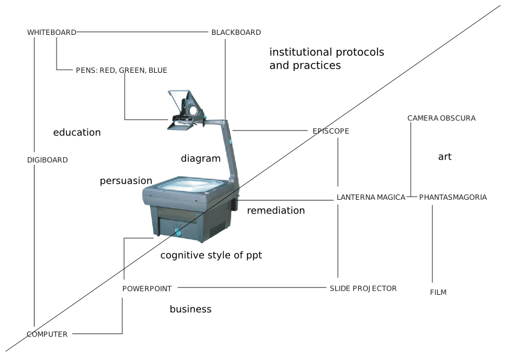
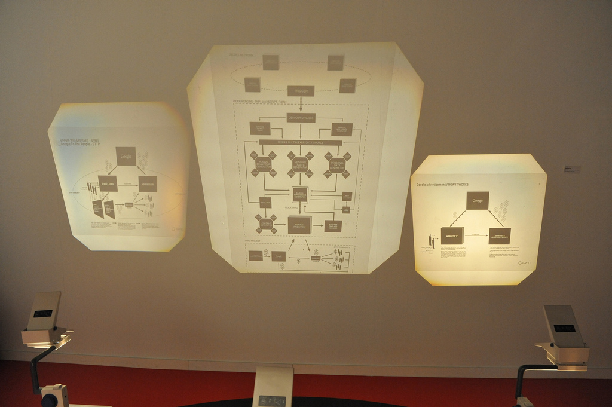
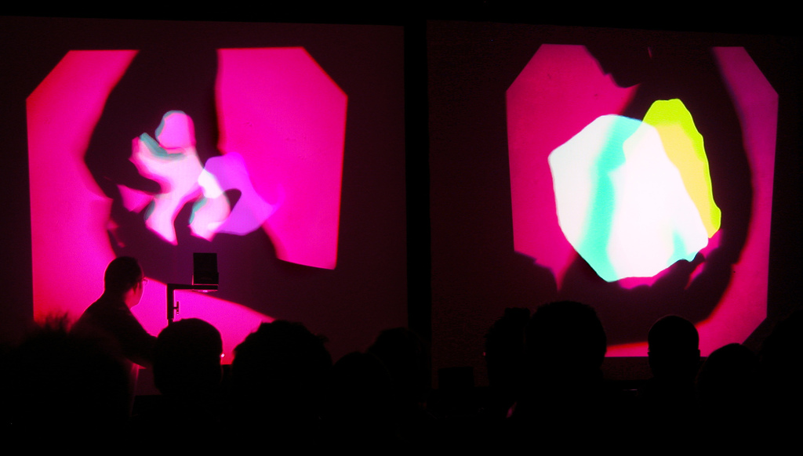
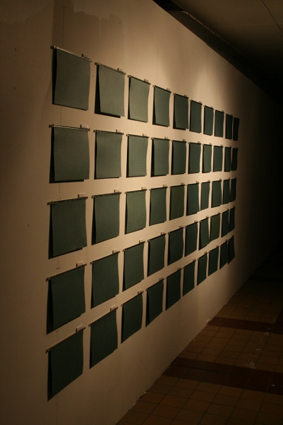
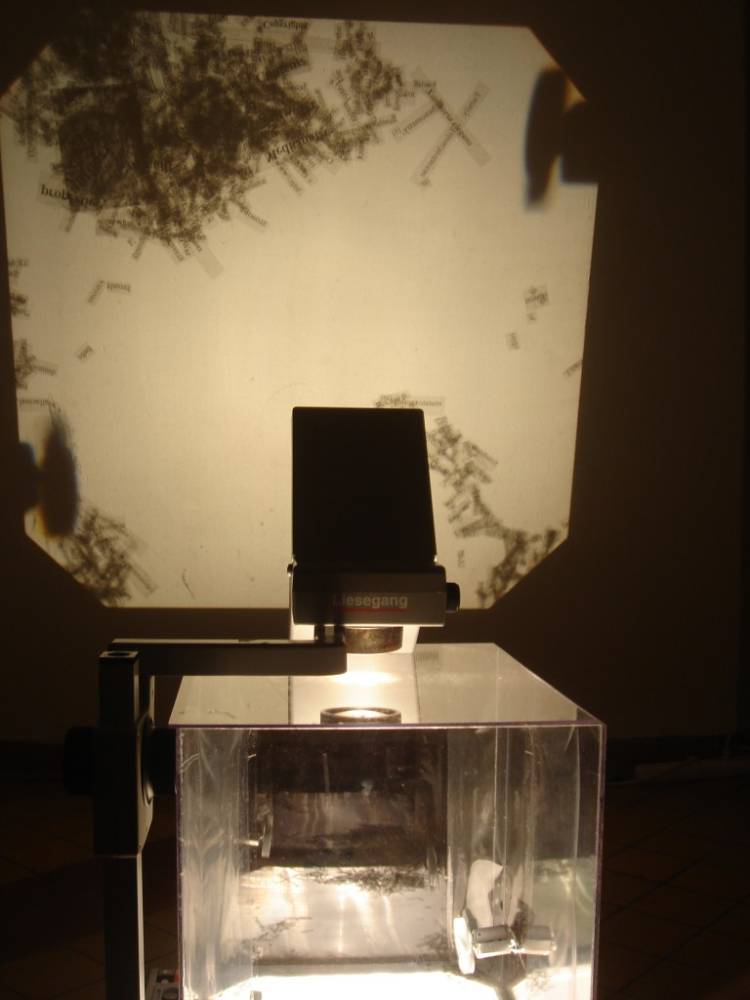

---

> The generic no doubt cuts across the contemporary operators of thought, like the transversality of Deleuze-Guattari, or Foucault’s diagonality.—Francois Laruelle (2011: 252) {#para1}

‘Take, for instance, an overhead projector’ as Bruno Latour wrote in a 1994 article (36). And why not? Introduced as a non-human actant by John Law in 1992 (3), Latour further employs this standardised piece of presentation equipment as an example of a generic black-box technology whose operation is hidden from the user. Most likely drawing on his own immediate experience as a lecturer, Latour described a situation where the technological complexity of the overhead projector only reveals itself in breaking down, when technicians come to the rescue and open up the machine, revealing components in a seemingly never-ending network. Today, one may assume that Law and Latour have long since abandoned the overhead projector. However, as I will explore in detail in the second part of this article, the act of opening up an overhead projector (discursively as well as materially) has curiously returned, and at the same time migrated outside the exclusive domain of select AV experts. This migration can be tied to the increasingly generic archaeological impulse that Simon Reynolds (2011) has recently described in his theorisation of the different regimes of cultural production in the analogue vis a vis the digital era. ‘It’s as though the space-time of culture has been flipped on its axis: the place once occupied by the future is now taken by the pasts’ as Reynolds (2011b: 34) writes on the transformation of music culture in which artists are no longer ‘astronauts but archaeologists, excavating through layers of debris (the detritus of the analogue, pre-internet era)’ (Ibid.). In the haze of synthetic futures past evoked by the hypnagogic pop of artists like Oneohtrix Point Never, the fetishistic focus on analogue technologies in Hollywood movies like *Zodiac* (2007) and *Super 8* (2011) or in the work of contemporary artists who utilise and re-purpose analogue technologies such as Haroun Mirza or Gina Carducci, it is as if media-archaeology has moved from a research agenda on the margins of media studies to being a wide spread cultural practice. In this context media-archaeology has also increasingly become, as recently stated by Jussi Parikka, ‘a method for doing media design and art’ (Hertz and Parikka, 2010). {#para2}

Indeed, not long after the turn of the millennium it suddenly seemed as if media-archaeological practices were popping up everywhere: academic conferences like the *Re:* series from 2005 onwards investigated the intertwined histories of art, science and technology; exhibitions like ZKM’s 2003 *Future Cinema*, despite its sci-fi sounding title, looked as much back to older conceptions of the future of film such as the *Expanded Cinema* practices of the 1960’s; in music, genre epithets like *hauntology* and *hypnagogic pop* have emerged to describe music that not merely samples snippets of earlier music but in a dreamlike way refashions entire cultures of popular sounds, such as 1980’s chart-pop or early synthesizer music, complete with their associated obsolete hardware and software. This is all not to speak of the immense number of academic titles taking a historical view on media: *New Media, 1740-1915; Always Already New: Media, History, and the Data of Culture; Deep Time of the Media: Toward an Archaeology of Hearing and Seeing by Technical Means;* *Rethinking Media Change: The Aesthetics of Transition*; *New Media, Old Media: A History and Theory Reader…* the list could easily go on. If we understand archaeology as the scientific study of past societies including their ways of living and thinking, then what is the relation between such a “backwards” looking discipline and the seemingly ever-forward looking vantage point of cultural production in capitalist society, with its foundational principles of creative destruction, built-in obsolescence and obsession with the new? {#para3}

A suitable starting point for considering the role of media-archaeology in contemporary culture is to consider the increasingly expanded role of the archive. Archaeology is not only a discipline for the objective study of the past, it is also an active intervention from the present into the past, mediated by different forms of archives and archival practices, whether physical or digital. In Michel Foucault’s work, archaeology’s raw materials were significantly expanded to include the modern bureaucratic archive as its main site of excavation, an archive used to transversally intervene across different historical discursive configurations. Complementing Foucault, Michel de Certeau (1975) pointed out that the work of history and the archive as a specific spatial and material site was itself transformed by the advent of the computerised archive, transforming the way we do history. Researchers loosely identified with “German media theory” such as Friedrich Kittler and Wolfgang Ernst later developed this thread further in line with McLuhan’s media theory, arguing that the archive should not be understood only metaphorically, but that its specific technical materiality needs to be the first thing addressed. The archive in this sense is foremost a technically ordering device, which in the computerised age is being governed not by humans but by programmed protocols. *Media*-archaeology, it could be argued, has developed as a bastard discipline in between Foucault’s transversal interventions across a more metaphorical sense of “the archive” as a discursive site and the Kittler tradition of emphasizing the technically determined and operational, or even actively *intervening* material aspects of archives themselves. In this article, I use both these understandings of the archive and archival practices, the material and the discursive, as equally important. This is in order, on the one hand to grasp how media-archaeology has become a sort of cultural “generic” in contemporary network culture and on the other to discern how it still may be attractive as a critical practice. This idea of the cultural “genericity” of media-archaeology will in turn be deployed as a positive force of transformation: ‘Here the generic is the problematic that allows us to reformulate, on the one hand, the event as non-historical occasion or historical-without-history, and on the other hand the True-without-truth as transformation of the history-world’ (Laruelle, 2011: 254). {#para4}

The first part of the essay will deal with theoretical approaches to media-archaeology while the second part focuses on artistic practices. Siegfried Zielinski’s “an-archaeological” excavations are discussed as valuable for understanding the non-linear approach to the archive and an expanded, “deep time” sense of media history. This is contrasted with the work of Wolfgang Ernst who almost clinically rejects anything that has to do with human agency such as memory and culture in relation to the archive. Following Ernst, I connect media-archaeology to a certain mode of instrumentalisation of the past which is akin to the “teleological mechanisms” or “Circular Causal and Feedback Mechanisms” of cybernetic discourse, as found in the early work of Norbert Wiener and Heinz von Foerster. It is argued that in this cybernetic view teleology as linear, idealist progression was transformed into an evolutionary emergent entity, as actualised, material past turned into a resource for the probabilistic production of the still virtual future. {#para5}

The cybernetic principles for managing the future through an operationalization and disclosure of the past as simply “the past” are then read through Wendy Chun’s notion of ‘the enduring ephemeral’. In Chun’s work memory, in the computerised age, is seen to have been conceptually conflated with storage, and this loses track of the double bind of the simultaneously constructive and degenerative aspects of the past and history as memory. In this context I then return to the revisionist imperative of Zielinski’s media-an-archaeology through the operations of artistic works that engage a transversal circumventing of the teleological underpinnings of network culture. A level of critical potentiality in media-archaeology is re-introduced through my exploration of artistic uses of the transversal discursive and material forces driving this generic, involving the construction of pasts and presents both through historical/narrative and material interventions. The media art practices considered in the second part of this article depart foremost from a series of projects that have taken place within the scope of the festival and ongoing artistic research project *The Art of the Overhead*. This revisiting of an old school presentation device is here conceptualised as a transversal approach to a medium as an archive in itself that cuts across material, discursive and institutional configurations. Drawing on the theory of transversality as found in the works of Felix Guattari, Calvin Schrag and Gerald Raunig, I will argue that such a transversal notion of media-archaeology is possible but that its critical powers do not lie outside of its generic status but should rather be derived from it. The notion of transversality is here referred to in the sense as a potential form of institutional critique (cf. Raunig, 2007) and particularly, as recently described by Luciana Parisi, as devoted to ‘the existence of unrealistic conditions of thought’ in research and artistic practices that are ‘able to insert cuts, gaps, break downs in the smooth operational flow of info-knowledge of cybernetic capitalism’ (Parisi, 2008). Returning to the notion of the generic, I invest in this a certain positive ontology, beyond absolute critique and more in line with the non-philosophy of Francois Laruelle (2010). Laruelle’s conceptualisation of the generic (2011) makes possible a weak form of intervention, which is not founded in any idea of a by default “radical” nature of transversal practice. The generic is rather to be considered as a unilateral base from which it is possible to *also* generate critical transversal modalities. {#para6}

We shall suggest that genericity, without destroying the market and capitalist structure of exchange and equivalence which is necessary to it as the element in which it intervenes and which is of another order, no longer simply reproduces it even with differe(a)nce, but contributes to transforming it through its operation which is of the order of idempotence, as we shall make clear later on. This is a transformation that takes place according to a subject of-the-last-instance and as its defence as Stranger against capitalist-and-epistemological sufficiency. (Laruelle, 2011: 242) {#para7}

As an example of how this may apply to the field of media-archaeology, my own case-study of the transversal artistic re-deployments of the institutional medium of the overhead projector provides an excavation of how an unlikely contender for media stardom may take up a critical modality within the rising atemporality and real-time obsessions of network culture. {#para8}

#### Problematic Archés: Archaeologies and An-Archaeologies

Instead of embracing media-archaeological practices as in any way critical by default, one needs to ask what arché, that is what idea of “origin” these kind of media excavations presuppose? Might media-archaeological art not simply be conforming to the stabilizing feedback mechanisms of digital capitalism as in the ‘product-making-nostalgia’ (Suominen, 2008) of phenomena like retrogaming? Or do they rather work to dislocate the teleological mechanisms of the old and the new, in the manner in which Michael Dieter (2007) has discussed the dysfunctional spaces created in the hardware-archaeology of artist game-modding? {#para9}

In research, media-archaeology often entails a kind of revisionist ethics best exemplified by the work of Siegfried Zielinski, as the searching for the ‘new in the old’ (2006: 3). In this sense, media-archaeology resonates with the multiplicity of Henri Bergson’s actual-virtual dynamic and, though far from a unified discipline, has emerged as an archaeology of the ‘fortuitous find’ (Zielinski, 2006: 28) where lost artefacts, discourses and personage of media-historical significance are (re-)discovered and re-used in new ways. Perhaps this requires a practice-oriented and slightly romantic view of archaeology as discovery: the practical endeavour of digging out new knowledge from the past (cf. Snickars, 2006: 132). While following Foucault’s archaeological and genealogical methodologies, Zielinski recovers histories of repressed media situations from a “deep time” perspective (with a perhaps unacknowledged hint of Adorno’s cultural critique), looking for the new in the old: {#para10}

> (…) we shall encounter past situations where things and situations were still in a state of flux, where the options for development in various directions were still wide open, where the future was conceivable as holding multifarious possibilities of technical and cultural solutions for constructing media worlds.
>
> (Zielinski, 2006: 10) {#para11}

Zielinski indeed offer us truly exhilarating cases of forgotten apparatuses and their inventors, but his post-Foucauldian an-archaeological narratives (or “cuts” as he more aptly calls them) do not seem to be able to break out of a postmodern celebration of rupture and heterogeneity. This risks leaving us with a favouring of the politics of particulars vis a vis the universal. The question is whether this approach fulfils the radical position to which Zielinski would like to ascribe to his efforts, that is to ‘enter into a relationship of tension with various present-day moments, relativize them, and render them more decisive’? As Zielinski argues in the introduction to *Deep Time of the Media* (2006: 9-10), standardisation and processes of unification (read convergence) have indeed become key to contemporary media culture. However, far from being hostile to heterogeneity, studies such as Tiziana Terranova’s *Network Culture* (2004) have shown that network architectures and their associated business models thrive on a new type of compartmentalised difference, found in phenomena such as data-mining and user-generated content. These new avenues for dynamic particularisation within cybernetic systems presents a challenge to the idea of media-archaeology as a discipline of cultural critique and construction of alternative media worlds. {#para12}

Perhaps we need to understand the current status of media-archaeology differently than as a form of avant-gardist research practice? More than just an academic or artistic trend or part of a historical turn in media studies, media-archaeology can be understood as a widespread cultural practice of going to the archives of techno-culture in order to create something (a-)new. ‘Nostalgia isn’t what it used to be’ (Connolly, 2006), notes a blogger musing on the abundant availability of games he played as a child now spread across a number of platforms geared for easily accessible retro-gaming such as the PSP and the Nintendo Wii. Similarly, Jaakko Suominen, in the article ‘The Past as the Future? Nostalgia and Retrogaming in Digital Culture’ (2008), has pointed to how ‘product-making-nostalgia’ has formed a central part of the logic of production in consumer societies since at least the 1960’s. Particularly in discussing the genre of retro-gaming as assembling an archive of the past for future consumption, Suominen’s article points to the consumption intensive character of convergence culture. One may easily add the recycling of any other media content such as music and old movies on ever new platforms and in a myriad of formats as part of this capitalist consumer logic of perpetual obsolescence and renewal. Similarly, albeit in a broader sense, Nigel Thrift (2005) has discussed the constantly ongoing activity of consumer interaction demanded by what he calls the “cultural circuit” of contemporary capitalism. In network culture this circuit is replicated on the level of production as well, as it entails the perpetual re-use, remix and adaptation of previous forms of content as well as of cultural styles. Media-archaeology in this sense seems not only to be the radical appearance of non-linear media history and artistic practice, but also increasingly a generic type of feedback mechanism intimately tied to how the objects of the past in the political economy of network culture are material resources, constantly “re-readymade” for new consumption. Understood as a generic force within such a cultural circuit of contemporary network capitalism, the media-archaeological impulse becomes qualitatively different to that of the post-modern. We are not entirely situated in a culture of pastiche and nostalgia that mocks teleology but rather in a situation of cultural production. In this situation the old and the new have become conflated and the past increasingly takes on the form not of a collective cultural memory but a computationally archived resource for future production. {#para13}

In the light of this view of contemporary network culture’s focus on instant archiving and managing of archives (think of blogs, social media or search bots) one may say that media-archaeology has become a generic force: we are all now media-archaeologists, a process strongly supported by the specific materiality of the past in the digital, as archival and computational. This perspective resonates with another thinker on the German media-archaeological spectrum, Wolfgang Ernst, who maintains that the archive’s primary function has moved from storage to a state of constant transference of information (Ernst: 2002). Emphasizing a post-Foucauldian as well as a post-Kittler approach, Ernst treats archives as entirely material entities not functioning according to discursive or narrative operations. For Ernst this is especially pertinent to the digital and networked archive, which has moved out of being a static collection in need of human administrative or discursive activation into a state of constant transmission governed by information protocols. In contrast to Zielinski’s approach, Ernst’s media-archaeological analysis does not depart from stories about old and forgotten media and their relation to the new but from what he calls the “time-critical” materiality of media technologies: media operate according to a micro-temporality which is processual and event-based rather than historical and discursive. In this view, media-archaeology is a descendant of cybernetics; it turns to the archive as a constant circular feedback of stored data operating in the present. {#para14}

‘To predict the future of a curve is to carry out a certain operation on its past’, Norbert Wiener (1965: 6) famously wrote in his foundational work on cybernetics. This hints at the idea that the roots of media-archaeology as a generic form of cultural production in contemporary network culture lie in how early cybernetics laid the ground for an operationalisation of the past that disclosed the paths of future actions. ‘Teleological mechanisms’ was the term originally used in 1940’s cybernetic research to describe the function at work in the operationalising dynamic of ‘feedback’ (Frank, 1948: 191). As a concept geared towards the control of an uncertain post-war future, systems of practically any kind would be seen as containing a potential for self-correction and evolution according to the constant comparison of present output with past input. If we follow the cybernetic media-archaeology outlined through Ernst above, such processes may be regarded as further intensified in the materiality (technical as well as cultural) of digital networked media. Here the convergence of the old and the new clearly forms a part of a new kind of ‘archive fever’ (Derrida, 1996) in which, whether user- or industry -driven, old media content is constantly repurposed for new consumption. In this sense, digital and networked archives allow for a networked, modular and, most importantly, temporally non-linear version of the principle of creative destruction once posited by economist Joseph Schumpeter as integral to the evolution of the capitalist economy (Schumpeter, 1942: 83). This networked political economy gives us a background to approach media-archaeology differently than as a by default radical force in network culture. That is, we should approach media-archaeology not only as a critique of technological development and linear assumptions about the progression from old to new media. Media-archaeology could in this way be explored according to the idea of a highly developed cultural “generic” which is increasingly integral to much contemporary cultural production. {#para15}

To sum up this section, having its origins in the “teleological mechanisms” of early cybernetics, I posit a certain operationalisation of the past as inherent to the constant play between old and new in the cultural circuit of contemporary network capitalism. The political economy of new and networked media builds on an instrumentalised making available of the old for constant re-appropriation. However, as I will argue in the conclusion, part of media-archaeology’s attraction lies in how it simultaneously operates in line with as well as potentially reconfigures such a cybernetic operationalisation of the past from within its own genericity. This idea requires that we reformulate the force of “the generic”, understood no longer only as a term for that which generally applies in different contexts but also as a unilaterally active force which generates possibilities of transversally transforming given contexts; for example in reforming the conditions of cultural production. Underpinning this understanding of the media-archaeological generic is the conceptualisation of the generic found in Laruelle’s work (cf. above) as well as the Deleuzian notion of a virtual excess in the actual, an always contingent potentiality of becoming. In order to contextualise this conceptualisation of media-archaeology it is necessary to explore the problematic conceptual gaps and possible fault-lines within cybernetic theory itself, as designating those instants where non-evolutionary (in the *non-*sense of non-creative destruction) changes may be predicated. The next section discusses some of the basic premises for how cybernetics entails an instrumentalised concept of the past and then moves on to consider the problematic conflation of the “actual” past with a more expanded sense of the past as the space of memory and degeneration of memory. Here, Chun’s discussion of the “enduring ephemeral” in computational culture will serve as a guiding concept and this discussion ultimately leads us back to re-consider the transversal criticality of some media-archaeological practices, in a rejuvenated spirit of Zielinski’s “fortuitous finds”. {#para16}

#### Cybernetics and the doing and un-doing of History

The uses of history—do we learn from the past in order to raise our historical awareness of present conditions or are we mostly interested in it for the sake of predicting the future? Maybe it is obvious that the first question usually leads to the second, as historians justify the instrumentality behind their works in terms of avoiding the repetition of history’s past mistakes or in the case of reactionary histories of cultural heritage, consolidating a future in which everything should and will remain the same. As Keith Jenkins argued in his postmodern classic *Re-Thinking History* (1991) the uses of history are in fact endless, at the same time reminding us of the party slogan in Orwell’s *1984*: ‘Who controls the past controls the future; who controls the present controls the past’ (Orwell, 1977: 248). {#para17}

The dystopia of Orwell’s *1984* was conceived concurrently with the utopia of the cybernetic model which turned to the data of the past as a resource for controlling the present and managing the uncertainties of the future. Orwell completed his book in 1948, the same year as Norbert Wiener published *Cybernetics: Or Control and Communication in the Animal and the Machine*, laying the foundation for cybernetics as a science based on the probabilistic prediction of the future. This work establishes cybernetics in a way that uncannily recalls the *1984* vision of a state eradicating possible subversive elements, arising out of the past conceived as a space from which to construct multiple interpretations of the present. For the sake of context, we need to remember that both Orwell and Wiener were working in the direct aftermath of WWII, with its strong impetus to correct the wrongs of history’s past mistakes. {#para18}

As mentioned earlier, Wiener published his first forays into cybernetics under the framework of ‘Teleological mechanisms’ (1943; 1948). This framework united a number of interdisciplinary researchers in the search for a holistic rethinking of cause and effect, according to principles of self-regulating systems, in nature, technology and society. Moving away from linear models of cause and effect and geared instead towards circular feedback movements, the teleological perspective advocated by Wiener in essays like *Behavior, Purpose and Teleology* (with Rosenbleuth and Bigelow, 1943) and *Time, Communication and The Nervous System* (1948) was not one of final causes but rather a kind of behavioural “soft teleology” aimed at delimiting the set of probable actions available to humans as well as to machines within a given situation through constant comparison of results (output) with past input. In the latter essay, as well as in the opening chapter of *Cybernetics*, Wiener discussed Newtonian and Bergsonian concepts of time, favouring Bergson’s formulation of duration as the constant irreversible “directedness” of time over the measured time of astronomy which (for Wiener) falsely extends, in the same manner, into the past and the future, like a palindrome (1965: 31). For Wiener, the past is the past precisely because of its fixed, specific nature and thereby the past becomes, in Bergsonian terms, the actual which through quantification may be operationalised so that we can apprehend the virtual that is the openness of the future. Wiener writes: {#para19}

> In short, we are directed in time, and our relation to the future is different from our relation to the past. All our questions are conditioned by this asymmetry, and all our answers to these questions are equally conditioned by it. (1965: 33) {#para20}

The study of the “directedness” of teleological mechanisms, for the purpose of *Control and Communication in the Animal and the Machine,* as the subtitle of Wiener’s foundational work suggests, does not draw any “natural” demarcation line between the world of biology and the mechanical. On the contrary, mechanical and computerised devices are in cybernetics seen to be highly instructive about the self-regulating dynamics of humans and animals, albeit not completely analogous. So even though early cybernetics evoked Bergson’s concept of time as duration in constant movement, as opposed to the spatial quantitative time of science, this is where Wiener also departed from what he saw as Bergson’s ‘vitalism’ (1948: 48), in that human and machine were to be seen as congruent entities, available to the same processes of control through probabilistic statistics. {#para21}

While much has been made out of the connection between the cybernetic orientation towards the future and its relation to the society of control and surveillance issues (cf. Holmes, 2007), less has been made of the possible relation between this problematic actualisation of the past as a material informational entity and the temporality of network culture. Despite the goal of cybernetics being the management of the future, the greatest operation of control it seems is actually carried out on the interpretation of the past. On the surface, Bergson’s virtuality as ‘bound up intimately with the activity of a living centre‘ (Ansell-Pearson, 2005: 8) and denoting a subject’s actions of subtracting and dividing the whole into parts through perception and representation, does not seem that different from cybernetic sampling of continuous reality into discrete units. In cybernetics, the construction of such sensing subjects takes place across the realm of machines as well as of organic life. Yet what is aimed at is an ontology for determining the future through a disclosure of the past as that which is known. This instrumentality of the past as materialised through information is different from the Bergsonian and later Deleuzian reading of the virtual and the actual as both tied to a positive *indeterminacy* of ‘pure virtuality’ (Bergson, 1991; Deleuze, 1997). In the words of Keith Ansell-Pearson: {#para22}

> In insisting that memory is not a simple duplication of an unrolling actual existence (…) Bergson is granting the virtual an autonomous power. The disruptive and creative power of memory works contra the law of consciousness, suggesting that for Bergson there is something “illegal” or unlawful about its virtuality. (2005: 10-11) {#para23}

In the networked processes of instant archiving and repurposing of media content the disruptive power of the pure and “illegal” virtuality contained in the past is repressed, at least on the surface of functionality which only accounts for a reduced sense of the actual. As Chun has suggested with her notion of ‘the enduring ephemeral’ (2008), digital media culture is characterized by an ideological conflation of memory and storage where the degenerative aspects central to memory are repressed ‘in order to support dreams of superhuman digital programmability and of the future unfolding predictably from memory’ (Chun 2008: 2). For Chun, ‘memory does not equal storage’ (Ibid: 164)—memory is connected to the past as an active process of looking backwards while storage ‘always looks to the future’ (Ibid.), but everyday computer jargon and practice have come to see the basic computational processes of storing and erasing data as the constant writing and re-writing of memory. This conforms memory to a kind of storing and erasing of the past as already actualised data, a clinical information-keeping which we might see as deriving directly from cybernetics as the science of the most effective circulation of information. In her article, Chun discusses how the conflation of memory to storage and the repression of memory as an active process involving degeneration, derives from Vannevar Bush’s seminal design of the (never constructed) ‘Memex’ machine for the associative storing and retrieving of “personalized” data. Perhaps not too surprisingly, as a contemporary to Bush, Wiener describes the functioning of computerised memory in a similar way, although he does actually take some steps to consider how to counter the degenerative processes inherent to computing and how they relate to similar aspects of the human brain. {#para24}

Whether our computing machine be artificial or natural, if it is to operate with no intervention but what enters through sense organs, it must be able to store data and recall them when they are needed later. (…) Usually, a message gets blurred in transmission; it does not take many consecutive blurs until it is unintelligible. To avoid this, the message should be copied, so that-instead of transmitting a blurred image of itself it recreates a sharp image. (1948: 211) {#para25}

Wiener argues that if degeneration (the ‘blurring’ of the message) appears, simply copy the original message to ensure that it stays the same. Cybernetics would go on to describe just how such processes of copying as transmission can be designed for the minimum of information loss and consequently forming a vital part in store-and forward protocols of communication such as packet-switching on the net. In the original cybernetic vision, technology is glitch-free, while the human brain is not: {#para26}

> When the machine has done its task and settles down to rest, these data are removed and replaced by other elements or by others of the same kind, and the machine is set up for another problem. But the human machine is never completely cleared. It always retains memories, from the past, of every situation which has ever confronted it. The depth and permanence of these memories is indicated by the success of a hypnotist or psychoanalyst in summoning them up from the depths. In other words, we can regard human life only as one grand problem and its separation into particular smaller problems as relative and incomplete, This coupling of all problems to all previously undertaken problems greatly complicates the behavior of the brain and may significantly contribute to its pathology.
>
> (Wiener, 1948: 214) {#para27}

In the passage above, the haunting aspects of memories in the human psyche are even linked to mortality, implying that the brain might become an immortal machine if such aspects were eradicated. Perhaps what we need today instead of this, given the media-archaeological generic, is a reconsideration of the degenerative and indeterminate aspects of machinic archives, including those of the past. This is not to suggest a pathology of machines modelled on human biology but a transversal realm of information exchange which can never be complete and which gives rise to inconsistencies across the realm of machines, humans and their cultures. Recalling the above discussion of Chun’s identification of the cybernetic conflation of memory to storage, a media-archaeologist in this context needs to be attentive to the productive critical potentiality of unavoidable gaps of non-pasts (forgotten, repressed, misrepresented) in the cybernetic transmission processes. Such excavations, be they theoretical or practical may allow for the intermission of transversal agencies beyond the control of clinical information ideals and neo-rationalist managerial agendas. With Deleuze (1994: 128) as focalizer we see how “in the infinite movement of degraded likeness from copy to copy, we reach a point at which everything changes nature, at which copies themselves flip over into simulacra”. Applying this insight to the alteration produced by the combination of incessant archiving and re-deployment of the past, we see how the past re-acquires a new kind force of becoming in the present. So even though we have in cybernetic systems a kind of copying of the past that is *directed* towards the future, this process can still in spite of itself give rise to the “not-quite” and “bad copy” (cf. Tuer, 2006: 44). {#para28}

Difference may here be seen not as particularised cultural practices, but as immanent alterations of the cybernetic temporality of network capitalism. As an example we may return to Suominen (2008) who points out that typically consumerist media-archaeological practices such as retro-gaming might also involve the ‘agony of home coming’ associated with the original meaning of nostalgia. This may lead to self-ironic reflections on the nature of the practice itself, in the process reformulating it. In the context of retro-gaming, such critical media-archaeological practice is analysed by Dieter (2007) who points to the dysfunctional aesthetics of DIY game-mods, citing Cory Arcangel’s *Super Mario Clouds* (2002) as the quintessential example. In this work, Arcangel famously hacked the original 8-bit cartridge of the NES *Super Mario Brothers* game, producing a version stripped bare of anything but the blue sky and pixellated clouds. In the modified game one simply follows the clouds as they scroll across the screen, and as Dieter suggests, contemplates the technological obsolescences of a lost gaming childhood along the way. {#para29}

#### The Art of the Overhead: An-Archaeology

> Like communities, all media are partly real and partly imagined. – (Kluitenberg, 2006: 8) {#para30}

In the concluding part of the essay, I will consider how artistic practices working in the spirit of media-archaeology, appropriating near-obsolete or residual media technologies, may be seen as “reverse-remediations”, acting out the politics of contemporary networked media through spatio-temporal hybridism. In this mode, new digital and networked media, rather than re-fashio*ning* themselves, are re-fashio*ned* by the artists who engage in revisionist interventions using near-obsolete, often analogue forms of media. Such activities are potentially transversal to the cybernetic media-archés analysed above in the way that they work across different subjectivities and materialities of media as well as their associated institutional frameworks. They set up imaginary and “unrealistic” constellations of theory and practice. Thus media-archaeology as transversal media practice can follow from different arches. It can simply conform to the circulation of capital or it may become the ontogenetic or perhaps rather ‘Variantological’ (Zielinski and Wagnermaier, 2005) base from which to imagine and establish new media-archés, going beyond the 1:1 relationship with cybernetic consumer society. {#para31}

In order to elaborate this view on media-archaeological art, I will draw on my own artistic and curatorial involvement in *The Art of The Overhead*, a media art festival devoted to that almost forgotten, yet still residual, medium of the overhead projector. First, I will briefly outline a conceptual archaeology of the overhead projector in an everyday and artistic context and, secondly, I will look at a few specific artistic appropriations of this technology to produce an imaginary or “bastard” device which performs a reverse-remediation of the new into the old. {#para32}

There is no definitive history of the overhead projector (OHP), a device which on the one hand is an institutional medium within education and business and which on the other extends across a hybrid context of uses from bowling to intermedial art (cf. Hilfling & Gansing, 2007, Coy & Pias, 2009). I will consequently approach the origins of the OHP with the *an-*archaeological insight of Zielinski, demonstrated in his approach to the history of projection: ‘When the knowledge that flows into an invention has been developed over centuries, the question of who actually invented it first becomes rather pointless’ (Zielinski, 2005: 91). {#para33}

Instead of a hierarchical genealogy, one has to trace the history of the overhead projector as a network of relations between technologies and practices, traversing the diverse areas in which it has been put to use across Education, Science, Business, Entertainment and Art. Except for its association to institutional settings within education and business, the OHP has always lacked a clear identity of its own, appearing in the beginning of the 20th century as an anonymous mass-manufactured “standard object”. In this sense, the OHP can be seen as a combination of different projection technologies such as the magic lantern with its transparent glass slides and the opaque projector (episcope) with its table-top set up, through which it is possible to reflect the light off horizontally positioned objects like books and printed images. In both its anonymous character and its near obsolete status, the OHP displays an affinity to the concept of ‘residual media’ (Acland, 2007), as a device often still sitting unused somewhere in the back of the class- or conference-room. Its physical presence in this context perhaps serves as a silent reminder of the genealogy of Power Point templates: the first version of what was soon to become this ubiquitous presentation software was originally called Presenter, released as Power Point 1.0 in 1987, a b/w Mac OS application designed for the easy formatting of slides meant to be printed on overhead transparencies (this original OHP related context of use is retained in the German word for “slides”: “Folien”, see Müller-Prove, 2009: 48). In other words, there is a direct connection between the common conference epidemic known as ‘Death by Power Point’ (Garber, 2001) and ‘The Tyranny of the Overhead’ (Dolby, 2000). The bore of standardized conference presentations, coupled with memories of childhood angst of speaking in public, connected to performing with these technologies make them hard to target within the consumer culture of product-making-nostalgia. Indeed, one is still hard-pressed to find any comprehensible information about the overhead projector on the net beyond the endless lists of the “do’s and dont’s” of presentation guidelines. These are of course themselves worthy of a closer inspection as they tell the story of the wider institutional discourse-network of presentation of which the overhead has formed a vital part: ‘cover only one main idea per slide’, ‘don’t turn your back to the audience’,’ always bring a spare bulb’,  ‘don’t correct with spit’. {#para34}

  {#para35}

 {#para36}

Being a hybrid projection technology mostly associated with institutional contexts in business and education, the OHP might even contend for the title of the most boring medium in the history of technology. So what then is the imperative to let its light shine once again? A song commissioned for *The Art of the Overhead* (2005), the first international media art festival devoted to the overhead projector, Monochrom/Oliver Hangl’s *Farewell to the Overhead* states: ‘Now you are dead media, looked up on Wikipedia. Not even Danish E-Bay nerds do care (…) Is there a chance to get you back again tonight to shed your light?’ (Grenzfuhrtner & Hangl, 2005). The overhead festival aside, by the mid-00’s, the overhead projector did seem to make an unlikely comeback in contemporary art, as for example observed by art critic Ben Lewis, commenting on the ‘swamping’ presence of OHP’s in art installations at the 2005 Venice Biennale (Lewis, 2005). Even in the media art scene, with its obsessive focus on the latest technologies, the OHP was sneaking in: in the installation version of Übermorgen’s interventional net-art project *Google Will Eat Itself* (GWEI, 2005), five overhead projectors are used to project the detailed diagrams explaining the system of subversive Google share buying at the core of the project. For their audiovisual performance *The Manual Input Sessions* (TMEMA, 2004-06), Zachary Lieberman and Golan Levin used overhead-projectors in combination with digital projection, to create an interface where ‘analogue’ hand gestures triggered and interacted with digital live animation. Around that time, Levin also published a short text called ‘An Informal Catalogue of New-Media Performances Using Overhead Projectors (OHPs)’ (Levin, 2005). {#para37}

Overhead projectors and new media? Levin’s list reminds us that it is not the first time that OHPs have been in vogue in audiovisual performance, stressing the heritage of 1960’s ‘light show’ which through key figures such as Elias Romero, Helen LeBrun and Tony Martin extended across psychedelic rock, Ken Kesey’s Acid Tests and the experimental intermedia art of The Tape Music Center in San Francisco (Bernstein, 2008; James, 2010). But even then, the overhead projector was not considered a state of the art piece of technology but was already regarded as an everyday institutional medium, chosen for its cheapness and accessible flat working surface, ideal for manual operation of the liquids, prisms and various filters so central to these kind of performance practices (Gansing, Martin, Scroggins and White, 2010). {#para38}

The two projects mentioned above, GWEI and TMEMA, could even be regarded as emblematic in that they represent the two main strands of contemporary appropriations of the overhead projector.  In the first instance, we have Übermorgen’s ironic recalling of the OHP as a class- and conference- room institution of truth designed for the flat, objective presentation of facts. In the second example, Levin and Lieberman are working in the shadow(-play) of this institution. By letting it take part in their live analogue/digital assemblage, they accentuate the informal aspects of this seemingly dusty piece of projection technology. Taken together these two different projects, through the rich irony of the restrained formal use and the “magic” of the animations brought about in the informality of the live improvised performance, work through the logic by which the OHP, as a standardized technology can be simultaneously open and closed—and how that which is open can seemingly paradoxically reveal itself by way of that which is closed (cf. Hilfling & Gansing, 2009). {#para39}

Perhaps this is the main lure of the OHP for contemporary artists, that its otherwise unlikely cultish sheen can be derived from an ambivalent double status. This dynamic has been similarly identified by Pias (2009), in perhaps the first serious attempt of dealing analytically with the OHP as a medium. His analysis situates the OHP in between being a device for persuasion in linear bullet-list presentations, business style, and the quite different dynamic of the OHP as a (proto-)augmented-reality technology belonging to a kind of spontaneous work-meeting culture where the speaker reveals, rearranges and further modifies his visuals as he goes along. A major in the minor so to speak, the interplay of the formal/informal uses of the OHP however goes much further than the presentation cultures mostly associated with it. The light of the overhead can be traced from its major institutional pedagogic settings to a network of appropriated minor practices extending from its use as an artist drawing aid, across bowling alleys (the 1940’s Tel-E-Score for keeping track of bowling player scores) to Haight-Ashbury concert venues (the psychedelic liquid-light show) and even into DIY home cinema cultures (the 00’s “Volksbeamer” movement of cheap video-projectors). In spite of this multiplicity of uses, the OHP was never sold on the consumerist basis of being a tool for individual creativity (Hilfling & Gansing, 2007). Consequently, the OHP has seldom been explored on its own terms according to modernistic aesthetics of Greenbergian “medium specificity”. Being a mediator of other worlds (and the worlds of others), the (non-)specificity of the OHP lies closer to the transversal aesthetics of intermediality, and this is perhaps what makes it pertinent to critically remediating the relations of production in contemporary network culture. {#para40}

The Art of the Overhead festival and its different projects cuts across the different technologies, institutions and the practices connected to the OHP. Within the festival there are transversal partial territories opened up by reverse-remediations, such as Katrin Caspar’s installation *Random Hit* (2009) that transposes Wikipedia entries onto cut-up transparencies, or Barbara Sterk’s interactive work for the The Art of the Overhead Archive, *private hypermediacy* (2005), which emulates a Windows-desktop filled with customisable error messages on the OHP. {#para41}

One work which attempts an overarching and transversal approach to the OHP as an archive in itself is *Variations on a Standard* (2005-) developed by Linda Hilfling and myself as a research project presented at the festival from 2005 and onwards, in the form of an archive of patents. On the surface, an overhead projector appears as a fairly simple standardized object for projection: involving a lens, a lamp, a mirroring device, electricity and a screen. But there are many variations existing on this simple formula as shown in the archive of overhead related patents dating from 1918 to 2005. They are arranged in a wall-mounted installation, where each patent is printed on a set of transparencies that go into an old-school office-archive folder. The audience can approach the wall, take down a folder and project the contents on a nearby OHP. The archive includes some of the key patents in the multifarious history of optical devices connected to the OHP. This includes different modifications and endless variations of the typical OHP, such as the portable projector, but also encompasses a vast array of increasingly weird augmentation devices where “Shielding device for the unwanted reflection from an Overhead Projector” (2003) would just be one of many examples. {#para42}

The patents archive was developed further and presented in an extended edition for the 2009 festival. The theme of this festival was “OHPen Surface”, relating to the notions of open and closed as a recurring dialectic within network culture, for example concerning standardisation of both hardware and software entities. A patent can be seen as the traditional inventor’s way of closing off a certain technology, marking off a particular assemblage of technological parts with the cultural notion of an “original” invention. It is a standard procedure ensuring that it can be commercialised and not copied by others. Arranged patents side by side however, as endless variations on a standard, for the audience to browse and project, may also reveal how the closed world of a patent and its denoted standard object are part of many diverse networks in which the open, the variation, appear by way of that which is closed, the patent. The multifarious story of the OHP is here activated by the archive itself as a transversal movement across OHP history in a way that resonates with the way in which Glen Fuller has described archival transversality as something that ‘problematises the historical event’: {#para43}

> (…) transversality is a concrete manifestation in the institution (psychoanalytic clinic) or the archive. In both cases it may not exist at all but has to be evoked or deployed. Transversality is a bomb; it is a weapon, and sometimes a tool. In the institution it problematises subjectivity (as an event); in the archive it problematises the historical event. (Fuller, 2007) {#para44}

Sweden-based German artist Katrin Caspar’s *Random Hit* (2009) is an OHP-based installation which performs a reverse-remediation of the old into the new. It further develops the open/closed dialectics and double-status of the OHP discussed above. In this work, Caspar has placed a transparent square plastic-box container on top of the projection surface of the OHP. In it we see small words printed on and cut out from transparency foils. The words are blown about the OHP projection surface with the help of two computer fans situated at the edges of the box. When projected, these words form generative and temporary clusters reminiscent of tag clouds, cut-up poetry or perhaps its more mundane version, the once so popular fridge-poetry. As the title indicates, the words have been selected from a simple script performing a randomising operation on Wikipedia entries which are then cut up into the words to be printed on the foils. The method of selection coupled with the materiality of the collage adds a transversal dynamic to the project, beyond the temporary territories of meaning and poetic statements generated when the air moves the words. As Caspar herself describes this simple experiment, she is connecting the flat space of the overhead, as a stage for the teacher’s typically linear pedagogic narratives, with the encyclopaedic, data-base knowledge space of Wikipedia. The concept is reinforced literally by the physical materiality of the assemblage-like installation. The boxed in three-dimensional space on the top of the overhead creates a further shadow play so that words are projected over their own more or less blurry copies. This is a process evocative of the politics of information networks and their incessant copying-as-transmission discussed earlier. {#para45}

*Random Hit* can be thought of as a *reverse*-remediation (cf. Korsten, 2010) vis a vis the pre-organised illusionary representation of projection. This is not simply in terms of the digital into the analogue, that is of the rendering of the discrete continuous again. It is also a reverse-remediation of the politics of networked knowledge formation, of the latter’s seemingly transparent logic, found in the dynamic generation of “tag clouds”. In their by now classic 1999 study, *Remediation – Understanding New Media*, Jay David Bolter and Richard Grusin argued that, by default, not only do new media continuously refashion old media but “older media” is also consistently transformed to respond to the development of new media. Recently, Korsten (2010) suggested the term reverse-remediation for dealing with instances of “uncanny” incongruities between different media being brought to the fore. Here reverse-remediation fosters critical reflection on the nature of different media, beyond the immediacy principle. This mechanism is present in Kaspar’s work. The traversal of the old and new blurs the supposed openness of network model of knowledge formation, together with the supposed closed nature of the older analogue model, forming partial territories of meaning situated between these regimes of knowing. This blurring of the old and the new is not carried out in order to re-enter a cultural circuit of intelligible relations. Instead it demonstrates that media-archaeological art practice may transform this generic into—in the words of Laruelle—what is only a ‘semi-circulation’ of ‘knowledges and products which do not have “guarantors”, unilateral merchandise, “perspectives”, or “intentions”’ (2011: 251). {#para46}

Through the spatio-temporal traversal of different media-archés, *Random Hit* becomes a synthesis of the approaches identified in the previous two projects of GWEI and TMEMA. On the one hand, we have the institutional context of the OHP as a conveyor of knowledge.  On the other hand there is also its connection to improvisational and intermedial aesthetics. This brings the analogue into the digital and reverse-remediates the context of use of particular knowledge technologies. As such, *Random Hit* goes against the connective and techno-fetishism typical of generative network-based art. The cybernetic dream of smooth self-emergence within systems is here countered by an aesthetics of dislocated messages and in-between projected worlds. In the context of media-archaeology, a work like *Random Hit* is transversal in relation to the cybernetic disclosure of the noises of the past. It thus evokes Gerald Raunig’s (2007) characterisation of transversality precisely not as conforming to teleological feedback mechanisms, but as practices of rupture and fault lines. These practices do not necessarily connect. Yet they bring new bastard subjectivities or “concatenations” of art and politics into play. {#para47}

Transparent (sic) DIY approaches to media culture have a strong presence in many OHP based performances,. There’s little room for high-tech smoothness. Instead the attraction of an OHP performance frequently comes from the artist and audience realising that such and such an effect can be achieved with simple, perfectly understandable means. This may for example involve acts of humorous reverse-remediation, for example in the work of a group of three artists, Milk Milk Lemonade. In work such as *The Game*, they “re-create” and “play” the levels of a fictional 8-bit computer game on the OHP, as an animated movie performed live. {#para48}

Milk Milk Lemonade describe themselves as “the kids whose parents couldn’t afford a Spectrum or an Atari, so they made their own computer game with the aid of analogue, OHP technology”. Milk Milk Lemonade’s working methods are completely revealed to the public, even taking the form of an installation staged before the work is being performed. Employing retro-graphics and a soundtrack featuring a dreamy voice singing  ‘it’s time to go home now’, ‘i want to see that face’ and ‘i want to hear that voice’, *The Game* is reminiscent of the whole nostalgia market connected to 8-bit culture and retro-gaming as well as of the music genre of hypnagogic pop. However, their remediation can also be regarded as a critical reverse-remediation. The digital to analogue re-conversion involved also modifies game hacking and modding in themselves, both here cast as a tangible, embodied and performative practices. It’s a queering of the tech-nerdy showing-off of such practices, and recalls the way in which Cory Arcangel exposed the makings of his game-mod *Super Mario Clouds* (cf. above). Although the difference here is that the artists have gone for a productive tension between reduction by analogue means, contra maximisation by playful intermedial aesthetics, manually “plucking” the characters off the (equally manual) scrolling game track/stage in the end. {#para49}

The arché of the archive is, following Derrida (1996) and Ernst (2002), a movement where order is created from disorder. Yet the materiality of networked media culture seems to lead to a generative multiplicity of parallel disorders as well as orders. There are no absolute origins to be found in this culture of constant computation and transmission of data. There is rather a constant generation of new links leading to what some have characterised as either a pervasive real-time culture (Volmar, 2009) or a state of atemporality (Sterling, 2010), where all cultural forms and media content seem to be simultaneously accessible, extending across past-present and future. Perhaps then, when media-archaeological practice becomes a cultural generic, the final breakdown of the cybernetic ideal of managing the future through the operationalisation of the past is already in motion. In such a context, the most radical cultural practices may not necessarily be those that literally transduce techno-material energies from one machine to another. They might rather be those which do not connect on technological terms but which work transversally *across* systems, rather than within them. This can be observed in the principle of maximisation found in intermediality. In relation to medium-specificity this is the indeterminate and “dislocative” side of modern aesthetics. {#para50}

Through this brief exploration of some specific artistic uses of the *transversal* discursive and material forces driving a media-archaeological generic, a level of critical potentiality in media-archaeology has been re-introduced. This involves the construction of pasts and presents through both historical/narrative and material interventions. The media art practices considered in the second part of this article embody a transversal approach that cuts across material, discursive and institutional configurations of media-archaeological culture, activating them beyond the cybernetic disclosure of the past. According to the concept of transversal reason of Calvin O. Schrag (1992), these would be ‘chronotopal communicative practices’ (163) which operate according to a transversal rationality cutting across ‘multiple configurations of discourse, perceptions, human emotions and actions, and institutional complexes,’ (154) without at the same time being entirely coincidental to them. Here the ‘shift of grammar is that from the universal to the transversal’ (168). Thus the transversal character of media-archaeology constitutes a critical potential within its generic cultural status, rather than being opposed to it. {#para51}

Such a reading of the generic has been inspired by the non-philosophy of Laruelle, through which we can approach the generic and “genericity” as forces simultaneously of the “general” and the “generative”. In this double understanding of the generic, Laruelle gives us a new understanding of transversality. Transversality no longer stands for an absolute heterogeneity, but for lines always contingent with what they traverse, differing not by default but always in the last instance. Media-archaeology as a generic cultural force embodies such transversality in its constant re-articulation of the old and the new across material, discursive, institutional, subjective and archival spectra. By way of artistic media-archaeological interventions, the old and the new of such fields are becoming, in Laruellian fashion, ‘transversal yet unilateral’, ’universal yet incomplete’, ‘dual yet not dialectical’ and, we may add, simultaneously old and new: ‘The generic will be the Two that has lost its totality or system’ (Laruelle, 2011: 246). {#para52}

#### Author’s Biography

Kristoffer Gansing is the artistic director of the transmediale festival in Berlin. In his PhD project, *Transversal Media Practices*, at the K3, School of Arts & Communication in Malmö, he investigates the articulation of old and new media forms in contemporary cultural production and network culture.

https://www.transmediale.de

#### References

- Acland, Charles R. (ed). *Residual Media* (Minneapolis: University of Minnesota Press, 2007).

- Ansell-Pearson, Keith. ‘The Reality of the Virtual: Bergson and Deleuze.’, *MLN* 120.5 (2005): 1112-1127.

- Bergson, Henri. *Matter and Memory*, trans. N. M. Paul & W. Scott Palmer (New York: Zone Books, 1991; 1896).

- Bernstein, David W. (ed.). *The San Francisco Tape Music Center 1960s Counterculture and the Avant-Garde*, (Berkeley and Los Angeles: University of California Press, 2008).

- Bolter, Jay David and Grusin, Richard. *Remediation : Understanding New Media* (Cambridge, Mass.: MIT Press, 1999).

- Chun, Wendy Hui Kyong. ‘The Enduring Ephemeral, Or the Future is a Memory’, *Critical Inquiry* 35.1 (2008): 148-171.

- Connolly, Emmett. ‘Emulating the past. Or, nostalgia isn’t what it used to be’, posting to blog thoughtwax.com, 1 December (2006), https://blog.thoughtwax.com/2006/12/emulating-the-past-or-nostaligia-isnt-what-it-used-to-be

- Coy, Wolfgang, and Pias, Claus. *PowerPoint : Macht Und Einfluss Eines Präsentationsprogramms* (Frankfurt am Main: Fischer-Taschenbuch-Verl., 2009).

- de Certeau, Michel. *The writing of history* (New York: Columbia University Press, 1988; 1975)

- Müller-Prove, Matthias. ‘Slideware – Kommunikationsmedium zwischen Redner und Publikum’ in *PowerPoint : Macht Und Einfluss Eines Präsentationsprogramms*, eds. Wolgang Coy and Claus Pias (Frankfurt am Main: Fischer-Taschenbuch-Verl., 2009), 45-62.

- Deleuze, Gilles. *Difference and Repetition*, trans. Paul Patton. (New York: Columbia University Press, 1994; 1968)

- Deleuze, Gilles. *Cinema 2: The Time Image,* trans. H. Tomlinson & R. Galeta. (Minneapolis: Minnesota University Press, 1997; 1985).

- Derrida, Jacques. *Archive Fever: A Freudian Impression*, trans. Eric Prenowitz (Chicago and London: University of Chicago Press, 1996; 1995).

- Dieter, Michael. ‘Notes on Hardware Archaeology and 8-Bit Video Game Modification’, *Civics, Communication, Industry – ANZCA2007 Conference Proceedings* (2007), https://www.latrobe.edu.au/ANZCA2007/proceedings/Dieter.pdf

- Dolby, Nadine. ‘The Tyranny of the Overhead: The Conference Paper Reconsidered’, *Teachers College Record* (2000).

- Ernst, Wolfgang. *Das Rumoren der Archive: Ordnung aus Unordnung* (Berlin: Merve, 2002).

- Foucault, Michel. *Foucault Live : (Interviews 1961-1984)*, (New York: Semiotexte, 1996).

- Frank, Lawrence, K. ‘Foreword’, *Annals of the New York Academy of Sciences* 50.Teleological Mechanisms (1948): 189-196.

- Fuller, Glen. ‘Transversality’, *eventmechanics*, May 9 (2007), https://eventmechanics.net.au/?p=675

- Gansing, Kristoffer, Martin, T., Scroggins, M. and White, J. Unpublished interviews with light-show pioneers Anthony Martin, Michael Scroggins and Joshua White, The Art of the Overhead Association (2010).

- Garber, Angela R. ‘Death by PowerPoint’, *Small Business* (2001), https://www.smallbusinesscomputing.com/biztools/article.php/684871

- Grenzfuhrtner, Johannes and Hangl, Oliver. *Farewell to Overhead,* song lyrics at https://www.monochrom.at/farewell-overhead/ (2005)

- Hertz, Garnet and Parikka, Jussi. ‘Archaeologies of Media Art – Jussi Parikka in conversation with Garnet Hertz’, *Ctheory Resetting Theory 020* (2010), https://www.ctheory.net/articles.aspx?id=631

- Hilfling, Linda and Gansing, Kristoffer. ‘O-History! A Geneaology of The Art of the Overhead’, Unpublished lecture manuscript, The Art of the Overhead Association (2007).

- Holmes, Brian. ‘Future Map Or: How the Cyborgs Learned to Stop Worrying and Love Surveillance’, Continental Drift (2007), https://brianholmes.wordpress.com/2007/09/09/future-map/

- James, David E. ‘Light Shows’, in Audiovisuology. Compendium. An Interdisciplinary Compendium of Audiovisual Culture, eds. Dieter Daniels and Sandra Naumann (Köln: Walther König, 2010).

- Jenkins, Keith. *Re-thinking history* (London: Routledge, 2003).

- Kluitenberg, Erik. ‘Second Introduction to an Archaeology of Imaginary Media’ in *Book of Imaginary Media – excavating the dream of the ultimate communication medium*, ed. Erik Kluitenberg (Rotterdam: Nai Publishers, 2006), 7-27.

- Korsten, Saskia. ‘Reversed Remediation – How Art Can Make One critically Aware of the Workings of Media’, Master’s Thesis New Media, Media and Culture (University of Amsterdam, 2010).

- Laruelle, Francois. ‘The Generic as Predicate and Constant: Non-Philosophy and Materialism’ in *The Speculative Turn. Continental Materialism and Realism*, eds. Levi Bryant, Nick Srnicek and Graham Harman (Melbourne: re.press, 2011).

- Latour, Bruno. ‘On Technical Mediation – Philosophy, Sociology, Genealogy’ *Common Knowledge* V3 N2 (1994): 29-64.

- Law, John. ‘Notes on the Theory of the Actor Network: Ordering, Strategy and Heterogeneity’ (Lancaster: Centre for Science Studies, Lancaster University, 2003; 1992)

- Levin, Golan. ‘An Informal Catalogue of New-Media Performances Using Overhead Projectors (OHPs)’ *Flong* (2005), https://www.flong.com/texts/lists/ohp/

- Lewis, Ben. ‘Private view’, *Prospect* 115 (2005), https://www.prospectmagazine.co.uk/2005/10/7062-privateview/

- Orwell, George. *1984* (New York: Penguin, 1977).

- Parisi, Luciana. ‘AtHQ: transversality’ *trinketization* (2008), https://hutnyk.wordpress.com/2008/05/23/athq-transversality/

- Pias, Claus. ‘>>electronic overheads
