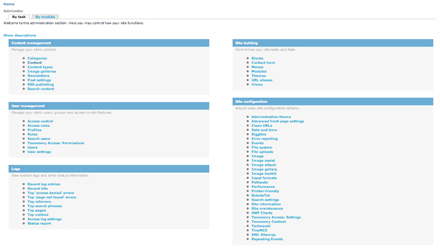
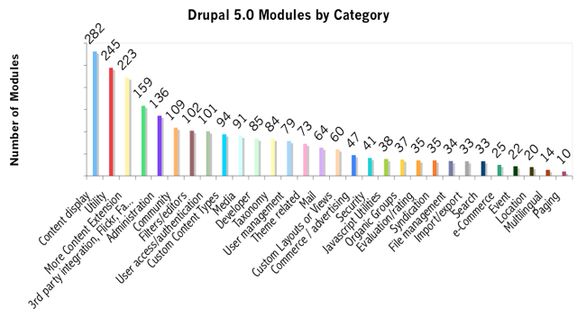

---

I found Drupal in the summer heat of the riverside town of Rosario, Argentina during an internship with a women’s rights organisation in the city. The Canadian government funded me to help the organisation with their information technology, part of a program to promote Canada’s reputation as a leader in technology sector. Cynical of my government’s motives, but committed to the politics of free or open source software (FOSS), I helped the administrator migrate from proprietary software to free software alternatives. Their website relied on an aging copy of Macromedia Dreamweaver, a foreign application for most of the staff. I wanted in Rosario to create the ideal website for the NGO, but I did not have the ability to program such customised software. After some extensive searching, I happened upon the Drupal content management system (CMS) as a replacement. Drupal describes itself as ‘a sort of ‘builder’s kit’ made up of pre-designed components that can be used as-is or be extensively reconfigured to suit your needs. Its intent is to provide incredible flexibility while still allowing people who aren’t programmers to make powerful websites’. [1] Though at times I regretted my decision as I struggled to learn how to configure it, its code adapted to my goals. Drupal adapted because its code is comprised of many components—known as modules—that I could add and remove to compose a customised web platform. The case of Drupal explicates how a platform may be programmable, in its case through a modular design that puts users in contact with its running code. {#para1}

How can the programmability of Drupal be understood? How would this lead to a general study of the programmability of platforms? Programmable means to be ‘capable of being programmed’ (2008: 224). My arrival story offers a window into Drupal, which exemplifies an intensely programmable platform: a platform whose very being resonates with a user.[2] While, as Dodge and Kitchin (2005) suggest, I can program a clock’s time (174-154), its programmability is highly limited because it only alters the time function of its more malleable electric circuits. A programmable platform facilitates adjustments to its very code. How does a platform’s interface express its programmability? Considering the characteristic of a platform requires a re-consideration of the act of programming. Typically, programming appears as a written act. Lawrence Lessig (2006), who has had a seminal influence on the study of the Internet and politics, refers to code as the constitution of cyberspace. His definition fits within the etymology of the verb program that stabilised in the 1940s and 1950s as a written act (see Grier, 1996). Programming came to be seen as an act in language comparable to other human languages (see Cramer, 2008). However, earlier usage of the verb ‘to program’ by mathematician John von Neumann considered ‘the word to mean “to assemble” or “to organize”‘ (Grier, 1996: 52). His earlier usage does not include the linguistic foreclosures of programming; instead, his usage opens up reconsidering programming as an act of composition. Thus, programming is not only an act of writing, but can also include the mouse clicks made on the computer screen. Importantly, written code is executed—it usually runs to create an interface with the user. This moment of interface offers another juncture to consider the act of programming. The interface, far from the static result of code, is a moment of resonance between the becoming of a user and the running code. {#para2}

The work of Gilbert Simondon on information and ontogenesis offers a way to understand the resonance between user and code at the moment of the interface. I rely on his concept of transduction (Mackenzie, 2002; Massumi, 2002) to express how platforms may be transductions, part of an individuation occurring through the chemistry between users and code. Programming is the individuation of a software’s running code occurring through the resonance of its users and by its code. A transductive approach opens up the window for the reconsideration of the interface of the platform as a moment of individuation, rather than a given form. In the case of Drupal, its modular code—code assembled into discrete, exchange parts—facilitates its programmability. Modularity is the variety of programmability by which Drupal enables users to alter its running code. Explaining Drupal and its modularity through the work of Simondon facilitates a consideration of a programmable platform and also provides an opportunity to question the benefits and limits of modularity. The approach and its engagement with the concept of transduction of programmability and modularity offer a novel line of criticism in the emerging field of platform studies. {#para3}

### Literature Review

The concept of the platform has proven a useful means to study and critique software and the web.[3] In computing, a platform means, ‘a standard system architecture; a (type of) machine and/or operating system, regarded as the base on which software applications are run’ (Oxford University Press, 1989). Both Microsoft Windows as software and a personal computer as hardware function as platforms that support other applications. The term acquires critical cache as its technical usage (development platforms) chaff with its political semantics (political platforms) (see Gillespie, 2010); provoking questions of who has access to a platform and what does the platform afford or enable. Lash argues platforms are lifted-out spaces that admit actors to ‘participate in various forms of technological life’ (2002: 24). Lifting out is a form of networking as it defines a common language or protocol (see Galloway, 2004) identifiably separate from the digital noise. A platform’s standards, especially digital ones, create networks of commonality that allow software, routines, and functions to circulate among its nodes. Admission and, by extension, exclusion to platforms constitute a ‘new type of social stratification, in which social classes depend on relations to intellectual property and rights of access’ (Lash, 2002: 24). His concept and its ramifications also apply to social media. If social media sites provide the technical means for forms of participatory cultural production (Benkler, 2006; Jenkins, 2006), then they also act as the gatekeepers of participatory culture—the means to exist online and create existences online. Critiques of web platforms not only question its boundaries, but also ‘the substantial role a site’s interface plays in manoeuvring individual users and communities’ (van Dijck, 2009: 45). Given the breadth of the term and explosion of social media platforms, a variety of theories have developed to explore their boundaries and affordances of platforms drawing upon political economy, cultural studies, and anthropology. {#para4}

Cultural studies and anthropology contribute a sense of the platform and its role in community development, cultural production and social intersection. The platform is defined as a site of community and culture enabled through the specific social networking functions (Boyd and Ellison, 2007; Burgess and Green, 2009; Lange, 2007). Lange, for instance, studies the communities of self-identified ‘YouTubers’ and video-bloggers who form a small community on YouTube through sharing video, responses, and comments. Platforms act as digital intermediaries (van Dijck, 2009; van Dijck and Nieborg, 2009; Gillespie, 2010) that mediate between ‘amateurs and professionals, volunteers and employees, anonymous users and stars’ (van Dijck, 2009: 53). The environments afford a cultural and technical context for the production and reception of digital objects (Benkler, 2006). While the literature helps explain the affordance of platform, the emphasis often overlooks the conditions of entry, namely what users might disclose in exchange for so-called free services. Political economy and critical studies of the Internet have stepped in to rectify this gap. {#para5}

While much of the literature on the political economic structures of the Internet predates Web 2.0, its insights on code as a form of structuration continue to resonate with platform studies (Dahlberg, 2005; Dyer-Witheford, 1999; Terranova, 2004). Approaches to structurations of the web question how commercial websites channel user activity into circuits of consumption, harness user labour as free labour, and monitor browsing habits to produce cybernetic commodities. Platforms, in sum, create processes of subjectivication perpetuating regimes of neoliberalism and discipline (Cote and Pybus, 2007; Langlois, McKelvey, Elmer, and Werbin, 2009). The approach adds a more nuanced view of how code mediates access and usage of platforms. Code, however, is a very different structure to those built of brick. If code has a ‘variable ontology’, as Mackenzie suggests (2006), then how does the code or programming of a platform change? {#para6}

The programmability of the platform is an emerging line of research. Programming has gradually moved from being dependent on hardware platforms to software platforms. Montfort and Bogost (2009) studied the programmability of the Atari 2600 to describe how programming or software production occurs with certain conditions of the platform. Atari programmers wrote within the confines of 4 kilobytes of computer memory. The primitive gaming platform required programmers to write code for every aspect of the hardware from controlling input from the joystick to drawing lines on the television screen. Modern platforms mediate the developer away from such low-level hardware functions. The case of the JAVA platform, for example, demonstrates how a software platform mediates hardware all altogether. As Adrian Mackenzie (2006) explains, JAVA sought, and ultimately failed, to create a universal platform that allowed one code to run on any operating system and hardware. The components of the JAVA virtual machine handled the low-level functions allowing programmers to focus on actually creating a program that utilises the platform. The JAVA platform is a zone of programmability that functions to mediate the software from the varying hardware. The Java virtual platform, while a failed experiment, foreshadows the web as a platform. As browsers and server languages become more sophisticated, websites become software, software that depends on the web as a platform (McKelvey, 2008). Software, rather than hardware, came to define the programmability of a platform. If the programmability of the platform has lifted-up, past hardware, then, how does software express its own programmability? {#para7}

Linux, the famous operating system, is the best known case of a software platform with a particular politics of its programmability. Free software, according to Lessig, is ‘code (both software and hardware) whose functionality is transparent at least to one knowledgeable about the technology’ (2006: 139). The source code of Linux is open for all to see, and to program as part of the development of the kernel or as a way to customise an installation. (Porting Linux to any hardware has become a bit of a hack, a mark of skill). The openness of the code permits greater entry into programming its source code. Richard Stallman (1985), whose original GNU Public License (GPL) proved a catalyst for FOSS development, argues in his manifesto that ‘copying all or parts of a program is as natural to a programmer as breathing, and as productive. It ought to be free’. Drupal is one thousands of projects that have adopted the GPL as an act of making their programming more open. These efforts mark a clear and vital counterforce to commercial software development using closed proprietary code (Dyer-Witheford, 2002; Milberry and S. Anderson, 2009). However, its open programmability is still a written act, difficult to those who do not speak its technical programming language. If we consider the interface and running code, what other forms of programmability might be possible? {#para8}

### Programmability at the Interface: An Analytic Framework

  {#para9}

The following section takes up the question of the interface to describe programmability and the fluidity of running code. By considering programming as assembling, I sought to open a space to consider the graphical user interface as a potential moment of programming. The interface is ‘the threshold between the underlying structure of the program and the user. As a threshold it contains elements of both’ (Fuller, 2003: 149). Users directly interact with code often through the click of their computer mouse. The mouse, as described by Sean Cubitt is a ‘nomadic and schizophrenic prosthesis’ (1998: 88) that points ‘to the modular space of infinite text’ (1998: 90) and ‘governs insert point’ (1998: 91). Mouse clicks shape our desktop by dragging, dropping, selecting, and deleting discrete elements. These clicks feed into a loop informing program and user. The question of the interface opens up a consideration of the program as one of forming. If the user possesses a role in the operation of code, does the written code contain the entire program? The following section introduces the concept of transduction to consider the forming of the program. {#para10}

The work of Gilbert Simondon has aided me in a thinking of programs as in-formation. His work encourages beginning with forming and working backward to formations. Simondon provided one of the first critiques of the now seminal cybernetic information theory. During his engagement with cybernetics, he rejects its definition of information as a static unit of data, and argues it is a process of becoming, a process of in-formation (Toscano, 2009: 384-386). His version of information brings machines, networks, and other technical beings into the fold of his general question of, as Adrian Mackenzie states, ‘ontogenesis (that is, how something comes to be) rather than ontology (that is, on what something is)’ (2002: 17). Ontogenesis questions ‘the becoming of being’ and this coming into being is a process of individuation, a term that ‘corresponds to the appearance of phases in being that are the phases of being’ (Simondon, 2009b: 5-6). If, as Simondon suggests, the individual is always already in a process of individuation, then I have come to think of the program as always already a process of programming. The question turns to understanding the motion and direction of this programming so that I might re-situate myself in programming Drupal. {#para11}

In-formation occurs when processes come into contact with each other, contaminating each other (Toscano, 2006: 152-153). Contamination abounds in Simondon because he considers processes to have a metastability which concerns ‘the notions of order, potential energy in a system, and the notion of an increase in entropy’ (2009b: 6). Simondon introduces the concept to discuss the potentialities driving the processes of in-formation and to contest models of individuation based on ‘stable equilibrium’. As Gilles Deleuze writes on his short commentary on Simondon, ‘a metastable system thus implies a fundamental difference, like a state of dissymmetry. It is nonetheless a system insofar as the difference therein is like potential energy, like a difference of potential distributed within certain limits’ (2004: 87). Metastablity in software involves the potentials coursing through electric circuits and user input—the potential of the user moving the mouse across the screen. The computer electrifies with the currents of human and software processes. {#para12}

When processes of a metastable system contaminate one another, the system changes. These phases are called by Simondon a transduction, which Garelli describes as ‘a phenomenon of resonance to a metastable system, which radiates on the basis of a preindividual potential that dephases itself at the same time that it takes hold in individualized form’ (quoted in Toscano, 2006: 143). Thinking transductively pushes toward considering the program, and also the user, as changing or individuating from their resonance with each other. Simondon uses the example of a crystal to clarify his concept of transduction: {#para13}

> The simplest image of the transductive process is furnished if one thinks of a crystal, beginning as a tiny seed, which grows and extends itself in all directions in its mother-water. Each layer of molecules that has already been constituted serves as the structuring basis for the layer that is being formed next, and the result is an amplifying reticular structure. (Simondon, 1992: 313) {#para14}

The crystal grows on a cave wall even though it appears static and rock-like. The motion and stabilisation of atoms grow crystals. The growth of the crystal originates from its metastability. {#para15}

Mackenzie utilises the concept of transduction to envisage the relation between various human and software processes. He emphasises Simondon’s transductive approach to information as a way to understand the forming of software. Mackenzie states, {#para16}

> Simondon’s notion of information acts as a countermeasure to the tendency of recent cybernetic and biotechnological understandings of information to collapse living and non-living processes together. It takes the specificity of machines and life seriously. Machines are in the process of in-formation. They are open to information to the extent that they can maintain a margin of indeterminacy, or a capacity to be in-formed (2002: 52*).* {#para17}

The indeterminacy allows for many instances, configurations, crashes, errors, and versions of software. Thinking transductively destabilises the finality of code and emphasising the executing and running of code—its ontogenesis. A transductive view of the platform then, offers a way to envision it as in-formation. The source code does not contain the finality of the platform; rather the informing of a Drupal site modulates through the interactions of users and code. Software is always forming, and this forming also includes a moment of programmability. As form become motion, programs become programming, and Drupal becomes Drupalling. {#para18}

Here begins a transductive critique of Web 2.0 platforms. As Mackenzie states, ‘transductive processes occur at the interface between technical and non-technical, human and non-human, living and non-living’ (2002: 52). An interface visualises the running code to the user, while the process of interfacing is a potential phase of transduction. The moment of the interface has significance in the ontogenesis of the platform. Mackenzie writes, ‘a machine works within a certain margin of indeterminacy maintained at its interfaces’ (2002: 53). Indeterminacy, in my case, refers to how an interface becomes a relation between a user and running code (Toscano, 2006: 140). Since platforms have different interfaces, the line of critique allows for the comparison of how platforms facilitate programmability.[4] The programmability of a platform depends, in part, on the resonance between user and code. {#para19}

The work of Sherry Turkle (1997) on the difference between users of Microsoft DOS and Apple Macintosh proves instructive to compare different transductions. The DOS interface provides only a blinking prompt, waiting for a command. No clues exist to what the commands might be. They rest in the complex documentation in a manual that its users must memorise to know its cryptic commands. Despite the complexity, its users enjoy their close connection to the computer. The blinking command line connects a user directly to the software processes running. A user can accidentally erase their hard drive or tweak its boot processes without warnings from the interface (Cramer and Fuller, 2008: 150). The Apple interface, on the other hand, provides a graphic user interface to allow users to see their computer in action, at the cost of being increasingly distanced from its actual operation. Users had less ability to modify their computer’s running code because the interface guards the running code from the user. Users had far less capacity to program their machines, since most of the configuration elements lay outside of their view on screen. In short, users enjoy the platform’s ease of use, but lack access to the most of the underlying code (Turkle, 1997). DOS and Apple interfaces illustrate how the interface acts as point of resonance between human and software processes. Not only does an interface relate a user to a running code, but it also changes how a user understands and feels capable of interacting with the computer. In the individuation of software, interfacing is a vital process for study. The question of the interface now turns to Drupal. How does it interface humans and code together? How does this interfacing enable its programmability? {#para20}

### The Drupal Interface: The Cut-Up Technique

Drupal began as a project of a student at the University of Antwerp, Dries Buytaert. He sought to share his internet connection in the residence and ended up coding a message board as well. After he graduated, he moved the message board online as a site called ‘drop.org’ after a fruitful typo. Drupal gets its name from this site as the word is Dutch for ‘drop’. To create the message board, he used the popular combination of open-source code, including the PHP scripting language, the Apache web server, and the MySQL database. In 2001, he released the software under the GPL license making it a free software project.[5] Gradually the platform acquired users and developers. Before the launch of Drupal 5, the number of developers had grown from 45 in mid-2003 to 555 in late 2006 on the Drupal.org site. [6] The site also acts as a repository of Drupal-related projects; they grew from 67 projects in late 2003 to 1,124 projects in late 2006. [7] {#para21}

Drupal, like most FOSS content management systems, breaks itself down into a series of modules. A module is a snippet of code that modifies the Drupal source code. Appendix I lists the core modules of Drupal and the other modules included by default. Manovich lists modularity as one of his five principles of new media. He defines it as occurring when ‘media elements, be they images, sounds, shapes, or behaviours, are represented as collections of discrete samples’ (Manovich, 2002: 30). Modularity, in his definition, not only refers to the granularity of computing components, but also their capacity to relate. The concept of modular design began in computer hardware as IBM streamlined its bloated product line by creating a modular product line consisting of relatable hardware and software components (Campbell-Kelly and Aspray, 2004: 117-137). IBM’s innovations, as Andrew Russell (2008) points out in his history of modularity, spread across the computer industry and inspired the current modular design of desktop computers. The computer is an assemblage of standardised components, such as the CPU and the hard drive (Grove, 1996). As websites transitioned from simple text files to complex software, developers translated the concept of modularity from computer programs. Many popular FOSS platforms, such as Drupal, Joomla, and WordPress, use modules in their development. {#para22}

Modularity is a standard form of programming that divides an application into the sum of many independent and linked components (Manovich, 2002). The concept is highly prevalent in FOSS projects. Modularity eases participation in development in their distributed operations. Contributors only need to specialise in certain parts of the code to make a contribution to the project, allowing ‘different individuals to contribute vastly different levels of efforts commensurate with their ability, motivation, and availability’ (Benkler, 2006: 103). The resulting modular code is ‘a highly distributed object’ comprised of ‘a loose corpus of source code’ consisting ‘of several thousand files organized in an intricate tree-like hierarchy’ that ‘provisionally stabilizes’ in the form of a ‘release’ and, at the same time, under ‘constant modification’ by ‘patches’ that modifies the source code’ (Mackenzie, 2006: 70). Modularity and open source creates an ‘open’ object, constantly evolving. {#para23}

Modularity also allows its developers to extend the program without the input or approval of the core by creating new, optional modules. So long as the module’s code speaks the same language as the platform, such as both using the standards of Drupal version 5, then development occurs without the consent or involvement of core development. By installing and running Linux, its users enrol in this a networked platform of module creation and distribution. Thus, the programming of Linux includes both a programming community expanding and honing the code base and an end user conjuring their own kernel, and in doing so, expressing their vision of the platform based on the available modules. Web modules further accelerate the spread and impact of modularity because their programming languages do not need to be compiled so the central core of the platform does not need to be recompiled to add or change modules. {#para24}

Where modularity has commonly been understood as a form of software production, modularity also alters the resonance between the end user (or, as Mackenzie puts it, the code subject) and the platform (the code object) (Mackenzie, 2006: 70). Linux famously allows users to compile their own kernel, a badge of honour among technical gurus. Various interfaces allow users to include, exclude, and modularise parts of the kernel. An instance of Linux includes an open platform, a developer community, and an end user creating their own version of the object. They too become part of this networked object, watching and benefitting from the modules uploaded. Various interfaces have adopted modularity as part of programming (Myers, 1998). One of the first popular programs to adopt a modular interface was MAX/MSP, a popular music composition software for the early Apple computer (Déchelle et al., 1999). Users composed music by connecting modules to create and modify sounds. {#para25}

Modularity at the interface helps because it divides code into discrete functions that are easily signified. Simply put, modules break complex code down into digestible bites. I depended on these little hints when I configured my first Drupal site in Argentina. Logging in as the site administrator gives a user access to add and remove modules. The Drupal interface, depicted in Figure 1, provides a simple menu to enable and configure modules. It allows users to exclude and include modules on their site. To use a module in Drupal, a user downloads and installs modules from Drupal.org onto their version of Drupal. The list of modules shows their names and a brief description that explains what they do. Modules feature their own configuration menus allowing users to tweak their functions. Through these menus and modules, a user begins a process of individuation with their local installation. The platform individuates through the enabling and disabling of different modules together in a particular configurations, what Simondon would call a phase. {#para26}

Modules connect the individuation of a local Drupal site by connecting the user to the wider open source development community. The developing community alters a local installation by generating new modules, versions of modules, and eventually new versions of the core. Drupal features a highly diverse range of modules. Figure 2 depicts the diversity of modules available for Drupal 5. At the time of my study, Drupal had 2,411 modules that Drupal.org divided into 30 categories. The average category has 80 modules. Each module extends and modifies the capacities of Drupal, from common tasks, like improving the software’s search engine or the type of media it can handle, to the obscure, such as allowing Drupal to become a bibliographic tool. If the possibilities of a Drupal site depend on the range of modules available, then the growing community continually expands and mutates the relationship between user and running code. {#para27}

Where the act of writing once described the act of programming, the cut-up technique (Burroughs and Gysin, 1978) provides a better description of modular programmability. William S. Burroughs popularised the technique of cutting up texts into short sentences or words and then re-assembling these cut-ups into new works (Hansen, 2001). Modules are like cut-ups—snippets of code assembled together by the author. Katherine Hayles notices a similar pattern in her description of new media. ‘Fragmentation and recombination,’ she mentions, ‘are intrinsic to the medium’ (Hayles, 2004: 76). She compares these characteristics to writing techniques similar to the cut-up, through the following helpful example— {#para28}

> … Raymond Queneau’s Cent mille milliards de poèes (1961), a book in which each page may be cut into several strips corresponding to the lines of a poem. By juxtaposing the cut strip on one page with strips from other pages, large numbers of combinations are possible, as indicated by Queneau’s title. (Hayles, 2004: 76-77) {#para29}

The pre-cut lines resemble the thousands of Drupal modules that users can include or omit. The Drupal.org website becomes its own book of poems, comprised of the 2,411 modules. Once written, modules become potential cut-ups for users to program at the Drupal interface. Like the reader or editor of Queneau’s book of poems, users arrange modules in various ways to program the platforms. This form of programming resembles John von Neumann’s definition of programming as assembling. The cut-up captures a type of programming as act of assembling snippets into new formations. The cut-up technique appears in Drupal as user piece together modules. Modules function as signs that ‘not only point to—or signify—other documents and resources, they enable material effects, for example, taking us to other signs, or in the case of web browser cookies, storing a remote ID file on our own PC hard drives’ (Elmer, 2006: 16). When a user enables a module in the interface, it injects a bit of code during various events of the Drupal process. The injection of code is a transduction that changes the form of the Drupal site. A user creates an event when they click a hyperlink. Drupal itself also creates an event when it runs a script automatically (through Linux’s job scheduler cron). Events trigger functions in the Drupal code. These two examples illustrate how both users and code trigger software functions. Developers refer to events and their resulting functions—‘the things Drupal does’—as actions. [8] Modules hook into actions. Drupal actually uses the term hook to designate how ‘modules interact with the Drupal core’. [9] Each module defines a list of hooks to alter actions. VanDyk and Westgate (2007) give the following example of how hooks allow modules to alter the Drupal process, {#para30}

Suppose a user logs into your Drupal web site. At the time the user logs in, Drupal fires the user hook. That means that any function named according to the convention module name plus hook name will be called. For example, comment_user() in the comment module, locale_user() in the locale module, node_user() in the node module, and any other similarly named functions will be called. If you were to write a custom module called spammy.module and include a function called spammy_user() that sent an e-mail to the user, your function would be called too, and the hapless user would receive an unsolicited e-mail at every login. (2007: 4-5) {#para31}

The example details the event (logging in), Drupal’s response (the hook announcement), and the capacity of the module to intervene (its hook function). By enabling a module, the user spawns a process that interjects new code when executing Drupal core code. The resonance between user and modules creates transductions that alter the Drupal installation, creating new phases of its individuation as Drupal. Through its modularity, Drupal remains in-formation—always with a potential for the platform to change even when installed and running. Modularity, in short, enables a particular form of programmability; however, the limits of Drupal too must be considered if this line of critique proves to be productive for future developments on the web. Modularity, as argued, is the specific transduction of Drupal, but what are the ramifications of modularity and the cut-up technique? {#para32}

### Plug and Play? Questioning Modularity

  {#para33}

The open development process leads to a highly divergent and complex code base for Drupal. Problems arise since Drupal 5.0 assumes the compatibility of modules. Inevitability, conflicts arise between modules operating together. The risk arises from the disjuncture between code and its representation at the interface. Bad interactions can occur between code that the interface cannot represent, except as an error. The user does not have the luxury of a pharmacist to advise against taking two modules at the same time. The metastability of the Drupal platform does not preclude crisis and failure. Modules may break, stopping the individuation of a site. A quick search on the Drupal websites for ‘module conflict’ returns 394 different mentions in the forum. An exemplary post writes, {#para34}

> Seems as though I have lost all administrative privileges to my site during development. I think their might be a code conflict between this module and another one. [10] {#para35}

The opacity of code returns; a conflict exists deep within the processes of Drupal as two modules and their function collide. The resonance between code and humans at the interface ruptures, separating the two processes. {#para36}

How does the modularity guide our own thinking about software development? A critique of modularity must also consider how its social dimensions affect its programmability. Modularity can be both social and technical. Russell (2008) utilises the same case of IBM and streamlining its product line I used above to illustrate not only technical design, but the social changes in IBM. Modularity, he suggest, also became a form of organisation where the firm consolidated systems engineering among elites who schematised the modules. Indeed, modularity has also become a concept to understand the spread of ideas and tactics in collective action. Benedict Anderson first introduced modularity when he suggested the rise of nationalism corresponded with its cultural underpinnings becoming modular, that is, ‘capable of being transplanted’ (1991: 5). Nationalism, in short, spreads through modular cultural artefacts. The concept of modularity as a social phenomenon was elaborated by Sidney Tarrow in his study of social movements. He defines modularity as ‘the capacity of a form of collective action to be utilized by a variety of social actors, against a variety of targets, either alone, or in combination with other forms’ (1994: 33). The petitions and the boycott, for instance, both circulated as modular tactics during the American Revolution. {#para37}

Technical compatibility of modularity obfuscates its social formations. What are the implications of disconnecting certain cultural practices from a specific context? Modularity depends on reducing complex social practices into simple pieces of code. The instrumental logic of modular compatibility seems to exclude the complexity of cultural artefacts. What are the conditions of circulating cultural practices embedded in technical modules? How do cultures become reified within modules? The process of modularity then encourages the circulation of socio-technical practices as fixed and unquestioned. The Drupal project itself suffers from a lineage of open source development with a male-dominated hacker culture (Jordan and Taylor, 2004; Mackenzie, 2006; Ross, 1991). An internal Drupal project has sprung up to attempt to address its lack of gender diversity.[11] This questioning is critical to reveal the cultural tendencies circulating with modules. Modules inscribe limits on the programmability of the platform because they transplant practices that have been encoded in a specific, perhaps problematic, way. Downloading and installing a module transplants code without much consideration of its specific politics. A module for voting on stories, for example, might deploy a binary ‘yes/no’ poll appropriate for its development context, but inappropriate for other sites. The technical compatibility ignores social incompatibilities. {#para38}

### Modular Resonance

  {#para39}

The concern that modularity might obfuscate social processes stresses the need for greater engagement with the development of modules. The individuation of my various Drupal sites has also involved my own individuation. The Infoscape Research Lab, where I work as a research associate, has run Drupal on its website since 2006. I applied my skills learned in Argentina to build the lab’s site. Over the years, the lab has built up a small eco-system of users and modules. (Not all the build-up is useful I learnt from administering the site). Adding module injects new processes into this ecosystem without requiring the migration of users or re-formatting our content. Even though we use modules to provide functions we never imagined when the site was first constructed, Drupal allows the programming of its core code to enable precisely this task. The site is never done, for better or worse. Its individuation continues. {#para40}

I have also come to see modularity as a concept of importance for digital methods.[12] The Lab has begun to develop its research tools as Drupal modules. The Blogpulse, for instance, pulls data from our sample of Canadian partisan bloggers, renders a timeline of blog posts year by year on the site, and allows site contributors to annotate the timeline. By developing tools as Drupal modules, we skipped having to develop a system for logging in users, a web interface, and avoided challenges of linking databases. The module is also distributed under the GPL license for other research projects to use. In benefiting from the modularity of Drupal, the system has opportunities for research. Could Drupal be a platform for research modules? How could the university create platforms, like Drupal, for developing methods and creating research projects? While this possibility must be left for another paper, my last anecdote emphasises a need to remain aware of how the ontogenesis of software, its programming, and how this ontogenesis includes our individuation. As software studies and digital methods evolve, how might our understandings of computers inform new methods and approaches? {#para41}

### Conclusion

What does Drupal tell us about the future of the web? To be sure, Drupal is not the only type of programmable platform. Examples proliferate on the web, such as Yahoo Pipes, OpenKapow, and Dapper (now defunct). The platforms allow users to create mash-ups by mixing information flows and injecting a number of modular filters. These programming interfaces, in short, make small machines—simple programs. Drupal, on the other hand, facilitates the re-purposing of its highly complex program. In this sense, Drupal exemplifies a growing number of open source projects such as Ruby on Rails, and Django for Python. These platforms allow users to program aspects of their code, while also leaving some components untouched. They allow for selective programming—connecting amateur web developer with the mature code of open source programmers. {#para42}

What other forms of programmability can be imagined? Matthew Fuller’s Webstalker (Elmer, 2006: 10-12), for instance, imagined a new way to navigate the web as networks of links. Users do not see a website, but a network of connections they can choose to follow. The re-imagining of browsing hints towards other ways code, its processes, and its effects could be represented at the interface. Could modules be seen as networks linked to various moments of the running code? Can the future and past produce a live interface where the potential collisions of code might appear? How might cloud computing link independent servers together to share code and innovations? Many questions about programmability and its future remain. The case of Drupal, I hope, pushes toward thinking about a future web, one capable of being further programmed. {#para43}

Programmability as a trend as I have discussed it here differs sharply from one currently popularised: the proprietary fiefdom of the iPhone (See Drahos and Braithwaite, 2003). Apple’s users have a conscribed interaction with its code. Extending the functionality of an iPhone—tailoring it—happens through the Apple’s App Store. Access to the store arrives pre-packaged, final, and seamless. The store greets you as one of the default applications on the iPhone’s home screen. Pressing the icon connects you to a world of applications extending your iPhone in unimaginable ways. Who knew your phone can simulate a piano or calculate a tip for you? The stability of the iPhone comes at a cost—it becomes a black box. The iPhone, once heralded as the ‘portable Internet’, has created ‘the anti-Internet,’ Joshua Errett (2010) writes in his introduction of the App Store as web3.0, ‘Unlike the Web, [the App Store] is closed, elitist and heavily and arbitrarily policed.’ Users resonate with the potentialities of the iPhone only through the App Store. It adapts the desires of users through millions of applications which extend the device, while simultaneously preventing substantive change. The iPhone is a fixed platform. The code operates, but never changes aside from the occasional update from Apple, a formality automatically installed when syncing the phone. The process of the iPhone, then, is stasis. The result creates ‘a curated web’ where the possibilities of the platform depend on Apple curators. {#para44}

The Drupal project takes on critical importance in contrast to the iPhone platform. Not all interfaces prioritise surfacing the variable ontology of code. Platforms involve hierarchies that mediate the resonance between user and code. Social media companies maintain control over proprietary platforms that they circulate as public goods and, when successful, position the public underneath their control. As Dyer-Witheford states, {#para45}

> … who commands which means of communication is a question in determining what articulations may or may not be made. And in advanced capitalism, the conditions of discourse, both its proliferation and blockages, are deeply set by corporate power.
>
> (2007: 196) {#para46}

Chun (2005) describes how the Windows Media Player communicates with its developer Microsoft to send user preferences. The code supports the Microsoft monopoly by feeding it valuable data about what media users consume. The opacity of the resonance between users and code often feeds into larger processes of monopoly and corporate expansion. Considering the resonance between user and code provides a way to invoke more participatory platforms. {#para47}

Drupal has political significance then as a programmable platform. Drupal exemplifies how open platforms contribute alternative, and non-commercial means of producing the web. In comparison to a platform like Linux where a platform really becomes a means of accessing and using your computer, Drupal is a productive and open platform that can be deployed in a variety of contexts and causes. Drupal becomes the ground on which different users and organisations build. Drupal thus aids our productivity. Further, by using Drupal, users enter into a shared space, almost a commons, where they benefit from the circulation of networked common goods. Drupal creates a common space through its standardised platform that, in turn, produces new spaces. Drupal, in this way, becomes almost a tactical database of modules ready to be deployed in the service of any cause. In a time where social media depends predominately on commercial platforms, Drupal demonstrates the existence of alternative platforms that should not be overlooked. {#para48}

At a time when platforms have become an important part of a participatory culture, their programmability acquires a critical importance. Through the work of Gilbert Simondon, I demonstrated how platforms always are in-formation, whose state might change due to the interactions between the user and its running code. The software interface acquires importance as a critical moment of resonance between user and code to enact programmability. Drupal offers a way to consider programmability through its modular design that includes an interface where users can add and subtract modules. The interface allows users to program the platform through the assembly of modules. While Drupal’s modularity does not prove a definitive answer to programmability, a study of its responses to these questions opens up a new line of inquiry into making the web more participatory, not only in content production, but in the programming the code constituting Web 2.0. {#para49}

### Acknowledgements

Sincere thanks to Alessandra Renzi and Taina Bucher whose help with the theory of Gilbert Simondon was inspiring and was a great lesson for me. Any errors with my usage of his thought is mine alone, despite their clear explanations. Further thanks to Greg Elmer and Ganaele Langlois for their constant support and guidance. A debt of gratitude, finally, to Catherine Fulton for her thorough edits.

### Biographical Note

Fenwick McKelvey is a PhD Candidate in the Communication & Culture program at Ryerson and York Universities. He researches digital political communication, and digital research methods. His dissertation charts the politics of traffic management software – how it controls information and how it meets resistance. He holds a Joseph-Armand Bombardier Canada Graduate Scholarship.

### Notes

- [1] This quote comes from *The Drupal Overview*, see: https: //drupal.org/getting-started/before/overview.

- [2] Arrival stories have been a popular method of virtual ethnography. The device, as used here, describes the ethnographer’s way into the object of study, in this case Drupal (See Beaulieu, 2004; Hine, 2000).

- [3] The concept of the platform was also the subject of a recent conference. For more details, see: https: //www.networkpolitics.org/content/platform-politics. The site, incidentally, runs Drupal.

- [4] Cramer & Fuller (2008) provide a taxonomy of interface for their contribution in the *Software Studies: A Lexicon*. Also see the book *Interface Criticism: Aesthetics Beyond Buttons* by Andersen & Pold (2011).

- [5] From Drupal’s own history at: https: //www.drupal.org/node/769.

- [6] I have kept my discussion of Drupal focused on 5; however, the version is long out of date. On 5 January 2011, Drupal released version 7. For more details about the project, and its continued growth visit: https: //www.drupal.org/.

- [7] From statistics posted by joshk on 5 December 2006 on Groups.Drupal.org. See: https: //groups.drupal.org/node/1980/.

- [8] See, https: //drupal.org/node/172152.

- [9] See, https: //api.drupal.org/api/group/hooks.

- [10] See, https: //drupal.org/node/726116.

- [11] The project is an internal Drupal Group called DrupalChix, see: https: //groups.drupal.org/drupalchix.

- [12] The module is viewable here: https: //www.infoscapelab.ca/blogpulse. Please email me at: mckelveyf@gmail.com for a copy. Paul Vet, a software developer who contributes to the lab, wrote the BlogPulse and has assisted in developing other software project. See his website: https: //640k.ca/.

### Appendix I

- Core Modules

- Source: https: //drupal.org/node/27367

- Core – required

- Block – Controls the boxes that are displayed around the main content.

- Filter – Handles the filtering of content in preparation for display.

- Node – Allows content to be submitted to the site and displayed on pages.

- System – Handles general site configuration for administrators.

- User – Manages the user registration and login system.

- Watchdog – Logs and records system events.

- Core – optional

- Aggregator – Aggregates syndicated content (RSS, RDF, and Atom feeds).

- Book – Allows users to collaboratively author a book.

- Comment – Allows users to comment on and discuss published content.

- Contact – Enables the use of both personal and site-wide contact forms.

- Drupal – Lets you register your site with a central server and improve ranking of Drupal projects by posting information on your installed modules and themes

- Forum – Enables threaded discussions about general topics.

- Legacy – Provides legacy handlers for upgrades from older Drupal installations.

- Menu – Allows administrators to customize the site navigation menu.

- Path – Allows users to rename URLs.

- Ping – Alerts other sites when your site has been updated.

- Profile – Supports configurable user profiles.

- Search – Enables site-wide keyword searching.

- Taxonomy – Enables the categorization of content.

- Tracker – Enables tracking of recent posts for users.

- Upload – Allows users to upload and attach files to content.

### References

- Anderson, Benedict. *Imagined Communities: Reflections on the Origin and Spread of Nationalism*. (London: Verso, 1991).

- Beaulieu, Anne. ‘Mediating Ethnography: Objectivity and the Making of Ethnographies of the Internet’, *Social Epistemology*, 18.2/3(2004), 139-163.

- Benkler, Yochai. *The Wealth of Networks: How Social Production Transforms Markets and Freedom*. (New Haven: Yale University Press, 2006).

- Boyd, Dana, and Ellison, Nicole. (2007). ‘Social Network Sites: Definition, History, and Scholarship’, *Journal of Computer-Mediated Communication*, 13.1(2007), https://jcmc.indiana.edu/vol13/issue1/boyd.ellison.html

- Burgess, J., and Green, J. *YouTube: Online Video and Participatory Culture*. (Cambridge: Polity, 2009)

- Burroughs, Willam and Gysin, Brion. *The Third Mind*. (New York: Viking Press,1978).

- Campbell-Kelly, Martin, and Aspray, William. *Computer: A History of the Information Machine*. (Boulder: Westview Press, 2004).

- Chun, Wendy. ‘Programmability’, in Matthew Fuller (ed.) *Software Studies: A Lexicon* (Cambridge: MIT Press, 2008), 224-229.

- Cote, Mark and Pybus, Jennifer. ‘Learning to Immaterial Labour 2.0’, *Ephemera: Theory and Politics in Organization*, 7.1 (2007): 88-106.

- Cramer, Florian. ‘Language’, in Matthew Fuller (ed.) *Software Studies: A Lexicon* (Cambridge: MIT Press, 2008), 168-173.

- Cramer, Florian, and Fuller, Matthew. ‘Interface’, In M. Fuller (Ed.), *Software Studies: A Lexicon* (Cambridge: MIT Press, 2008): 149-152.

- Cubitt, Sean. *Digital Aesthetics*. (Thousand Oaks: SAGE Publications, 1998).

- Dahlberg, Lincoln. ‘The Corporate Colonization of Online Attention and the Marginalization of Critical Communication?’ *Journal of Communication Inquiry* 29.2 (2005): 160-180.

- Déchelle, François., Borghesi, Riccardo, De Cecco, Maurizio, Maggi, Enzo, Rovan, Butch, and Schnell, Norbert. ‘jMax: An Environment for Real-Time Musical Applications’. *Computer Music Journal*, 23.3 (1999): 50-58.

- Deleuze, Gilles. ‘On Gilbert Simondon’, trans. Mike Taormina. in *Desert Islands and Other Texts 1953-1974*. (New York: Semiotext(e), 2004), 86-89.

- van Dijck, José. ‘Users like You? Theorizing Agency in User-Generated Content’, *Media, Culture and Society*, 31.1(2009): 41-58.

- van Dijck, José, and Nieborg, David. ‘Wikinomics and its Discontents: a Critical Analysis of Web 2.0 Business Manifestos’, *New Media and Society*, 11.5 (2009), 855-874.

- Dodge, Martin, and Kitchin, Rob. ‘Code and the Transduction of Space’, *Annals of the Association of American Geographers*, 95.1(2005), 162-180.

- Drahos, Peter and Braithwaite, John. *Information Feudalism: Who Owns the Knowledge Economy?* (New York: New Press, 2003).

- Dyer-Witheford, Nick. *Cyber-Marx: Cycles and Circuits of Struggle in High-Technology Capitalism*. (Urbana: University of Illinois Press, 1999).

- Dyer-Witheford, Nick. ‘E-Capital and the Many-Headed Hydra’, in G. Elmer (ed.), *Critical Perspectives on the Internet*. (Lanham: Rowman and Littlefield, 2002), 129-164.

- Dyer-Witheford, Nick. ‘Hegemony or Multitude? Two Versions of Radical Democracy on the Net’. in Lincoln Dahlberg and Eugenia Siapera (eds.), *Radical Democracy and the Internet: Interrogating Theory and Practice*. (New York: Palgrave Macmillan, 2007), 191-206.

- Elmer, Greg. ‘Re-tooling the Network: Parsing the Links and Codes of the Web World’, *Convergence*, 12.1 (2006), 9-19.

- Errett, Joshua. ‘Welcome to Web 3.0: Is Apple sitting on the next version of the Web?’, *NOW Magazine*, 29.33 (2010), https: //www.nowtoronto.com/news/webjam.cfm?content=174558

- Fuller, Matthew. *Behind the Blip: Essays on the Culture of Software* (Brooklyn: Autonomedia, 2003).

- Galloway, Alex. *Protocol: How Control Exists After Decentralization*. (Cambridge: MIT Press, 2004).

- Gillespie, Tarleton. ‘The Politics of “Platforms.”’, *New Media and Society*, 12.3 (2010), 347-364.

- Grier, David. ‘The ENIAC, the Verb “to program” and the Emergence of Digital Computers’. *IEEE Annals of the History of Computing*, 18.1 (1996), 51-55.

- Grove, Andrew. *Only the Paranoid Survive: How to Exploit the Crisis Points that Challenge Every Company and Career*. (New York: Currency Doubleday, 1996).

- Hansen, Mark. ‘Internal Resonance, or Three Steps Towards a Non-Viral Becoming’, *Culture Machine*, 3 (2001). https://culturemachine.tees.ac.uk/Cmach/Backissues/j003/Articles/hansen.htm.

- Hayles, N. K. ‘ Print Is Flat, Code Is Deep: The Importance of Media-Specific Analysis’, *Poetics Today*, 25.1(2004), 67-89.

- Hine, Christine. *Virtual Ethnography*. (Thousand Oaks: SAGE Publications, 2000).

- Jenkins, Henry. *Fans, Bloggers, and Gamers: Exploring Participatory Culture* (New York: New York University Press, 2006).

- Jordan, Tim, and Taylor, Paul A. *Hacktivism and Cyberwars: Rebels with a Cause?* (New York: Routledge, 2004).

- Lange, Patrica. ‘Publicly Private and Privately Public: Social Networking on YouTube’, Computer-Mediated Communication, 13.1(2007). https://jcmc.indiana.edu/vol13/issue1/lange.html.

- Langlois, Ganaele, McKelvey, Fenwick, Elmer, Greg, and Werbin, Kenneth. *Mapping Commercial Web 2.0 Worlds: Towards a New Critical Ontogenesis*. the *Fibreculture Journal*, 14 (2009), https://fourteen.fibreculturejournal.org/fcj-095-mapping-commercial-web-2-0-worlds-towards-a-new-critical-ontogenesis/.

- Lash, Scott. *Critique of Information* (Thousand Oaks: SAGE Publications, 2002).

- Lessig, Lawrence. *Code: Version 2.0*. (New York: Basic Books, 2006).

- Mackenzie, Adrian. *Transductions: Bodies and Machines at Speed* (New York: Continuum, 2002).

- Mackenzie, Adrian. *Cutting Code: Software and Sociality* (New York: Peter Lang, 2006).

- Manovich, Lev. *The Language of New Media* (Cambridge: MIT Press, 2001).

- Massumi, Brian. *Parables for the Virtual: Movement, Affect, Sensation*. (Durham: Duke University Press, 2002).

- McKelvey, Fenwick. *The Code and Politics of Drupal and The Pirate Bay: Alternative Horizons of Web2.0* (York/Ryerson Universities, Toronto: Unpublished Master’s Thesis, 2008).

- Milberry, Kate and Anderson, Steve.’ Open Sourcing Our Way to an Online Commons: Contesting Corporate Impermeability in the New Media Ecology’. *Journal of Communication Inquiry*, 33.4 (2009), 393-412.

- Montfort, Nick and Bogost, Ian. *Racing the Beam: the Atari Video Computer System* (Cambridge: MIT Press, 2009).

- Myers, Brad. ‘A Brief History of Human-Computer Interaction Technology’, *ACM Interactions*, 5.2 (1998), 44-54.

- Oxford University Press. Oxford English dictionary (1989), from https: //www.library.yorku.ca/eresolver/?id=247

- Ross, Andrew. *Strange Weather: Culture, Science, and Technology in the Age of Limits* (London: Verso, 1991).

- Russell, Andrew. (2008). *Modularity: The Modern Architecture of Postmodern Technologies. iTunes U*, Retrieved from https: //deimos3.apple.com/WebObjects/Core.woa/Browse/new.duke.edu.1517863621.01517863627.1539294410?i=1827409788

- Simondon, Gilbert. The Genesis of the Individual. in Jonathan Crary and Sanford Kwinter (eds.), *Incorporations* (New York: Zone, 1992), 297-319 .

- Simondon, Gilbert. ‘Technical Mentality’, trans. Arne De Boever, *Parrhesia: A Journal of Critical Philosophy*, 7 (2009a), 17-27.

- Simondon, Gilbert. ‘The Position of the Problem of Ontogenesis’, trans. Gregory Flanders, *Parrhesia: A Journal of Critical Philosophy*, 7 (2009b), 4-16.

- Stallman, Richard*. The GNU Manifesto* March (1985), https://www.gnu.org/gnu/manifesto.html

- Tarrow, Sidney. *Power in Movement: Social Movements, Collective Action, and Politics* (Cambridge: Cambridge University Press, 1994).

- Terranova, Tiziana. *Network Culture: Politics for the Information Age* (Ann Arbor: Pluto Press, 2004).

- Toscano, Alberto. *The Theatre of Production: Philosophy and Individuation between Kant and Deleuze* (New York: Palgrave Macmillan, 2006).

- Toscano, Alberto. ‘Gilbert Simondon’, in Graham Jones and Jon Roffe (eds.), *Deleuze’s Philosophical Lineage* (Edinburgh: Edinburgh University Press, 2009), 380-398.

- Turkle, Sherry. Life on the Screen: Identity in the Age of the Internet (New York: Touchstone, 1997).

- VanDyk, John and Westgate, Matt. *Pro Drupal Development* (Berkeley: Apress, 2007).
