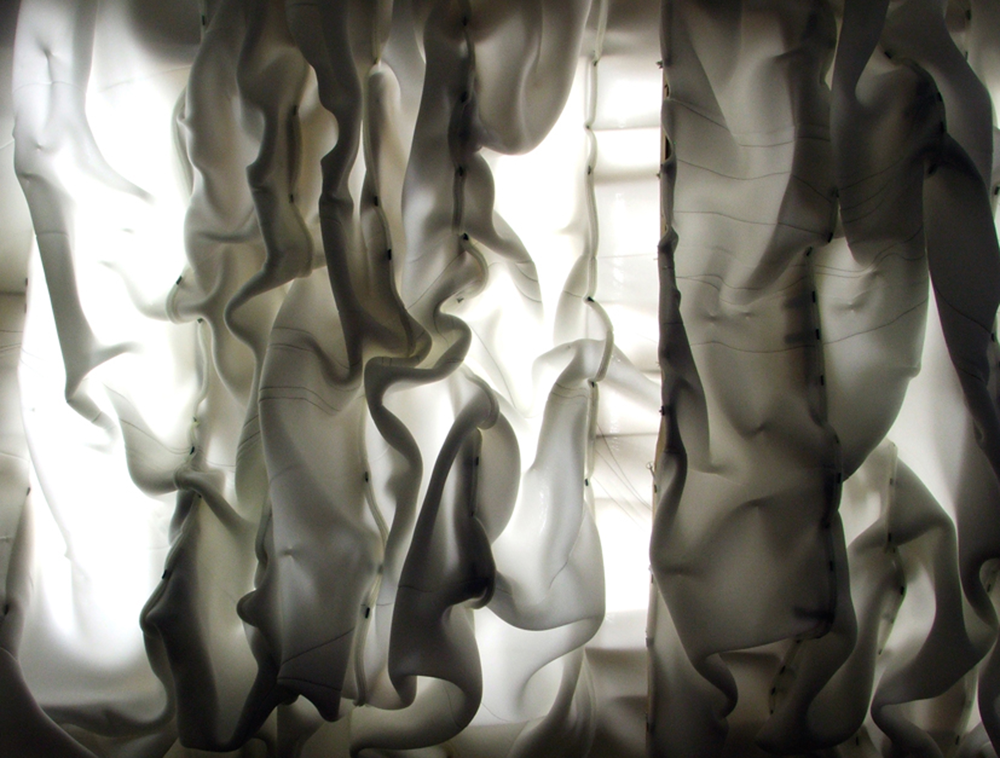
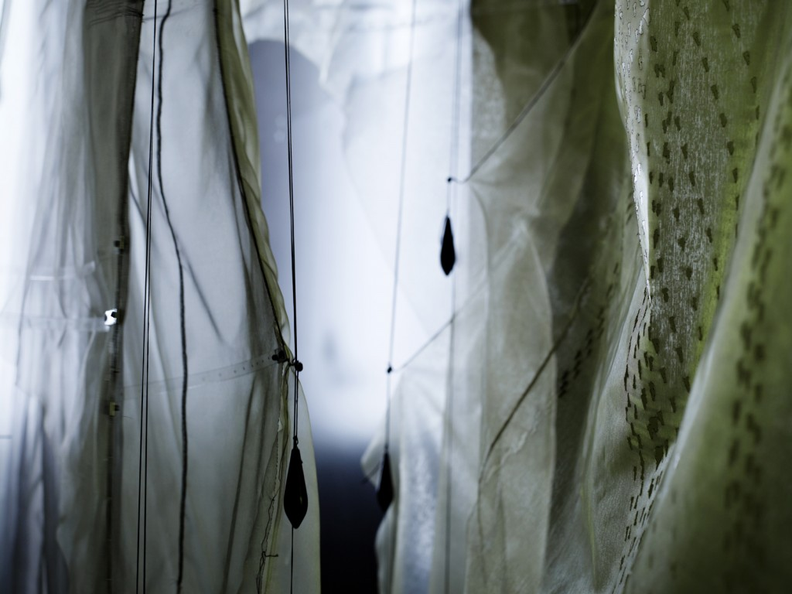
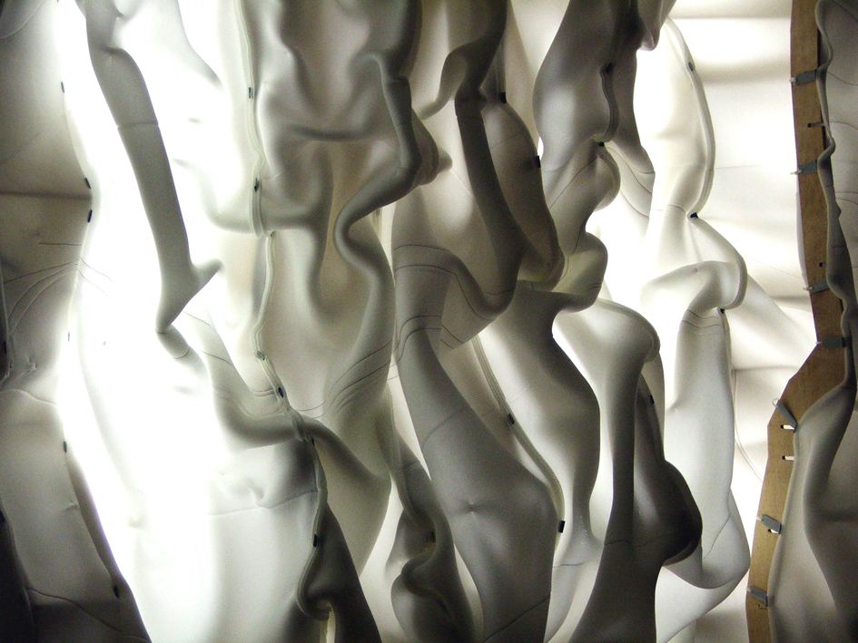
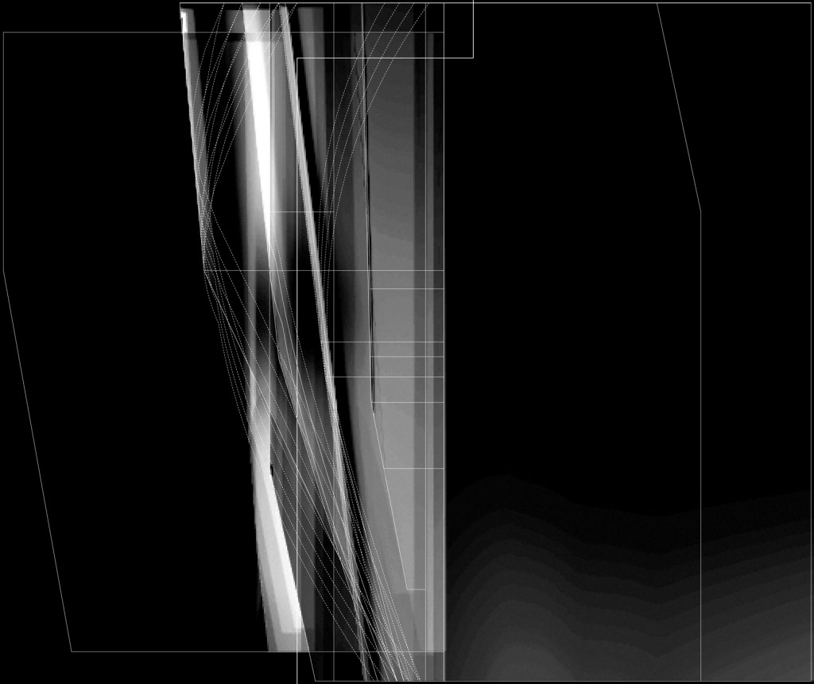
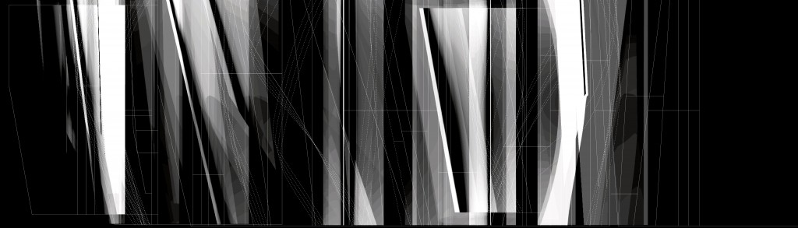
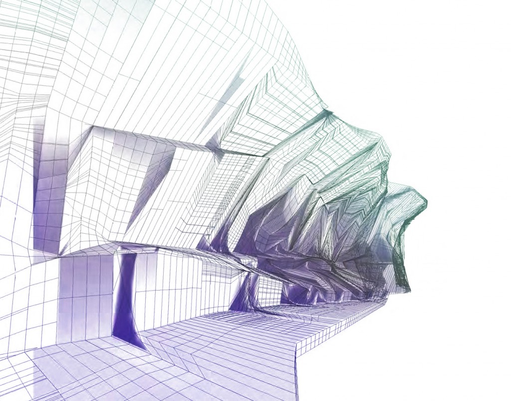
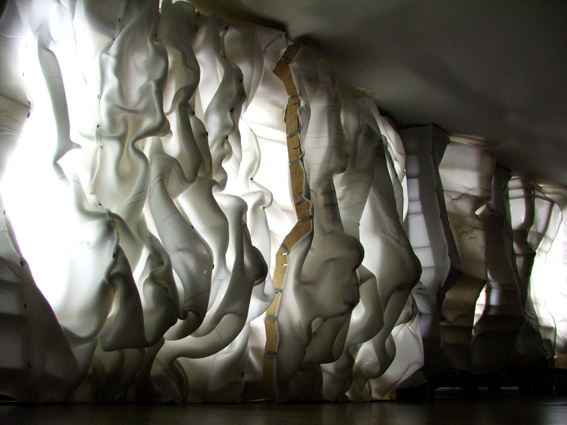

---

### Introduction

Ubiquitous computing positions a world where computation is embedded into our surrounding environment. Rather than retrieving information and communication from distinct devices (PCs) removed from contexts and activities, ubiquitous computing proposes that the mediated can become an integral part of our environment, seamlessly implanted, much in the way that text-based communications are incorporated now (Weiser, 1991). As such, ubiquitous computing places us in a world where material reality merges with computational reality, and where the built environment holds a strata for computation, a readiness towards the digital and the mediated. {#para1}

This paper asks what the architectural consequences of ubiquitous computing can be. Architecture is concerned with the designing and making of spatial contexts. The central objective of architectural design practice is to define spatial ambitions and ally these with the given design criteria. In this way it holds a different point of departure to ubiquitous computing. The aim for ubiquitous computing is to support the incorporation of interactive experiences in ways that can, for example, extend and support the existing framework of a work situation or the home. Where ubiquitous computing seeks models for embedding the digital in a meaningful and seamless manner, it also privileges the idea of the everyday, of the environment and surroundings of its users as fundamentally antecedent to the digital tool. Reconciling the cultural and technological ambitions of ubiquitous computing with the practice of architecture therefore brings forth new challenges for the development of concepts and techniques by which digital events can become “embedded”, that is, can become part of the conception of architecture rather than an afterthought. {#para2}

This article reflects on the two interactive installations *Breathing Room* and *Slow Furl*, following a practice-based research method. The paper explores the issues involved from two perspectives. Firstly, it queries how embedding ubiquitous computing and the idea of responsiveness into architectural practice can lead to new models of interactivity. Referencing the concepts of self production and recursiveness in robotics and early cybernetics, it seeks not to fix the user in a situation of apparent control but rather to position the environment as a whole within a continual condition of self invigoration. We propose the term *pulse* as a measure of temporal extension, in order to think temporality and movement as part of an architectural language of design. {#para3}

The second perspective concerns the inherent challenge to the material practices of architecture that result from working with responsiveness. Architecture has traditionally been cast within the image of the permanent and the static. Embedding the ability to sense and act is therefore one of several recent events in architecture that questions its tectonic conceptualisation. By proposing *instability* as a concept for material thinking this article references the emerging field of transitive materials. Materials are thought performatively both in respect to their structural and their computational facility. {#para4}

The idea of ‘embeddedness’ poses questions not only in respect to the use of and behaviour within a ubiquitous computing space or to the infrastructural necessities that this might require, but also, more fundamentally, to what it means for computation to become an integral part of the built environment. The article asks the following questions. What happens to the relationship between the spatial conceptualisation and occupation of an environment when computation becomes an integral part of our built environment? How does a consideration of architecture as interactive challenge traditions of spatial conceptualisation and lead to a rethinking of core architectural concerns such as stability and structure? What happens to our material practices as the ability to sense and actuate become core properties of an ‘architecture of change’? {#para5}

### *Breathing Room* and *Slow Furl*: Textile architectures of actuation and response

The ambition for the two architectural installations *Slow Furl* and *Breathing Room* is to imagine a textile architecture that acts upon and reacts to changes in their environments. Conceived as robotic installations at an architectural scale the installations are speculative probes querying the territory of robotics, architecture and ubiquitous computing, while suggesting new spatial concepts for a soft space. {#para6}

The installations use textiles as a material for construction. A primary interest in textiles within these projects is their inherent pliability. As compressive materials, textiles allow for easy state shifts such as folding, pleating or stretching. But textiles are also interesting from a manufacturing point of view. Textile technologies are also methods of material *production*: knitting, weaving, lacing, or crocheting are structural techniques by which single fibres are brought together to make fabrics, generating their particular properties of pliability and flex. Controlling these techniques as well as the specific properties of the fibres allows the specification of the material performance. Understanding textiles as a technology as well as a material, the installations propose new ways of embedding the computational into the built environment. {#para7}

In *Breathing Room* and *Slow Furl* the textile is understood as a matrix for embedding computation. By integrating conductive fibres into the textile membranes the architectural skin itself becomes part of the electronic circuit of the robotic environment. The installations use this externalised circuitry to create a strata of soft switches (Berzowska, 2004) by which the state of the fabric, its position and folds, can be registered. As the installations move, the conductive paths within the material change, thereby creating shifts within the electronic state. These state shifts act as a sensing matrix of material interaction. {#para8}

The membranes clad dynamic substructures, or armatures, that hold their particular motility, informed by the materiality and structure of their construction. The armatures are actuated using simple motors steered in turn by an array of micro controllers. The micro controllers use the soft switches as input steering the actuation of their movement cycles. In *Breathing Room* and *Slow Furl* computation exists as a distributed system. In both installations the armatures are steered using multiple autonomous micro controllers connected to each their part of the strata of soft switches. The movement of the installations is therefore instigated as a set of independent actions and reactions in turn unified by the continuity of the textile membrane. In this way the building skin itself becomes part of the computation, effectuating the emergence of the complete movement score. {#para9}

The key constituent of the two installations lies with their programming. In both installations interaction happens through material manipulation and state change. This material call and response is the basis for the programming of their responsive behaviours. The code is constructed as finite loops prompting the movement of the motors and armature. As the membranes fold and unfold they instigate changes within the circuitry thereby continually calling forth further movement cycles. Each movement loop is potentially the last. It is only through the material interaction, the actual self-touching of the membranes, that a continuity of movement is established. This continuity, the pulsing of switching and unswitching, creates the emergence of a behavioural patterning defining the architectural quality and presence. {#para10}

It is into this cyclical looping that the user enters. In *Breathing Room* and *Slow Furl* interaction is physical. Those engaging with the works are encouraged to manipulate the material through touch and movement. As they manipulate the physical arrangement of the membranes, shifting their positions and creating change in the externalised circuitry they affect and change the production of new movement cycles. The inhabitants and the environments become part of the same material interaction, both affecting and changing the movement scores of the structure. The presence of the user is conceived as an intensification, or, conversely, a relaxing, of the continual movement of the installation. {#para11}

### Self production and the auto-poetic system

The installations explore the idea of self-production. Rather than considering interaction as something the user instigates and controls, interactivity is understood as the means by which the installations iteratively self-produce their movement cycles and, through this, their behaviour. It is in this way that the installations propose new ways of understanding the relationship between user and environment, occupant and space. {#para12}

In architecture, the thinking of ubiquitous computing has become synonymous with building automation projects such as the Intelligent Building or the Smart House. As such, the embedding of sensors enables the steering of the complex infrastructures of a building, such as heating, ventilation, and air-conditioning. It is now commonplace that buildings switch their heating or lighting on and off in response to its usage, and that more complex systems such as air-conditioning are steered by central computing units (Wiggington and Harris, 2002; Compagno, 2002). Buildings therefore become interfaces that continually control the complex layering of exchanges between outside environmental conditions and the perceived needs of its user. To use the favoured analogy of the cyberneticians, the building becomes an advancement of the simple thermostat, a means by which the conditions of the living environment can be regulated and controlled (Weiner, 1965). {#para13}

While this model is useful for the control of complex building infrastructures, it also points to a particular understanding of the role of technology in architecture, a role both challenged and intensified through *Breathing Room* and *Slow Furl*. In conventional instances of ubiquitous computing, the subject, or the user model, becomes the centre of an interactive system, where every call demands a response. The environment then remains subservient to the user, creating a relationship of control and determinacy. {#para14}

Yet in cybernetics, the causal model of the thermostat has been the cause of much debate. If Norbert Weiner understood the thermostat as a control unit generating the stability of a system, the second order cyberneticians developed a more complex model of the interconnection of system and environment, one in which a circular causality allows for inter-relational actions and reactions (von Glaserfeld, 2000). Here, the continual exchange of conditions between environment and system is understood as a mutual negotiation in which there is no primary cause or instigator. Instead of understanding the system as under a measure of control, environment and system are conceived as mutually dependent, continually affecting each other through their recursive interchanges. {#para15}

It is this circular relationship that *Breathing Room* and *Slow Furl* seek to engage. In *Breathing Room* and *Slow Furl* the aim is to create a position where user and environment are part of the same cycle of material interaction. The condition of self-touching (installation) and touching (user) affects the same part of the circuitry thereby creating equivalence between action and interaction. {#para16}

While on one level the rethinking of causality challenges the primacy of the subject, it also proposes a more fundamental shift in understanding the central aims for the system. Where the causal model points beyond the system for the instigation of *change*, the recursive interactions of the interconnected system seeks *stability* as a result of the dynamics of the interchanges between system and environment. With this model of recursive interchange an idea of ‘liveness’ is introduced. The live system is one that can preserve its interactions and recursive interchanges between system and environment in ongoing self-production. As defined by the cybernetician and biologist Humberto Maturana, an auto-poetic system (both organic and mechanical) is one which continually reconstitutes itself through its iteration of its processes of production. Here, self-production becomes the key objective for the system for which  ‘… everything that takes place in [the] autopoetic system is subordinate to the realisation of its autopoiesis’ (Maturana, 1980: 149). Whereas the system is open to its environment, it is closed in its aim, or, as Ranulph Glanville puts it: ‘… while it is open to information, its organisation remains closed’ (Glanville, 2004: 1381). {#para17}

Returning to an architectural perspective, this shift of focus fundamentally changes the original percept of the building as subservient to its user into a near converse construct of introspection and self absorption. In this optic, the building becomes concerned with itself, and its occupant changes from “user” to participant, intrinsically linked to the system and part of its cycles of self-production. {#para18}

In the making of *Breathing Room* and *Slow Furl* the thinking of self-production as a means of interaction has lead to a similar state of introspection. In both installations the focus of interaction is to preserve the continual movement of its membranes. But this does not rupture the programmatic intentions of the installations. Despite existing as speculative probes both installations engage abstract programmes of occupation and use. {#para19}

*Breathing Room* was developed as a probe for an interactive scenography. The scenography was imagined for a dance performance and the folds and pleated gatherings of the fabric are scaled for the human body. As an extended backdrop, *Breathing Room* creates a shallow space that rhythmically expands and contracts opening up to its user, allowing the dancer to enter its complex skins. *Slow Furl* is an active wall membrane developed as a site specific installation for the Lighthouse Gallery, UK. The membrane includes scaled deepenings that act as seats, inviting the user into its flowing skins. Both installations engage the user directly through a measure of programmed occupation, and the introspective and in essence autonomous sense of interaction affects the design space of their conception. {#para20}

Clearly, these shifts imply profound challenges for the practice of architecture. If architecture is traditionally understood as containing its occupant, and architectural design practice is concerned with the conception of this frame, inscribing this process into a cybernetic understanding of interaction and self-production changes architecture and its design from the making of an absolute specification to that of the devising of a dynamically changing systemic relationship. Thinking architecture as live, as motile and as self-sustaining, challenges both the object and the process of architectural making. {#para21}

### Pulse as a Measure of Self-Production

In *Breathing Room* and *Slow Furl* the recursive interchange and self-production have lead to the conceptualisation of *pulse* as a way of understanding the temporal dimensions of the installations. The spatial intentions of the installations are defined across time, occupying time as an integral part of their performance. But this is not an abstract time of endless extension. Rather it is a time of agency and action: an enacted time that is neither cyclical nor linear, but random and fractured, always potentially, and disastrously, final. {#para22}

The two installations are different in their way of engaging this temporal extension. *Breathing Room* was developed first. The installation is lightweight and transparent, its pulsing tuned to the breath of its occupant. In *Breathing Room* the armature is made from steel rods controlled by a pulley system. Much as with a fishing rod, the pulleys cause the rods to bend in a spline shape. The armature is clad with a translucent organza fabric pattern cut to vary in density as it folds. The material performance of the fabric is further detailed through laser cut patterns that locally changes the translucency, weight and draping of the membrane. Into this building skin conductive fibre is embroidered, creating a complex patterning of soft switches. The switches are connected to the steel armature. As such the armature becomes part of the circuitry passing the state changes to the micro-controllers. The fabric and the armature are understood as parts of the same complex composite material – collapsing, sensing and actuation – in which the motor systems trigger the switching and unswitching of the externalised circuitry, causing a continual oscillation making the membrane contract and expand. {#para23}

In *Breathing Room* the space is highly motile. The lightness of the membrane, variegated by its detailing, gives the installation an ephemeral expression. The movement loops are likewise agile, the pulse of the installation resonating with the pulse of its inhabitant. {#para24}

*Slow Furl* was developed after *Breathing Room*. As a reaction to the design of the temporal pulsing in *Breathing Room*, the aim for *Slow Furl* was to query the temporal dimensionality of a motile architecture. During the design of *Breathing Room* the tempo of each movement loop was discussed. Referencing former work (Ramsgard Thomsen 2007a, 2007b, 2008), it was noted that the timeframes of these installations had related to the size of the structure. Just like the quick breath of a small bird, the size of the organism relates to its breath or pulse. Critical to that reflection was the consideration of what would happen to this system at the scale of architecture, and how this could be related to the slow pulse of the inorganic. As such, *Slow Furl* explores a geological time of imperceptible flow. Like a glacier or a frozen river, the installation imagines a space of continual change taking place in times that exceed our immediate perception. {#para25}

As a structure, *Slow Furl* is in many ways similar to the *Breathing Room* installation. *Slow Furl* is defined by a thick spacer fabric cladding a dynamic armature which is moved by a series of stepper motors, that in turn are steered by a network of independent micro-controllers. Armature and fabric are understood as part of a complex composite that merge sensation and actuation. But where *Breathing Room* is ephemeral and agile, *Slow Furl* is thick-bodied and intransigent, moving as if in a deep pace at the edge of stasis. {#para26}

In *Slow Furl* the armature is made of a wood structure with a series of jointed arms pulled vertically by the motors. The installation is heavy-set; the wood armature weighing the structure down and the many joints generating friction and an inherent inflexibility. In contrast the motors are exceptionally weak. Running at 5 volts they move at a quick pace without much torque. In collaboration with an engineering company we developed bespoke gearboxes gearing down the pace of the motors and generating a slower but more forceful output. In this way *Slow Furl* uses little energy to create great strength at a deeply set slow pace. {#para27}

The movement of the installation is differentiated in areas of movement contrasted with areas of stasis. Its thick membranes meet the underlying armature, partly in a tight fit and partly through a voluptuous folding allowing for the movement of the armature. In *Slow Furl* the triggering of movement happens through the same structure of movement loops as in the *Breathing Room* installation. The membrane is embroidered with conductive fibres creating an externalised circuitry that as the installation moves triggers new movement cycles. The occupant enters this self-interaction. Invited to touch, or to sit within the deep folds of its pleated membranes the user reconfigures the externalised circuitry. However, because of the slow speed of the movement, users have little means of understanding their effect on its slight pace changes. Users therefore remain almost entirely outside an experience of interaction, relating more to the structure’s material presence than its responsiveness. {#para28}

### Challenging Material Practices: Looking for the instable

As practice based probes the two installations query the material-tectonic realisation of a motile architecture as well as its conceptualisation. The idea of embedding computationally steered events into building skins presents profound challenges to the material practices of architecture. As architecture becomes a material for ubiquitous computing it becomes necessary to develop a new material foundation that allows for sensing and actuation. This presents a key shift in architectural practice away from the stable, towards the motile suggesting new structural concepts by which the state-shifting can be integrated as an inherent part of material performance. *Breathing Room* and *Slow Furl* thus investigate the making of ‘*transitive materials*’ that combine the structural performance of traditional material approaches with new computationally-informed properties. Transitive materials are inherently transformative. They are: ‘material organisations containing computation(s) and/or promoting unique digital fabrication methods as elements inherent to their properties and behaviour’ (Coelho et al, 2007: 2)  The interest in structural and material consequences of an architectural configuration of ubiquitous computing is informing a growing number of architects. In the work of practitioners such as Philip Beesley (Beesley, 2007), Omar Kahn (Kahn, 2009) and Neri Oxman (Oxman, 2008), spatial design takes its point of departure in material design investigating the potentials for actuation and movement, whether at the scale of the joint or in the actual compositing of materials themselves. {#para29}

In *Breathing Room* and *Slow Furl* the membranes merge sensing and actuation into one complex skin. Here, textiles are understood as a *material approach*, a means by which the designed interactivity can be materialised. Conceived as composite materials, the membranes collect skin and substructure, merging the inherent pliability of textiles with the motile performance of the armatures. Rather than building for permanence, the installations seek to engage the material performances of the organza and steel, spacer fabric and wood, so as to create a platform for movement and change. The installations are therefore in very fundamental ways informed by the material presence of their structures. The motility and behaviour of the installations are shaped by the pliability of their cladding fabrics, the flex of the steel rods (*Breathing Room)* and the weight of the wood structures (*Slow Furl)* as much as by their programming and motor movement cycles. {#para30}

### Conclusions

*Breathing Room* and *Slow Furl* explore how ubiquitous computing and the idea of embeddedness pose profound challenges to architectural thinking. Rather than seeing the embedding of computation as an augmentation or extension of existing models of space and inhabitation, these projects ask what happens as computation becomes an integral part of our environment. The installation’s twofold focus on interaction design as well as material design presents a complex weave of exchanges between the computational and the material. In *Breathing Room* and *Slow Furl* interaction is uniquely tied to the embodied presence of the material. The interactive system not only relies on outside stimulation, but also on its own material presence for continual invigoration. The externalised circuitry is a network by which the continual process of self-production takes place. The interactive system is always potentially ending, only re-finding its pulse as new connections in its membranes are found. {#para31}

*Breathing Room* and *Slow Furl* also inquire into the material reality of a ubiquitous computing space. Using textiles as a technology as well as a material, the installations investigate how the design of a material performance can becomes part of spatial design. Rather than understanding the material as an existing strata for the embedding of computation, the installations ask how particular techniques lend themselves towards material specification that can be locally defined both in respect to its structural and its computational properties. {#para32}

A further consequence of this thinking is the extension of architecture into the temporal. The installations ask how this temporality can be architecturally stratified. Time is understood through a model of agency, continually enacted and lived. Where *Breathing Room* seeks to imitate the breath of its user, *Slow Furl* questions the temporality of interactive experiences. Where computers normalise the instantaneous feedback between the call of the user and the response of the system, *Slow Furl* asks what happens when this relationship is scaled up. By engaging a geological time, *Slow Furl* introduces concepts such as resistance and intransigence as ways of understanding the relationship between the moving and the formed. {#para33}

### Acknowledgements

*Breathing Room* was developed for the Robo-Art festival and shown at Brandts Klædefabrik in Odense (2007).

*Slow Furl* won commission from the InterARCHtive competition supported by the Lighthouse (Brighton), Architecture Centre Network, interactivearchitecture.org and RIBA (Sussex branch).

The installation was supported by the University of Brighton, School of Architecture and Design.  The installation was shown as part of the Architecture 08 festival in the UK.

### Biographical Note

Mette Ramsgard Thomsen is an architect working with digital technologies. Her research centres on the relationship between computational design, craft and technology framed through “Digital Crafting” as way of questioning how computation, code and digital fabrication challenge the material practices of architecture. Mette Ramsgard Thomsen is Professor at the Royal Academy of Fine Arts, School of Architecture, where she heads the Centre for Information Technology and Architecture [CITA].

Karin Bech is an architect working with practice based research at the Centre for IT and Architecture, in Copenhagen. She has been a collaborator on projects as *Slow Furl*, *Thaw* and *Thicket*. Karin Bech is also the co-founder of the architectural office Byen Sover, working with urban ideas and conceptual design projects. The practice of Byen Sover has lead to a series of experimental and inventive projects generated from urban situation and strategies.

### References

- Beesley, Philip, *Hylozoic Soil: Geotextile Installations : 1995/2007* (Toronto: Riverside Architectural Press, 2007).

- Berzowska, Johanna. ‘Memory Rich Clothing: Second Skins that Communicate Physical Memory’ *Proceedings of the 5th conference on Creativity & Cognition* (New York: ACM Press, 2005), 32 – 40.

- Coelho, Marcelo , Sadi, S. , Maes, P. , Berzowska, J. and Oxman, N. ‘Transitive Materials: Towards an Integrated Approach to Material Technology’ *Ubicomp 2007 Workshop Proceeding*, 2007.

- Compagno Andrea, *Intelligent Glass Facades* (Berlin: Birkhauser Publishers, 2002).

- Glanville, Ranulph, ‘The Purpose of Second-Order Cybernetics’ *Kybernetes* 33.9/10 (2004): 1379 – 1386.

- Glasersfeld, Ernst Von, ‘Reflections on Cybernetics’ *Cybernetics And Human Knowing* 7.1 (2000): 93–95.

- Khan, Omar, ‘[Reflexive Architecture Machines](https://ambient.media.mit.edu/transitive/chi2009papers/khan09.pdf%22%20%5Ct%20%22_blank)’ *CHI 2009 Workshop Proceedings*, 2009.

- Maturana, Humberto, ‘The Organization of the Living: A Theory of the Living Organization’ *International Journal of Human-Computer Studies* 51.2 (1980): 149-168.

- Oxman, Neri, *Acadia*, 2008

- Ramsgard Thomsen, Mette, ‘Drawing a Live Section: Explorations into Robotic Membranes’ *Kybernetes* 36.9/10 (2007a): 1471 – 1485.

- —. ‘Building Liveness, Imagining Architecture as a Robotic Membrane’ Ubiquitous Computing Workshop Proceedings: 9th International Conference, Ubicomp 2007, Innsbruck, Austria, September 16-19, (2007b).

- —. ‘Robotic Membranes’ *Exploring a Textile Architecture of Behaviour’ Proto Architecture: Analogue and Digital Hybrids*, ed. Sheil, B. (Hoboken, N.J.: John Wiley and Sons Ltd, 2008).

- Wiener, Norbert, *Cybernetics or Control and Communication in the Animal and the Machine* (Cambridge, Mass.: MIT Press, 1965).

- Weiser, Mark, ‘Creating the Invisible Interface: (Invited Talk)’ *Proceedings of the 7th Annual ACM Symposium on User Interface Software and Technology* (Marina del Rey, California, United States: ACM, 1994), 1.

- —. ‘The Computer for the 21st Century’ *Scientific American* 265.3 (1991): 94-104.

- —. ‘Designing Calm Technology’ *PowerGrid Journal* 1.01 (1996).

- Wiggington, Michael, and Harris, Jude, *Intelligent Skins* (Kent: Gray Publishing, 2002).
