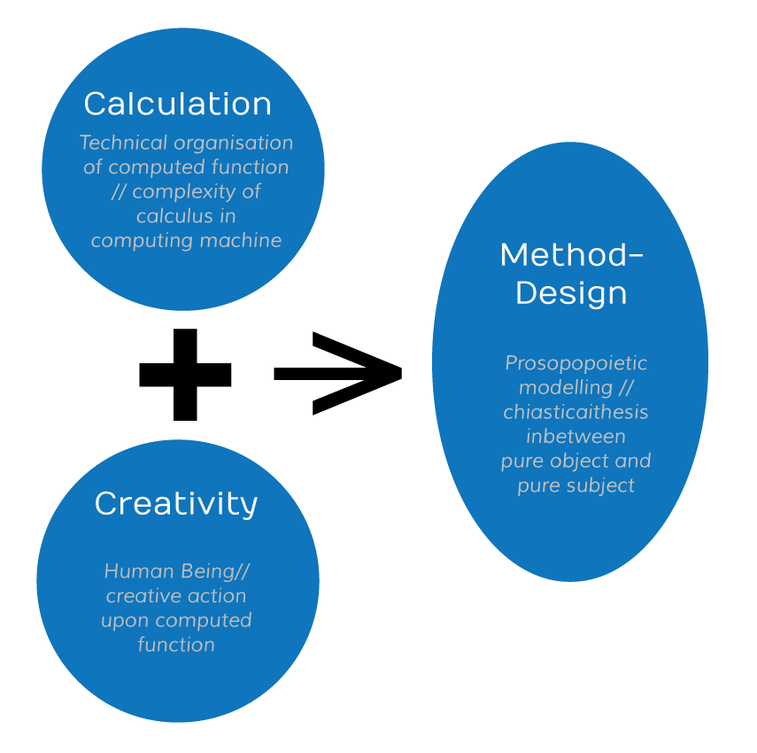

---

### Introduction

This article treats the philosophical underpinnings of the notions of ubiquity and pervasive computing from a historical perspective. The current focus on these notions reflects the ever increasing impact of new media and the underlying complexity of computed function in the broad sense of ICT that have spread vertiginiously since Mark Weiser coined the term ‘pervasive’, e.g., digitalised sensoring, monitoring, effectuation, intelligence, and display. Whereas Weiser’s original perspective may seem fulfilled since computing is everywhere, in his and Seely Brown’s (1997) terms, ‘invisible’, on the horizon, ’calm’, it also points to a much more important and slightly different perspective: that of creative action upon novel forms of artifice. Most importantly for this article, ubiquity and pervasive computing is seen to point to the continuous existence throughout the computational heritage since the mid-20th century of *a paradoxical* *distinction/complicity* between the technical organisation of computed function *and* the human Being, in the sense of creative action upon such function. This *paradoxical* *distinction/complicity* promotes a chiastic (Merleau-Ponty) relationship of extension of one into the other. It also indicates a generative creation that itself points to important issues of ontology with *methodological implications* for the design of computing. In this article these implications will be conceptualised as *prosopopoietic modeling* on the basis of Bernward Joerges introduction of the classical rhetoric term of ’prosopopoeia’ into the debate on large technological systems. *First*, the paper introduces the *paradoxical* *distinction/complicity* by debating Gilbert Simondon’s notion of a ‘margin of indeterminacy’ vis-a-vis computing. *Second*, it debates the idea of prosopopoietic modeling, pointing to a principal role of the paradoxical distinction/complicity *within* the computational heritage in three cases: {#para1}

- a. Prosopopoietic aspects of John von Neumann’s *First Draft of a Report on the EDVAC* from 1945.

- b. Herbert Simon’s notion of simulation in *The Science of the Artificial* from the 1970s.

- c. Jean-Pierre Dupuy’s idea of ‘verum et factum convertuntur’ from the 1990s.

*Third* it concludes with a brief re-situating of Weiser’s notion of pervasive computing on the basis of this background. {#para2}

### First part – Pervasive Computing – Beyond Use as Interaction

One of the best kept secrets of new media success in the past twenty years or more is the creative role of the human user. This claim may outrage any serious observer of new media – after all, isn’t new media about human user interface, user interaction, media (user) culture, appealing graphics and applications (to the user) and so on? What about Web 2.0 and social software? Isn’t the history of computer use since the 1940s one long process of accommodation of the human user in still more sophisticated manners? {#para3}

The short answer is no. {#para4}

The creative *action of human use* as a principal instance of human ontology, that is an entity that may be different in principle from computed function, yet important for such function, has never been queried in the history of computing. The conception of computed function has never been approached from the perspective of a form of Being ontologically different from computing, yet of crucial importance. Often it has simply been ignored. Think about the ongoing thrust of etymology: the term for socially inclusive software, ‘social software’ – networked communities of humans – is still ‘software’, and so on. The predominant assumption (and a tenet of a basically cybernetic origin) has been that human use is ontologically predicated on implications of the technical organisation of computed function. In fact, in the history of computing the human has grosso modo been rendered an entity to be ontologically surpassed or even eradicated by the diffusion of computed function into all aspects of the human’s Being. From computer chips in model trains, intelligent buildings, and smart materials, to robotics, to models of the brain’s functionality, all sorts of computer based modeling, and further, to recent ideas of a connectionist network sociology (Watts, 2003; Barabási, 2003); the attempt to fully implicate the ontology of the human Being within computing has been significant. {#para5}

A preliminary sketch may indicate three common frameworks for understanding human use in this regard (use/interaction etc.) in the post war era: {#para6}

- (a) Human use derived as directly as possible from computed function in well defined measures of design (e.g., Jakob Nielsen’s ‘usability’ [Nielsen, 1993]),

- (b) Use derived from perceptual aspects of approaches to computed function (e.g., Donald Norman’s ‘affordance states’ [Norman, 2001 [1998]]),

- (c) Use derived from computed function as social context (e.g., Susan Leigh Star’s assumption of new media as ‘community building media’ [Starr, 1995]).

Put differently, the technical organisation of computed function has been posited as ontological determination of use in the sense of human use by a human Being, that is, of this Being’s body, psyche-soma, intelligence, behavior, emotions, social predication and so on. In sum, this is use in whatever form we know. {#para7}

### Pervasive Computing – Creating an ‘Unknown Artificial World’

The broad origin of this determinism is what we, for want of a better term, may call a *computational heritage* originating in the mid-20th century (from Alan Turing’s response to David Hilbert’s ‘Entscheidungsproblem’ in the 1930s onwards). This heritage today encompasses a stunning mass of issues, disciplines and knowledge closely related to formalisations (e.g. algorithms), languages/codes (e.g. programming languages), techniques (e.g. CPUs), artifacts (e.g. computers) and smart materials (e.g. piezo-materials). In addition to this are further perspectives arising within new disciplines and theories such as self-organisation, connectionism and complexity – all contributing to a paradigm of ‘complexification’ (Casti, 1994, 2002; Eve et al., 1997; Mainzer 1994; Watts 2003; Barabási, 2003). Added to this, there are the immense and diverse movements into the ‘posthuman’ (Hayles, 1999) along with constructivist social and cultural theory and philosophy, exemplified by the thought of Niklas Luhmann and Gilles Deleuze, to mention two well-known thinkers. Further, there is the appearance of ‘classic’ (Toronto School) and new media and communication theory (Michelsen, 2005, 2007). {#para8}

However, considering the scope of computed function in today’s society there is an impending need for a look at the human Being in different terms. Put differently: if the claim of pervasive and ubiquitous forms of embedded digital computing is correct what does that entail for the human Being which ‘embeds’ this? To begin to answer this, I turn to a different understanding of the artificial. {#para9}

Ezio Manzini has argued for an entirely novel state of the artificial per se. He argues that there exists a discrepancy between the human creation of the artificial *and* the lack of insight into the distinctive character of the resulting effects. ‘To man the artificial is a completely natural activity,’ (Manzini, 1994: 44), but the resulting artificiality appears as ‘an unknown artificial world that we must examine to discover its qualities and laws’ (Manzini: 52). Manzini argues that it is necessary to establish positive connotations for the artificial. {#para10}

In this article the current interest in pervasiveness and ubiquity will be used as occasion for discussing such connotations, beyond an ontological determination by computed function. The article’s point of departure is Cornelius Castoriadis’s idea of a new form of self organisation pertaining to the Human Being per se: ‘a human strata of the real’. This strata is distinguished by a *strong ontological imagination* – ‘the imaginary institution of society’ (Castoriadis, 1987). All phenomena within such a strata reside ontologically within human creativity, what he terms ‘humanity’s self-creation’: {#para11}

> Humanity self-creates itself as society and history – there is, in humanity’s self-creation, creation of the form of society, society being irreducible to any ‘elements’ whatsoever … This creation takes place ‘once and for all’ – the human animal socializes itself – and also in an ongoing way: there is an indefinite plurality of human societies, each with its institutions and its significations, therefore each also with its proper world. (1997: 339) {#para12}

In *Domaines de l’homme* (1986), Castoriadis writes that a new type of distinction/complicity between ratio and creativity follows from the idea of humanity’s self-creation. He argues that it is necessary to undertake the project of distinguishing between and thinking together the ‘ensidic [rational] dimension and the proper dimension of the imaginary’ (1986: 16–17). Folllowing from this, it is possible to envisage an ontological ‘distinction/complicity’ between the technical organisation of computed function enacted in a human strata of the real and a strong ontological imagination of a human Being (Michelsen, 2007). There is a need to undertake a project of *distinguishing between and thinking* ‘together’ the ratio of computed function and the proper dimension of the imaginary in an ontological sense of creative action upon such function. {#para13}

For all these reasons, the following will account for what I have called *a paradoxical distinction/complicity* between the technical organisation of computed function *and* the human Being in the sense of creative action upon such function. This paradoxical distinction/complicity will be described as the opening of a certain form of aisthesis based on the intertwining of function and creative action as two instances which are ontologically distinct, yet deeply complicit. This is what I will term a chiastic aisthesis, following Merleau-Ponty’s famous idea of the ‘chiasm’ of the ‘visible and the invisible’ (Merleau-Ponty, 1983). Furthermore, the approach here will be conceptualised in general terms as a methodology of *prosopopoietic modeling* developed from the classical rhetorical device of prosopopoeia (Greek: προσωποποιία). {#para14}

### Pervasive Computing – Paradoxical distinction/complicity

A first observation of the paradoxical distinction/complicity may be found in the work of the French pioneer of cybernetics, Gilbert Simondon, from 1958. Simondon writes about the relation between the aesthetic and the cybernetic organisation of ‘technicity,’ what he terms the ‘ensemble’ (Simondon, 1989 [1958]) (all translations of Simondon’s French text are mine. A.Michelsen). For Simondon, the problem of ‘the aesthetic’ has implications for certain acts of primary importance. The aesthetic form of thought, the aesthetic object – fundamentally the *aesthetic* , as he argues in a dense overview – points to a peculiar origin, a ‘remarkable moment’ [point remarquable] or ‘position’, ‘event’, of cultural issues (Simondon, 1989 [1958]: 179ff). The aesthetic suggests a ‘bifurcation’ of the natural world by way of a remarkable moment which makes explicit a cultural world of humans, and further a human form of Being. Importantly, this world stands out as a particular bounding of the aesthetic in a human mode which is non-dichotomous, i.e. not within the received idea of a subject-object dichotomy. It is a form of organisation relying on a dimension of Being – the cultural, the human etc. – which is in-between ‘pure objectivity and pure subjectivity’ (187). {#para15}

The idea of the ensemble thus indicates a different organisation bounded not by computed function but by an appraisal of the human which is open towards computed function. This allows one to conceive of the human in an ontological sense which is on one hand different from the technical organisation of computed function, and on the other hand related to this organisation. It is possible to envision two ontologies without creating a conflict with the cybernetic tenet, because they refer to principally different forms of organisation which are nevertheless open to each other in the sense of an intertwining in-between ‘pure objectivity and pure subjectivity’. {#para16}

For Simondon it is important to avoid a definition of the ensemble (11) as an extended determination by computed function. On the contrary, a computing machine exhibiting a range of options is not an automat determined by a vocabulary of closed functions. It is a machine which *qva* its technological definition introduces a *principal margin of indeterminacy* relying on human intervention, defined by Simondon as ‘perpetual innovation:’ (12) {#para17}

> (…) the being of the human intervenes as regulation of the margin of indeterminacy, which in the final consequence is adapted to a more comprehensive exchange of information. {#para18}

The technical organisation of computed function thus resides within an *enforcing openness* because of innovative human steps emerging in the margin of indeterminacy. We may argue this way: at one extreme of a spectrum the technical organisation of computed function is ‘hard’ and almost impenetrable for the human, e.g. in the aggregate automated workings of code. At another extreme the human is almost wholly aloof in a self-enclosed imaginary flux which has nothing to do with forms of computing. However, in the intertwining middle there emerges an enforcing openness between computed function and creative action. Here computed function becomes defined by the margin of indeterminacy and creative action rendered computational. {#para19}

Computed function is thus co-defined by a ‘regulation’ in the shape of ‘perpetual innovation’, that is, integrally related to the different instance of a human Being. This is what is unacknowledged or figured as ontologically surpassed in the computational heritage. {#para20}

Simondon thus indicates a paradox. There exists a paradoxical distinction/complicity *between the technical organisation of computed function and the human* *Being* *in the sense of* *creative action upon such function*. In one perspective they are wholly distinctive; in another they are complicit. The result is that computing as we know it reside within a paradox. {#para21}

Simondon thus argues not only for a paradoxical distinction/complicity beyond ontological determination of the human Being by computed function. He further indicates that: a. The distinction/complicity entails a margin of indeterminacy in between the purely objective and the purely subjective, i.e., beyond modern Western dualism. b. The ensuing ‘regulation’ can be seen as an intertwining of two distinct forms of organisations at the emergent level of a bifurcation. c. Here, cybernetically speaking, ‘a more comprehensive exchange of information’ is possible between innovative – or creative, forms of action, and the technological organisation of computed function. d. All that has to do with use is appearing in this intertwining middle. I want to suggest that it does so as a specific form of aisthesis. {#para22}

### From Pervasive Computing to Chiasm

This can be taken further by involving the notion of the ‘chiasm,’ outlined in Maurice Merleau-Ponty’s famous draft of what was to be the posthumuous work of *The Invisible and the Invisible* (Maurice Merleau-Ponty, 1983 [1968]) from the same decade as Simondon’s work on the technical object {#para23}

Here Merleau-Ponty elaborates the famous idea of the visual as a ‘flesh’ of the world based on a ‘chiasm’ of something ‘visible’ and ‘invisible’. While his well known early work on the ‘phenomenology of perception’ from the 1940s argues that ‘our own body is in the world as the heart in the organism: it keeps the visible spectacle constantly alive, it breathes life into it and sustains it inwardly, and with it forms a system’ (Merleau-Ponty, 1986: 203), he takes radical steps in the second posthumous phase which allow for thinking the aisthesis of a paradoxical distinction/complicity: {#para24}

> With the first vision, the first contact, the first pleasure, there is initiation, that is, not the positing of a content, but the opening of a dimension that can never again be closed, the establishment of a level in terms of which every other experience will henceforth be situated. The idea is this level, this dimension. It is therefore not a *de facto* invisible, like an object hidden behind another, and not an absolute invisible, which would have nothing to do with the visible. Rather it is the invisible *of* this world, that which inhabits this world, sustains it, and renders it visible, its own and interior possibility, the Being of this being. (Merleau-Ponty, 1983: 151) {#para25}

As research into the ‘paradox’ in the 20th century has shown – notably Willard Van Orman Quine’s investigations (Quine, 1966), a paradox does not rule out meaning *per se*. Some paradoxes, Quine argues, are only insolvable in their time. That is, they are only to a certain extent anomalies, e.g., Zenon’s paradox. At a later stage they may be verified, and thus become veridical, even if some still maintain – so far – their anomaly. The chiasm in our context may be reviewed as a paradox under its way to verification. {#para26}

This is exactly what Merleau-Ponty argues. The chiasm is a verified paradox based on the transversal structure of the flesh which organises the visible in forms of meaning beyond the seeing subject vis-à-vis the visible object. Moreover, this is a form which in its intertwining becomes inner and outer in the same moment, that is, a fact of the world and an idea. It is an organisation, or an ensemble, which organises potential and actualises forms by an inherent dynamic involved with the intertwining. {#para27}

We can look at the history of computing from this perspective. Take the history of the internet. From the first drafts of internet architectures in the late 1950s and 1960s by Baran and Davies, up to the breakthrough of the World Wide Web in the mid-1990s, important initiations of creative action upon computed function have emerged. In Janet Abbate’s words, the network architectures developed from the 1950s onwards did not only accommodate a variety of computed functions, they were also paradoxically open in a very productive sense. Their later success was closely connected to this feature, ‘the ability to adapt to an unpredictable environment’ (Abbate, 1999): {#para28}

> No one could predict the specific changes that would revolutionize the computing and communication industries at the end of the twentieth century. A network architecture designed to accommodate a variety of computing technologies, combined with an informal and inclusive management style, gave the Internet system the ability to adapt to an unpredictable environment. (Abbate: 6) {#para29}

From the Home Brew Computer Club (1975-1977) and its focus on amateur designs for a centralised technology that moved away from corporate, military and research uses, to the spread of cell phone technology in the past decade, such unpredictable environments have played a massive role for any new formation of use. Every turn of use has presupposed and implied perpetual innovation in the sense indicated by Simondon, i.e., human use – what Abbate, perhaps somewhat vaguely, terms ‘an unpredictable environment.’ And vice versa, every instance of human use has triggered a huge development of computed function. In direct contrast to many assumptions of the computational heritage, the human has not been an ontological entity to become eradicated. It has bounced back with every cusp of new use, to the point where current new media growth is almost wholly reliant on a deep human presence, as we see in phenomena such as Facebook and Youtube. {#para30}

It is possible, indeed necessary, to argue that every time computing has leaped forward with new successes, this has resided paradoxically within an instance of *the Human* *Being* *in the sense of* *creative action upon computed function* in a still more comprehensive manner. {#para31}

The current focus on the notion of pervasive computing is no exception. Notions such as ‘pervasive’, ‘ubiquituous’ and ‘embedded’ are yet another example of Simondon’s *paradox*, emergent as chiasm. This is clearly apparent in Mark Weiser and John Seely Brown’s manifesto *The Coming Age of Calm Technology* from 1997 (Weiser and Seely Brown, 1997). Here they envision a ‘third wave’ of computing – ‘beyond calculation’ in the Turing machine sense – which will be more at the users disposal. It will take on a membrane-like, active set of relationships between artifact and human, which, at the time of writing (1997), is primarily ‘post the personal computer of the desk top (PC)’: {#para32}

> The Third wave of computing is that of ubiquitous computing, whose crossover point with personal computing will be around 2005-2020. The ‘UC’ era will have lots of computers sharing each of us. Some of these computers will be the hundreds we may access in the course of a few minutes of Internet browsing. Others will be embedded in walls, chairs, clothing, light switches, cars – in everything. (Weiser and Seely Brown: 77) {#para33}

In the ‘’”UC” era’ there will emerge a chiastic relationship between almost omnipresent computed function –in everything, experienced as *seamless* by the user. ‘Lots of computers’ will be ‘sharing each of us’. There will emerge a membraneous interaction between new ubiquituous artifice – an ‘artificial environment’ (Manzini) – on the basis of which two forms of organisation will chiastically engage with each other. This will be what Weiser and Seely Brown discuss as the absent, yet omnipresent ‘calm’ which ‘engages both the center and the periphery of our attention and in fact moves back and forth between the two’ (Weiser and Seely Brown: 79): {#para34}

> … it should be clear that what we mean by the periphery is anything but on the fringe or unimportant. What is in the periphery at one moment may in the next moment come to be at the center of our attention and so be crucial. {#para35}

This is ‘encalming’ (80) because: a. It allows us ‘to attune to many more things’ since computed function is at a distance yet present, that is, absent yet present, ‘the periphery is informing without overburdening’, and b. It allows us to operate *in-between* center and periphery, thus placing the peripheral ressources of computed function in a ‘calm through increased awareness and power:’ {#para36}

> … *without centering, the periphery might be a source of frantic following of fashion; with centering, the periphery is a fundamental enabler of calm through increased awareness and power.* (italics my emphasis) {#para37}

Despite Weiser and Seely Brown’s explicit reference to the debates within HCI, e.g., Gibson, Norman etc, around issues such as affordance, what is suggested here is in fact in almost complete accordance with Simondon’s idea of a particular bounding of the aesthetic in between ‘pure objectivity and pure subjectivity’ (Simondon, *1989:* 187). One may even argue, without taking the parallel too far, that the actual event of *encalming* is exactly the emergence termed by Simondon as ‘perpetual innovation’. Moreover, this entire conjecture is deeply chiastic, almost to such an extent that it may be translated directly into Merleau-Ponty’s draft description of a transversal structure of the flesh which organises the visible in forms of meaning, beyond the seeing subject vis-à-vis the visible object. This flesh is simply the dimension which allows for the intertwining middle described by Weiser and Seely-Brown. The options enabled by UC make for a chiastic organisation residing with this dimension. {#para38}

### Second Part – A Methodology of Prosopopoietic Modeling

In the second part of the paper I will debate this chiastic organisation in the sense of its *methodological implications* for the design of computing, inspired by Bernvard Joerges’s interesting note on the need for a prosopopoiesis of large technological systems (e.g., like the internet) (Joerges, 1996). With prosopopoiesis Joerges refers to the *rendering meaningful* of large technological systems in a human mode. Prosopopoiesis will be seen as a proper methodological definition of what I have termed a paradoxical distinction/complicity between the technical organisation of computed function and the human Being in the sense of creative action upon such function. It follows from the verified paradox of the chiasm, based on a transversal structure of flesh. It opens up certain approaches to novel forms of artifice. Importantly, this establishes positive connotations for the artificial in the terminology of Manzini. That is, it encourages the type of designs that allow for the chiasm that Weiser and Seely Brown discuss. In blunt terms, it allows for the designs which will render computed function a billion user large success in the second half of the 20th century. {#para39}

Put differently, there exists a real chiasm – intertwining, of the paradoxical distinction/complicity – which makes up a history of use, i.e., creative action upon technological organisations of computed function (in the last resort, of the universal Turing machine idiom with all that it entails). This is guided methodologically by prosopopoietic modeling. {#para40}

### Prosopopoietic Modeling – Methodology

Joerges argues that large technological systems institute a ‘Macht der Sache’ [power of things] in a social context which needs to be rendered meaningful in their technical organisation by a ‘showing’ (15ff) in a human mode as ‘Körper der Gesellschaft’ [embodiment of society]. For this he uses the term I have already begun to discuss, ‘prosopopoiesis,’ derived from the notion of prosopopoeia in classical rhetorics. A prosopopoeia is a rhetorical device in which a speaker or writer communicates to the audience by speaking as another person or object. Joerges gives an example of this in the technological organisation by which the rain embodies the roof in the appearance of a delicate sound pattern intelligible to the aisthesis of a human underneath, who becomes enactively aware of the technical organisation of the roof (265ff). The rain appears via a particular gestalt – a prosopopoeia – that makes sense to a human: a sound to ear and so on. {#para41}

Large technological systems must enact a response in the user in order for the systems to function (had the roof-user not been able to identify the *roof*, he might not creatively have found shelter, so to speak). This is paradoxical in the sense that it transforms the technical organisation into a much different but no less relevant range of emergent events involving the system ‘roof’ and sound. The fall of rain on the roof is thus potentially full of meaning which the prosopopoiea expands poietically by creative action. This literal implication is needed in order to situate the system fully. The roof has to become situated creatively as meaning for humans in order to function. Or more radically, the function of the roof is immediately situated within a plenitude of creative meaning and there is not really any function, in fact no roof, without it. {#para42}

Prosopopoiesis may thus be described as a method for modeling events within Simondon’s paradoxical distinction/complicity as a margin of indeterminacy opening for innovation of a range of possible uses. To be precise, it situates use *as any form* of human use. Or, differently, it situates the negotiations between Weiser and Seely Brown’s center and periphery in something which may be rendered a method for enabling specific designs. Prosopopoiesis becomes a methodological *locale* for creative action upon computed function where we may discover the details of the chiasm intertwining ‘pure objectivity and pure subjectivity’ (Simondon). In the following I will pursue some further indications in three steps: {#para43}

- *Prosopopoietic modeling* *– John von Neumann’s Draft*: the basic traits of prosopopoiesis, discussed via Paul Ricoeur’s idea of heuristic inscription and the complexity of calculus in the Turing machine.

- *Prosopopoietic modeling* *– Herbert Simon’s simulation*: a response to prosopopoiesis in the computational heritage. Here I will focus on Simon’s idea of simulatory interface.

- *Prosopopoietic modeling* *–* *verum et factum convertuntur: negotiations from within the computational heritage*: Here I will discuss Jean-Pierre Dupuy’s observation of modelling as product and transcendence of human finitude.

### Prosopopoietic Modeling – von Neumann’s Draft

According to Wikipedia, ‘A prosopopoeia (Greek: προσωποποιία) is a rhetorical device in which a speaker or writer communicates to the audience by speaking as another person or object’ (Wikipedia. The Free Encyclopedia: Prosopopoeia): {#para44}

> This term also refers to a figure of speech in which an animal or inanimate object is ascribed human characteristics or is spoken of in anthropomorphic language. Quintilian writes of the power of this figure of speech to ‘bring down the Gods from heaven, evoke the dead, and give voices to cities and states … {#para45}

In order to enact meaning vis-à-vis an ‘inanimate object,’ the object in question must bring about a gestalt which may relate to the creative action of a human. In the computational heritage, this basic trait may be said to have first emerged as a creative action upon the complexity of calculus in the Turing machine. The Turing machine was one of the most sophisticated artifacts ever invented, not least because of its potential for modelling everything compatible with the universal Turing machine form. Yet it also appeared difficult for humans to approach directly. A number of complicated steps had to be taken in order to understand and utilise the machine, from the construction of storage techniques to the development of programming as such (Ceruzzi, 1998). The user, early on and later, had to establish a number of procedures going beyond anything hitherto seen. {#para46}

Concrete computed function (e.g., the chaotic cablings of the ENIAC, the first general-purpose electronic, digital and reprogrammable computer from the mid-1940s) had to be creatively related to use by a heuristic force of fiction, residing within a figure of speach which might introduce, ‘a general function of what is possible in practice’ (Ricoeur, 1994: 127). Use, in other words, was not a piece of cake. Creative action upon the machine facing the user for a long time required something close to a complete reinvention of it. This was the first encounter of prosopopoietic modeling. It was not a haven or a promise, but a downright requirement. And if computing today may appear more ‘plug n’ play’ it is only because of decades of toiling and juggling, not only with specific forms of prosopopoeia, but with an excruciating construction of whole fields of interrelated prosopopoeia – what to the user appears seamless as ‘the web.’ {#para47}

The first appearance of prosopopoiesis was consonant with the first programming of the ENIAC and other early Moloks of pioneering computer design by an engineered intuition of how to e.g. combine cables in order to calculate. Despite, or exactly because of the eccentric expertise required for these operations, they immediately posited the issue of prosopopoietic modeling: of methods to enact chiastic aisthesis. {#para48}

A famous early instance is John von Neumann’s draft of a principal logical design of a computer. He wrote this as the *First Draft of a Report on the EDVAC,* from 1945, after a few days of inspection of the of the ENIAC. In order to grasp the portent of this machine von Neumann applied a ‘figure of speech,’ by describing the ENIAC’s technical organisation of computed function via an instrumentarium of logic. Von Neumann saw through the technical mass of relays and combinatorics, to a momentous and automated logic figuration – i.e., a future logic that was the precondition for making explicit the universality of the Turing machine. {#para49}

This was a radical rethink of the ENIAC-inventors’ (Mauchley and Eckert) accomplishment, in terms of what is still known as the ‘architecture’ of the serial computer. The mechanical workings inside the ‘black box’ of Mauchley and Eckert’s ENIAC – the ‘inanimate object,’ i.e., the concrete mechanically instantiated calculus of the Turing machine, were by von Neumann’s logic tables opened towards a methodological coupling of Mauchley and Eckert’s mechanical engineering with logic in the sense of creative action upon these mechanics. To paraphrase Paul Ricoeur, mechanical workings were opened to a mode ‘in which we radically rethink what family, consumption, government, religion and so on are’ (Ricoeur: 132). Logic was thus applied as creative action, not only upon the specificity of the ENIAC in 1945 but upon the universal Turing machine, via a chiastic aesthesis which offered the specialised wartime artifact of the ENIAC the broader promise indicated by Turing. Prosopopoiesis may thus be taken as another term for a creative heuristic of the universal Turing machine, attempting to tackle methodologically the paradox of distinction/complicity that any user would encounter. {#para50}

From the very beginning of the computational heritage – for example as summarised in the emphasis on *universality* of the universal Turing machine, it was clear that the mechanical calculus was implying a new ratiocination. In this, human proof in the traditional sense of compelling human embedded logic was superceded by embedded technology. When it came to the Turing machinics – mathematics and algorithmics embedded in digtal relay-structures, the machine could in plain words calculate much more than any human and, importantly, in modes with a comprehension, scope and intrinsic purport which a human could only, at best, address intuitively. {#para51}

That was the birth of mechanical approaches to ‘complexity’ which until then had been a vague metaphor (Merriam-Webster dates complexity to 1661, at the time of the origin of the modern ratio in a sense somehow of mechanical computing, c.f. ‘reckoning’ in Hobbes’s usage from the same time). It came into being, we may argue, because the instrumentarium of logic was methodologically applied as prosopopoietic modeling. To put it bluntly, the computer posited to the world from the beginning a paradoxical dinstinction/complicity between a mechanically embedded machinics much beyond any human grasp which was nevertheless deeply reliant on human creativity. {#para52}

In fact the paradox was so compelling that the rendering operative of the Turing machine was only possible when creating it heuristically by way of prosopopoiesis. The Turing machine – as artifice, would only make sense if prosopopoietically modeled, whether in Turing’s own explanatory metaphor of the famous ‘tape’, or by Mauchley and Eckert’s concrete cablings, or by von Neumann’s logic tables in the *First Draft of a Report on the EDVAC*, or – consequently, in any other way created by humans. {#para53}

This machine could only be entered into a general function of what is possible in practice for humans once such a prosopopoietical method was established. There was no way around it. Had this not happened, we may polemically ad, the whole issue of mechanical computation could have remained an eccentric side effect of the American wartime economy. Indeed all the more or less eccentric historical precedents had turned out to be exactly this – Pascal, Babbage, Lovelace etc., up to the advent of Turing, Shannon, and von Neumann. {#para54}

The success of computing would raise the issue of from where and how to create: of how to procede, grasp, deal, to imagine creatively, the artifact of computed function ‘first’ invented by Mauchley and Eckert’s mechanics. And further, this prosopopoiesis would remain challenging for the coming decades, in abject contrast to any naive idea of technique as ‘ready to hand’ (Heidegger would revise his assumptions in the postwar essay on technology). {#para55}

In the first years of computing this task was left in the concrete to the cybernetic pioneers – often in quite practical ways, when fumbling with chaotic cablings such as the ENIAC’s in the mid-40s, and later in the 1950s and 1960s extending this to a new expert culture of cybernetics and systems theory. {#para56}

By then the prosopopoiesis relating to the creative actions of experts had for a long time been involved in wild speculations which would imagine in diverse and increasingly public ways the Turing machine calculus as a ‘general function of what is possible in practice.’ Animated machines, electronic brains, an entire *world system* trespassing the realm of God in the making; all of this as a ‘mode in which we radically rethink what family, consumption, government, religion and so on are.’ Not for nothing is the title of Norbert Wiener’s last book *God & Golem,* Inc. *A Comment on Certain Points Where Cybernetics Impinges on Religion* (Wiener, 1964). {#para57}

Thus prosopopoietic modeling appears as a very first methodological precondition for making sense of an inanimate object, or better, for an apparant ‘anima’ of its Turing machine calculus (!). However, such deliberate fancy would enact the ‘planned rationalism’ of a technical organisation of computed function into a ‘situation’ of much broader human use in the coming decades, in the words of Lucy Suchman writing when user-centric design was clear in sight (Suchman, 1987). {#para58}

A first description of the prosopopoiesis needed to methodologically situate the Turing machine calculus is thus also a first heuristic force of inscription by creative action upon computed function, no more, no less – from the outset a chiastic aisthesis, as indicated by Simondon. The very first inventions of specific ways of computing (from Konrad Zuse’s electromechanical machine Z3 and the other ‘firsts’ to the ENIAC) had from the very outset to be re-invented as ‘a general function of what is possible in practice’ (Ricoeur, *Op.cit*.: 127) by paradoxically rethinking what is taking place inside the complexity of Turing machine calculus by way of prosopopoietic modeling. The cybernetic pioneers struggled bravely to get everything right. Yet they also testified to the dynamic of prosopopoiesis in their creative production of prosopopoeia, of methods relying on the creative enaction of figures ‘of speech in which an animal or inanimate object is ascribed human characteristics or is spoken of in anthropomorphic language’ (Wikipedia). And over the coming decades all sorts of paradoxical issues which had little to do with computing senso strictu came into being, as seen in examples from Kubrick’s *2001: A Space Odyssey* (1968) to William Gibon’s *Neuromancer* (1984) (Bukatman, 1993). See the graphic below for a summary of the argument: {#para59}

 {#para60}

### Prosopopoietic Modeling – Simon’s Simulation

At this point we may argue that prosopopoietical modeling has several features: {#para61}

a. It enables a chiastic aesthesis, emerging in-between two distinct yet intertwined ontological forms of organisation, the Simondonian pure subject and object (see the part to the right in the graphics above). {#para62}

b. It moves the emphasis of use away from the technical organisation of computed function in whatever complex form, and toward a heuristic force of inscription which makes relations possible by methods derived through prosopopoietic modeling. {#para63}

c. It makes possible a new approach to understanding use in this regard, in the computational heritage, by moving towards creative action upon computed function and a re-evaluation of the ontological form of the human Being. {#para64}

A further step of my argument may be presented by taking up Herbert Simon’s discussion of ‘simulation at the front end of use’ in the programmatic treatise *The Sciences of the Artificial* (Simon, 1996 [1969]). Here, it may be argued, heuristic inscription is tackled via the announcement of methods of *simulation*. Simon argues that the computer makes up a particular form of complexity which cannot and may not be put wholly at the disposal of the user. What is needed is a ‘meeting point – an “interface” in today’s terms – between an “inner” environment, the substance and organization of the artifact itself, and an “outer” environment, the surroundings in which it operates’ (Simon 1996 [1969]: 6). {#para65}

To Simon the intrinsic complexity of the inner environment of the artifact (i.e., the resources of the universal Turing machine) need not be wholly disclosed. Appropriate measures of simulation at the front end directed towards the user’s attention may be enough. This argument is in strict accordance with the deterministic positions of the computational heritage: the technical organisation of computed function is simply too comprehensive for any form of prosopopoiesis beyond simple simulatory presentations. That is, beyond what would be known from the 1960s as GUI, or ‘graphic user interface,’ in combination with other interactive devices such as mouse, keyboard etc, based on Ivan Sutherland, Douglas Englebart’s and others experiments throughout the 1960s. In the late 80s and 90s this would evolve into the comprehensive design issues of usability, affordance and context, further user-centricity etc. {#para66}

Simon’s solution thus appeared to fix prosopopoietic modeling through strict methods for displays of the technical orgnisation of computed function. At the time of his writing, in 1969, such methods were well under way to become commonplace, exemplified by new norms of e.g. usability. What would be less clear to Simon and the computational heritage was that this simulation was a very restricted form of chiastic aisthesis prosopopoietically subsumed under displays of the technical organisation of computed function. It would result in a bland and ironic substitute for the complexity of the Turing machine calculus, parading over decades as the desktop. It was of course still a creative action upon the technical organisation of computed function, but it left the intrinsic complexity at the mercy of a prime metaphor from 19th century bureacracy, the desktop – or, in different words, linear print as a frame for enacting complexity. {#para67}

While affirming the basic traits of prosopopoietic modeling, simulation nevertheless became a veil to cover the paradoxical distinction/complicity, merely bearing witness to the fact that the technical organisation of computed function would far supersede the human capacity for ratiocination, leaving it at the front end as the infamous ‘dumb’ end user. But it was prosopopoietic modeling nevertheless. Simon’s book can be read as a methodological manifesto which affirms the prescient assumption of chiastic aisthesis by Simondon, if by disregard. {#para68}

### Prosopopoietic Modeling – Verum et Factum Convertuntur

The reduction of prosopopoietical modeling to a graphic simulation of a desktop would be quite convincing to prime users of computed function throughout the 80s and 90s. Nevertheless, even in this it demonstrates the paradoxical distinction/complicity *between the technical organisation of computed function and the human* *Being* *in the sense of* *creative action upon such function* in fully fledged operation. Today, however, this modeling appears as an increasingly daft entry to fast internet access etc. Simulation will hardly fit the context of radical heuristic inscription and the surging variety of prosopopoeia which have emerged throughout the 1990s and 2000s. {#para69}

By 2011 the cell phone, wireless and devices such as iPods, smart phones etc. have long made widespread prosopopoietical modeling possible, as we see in such phenomena such as web 2.0 and social software. It becomes apparent that the technical organisation of computed function today is working only when allowing for extended creative action. {#para70}

In his book on the origins of cognitive science Jean-Pierre Dupuy considers indirectly the importance of the new perspectives of modeling which appeared with the universal Turing machine calculus. Dupuy places it in a more reflected relation to the issue of prosopopoietic modeling. (Dupuy, 2000) {#para71}

Dupuy emphasises the importance of complex ‘modeling’ discovered by the computational heritage with a profound reference to Giambattista Vico’s dictum of ‘*Verum et factum convertuntur.*’ This means that humans can ‘have rational knowledge only about that of which we are the cause, about what we have ourselves produced’ (27-28): {#para72}

> A model is an abstract form … that is embodied or instantiated by phenomena. Very different domains of phenomenal reality … can be represented by identical models, which establish an equivalence relation among them. A model is the corresponding equivalence class. It therefore enjoys a transcendent position, not unlike that of a platonic Idea of which reality is only a pale imitation. But the scientific model is man-made. It is at this juncture that the hierarchical relation between the imitator and the imitated comes to be inverted. Although the scientific model is a human imitation of nature, the scientist is inclined to regard it as a ‘model,’ in the ordinary sense, of nature. Thus nature is taken to imitate the very model by which man tries to imitate it. (29-30) {#para73}

The creation of a complex model is paradoxically both a product and a transcendence of human finitude. The model abstracts from phenomenal reality ‘the system of functional relations,’ putting aside everything else, and in its mechanical sphere of calculus, by computed function, such a model comes to obtain a life of its own, ‘ (…) an autonomous dynamic independent of phenomenal reality’ (31). {#para74}

Now, according to Dupuy, this principle of *Verum et factum* gains a particular emphasis from the 1930s onwards. With Alan Turing and Alonso Church’s alignment of computation and mechanics a new significance of the artificial is conjectured, the issue of ‘effective computability:’ {#para75}

> It seems plain to us now that the notion of effective computability that was being sought [in the 30s], involving only blind, ‘automatic’ execution procedures, was most clearly illustrated by the functioning of a *machine*. It is due to Turing that this mechanical metaphor was taken seriously. In his remarkable study of the development of the theory of automata, Jean Mosconi makes an interesting conjecture about the nature of the resistance that this idea met with in the 1930s: ‘Considering the calculating machines that existed at the time – the perspectives opened up by Babbage having been forgotten in the meantime -, any reference to the computational possibilities of a machine was apt to be regarded as arbitrarily narrowing the idea of computability … If for us the natural meaning of “mechanical computability” is “computability by a machine,” it seems likely that until Turing came along “mechanical” was used in a rather metaphorical sense and meant nothing more than “servile” (indeed the term “mechanical” is still used in this sense today to describe the execution of an algorithm).’ (35) {#para76}

Thus the ideas of Turing and Church *not only* expand on the notion of computed function, they also further the notion of what sort of technical organisation computed function can be seen to be. This is the road which takes the universal Turing machine into forms of modelled complexity, and further to a paradigm of ‘complexification’ (Casti) – highlighting the paradoxical distinction/complicity. Verum et factum embodies an acceptance of an integral need for prosopopoeia. It also seems to indicate that complexity modeling is only an underlying aspect of prosopopoietical modeling, of a generalised, methodological, and in fact little reflected creation of figures, ‘of speech in which an animal or inanimate object is ascribed human characteristics or is spoken of in anthropomorphic language.’ {#para77}

The machine may create something, not in its capacity for incorporated mathematics or in its capacity of calculating mechanics (Turing machine calculus in various forms), but in its capacity of effective computation, thus *foregrounding ‘effect’* in terms of models which also reside chiastically with the human*.* Not only the machine *but also the human* will henceforth have all the options of computation as ‘an autonomous dynamic independent of phenomenal reality’ – i.e., as an element of a chiastic aisthesis. *For all its capacity for effective computation,* any technical organisation of computed function is only meaningful in the methods which will effectuate its Turing universality as ‘*Verum et factum*’: ontologically transcending and ontological relying on *creative action upon computed function*. {#para78}

### In Conclusion – Weiser’s Notion of Pervasive Computing Today

Reading through my notes above, I think Mark Weiser’s pursuit of pervasive computing takes on a specific quality. Texts such as ‘The portable Common Runtime Approach to Interoperability’ (1989), ‘The Computer for the 21st Century’ (1991), ‘Libraries are more than information: Situational Aspects of Electronic Libraries’ (1993a), ‘Some Computer Science Issues in Ubiquitous Computing’ (1993b), ‘The Last link: The Technologist’s responsibilities and social change’ (1995), and ‘Designing Calm Technology’ (1995) read like an engineer struggling to expand the technical organisation of computed function into something else. Indeed Weiser himself points to the challenge ‘to create a new kind of relationship of people to computers, one in which the computer would have to take the lead in becoming vastly better at getting out of the way so people could just go about their lives’ (Weiser, 1993b: 1). {#para79}

For one thing, this captures the fact that they expose the paradoxical distinction/complicity between the technical organisation of computed function and the human Being in the sense of creative action upon such function. The machines must be designed so that creative action is rendered possible. Or differently: there is no design, no machine without creative action. This is a huge step away from Simon’s simulatory strategies, once in accordance with Dupuy’s argument for ‘verum et factum’, as discussed above. In order to transcend the finitude of the technical organisation of computed function, the technical organisation must pervasively transcend the realm of human finitude as ever-present, yet absent – made operative by prosopopoietical modeling. {#para80}

Second, however, this move away from the determinism of the computational heritage is only a partial step. It also installs a benevolent super-determinism, which in the period after the mid-90s appears increasingly outdated. The constant development of prosopopoietical modeling restates the paradox in its own way. While the engineering aspects are focused on quite restricted locales – the artificial definition of lap tops and cell phones etc., we see billions of prosopopoiea which simply appear as a blunt cultural instituting of new media. {#para81}

What we see in all this, I believe, is a ‘cultural turn’ of new media, one which by now is generally acknowledged, and which has turned the engineering of Weiser, not to mention the simulatory techniques of GUI into quite useable but minor issues of computed function today. In this respect Weiser appears as a highly sympathetic engineer addressing us from a finished history: or better a history which from the beginning was misconceived, since all technological development resides with the paradoxical distinction/complicity. The world now indicated is a social world of new media, the perspetive of which we have just begun to see. But it is a world that increasingly exploits the paradoxical distinction/complicity that for so long was a problem for the computational heritage, and which continues to highlight prosopopoietical modelling. {#para82}

I will close by advocating an increased interest in such, e.g., in regard to new generations of new media for the developing world, where a cultural paradigm may make wonders of use (Michelsen, forthcoming). That is, there is a much keener focus on the options appearing when starting out from creative action upon computed function, not, vice versa, in whatever form and capacity*.* If the Turing machine in the mid-20th century was still a real enigma to be translated by heavy expertise, real enigmas today may reside much more with the latter part of the distinction/complicity: that is, with our enigmatic and human creativity. {#para83}

### Biographical Note

Anders Michelsen is Associate Professor, Ph.D., at the Department of Arts and Cultural Studies, University of Copenhagen (2500 students/ 40+ scientific employees). From 2002-2009 he coordinated the first master program in Visual Culture Studies in Denmark. From 2007– 2011 he was Head of Studies at the Department of Arts and Cultural Studies. Michelsen’s research topics and interests lie within the interdisciplinary cultural and social research field emerging from, a. contemporary culture and art in processes of globalization, including visual culture b. imagination, creativity, and forms of innovation, c. design and technology, especially as related to social roles of culture and intercultural communication, d. new media, information and communication technology ‘4’ development (UN headline: ICT4D). He is co-chairing the Danish-Somaliland NGO PeaceWare-Somaliland which is projecting the first tele psychiatric system in Africa, in the Republic of Somaliland: https://peaceware-somaliland.com. His Ph.D. thesis (2005) explores the ‘Imaginary of the artificial: Confronting the imaginary of the artificial: from cyberspace to the Internet, and from the Internet to us. He is presently writing book on ‘visual culture and the imaginary’ – on creative imagination and innovative imaginaries in collective and subjective forms. Michelsen is author/co-author of 2 books and 2 publications, he has co-edited 8 anthologies and journal issues (most recently *Thesis Eleven* 88.1 – https://the.sagepub.com/content/vol88 /issue1/). He is currently co-editing a three volume collection with contributors from Europe, US, Latin America, The Middle East, Asia and Australia, on the notion of visuality and visual culture, *Transvisuality. Dimensioning the visual in a visual culture**.* Liverpool: Liverpool University Press 2012-13. He has authored 67 (71) papers published in Denmark and internationally, in Australia, Brazil, Denmark, Germany, Italy, Norway, Spain, Sweden, and the U.S..

### References

- Abbate, Janet. *Inventing the Internet* (Cambridge, Mass.: MIT Press, 1999).

- Barabási, Alberto-László. *Linked. How Everything Is Connected to Everything Else and What It Means for Business, Science and Everyday Life* (London: Plume, 2003).

- Bukatman, Scott. *Terminal Identity. The Virtual Subject in Postmodern Science Fiction* (Duke University Press, 1993).

- Casti, John L..*Complexification: Explaining a Paradoxical World through the Science of Surprise* (New York: HarperPerennial, 1994).

- Casti, John L. ‘Complexity’ (Encyclopedia Britannica [database online] https://search.eb.com/eb/article?eu=108252, 2002).

- Castoriadis, Cornelius. *Domaines de l’homme. Les carrefours du labyrinthe II* (Paris: Seuil, 1986).

- Castoriadis, Cornelius. *The Imaginary Institution of Society,* trans*.* Kathleen Blamey (Cambridge, UK: Polity Press, 1987).

- Castoriadis, Cornelius. *World in Fragments: Writings on Politics, Society, Psychoanalysis, and the Imagination* (Stanford: Stanford University Press, 1997).

- Ceruzzi, Paul. *A History of Modern Computing* (Cambridge Mass.: MIT Press 1998).

- Dupuy Jean-Pierre. *The Mechanization of the Mind. On the Origins of Cognitive Science* (Princeton: Princeton University Press, 2000).

- Eve, Raymond A., Horsfall, Sara and Lee, Mary E. (Eds). *Chaos, Complexity and Sociology. Myths, Models, and Theories* (Thousand Oaks: SAGE Publications, 1997).

- Hayles, N. Katherine. *How We Became Posthuman. Virtual Bodies in Cybernetics, Literature, and Informatics* (Chicago: The Chicago University Press, 1999).

- Joerges, Bernward. *Technik. Körper der Gesellschaft. Arbeiten zu Techniksoziologie* (Frankfurt am Main: Suhrkamp Verlag, 1996).

- Mainzer, Klaus. *Thinking in Complexity. The Complex Dynamics of Matter, Mind, and Mankind* (Berlin: Springer Verlag, 1994).

- Manzini, Ezio. *Artefacts. Vers une nouvelle écologie de l’environnement artificiel* (Paris: Les Essais, Centre Georges Pompidou, 1991).

- Merleau-Ponty, Maurice. *The Phenomenology of Perception*. (London 1986 [1962]).

- —. *The Invisible and the Invisible. Followed by Working Notes*, Ed. Claude Lefort. (Evanston: Princeton University Press, 1983 [1968]).

- Michelsen, Anders. ‘Medicoscapes: on mobile ubiquity effects and ICT4D – The

- Somaliland Telemedical System for Psychiatry’ *Digital Creativity* (Forthcoming)

- —. ‘Autotranscendence and Creative Organization: On self-creation and Self-organization’ ‘Autopoiesis: Autology, Autotranscendence and Autonomy’ *Thesis Eleven. Critical Theory and Historical Sociology* 88 (2007): 55-75.

- —. ‘The Imaginary of the Artificial: Automata, models, machinics. Remarks on promiscuous modeling as precondition for poststructuralist ontology’ *New Media, Ole Media. Interrogating the Digital Revolution* (New York: Routledge, 2005), 233-247.

- Nielsen, Jakob. *Usability Engineering* (Boston: Academic Press, 1993).

- Norman, Donald A. *The Design of Everyday Things* (London: Mit Press 2001 [1998]).

- Quine, Willard Van Orman. *The Ways of Paradox and Other Essays* (Cambridge, Mass.: Harvard University Press, 1976).

- Ricoeur, Paul. ‘Imagination in Discourse and in Action’ *Rethinking Imagination. Culture and Creativity* (London and New York: Routledge, 1994), 118-135.

- Varela, Francisco J., Thompson, Evan, and Rosch, Eleanor. *The Embodied Mind, Cognitive Science and Human Experience* (Massachusetts: MIT Press, 1993).

- Simon, Herbert. *The Sciences of the Artificial* (Cambridge Mass.: MIT Press, 1996 [1969]).

- Simondon, Gilbert. *Du mode d’existence des objets technique* (Editions Aubier, 1989 [1958]).

- Star, Susan Leigh (ed.) *The Cultures of Computing* (Oxford: Blackwell Publishers/The Sociological Review, 1995).

- Suchman, Lucy. *Plans and Situated Actions: The problem of human-machine communication* (Cambridge: Cambridge University Press, 1987).

- UPA – Usability Professionals Association https://www.usabilityprofessionals.org/usability_resources/about_usability/what_is_ucd.html

- Wiener, Norbert. *Cybernetics: or Control and Communication in the Animal and the Machine* (Cambridge, Mass.: MIT Press, 1991 [1948]).

- Wiener, Norbert. *The Human Use of Human Beings. Cybernetics and Society* (New York: Doubleday & Company Inc., 1954 [1950]).

- Watts, Duncan. *Six Degrees. The Science of the Connected Age* (New York: W.W. Norton & Company, 2003).

- Weiser, Mark. ‘The Computer for the 21st Century’ https://www.ubiq.com/hypertext/weiser/SciAmDraft3.html.

- Weiser, Mark and Reich ,Vicky. ‘Libraries Are More than Information: Situational Aspects of Electronic Libraries’ (1993a) https://www.ubiq.com/hypertext/weiser/SituationalAspectsofElectronicLibraries.html.

- Weiser, Mark. ‘Some Computer Science Issues in Ubiquitous Computing’ (1993b) https://www.ubiq.com/hypertext/weiser/UbiCACM.html.

- Weiser, Mark. ‘The Last link: The technologist’s responsibilities and social change’ [*Computer-Mediated Communication Magazine*](https://www.december.com/cmc/mag/) 2.4 (1995): 17 https://www.ibiblio.org/cmc/mag/1995/apr/last.html.

- Weiser, Mark and Seely Brown, John. ‘The Coming Age of Calm Technology’ *Beyond Calculation. The Next Fifty Years of Computing* (New York: Springer Verlag, 1997), 75-85.

- Weiser, Mark and Seely, Brown John. ‘Designing Calm Technology’ (1995) https://www.ubiq.com/hypertext/weiser/calmtech/calmtech.htm.

- Wikipedia: Prosopopoeia, [https://en.wikipedia.org/wiki/Prosopopoeia](https://en.wikipedia.org/wiki/Prosopopoeia)

- Wikipedia: ENIAC, [https://en.wikipedia.org/wiki/ENIAC](https://en.wikipedia.org/wiki/ENIAC).
