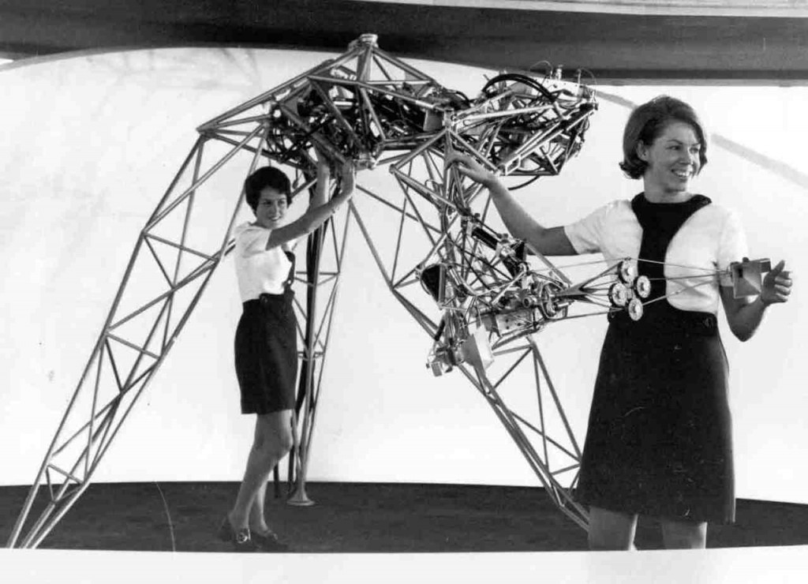
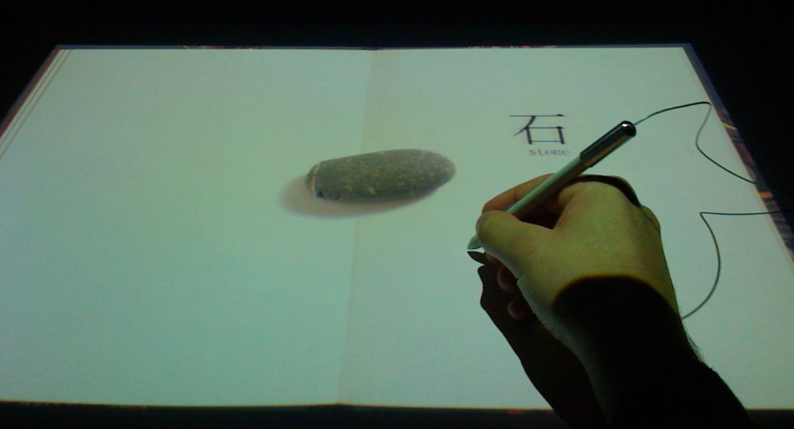
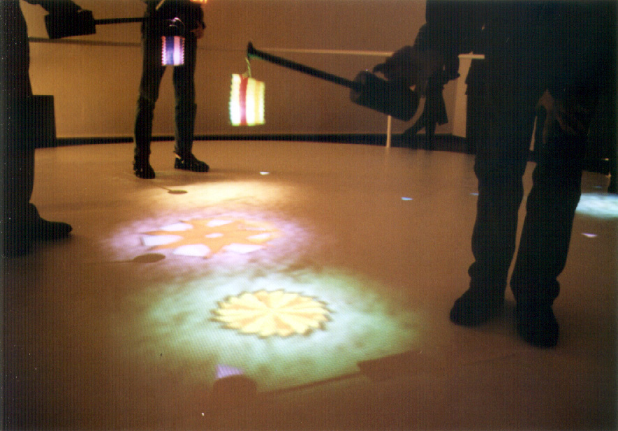
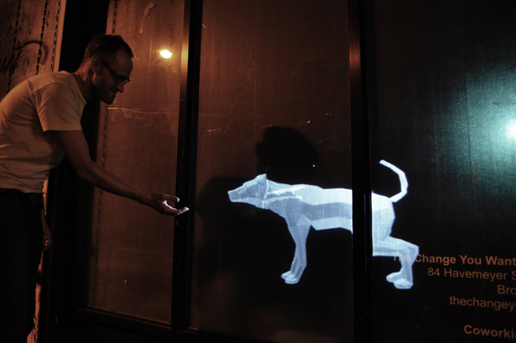

### Introduction

As I write this, at the end of 2010, it is sobering to reflect on the fact that over a couple of decades of explosive development in new media art (or ‘digital multimedia’ as it used to be called), in screen based as well as ‘embodied’ and gesture based interaction, the aesthetics of interaction doesn’t seem to have advanced much. At the same time, interaction schemes and dynamics which were once only known in obscure corners of the world of media art research/creation have found their way into commodities from 3D TV and game platforms (Wii, Kinect) to sophisticated phones (iPhone, Android). While increasingly sophisticated theoretical analyses (from Manovich, 2002 to Chun, 2008 to Hansen, 2006, more recently Stern, 2011 and others) have brought diverse perspectives to bear, I am troubled by the fact that we appear to have advanced little in our ability to qualitatively discuss the characteristics of aesthetically rich interaction and interactivity and the complexities of designing interaction as artistic practice; in ways which can function as a guide to production as well as theoretical discourse. This essay is an attempt at such a conversation. {#para1}

Over the first (roughly) two decades of practice, interactive aesthetic strategies were developed and adapted to the constraints of digital technologies—themselves under rapid development through this period—and substantial technical R+D as well as aesthetic research, was undertaken by artists. In fact, I propose that the reality that technical and aesthetic developments were inseparable was a defining characteristic of the work of that period. Less obviously, digital and interactive practices were (only) slowly assimilated into the corpus of fine-arts practices and cross-fertilised with more traditional aesthetic approaches. {#para2}

Within the context of arts practices, a space for development of interaction less overwhelmed by the instrumental individualistic modalities of interactivity characteristic of the computer industry opened up, informed by generative systems and artificial life and discourses of emergent complexity and self-organisation which link back to cybernetic conceptions of responsive systems. These negotiations were characterised by a not entirely clearly elucidated swing between preoccupation with user subject experience and a (more sculptural?) emphasis on the behaviour of the artefact, which offers less instrumental and more bio-mimetic approaches. [1] {#para3}

The domain of Interactive Art functioned over this period as a space of free invention, an anarchic research realm less application-driven and relatively free of market directives. In this context, in many cases, ideas appear long before they were recognised as research agendas addressed in academic and corporate contexts. In that period, all kinds of experimental interaction modalities were realised by artists—many deploying custom technologies in code and/or hardware. The necessity to develop tools was double edged—on the one hand it permitted an organic development process in which the specifications of the technologies arose from theoretico-aesthetic requirements (and sometimes vice versa). On the other hand, the implicit task of running an engineering R+D lab with limited technical skills and usually very limited budgets was fatiguing. Without recognising these special conditions, it is not possible to grasp the significance of work arising in that period. In some cases, such work remained unknown outside a relatively closed tech-art community, and was independently recreated in other contexts. In other cases, the transfer was more explicit and sometimes it resembled a plundering. We might usefully examine the period to discover the roots of ubiquitous technologies and the motivations for such. Over the last decade, much of the substance of interactive art research has found its way into commercial digital commodities and thereby suffered a confusing erasure of its historico-aesthetic significance. It is an odd feeling to see, in a few short years, systems which were perceive as having rich aesthetico-theoretical presence trivialised as mass produced commodities deployed in a paradigm of vacuous ‘entertainment’. {#para4}

Echoing the fundamental computer science hardware/software binary of computer science, mainstream digital discourses were undergirded by a commitment, stated or unstated, to a dualistic polarisation of materiality and the ‘digital’, especially in the early years. This led to a deep and polarising discursive tension with the embodied and holistic perspectives of traditional fields of practice, rendering one camp ‘luddite’ and the other ‘techno-fetishist’. Recognition of the centrality of the negotiation of materiality and embodiment within digital practices is, in my opinion, fundamental to understanding the history of interactive art, and provides a purchase with which to understand transitions to ubiquity. The advent of cheap, ‘over-the-counter’ technological bundles (microcontrollers, sensors, programming environments…) has made the practice far more amenable to technological novices, and has also created a new set of aesthetico-technological challenges in the sense that these commodity widgets are designed to fit a narrow consumer need and thus have all kinds of decisions built into them (image ‘improving’ algorithms, digital video formats…) that are often difficult to isolate, let alone work-around. One of the happy upshots of the transitions outlined in the points above is the increasing presence of work by a second generation of artists in the field which more fluidly combine, for instance, material aesthetics of (even formalist) sculpture and installation with digital and interactive systems. Some examples of such work are given later in this paper. {#para5}

### Interactivity and the Emergence of Digital Cultural Practices

I identify a two-decade period—roughly speaking 1985-2005—as the pioneering experimental period of (computer based) interactive art. Crucial to the understanding of work in this period is the blindingly rapid development of the technological context. At the beginning of the period the graphical user interface was a novelty, the internet barely existed, the web was a decade away, interactivity was an intriguing concept. The production of acceptably high resolution illusionistic digital pictures (still frames) was an active research area and a megabyte of RAM was something luxurious. {#para6}

The period neatly brackets the emergence of most of the major technological milestones which now undergird digital culture and ubiquitous computing: WYSIWYG, digital multimedia, hypermedia, virtual reality, the internet, the world wide web, digital video, real-time graphics, digital 3D, mobile telephony, GPS, Bluetooth and other mobile and wireless communication systems. It was a period of rapid technological change, euphoria and hype. {#para7}

In what follows I discuss several works of the period which in my mind, stand as markers for significant moments in the development of interactive digital cultural practice. I have chosen these works in part because I have experienced them directly and in most cases, I am privy to both the goals of the artists and the internal workings of the systems. I include three of my own works here, because in developing them I was engaged in the development of ideas and approaches in question, and also because I happen to know intimately the motivations and development of designs and prototypes in these works. [2] {#para8}

There are numerous other works one might usefully discuss. It is a regrettable fact that, due in part to rapid changes in the technologies and the absence of appropriately skilled and resourced staff in appropriately set-up collections, I estimate that 75% of this work built in the last 25 years is lost entirely, and only a very small percentage of it persists in working form. It is sobering to reflect that a photograph 100 years old, if kept dry, is perfectly accessible to view, but the vast majority of commercial digital systems only a decade old are unusable, to say nothing of the many custom systems. [3]Occasionally, a heroic effort is conducted to rescue such work before it decays completely. The exhibition *Eigenwelt der Apparatwelt* by Woody Vasluka for Ars Electronica in 1992 was one such case in which works were rescued from basements and attics and restored. [4] {#para9}

Conspicuously, I here avoid discussion of desktop-based works. My reason for this is principled. It has always been my opinion that such work—whatever its creative and experimental value—on the level of interaction, interface, and physical instantiation, took too much for granted. That is, by willingly adopting the constraints of the commodity desktop interface, assumptions about the nature of interaction which were reified in physical and system architectures were implicitly endorsed and solutions appropriate for sedentary mathematico-symbolic deskwork were uncritically adopted. This, in my opinion, has had the effect of perturbing and constraining creative possibilities in regrettable ways. {#para10}

### Interactive Art before the PC

While the notion of a performative and processual aesthetics of interaction has been bandied about for twenty years or so, looking at interactive art over that period reveals little in the way of development in the formal qualities of interaction per se. The interactional logic captured in Edward Ihnatowicz’ *Senster* of the early 70s remains paradigmatic. [5] *Senster* also neatly framed the agendas of reactive robotics, biomimetic robotics, social robotics, twenty five to thirty years ahead of the institutional curve. Around the time of the *Senster*, Myron Krueger pioneered machine vision-based embodied screenal interaction in several works, the most well-known being *Videoplace* (1975). There is little in the Wii or the Kinect which was not prototyped in the several iterations of *Videoplace* forty years before. [6] {#para11}

In terms of autonomous behavioural repertoire, Grey Walter’s *Turtles* of the late 1940s set a standard for machine behaviour seldom exceeded since. These devices, built with minimal (and by today’s standards, rudimentary) technology, displayed behaviours seen today in artworks and robotic toys. The *turtles* were made not as artworks but as cybernetic experiments into electronic ‘brains’. It is important to recognise that, consistent with the cybernetic context he worked in, the conception of ‘intelligence’ which Walter sought to simulate was thoroughly situated and pre-cognitivist.[7] The complexity of the creative agency of Gordon Pask’s *Musicolor* of the late 1940s is likewise seldom attained (Pask, 1971). The *Turtles* and *Musicolor* were entirely analog, and Senster had the digital processing power, roughly, of an Arduino. {#para12}

These works then, provide a pre-digital or at least pre-consumer-digital reference point for interactive art. It is important to recognise that they arose within the discursive context of cybernetics—as opposed to the cognitivist regime of late C20th computing—and prior to the overwhelming presence of the digital commodity industry. And if this perspective explains to some extent their inventiveness, then we might have to view the last quarter century as a period of increasingly successful attempts at rehabilitation from the disembodying discourses of the cognitivist and the ‘digital’. {#para13}

It has been observed that the advances in Artificial Intelligence over the period of roughly 1965-1985 can be attributed almost entirely to advances in hardware engineering—faster processors and more RAM have permitted larger scale brute force search, etc., as over the period formal procedures and basic techniques did not advance significantly. This assertion seems to have some justification, given that the computer upon which Deep Blue’s chess program ran in 1997 was ten million times faster than the Ferranti Mk1 upon which Dietrich Prinz’s chess program ran in 1951. [8] {#para14}

Could it be that the design and aesthetics of interaction are subject to the same conditions of increase of technical capability without significant development of ideas? The rapid advance in bells and whistles permits interfacial cosmetic niceties undreamable 20 years ago. [9] The techno-fetishism of higher resolutions and faster bit-rates serves the needs of an industry which depends on obsolescence (as perceived or as inbuilt material breakdown) to remain profitable, often deploying novelty to obscure a void of significant advancement. The ‘all the time, everywhere’ catchphrase of pervasive computing (like the prospect of the same trivial and pathetic ‘content’ consuming more bandwidth as HD and 3D television) can be seen as a marketing device for bit-peddlers. Increasingly, physical devices are loss-leader market capture devices, as printers are for ink cartridges. {#para15}

### Grounding Interaction

Having elucidated some of the historical realities of the practice, in this section of the paper I will outline some of the theoretical challenges. The first is also historical and has to do with sites of practice. Much of the work arose in the context of the plastic and visual arts, and as such, a theoretical void was encountered (or, more regrettably, not encountered). That is to say: whatever the theoretical tools available to address matters of form, colour, expression, and embodied sensorial engagement, those traditions had little to say about ongoing dynamic temporal engagement because *traditional art objects do not behave*. Within the traditions of aesthetics of the plastic arts, these are fundamentally novel issues. Recognition of this reality suggests an as-yet incomplete project of identifying prior fields of practice which have some theoretical relevance to this realm. [10] Questions like ‘how does the act of interaction *mean*?’ and ‘how are such valences to be manipulated for enriched affective practice?’ are fundamental questions in the aesthetics of interactive art. {#para16}

Long ago R. Buckminster Fuller (1970) asserted ‘I seem to be a verb’ and this cybernetically inspired locution was itself informed by the doubly continuous nature of the analog electronic signal: as temporally continuous and amenable to infinite resolution. The sentiment expressed by Fuller also informed much of the emerging art practices of that period which emphasised process—performance, site specific art of various kinds, etc. More recently the terms dynamical, processual, procedural, performative, situated, enactive and relational, each in their own milieu, capture the evanescent process of contextualised doing. There appears then to be a groundswell in the theorisation of cultural practices sympathetic with phenomenological approaches, and by extension with emerging post-cognitivist cognitive science. I see this trend here as a critical paradigm shift which has major implications for the theory and practice of interactive art. {#para17}

Being a radically interdisciplinary realm, scientific and humanistic narratives collide in interactive art and the science wars have been a constant backdrop to work and theorisation in the field. Yet to the extent that interaction is an embodied process, neat separations of biology and culture are collapsed. My position here is evolutionary and materialist: interaction makes sense to the extent that it is consistent with or analogous to the learned effects of action in the ‘real world’. Our ability to predict, and find predictable, behaviours of digital systems, is rooted in evolutionary adaptation to embodied experience in the world. We are first and foremost, embodied beings whose sensori-motor acuities have formed around interactions with humans, other living and non-living entities, materiality and gravity. We understand digital environments on the basis of extrapolations upon such bodily experience-based prediction. This is easy to understand in mimetic environments such as *Second Life*, but is equally present in more basic mouse-screen levels of interaction. {#para18}

Our most common interactive modalities subscribe to or enlist assignments or connections which are deeply sensorimotoric in nature, and perhaps draw upon DNA hardcodings. Aside from the trivially Pavlovian modality (press the button and get the reward/food pellet) what are the key interactive modalities in artworks? In installation and robotic work, many examples exploit a zoomorphic ‘puppy paradigm’ of approach and withdrawal, trust and fear. This is always beguiling—for a while. Is the charm of this modality somehow ‘natural’ to us as humans, perhaps hardcoded into our DNA as parenting animals? This question opens a field of inquiry at the intersection of neuroethology and interactive aesthetics. Whatever the case, the next question is how to move aesthetic development of the field beyond this biological or cultural ‘ground zero’. {#para19}

It is a seldom noted corollary to the panegyric around ‘the virtual’, that many interactive art projects focus on the dynamics of embodied interaction (Penny, 2011). This central aspect of human being-in-the-world was conspicuously poorly addressed in conventional sit-at-a-desk computer systems. Because of the sensitivity of artists to persuasive sensorial immediacy and embodied engagement, interactive art practice pioneered research into dimensions of interaction which remained opaque to institutional and commercial labs for many years. In this spirit, one must acknowledge that people making interactive art were doing ‘affective computing’ a decade ahead of academic and industrial recognition of such issues. {#para20}

In the contemporary context, this situation has changed in two ways. Interface technologies are far more diverse, complex and subtle. Not long ago, microphones and cameras were exotic add-ons to computers. The embedded miniaturised accelerometer has become ubiquitous and has contributed to the development of all sorts of gestural and body-dynamic driven applications. [11] And yet, first generation interactive modalities involving pointers and keyboards hang on skeuemorphically. Of all the things I do in my life, only some of them map well onto sitting at a desk in front of a glowing surface, poking at buttons, nor is this situation improved one iota when the context is miniaturised so the buttons are smaller than my fingers and I have to put my reading glasses on to look at the screen. For all the expansion of wireless networks (etc.) we have not progressed very far in interactive modalities. As in AI, advancement in the field can, as often as not, be attributed to advances in hardware. {#para21}

More subtly, the first generation to have lived with digital devices during infancy is now approaching adulthood. This generation acculturated to, for instance, multi-modal on-screen interfaces. These people’s neurology must have, to some extent, formed and developed around such systems. That is, the metaphors and behaviours of digital systems, like any aspect of language and culture inculcated in infancy, have generated isomorphic neurological structures—digital metaphors instantiated at the level of cellular biology. [12] {#para22}

### Who or What Is Interacting? : Analysis of Interactive Systems

Conversations regarding the aesthetics of interaction sometimes take on a weirdly schizophrenic quality due to the fact that some speak from the point of view of user experience and some from the point of view of system design. The question ‘is it interactive?’ can have wildly different answers depending on this point of view. One can maintain, as some do, that viewing a photograph is ‘interactive’. Such positions are clearly nonsensical if one is looking from the perspective of the artefact/system, and are destructive of the goal of building a richer critical discourse about interactive systems. The photograph does not change in any way due to changes in its environment. A human viewer might have varying experiences due to personal associations, varying proximity or lighting conditions, but there is no *interaction* in the sense of an ongoing sequence of mutually determining actions between two systems possessing agency, or as interacting components (user and machine) in the larger user/machine system. The bifurcation in such conversations is whether the critique addresses the experience of the ‘user’ or the behaviour of the system. {#para23}

While there is undoubted value in probing the nature of the interactive aesthetic experience on the part of the subject, study of the design of the system as an armature upon which the experience occurs must provide a necessary complement. Such a design-centric approach engages issues such as designer authoriality and the position of the system as a literature—as discussed by Mateas and as is becoming central in some aspects of software studies (Fuller, 2008). Other (Artificial Life) approaches address the system as quasi-organism, in autopoietic or enactive sensori-motor loops with user(s) (etc.) (Penny, 2010). {#para24}

To focus on the machine, the fundamental requirement of an interactive system is that it correlates in a meaningful way, data gathered about its environment (usually a user’s behaviour) with output. That is, the system must present effects which are perceived by the user as being related to their actions. Without this there is no perception of interactivity. From the perspective of system design, successful interaction comprises two mirrored parts: first, the sensing and interpretation aspects of the system must gather relevant information about the world and interpret it ‘correctly’. Secondly, action of the system must be contrived such that they are perceived to be related to the events in the world which were sensed and interpreted. Meaningful interaction thus requires that several functions be correct and coordinated correctly. Sensors must be chosen correctly and calibrated correctly to capture relevant environmental electro-physical variables and such data must be interpreted correctly. Well-designed associative systems result in the generation or production of output whose content, location and dynamics makes sense to a user as a meaningful correlate of their own behaviour. {#para25}

But this does not mean that only literal or instrumental modalities can be meaningful. Temporal immediacy permits aesthetic deployment of sleight of hand. In the world, if I knock a glass and it falls to the floor splintering, I assume a physical and temporal causality. Assumption of causality based on temporal order can be designed-in and exploited in interaction design. As in film montage, diverse elements and events can be connected by an associative or inferential temporal sequencing. The aesthetic manipulation of temporal process is inherent in interaction. It is worth noting that the verb in ‘interaction design’ (as opposed to chair design or car design) implies process. {#para26}

### Lay and Virtuosic Systems

The distinction between systems designed for untrained public (lay) interaction, and systems designed for use by trained interactors is a technical binary which tacitly characterises interaction design in the fine arts. [13] Because art practice is predicated on public exhibition and an imperative of some degree of public accessibility, and because interfaces are often unfamiliar (not a condition experienced in the closed environments of university and corporate research labs), the task of providing ‘intuitive’ access to unfamiliar modalities was (a usually unremarked) part of the design task of artists. When interactive digital artwork began, there was some focus on celebrating the novelty of digital interaction itself (i.e. mouse-screen coordination and virtual on-screen ‘buttons’) while at the same time constructing an easy way into such interaction paradigms, usually via deployment of objects, images and structures familiar from pre-digital forms. In the early years of interactive art, substantial design effort was required to create a context in which an untrained member of the public might be drawn into a work which was framed and constrained in such a way that they could be expected to do something which wasn’t completely ‘out of the ballpark’, while simultaneously not being tediously instructive and didactic.[14] Within a decade, users had thoroughly acculturated to the screen/keyboard/pointer, desktop paradigm. Since then, interaction design, in the arts and elsewhere, has bifurcated between deploying well known interaction paradigms (which are at this point ‘intuitive’) and the development of novel modalities. In the latter case, artists must engage a meta-design task of introducing the user to the special modalities of the work, without making such introduction itself laborious or instrumental. No one wants to do a tutorial for an artwork. [15] {#para27}

‘Virtuosic systems’ comprise an entirely different category of interactive systems as they are designed for virtuosic performance by a highly trained ‘player’. Such systems are most familiar in the context of music and digital musical instrument design. These systems are often highly idiosyncratic, predicated on a fused trajectory of player training and system development—often the designer/developer is a performer. Such systems re-affirm a conventional binary of (active) performer and (passive) audience, whereas systems for ‘lay’ interaction conflate the roles of performer and observer—the performance is the performer observing herself perform. {#para28}

### Temporality and Poetry in Interaction

The very existence and success of commercial and commodity interactive digital multimedia (and their rhetoric) have, one might suggest, impeded aesthetic progress in the field, because they created confusion between interactivity for instrumental purposes and interactivity for cultural purposes. The interactivity of conventional software tools (say a word processor) should ideally be ‘transparent’ and instrumental. What is meant by ‘transparent’ and ‘intuitive’ in such discourse is that the behaviour of the system is consistent with previously learned bodily realities. A lack of clarity on such issues is typical of the tendency of technical research areas to undertheorise.[16] In Heideggerian terms, instrumental software should be ‘ready-to-hand’. To the extent that it is noticeable, it is bad. This, one might argue, is exactly the opposite of what aesthetic interaction ought to be—it should not be predictably instrumental, but should generate behaviour which exists in the liminal territory between perceived predictability and perceived randomness, a zone of surprise, of poetry. {#para29}

To the extent that every digital interactive event is analogical, interaction is always poetical, and the construction of instrumental systems involves reduction of the poetry quotient. And in many cases, the focus of the artist has been precisely to probe the qualities of this analogising. This is most often obvious in augmented and mixed reality projects where the behaviours in the digitally constructed environment maintain certain consistencies but invert, erase or otherwise distort such correspondences. For instance, user representation may be abstracted (it is already reduced to two dimensions), but temporal correspondences make it abundantly clear what aspects of the image correspond to what body part or gesture. {#para30}

Such correspondences leverage deeply embodied understandings of a sensorimotor nature—specifically the affiliation of proprioceptive and visual feedback. In a way analogous to the example of the Blind Man’s Stick as explored by Merleau-Ponty, Gregory Bateson and more recently Lambros Malafouris, the real-time computer vision representation of the user almost instantly obtains a prosthetic functionality, testifying to the remarkable speed of neurological mapping across modalities (Merleau-Ponty, 1965: 245; Bateson, 1972: 434; Malafouris, 2008). And indeed, without this, we would not be able to drive a car or use a screwdriver. While realtimeness is not easily subtracted from the stick, it was a technical challenge for vision-based work, and as such the symptom acquired a name—latency. The very existence of latency—unavailable in the case of the stick—has led to exploration of the sensorimotor requirements of the perception of realtimeness. The persuasiveness, the plausibility of interaction is intimately temporal, and indeed, sensory modalities have more or less extended conceptions of ‘now’. For instance, ‘immediacy’ (the reciprocal of latency) is much more immediate in hearing than in vision. {#para31}

The question of interaction has cognitive and phenomenological dimensions which have ramifications for the development of adequate aesthetic theory for the practice. In interactive work which arises from a tradition of plastic or visual arts, conventional aesthetic language imposes an axiomatic subject-object distinction upon the artwork/interactor system. This has the effect of obscuring the very (relational) nature of the experience. A distinction must be drawn between two paradigmatic modalities of interaction deployed in cultural practices, which we might identify as ‘instrumental’ and ‘enactive’. The instrumental mode, typified by HTML links and its hypertextual predecessors (all the way back to Hypercard) regards the enaction of a link as simply a way to get from A to B, a connection which ideally is instantaneous and is not marked as an event in itself. A and B are the objects of concern—they are objects, and nothing else is of concern. Effects such as fades or wipes, borrowed from video and cinematic language, tend to be distractions or at best signify a change of temporal or spatial context, register etc. As noted above, Buckminster Fuller’s assertion ‘I seem to be a verb’ was itself informed by the doubly ‘continuous’ nature of the analog electronic signal. Both of these conditions are artificially curtailed by the discrete nature of digital data—a fact which, via rhetoric of object-oriented programming and the like, may have informed the object-centric nature of instrumental interaction. This erasure of temporal process is somehow typical of the ways we tend to explain experience—note the cinema ‘frame’ and its metaphoric extension into analog and digital video realms creates the sense that time is composed of a sequence of stoppages. {#para32}

The lesson of performativity is that the doing of the action by the subject in the context of the work is what constitutes the experience of the work. It is less the destination, or chain of destinations, and more the temporal process which constitutes the experience. To call it ‘content’ would be again to slip into objectivising language. In what follows I will deploy the concept of ‘enactive cognition’ of Varela, Thompson and Rosch (1992) as it captures the ongoing ‘structurally coupled’ nature of experience (as they say) in ‘laying down a path in walking’ and it is precisely this (performative) aspect of the aesthetics of interaction which demands theoretical elaboration. [17] {#para33}

### Interaction: Embodiment, Gesture and Affect

Over the ‘heroic’ period in question, machine vision for interactive artworks was pursued by several artists, with David Rokeby’s *Very Nervous System* being an early case (though Krueger’s *Videoplace* is the true pioneering work). [18] *Very Nervous System*, first shown at Venice Biennale in 1986, responded to the dynamic of user movement with stereo audio. Rokeby notes: {#para34}

> The installation is a complex but quick feedback loop. The feedback is not simply ‘negative’ or ‘positive’, inhibitory or reinforcing; the loop is subject to constant transformation as the elements, human and computer, change in response to each other. The two interpenetrate, until the notion of control is lost and the relationship becomes encounter and involvement… The installation could be described as a sort of instrument that you play with your body but that implies a level of control which I am not particularly interested in. I am interested in creating a complex and resonant relationship between the interactor and the system. [19] {#para35}

The fact that video cameras and real-time video are now a normal part of contemporary computers and gaming systems obscures the fact that into the late 90s, machine vision was regarded as a non-trivial technical research problem. Getting video into a computer in real time required special and expensive peripheral hardware. This makes Rokeby’s achievement all the more remarkable. VNS ran on an Apple IIe, a machine which would have struggled to render a single 640×480 ray traced image in 24 hours. He managed with its tiny processor to do both real-time machine vision and real-time stereo audio output. He achieved this extraordinary result because, in the first instance, his project was concept driven—he knew what he wanted out of the technology and he had an adequately deep understanding of the analog and digital electronics and coding that he was able to pare away unneeded functions. [20]Rokeby’s approach was also ‘dynamical’ and attended to temporal rather than pictorial pattern. While a conventional approach would analyse sequential frames pixel by pixel, laboriously identifying and labelling presumed relevant ‘objects’; with an artist’s education, David recognised both that frame-wise thinking was an impediment and that light values on pixels do not indicate objects in the world in any unproblematic sense. {#para36}

Much of the thinking behind academic and industrial machine vision research still labours under the naïve conception that frames are a fundamental aspect of reality (rather than a skeuemorphic convention) and likewise that ‘lines’ in images can be unproblematically associated with objects or edges in a physical space. Computer science libraries and journals are replete with papers on topics like ‘edge detection’; in some cases the authors seem quite unaware that a video image depends on optics developed in film cameras, and cameras themselves were designed to implement the graphical perspective, a conventionalised geometrical system for representing spatial depth on a plane. [21] {#para37}

David was interested in temporal bodily dynamics and recognised that variation through time was the data that was critical and pictorial resolution was far less important. Colour was therefore dispensable. In fact, David’s 1986 ‘camera’ consisted of 64 cadmium sulphide light dependent resistors in the back of a wooden box, with a plastic Fresnel lens on the front. The resistors, being slow moving devices, effectively damped the system. David in fact summed the voltage values for the resistors, to produce one value per time step, and tracked the pattern of change in the line generated through time. The parsimonious elegance of this solution is characteristic of the technological solutions which technically adept artists of the day were compelled to realise due to the double constraint of the condition of the technology of the day and the limitations of art budgets. VNS is a prime example of what I have referred to previously as ‘machine parsimony’: an ethic of technology design which is elegant and economical—at the cost of being application specific. [22]Such an approach is antithetical to the conventional commitment to ‘generality’ and general-purpose tools, which tends to be profligate in its use of resources, and encourages a plug’n’play approach to coding, which while emulating the look of purist modularity, is antithetical to its spirit. In the context of digital cultural practices, the slippage in computer science discourse around this notion of generality is most unfortunate. While Turing’s mathematical formulation of the ‘general purpose machine’ has undeniable value in its context, the notion has oozed weirdly into other frames of reference. This has as much to do with marketing rhetoric sleight of hand and with economies of scale in the computer industry as it does any principled argument. {#para38}

Around the same time as *VNS*, another Canadian artist (and a teacher of Rokeby) Norman White debuted his *Helpless Robot* (1987).[23] Savagely funny, the *Helpless Robot* has no motive power and its sensor suite is rudimentary. It depends on its verbal persuasiveness to entice humans to do its work for it. As a person is drawn into helping the helpless robot, the device becomes increasingly impolite and abusive, creating a situation from which the humiliated human helper must sheepishly escape. Under the hood, *Helpless Robot* speaks over 500 phrases organised by emotional categories such as boredom, frustration, arrogance, and overstimulation. As such, it is an early example of interactive art practices pre-empting affective computing research which began in institutional contexts a decade later. {#para39}

In 1990, Luc Courschesne developed *Portrait One*, an interactive video portrait.[24] The subject, a young woman, spoke to the user, who responded by selections from multiple choice options on screen via mouse clicks. The system ran under Hypercard on a Mac II which serially drove a 12’ laserdisc player. Computer and video images were overlaid visually in a neatly contrived reflective box—there was no electronic integration of computer and video images. By contemporary standards the technology was vestigial and even by the standards of its day, it was not particularly technically ambitious. The ambition and the success of *Portrait One* was in the realm of simulation of affect. While users of far more technically sophisticated (immersive VR etc.) works came away nonplussed, people came away from *Portrait One* in love. [25] Courschesne achieved with limited means and high aesthetic intelligence what others with far more resources were unable to do. His insights into interactive dramaturgy, narrative construction and simply, the subtleties of acting, drove *Portrait One* and later projects. The work thus offered a poignant implicit critique of more technophilic enterprises.[26] {#para40}

Arising from sculptural and installation sensibilities, my own *Petit Mal*—*an Autonomous Robotic Artwork* (begun in 1992 and first exhibited in 1995) sought to move ‘serious’ interaction off the desktop, out of the shutter-glasses into the physically embodied and social world. [27] I undertook the task of building a robust mobile autonomous machine for cultural purposes. I saw the device, technically, as a vindication of a ‘reactive’ robotics strategy and a critique of conventional AI based robotics, as well as an experiment in artificial sociality. The device behaves robustly with the public (albeit in a constrained environment) continuously for 10-12 hour days. Socially, it elicits play or dancing behaviour in users. Interaction is driven by curiosity and seemingly, a desire to pretend that the thing is cleverer than it is. People willingly and quickly adjust their behaviour and pacing to extract as much action from the device as possible, motivated entirely by pleasure and curiosity. [28]*Petit Mal* implements a non-instrumental kind of ‘play’ which is quite incommensurable with conventional computer game logic. [29] {#para41}

*Beyond Pages* by Masaki Fujihata (1995) was a work which subtly and exquisitely merged the book paradigm with interactive graphics, held together by carefully crafted interaction design supported by not particularly adventurous technologies of the time—data projection from underneath combined with a tracking stylus for interaction.[30] As one drags the stylus across the image of a large book displayed on a projection surface inset into a desk, pages flip. The high-resolution sound samples synchronised with the image contrive the feeling that these are heavy, course pages. On each page an object is depicted, and stylus action moves or changes the object. Propelled by the cursor, a rock shuffles across the page. Large crunchy bites are taken out of an apple by an invisible eater. Japanese characters on the page are voiced. In an elegant set of visual puns, an image of a light switch on the page turns on the (physical) lamp on the desk. A door handle on the page opens the door in the video image projected on the adjacent wall. {#para42}

As noted above, during this period, artists were (necessarily) at pains to demonstrate the new modalities of digital interaction by grafting them on to (representations of) understood artefacts and devices. After twenty years, as often as not, the tables are turned. It is the digital interface to which users are naturalised and the works serve as a window onto a preceding technology. It may not be long before users play with Fujihata’s *Beyond Pages* to get a sense of what books were like. {#para43}

### The Implicit, Enactive, Performative Body

Consistent with its interdisciplinary history, the analysis of interactive art has a strongly dialectical quality. On one hand, a bone-headedly Luddite approach has all but ignored the fact that machine mediated interaction is a novel context, and that without some familiarity with the technology, discussion of the work is superficial. On the other hand, technocentric approaches tend towards instrumentalisation of the user and the trivialisation of precisely the phenomenon which is in need of explication. Ultimately some critical purchase must be made upon the behaviour of the complete (user/machine) system. {#para44}

This difference might be conceptualised in terms of ascribed modalities of meaning construction—is meaning gathered as a result of the extraction of representational tokens, or is it enactively constructed in doing? In his insightful work in this area, Nathaniel Stern (2011) marshals insights from performance studies to formulate a conception of the ‘implicit body’, a Deleuzian ‘body in motion’, as an object through which to discuss interaction. Central to his analysis is an awareness of the dynamical condition of interaction—a perspective I would identify in cognitive terms as ‘enactive’. As an interdisciplinary intervention, projects like Stern’s have the salutary effect of balancing the weight of a technocentric and instrumental approach which often has the effect of rendering the user as a ‘robot’ or a Pavlovian subject, capable of a limited range of behaviours elicited by specific stimuli. Crucial to Stern’s analysis is an understanding of temporally and spatially ongoing embodiment as the locus within which meaning is created. Such a position is in Agre’s (1987) terms ‘deictic’, and in Pickering’s (1995), ‘performative’. This confluence (of Varela and Deleuze, Agre and Pickering—and one might add, Evan Thompson, Ezequial Di Paulo, Bruno Latour, Nathaniel Stern, Karen Barad and others) points to a new ontological perspective from which interaction, and the interactor, can be usefully reformulated.A perspective from which, I would argue, advances in interaction design practice might be made, and indeed, in practice *have been made*, though theoretical analysis has been slow to recognise it. {#para45}

*Fugitive* (Penny, 1997) deployed a custom machine vision system for detecting bodily movement and large gestures of a user in a 10m circular space. [31] This behaviour drove selection of video from a structured database of video and sent it to a motion-controlled video projector which displayed the images in varying locations on the wall of the cylindrical room. My goals in the interaction scheme of *Fugitive* were precisely to resist the tendency toward scopophilic focus on the image, and rather to draw the attention of the user to the temporal continuity of their own embodiment. This was in part motivated by a critique of Virtual Reality. In conventional VR, the disembodied gaze had the ability to ‘move’ on preordained paths within a pre-structured architectonic environment. {#para46}

In *Fugitive*, the subject is the subject. This presented novel design challenges as one had to construct the images and the interaction to counter the normal assumption that when looking at an image, it is the image, rather than the looking, which is important. I made explicit at the time, in *Fugitive*, the continuity which structured the experience was the subjective temporal continuity of the users’ embodiment, or more correctly their kinaesthetic awareness. Virtual ‘worlds’ arose and collapsed on the basis of that continuity. {#para47}

One way of thinking about interactive artworks is that they might provide a context in which engagement with the work constructs a condition which requires further action in order to be resolved; in which artefacts and effects are arrayed spatially and temporally in such a way as to encourage the formulation of novel ideas. The temporality of the process is unavoidable, and its design constitutes a kind of synthetic enactionism. The arrangement of such artefacts and effects in a way that optimally stimulates such processes (bearing in mind questions of demographics and cultures) is then, the cognitive dimension of the task of interaction design for aesthetic purposes. {#para48}

### *Terminal Time* and AI-based Art

In the later 90s an eminently interdisciplinary grouping—Steffi Domike (a documentary filmmaker) Paul Vanouse (a media artist) and Michael Mateas (an AI specialist)—produced a project which, while only marginally ’interactive’ and not exactly adapting to a user in real time, deployed relatively sophisticated AI techniques to build documentary films ‘on demand’ and according to the political profile of the particular audience. [32] In *Terminal Time* the audience was polled in multiple choice form on its positions on various issues regarding technology, religion, science, politics, gender issues (etc.) their response gathered by a simple applause meter (microphone). Based on this data, the system assembled a documentary on the history human civilisation, combined from hundreds of music and film clips and short voice-overs, which was then presented to the audience. *Terminal Time* stands as a witty commentary on contemporary political media—the audience gets the history it deserves. Terminal Time generates as output, a formally conventional linear narrative, it trades in a currency of symbolic tokens, it addresses its multiple audience as a demographic mass and has no concern with the ongoing embodied behaviour of it audience. {#para49}

As experiences, conventional interactive systems tend to fall into two camps—ones that are simple and therefore easy to understand, and which therefore either become familiar and automatic or boring, and others which are so complex as to be baffling and cause all but the most dedicated to fatigue. By ‘conventional’ I mean that the interactions themselves are hardcoded. This is a kind of meta-stability. To move beyond this stalemate, in 1997, I proposed the idea of a dynamical ‘auto-pedagogic interface’—an interface which observed and learned from its user(s) how well they understood the system, and ramped up complexity gradually as a result of constant monitoring. [33] In this context, *Terminal Time* represents a phase shift in the sophistication of strategies of database combinatorics in artworks. To that date, interactive works had usually taken recourse to only the most simplistic of selection procedures (lookup tables, pseudo-random choices). *Terminal Time* deployed a wide palette of sophisticated AI techniques to dynamically construct the work for every iteration. This strategy was based in Mateas’ reflexive view of AI. Consistent with the critique of the time, he rejected the larger project of AI regarding simulation of human intelligence. He insightfully observed that in the context of that discipline, some very intelligent people had developed sophisticated tools for automated reasoning and such tools were ripe for application in interactive art. Mateas (2001) refers to this practice as ‘Expressive AI’. {#para50}

Phenomenologically-based critiques of AI, the elucidation of the frame problem (and the related symbol-grounding problem) and the more recent critiques by Agre have themselves ‘framed’ the domain in which (good old-fashioned) AI can be effective—a domain of logico-mathematical manipulation of symbolic tokens. Philip Agre is so eloquent on this subject that a full quotation is justified (but only on the left): {#para51}

> …the privileged status of mathematical entities in the study of cognition was already central to Descartes’ theory, and for much the same reason: a theory of cognition based on formal reason works best with objects of cognition whose attributes and relationships can be completely characterized in formal terms. Just as Descartes felt that he possessed clear and distinct knowledge of geometric shapes, Newell and Simon’s programs suffered no epistemological gaps or crises in reasoning about the mathematical entities in their domains (1997: 143). [34] {#para52}

AI foundered on extraction of such tokens from the world and the re-connection of the result of such processing with the world. Indeed, even to speak of connection with the world as constituted by input and output is to subscribe the worldview which has been found to be defective. Thus the useful applicability of AI techniques to interactive art and its challenges, as it has been framed here, is limited. Interactive art captures and epitomises many of the contexts in which AI has been troubled—embodied engagement with an explicitly open-ended world of multivalenced cultural properties. Interactive art is the New York of AI—if it can make it there it can make it anywhere. {#para53}

There is a domain of cultural practice where the constraints on AI techniques are not an impediment. On the net, the applied fields of data-mining and machine-learning have demonstrated significant successes. The popular name for autonomous agents in game-worlds is ‘AIs’. It is worth noting why this is. It is because on the net, the processing of the material world into bits has already been done (by people). Everything on the net is pre-digested for CPUs into a numerical value, one just has to find and get it. This relieves such systems of much of the tricky (far more tricky than AI rhetoricians admitted) task of interpretation of sensor data derived from the electro-physical world. {#para54}

Giver of Names (David Rokeby, 1998) presents as novel a reading of artificial intelligence (and especially the area of ‘natural language’ analysis and generation) as VNS did of machine vision. [35] Giver of Names speaks cryptic sentences produced by a metaphorically-linked associative connectionist database of objects, ideas and sensations. The system is seeded by shape and surface recognition information derived from a machine vision system which views (arbitrary) objects placed on a pedestal by visitors. These utterances are fed back in to the system, generating a stream of solipsistic musings which by turns sound poetic, philosophical or like the ravings of an obsessing schizophrenic. Here the preoccupation is not with interactivity, but with the behaviour of a solipsistic self-reflexive autonomous system. {#para55}

### Artificial Life, Autonomous Agents and Virtual Ecologies

Another work which inventively addressed concerns of the period is *El bal de Fanalet/ Lightpools*, by Narcis Pares, Roc Pares and Perry Hoberman (1998). *El bal de Fanalet/ Lightpools* combined multiple spatial tracking and interactive artificial life-based graphics with artefacts derived from Catalan popular culture. [37] *El bal de Fanalet Lightpools* captures three important themes of 90’s interactive art. The first was the articulation of the notion of ‘the virtual’ which was a central term in the discourses of the period, and the exploration of embodied interaction with the ‘virtual’. The second was an exploration of ‘artificial life’, the possibility of implementation of life-like forms and behaviours in computational systems. A third concern for artists working with interactive systems was the limitation of conventional computer platforms and sensor systems to single user application. There was much interest in devising viable multi-user systems which attend to the small and large group social dynamics so important in human interaction. A set of more practical concerns involved how to instrument members of the public so such presentations were viable in public spaces. Extensive ‘suiting-up’ was labour intensive and time consuming and required complex logistics and support. El bal de Fanalet/ Lightpools addressed all these concerns with some elegance. {#para56}

Pares, Pares and Hoberman implemented a world where users could grow virtual organisms which would then interact with users and other entities in the ‘virtual’ realm. Aspects of these modalities were commonly addressed by other artists. Char Davies and Sommerer and Mignonneau come to mind. But *El bal de Fanalet/ Lightpools* is particularly successful in addressing and resolving a combination of these issues. {#para57}

Users wielded a fanalet, an interface device modelled on the eponymous paper lantern used in a traditional Catalan dance festivity. The signification of the lantern was deployed metaphorically to conceptually join the physical world inhabited by the users with the virtual world ‘under the floor’. Here three (at least) separate conceptual realms are joined—the world of the fanalet and the dance, the world of fish etc. in ponds, and the realm of artificial life creatures. The ‘glue’ that held these metaphors together was real time integration of user gesture with projected content. Tight gestural correspondence and control of latency gave actions an immediate sensorimotor veracity. The ‘lamp’ interface device contained a spatial tracker and the tracker localised the area where light would shine from an overhead projector. The virtual realm was ‘exposed’ in the ‘lightpools’ associated with each fanalet, in the way that at night a lantern might illuminate an area of a lake or pond. Movement of the fanalet by the user encouraged movement of the virtual creatures, and new behaviours emerge when users merge their lightpools. Here is a case example of complex interactive metaphors being intelligible by virtue of their relation to real world scenarios and dynamics. The question of how these metaphors can be stretched while remaining coherent is a rich area for cognitive-linguistic research in the field. [38] {#para58}

Works such as *El bal de Fanalet* and *Petit Mal* reflect a general interest among the community at the time in Artificial Life. Alife marked a radical swing in computation and AI circles from symbolic approaches to systems modelled on biology, self-organising and dynamical systems and emergent complex order. Colonial animals—slime molds, sponges, termites, ants and bees—became the poster-children for emergent complex behaviour from simple elements. Cellular automata were seen to model such behaviour computationally. Evolutionary, genetic and ecological metaphors and methods (Holland, 1975; Ray, 1992), neo-neural-net connectionism and Darwinian computational environments (genetic algorithms) demonstrated significant success (Sims), as did bottom-up and reactive robotics (Brooks, 1991; Steels, 1996). In the arts, there was a remarkable flowering of new practices based in these ideas (Penny, 2010). {#para59}

My own work *Sympathetic Sentience* (Penny/Schulte 1996) was inspired by such developments. [39]My goal was to build a minimal physically instantiated system of multiple communicating units which demonstrated emergent complex behaviour. *Sympathetic Sentience* was constituted by twelve independent, more or less identical, wall mounted sound producing devices. These communicated in a serial loop via custom infra-red hardware. Alone, each unit could emit only an occasional chirp, but in a loop, each device voiced a constantly changing but acceptably ordered rhythm and melody. The system on its own generated complex and constantly changing output and was self-stabilising, it possessed a native capacity for quasi-stability—after initial build-up, the chirp/silence ratio stabilised but fluctuated around 50%, it never went silent or fully saturated. (In cybernetic terms it was a homeostat of sorts). The system achieved this result with little but a simple instable pulse generator, an XOR gate and a short time delay in each unit. The system did have minimal, suppressive ‘interactivity’—a user could unknowingly interrupt an IR beam and thus impose a gap or silence in the melodic passage, which would then slowly fill up again. The focal concern was not with human agency, but with the agency, autonomy and creativity of a minimally complex system. {#para60}

A more recent work which combines emotion modelling with embodied interaction is *Sniff* by Karolina Sobecka and Jim George (2009).[40] *Sniff* is member of the Alife genus of on-screen interactive semi-autonomous agents which must count Weizenbaum’s Eliza as their ancestor. *Sniff* is a lively pup, or rather, a behavioural portrait of a lively pup rendered on a large back-projection screen. *Sniff* interacts with visitors via machine-vision based sensing. *Sniff* is rather finely physiologically modelled and 3D animated, but in a deft artistic touch, *Sniff* eschews the baroquity of texture maps and synthetic fur and is presented as a fine-resolution polygonal model in white lines, in a featureless black space. The contrast between the verisimilitude of *Sniff’s* behaviour and the abstraction of its visual representation heightens the persuasiveness of its physiological and behavioural modelling. Sniff is a rather subtle canine behaviour-portrait, it will identify with one of several visitors a primary interactor, and has a sophisticated behavioural memory. {#para61}

*Performative Ecologies* by Ruairi Glynn (2008) is a more abstractly mechanical work which attempts to realise embodied agents which learn from their environment and improve their behaviour. It consists of three identical, exhibitionistic and somewhat insecure motorised sculptures which dance for their supper, as it were. Each has a tail part—a motorised illuminated rod which it can turn and light up variously, and a head part, an infra-red video camera on a motorised neck. When functioning as designed, each unit identifies a visitor using face recognition software, and performs a dance for her with its tail, all the while monitoring the attentiveness of the visitor, using gaze tracking. The longer the visitor attends, the better the dance scores. Later, using genetic algorithms, these devices develop new dances from the best scoring previous dances, to be tried out on the next day’s visitors. In a limited way, these devices move beyond the ‘look-up table’ paradigm of interaction where all behavioural possibilities are pre-scripted, to a mode which can truly produce novelty or surprise. [41] {#para62}

### The Role of Epistemic or Performative Action in Interaction

A work of very different scale and historical reach is Rafael Lozano Hemmer’s *Displaced Emperors* (1997), a part of his ‘relational architecture’ series of works.[42]The projection installation took place on the multi-storey exterior of a Hapsburg villa in Linz, Austria. A user, equipped with a custom triangulating sonar tracker on the back of her hand, makes a waving gesture in the direction of the castle, and the image of a giant hand moved across the façade. Using synchronised image projections, this waving appeared to wipe the exterior facade of the building away, revealing period interior rooms. These room views were in fact taken in the Chapultepec Palace in Mexico City, the residence of the short-lived Mexican Hapsburg dynasty. The waving/wiping gesture collapsed one physical location onto another, and directly—via the immediacy of sensori-motricity—induced reflection of the historical peculiarities of the colonial period. {#para63}

We should make a distinction between interface and interaction modalities which are deployed as a mechanism for exploring ‘content’, and modalities which themselves contribute to the accumulated meaning or experience of the work. As discussed above, in some interactive work, interactive modalities are taken as transparent and given: the dynamics of interaction were conceived as a means to an end which was primarily found in the ‘content’ of the work (as if interaction dynamics were not always part of the ‘performative’ content). In other cases, such as *Displaced Emperors*, the dynamics of interaction play a key role in the overall construction of meaning. We might suggest that content-centric interactives are retrogressive, and simply articulate the representational idiom of painting, film and video, while works in which the dynamics of interaction are themselves the ‘content’ of the work occupy a more progressive position. {#para64}

The recognition that the process of interaction is both embodied and quintessentially performative provides a position from which to build out an aesthetic theory. Andrew Pickering’s (1995) formulation that the representational and performative idioms are distinct and perhaps incommensurable is relevant. Originally applied to questions of scientific knowledge and practice, this binary is ripe for application to arts practices, for conventional plastic arts artefacts are representational artefacts par-excellence. I want to assert that interactive cultural practices, while deploying representational components, prescribe a performative ontology—some more than others. Again—to the extent that the mechanisms of interaction are naturalised, automatic, ‘intuitive’, ready-to-hand—they do not play a significant part in the epistemological circuit of the work. But to the extent that I have to bend this way, climb that ladder, or stand with my feet in cold water, the doing of the work, the embodied and performative dimensions are and must be designed as (often major) components in the overall meaning of the work. Extensive work remains to be done in assessing *how* interactions mean. Here the distributed cognition research of Edwin Hutchins (2006) and David Kirsh and Paul Maglio (1994) offer ways in to this inquiry, as both researchers are concerned with how bodily action plays a role in cognitive processes involving manipulation of artefacts and exploitation of images. {#para65}

Building such meaning has several aspects. Making a user complicit in the construction of an unfolding experience is a powerful technique for establishing engagement and commitment. If seeing a video in which a person is pushed off a balcony is disturbing, pushing them yourself—or being put in the position of choosing to—is an order of magnitude more so. (Unless of course such action is routinely trivialised, as in first person shooter games). Aside from ethical issues, basic sensorimotor realities anchor the actions of interaction in a way that dissociated contemplative vision can never achieve—if indeed it were possible. As embodied beings, we conduct our path through the world in the form of sensorimotor circuits which have no beginning or end. Contrary to received wisdom, humans rarely perceive then act, but understand the world in a synaesthetic and proprioceptive fusion of sensing and action, often acting to perceive the action to calibrate the action. An aesthetic theory of interaction, then, must include a choreographic understanding of user action. {#para66}

It is not just doing, not just the awareness of doing, but the cognitive dimensions of doing which are important dimensions of interaction design. Kirsh and Maglio (1994) demonstrated a phenomenon they call ‘epistemic action’. Epistemic action describes the gathering of knowledge through action in the world. That is, certain kind of things can only be thought, or can be thought faster, more efficiently or more richly, by the manipulation of objects in the material world. Doing math on paper is an example which trades in symbolic notional systems, moving the scrabble letters about to suggest words is somewhat more materialised. An array of utensils and ingredients on a kitchen bench might suggest action, the shape of the knife facilitates certain kinds of actions (and not others), but does the arrangement and design of implements support mental computation? Kirsh and Maglio’s Tetris research addresses time constrained problem-solving. The challenge of applying such models to interactive art practice is that only the most tedious kinds of interactive art, and only the most tedious approaches to interactive art, treat it as a puzzle-solving task. In more exemplary cases, the conditions are set for an inquiry whose outcome, while framed, is open-ended and designed to be generative, allowing the possibility of hypothesis formulation, rather than simply resolution. Cognitive science, with its quantitative scientific roots, has understandably shied away from such questions, seeing them as out-of-ballpark. This is one of the ways in which scientifically based practices find unresolvable discontinuities in the arts. {#para67}

Similarly, I have several times been asked by HCI professionals if I have undertaken user-studies of my works, and the question has always seemed absurd. The idea that the ‘outcome’ of the experience is not proscribed is fundamental to the rationale of the practice. It would be an amusing dinner party game to design such a questionnaire. ‘On a scale of 1-10, rate your surprise’ … ‘How satisfactorily did the work challenge your unquestioned assumptions?’… ‘What did it make you think about that you had not expected to think about?’ Would it be possible to analyse epistemic action in the domain of interactive art, where the task might be formulated not so much as getting the right answer, but asking the right question? {#para68}

### Becoming Becoming

Through this essay, I have argued in various ways for the relevance of the processual in thinking about interaction. I noted that such sensibilities underlay much 60s art, and played a role in the design discourse of that techno-guru of the period Buckminster Fuller. Here again we might observe the prescient but inchoate way these ideas come up first in the arts. Yet how can a felt embodied idea be anything but inchoate, without the development of a discursive skin? In their day, works like *Senster* and *Videoplace* could not be appreciated for want of a discursive context, so likewise it has been with ‘process’ in general. {#para69}

In the years since, such a discursive skin has indeed begun to surface, in patches as it were. In Artificial Intelligence, Agre and Chapman (1987) proposed Deictic programming which contested the objectivist ‘gods eye view’ assumptions of conventional AI. Situated and reactive robotics (Brooks, 1991) were similarly inclined as were discourses of ‘emergence’ and iterative processes in Artificial Life, Self Organisation and Dynamical Systems Theory (Kelso, 1995). In cognitive science, Enactivism, situated and distributed cognition challenges cognitivist attitudes. [43] In the humanities, the rise of performance theory (in some forms) contests the excesses of the linguistic turn. In science studies, Actor Network Theory and Pickering’s Mangle both destabilise conventional objectivist science discourses. In art theory, we saw the rise of relational aesthetics, and in philosophy, a resurgence of interest in Spinoza and Bergson, brokered by Deleuze (2001) and later Massumi (2002), and a resurgence of pragmatism (James, 1907; Dewey, 2005). This is quite a patchwork, and some of the pieces might feel a little strained. But across diverse fields in the late twentieth century, such approaches have lurked on the margins of positivist disciplinary discourses. To go beyond a call for the recognition of the fundamentally embodied and distributed nature of cognition, the upwelling of arguments (in such diverse fields as feminisms, performance studies, science studies, and cognitive and neurosciences) which contest presumed axiomatic binaries of subject/object, world/representation suggests a fundamental and large scale change in ontology which one might be excused for identifying as a paradigm shift. {#para70}

Contemporary cognitive science, informed in part by Heidegger, Husserl and Merleau-Ponty, has brought into question not only cognitivist representationalism, but the fundamentally Cartesian binaries of mind/body, self/world and subject/object. The deep ontological ramifications of all this is captured with some precision by Karen Barad (2007), in which she argues that the very construction of subject and object are historically contingent, and proceeds to propose a radically materialist and performative ontology which sees ‘phenomena’ as primary and subjects and objects contingently forming or falling out of a process of ‘intra-action’. Such an approach would be consistent with the performative ontology of Pickering, the ‘laying down a path in walking’ of Enactivism and the ‘ongoingness’ of O’Reagan and Noë (2001). *This ontological reformulation has direct relevance to the theorisation of, and the creation of, interactive artefacts.* {#para71}

In Rafael Lozano Hemmer’s *Displaced Emperors* the gesture of the swipe of an outstretched hand wipes the façade off the palace, revealing (images of) the rooms inside. The façade, in both a real and metaphorical sense, is destroyed, performatively implicating the user in a violent act. The user, standing in front of the imposing edifice, makes a grand gesture. They could make a wriggle or a flick, but they tend to make an expansive full arm gesture. How such a style of gesture is implied or specified is a mysterious aspect of the design of the scenario—but it happens. And the value of that gesture—grand and empowered, is an integral part of the experience. Perhaps the gesture is implied by the immediately prosthetic sensori-motor linkage of the gesture with an image of a (giant) hand, which strokes the surface of the façade as a shadow would. The embodied sensorimotor understanding of the movement of my shadow as action at a distance is exploited here. The strength and scale of the arm is amplified, as with a sword or a staff, and this powerful force-amplified prosthetic arm wipes the masonry of the façade away—at least it appears that way, sans the noise and rubble and dust. Here then, embodied and gestural engagement constitutes something like epistemic action—but in the process, nothing is resolved. Through enactive or performative action the user is immersed in a context loaded with the paradoxes of colonialism. {#para72}

### Autistic and Solipsistic Machines

In recent years a new class of devices has arisen which offer a perversely witty response to the preoccupation with the user. These works possess complex behaviour and are so autonomous as to have no connection with human viewers. In such works, the visitor engages in a conventional mode of passive observation of an autonomous machine negotiating its environment. The biological or ecological implications suggest a kind of synthetic ethology. Two recent works exhibit a resurgence of a minimalist/formalist sculptural aesthetic. They also have in common a commitment to materiality and to integrating electro-physical realities as part of the larger computational a system. That is, the elegance of their formalism has extended into the machinic/performative dimension of their existence. {#para73}

*Der Zermesser* by Leonhard Peschta (2007) is a large but minimal geometrical robot which engages in a sensitive relation with architectural space, expressing its response as perturbations of its tetrahedral form.[44]One might call it ‘architaxis’. Each node is instrumented and motorised such that it can both move and adjust the lengths of is vertices. Der Zermesser works on a slow, non-human timescale, like a mollusc on a rock. This work is exemplary of a long-delayed reunion of aesthetic systems of conventional plastic arts with interactive art. The geometric minimalism of *Der Zermesser* recalls formalist sculpture, that epitome of modernism, and indeed, it could be said to implement formalist aesthetics as a machine, in the same way that computer hardware implements Boolean algebra. And certainly the formalisms of coding and computer engineering do have immediate sympathies with the modes and methods of formalist sculpture. The formal coherence and elegance of *Der Zermesser* is carried through to its electronic aspects—the geometrical nodes are also motor, sensory and computational nodes. The tetrahedron, the first platonic solid, the strongest polyhedron, is an icon of engineering efficiency, and is also manifested in a myriad of biological forms, evidence of the effectiveness of evolutionary design. *Der Zermesser* captures this duplicity as an adaptive geometry. {#para74}

*The Conversation*, by Ralf Baeker (2010) is a self-referential and homeostatic colonial machine—a model of a colonial organism rendered in electro-physical machines. [45] *The Conversation* is a closed-loop computational system combining electro-mechanical, analog and digital electronic components, presented in an elegant and minimal sculptural form—a ring made up of a 99 solenoids. The solenoids pull on wires connected to three concentric rubber rings in the centre of the device. With a machine parsimony based in an understanding of electro-physical phenomena, Baeker monitors fluctuations in the magnetic pull of the solenoids via their current consumption (where others might have added an array of sensors). A floating metal ring—a platonic apparition, paradoxically pulsates with the vibrancy of the living. If the metal ring is the cell wall, the three fluctuating red rubber rings define the nucleus, with radiating strings relaying tensions back and forth between the two. Crucially, the physical system is not ‘driven’ by code, but in dynamical and cybernetic sensibility, the moment by moment condition of the material array drives resonating cycles of oscillations and dampings within the system. {#para75}

### Conclusion

The general historical picture I hope to have drawn here places the development of an aesthetics of interaction within a developing technological context. During the ‘heroic period’ of interactive art, big questions such as: ‘how can we deploy computational capability in artworks?’ and ‘how can we integrate computation with material, sensorially immediate practices?’ motivated work. The technological challenges of interaction, like the other technical challenges of the 90s—problems of wireless communication, computer graphics and of machine vision—are now effectively resolved. Culturally, the novelty of the scenario of the machine which responds to a user in real-time has clearly worn off. In digital cultural practices, exploration of the modalities of interaction has been fairly thorough, though there is always room for inventive exploration of the subtle complexities of the poetics or aesthetics of interaction. In my opinion, future development of the aesthetics of interaction might usefully be framed as three areas of concern: the material artefact, the code/machine system, and the dynamics of interaction. {#para76}

For two decades, the computational has been more or less ‘pasted on’ to artefacts and social structures. And with the technology, the rhetoric of cognitivist computation has also usually been more or less uncritically pasted on. Works like *Giver of Names*, *Der Zermesser*, and *The Conversation*, demonstrate an integration of sculptural and embodied dimensions with a sensorial and performative orientation to coding, into a coherent aesthetic and theoretical approach (we heave a sigh of relief and whisper ‘at last!’). In their integration of materiality and computation, these works reject a dualist computationalist separation of software and hardware, information and matter, control and action. For me this signals a new maturity in the cultural and theoretical grounding of work of this kind, where ‘interactivity’ is subsumed into a wider field of autonomous machine behaviour. As I have proposed elsewhere, in our current era of ubiquitous computation, the universe of live data which was once called ‘the virtual’ is increasingly anchored into physical and social context via a diversity of digital commodities. The technologies, techno-social structures and modalities of interaction which permit this (re)union were workshopped and prototyped in ‘media arts’ research and elsewhere over the past quarter century. {#para77}

A second generation of practitioners naturalised to the digital are pursuing a more organic interrelation between machine behaviour and sensoriality/materiality than their forbears could, in part due to technological developments but also due to a maturation of the fine arts context. Meantime, an increasingly code and hardware-literate community of artists are able to deploy more sophisticated aesthetic code-machines. A deepening and theoretically substantiated conception of interaction and enactive cognitive process inhering in a performative ontology promises more rich and subtle systems. And lastly, the conception of ‘interaction’ has been expanded beyond user-machine, to larger ideas of behaviour between machines and machine systems, and between machine systems and the world. This leads to a kind of machinic ecology, and potential useful application of actor network theory. {#para78}

I have proposed that across a diverse range of disciplines, we are on the cusp of a veritable Kuhnian paradigm shift toward a performative ontology. Such moments are, in the terms of Hakim Bey and Peter Lambourne Wilson, truly ‘temporary autonomous zones’ (Bey, 1991) and open up temporarily at moment of flux. Like all good technical ideas, it has a heady whiff of metaphysical liberation about its tattered edges. Over the last fifty years or so, such shifts have appeared (on the horizon so to speak) only—mirage-like—to evanesce. For example, it is salutary to note how aspects of the cybernetics which could be recuperated to the positivist establishment lived on, control theory being a case in point. In any case, in such a Kuhnian shift, the intractable is rendered trivial by an orthogonalising shift of perspective. In my opinion, the practice and performance of interactive art itself is an integral part of that ontological shift, and that shift offers leverage on theoretical questions which have seemed vexing under previous theoretical approaches. {#para79}

### Biographical Note

Simon Penny is Professor of Arts and Engineering at University of California Irvine. His practice has included artistic practice, technical research, theoretical writing, pedagogy, and institution building in Digital Cultural Practices, Embodied Interaction, and Interactive Art. He makes interactive and robotic installations utilising novel sensor arrays and custom machine vision systems which address critical issues arising around enactive and embodied interaction, informed by traditions of practice in the arts including sculpture, video-art, installation, and performance; and by ethology, cognitive science, phenomenology, human-computer interaction, ubiquitous computing, robotics, critical theory, cultural studies, media studies, and Science and Technology Studies.

### Notes

[1] I have explored related themes in two recent papers: ‘Trying to be Calm,’ and ‘Desire for Virtual Space’ (2012, 2011). The current paper addresses related issues across the same time period. As such the three might be usefully read together.

[2] Discussion of these works can be found at www.simonpenny.net (works).

[3] This technological obsolescence is a profound impediment to pedagogy and historical research. It is a regrettable fact that much contemporary media art history and theory discusses works which the authors themselves have not actually experienced, and often relies on poor documentation and/or other textual accounts. This situation would be regarded as intolerably unscholarly in conventional art history. Imagine the contempt an art historian would be held in if they presumed to write on, say, the ceiling of the Sistine chapel without having actually seen it. So much worse then, is relying on photographs (!) of a work which was originally dynamic and multi-media.

[4] *Eigenwelt der Apparatwelt*, Pioneers of Electronic Art, Ars Electronica 1992 exhibition catalogue, 1992.

[5] See https://www.senster.com/

[6] See https://www.youtube.com/watch?v=dqZyZrN3Pl0

[7] See https://www.youtube.com/watch?v=lLULRlmXkKo (Quaint BBC coverage)

[8]Dietrich Prinz wrote the first chess playing program for a general purpose computer. The program first ran in November 1951 on the Manchester Ferranti. Prinz was the head of programming at Ferranti.

[9] Steve Wozniak recently commented when asked if, in the late 80s, he foresaw internet porn, that the early Apples did not have enough memory to render a (colour) image, to say nothing of real-time video streams. (Radio interview on ‘Wait, wait, don’t tell me’, December 2010, personal notes)

[10] See my forthcoming essay: ‘Emergence, Improvisation, Interaction’, Lewis and Piekut (eds) *Oxford Handbook of Improvisation Studies*.

[11] Likewise, sophisticated machine vision procedures, such as ‘body-segmentation’—the nerdy moniker for inferring skeletal anatomy from single or multiple images—which were non trivial and cutting-edge technical problems circa 2005, are now part of commodity devices, i.e. the Kinect.

[12]As far as I am aware, this assertion remains speculative. Given the extensive evidence in developmental neurology for similar neurological adaptation, I am persuaded by this idea. As we move into the generations of those ‘born digital’ there is a call for neurophysiological research into structural and behavioural differences between those naturalised to digitality and those who came to digital systems later in life.

[13]As indicated, I am here focusing my attention upon interaction design in the fine arts, and referring to practices which extend beyond the desktop or hand held device. I am well aware of the rich complexities of the domain specific interaction modalities in networked interactions from virtual communities (Second Life) to massively multi user gaming (World of Warcraft) to dimensions of social media from Facebook to Twitter, but these are beyond the scope of the current text.

[14]Stories of such unfamiliarity from the early 90s are common, such as that of the young woman driven to tears by the computer mouse. She had reasoned, perfectly reasonably, that the mouse should ‘face’ the screen, i.e. with the ‘tail’ toward her, which inverted all her actions with respect to cursor movement.

[15]I use the term ‘user’ here (grudgingly) and in what follows to refer to anyone interacting with an interactive artwork. Many including myself have deplored (the instrumentality of) the term, and have sought alternatives and coined neologisms, but alternatives have been clunky and have not achieved general acceptance.

[16] See Agre (1997). A more subtle point is that to the extent that such modalities are intuitive in this sense, neurological impact will be minimal. But as digital behaviours themselves become ‘naturalised’ at the level of culture and of embodied cognition, we will see a drift in what is taken to be ‘intuitive’.

[17] This phrase is the title of chapter 11 of *The Embodied Mind: Cognitive Science and Human Experience* by Francisco J. Varela, Evan Thompson, Eleanor Rosch (MIT press, 1992) The authors note ‘Our guiding metaphor is that a path exists only in walking…’ (241). The term has been taken up in aspects of contemporary cognitive science and Philosophy of mind, notably the work of Kevin O’Regan and Alva Noë (2001).

[18] See https://www.youtube.com/watch?v=GALMmVZ49Pc

[19] See https://homepage.mac.com/davidrokeby/vns.html

[20] In computer science and engineering circles, the idea of generality or general applicability is a cardinal virtue. This ethos can lead to systems which do many things badly and nothing well. The approach of many artists (including Rokeby) is to achieve a specific goal with quality and elegance. An approach which is fundamentally pataphysical. ‘Pataphysics will be, above all, the science of the particular, despite the common opinion that the only science is that of the general’. Alfred Jarry

[21] The geometrical basis of perspective was laid by the Arab mathematician Alhazen (al-Hasan Ibn al-Haytham) in 1021. There is nothing ‘natural’ about perspective, it is not the ‘true’ way to represent the world, and it is not an integral biological aspect of human vision.

[22] I developed the concept of ‘machine parsimony’ in the mid 90s to describe this kind of ‘application specific’ development which did not subscribe to the requirement for generality.

[23]See https://www.year01.com/helpless/statement.html

[24] See https://www.medienkunstnetz.de/works/portrait-one/

[25] I witnessed this at SIGGRAPH91 in Las Vegas.

[26] It is no accident that these three pioneering works all arose in Canada. Canada was remarkably proactive in funding and otherwise supporting ‘media-art’ research in the period and in the small international community of interactive art—Canadian artists (etc) were ubiquitous and recognised as doing generally progressive advanced work.

[27] See https://www.simonpenny.net (works—petit mal).

[28]Interestingly, the only demographic who were unwilling to interact were adolescents.

[29] The conception of ‘play’ as encapsulated in typical computer games is a decidedly narrow slice of modes of play and has an instrumental cast to it. When, for instance, the paradigmatic ‘first person shooter’ is stripped of its colourful monsters and futuristic weapons, computer game-play resembles the worst qualities of industrialised labour: constrained and highly repetitive tasks executed in social isolation, a tight harnessing of user and machine, rewards linked to high rates of production, to say nothing of the covert inculcation of military skills.

[30]See https://www.iamas.ac.jp/interaction/i97/artist_Fujihata.html, https://www.youtube.com/watch?v=6Ek2DW7aV68

[31] See https://www.simonpenny.net/works/fugitive.html, https://www.simonpenny.net/works/fugitive2.html

[32]*Terminal Time* https://www.terminaltime.com/

[33]See my ‘Agents as Artworks and Agent Design as Artistic Practice’ (1999). This kind of adaptive technology harks back to cybernetic precepts but has rarely been pursued in artwork. A work which has pursued this to some extent is *Performative Ecologies* by Ruari Glynn (2008) (discussed below).

[34] Agre’s remarkable paper is the most insightful inquiry into the culture of AI I know of.

[35] See https://homepage.mac.com/davidrokeby/gon.html

[36]See https://www.galeriavirtual.org/varis/lightpools.ogg

[37]*El bal de Fanalet/ Lightpools* used the GAMS triangulating sonar sensor developed by Will Bauer and Rafael Lozano-Hemmer, also deployed in *Displaced Emperors* (Lozano-Hemmer, 1997).

[38] See for instance the work on concept blending by and Fauconnier and Turner (2008).

[39]See https://www.simonpenny.net/works/sympathetic.html, https://www.simonpenny.net/works/sympatheticII.html

[40] See https://vimeo.com/6400266

[41]*Sniff* and *Performative Ecologies* were included in Emergence, a show of Artificial Life Art curated by Simon Penny and David Familian at the Beall Center for Art and Technology, University of California Irvine, December 2009 – April 2010. Regrettably *Performative Ecologies* did not function as designed during the exhibition.

[42]See https://www.lozano-hemmer.com/displaced_emperors.php

[43] Enactivism, situated and distributed cognition are three major variants of post cognitivist cognitive science.

[44] See https://www.youtube.com/watch?v=2kRuxutzluE

[45] See https://www.no-surprises.de/the_conversation

### References

- Agre, Philip. ‘Towards a Critical Technical Practice: Lessons Learned in Trying to Reform AI’, Geoffrey C. Bowker et al. (ed.), *Social Science, Technical Systems, and Cooperative Work : Beyond the Great Divide* (Mahwah, N.J.: Lawrence Erlbaum Associates, 1997).

- Agre, P.E. and D. Chapman. ‘Pengi: An implementation of a theory of activity’, *Proc., AAAI-87* (Seattle, WA, 1987): 268-272.

- Barad, Karen. *Meeting the Universe Halfway: Quantum Physics and the Entanglement of Matter and Meaning* (Duke University Press Books, 2007).

- Bateson, Gregory. *Steps to an Ecology of Mind* (University of Chicago Press, 1972).

- Bey, Hakim. *T.A.Z. the Temporary Autonomous Zone, Ontological Anarchy, Poetic Terrorism* (San Francisco: Autonomedia, 1991).

- Brooks, Rodney. ‘A Robust Layered Control System for a Mobile Robot’, A.I. Memo No. 864, Massachusetts Institute of Technology, Artificial Intelligence Laboratory, September (1985).

- —. ‘Intelligence without Reason’, A.I. Memo No. 1293, Massachusetts Institute of Technology. Artificial Intelligence Laboratory, April (1991).

- —. ‘Elephants Don’t Play Chess’ *Robotics and Autonomous Systems* 6 (1990): 3–15.

- Deleuze, Gilles. *Spinoza: Practical Philosophy* (San Francisco: City Lights, 2001)

- Dreyfus, Hubert L. *What Computers Still Can’t Do: A Critique of Artificial Reason* (Cambridge, Mass.: MIT Press, 1992).

- Chun, Wendy Hui-Kyong. *Control and Freedom: Power and Paranoia in the Age of Fiber Optics* (Cambridge, MA: MIT Press, 2008).

- Dewey, John *. Art as Experience* (New York: Perigee Trade, 2005).

- Di Paolo, Ezequiel. A. ‘Extended life’, *Topoi* 28 (2009): 9-21.

- Fauconnier ,Gilles and Mark Turner. ‘Rethinking Metaphor’, *Cambridge Handbook of Metaphor and Thought* (New York: Cambridge University Press, 2008): 53-66.

- Fuller. R. Buckminster. *I Seem to Be a Verb: Environment and Man’s Future* (New York: Bantam Books, 1970).

- Fuller, Matthew (ed.). *Software Studies – A Lexicon* (Cambridge, Mass.: MIT Press, 2008).

- Hansen, Mark B. N. *New Philosophy for New Media* (Cambridge, MA: MIT Press, 2006).

- Holland, John. *Adaptation in Natural and Artificial Systems* (Michigan: University of Michigan Press, 1975).

- Hutchins, Edwin. ‘Imagining the Cognitive Life of Things’, Lambros Malafouris and Colin Renfrew (eds), *The Cognitive Life of Things: Recasting Boundaries of the Mind* (2006): 7-9.

-

- James William. *Pragmatism: A new name for some old ways of thinking* (New York: Longmans, Green and Company, 1907).

- Kelso, J.A. Scott. *Dynamic Patterns: The Self-Organization of Brain and Behavior* (Cambridge, Mass.: MIT Press, 1995).

- Kirsh, David and Paul Maglio. ‘On Distinguishing Epistemic from Pragmatic Actions’ *Cognitive Science* 18 (1994): 513-549.

- Latour, Bruno. *Reassembling the Social: An Introduction to Actor-Network-Theory* (Oxford: Oxford University Press, 2007).

- Malafouris, Lambros. ‘Beads for a Plastic Mind: the ‘Blind Man’s Stick. (BMS) Hypothesis and the Active Nature of Material Culture’, *Camb. Archaeol. J.* 18.3 (2008): 401-414.

- Manovich, Lev. *The Language of New Media* (Cambridge, MA: MIT Press/Leonardo Books, 2002).

- Massumi, Brian. *Parables for the Virtual: Movement, Affect, Sensation* (Durham: Duke University, 2002)

- Mateas, Michael. ‘Expressive AI: A hybrid art and science practice’, *Leonardo: Journal of the International Society for Arts, Sciences and Technology* 34.2 (2001): 147-153.

- Merleau-Ponty, Maurice. *Phenomenology of Perception* (New York: Routledge and Kegan Paul, 1965).

- O’Reagan, J Kevin, and Alva Noë. ‘A Sensorimotor Account of Vision and Consciousness’ *Behavioral and Brain Sciences* 24 (2001): 939–1031.

- Pask, Gordon. ‘A Comment, A Case History and a Plan’, J.Reichart (ed.) *Cybernetics, Art and Ideas* (London: Studio Vista, 1971): 76-99.

- Penny, Simon. ‘Trying to be Calm: Ubiquity, Cognitivism, and Embodiment’, Ulrik Ekman (ed.) *Throughout* (Cambridge, Mass.: MIT Press, forthcoming 2012).

- —. ‘Agents as Artworks and Agent Design as Artistic Practice’, Kerstin Dautenhahn (ed.) *Human Cognition and Social Agent Technology* (Amsterdam: John Benjamins Publishing Company, 1999): 395-414.

- —. ‘Twenty Years of Artificial Life’, *Digital Creativity* 21.3 (2010): 197-204.

- —. ‘Desire for Virtual Space : The Technological Imaginary in 90s Media Art’, *Space and Desire. Scenographic Strategies in Theatre, Art and Media (*Zürich *:* Zurich University of the Arts, 2011).

- Pickering, Andrew. *The Mangle of Practice: Time, Agency, and Science* (Chicago: University of Chicago Press, 1995).

- Ray, Thomas S. ‘Evolution, ecology and optimization of digital organisms’, Santa Fe Institute working paper 92-08-042 (1992).

- Stern, Nathaniel. ‘The Implicit Body as Performance: Analyzing Interactive Art’, *Leonardo* 44.3 (2011): 233-238.

- Steels, Luc. ‘Perceptually Grounded Meaning Creation’. in Tokoro, M., (ed.), *ICMAS96*, AAAI Press (1996).

- Steels, Luc and Brooks, Rodney. *The artificial life route to artificial intelligence: Building Situated Embodied Agents* (New Haven: Lawrence Erlbaum Ass, 1994).

- Thompson, Evan. *Mind in Life: Biology, Phenomenology, and the Sciences of Mind*

- (Harvard: Belknap Press of Harvard University Press, 2010).

- Varela, Francisco, Evan Thompson, Eleanor Rosch *. Embodied Mind* *The Embodied Mind : Cognitive Science and Human Experience* (Cambridge, Mass.: MIT Press, 1992).

- Vasulka, Woody. *Eigenwelt der Apparatewelt, Pioneers of ElectronicArt* (Ars Electronica 1992 exhibition catalogue).

### Artworks

- Baeker, Ralf *The Conversation* 2010

- Courschesne, Luc *Portrait One* 1990

- Fujihata, Masaki *Beyond Pages* 1995

- Glynn *,* Ruairi *Performative Ecologies* 2008

- Ihnatowicz, Edward *Senster* 1971

- Krueger, Myron *Videoplace* 1975

- Lozano-Hemmer, Rafael *Displaced Emperors* 1997

- Mateas, Michael, Steffi Domike, Paul Vanouse *Terminal Time* 1999

- Pares, Narcis, Roc Pares and Perry Hoberman *El bal de Fanalet/ Lightpools* 1998

- Pask, Gordon *Musicolor* 195

- Penny, Simon *Petit Mal – an Autonomous Robotic Artwork* 1995

- Penny, Simon, and Jamie Schulte *Sympathetic Sentience* 1996

- Penny, Simon *Fugitive* 1997

- Peschta, Leonhard *Der Zermesser* 2007

- Rokeby, David *Giver of Names* 1998

- Rokeby, David *Very Nervous System*1986

- Sobecka, Karolina and Jim George *Sniff* 2009

- White, Norman *Helpless Robot* 1987
