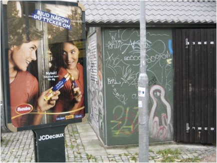
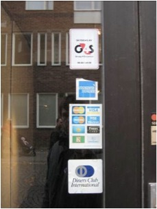
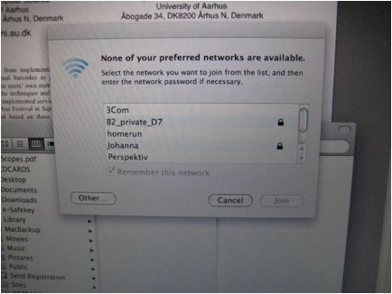
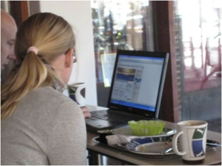
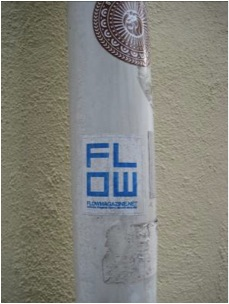
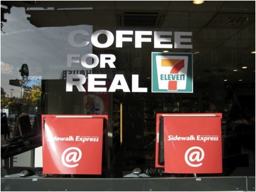

---

The computer is moving out into physical and urban reality. Since Mark Weiser’s call for a ‘computer for the 21st century’ in 1991 a migration from the screen and the desktop towards integrating computers and networks into our surroundings has been a part of contemporary computer science research; for example, in augmented reality, ubiquitous computing (ubicomp), and pervasive computing. A number of technological developments (such as big screens, new smart materials, GPS, RFID tags, and ever faster and cheaper wireless networks) have helped carry the research agendas out into ordinary reality. {#para1}

This article will discuss how we experience the urban space of ubicomp. It will do so by introducing the concept of ‘scripted space’ in order to discuss how ubicomp is related to new developments in public urban space. Focusing on the experience of the urban we will argue that scripted space is a concept that highlights the written, coded quality of ubicomp. As opposed to that suggested by such titles as ‘The Disappearing Computer’ (Streitz, Kameas and Mavrommati, 2007), we believe that embedding the computer into the environment will not render it transparent or invisible. Rather, computing will continue to be an important part of our conscious experience. Furthermore, we will concentrate on the present rather than speculating on future potentials, technologies, and uses. As argued by Genevieve Bell and Paul Dourish, ubicomp has arrived; the future is here, though it looks different than originally envisioned by the IT designers and technologists (Bell and Dourish, 2007). It is especially remarkable that ubicomp is predominantly a ‘messy’ cultural interface and not, as envisioned, a ‘seamless’ tool for work. The many parallel technologies, networks, gadgets, and software developments have become part of ‘cultural scripts of many sorts’ – for example, via the cultural developments surrounding mobile phones, social software, and web 2.0 (Bell and Dourish, 2007: 141). {#para2}

Scott McQuire discusses whether this development has the potential to change public space and reverse its demise. In continuation of the work of Paul Virilio, Richard Sennett, and Jürgen Habermas he argues that public space has lost to the public image consumed in private at home, and that the urban has lost to the suburban. McQuire quotes Philip Kasinitz, writing that suburban spaces ‘are notably rich in private spaces and poor in public ones’ (McQuire, 2006: p. n.p.). But this might be changing: ‘With the emergence of mobile devices, media consumption is increasingly occurring in public. It could be argued that the ‘media event’ is in the process of returning to the public domain’ (McQuire, 2006: p. n.p.). {#para3}

Drawing on a workshop study of digital layers in the midsized Swedish city of Lund, the article will consider how this might happen. It will conclude by discussing the potential of scripted space as a new public domain by mapping out a matrix and suggesting writerly scripted spaces as a way of furthering this development. {#para4}

### Scripted Space

The concept of scripted space has been suggested by Norman M. Klein (Klein, 2004) but he does not elaborate on the concept in relation to ubicomp. Etymologically, the term ‘script’ refers to something written. It is mostly understood in a literary sense as either a ‘manuscript’, meaning the handwritten original, or a set of instructions and dialogue for a performance. In IT and software, drawing upon these connotations, scripting refers to the user’s own writing of instructions for the computer. In an operating system, experienced users may add scripts that overwrite certain files, for instance, or mount net volumes. These scripts can later be activated automatically by clicking on an icon. In authoring software like Adobe Flash, users may add ‘action scripts’ which determine dynamic behaviours of objects in an animated drawing (e.g., in a game where the score is increased whenever a ball hits a hole). In the written set of instructions, scripts have a semiotic attribute. The signs, however, are rarely read but are experienced as a performative attribute. The meaning of scripts is established in the performance of the instruction and not in the coded, incomprehensible instruction itself. {#para5}

Our understanding of scripted space is based on the fact that ubicomp literally means adding scripts to the space surrounding us by programming smart things, architecture, infrastructure, and PDAs, and by connecting the scripts of these devices through wireless networks. Ubicomp adds simultaneously a semiotic and a performative attribute to the urban space. Recognising ubicomp as a scripted space highlights how digital scripts are added to the coupling of space and signs already carried out through urban planning, architecture, advertising, street signs, and so forth. As such, the scripted space of ubicomp does not result in an entirely new configuration of urban space, but is seen as continual development of the urban experience, which gets intensified by the adding of scripted environments and objects. The scripted space is in other words related to earlier developments of the spectacular modern city (McQuire, 2006; Pold, 2004) and denotes an urban experience scripted through architecture, visual media, signs, and semiotics (figure 1). {#para6}

  {#para7}

  {#para8}

Besides being a continuation of the ways urban space has been planned, scripted space also has a more contemporary dimension which is linked to the computer. Scripted space has a non-visual, coded, encrypted side to it and suggests that there are computed transactions and control structures behind the facade, surface, or interface of the city. {#para9}

This aspect has also been described by Bruno Latour and Emilie Hermant. They describe and photograph the development of Paris from ‘la ville lumière’ to ‘la ville invisible’ – from the illuminated, spectacular city that we still visit and cherish to an invisible city with an informational layer folded into its spectacular surface (Latour, Hermant and Shanon, 1998). The invisible city is a city where computers and information workers are constantly working to describe and script the city; Latour and Hermant document processes where the elements of the city (cafés, monuments, streets, etc.) are constantly under surveillance and correction, described and prescribed by networks of computers and information workers. What becomes clear from their detailed description of Paris (published before the current surge of ubicomp) is that the city is constantly being produced (re-engineered and mediated) by computers in complex networks and that it takes considerable amounts of work and material infrastructure as well as large numbers of highly skilled workers to maintain this. {#para10}

Subsequently, the scripted space as the info-layer of the city is a complex and networked software structure where algorithmic scripts organise and control the city and our experience of it. As expressed by Nigel Thrift, the computer is ‘extending its fugitive presence through object frames as diverse as cables, formulae, wireless signals, screens, software, artificial fibres and so on’ (Thrift, 2004: 584). {#para11}

Following Scott McQuire, it is this mediation and scripting that holds the potential return of an urban public space. When the ‘media event’ returns to the urban public domain via ubicomp one should not merely consider it as disappearing into the city, invisibly and transparently embedded in the experience of the urban. Rather, the coded, scripted, or essentially written quality of ubicomp should be highlighted. Of course the scripts of ubicomp are hidden behind screens, devices, and interactions. In this way, they are not as accessible or readable as the texts in books or on signs. They are (as scripts or code in general) first and foremost experienced in their execution. The scripts of ubicomp add new layers to the already multilayered urban scripted space – which is already more or less impossible to read in its entirety, but is nevertheless experienced through urban daily life. But how is the urban scripted space experienced? And how does it relate to a public domain? {#para12}

### The Experience of Scripted Spaces

Obviously, a scripted space is experienced in many different ways, but an important aspect is the feeling that something is going on behind the facade and that there are powers controlling and structuring what is seen and experienced. The immediate experience of the urban is disturbed by the feeling that there is something unreadable, but still scripted, programming the space. {#para13}

In the novel *The Crying of Lot 49*, Thomas Pynchon describes the narrator’s panoramic view of a southern Californian sprawling suburb in ways that illustrate this experience quite well. The narrator watches a dull suburb, where ‘nothing was happening,’ and she thinks of ‘the time she’d opened a transistor radio to replace a battery and seen her first printed circuit. The ordered swirl of houses and streets, from this high angle, sprang at her now with the same unexpected, astonishing clarity as the circuit card had.’ Since the novel was first published in 1966, Pynchon uses a radio circuit board, rather than a computer, as a metaphor for the hidden information structure. Elsewhere in the novel, though, computers are remarkably present, and the novel revolves around hidden information structures, networks and almost paranoid investigations of these. The urban space is hardly identifiable, but simultaneously it seems to communicate a hidden plot – a concealed information infrastructure. The space is not remarkable and cannot be read in spite of its ‘intent to communicate’ and ‘hieroglyphic sense of concealed meaning’: ‘There’d seemed no limit to what the printed circuit could have told her (if she had tried to find out); so in her first minute of San Narciso, a revelation also trembled just past the threshold of her understanding’ (Pynchon, 1979: 14-15). {#para14}

This ‘hieroglyphic sense of concealed meaning’ is an essential part of the experience of the scripted space, and the novel describes a very early example of an informational urbanity which is experienced not as readable signs, but as ‘signs of signs,’ as hieroglyphs that the urban dweller knows are readable for those with the right code but that cannot be accessed by outsiders. One feels that there is something going on beyond the surface, but it is difficult to see or read the scripts. Rather than becoming ‘natural’, the scripted space maintains a highly mediated character, even though the urban dweller does not necessarily see through it. A similar view is found in Norman Klein’s description of the experience of scripted space in places such as Las Vegas, Disneyland, and the entertainment architecture of The Jon Jerde Partnership (e.g., malls like San Diego’s Horton Plaza and urban areas like the Universal City Walk in Los Angeles). Spaces where ‘each square foot must pay off’ and that bring on an effect of ‘happy imprisonment’ and ‘ergonomic control’ (Klein, 2004: 332). Again, the urban dweller feels the control and the imprisonment – she knows that she is being manipulated but still enters freely and enjoys the user-friendly ergonomics. {#para15}

The urban dweller’s experience of concealed meaning, happy imprisonment or ergonomic control is comparable to other experiences of scripted spaces. Computer games seem to offer an important contemporary exploration of this experience of a scripted space. The player can interact with scripts in different ways. On a functional level, a script can be activated logging in to a computer game, setting control menus, etc. However, the player’s most dominant experience is of course the aesthetic experience. On an aesthetic level the player activates scripts to play with them. As suggested by game theorist Ted Friedman the ‘way computer games teach structures of thought – the way they reorganise perception – is by getting you to internalise the logic of the program’ (Friedman, 1999: p. n.p.). In this internalisation the computer’s scripts simultaneously work in two ways. At once, they are they are an ally helping the player in controlling the environment and an obstacle to be overcome, an opponent. The player must collaborate with the computer in order to find a way to overcome it. A game experience on an aesthetic level is essentially about playing with and against the scripts as long as it remains a compelling activity. {#para16}

A third option is however also possible in the computer game. Friedman’s description of an internalisation of the computer’s scripts has a distinct political level. Winning a game can only happen by accepting the terms of the game. In Friedman’s case, the game *Civilization II* (1996), the player can only win by assuming the role of a colonising nation state; art and religion serve a purely functional role: to keep the people pacified and so forth. The game thus addresses controversial historical and ideological assumptions. To Friedman, the player must submit to this political level but experience from other games suggests different strategies. Working as a designer for Maxis on their game *Sim Copter* (released the same year as *Civilization II*), the artist and founding member of The Yes Men, Jacques Servin (a.k.a. Andy Bichlbaum) illegally incorporated an easter egg into the game. Triggered by a cheat code or on certain dates, Servin’s secret script will flush the game world with men in trunks kissing both each other and the pilots in the game. Servin’s easter egg indicates a political response to the ideology of the scripted space. Here, the scripted space is subject to debate and will be reconfigured, used in unintentional ways or even hacked. {#para17}

How do these functional, aesthetic and political levels and experiences of the urban scripted space manifest themselves? We took part in a workshop exploring such issues in the mid-sized Swedish city of Lund. [1] {#para18}

### Scripted Spaces in Lund

The forefront of scripted spaces might be more or less ‘virtual’ spaces, such as computer game spaces, which are heavily commercialised and ‘themed’, or it might be post-urban spaces, such as Las Vegas and Los Angeles, or high-tech spaces, such as Singapore or Tokyo. But as demonstrated by Latour and Hermant, this mediation of space also spreads beyond the technological ‘sci-fi’ spaces to affect the experience and quality of space in more ordinary cities (Latour, Hernant and Shannon, 1998). Ubicomp is increasingly becoming part of an everyday urban life – also outside the techno-sci-fi capitals, at least in the richer parts of the world, where the population is readily equipped with ubicomp technology and networks. Lund is an example of this. {#para19}

In general, Lund consists of many layered traces of history, culture, commerce, personal and social narratives. We see ways of using and mis-using the urban space, and we see signs of transactions and interactions whose full meaning eludes us. We see signs of class and ethnic struggles, signs and sign systems that make people feel welcome or alienated, safe or threatened. Of course, our interpretation of and reaction to these signs depend on who we are and what we want – for example, whether we are residents or non-residents, our purpose, and our financial and cultural capital. Hence, a native to Lund who knows her way around will read the city scripts differently from a tourist. She will be able to read and interpret more of the scripts and normally also be less conscious of her readings and perhaps unconsciously overlook the stuff she is not able to interpret. However, this changes neither the basic hieroglyphic nor the everyday-like quality of the scripted space. {#para20}

As in the computer game, we found behaviour that indicated the importance of staying connected to the scripted space, scriptory control, and the potential for renegotiating the scripts themselves. Focusing on the digital layers of Lund, we saw three different interrelated ways of using public space. First, IT is used to create what we will label a *log-in space*, often designed to keep unauthorised access out. The digital layers are primarily visible as gateways under surveillance so as to  restrict access. Only those able to locate the access points, who also know the passwords and have the keys to log in, can access the gated areas and hidden scripts. We find many traces of surveillance, encrypted and secured information structures, and keypads for logging in. Sometimes we find traces of information structures that appear enigmatic to us as unauthorised foreigners but that are still clearly communicating ‘a hieroglyphic sense of concealed meaning’, such as signs indicating hidden infrastructures, security alarms, and surveillance cameras. We find many physical structures guiding and welcoming us, combined with electronic layers sorting and disciplining the clientele – for example, the signs in alluring shop entrances indicating the credit cards accepted, in this way welcoming those with the right cards and excluding those without money (figure 2). Another example of a log-in space could be the list of available wireless networks on a laptop or PDA, which often require log-in passwords and authentication (figure 3). {#para21}

Second, IT is used to create what we will call a *mobile personal computing space*. We observed many laptops, media players, mobile phones, and other devices allowing people to carry their private data, soundscape, media- and communication-devices with them in public space (figure 4). Accessing, configuring, and inhabiting public space through personal interfaces thus compete with, for instance, newspaper reading, which previously defined public life in a café as a private behaviour in public space. Also, text messages setting up social encounters can be considered to play an important role in the way both non-residents and residents make their way around urban space. When we add to this websites advertised on stickers or posters, virtual maps, and other web 2.0 services, it becomes clear that the mobile personal computing space is not only about the isolated individual (figure 5). It is the individual’s interface to the public space. However, as implied by, for instance, Apple’s successful range of ‘iProducts’ (iBook, iPod, iPhone), this interface is still privileging the individual and delivers personalised views and configurations of urban, social space. {#para22}

Third, IT is used for a *hypertextual connectivity and linking* of local nodes (people, places) to other nodes and the network. It is important to be well-connected, to be on-line, and to be accessible. In this fashion, most of the urban dwellers we passed in Lund probably had mobile phones in their pockets, as well as credit cards and other keys allowing them access to the scripted space. Cafés and shops have websites and email addresses, and some even provide wireless internet access, thereby offering the possibility to connect and get on-line (figure 6). Many urban dwellers probably also have their own networks of social links, favourite sites, and perhaps even exchange tags and preferences. In this way, an urban space and its dwellers are connected to each other, and to other spaces. Compared with earlier ways of congregating and inhabiting urban space, this social formation is thus often strangely invisible to outsiders in physical urban space. {#para23}

### The Scripted Space as the New Public Domain

The advent of digitally scripted objects in an urban setting can be seen as a movement of the public domain from the private home back into the urban setting. Log-in space, mobile personal computing space, and hypertextual connectivity each suggests a different approach to the scripted space as a new public space. Mapping out the observations from Lund, we find a matrix of different potential approaches to the scripted space (table 1). {#para24}

<table style="width: 500px;" summary="Table 1: A matrix of different potential approaches to the scripted space." border="1" cellspacing="0" cellpadding="0"> <tbody> <tr> <th scope="col"> 
SCRIPTED SPACE
 </th> <th scope="col"> 
<em>Home</em>
 </th> <th scope="col"> 
<em>Urban</em>
 </th> </tr> <tr style="text-align: center;"> <td><em>Individual interface</em></td> <td>Desktops &amp; internet</td> <td>iPhone, laptop, PDAs, etc.
 <a href='#para25' id='para25'> - 25 - </a>
(<em>the digital urban café</em>)</td> </tr> <tr> <td><em>Public interface</em></td> <td>Weblogs, WIKIs, etc. (web 2.0)</td> <td>Urban screens, media facades with public interaction, e.g. integrated with laptops, PDAs, etc.
 <a href='#para26' id='para26'> - 26 - </a>
(<em>the digital urban agora</em>)</td> </tr> </tbody> </table>

*Table 1: A matrix of different potential approaches to the scripted space.* {#para27}

In a home (or an office) setting, individual access to a scripted space takes place via the desktop and the internet – whose historical predecessor could be either the reading or the inscription of the personal notebook, manuscripts, letters, and the like. Today, the movement of this activity into an urban setting takes place via PDAs, laptops, phones, media players, and so on, all of which are made for individual use in an urban setting – creating a personal reading and inscription of space. Using an MP3-player, a laptop in a café, or hypertextual connectivity and linking via an iPhone; getting a personal schedule, information about a future meeting point in town, the opening hours of a store; receiving messages, and participating in an urban game – all of this contributes to creating an individualised, personal space within the urban setting. Though this kind of public behaviour could be seen as purely functional, it should also be seen as an individualisation of the urban setting where public space becomes a playing field for private activities – an ‘individual game space’. A historical predecessor to this kind of public participation is the café, where city dwellers read newspapers, are situated behind glass windows to see and be seen, or plan their city activities through immediate access to city information (through city magazines such as *TimeOut*, gallery and movie lists, etc.). {#para28}

A public variant of access to the scripted space is nevertheless also evident. Quite often, the data accessed is not merely controlled and static but dynamic and open. In other words, hypertextual connectivity and linking is not just about accessing information but also about actively contributing information – as labelled in the web 2.0 paradigm (O’Reilly, 2005). Interfacing to the scripted space is not merely individual but also collective and public. A historical predecessor to these cultural forms could be a participatory newspaper culture, the writing of chronicles, letters to the editor, and so forth. This reflects an idea of public space as not just a setting for individual performative activities but also a space for debate and knowledge dissemination – a political level of scripted space equivalent to the idea of the agora. {#para29}

What is striking about the observations from Lund is the emphasis on using digital technologies for personalised access and interfaces to the urban space and the public domain. Most often, digital technology in urban space is predominantly exclusive. This is of course the case with the creation of log-in space, but also to some extent with the mobile personal computing space. However, the hypertextual connectivity and linking seem to suggest a desire to connect to the social. Surprisingly, today, we usually see participation in weblogs, WIKI-editing, and so on as a participatory culture that does not involve the urban setting. Though WIKIs and weblogs may be accessed and read from an urban setting, there has been little effort to actively promote the urban setting as a context for active participation. Surely, examples can be found – such as user-generated content of urban screens and media facades, and video and textual tagging of the cityscape (e.g., as in WIKI maps) – but in the context of an average urban setting, they are in no way dominant. This of course signifies an area open to new forms of digital civic participation and will probably develop into new ways of creating social relations and potentially new ways of developing cultural interfaces in scripted spaces. {#para30}

### Conclusion: Writerly Scripted Space

The digital urban and scripted space is at once a functional, aesthetic and political space. It manifests itself not as a grand spectacle but most often as a space where one can log-in (or be left out), a space for mobile personal media consumption and local/global connectivity. Beyond being able to operate the urban scripts for functional use (logging in, configuring network settings, activating links, etc.) the ability to play and emancipate the digital scripts is crucial for the experience of the scripted space. The digital, scripted layer of the urban can be accessed to serve as the point of departure for individual experiences of the city as a personal, public playground (a borderless café) or, less frequently, the basis of social encounters, communication, and debate (a borderless *agora*).  This activity that defines participation in the urban public domain depends on the ability to access and internalise the scripts. It is, however, not the only way to participate in the public, scripted space of the city. {#para31}

The city dweller may implement, experience, and use urban scripts, but what happens when she is not satisfied with the foundation of participation in urban public life, the scripts themselves? This experience is a call for action where the city dwellers take control of the urban scripts and become ‘writerly’ by creating, hacking, and rewriting the city. {#para32}

’Writerly’ (or ‘le scriptible’) is the term Roland Barthes used to characterise the particular way of reading associated with the open texts of modern literature. Writerly texts address the reader as an active producer of meaning rather than merely a passive consumer reconstructing the text’s ‘proper’ meaning through a way of reading predetermined by the author – as in the classical characterisation of ‘readerly’ texts (Barthes, 1970: 10). In certain interpretations, hypertext itself is equivalent to this liberation of the reader (e.g. Landow, 1992). It seems, however, more accurate to evoke a digital writerly, open text as a textual corpus where the reader is enabled to not just experience the effect of the script but also to affect the script (by e.g. programming). Following Barthes, the German media theorist Florian Cramer thus advocates a ‘writerly computing’ where the user is transformed from a consumer whose use is staged by the software interface to a producer who actively takes control of the scripts and has read and write access (Cramer, 2003: 100). {#para33}

Open, writerly texts/computing is the basis of all experimental digital artistic practices. This is where the computer is not merely seen as a medium for messages but as open to interpretation, imagination, and further production by the user. Though often not a regular sight in average cities, such practices that critically explore the new public domain of scripted spaces are numerous and include the inversion of city surveillance (‘sousveillance’) or other ways of rewriting or ‘hacking’ the city (Greenfield and Shepard, 2007; Fuller and Haque, 2008). Turning users from consumers to producers of scripts may challenge existing hierarchies of meanings, roles, and experiences that differentiate acceptable from unacceptable practices in urban scripted space. This will also mean a return of an urban public domain and a new paradigm of computing remarkably different from the dominant ideas of the disappearing computer. {#para34}

### Acknowledgements

This research has been funded by the Danish Council for Strategic Research, 09-063245, (Digital Urban Living).

Thanks to Stacey Cozart Madsen for English proof reading.

### Biographical Note

Christian Ulrik Andersen is Ph.D., Associate Professor and chair of Digital Aesthetics Research Centre at Aarhus University, Denmark. He researches within digital aesthetics, software cities and computer games. Together with Søren Pold he recently edited the book “Interface Criticism – aesthetics beyond the buttons” (2011). He is also a researcher at the Centre for Digital Urban Living, Aarhus University.

Søren Pold is Ph.D. and Associate Professor of digital aesthetics at Aarhus University, Denmark. He has published in Danish and English on digital and media aesthetics – from the 19. c. panorama to the interface – e.g. on electronic literature, net-art, software art, creative software, digital culture and digital urban living. Together with Christian Ulrik Andersen he edited the anthology “Interface Criticism – Aesthetics Beyond the Buttons” (2011).

### Notes

[1] The workshop was part of the ACM conference NordiCHI 2008, a conference on Human-Computer Interaction, held on 19 October 2008. ([https://www.nordichi2008.org/index.php?option=com_content&task=view&id=66&Itemid=90](https://www.nordichi2008.org/index.php)). The workshop, attended by IT researchers, was organised by the Digital Urban Living Research Center, Martin Brynskov, Peter Dalsgaard, Christian Dindler, Jonas Fritsch, Kim Halsskov, and Ole Sejer Iversen. All participants went to the centre of Lund and were asked to look for and take photos of three different layers in the urban space (social, digital and physical) and organise these with reference to three different dimensions (information, services, aesthetics) on a printed map of Lund. The participants were asked to focus on a transitional, mainly pedestrian space with shops, hotels, cafés and bars.

### References

Barthes, Roland. *S/Z* (Paris: Éditions du Seuil. 1970).

Bell, Genevieve., and Dourish, Paul. ‘Yesterday’s tomorrows: notes on ubiquitous computing’s dominant vision’, *Personal and Ubiquitous Computing, 11*.2 (2007): 133-143.

Cramer, Florian. ‘Exe.cut[up]able statements: The Insistence of Code’, in *Ars Electronica: Code – The Language of Our Time,* eds. G. Stocker and C. Schöpf (Ostfildern-Ruite: Hatje Cantz, 2003), 98-103.

Friedman, Ted. ‘Civilization and its discontents: Simulation, subjectivity, and space’, in *Discovering discs: Transforming space and genre on CD-ROM*, ed. G. Smith,  (New York: New York University Press, 1999), 132-150

Fuller, Matthew., and Haque, Usman. *Urban Versioning System 1.0* (Vol. 2). (New York: The Architectural League of New York, 2008).

Greenfield, Adam, and Shepard, Mark. *Urban Computing and its Discontents* (Vol. 1). (New York: The Architectural League of New York, 2007).

Klein, Norman M. *The Vatican to Vegas* (New York: New Press, 2004).

Landow, George P. *Hypertext the convergence of contemporary critical theory and technology* (Baltimore, Md: Johns Hopkins University Press, 1992).

Latour, Bruno, Hermant, Emilie and Shannon, Susanna. *Paris ville invisible* (Paris: La Découverte, 1998).

McQuire, Scott. ‘The Politics of Public Space in the Media City’, *First Monday* Special Issue #4 (2006), https://firstmonday.org/htbin/cgiwrap/bin/ojs/index.php/fm/article/view/1544/1459

O’Reilly, Tim. ‘What Is Web 2.0 – Design Patterns and Business Models for the Next Generation of Software’, [https://www.oreillynet.com/pub/a/oreilly/tim/news/2005/09/30/what-is-web-20.html](https://www.oreillynet.com/pub/a/oreilly/tim/news/2005/09/30/what-is-web-20.html)

Pold, Søren. *Ex libris medierealistisk litteratur, Paris, Los Angeles & cyberspace* (Odense: Syddansk Universitetsforlag, 2004).

Pynchon, Thomas. *The crying of Lot 49* (London: Pan Books, 1979).

Streitz, Norbert A., Kameas, Achilles and Mavrommati, Irene. *The disappearing computer : interaction design, systems infrastructures and applications for smart environments* (Berlin: Springer, 2007)

Thrift, Nigel ‘Movement-space: The changing domain of thinking resulting from the development of new kinds of spatial awareness’, *Economy and Society, 33*.4 (2004): 582-604.
