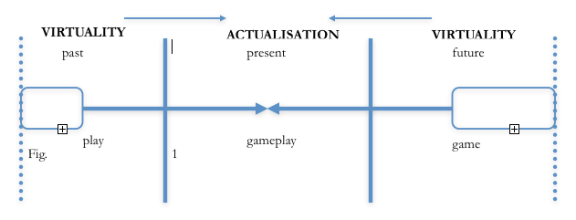

### Introduction

Presently there are a number of gameplay definitions, ranging from Sid Meier’s famous assertion of ‘interesting choices’ to Richard Rouse’s concept in which the vibrant iterations of user input and machine output is the decisive factor (Rouse, 2005). Further, ‘gameplay’ seems to drift indefinably between psychological categories, as in the emphasis on the concept of ‘flow’, and more formal conceptualisations often derived from computer science. However, the discussion of how the realm of pervasive games necessitates both playing and gaming, play-mode and game-mode, seems to oblige a slightly different gameplay terminology. One level of gameplay is the actualisation of a specific stratification of rules, strategies, and interactions as well as the realisation of a certain amalgamation of commands, plans, and paths. A second level, which is equally or even more important since it explains the inherent fascination of playing games, is the interconnection of playing in an open environment and focusing on presence *and* gaming within a fixed, discrete framework (the ‘board’) and paying strict attention to progression. {#para1}

The purpose of this article is to inspect the theoretical consequences of moving from a traditional, ludological concept of computer games to an extended ludology of pervasive games. In the process of unfolding these consequences our general understanding of play and games—these straightforward and yet highly convoluted terms—will hopefully also be sharpened. Such an assessment should rivet reflections that take the heightened emphasis on physical space as well as the contingency of socio-cultural activities in pervasive games seriously. It should further critically investigate the notion of the virtual. This is done in the third section where I employ Gilles Deleuze’s Bergson-inspired claim, that the virtual is indeed more ‘real’ than any present actualisation, as a backdrop against the hypothesis that, rather than invoking a common sense dichotomy between a tangible reality and the informational bits and bytes of the computer, we should instead focus on the discontinuous relation between virtual play and actualised gaming as the pivotal *modus operandi* of pervasive games. The article can be read as a continuation of the work on game theory laid out in Walther (2003, 2005, 2006, 2007a, 2007b, 2007c). Consequently, the noticeable lack of empirical references in this article is not the result of a normative disapproval of the many and very interesting experiments with pervasive technology that flourish these days, but on the contrary must be regarded as a rather rigid attempt to enlighten the deep axioms and often ambivalent key conceptions underneath the world of digital games. {#para2}

### Rules and Gameplay

In line with economic game theory we can define games as complex, rule-based interaction systems consisting of these three key mechanisms: absolute rules, contingent strategies, and possible interaction patterns. Game rules are absolute in the sense that while the players may question the rationality of the rules at hand, they are nevertheless obliged to obey, to ‘play by the rules’. Rules are therefore absolute commands (Neumann & Morgenstern, 1953) and unquestionable imperatives. They transcend semantic issues, cultural signification, moral agendas, etc. This does not, incidentally, preclude the fact that game rules are discussed in a cultural or ethical milieu. {#para3}

In contrast to rules, strategies are contingent, nonabsolute entities since they count as the more or less detailed plans for the execution of turns, choices, and actions in the game. Other strategies than the ones actually carried out could have been outlined and performed. Both in the shape of short-term tactics and as long-term schemes, strategies are contingent. In economic game theory, a strategy is an overall plan for how to act in the assembly of different states that the game may be in (Juul, 2006). Game theory studies the affiliations of the rules and the strategic behaviour in competitive situations (Smith, 2006). Finally, interaction patterns are the moves and choices, which become part of the game being played, thus interfering with the restrictions and options of the game. As the implementation of game strategies tend to cluster in selected regions of the possibility space of the game (in approximation of what is known as the ‘dominant strategy’ in game theory) forming a path through the game space,[1] we may even insinuate that the interaction patterns, taken as a whole, *are* the game itself—especially if we view it from the perspective of the player (Holland, 1998). Interaction patterns are the possible as opposed to necessary combinations or the emergent outcome of rules and strategies. This differentiation can be listed even more briefly: {#para4}

- – Rules are commands

- – Strategies are plans for game executions

- – Interactions patterns define the actual path through the game and specify the topography of human-computer (or player vs. rule) dynamics

Clearly, the interaction patterns work as ‘middle ground’ as they occupy a domain located between the machine that upholds the rules (the computer) and the human player who has to find and optimise the best way to accomplish the goal of the strategy. {#para5}

The notion of game play, which we shall pursue also as regards the relation between free play and confined gaming, involves all three levels of a game, which also explains the difficulty in defining the concept properly. We can refer to the following definition as the *ontological* or formal definition. The definition is ontological because it assumes at least the minimal and necessary (axiomatic) existence of some quasi-material, algorithmic entity: {#para6}

*[Gameplay: Definition 1]*  Game play is the actualisation of a specific stratification of rules, strategies, and interactions as well as the realisation of a certain amalgamation of commands, plans, and paths. {#para7}

For a player, a successful game play means a delicate balance between knowing the rules and mapping one’s strategy in accordance with both rules and the possible actions of opponents. Games should be equally challenging and rewarding, hovering between boredom and anxiety thereby assuring a space of flow through the network of choices. For a computerised game system, a successful game play implies a balance between fixed rules and the control of player input in variable settings. {#para8}

What defines a rule? A rule, being algorithmic in its core design, consists of a simple, unequivocal sentence, e.g. ‘you are not allowed to use hands while the ball is on the pitch’. Here, a rule constitutes the possibility space of a game by clearly stating limitations (not use hands) as well as opportunities (the ball is on the pitch). It is always possible to define a game both in negative and positive terms: rules limit actions; they determine the range of choices in the possibility space; they encircle the arenas to be played in; yet they also frame what can be done. {#para9}

At this point, I am speaking of all games, both traditional games, including sports, and computer games. *Heroes of Might and Magic* rests on rules stored in and processed by a computer. Chess or *Monopoly*, by contrast, relies on rules not accumulated in the database and algorithms of a computer but written down on paper and stored in the player’s mind during the play. In a game of soccer, for example, a referee administers such rules ultimately by reference to the *FIFA Handbook*. Implicit rules that are normally considered exterior to the ‘real’ rules (e.g. a time restriction in chess matches) must be engaged explicitly in digital games. These rules have to be programmed as well. Weather conditions or the general physics of a soccer game are usually taken as ‘out-of-game’ features in the real world. When we simulate a soccer game in a computer, however, the rules of soccer and the general physics (including random variables such as surface granularity, crowds, time of day, etc.) must be built into the rule algorithms and the input-output control of the computer. {#para10}

Rules specify the constitution of the playing ‘deck’ or, more broadly, the playing ‘field’. In games, behavioural patterns inside this field are limited, constrained, and highly codified (Huizinga, 1994; Caillois, 2001; Walther, 2003). Rules are guidelines that direct, restrict, and channel behaviour in a formalised, closed environment so that artificial and clear conditions inside the ‘magic circle’ of play are created (Salen & Zimmermann, 2004). The outside of this circle, reality or nonplay, is essentially irrelevant to game play. Confronted with unambiguous rules, strategies (or tactics) might entail best practice solutions variable to the given rule constraints. Hereafter, interaction patterns map the various player interventions and can hence be viewed as a texture of moves and choices overlain on top of the possibility space of the game. Furthermore, interaction patterns can refer to the social and competitive intermingling of players during the fulfilment of the game. In that respect, the patterns correspond to the outcome of absolute rules and social dynamics. {#para11}

The formal organisation of games can be regarded as a *parameter space*. In this space, the current state of the game counts as a point and ultimately a dimension in the parameter space. A played game has therefore *n* possible state dimensions. In Tic-Tac-Toe, for instance, the nine squares constitute the parameter space of the game and thus the possibility domain for the arrangement of the board pieces. The rules of the game define the possible edges in the space connecting states, and the total number of discrete points in the parameter space represents the total number of games states. Rules define the possible game as in the initial framing of the game, whereas a particular game is a path through the state space. This latter particularity rests, consequently, on a *variability space* upon which one can also measure the optimum rate or success probability of the system. The crucial factor is that there can be no variability or multiple paths through the possibility space of a game without the compulsory parameters of the game. Hence, the parameter space constitutes the transcendental level of the game, whereas the particular game path expresses the contingent realisation of the space. {#para12}

This dialectic between parameter space and actual game path (or variability space) also sheds some light on why games are complex; basically it is because there is an uneven relation between the unchanging set of rules and the actual and changing realisation of a particular game. This asymmetrical tie between rules and realisation (or rules and strategies) can be termed game emergence. Most often it is impossible to predetermine the actual moves and outcome of a game only by knowing the set of rules. Also, most games are games of imperfect information (Nash 1997). At the outset, the rules of chess are simple, and yet the wealth of distinct chess playing tactics is quite enormous. A child can memorize chess rules, but to master all grand openings in the actual game is probably a lifetime achievement. {#para13}

### Play-mode and Game-mode

It is however a characteristic feature of many types of framed differentiations, or ‘fiction’ (in the widest possible sense, and notwithstanding if this feature counts as an impossible Utopia), that they wish to expand the gaming space, physically and mentally, often by reconfiguring the social landscape of worlds into a dense grid of game objects, game goals, and game worlds, thus obscuring the demarcations between the real and the virtual. Very often, stories, movies, games, and other narratives play with these demarcations. {#para14}

What, then, is most important? Is it the game itself, or is it rather the social and geographical infrastructure that supports it? Who (or what) has the upper hand? Is it the relational complexities of the characters or other personified ‘avatars of story’ (Ryan, 2006) or perhaps the fluent vectors of the game world? In the following we will explore this tension between the telic game orientation and the presence of a world surrounding the former by drawing upon the recent paradigm of pervasive computing (Walther, 2007b; Walther, 2007c). [2] {#para15}

There is a fine line between being there, somewhere, and being there with a purpose. The mundane space that a human subject inhabits is not by nature geometrical; rather, it is structured in accordance with matter-of-fact actions. In such a spatial environment, the various orientations are related to directions (practical vectors), places, ranges of space, and things, in contrast to dimensions, points, lines, and absolute objects. The space for action is a praxis-architecture or a phenomenological space that is not defined by length, height, and width, but rather by territory, proximity, and distance (Nielsen, 1996). A personal space zeroes in on the required equipment and relations to institute meaning, whereas a geometrical space is continuous and unbounded. {#para16}

Territorial exploration, whether in the real, physical world or in the flowing realm of one’s fantasy, involves the incessant modification of intentions. It is an advanced procedure of trial-and-error set in a socio-semantic circumstance. You go right. Not interesting. You move to the left. Wait, here’s something. You rush straight forward, and the result is immediate and loads of action. Such movement requires both cognitive mapping and a basic perception of metric coordinates. However, the elusive co-existence of being present and intentionally moving around for a reason is also known as *rules*. It subsumes at least three important characteristics of structured, goal-oriented activity: momentum + direction (vectorization) + a valorized and quantifiable endpoint or outcome. Mapping a place through adventurous discovery in order to figure out the story underneath the space, and possibly inventing new ones in the same process, is all about *playing*. Learning to move and advance in a space filled with discrete norms of orientation, i.e. a parametrical space, meaning that you can do this but not that, and that you can go here but not there, is the art of *gaming*. {#para17}

Thus, there are two firmly interwoven modes of game epistemology: there is *play-space* and there is *game-space*. Accordingly, there is *play-mode* and *game-mode*. Together they form the much hyped and commonly misunderstood term ‘game-play’. We call those games that mix up the tangibility of everyday spaces with the closed information spaces found in digital computers *pervasive games*. Such games may be the next generation in computer games. Make people move around. Don’t tie them in front of the screen. Moreover, these games are particularly captivating because they deliberately place the relation between rules and world voyaging, gaming and playing, the parameters of games and the variables of play, at the nucleus of the very rule system itself. In other words: you learn how to master the rules of the game by playing them out in the real world. Pervasive gaming is game-play out in the open. {#para18}

In the play mode, one does not want to fall back into reality (although there is always the risk of doing so). In the game mode, it is usually a matter of climbing upwards to the next level and not losing sight of structure. Play is about presence, while the game is about progression (Walther, 2003). Play-space could be a city, and game-space could be the rules and informational network dictating what can and cannot be done during game-play. Or, to rephrase this in abstract terms, play-space could be a fictitious world, with its binding rules, and game-space the rules and missions within this world: the teleology of the protagonist, the endpoint of his trajectory. {#para19}

Play is also about uncertainty, and herein lies the irreducible element in play which, according to Roger Caillois, makes it inaccessible to mathematics (Caillois, 2001: 173). Complete transparency derived from calculation and perfect strategy means the disappearance of player interest together with the pleasurable uncertainty of the outcome. {#para20}

Look at people playing. One notices that there is always the inherent but beguiling hazard of being ‘caught’ in reality. Nothing is more distressing for play than the aggressive intermission of reality which at all times jeopardizes play *as* play or simply threatens to terminate the privileges of play. Then it’s back to normal life—which may be, incidentally, a giant gamespace in its own right, as McKenzie Wark suggests (Wark, 2007; cf. also Galloway, 2006). This is, of course, a structural feature of all play and of all game-play. This is true of chess and soccer. It is also apparent in *Doom* and *Myst*. Interruption and termination must be avoided at all costs—in the continuous pursuit of having fun—but, since they are inescapable, they must be built into the very ‘being’ or ontology of playing games. {#para21}

Now, consider pervasive gaming, game-play out in the open. As a player I rush down a street in order to amass my next item to be uploaded via my PDA so that my game-buddy at home can keep track of my doings and goal-seeking so far. It’s 4 pm, there is heavy traffic, and I am momentarily barred from reaching the corner with the alacrity I wished for. {#para22}

We witness a growth in the design of game systems that use ubiquitous computing techniques to propel forward player experiences that connect objects within the real world with objects of the computational world. *SuperFly*, by the Swedish game company It’s Alive Mobile is a good example. The player’s aim is to become a virtual celebrity. The projects *Can You See Me Now?* and *Uncle Roy All Around You*, both created by the UK performance group Blast Theory, use hand-held digital devices, GPS location tracking, and online agent technology in an attempt to use location and mobility as game features from within the real world. While one player stays at home and moves a virtual character around a representation of a real city, other players speed around the real streets, trying to hunt down the virtual quarry. {#para23}

In chess, there are no strident interruptions between two or more discrete fields. I move my queen independently of physics, be it weather, traffic jams, or the occasionally bad habits of my fellow citizens. In a game of soccer, you block your opponent, and he tries to tackle you. However, a nice set of training principles that look for ways to avoid the physicality of blocking is always an option. That is what the refinements of dribble are all about. In pervasive game-play, mixing play-space and game-space, ‘real’ problems, as the ones described above in my own thought experiment, remain real problems. If not, the aesthetics of producing eloquent game mechanics turns into a matter of ethic. I do not, in the quest of fulfilling the game’s teleology, knock down the old—real—lady on the sidewalk only because she is refraining me from targeting the ‘pac man’ further down the road a little bit faster. {#para24}

Therefore, we must be careful in judging the fun factor of game-play. It is not only the city, the social and geo-graphically expanded context, in itself, that is the locus of enjoyment in pervasive game-play. Yes, I can go explore, and yes, I meet people, and yes, the site of navigation has become much wider than a trivial board. Nevertheless, the bouncy guarantee of space might indeed become the constraints of the game. Serious gamers do not want to waste their time looking for ‘interesting’ places to explore. They much rather want to understand the structure so as to move forward revealing new game areas or climb upwards in the hierarchy of levels. {#para25}

As we shall see later on, this veiled and all-important prerequisite of playing games, including the pervasive ones, is contained within the notion of ‘the virtual’. Being a conditional *causa sui* of the actualised game, and the gameplay that unfolds in the being-present, the virtual explains in its pure form the dual and much overlooked nature of gameplay: the virtual is the ‘past’ of the ‘now’ of gaming since we must always silently remember the enjoyable and playful offspring of a game, and, at the same time, the virtual drives the articulated though momentarily non-fulfilled target point of gameplay that is the ‘future’. {#para26}

Why? Because play is centred in a discovery of open spaces that invite observation through the duration of temporality. Gradually, one learns how to pilot inside play, and since the completion of more and more successful tasks takes time, it corresponds to the distinctive forms that keep differentiating the play system into finer grades of subsystems. One inhabits spaces like these via certain as-if structures; one assumes a role and lives out characters whether in the form of other players or agents that one can adapt as a player. The gamut of play equalises a measurement of its geometry—how big is the playing field, and where are its borders? And these lengths and widths become in turn the source of gaming’s internalisation of both geometrical space and discrete progression. {#para27}

In contrast, play seems to focus on investigations of semantics, since the task is, not only to measure its space, but furthermore to elaborate upon its modes of interpretation and means for re-interpretation. Not only do we explore a world while playing, its potential meaning and the stories we can invent in that respect also drive us. Play spaces tend to expand, either in structural complexity or in physical extent. This expansion is further reflected in the praxis of play, for instance when players argue over the exact thresholds of a play domain. Another feature that distinguishes playing from gaming is the notion of presence, as I pointed out earlier. Obviously, the sensation of presence is tightly interwoven with phenomenological concepts like ‘immersion’ and ‘flow. Play commands presence. We have to be there—not only *be* there, but also be *there*. This is the double meaning of Heidegger’s *dasein*: *da*sein (being *there*) and da*sein* (*being* there). We go with the flow; or, rather, while swallowed by the presence of playing we are *in* the flow, as Mihály Csíkszentmihályi claims (Csíkszentmihályi, 1990). A game’s success is intimately tied to the organisation of space and time. Gamers need to trust this organisation. Since a game hinges on a certain finite structure in order to promote infinite realisations of it—the correlation of rules and tactics—the very articulating of presence so important for play must already be presupposed in a game. One already knows in a game that the mission is to *keep on gaming*, which really means, in my vocabulary, to *keep on playing*, that is, to prolong the sensation of presence. The energy can then instead be directed towards elucidation of the game’s structure: ‘How do I get to the next level?’ and not ‘Why do I play?’ This *keeping on*, knowingly or unknowingly, is the virtuality of games. {#para28}

Although one should indisputably respect the ethical boundaries of pervasive games that transport game-play out in the open—just as one should bear in mind that the metaphysics of fictional worlds often goes beyond the natural laws and moral confines of everyday life; one does not want to hang on too long for the old lady to cross the street. While waiting, the question above might turn up thus threatening to disintegrate the exquisitely balanced halves of gaming (to progress) and playing (to be present). {#para29}

Thus, we can put forward the second definition of gameplay. In continuance of the first one, we can refer to the following definition as the *epistemological* or player-oriented definition: {#para30}

*[Gameplay: Definition 2]*  Gameplay is that kind of player activity that intentionally involves the asymmetrical relation between world exploration and level progression. {#para31}

What do the novel features of pervasive games, including play-mode and game-mode, mean with respect to rules, as we have defined them above? {#para32}

- – Rules are commands. *However, since pervasive games often take place in a physical context that is characterised by socio-cultural contingency, rather than the discrete controlling of parametrical progression, rules should therefore be seen as deep commands within a variability space that, simultaneously, allow for the more or less intentional modification of rules.*

- – Strategies are plans for game executions. *However, while strategies in strictly confined ‘boards’ with clearly defined edges may be easier to control (and hence to realise), strategic actions in large pervasive games building on the complexities of both real and computational space tend to evolve into even more complex sub-strategies and perhaps unforeseen interaction patterns.*

- – Interaction patterns define the actual path through the game and specify the topography of human-computer (or player vs. rule) dynamics. *True,* *but while the topography of traditional computer games rests on a topological level structure which enables, for instance, a virtual teletransportation from one ‘dimension’ to another, the topography or path of large pervasive games*—*typical of urban gaming*—*is rather based on the geometrical constraints that are bound to the actual physicality* and *linked with the socio-cultural contingency of the gameworld.*

In the following we shall qualify the notions of play-mode and game-mode further by relating them to Deleuze’s concept of the virtual. {#para33}

### Virtuality

A prevailing notion of ‘virtuality’, which was especially dominant in the cyber theories and virtual reality oriented writings of the nineties, sees it as a kind of spatial and epistemological liberation from Cartesian geometry (Ostwald, 1997; Lunenfeld, 2000). The kind of space that Descartes had in mind, in his *Meditations on the First Philosophy*, is organised in accordance with Euclidian mathematics and categorises spatial elements in a general and absolute sense. In Euclidian space there is no resistance; it is an ethereal morphology containing absolute, non-contingent relations. A typical cyber theory goes on to claim that the spatial form of the computer (and its spatial representation) more willingly obeys the laws of differential topology, which describes spatial singularities or catastrophes. Cartesian space is analogue with its emphasis on measurable planes, geometrical continuity, and friction-less dimensions, whereas the topological space of Henri Poincaré is digital and discontinuous. The effect of the latter is the displacement of spatial orientations (such as up/down and inside/outside) and the novel possibility of constructing latitudes with infinite dimensions that threaten to adjourn the space as object. {#para34}

Moreover, the virtual has generally been considered as the apex of a media and artistic evolution. Thus, an important distinction between static images in which the perspective is tied to the observer, and virtual reality implemented, interactive environments, is the user’s liberated command over spatially distributed point of views. Ever since the Italian Renaissance and the theories and works of art by Alberti, Leonardo, and Botticelli, the painted arts have tried to master a linear vista so as to create depth, visual consistency, matte relations, and smooth continuity. But the idea of artistic creativity in the Renaissance nevertheless rests on the artist and the way he manipulates the experiences and senses of an audience. The celebrated *trompe l’oeil* is a technical culmination of this conceptual and visual striving for perfection that can be regarded as a pre-form of augmented reality: a frame within the frame or an illusion within the illusion itself. Later, in photography, the point of view is still linked to physical setting of a camera in concrete space-time. Motion picture and television finally release the perspective into moveable and oscillating events in time. Not only do images move around in front of the camera lens—the camera is itself mobile in relation to the actual viewpoint. Yet, this dynamic mode of representing and presenting space-time has a certain limitation in perspective because the photographer or director completely determines the POV. It is only with the advent of virtual reality ‘that the user can have substantial visual control of the scene’ (Bolter, 1996: 113). {#para35}

Gilles Deleuze’s definition of virtuality and the virtual that he inherits more from Aristotle and Spinoza than from Plato and Descartes, and which he elaborates particularly in *Bergsonism*, *Difference and Repetition* and *The Logic of Sense*, is remarkably different from the above. Interestingly, he seems to arrive at a classification of the virtual—including an assumption of metaphysical grounding, to which I will return—not because of the concept in itself, but rather as a response to a problem with ontological implications posed by structuralism. How can the underlying structures or systemic constructions exist if they do not belong to either the mind of a subject or the material world of objects? Deleuze’s answer is that these structures, which act as conditional guidelines for present actualisations, represent something that is, ontologically speaking, ‘in-between’ subject and object, and this is exactly virtuality. How is it possible, Deleuze asks, for something to be a condition of being, to be a catalyst of an actualised articulation or presence, while not being discernible or measurable, or being located in one particular person’s mind, or otherwise embedded in a material world? The difficulty is to establish the exact ontology or existence of such relational, determining structures, i.e. to insist that this ontology is *eo ipso* the most comprehensive form of reality and, at the same time, a detached and left behind reality. Part of the answer lies in Deleuze’s deliberate Kantian design. Similar to Kant’s notion of space and time as unifying forms imposed by the subject that do not, in themselves, exist *in* space and time, Deleuze holds that pure difference is non-spatio-temporal—reality without actualisation, ideality without abstraction. {#para36}

The reason why ‘the virtual’ commonly appears obsessively contrary to reality is because we fail to acknowledge virtuality as the ‘real’ condition of actuality, and also because we one-sidedly prioritise the actual as the being-present over the virtual as pure Being. The virtual is neither non-existence nor ontic occurrence; rather, it is a real system of differential relations that creates actual spaces, times, and sensations. Deleuze writes in *Bergsonism*: {#para37}

> We have […] confused Being with being-present. Nevertheless, the present *is not*; rather, it is pure becoming, always outside itself. It *is not*; but it acts. Its proper element is not being but the active or useful. The past, on the other hand, has ceased to act or be useful. But it has not ceased to be. Useless and inactive, impassive, it IS, in the full sense of the word: it is identical with being in itself (Deleuze, 1988: 55). {#para38}

Could it be that ‘play’ belongs to the virtual and ‘game’ to the actualisation of being? And what does that mean in relation to the philosophy of pervasive gaming that seems to be more attentive towards explorative play than the traditional emphasis on level progressive gaming? Let us pursue this thought in the following. {#para39}

At least in traditional computer games, play-mode works as the virtual or relational condition for the present activity and the ontological materialisation we call ‘the game’. This condition is more than the underpinning algorithms and digital codes but must be considered the abstract, or even ideal, base of games as such. There is a condition, a *raison d’être* upon which the materialisation of each game depends and that condition is play. One could argue that play is an ontological praxis; but it is certainly also an ontological condition. Continuously, new games arise and old ones cease to be—not just in an inventive but also in a pragmatic sense. Contrary to this constant activity in game-time, the inexorable pastime of playing games, ‘play’ has the strange quality of being discontinuous in time: somehow it is there all the time, as a completion of the idea incarnated in a specific game, and, at the same time, it is not there since it cannot be found in the integral whole of any particular object. The game is the discrete being or entity that seems to discriminate the conditional past (play) as abstract and fictional. However, as Deleuze states in chapter four of *Difference and Repetition*, ‘Ideas and the Synthesis of Difference’: {#para40}

> The virtual is opposed not to the real but to the actual. *The virtual is fully real in so far as it is virtual* […] ‘Real without being actual, ideal without being abstract’; and symbolic without being fictional. Indeed, the virtual must be defined as strictly a part of the object—as though the object had one part of itself in the virtual into which it plunged as though into an objective dimension (Deleuze, 1994: 208f.). {#para41}

Virtuality is not the unreal in a stark contrast to the actual existence of either ideal subjectivity or material objectivity but, rather, the determined structure or ‘embryonic’ element that *completes* the actualisation more than makes it whole. Following from this we can say that a game is a discrete, unconnected and actualised entity that belongs to one and the same relational structure or system—the latter being ‘play’ or the Bergsonian pure past. While the game is experienced in time as a discontinuous, ontological emanation, play accounts for the process in which we, unknowingly, move from the virtual domain of ideal relations and singularities that characterise a system to uniquely actualised entities. Whereas games constantly move about and reorganise themselves into discrete actualities with epistemic qualities, the ‘purity’ of play withstands this perpetually passing-by through a strong sense of *simultaneity*. Play, then, completely determines a game but is only a part of the object. {#para42}

There is of course the danger that ‘past Play’ becomes a secret transcendental teleology of ‘present Game’, or that the virtual-as-Substance turns into a Spinozian metaphysic. In temporal terms, the actual (which we call game-mode) corresponds to *chronos*, the pure present, whereas the *aion*, or the virtual (which we call play-mode), is the pure past and the condition of *chronos*. A certain impassivity therefore clings to virtuality as an abstract ontological memory that insists in all actuality and yet can never be said to contribute anything to the concrete instances of our chronological time. We would then fall prey to the Spinozian idea that everything that exists is a modification of the one substance. {#para43}

Does this imply that games cease to exist the moment they occur and that, by contrast, play is composed of the real substance that somehow endures despite the constant fragility of relational organisation? No, insofar as play is the ‘past’ of gaming’s ‘presence’, this does not mean that play contributes nothing to actuality and disappears as a tragic but true Being. Rather, the two levels, substance and actualisation, playing and gaming, the ontology of the virtual and the epistemology of the present, exist in a continuous state of flux, a nomadic unrest that perpetually reproduce the relational encounters from moment to moment and from one game state to another. This is especially true in the later writings of Deleuze—the one who turns to chaos and complexity theory—where the distinction between the virtual and the actual progressively disappears, and we instead get interrelating processes where events reproduce certain patterned relations or organisations. {#para44}

Taking off from Deleuze we can pursue the proposed link between the virtual past and the being-present of gameplay. I suggest reading the Bergsonian framework, not as a comprehensive metaphysics of time, but as a conceptual scheme of causal conditioning. The following figure illustrates the double realm of virtuality. {#para45}

First, the virtual accounts for the underlying past of the actualised game—resulting in present gameplay—as it separates itself from the other of play, i.e. reality or nonplay. This is how we described the virtual in the above. However, there is a second and just as important characteristic of virtuality in that it also occupies the teleological domain of games. Here we find the level oriented progression and goal of gaming and, in a way, this very modality of the virtual signifies the irrefutable ‘arrow’ of play and games. Traditional videogames as well as novel pervasive games always possess this telic attribute—heading, with or without detours, for the quantifiable outcome and the Utopia of winning. Furthermore, the two poles of virtuality, both pointing directly towards the now of gameplay, are intimately coupled with the transitional localities in games. Dangerously near the edge where a game exactly stops being fun to play, play-mode is a feeble confine because of the latent likelihood of stepping out of the magic circle and back into reality. Game-mode bears a similar stamp of transitional delicacy due to the all-pervading thread of blocking the uni-directional gameplay thus freezing the player between two levels and denying him the bliss of advance, access, and the potent omen of triumphing. {#para46}

Concluding remarks As I see it, the Deleuzian outline represents a step forward from the premature and overtly hyped understanding of virtuality as the ontologically ‘un-real’. Rather than to focus on whether the virtual, in the traditional cybertheoretical sense, dictates an essentially different metaphysic or a whole new set of phenomenological qualities, we should enquire into the differentiating and imposing forms of play and games as they mutually determine the logic of virtually conditioned actualisations in time and space. This way, we do not need to come up with any new metaphysic or phenomenology. Furthermore, this approach emphasises the virtual as the transcendental, non-spatio-temporal, and driving force behind the praxis of play with nevertheless actual and real implications. The virtual *is* not play, but it in-forms its being. The virtual *is* not (the) game, but it shapes and sharpens its imminent horizon. Virtuality becomes a conceptual tool with which to describe both the playful past and the goal-oriented future of gameplay—thus being a kind of synonym for the *what if* and *as if* of the *homo ludens*. In fact, this is an anti-Deleuzian claim; rather than the call for a ‘Body without Organs’ that thrives in playspace like a madman amidst the open-ended, smoothed immanence of nomadic anarchy (Deleuze, 1987: 149ff.), the underlying thesis here is one of an inevitable return to a striated, grid-fixed game universe. Ultimately, ‘flight lines’ becomes telic lines; not necessarily unmovable guidelines, but guidelines nonetheless. {#para47}

Gameplay is the actualisation of rules, strategies, and interaction patters as well as a non- equlibrious poise between explorative play and level-oriented gaming. Pervasive gaming, as we have seen, revitalizes exploration as the blood and bones of naturalised gameplay; and yet it never completely abandons the telos of the discrete, parametrical, and competitive. The virtual domain, including the past of play and the future of games, is hardly ever questioned as such in gameplay; the conditioning forces always ensure the unsaid and proper framework within which play and games can take place. This way, the virtuality of games is perhaps not just the logico-formalistic precondition of gameplay as it hovers between the mimicry of play and the teleological, rational desire of progression, but a violently imposing ‘discrete ideology’, as Slavoj Zizek would say (Zizek, 2008). [3] The constant reterritorialisation of the virtual that happens in the course of playing games is thus a play *within* the virtual much more than it is a play *with* the virtual. And, as it happens, Zizek hates *Kung Fu Panda*: ‘If you ask me for really dangerous ideological films, for ideology at its purest, I’d say *Kung Fu Panda*. I saw it five times because my son likes it. The movie is extremely cynical in that you know they make fun of all this ideology, of Buddhism and these things, but the message is even though we know it is not true and we make fun, you have to believe in it. It’s this split of you know it’s not true but just make like you believe in it’ (New York Entertainment, 2008). {#para48}

### Biographical Note

Bo Kampmann Walther is Associate Professor at the Center for Media Studies, University of Southern Denmark, and has written, taught, and lectured extensively on new media, computer games, and (mediated) sports. Read more at https://www1.sdu.dk/hum/bkw

### Notes

[1] It is a commonplace of screen-based, contemporary computer games to equate this dominant strategy with graphical trajectories so as to ensure a *dominant path* in the otherwise seemingly ‘free’ world of the game. See Espen Aarseth’s analysis of *Half-Life 2* for a comprehensive documentation of this aspect (Aarseth, 2005).

[2] I should stress that when I am referring here, and in the remainder of the article, to ‘pervasive gaming’ I exclude persistent games (*Everquest*, *World of Warcraft*) as well as Alternate Reality Games and MMORPG’s, on the one side, and mobile games (existing computer games reshaped for cell phones and other handheld devices) on the other. Thus, pervasive gaming represents a technological paradigm that relies on adaptronics, wearable, mobile, or embedded software and hardware in order to facilitate a ‘natural’ environment for gameplay that ensures the explicitness of computational procedures in a post-screen setting. As a result, pervasive games frequently use GPS, various types of wifi (and Bluetooth), and signal triangulation techniques. In true pervasive gaming the physical environment must be *prepared*, technologically, for mobile, location-oriented gameplay. Consequently, there is a fine line between the natural environment that *facilitates* the played game and the natural environment that is *responsive* to gameplay.

[3] I am not claiming that Zizek should be against games on the above grounds—in fact, he isn’t (cf. https://scrawledinwax.com/2008/09/15/wax-scrawls-zizek-on-ideology-and-video-games-crashing-parties-and-sms-art/). I am merely suggesting that a certain Adorno-Foucault inspired critique of the underlying instrumentalism of competition and masculinity clearly predominant in the culture of play and games will find it relatively easy to pinpoint the ‘unknown knowns’ of our object. Sadly, any thus far proposed counter strategy that would work against the ideological powerhouse of gaming—attempting to subvert the violent logic of games; desiring to compose non-teleological gameplay; invoking ‘tragedy’ rather than the usual potent endings of games—is precisely against the point, that is, outside the magic circle.

### References

- Aarseth, E. ‘From Hunt the Wumpus to Everquest: Introduction to Quest Theory’, in F. Kishino et al. (ed) ICEC 2005, LNCS 3711, 2005.

- Caillois, R. Man, Play, and Games (Urbana: University of Illinois Press, 1958, 2001).

- Csíkszentmihályi, M. Flow: The Psychology of Optimal Experience (New York: Harper and Row, 1990).

- Deleuze, G. A Thousand Plateaus (Minneapolis: University of Minnesota Press, 1987).

- —. Bergsonism (New York: Zone Books, 1988).

- —. The Logic of Sense (New York: Columbia University Press, 1990).

- —. Difference and Repetition (New York: Columbia University Press, 1994).

- Holland, J. John. Emergence. From Chaos to Order (Oxford: Oxford University Press, 1998).

- Huizinga, J. Homo ludens. Vom Ursprung der Kultur im Spiel (Rowolt: Reinbek, 1938, 1994).

- Juul, J. Half-Real. Video Games Between Real Rules and Fictional Worlds (Cambridge, Mass.: MIT Press, 2006).

- Lunenfeld, P. Snap to Grid. A User’s Guide to Digital Arts, Media, and Cultures (Cambridge, Mass.: MIT Press, 2000).

- Nash, J.F. Essays on Game Theory (London: Edward Elgar, 1997).

- Neumann, J. von and O. Morgenstern. Theory of Games and Economic Behavior (Princeton: Princeton University Press, 1953).

- New York Entertainment: What Did Slavoj Zizek Think of ‘Kung Fu Panda’ Anyway? December 9, 2008.

- Ostwald, M.J. ‘Structuring virtual urban space’, P. Droege (ed.) Intelligent Environments (Amsterdam: Elsevier, 1997).

- Rouse, R. Game Design: Theory & Practice (Plano: Wordware, 2005).

- Ryan, M.-L. Avatars of Story (Minneapolis: University of Minnesota Press, 2006).

- Salen, K. and E. Zimmermann. Rules of Play: Game Design Fundamentals (Cambridge, Mass.: MIT Press, 2004).

- Smith, J.H. ‘The Games Economists Play – Implications of Economic Game Theory for the Study of Computer Games’, Game Studies 6, 1 (2006), https://gamestudies.org/0601/articles/heide_smith

- Walther, B.K. ‘Playing and Gaming. Reflections and Classifications’’ Game Studies 3, 3 (2003), https://www.gamestudies.org/0301/walther/.

- —. ‘Atomic Actions – Molecular Experience: Theory of Pervasive Gaming’, ACM. Computers in Entertainment, 3, 3 (2005).

- —. ‘Pervasive Gaming: Formats, Rules and Space’, Fibreculture 8 (2006), https://journal.fibreculture.org/issue8/issue8_walther.html

- —. ‘Self-Reference in Computer Games: A Formalistic Approach’, in W. Nöth and N. Bishara (eds.) Self-Refence in the Media (Berlin: Mouton de Gruyter, 2007a).

- —. ‘Pervasive Game-Play: Theoretical Reflections and Classifications’, in C. Magerkurth and C. Röcker (eds.) Concepts and Technologies for Pervasive Games: A Reader for Pervasive Gaming Research vol. 1 (Aachen: Shaker Verlag, 2007b).

- —. ‘Pervasive Gamespaces: Gameplay Out in the Open’, in F.v. Borries, S. P. Walz and M. Böttger (eds.) Space Time Play: Computer Games, Architecture and Urbanism. The Next Level (Basel, Boston, Berlin: Birkhaüser, 2007c).

- Zizek, S. Violence (New York: Profile Books, 2008).
