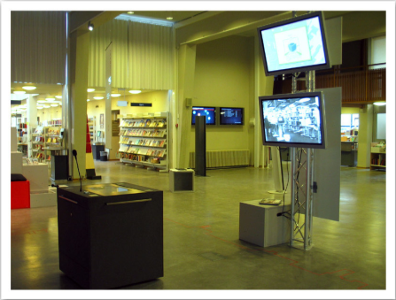
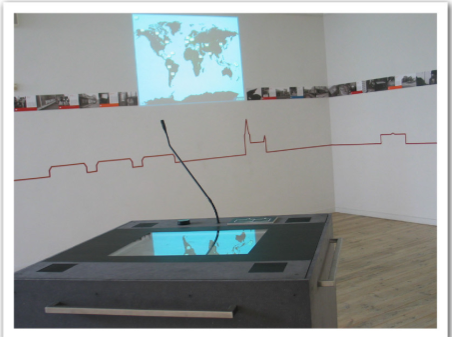
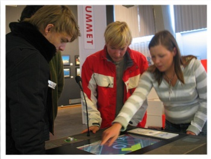
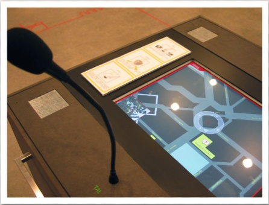

The theoretical vocabulary is used to analyse the experiential field of the interactive installation City Voices in affective terms. City Voices actively engages people in the exploration of, and interaction with, the installation, altering the affective tonality of the cityscape. The interactive technologies deployed create conditions of emergence for a range of relational events. Building on this analysis the article proposes the Massumian vocabulary as a rich field of questioning for the future analysis and design of interactive environments.

---

### Introduction

Digital technologies in new interactive environments are radically affecting the way we experience and make sense of the world. The advent of ubiquitous computing in particular has led to the development of advanced sensor technologies and microchips, moving the realm of computing from the desktop computer into broader contexts of interaction or interactive environments (Weiser, 1991). It seems, however, that there has been a shift from the original vision of ubiquitous computing in the light of the possibilities that a ubiquitous computational infrastructure has actually been shown to offer. Mark Weiser’s initial ideal of disappearing computers, so the technology resides in the background to let us focus on more important things, is no longer the only way of working with ubiquitous computing and technologies. Among others, Yvonne Rogers has proposed a new agenda for the design of UbiComp technologies focused on the creation of engaging user experiences, where the technology does not disappear but is actively used to create particular experiences (Rogers, 2006). In line with this, Petersen insists that objects and environments embedded with interactive technologies are becoming remarkable objects of lifestyle and identity (Petersen, 2004). {#para1}

This tendency is currently being explored in interaction design, described by Winograd (1997) as a heterogeneous academic discipline concerned with designing digital artefacts, based on an understanding of the relationship between humans and digital technology (Winograd, 1997: 161). This understanding is subject to changes due to developments in digital possibilities, human needs, and situated social as well as physical contexts (Thackara, 2001). Consequently, interaction design is forced to continually develop new theoretical, analytical, and practical tools that may contribute to the design of new interactive environments. These allow us to experiment with how we might live with the technologies in the future. {#para2}

Designing for living with ubiquitous technologies implies consideration of the experiential qualities that come into play to form our experience of designed interactive environments (McCarthy and Wright, 2004). The way the experiences offered by ubiquitous, interactive environments are conceptualised in interaction design largely determines the outcomes of the design processes. It therefore becomes necessary for interaction design to develop an understanding of, and a vocabulary to describe, how interactive environments and technologies might shape our situated affective experiences. {#para3}

This article introduces the notion of affect as it is developed in the philosophy of Brian Massumi as a contribution to meeting this challenge. Massumi develops a philosophy of experience which is particularly useful for investigating how ubiquitous interactive environments might engage us affectively. I will suggest here that this is primarily through the creation of fields of experience. The concept of affect itself is inherently relational. It describes the correlation between a person’s ability to think and feel and the body’s ability to act in the world. Taking Massumi’s notion of affect as a starting point for the design of experience-oriented interactive environments forces us to focus on the affective tonalities and the relational events that might emerge through the interaction. {#para4}

Before entering the conceptual development, however, I take a step back to relate ubiquitous computing to recent developments in experience-oriented interaction design. This sets the scene for introducing Massumi’s work on the concept of affect. Through an analysis of the interactive installation *City Voices* I develop an analytic understanding of how the installation changes our affective experience, bodily activation and capacitation in an interactive environment in a public setting. Following this analysis, I outline how taking the complexity of the concept of affect seriously in the design process can make it possible to sketch out new horizons for designing affectively engaging interactive environments. {#para5}

### Ubiquitous Computing and Experience-oriented Interaction Design

There can be no doubt that Mark Weiser’s *The Computer for the 21* *st* *Century* has been seminal for setting the agenda for most of the work done when designing and conceptualising ubiquitous computing in industrial as well as research settings. His vision of calm technologies that stay out of the way and disappear into the background, appearing only when and where we need them, has spurred a great many both practical and theoretical developments that make technologically enhanced living convenient and comfortable (Weiser, 1991; see Rogers, 2006 for a comprehensive project overview). Yet, in an article from 2006, Rogers argues that there is an enormous gap between the ‘dream of comfortable, informed and effortless living and the accomplishments of UbiComp research’ (Rogers, 2006: 405). Instead, she proposes that the field of ubiquitous computing should broaden its scope and address other goals than the seamless integration of digital technologies in our everyday living. This leads to an agenda for designing UbiComp technologies for what she terms ‘engaging user experiences’ (Rogers, 2006: 406): {#para6}

> The ‘excitement of interaction’ that Weiser suggested forsaking in the pursuit of a vision of calm living should be embraced again, enabling users, designers and researchers to participate in the creation of a new generation of user experiences that go beyond what is currently possible with our existing bricolage of tools and media. We should be provoking people in their scientific, learning, analytic, creative, playing and personal activities and pursuit. (Rogers, 2006: 418) {#para7}

The ideas presented by Rogers resonate with a general concern within the respective fields of digital art, digital aesthetics and interaction design. Bolter and Gromala (2004) use the concepts of transparency and reflectivity to describe two strategies in interface design. The aesthetics of the former is concerned with the disappearance of the media whilst the aesthetics of the latter invites and forces an active reflection on the part of the user in relation to the media. Recently, Munster (2006) has argued for an active understanding of the sensational and experiential aspects of interacting with new media. These should not be hidden away in the analysis and design, but further explored in facilitating new relations between people and digital technology: {#para8}

> Far from disposing of the senses, new media, whether commercially realized or experimentally proposed, point toward the synaesthetic disruptions and reconfigurations of bodily capacities and functions that might be made possible by digital technologies. (Munster, 2006: 19) {#para9}

Interaction design today is investigating theoretical and practical ways to uncover new contexts of use, along with new conceptualisations of users to design for. People are not always rational or striving for efficiency or transparency in their interaction with technology; happiness, reflection, provocation, and desire also play a functional role in the design of new, remarkable interfaces, products and interactive environments (Dunne, 1999). The shift is also manifested in the rise of the experience-oriented domain of interaction design. Among others, McCarthy and Wright (2004) argue that experience-oriented interaction design can lead to the creation of innovative and creative forms of digital technology with human experience as the turning point. {#para10}

A common concern in interaction design today can thus be said to be the articulation of a new vocabulary for addressing experiential concerns in design work along with an exploration of what that means for the future design of ubiquitous technologies. In this article I will argue that the concept of affect as developed by Brian Massumi can be beneficial for addressing and problematising this concern. The concept of affect is not foreign to recent developments in Human-Computer Interaction (HCI) and interaction design (see Fritsch, 2009 for a comprehensive overview). However, the Massumian notion of affect has yet to find its way into the discourse. In the following, I will introduce the vocabulary proposed by Massumi and argue that it might contribute to the challenges of designing affectively engaging, experience-oriented, interactive environments. {#para11}

### Affective Experience

Brian Massumi works at the intersection of philosophy, cultural theory, art, interactive architecture, politics and design. In his writings, he proposes a philosophy of experience which is inspired by radical empiricism primarily as this is exemplified in the work of William James. In radical empiricism, focus is on the relations between particulars. Relations that have the same ontological and epistemological status as the particulars themselves. Massumi talks about his own philosophical project as a form of expanded radical empiricism in which ‘experience is an additive “form of transition”, a continued motion of intersecting process lines: a co-motion (commotion) of mutual non-exclusion’ (Massumi, 2002: 213). {#para12}

According to Massumi, experience never stops. It can never be confined to a static, objective description. Experience is dynamic. However, it is possible to look into the formation of experience – how experience works, what makes us experience – bringing into play the relational complexity advocated by a radical empiricist philosophical approach. To arrive at a description of these general conditions of emergence of experience, Massumi argues that it is necessary to investigate that which comes before an actual experience, the preindividual. The notion of the preindividual is taken from French philosopher Gilbert Simondon to denote that which has not yet taken any determinate form, but modulates the formation of experience and the potential for action in a given situation. The preindividual is felt and experienced without being registered consciously. This does not mean, however, that it does not have an important impact on what we experience consciously. {#para13}

Thinking with Massumi in relation to interaction design offers a way to describe the dynamics that govern the transition from the non-conscious or preindividual dimensions of the experiential to the experienced. Thinking this way involves thinking about the workings of what Massumi in several places refers to as the field of experience (Massumi, 2002: 4). The field of experience addresses the potential for experience as much as the outcome, which is a qualified experience. Massumi specifically addresses this field through the notion of affect and the role it plays in our experiences in-the-making [1]. However, working with affect demands conceptual caution. It does not offer definite answers but rather what Massumi himself refers to as a ‘field of questioning’: {#para14}

> The notion of affect does take many forms, and you are right to begin by emphasizing that. To get anywhere with the concept, you have to retain the manyness of its forms. It’s not something that can be reduced to one thing. Mainly because it’s not a thing. It’s an event, or a dimension of every event. What interests me in the concept is that if you approach it respecting its variety, you are presented with a field of questioning, a problematic field where the customary divisions that questions about subjectivity, becoming or the political are usually couched in do not apply. (Massumi and McKim 2009: 1) {#para15}

When developing his notion of affect, Massumi takes as a starting point Gilles Deleuze’s reception of Spinoza’s idea of affect. This is affect as something which can be defined in terms of the capacity to affect or be affected. This definition makes it possible to think of affect in active terms, avoiding a strict focus on passive reception. Massumi stresses that the importance of the capacity to affect and the capacity to be affected are two facets of the same event. Capacitation here refers to a preindividual and virtual potential for action experienced affectively which may or may not translate into an actual(ised) action line. The power to affect and be affected governs a transition where a body passes from one state of capacitation to an augmented or diminished stat of capacitation, a transition which is felt. The felt quality of a given experience is that which characterises the feeling of the transition as the body moves from one power of existence to another, which is separate from the actual capacitation understood as potential for action. Massumi argues that positive affects are those that make us feel alive and act in the world. Negative affects have the opposite effect, reducing our possible activity in the world and making this reduction felt. {#para16}

In the Massumian affective account, a body is defined by what capacities it carries from step to step. The charge of affect is not something fixed and it plays out differently in any given situation. Instead of working with pre-determined and static notions of the experiential, and in keeping with the radical empiricist approach, focusing on affective experience stresses the relations that occur in the middle of a field of experience. It is necessary to understand relational events that play out differently every time, take up the past differently, creating new potentials for the future. Massumi underlines that an account of affect has to ‘…directly address forms of experience, forms of life, on a qualitative register’ (Massumi and McKim, 2009: 1). The affective position accounts for the way an experiential field – a potentialising set of conditions of emergence – effects our preindividual but felt relation to the world. In the following section this will be explored through the concepts of affective tonality and proprioception. This will allow a more elaborate description of the workings of the preindividual. {#para17}

### Affective Tonality and Proprioception

Massumi develops the concept of affective tonality from Alfred N. Whitehead who argues that we always apprehend the affective tone of a given situation. The affective tonality is not something residing in either the subject or the object. It emerges in the actual encounter while simultaneously modulating the occurrence [2]: {#para18}

> What Whitehead calls affective tonality is something we find ourselves in, rather than finding in ourselves. An embracing atmosphere that is also at the very heart of what happens because it qualifies the overall feel. (Massumi, 2007: 82) {#para19}

According to Massumi, the capacity to be affected and to affect is formed by the affective tonality of a given situation. However, rather than determining our lines of action the affective tonality is tied to tendencies that will always play out differently and event-fully in every situation. Some tendencies will actualise and some will remain in the virtual, but they still remain part of the really felt affective experience. Massumi emphasises that the body’s tendencies are also like this. They are activated as the body moves into and through situations. This leads to a relational complexity that provides conditions of emergence for more qualified experiences: {#para20}

> …the body is that region of in-mixing from which subjectivity emerges. It is the coming together of the world, for experience, in a here-and-now prior to any possibility of assigning categories like subject or object. (Massumi, 2009: 3) {#para21}

Starting from affect in the description of the body is ‘an invitation for an indefinitely constructive thinking of embodied, relational becoming’ (Massumi and McKim , 2009: 2). The tendencies in the body take many forms ‘as instincts, inclinations, teeming feelings, masses of memories, conscious and nonconscious’ (Massumi and McKim, 2009: 2). The question becomes one of exploring how this crowding is moved into a constitution, as a qualified experience. This question is ultimately a question of the emergence and formation of a subject: ‘The subject of an experience emerges from a field of conditions which are not that subject yet, where it is just coming into self’ (Massumi and McKim, 2009: 3). {#para22}

The notion of proprioception is also crucial to the Massumian experiential vocabulary. It is defined as the sensibility proper to the muscles and ligaments, as opposed to tactile sensibility (which is ‘exteroceptive’) and visceral sensibility (which is ‘interoceptive’). Proprioception is preindividual yet actualised, really felt bodily but not consciously reflected upon: {#para23}

> Proprioception effects a double translation of the subject and the object into the body, at a medium depth where the body is only body, having nothing of the putative profundity of the self nor of the superficiality of external encounter. (Massumi 2002: 59) {#para24}

Massumi argues that proprioception is always a primary phase in every sensation. It is the body’s self-feeling of a posturing for movement, nonconscious by nature, barely active before unfolding into action. It can only be felt, lived out, transduced into an ensuing action-line. Proprioception is an enactive awareness of the body’s own movement, affecting the body’s actual unfolding. The body’s capacity for action or activation is therefore this bodily field of potential, where affect is what connects the virtual series with their actual event-ful unfolding as real, preindividual tendencies forming an experiential field which might transform into personally qualified experiences (Massumi, 2002). In sum, proprioception actively works in and forms an experiential background. {#para25}

A Massumian approach to working with experience-oriented interaction design would account for the fields of experience offered by interactive, ubiquitous environments. It would uncover how they work affectively, offering particular conditions of emergence for the interaction. It would take into consideration the affective tonality of these environments, in terms of how they might activate and capacitate bodies as they move into and through interactive situations. It would describe the relational complexity of the events forming and being formed by the affective experience of moving through and with an interactive environment. In all this, an affective point of view necessitates looking into potential situations of emergence and the re-conditionings of the emerged in relation to becoming: {#para26}

> Conditions of emergence are one with becoming. Re-conditionings of the emerged define normative or regulatory operations that set the parameters of history (the possible interactions of determinate individuals and groups). (Massumi 2002: 10) {#para27}

In the following, through the analysis of the interactive installation *City Voices* , I will try to show how the preceding vocabulary can be used to describe the affective experience offered by a particular interactive environment. {#para28}

### *City Voices* as a Field of Experience

*City Voices* was a citizen involvement project in the form of an exhibition. It focused on gathering values and ideas for the design of the future Multimedia House, a 28,000 m2 building with surrounding areas, to be built at the harbour in Aarhus, Denmark from 2012-2015. The exhibition was designed by the architect and interaction design firm KOLLISION (www.kollision.dk). {#para29}

  {#para30}

Figure 1: *City Voices* at the main Library (left) and at the Aarhus Centre for Contemporary Art (right). {#para31}

  {#para32}

The project consisted primarily of two interactive installations; one exhibited in the main library of Aarhus and one in the Aarhus Centre for Contemporary Art (Fig. 1). Each installation involved an interactive table on wheels. When one moved the tables, a map displayed on a table top screen was panned, making the table a peephole into a larger digital map. A compass was wired to the tables, so the digital map would also relate to the physical placement of the table in terms of N-S-E-W directionality. The user would navigate the digital map by moving the table around in the physical room. It was possible to choose between three different digital maps to be displayed on the table; a local map of Aarhus, a map of Denmark, and a world map. On the table, parts of the maps would be displayed that could be navigated by moving the table. On the wall the user could see the full map and the selection of the map presented on the table (Fig. 1., Fig. 2). {#para33}

On each of these maps a number of scenarios were visualised on the interface. Each one contained a voice from the future discussing a personal experience in relation to the finished Multimedia House. The idea was to inspire the users to voice their own opinions and discuss their own experiences and expectations. A microphone on the table allowed the users to record their own scenario and leave it for the next user to encounter. During the process the users’ scenarios would be accumulated for all to hear along with the original scenarios. These user scenarios could be accessed through the two interactive tables and the project website. {#para34}

  {#para35}

Figure 2: People interacting with the table (left) and a close-up of the map displayed on the table, {#para36}

which you could only navigate by moving around in the physical room (right). {#para37}

  {#para38}

*City Voices* uses ubiquitous technologies in the design of an interactive environment experimenting with the affective tonality of the public setting. The installation is a post-desktop interface encouraging bodily movement in order to explore the digital content and physical constraints of the interaction with the system. The interactive tables are not facilitating the search for information or disappearing into the background. Instead, they actively foster curiosity and engaged exploration of the content of the exhibition by providing new means of interaction with the underlying digital system, contributing to a different affective experience of the technological setup. When you interact with *City Voices* , you are immediately engaged in the exploration of an experiential field activated by the installation. The need to move the table around in the exhibition space activates you proprioceptively. The table itself becomes an interface between your body and the system; your bodily movement is necessary to navigate the system, and this alters the affective tonality of the interaction. You explore actual movements in space, choreographed or performed by the installation. Simultaneously, the movement is registered proprioceptively and by the system itself processing the data. There is a doubling of a registering of movement. This is both visualised in the system and felt in the interaction, or more accurately occurring in-between as part of the affective tonality. {#para39}

The interactive tables and the coupling of the digital content and physical interaction with their co-emerging spatial realities profoundly alter the affective tonality. You interact with the table in a room based on a partial map of the city visualised on the screen on the table. Simultaneously you also orient yourself towards the larger map on the wall. Trying to navigate all three scales of interaction smoothly is almost impossible. You need to continuously stop and situate yourself in relation to the scale with which you are trying to connect. Attention shifts between interacting with the table, orienting yourself towards the visualisations on the walls and moving about in the room creating a complex relational space of interaction. Interestingly, though, the installation is rarely used by only one user. More people can easily gather in the room or around the screen, creating the scene for social interaction which in turn affects coordination of the movements and explorations. {#para40}

*City Voices* seeks to engage people in the future planning of the city landscape by providing cues as forms of scenarios. These are meant to trigger a participation in the project that involves leaving a voice message. It remains possible that the interaction with the setup might in the future effect a change in the cityscape when the Multimedia House is built. This is capacitation on a different experiential level, yet it still feeds into the affective experience within a defined interactive setup. At the same time, the engagement with *City Voices* goes beyond the immediate and already doubled spatio-temporality of the interaction with the installation here-and-now. It facilitates a possible long-term relationship or more correctly a possible re-occurrence or retro-activation of the interactions preserved in the data collected and presented both on the two interactive tables and on the shared website. {#para41}

What exists virtually as part of the future of the cityscape is activated and partly actualised through *City Voices* as relational events. The installation tries to make existing and new relations felt differently. *City Voices,* like the name suggests, gives people a ’voice’, it creates the potential for strong affective ties by capacitating people, giving them an opportunity to voice their opinions and feelings. In this way, the installation ’bridges’ the affective with emotivity, emotions, narratives and communication. All these thresholds of the experiential continuum are somehow activated and distributed in the physical, social and affective spaces the installation creates. {#para42}

In this analysis, the concept of affect and the resulting vocabulary work to describe the experiential field that is offered by the particular interactive setup *City Voices* . People are invited to activate and affect the setup; in turn, there is an affectation through movements, interactions and reflections. How this affectation or activation is lived or felt depends on the specific situation; the relational events play out differently every time. However, the engaged exploration and the experiential field facilitated by the interaction design does offer the potential (and an invitation) for activation and capacitation. In this respect, *City Voices* is an experimental exploration of how a designed urban interactive environment might take a wholly relational and interactional form by altering the affective tonality of interaction, in a public setting, and with digital and ubiquitous technologies. The technological exploration investigates new forms of proprioceptive engagement in the interactional events. Finally, the installation provides conditions of emergence and cues for re-conditions of the emerged that might or might not translate into more stable or qualified forms of becoming. {#para43}

### Concluding Remarks

The analysis of *City Voices* can be seen as an example of how the design of an interactive environment – and the analysis of the experiential field it offers – might be conceptualised in affective terms. Rather than disappearing, the digital technology in *City Voices* is used actively to engage users in the exploration of the installation, thus experimenting with the affective tonality of the cityscape, the interactive situation and the possible relational events that might emerge. Ubiquity in this setting results in a complex interaction design of a possible space stirring with activation and affective capacitation. {#para44}

The Massumian understanding of affect as developed in this article has the potential to offer important insights concerning the theoretical foundations for practical design experiments with experience-oriented interaction design. However, in keeping with the Massumian philosophy of experience, it is important to stress that affective experience cannot and should not be used as a blueprint for design. Arguably, the notion of affect with its attached vocabulary raises more questions than it answers. This is exactly the point; the concept of affect offers to interaction design, as it does to philosophy and cultural theory, a ‘field of questioning,’ a problematic field ‘starting in the middle with the full complexity and dynamics of fields of experience.’ This, to me, seems to be the right place to start any experience-oriented design process. {#para45}

### Biographical Note

Jonas Fritsch holds a PhD in interaction design and is currently Assistant Professor at Aarhus University. He works on a multitudinous thinking-together of interaction design and affect theory in conjunction with practical design experiments carried out at the Centre for Digital Urban Living (www.digitalurbanliving.dk) and the Centre for Advanced Visualization and Interaction (www.cavi.dk) in the Department of Aesthetics and Communication. He holds an MA in Information Studies with a supplementary degree in Aesthetics and Communication from la Nouvelle Sorbonne, Paris and is a member of the SenseLab, Concordia University.

### Notes

- [1] Importantly, in a Massumian vocabulary affect is distinct from emotions or feelings that can be seen as a recognized outcomes of affect (Massumi, 2002: 61).

- [2] In line with this Erin Manning argues that the affective tone can also be described as the relational concernedness of the emerging world, again highlighting the radical empiricist approach and the relational as integral to a description of the affective experience (Manning, 2009).

### References

- Bolter, Jay David & Gromala, Diane. *Windows and Mirrors: Interaction Design, Digital Art and the Myth of Transparency* (Cambridge, Mass.: MIT Press, 2003).

- Dunne, Anthony. *Hertzian Tales – Electronic Products Aesthetic Experience and Critical Design* (RCA Research Publications, 1999).

- Fritsch, Jonas. ‘Understanding Affective Engagement as a Resource in

- Interaction Design’, *proceedings of the Nordic Design Research Conference* , *NORDES’09: Engaging Artifacts* , 2009.

- Manning, Erin. *Relationscapes: Movement, Art, Philosophy* (Cambridge, Mass.: MIT Press, 2009).

- Massumi, Brian. *Parables for the Virtual: Movement, Affect, Sensation* (Durham/London: Duke University Press, 2002).

- Massumi, Brian and McKim, Joel. ‘Of Micropolitics and Microperception [interview],’ in *Inflexions* 3 (Nov. 2009).

- Massumi, Brian (2007): The Thinking-Feeling of What Happens. In Massumi, B., Mertins D., Spuybroek, L., Marres, M. and Hubler, C. (eds). *Interact or Die: there is Drama in the Networks* (NAI Publishers, 2007), 70-91.

- McCarthy, John C. and Wright, Peter. *Technology as Experience* (Cambridge, Mass.: MIT Press, 2004).

- Munster, Anna. *Materializing New Media – Embodiment in Information Aesthetics* (Dartmouth College Press, Hanover, New Hampshire: University Press of New England, 2006).

- Rogers, Yvonne. ‘Moving on from Weiser’s Vision of Calm Computing: Engaging UbiComp Experiences.’ In Dourish, P. and Friday, A. (eds.): *Proceedings of UbiComp 2006* (Springer-Verlag Berling Heidelberg, 2006) 404-421.

- Petersen, Marianne Graves. ‘Remarkable Computing – the Challenge of Designing for the Home.’ (Late Breaking Results Paper, *Proceedings of CHI 2004* , 2004) 1445-1448.

- Winograd, Terry. ‘From Computing Machinery to Interaction Design’, in Denning, P. and Metcalfe, R. (eds). *Beyond Calculation: The Next Fifty Years of Computing* (Springer-Verlag *,* 1997) 149-162.

- Thackara, John. ‘The Design Challenge of Pervasive Computing’, *Interactions* , (May-June 2001) 46-52.

- Weiser, Mark (1991): The Computer for the 21st Century. Scientific American.

- Zournazi, Mary ‘Navigating Movements: an Interview with Brian Massumi.’, *21C Magazine* 2002. Retrieved from https://www.21cmagazine.com/issue2/massumi.html.
