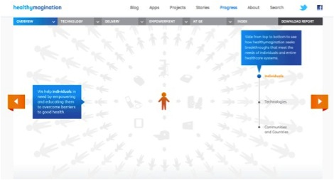
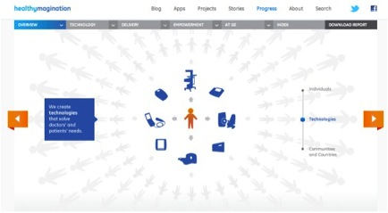
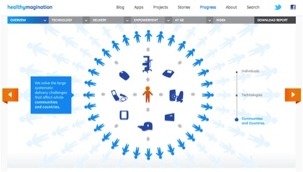
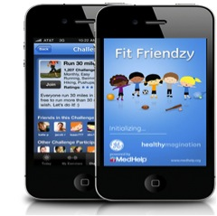
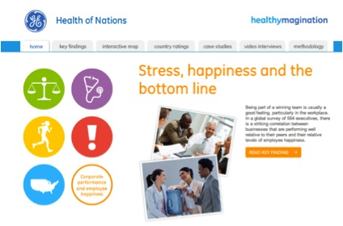

---

In 2010 General Electric launched an initiative called Healthymagination. On its website, GE declared that Healthymagination is about becoming healthier, ‘through the sharing of imaginative ideas and proven solutions’. Looking to explore/exploit the growing field of health information technologies, GE declared that through sharing health information in the networked social space, we could imagine a future where medical conditions of our bodies – together with our identities – will be transformed and enhanced. Under the slogan of ‘Imagination at Work’, GE’s advertising campaign invites us to imagine such future: {#para1}

> Imagination. It’s the most powerful resource on earth. And at GE we are using it right now. To create innovative technology that will improve the health of our economy, the health of the earth, and the health of its people. {#para2}

Featuring a multicultural assortment of people gazing at city skylines, test tubes, double helixes, wind turbines and other signifiers of scientific and technological progress, GE invites us to imagine a utopia where we can have an automatically rendered better life. This campaign illustrates how cultural visions of utopia are often signified through an unproblematic usage and development of technologies. More importantly, it introduces a notion of imagination as work – an immaterial labor that maximises our bodies’ capacity to affect and be affected (Clough, 2007). This utopian world is enabled through the regime of anticipation, which combines the affective with the possible to produce future subjectivities (Adams, Murphy, and Clarke, 2009). Moreover, Healthymagination is an apt signifier of the emerging Health 2.0 movement – a growing effort to marry Web 2.0 technology, participatory discourse, and network subjectivity to health care and management. Through tracking, reporting and sharing of our health data we are transported into a utopian world where we obtain a mastery of our future selves. In this essay, I argue that the investment in the health of our future selves creates actionable conditions for our present selves – a participation in the moral economy of the network, where subjects are bound by a morality that necessitates sharing of our data with others. In the utopia of Healthymagination specifically – and Health 2.0 in general – the vision of a future healthy self therefore is bound with the health of the network. Through the regime of anticipation, networked utopias of Health 2.0 produce risk subjectivities engaged within an affective investment in the neoliberal market economy. {#para3}

In February 2009, as a part of its stimulus package, the Obama administration allocated $19 billion dollars in incentives to jump-start the adoption of digital medical records (Lohr, 2009). This reflected a larger move to promote wider access and data integration in the health information technology field. Wal-mart, for example, made a push into the market for electronic health records by developing and distributing cheaper hardware and software technology for physicians in small offices (Lohr, 2009). At the same time, Google Health allows users to keep and send their information as a digital file, easily transmittable to the clinic or accessible online. Google has taken the quest for accessibility seriously, releasing a smart-phone application called Health Cloud, which allows users to always have access to their health information. The advertised benefit is the promise of centralised health information at users’ fingertips (Farnham, 2009). The Office of the National Coordinator has also promoted the adoption of health information technology, and development of The Nationwide Health Information Network (NHIN) billed as a ‘network of networks’. {#para4}

These health information technology initiatives, which advance access and interconnectivity between users and clinics, are a part of a Health 2.0 movement traditionally defined as ‘the use of social software and light-weight tools to promote collaboration between patients, their caregivers, medical professionals, and other stakeholders in health’ (Sarasohn-Kahn, 2008). However there is more to Health 2.0 than the promotion of information communication technology and health care collaborations. While issues of access are important, Health 2.0 sees itself as a movement that stresses community building and patient participation, ‘all with result of patients increasingly guiding their own care’ (Holt, 2009). As such Health 2.0 positions itself as a part of what Deborah Lupton called ‘the new public health’, an approach based on socially oriented, community-based, and preventative aspects of health promotion (Lupton, 1999). She considers that the new public health constructs a neoliberal subject: ‘a responsible citizen who is encouraged ‘to become “subject to ourselves”…. This includes undertaking self-reflection and self-improvement activities that dovetail with governmental objectives as part of our efforts to achieve individual success and happiness’ (289). {#para5}

As a result, the Health 2.0 movement positions itself as a participatory process, one through which users of health information technology are reconstituted as responsible and active patient-citizens as evidenced by these definitions: {#para6}

> Health 2.0 defines the combination of health data and health information with (patient) experience through the use of ICT, enabling the citizen to become an active and responsible partner in his/her own health and care pathway (Boss etc, 2008) {#para7}

Or {#para8}

> Health 2.0 is participatory healthcare. Enabled by information, software, and community that we collect or create, we the patients can be effective partners in our own healthcare, and we the people can participate in reshaping the health system itself (Eytan, 2008). {#para9}

This sentiment is echoed throughout Health 2.0 discourse. Online communities such as PatientsLikeMe.com or CureTogether.com connect patients, provide a virtual space for support groups, but also mine patient data to affect medical research and trials. These sites, like access engines such as Google Health, fully embrace and use the participatory discourse of the Health 2.0 movement, and their supporters insist that health information technology and social media tools have had radical effects on the health care industry in general. For example, Shaw (2009) argues that we are witnessing a healthcare reformation equivalent of the Reformation: {#para10}

> Traditional paternalistic relationships between patients and doctors are being undermined in much the same way as the religious Reformation of the 16th century empowered the laity and threatened the 1,000-year-old hierarchy of the Catholic Church in Europe. The Reformation had irreversible consequences for Western society; the implications of the health -care reformation could also be profound…. In our age, the “bible” is medical information, the technology is the Internet, and the priests are the medical profession. The Internet has brought the canon of medical knowledge—previously accessible only in expensive textbooks, subscription journals, and libraries—into the hands and homes of ordinary people. {#para11}

And in a *New York Times* article titled ‘Logging in for Second, Third Opinion’ Dr. Ted Eytan, medical director for delivery systems operations improvement at the Permanente Federation, opines ‘patients aren’t learning from Web sites — they’re learning from each other’. The shift is nothing less than democratisation of health care, he goes on, adding, ‘Now you can become a national expert in your bedroom’ (Schwartz, 2008). Here medical expertise is redefined as access and participation in web-based communities – a promotion of a networked utopia where health information is distributed and shared equally amongst all participants. The burden of care is then placed on responsible neoliberal citizen subjects (Lupton, 1999), as public health is individualised and reassigned away from institutions (Levina and Quinn, 2011). {#para12}

The shift towards embracing what California HealthCare Foundation terms ‘the wisdom of patients’ positions health information technologies within a larger school of thought emphasising the social media-based wisdom of aggregates, or crowds. In this vein, Clay Shirky – an author of popular books on crowdsourcing and new media – argued at a 2008 Health 2.0 Conference that ‘patients in aggregate behave very differently than when solo… what you do when you get a bad diagnosis – you fire up Google, find out who has what you have, and then talk to them. That ability, for patients to pool their resources, is a massive change to the health industry’ (Davis, 2008). In a 2008 report for the California HealthCare Foundation, Jane Sarasohn-Jahn posits that the collective wisdom of patients, aggregated through social media technologies, could yield knowledge beyond any single patient or doctor. She argues that Health 2.0 is the result of trends in the accumulation and sharing of collective wisdom; ‘a new movement that challenges the notion that health care happens only between a single patient and doctor in an exam room’ (Sarasohn-Kahn, 2008). The inherent characteristics of social media technologies will generate better, more useful knowledge, as collective wisdom challenges dependence on a single expert opinion. Here the information collected through Health 2.0 practices is juxtaposed with the knowledge generated through medical institutions, as Sarasohn-Kahn describes an ideal information-sharing scenario: {#para13}

> When patients managing the same chronic condition share observations with each other, their collective wisdom can yield clinical insights well beyond the understanding of any single patient or physician. Similarly, when physicians share information with each other online, the results go well beyond the doctor’s lounge — the traditional locale for exchanging clinical experiences and insights. {#para14}

A promotional video for 2008 Health 2.0 Conference also advocates for collective participation and information aggregation. A retelling of the history of medicine from Ancient China to Web 2.0, the video welcomes us to Health 2.0 and states that ‘Health is Information Technology; Health is US. Welcome to Health 2.0!’ Using scenes of a terminal cancer patient blogging at CarePages.com the video echoes the sentiment of other Health 2.0 NGOs, physicians, and advocates. This is the claim that Health 2.0 movement is, at its core, a solution to institutional power inherent in the current medical system. Health 2.0 discourse presupposes that unrestricted access to information combined with social media participatory practices will ultimately lead to liberation from the hierarchical, and often arbitrary, structure of the current health care system. The video’s statement that health is information technology is a quite literal claim that access to information through social networking tools will not only liberate us, but will, in fact, make us healthy. The imagined visions of a healthy future are therefore tied to participation in these networks. Healthymagination echoes this point. Figures 1-3 illustrate how, in its annual report, GE facilitates a connection between individuals and networks of communities and countries, a connection mediated through technologies. Technologies might enable networked utopias, but it is through participation in the network that an individual becomes a part of those utopian visions. {#para15}

  {#para16}

A proper theorising of the Health 2.0 movement and its utopias needs to be grounded within the rise of a network society and, with it, a system of power relations necessitated by the emergence of globalisation and information technology (Castells 2000, Hardt and Negri, 2000). Castells (2000) argues that network society is characterized by the pre-eminence of social morphology over social action; logic that privileges network form, expansion, and information flows over any particular social interest – a prioritisation of the power of flows over the flows of power. As a non-linear power relation, which operates through decentralised relations of sociability, network power operates through regulations of standards as opposed to the enforcement of a sovereign will (Singh Grewal, 2008). This does not mean that network power is democratic, but rather that it is a diffuse system of control and regulation operating through a multitude of nodes. As a result, David Singh Grewal (2008: 9) argues, ‘aggregate outcomes emerge not from an act of collective decision-making, but through the accumulation of decentralised, individual decisions that, taken together, nonetheless conduce to a circumstances that affects the entire group’. Network power is therefore a complex system of coordination and expansion:

> First, that coordinating standards are more valuable when greater numbers of people use them, and second, that this dynamic – which I describe as a form of power – can lead to the progressive elimination of the alternatives over which otherwise free choice can effectively be exercised…. when these ideas are considered together, the central premise of network power is that the benefits that come from using one standard rather than another increase with the number of users, such that dominant standard can edge out rival ones (Singh Grewal 2008: 9). {#para17}

This example illustrates how Health 2.0 functions as constitutively social process of network power. Network power operates through decentralised relations of sociability, and as such it is always relational, always circumstantial, and always mutable. It also encourages relations of sociability in order to facilitate expansion. As Michael Hardt and Antonio Negri (2000: 166) argue, ‘network power must be distinguished from other purely expansionist and imperialist forms of expansion. The fundamental difference is that the expansiveness of the immanent concept of sovereignty is inclusive, not exclusive. In other words, when it expands, this new sovereignty does not annex or destroy the other powers it faces but on the contrary opens itself to them, including them in the network’. The power of the network is in its continuous and constant growth and openness to divergence and difference (Terranova, 2004). This does not make the exercises of power benign; indeed network power operates through incorporation of dividend elements. Nothing can or should be outside of the network (Galloway and Thacker, 2007). Therefore participation in networks requires a commitment toward incorporation in the systems of network power. This commitment is enacted through a donation of the vital lifeblood of the network – information. Whereas networks function as control apparatuses, information gives control its material existence; it is what makes control matter (Deleuze, 1995). Alexander Galloway and Eugene Thacker (2007) argue that protocol – a horizontal, distributed control apparatus that guides formations of networks – functions in computer and biological networks when it directs the flow of information. In that sense, ‘information is the concept that enables a wide range of networks – computational, biological, economic, political – to be networks. Information is a key commodity in the organisational logic of protocological control’ (Galloway & Thacker, 2007: 57). Generating information gives networks capacity to grow, to regulate, and to circulate. This is the underlying logic, or protocol, of the network. Information flows in the network are not inconsequential; they alter topologies, relationships, and identities. Tiziana Terranova (2004) adds that ‘the rise of the concept of information has contributed to the development of new techniques for collecting and storing information that have simultaneously attacked and reinforced the macroscopic moulds of identity’ (Terranova, 2004: 34). Therefore, a constant movement of information in networks encourages volatile spaces, random relationships, and in-flux identities. In the control society, you are your information. Deleuze (1995: 80) points out ‘the digital language of control is made up of codes indicating whether access to some information should be allowed or denied. We are no longer dealing with a duality of mass and individual. Individuals become ‘dividuals’, and masses become samples, data, markets, or “banks”’. As a ‘dividual’, the corporeal self can only know the materiality of its existence through data. The data body is distinguishable from a corporeal experience only by the virtue of translation of bodily experience into transferable and alterable data sets. These data sets make the promise of future health imaginable, manageable and actionable in the present. Moreover, identity constituted by and through these data sets is identity in-flux. It can always be changed and altered. More importantly it can only be understood in the context of other data. Therefore, in the control society, dividuals can understand themselves only in terms of relationship to others in the network. This carries enormous consequences in construction of network utopias. In order to participate in the utopian visions, and, in our case, to imagine a ‘healthy’ future and to engage in the very functioning of Healthymagination, dividuals must consent to the logic of the network power in the present moment. The investment in the health of our future selves creates actionable conditions for present moment selves – a participation in the moral economy of the network, where subjects are bound by a morality that necessitates sharing of personal data with others. This introduces a new – post-network – care of self: one that irrevocably ties the health of the individual to that of the network. {#para18}

GE’s Healthymagination creates a utopian narrative, promising affective rewards of health, fun, and ease in the ‘imagined’ future. Its mission statement states: {#para19}

> Healthymagination is about becoming healthier, through the sharing of imaginative ideas and proven solutions…. GE created Healthymagination to gather, share and discuss healthy ideas. Because *healthymagination is about becoming healthier together* [emphasis added], it takes the form of multiple projects that you can participate in, whether you’re looking to change your lifestyle or fine-tune your approach to health. Making healthy decisions should be easy…and fun.
>
> What particularly situates this utopian narrative in network culture is the ideal of social collective. For example, CureTogether – a Health 2.0 forerunner in the field of self-tracking and data donation – is an online service that allows users to track their health data, alongside others, in hundreds of conditions ranging from ‘depression’ to ‘aging’. On the ‘About’ page, the company is described:
>
> Imagine patients around the world coming together to share quantitative information on over 500 medical conditions. They talk about sensitive symptoms and compare which treatments work best for them. They track their health. New research discoveries are made based on the patient-contributed data. This is happening at CureTogether, and we believe it can have a massive global impact (About CureTogether, 2010). {#para20}

Whereas in nationalist narratives, citizen bodies are discursively tied to that of the nation-state – a healthy soldier means a healthy country – in the network society citizen bodies serve as stand-ins for the network itself (Levina, 2009). Therefore, citizen bodies become subject to the network logic that determines the network’s health through expansion and growth. And this growth demands a constant flow of information. As citizen bodies become enveloped in the functioning of network power, the care of self is reconfigured in terms of how much information we donate to the network. The promises of a better and healthier network and, therefore, a better and healthier self rely on leveraging the present state of ‘the possible’ into an optimal future. These are a part of what Adams, Murphy and Clarke (2009) calls the regime of anticipation. Anticipation is important to any imagining of possible futures, as ‘anticipation is the palpable sense that things could be (all) right if we leverage new spaces of opportunity, reconfiguring “the possible”’ (246). Anticipation sets up a moral economy ‘in which the future sets the conditions of possibility for action in the present, in which the future is inhabited in the present’ (249). Utopian visions necessitate an active positioning toward the future; it becomes a moral responsibility of citizens to secure their ‘best possible futures’ (256). Therefore, a theoretical consideration of utopia necessitates a consideration of present actions required to secure that possible future. I argue that the future networked utopia is reliant on present data sharing to assure future growth and expansion. Therefore a moral economy of the network is an imperative of constant and consistent data sharing. We are offered a utopian vision of healthy networks and, by extension, healthy citizen bodies. In fact, as illustrated above, narratives of good citizenship abound in the Health 2.0 discourse. These narratives are directly relatable to the primary objective of Health 2.0 to enable technologically mediated information flows from individuals to the network. For example, Healthymagination has launched several phone applications that enable individuals to track and share their sleep patterns (Sleep on It), mood (Moody Me), and pregnancy (I’m Expecting). The link between data sharing and well-being is made explicit in these – Moody Me’s slogan is ‘Have More Happy Days!’ The latest application in the series is Fit Frendzy that beckons individuals to ‘get in great shape and have a blast doing it! Get motivated by joining your friends in exercise challenges!’ Exclamation signs abound in networked utopia. {#para21}

These utopian narratives depend on a present imaginary, which combines the affective with the possible to produce a future self (Gregg and Seigworth, 2010). For example, another Health 2.0 start-up, HealthTap, whose mission is to empower through data collection and donation, promises {#para22}

> At HealthTap, *we are committed to creating a healthier, happier world – one decision at a time* [my emphasis]. We envision people everywhere making confident, informed, fact and data based choices that maximize their health and improve their well-being. We see a future of true individualized medicine, where people’s increased control of their health reduces anxiety and increases optimism. (Vision/Credo, 2010).
>
> In this case, the affect is future oriented, it promises to create happiness and increase optimism at an unidentifiable future point in time. As Sarah Ahmed (2010) argues, the promise of happiness is what allows happiness to be out and about, in other words, happiness, and its affect, is always future oriented. The promise of happiness is contagious and contingent (Ahmed, 2010). As articulated by another Healthymagination slogan ‘Good Health is Contagious’ the promise of happiness, while future oriented, always summons a present moment citizen orientation toward the network –good health is contagious because information about health is always shared within the network. As Seigworth and Gregg (2010: 3) argue ‘the capacity of a body is never defined by body alone but is always aided and abetted by, and dovetails with, the field or context of its force relations’. The state of becoming is contingent on others, so in the promise of a happier future we enable network health in order to, someday, guarantee ours. {#para23}

In short, anticipation becomes a moral obligation of good network citizenship. As Adams, Murphy, and Clarke (2009) write, ‘the obligation to “stay informed” about possible futures has become mandatory for good citizenship and morality, engendering alertness and vigilance as normative affective states…. Anticipation is not only an epistemic orientation toward the future, it is also a moral imperative, a will to anticipate’ (254). A moral imperative of anticipation, when manifested through network narratives, obligates data collection and sharing, but also necessitates a positioning toward the present day subjectivity of its citizens. It requires us to think of ourselves as risk subjects. In fact, risk subjectivity is an essential part of network’s moral economy and an imperative part of imagining utopian futures. In order to be able to project into the future, we need to see ourselves at risk in the present. We must consistently imagine ourselves as always already diseased subjects. Nikolas Rose (2007: 20-21) argues that technologies of life construct narratives of susceptibility through which we construct our present and future risk identities: {#para24}

> The idea of susceptibility brings potential futures into the present and tries to make them the subject of calculation and the object of remedial intervention. This generates the sense that some, perhaps all, persons, though existentially healthy are actually asymptomatically or pre-symptomatically ill. Technologies of life not only seek to reveal these invisible pathologies, but intervene upon them in order to optimize the life chances of the individual. Hence new forms of life are taking shape in the age of susceptibility, along with new individual and collective subjectifications of those, ‘at risk’, and, of course, new extensions of the powers of expertise potentially to all who are now understood as ‘pre-patients’. {#para25}

Risk subjectivity becomes a part of moral economy of the network because it justifies the affective labor necessary for consistent data donation and sharing. For example, when you become a member of CureTogether, you can select a condition, take surveys tracking symptoms you have and treatments you find most helpful, compare your answers with others in your condition, and see how various treatments rank in effectiveness. You can participate in daily tracking, a feature of the forum that monitors weight, sleep, exercise, caloric intake, and other events using day-to-day calendar. You can also choose to fill out lab reports – a feature that asks users to essentially report their blood tests. These multiplicities of data donation are time and labor intensive. Therefore, there has to be an affective value to these acts. As we imagine ourselves as risk subjects or pre-patients, we are affectively bound to the network: our future well-being is tied to those of other risk subjects. This connectivity is illustrated by a Healthymagination advertisement that shows doctors across the globe asking their patients to say ‘Aahh…’. As images of children and adults flash across familiar and remote locations, ‘Aaahs’ combine to create Beethoven’s ‘Ode to Joy’. The voiceover says ‘At GE, we’ve dedicated some of the best minds, and most advanced technology to bring better health to more people. It’s an idea we call Healthymagination, and we think it just might catch on’. Here each individual’s health is literally and figuratively connected to others across the globe, such that their voices are formed together as one to sing a hymn to happiness. {#para26}

In this essay, I argued that the investment in the health of our future selves creates actionable conditions for present moment selves – a participation in the moral economy of the network, where subjects are bound by a morality that necessitates sharing of their health data with others. This introduces a new, post-network, care of self that irrevocably ties health of the individual to that of the network. An imperative of anticipation, manifested through the network, obligates data collection and sharing and necessitates a certain orientation toward the present day subjectivity of citizens. By optimising risk subjectivities, Health 2.0 narratives ask us to imagine a future where we are most happy and healthy. But healthier and happier to do what? What is to be done with our optimised future subjectivities? According to the logic of Health 2.0, and arguably network culture as a whole, these optimised future selves need to be made productive in the present, which means that network utopias require an engagement with neoliberal market economy. The moral economy of the network produces risk subjectivities and also embeds them within particular economic strategies of neoliberal governance. As Brian Massumi (2005) argues: {#para27}

> Neoliberal governance goes hand in hand with a culture of risk. It is an art of dosages, knowing when and how much to intervene to avert accumulations of danger and sudden breaks. When action is necessary, its aim must be to recalibrate the market’s self-regulation… This form of capital is unqualified. It is whatever-activity, measured not in labor-time but in life-time. Productive powers shade into powers of existence…. Productive powers are now growth factors, powers to be, becoming…. Whatever amplifies an individual’s productive powers eventually settles into a reinforcing systemic adjustment, through a higher-equilibrium seeking multiplier-effect contributing to the health of the economy. Whatever amplifies an individual’s productive powers is thus an economic factor…, whatever an individual does in life becomes an economic factor. The system runs on life capital, ‘human capital’ (2). {#para28}

As far as neoliberal governance and the production of human capital are embedded within network practices, they are also tied to the imagining of future utopias. A will to anticipate the future relies on certain market predictions and assumptions. Gary Wolf, a co-founder of Quantified Self, a web company and a movement that encourages people to track their data – writes, ‘for many self-trackers, the goal is unknown. Although they may take up tracking with a specific question in mind, they continue because they believe their numbers hold secrets that they can’t afford to ignore, including answers to questions they have not yet thought to ask’ (Wolf, 2010). Here moral imperatives of risk subjectivities are specifically tied to productivity and epistemology. It is impossible to know the future, but it is possible to be a productive working member of a networked utopia. As a project dedicated to optimising worker health states, ‘being part of a winning team is usually a good feeling, particularly in the workplace. In a global survey of 554 executives, there is a striking correlation between businesses that are performing well relative to their peers and their relative levels of employee happiness’ {#para29}

As Sarah Ahmed (2010: 30) argues, ‘to explore happiness using the language of the affect is to consider the slide between affective and moral economies’. I would argue that networked utopias represent unique spaces where this slide becomes most evident. To engage with utopia is to embrace a certain vision of the future – to form an affective attachment to something that can never be. And to be a good citizen of the network is to engage in moral and economic practices of data sharing, to see our self as a risk subject always dependent on the network for future health. Therefore, network utopias are interesting not because of what they reveal about the future, but rather what they say about our current moral and ethical obligations to self and others.

### Biographical Note

Marina Levina is Assistant Professor at the Department of Communication at the University of Memphis. Her research focuses on cultural studies of science, technology and medicine and critical media studies. She published work on citizen bioscience, personal genomics, and cyberfeminist practices in Health 2.0 discourse. She co-edited a collection *Post-Global Network and Everyday Life* (Peter Lang, 2010).Currently, she is working on a book titled *Pandemics in the Media* (under contract with Peter Lang) and an edited collection titled *Monster Culture in the 21st Century* (with Diem-my Bui; under contract with Continuum Press).

### References

- Ahmed, Sara. ‘Happy Objects’, in Melissa Gregg and Gregory J Seigworth (eds.) *The Affect Theory Reader* (Durham: Duke University Press, 2010), 29-51.

- Adams, Vincanne, Murphy, Michelle, and Clarke, Adele E. ‘Anticipation: – Technoscience, Life, Affect, Temporality’. *Subjectivity*, 28.1 (2009): 246-265.

- Bos, Lodewijk, Marsh, Andy, Carroll, Denis, Gupta, Sanjeev, and Rees, Mike ‘Patient 2.0 Empowerment’. In Hamid R. Arabnia, Andy Marsh (eds.), *Patient 2.0 Empowerment Proceedings of the 2008 International Conference on Semantic Web & Web Services* (2008), 164-167.

- Castells, Manuel. *The Rise of the Network Society* (2nd ed.) (Oxford: Blackwell Publishers, 2000).

- Clough, Patricia. *The Affective Turn : Theorizing the Social*. (Durham: Duke University Press, 2007).

- Davis, Lidija. ‘Health 2.0 and The New Economics of Aggregation.’ *ReadWriteWeb* (October 22, 2008), [https://www.readwriteweb.com/archives/health_20_economics_of_aggregation.php](https://www.readwriteweb.com/archives/health_20_economics_of_aggregation.php).

- Deleuze, Giles. *Negotiations, 1972-1990*. (New York: Columbia University Press, 1995).

- Farnham, Kevin. ‘Google Health: Now on Your iPhone’, *Programmable Web* (March 30, 2009), [https://blog.programmableweb.com/2009/03/30/google-health-now-on-your-iphone/](https://blog.programmableweb.com/2009/03/30/google-health-now-on-your-iphone/).

- Eytan, Ted. ‘The Health 2.0 Definition : Not just the Latest, The Greatest!’ *E-Health. Patient Empowerment* (June 13, 2008), [https://www.tedeytan.com/2008/06/13/1089.](https://www.tedeytan.com/2008/06/13/1089.)

- Galloway, Alexander and Thacker, Eugene. *The Exploit: a Theory of Networks*. (Minneapolis: University of Minnesota Press, 2007).

- Gregg, Melissa and Seigworth Gregory J (eds). *The Affect Theory Reader* (Durham: Duke University Press, 2010).

- Hardt, Michael and Negri, Antonio. *Empire*. (Cambridge Mass.: Harvard University Press, 2000).

- Holt, Matthew. ‘Health 2.0: User-Generated Healthcare’, *Health 2.0 Blog* (February 3, 2009), [https://www.ncvhs.hhs.gov/090226p3.pdf](https://www.ncvhs.hhs.gov/090226p3.pdf).

- Levina, Marina. ‘Regulation and Discipline in the Genomic Age: A Consideration of Differences Between Genetic Engineering and Genomics’, In Sam Binkley and Joe Capetillo (eds.), *A Foucault for the 21st Century: Governmentality, Biopolitics and Discipline in the New Millennium* (Newcastle: Cambridge Scholars Publishing, 2009), 308-319.

- Levina, Marina and Quinn, Roswell. ‘From symptomatic to pre-symptomatic patient: the tide of personal genomics’, *Journal of Science Communication* 10.3 (2011): C03-C07.

- Lohr, Steve. ‘Wal-Mart Plans to Market Digital Health Records System’, *The New York Times* (March 11, 2009).

- Lupton, Deborah ‘Developing the “whole me”: Citizenship, neo-liberalism and the contemporary health and physical education curriculum’, *Critical Public Health* , 9.4 (1999): 287-300.

- Massumi, Brian ‘The Future Birth of the Affective Fact’, *Conference Proceedings: Genealogies of Biopolitics* (2005), [https:// www.radical empiricism.org/biotextes/textes/massumi.pdf](https:// www.radical empiricism.org/biotextes/textes/massumi.pdf).

- Sarasohn-Kahn, Jane. ‘The Wisdom of Patients: Health Care Meets Online Social Media’, *California HealthCare Foundation ihealth Reports* (2008),[https://www.chcf.org/topics/chronicdisease/index.cfm?itemID=133631](https://www.chcf.org/topics/chronicdisease/index.cfm).

- Schwartz, John. ‘Logging On for a Second (or Third) Opinion’, *The New York Times* (September 30, 2008), [https://www.nytimes.com/2008/09/30/health/30online.html](https://www.nytimes.com/2008/09/30/health/30online.html) .

- Shaw, Jessica. ‘A Reformation for Our Time’, *BMJ 338*(2009): b1080.

- Singh Grewal, David. *Network Power: The Social Dynamics of Globalization*. (New Haven: Yale University Press, 2008).

- Terranova, Tiziana. *Network Culture : Politics for the Information Age*. (London: Pluto Press, 2004).
