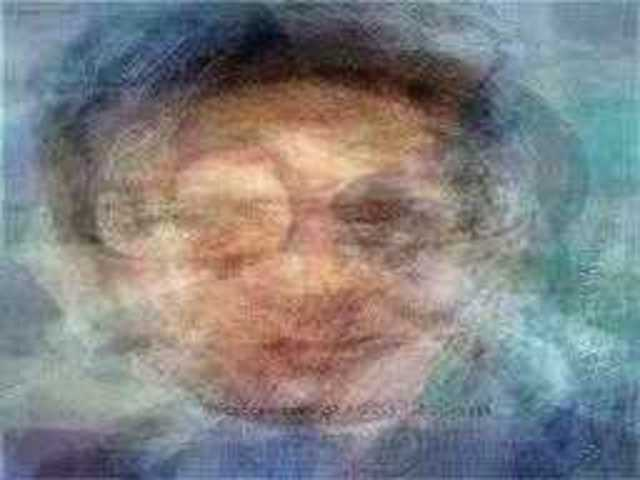
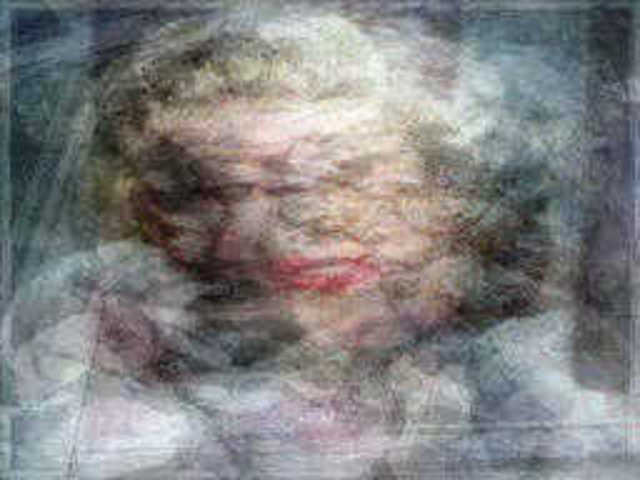
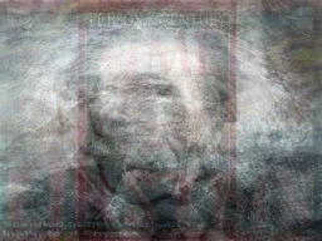
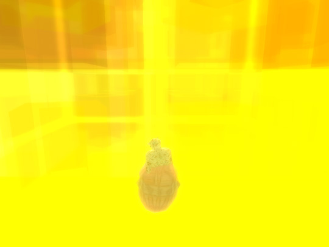
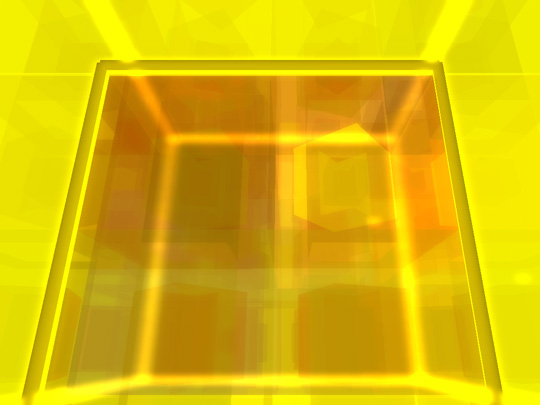
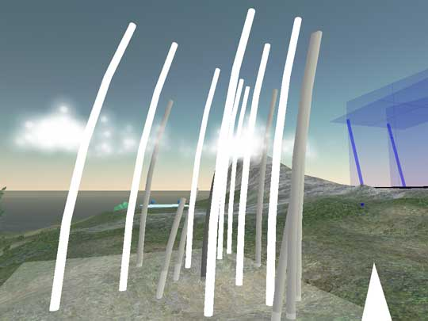
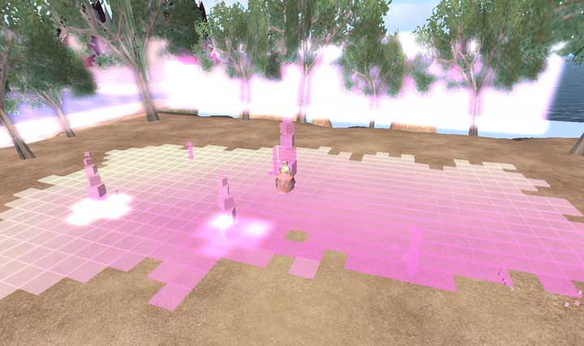
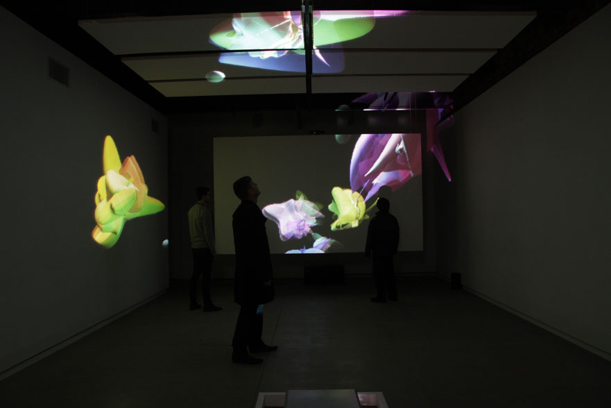

---

### Introduction

This paper attempts a technical analysis of the medium of digital data to establish how affect may emerge in that medium. Two central questions here are, first, whether it is possible for two immanently digital entities to establish an affect cycle with each other, and, second, how this relates to affect cycles established between digital data and non-digital entities? It should be possible to build artworks that can test certain of their own intrinsic properties in both these respects. The author had a hand in creating some such artworks, and these are examined later in this paper. [1] {#para1}

The constant movement of data in a process of modulation, demodulation and remodulation is one of the defining characteristics of the digital medium. Regardless of the final display characteristics and potential interactions of any given digital bit, it is constituted through a constant process of digital data modulation. *Modulation* is used here to mean the process of changing some phenomenon from one register into another, for the purpose of storage, transmission and display. The term also resonates with Deleuze’s (1992: 3) sense of modulation as ‘like a self-deforming cast that will continuously change from one moment to the other, or like a sieve whose mesh will transmute from point to point,’ as well as the musical sense of changing key, the electronic sense of changing a signal with another signal or the social sense of changing one’s tone of speech according to listener or circumstances. All these share the characteristics of both *intentionality* and *change*. Deleuze (2003: 84) also uses the term in relation to Francis Bacon’s use of colour, to describe an intentional change of relationship. Steven Goodman (2009: xiv, xvi, xix) uses *modulation* in a similar sense when talking about the relationship between sound, affect and vibration. {#para2}

There are other words that can be used to describe the process of conversion to and from, and transformations performed by, digital data (en/decoding, conversion, transduction, etc). However, I prefer *modulation* precisely because it maintains an overtone of change. This overtone facilitates a constant challenge to the often unexamined assumption that digital data is somehow ontologically endowed with the special power to make exact copies of anything, that to digitise something is to somehow capture it free of interference from the capturing medium. In fact, the digitising of anything involves a complex series of protocol negotiations and these negotiations create an excess of data. This excess of data is a new object created in excess of the object being digitised, comprising the data from which a simulation of its semantic source may be constructed, a set of data about the data, and the object created by the synthesis of these two sets of data plus the new object’s knowledge of itself. Goodman (2009: 121) also acknowledges the excess created through digitisation, and wonders about the implications for affect in such an excess. {#para3}

Assemblages involving digitisation are also constantly and recursively deepened. As just mentioned, each step in digital processes relies on a protocol pre-agreed (usually by humans). These protocols determine how to proceed. References to these protocols and minimal descriptions of the nature of the data’s semantic source constitute some of the excess constantly created within processes of digitization. However, it is important to note that a digital file does not usually contain instructions on how to decode it in order to reconstruct a copy of its semantic source. Rather, digital files simply note which protocols are required to do so, in order that the system can employ the appropriate software to attempt a decoding. Such software is itself subject to the same process and so on. The point is that digital data is *essentially* formless and plastic. It requires an intentionality external to itself in order to be reconstituted as a copy of its semantic source.[2] This is why I use the terms *modulation*, *demodulation*, and *remodulation*, to keep in mind the intentional and transformative nature of the operations performed on, within and by digital data. {#para4}

In this article, I am specifically interested in the modulation process that occurs between *data-as-data* and *data-as-display*. Here, *display* does not necessarily mean *visual* display, but, rather, any mode by which the data can be perceived, which may be visual, aural, textual, physical, relational, whatever. Such display may not be restricted to human perception, which I will discuss later. When it comes to display, modulation is a constantly occurring, crucial interaction that, at least to some degree, defines the nature of perceptions and therefore the work done in and through the medium with regard to display. Yet, here as elsewhere, at the level of data, modulation is a process that effaces its own input. This provokes further questions. What is the ontological status of data in such contexts? What are the consequences of this constant modulation from one register to another, within data, and through data of non-digital material events such as display? What is the status of artworks produced within such a medium? How does data modulation influence the nature of the interactions and perceptions, or the escape and capture of affect? {#para5}

### Virtual environments are post-convergent

In order to reflect adequately on the new affective relations enabled by the modulation and remodulation of digital data, we can try to examine the intrinsic qualities of virtual environments. Firstly, virtual environments can be seen as *post-convergent*. This term builds on Henry Jenkins’ notion of ‘convergence’, and designates the phase in the development of a new medium when it recognises itself as such, when practitioners begin operating within the medium to explore its intrinsic qualities – as opposed to mere expressions of its content, that is, prior media – to create work that is only possible in the new medium. (Clemens & Nash, 2010; Deleuze & Guattari, 2004: 261; Elias, 2011: 199; Jenkins, 2006: 18) Networked, digital, virtual environments exemplify contemporary post-convergent practice. The art of virtual environments is not simply art that relies on digital technologies. Rather, it is art that intrinsically operates in the excess that is created in the digital medium. This technical excess is also the excess that is necessarily created in the emergence of a new medium. A new medium contains all prior media as content, and thus is convergent. Yet it is also the container, in excess of these contents. The sum that is greater than its parts, and thus is post-convergent. (McLuhan, 2001: 8–9) {#para6}

One of the problems of understanding virtual environments as post-convergent is vocabulary. Vocabulary is always challenging when discussing any new form of artistic endeavour. At crucial defining moments an unsatisfactory choice arises between retrofitting existing vocabulary at the risk of forcing a genuinely new concept into the expectations created by the existing vocabulary, thereby losing the very novelty whose expression was attempted, or creating neologisms that potentially confuse more than elucidate. This is particularly true of the term ‘virtual’, since it is used differently in mainstream culture, media studies, affect theory and philosophy. The current casual mainstream usage, meaning some kind of affect-producing interaction that takes place on the digital network, reflects a growing acceptance of reality as comprising a symbiotic combination of online and material experience – an acceptance that has perhaps always existed, even if implicitly, but is brought into explicit focus by the growth of digital networks as a significant cultural force. As Larissa Hjorth (2011: 65) says, as ‘the internet has developed to become an integral part of everyday life globally, the online has evolved into a complex set of networks and communities that have challenged traditional notions of online/offline relations.’ {#para7}

In media studies, the term ‘virtual’ is sometimes (mistakenly) seen as part of a discussion that took place in the 1990s and is therefore somewhat old-hat for contemporary debates. This is more indicative of contemporary media studies’ habit of mistaking the naming of something for the understanding of something, than an indication of the usefulness of the term. The vocabulary is further confused in media studies through the apparent conflation – or at least confused use – of two ostensibly very different concepts: ‘virtual’ as in ‘virtual reality’ and ‘virtual’ as in Gilles Deleuze’s use of the term. Deleuze’s ‘virtual’ is an important, nuanced and multifarious concept that is not easily reducible to a single definition, especially given Deleuze’s use of the term in different situations over the course of his career. However, we can crudely characterise Deleuze’s ‘virtual’ as being ’the characteristic state of Ideas’ (2004: 263), where ’an Idea is a ”complex theme”, an internal multiplicity – in other words, a system of multiple, non-localisable connections between differential elements which is incarnated in real relations and actual terms.’ (2004: 231) Deleuze’s term is strongly informed by Bergson’s intuitionism, and as such is often mistakenly taken to simply mean ‘possible’. However, Deleuze is very clear on the distinction between the possible and the virtual: ’[t]he possible is opposed to the real… [b]y contrast, the virtual is not opposed to the real; it possesses a full reality by itself… [w]hat difference can there be between the existent and the non-existent if the non-existent is already possible[?]’ (2004: 263) Cleared of this confusion of the possible and the virtual, Deleuze’s virtual can offer interesting insights into how affective experiences can emerge in the digital (or at all), and Anna Munster (2006: 92) has convincingly shown that ‘one of the wider aesthetic implications of processes of digitization has been to impinge upon and give a certain form to manifestations of the virtual.’ Furthermore, in one of the key texts of affect theory, *Parables for the Virtual*, Brian Massumi (2002: 35) locates affect precisely in the two-sided ’simultaneous participation of the virtual in the actual and the actual in the virtual.’ {#para8}

As for the 90s usage of the term ‘virtual reality’, it was a contemporaneously useful term to capture what was a novel expression of the intersection of material and conceptual reality (or, of data-as-display and data-as-data), heavily informed by the cyberpunk fiction of William Gibson, Neal Stephenson and other authors. (Hjorth, 2011: 65; Pesce, 1995) The term can retrospectively be seen as reflecting and reacting to the virtualisation of capital that occurred in the 1980s, as capital was brought into digital networks. (Attali, 2009: 86) Simultaneously fascinated and repulsed by the implications of this virtualisation, these authors – and subsequently mainstream media – experimented thoughtfully with dematerialisation and the nature of the symbiotic affect system that virtualisation implied (I see this as “symbiotic” in the mutual dependence of data and the non-digital). As I said above, mainstream media simplified the term (dropping the “reality”) so that it became a signifier for any interaction that is facilitated on a digital network and induces affect in the material world, or vice versa. Much of this usage also has roots in an arguably religious reading of virtuality. (Wertheim, 1999: 20). Yet as the lived experience of the nexus between material and virtual reality has become more common in contemporary society, the term “virtual” has come to designate something closer to Deleuze’s virtual, that is, it describes one part of a relation between the virtual and actual. Put differently, this can be characterized as what Anna Munster (2006: 90) calls ‘a differentiated continuum of force and materiality.’ {#para9}

To quickly discuss another relevant term, I suggest that ‘digital art’ is, at this juncture, not a useful definition for the artworks I am describing, because the term has been co-opted by pre-digital art forms to designate simply a tool in the creation of existing artforms. In fact, this is the colonising nature of all artforms, since they are incapable of conceiving of a world that is not contained within their parameters. Naturally, this colonisation results in a new assemblage where the existing artform operates in dialogue with the newly adopted digital tools, creating a kind of simulated version of the artform. This retroactively uncovers previously unknown potentials and tendencies of that artform. Nonetheless, the existing artform’s intention remains the absorption of digital data into its established value structure. For example, in the digital medium, an *oscillator* is just another object defined, analogically, by its intended behaviour, as is a *channel*, and there are an infinite number of them available, neither more nor less important than a triangle, a colour, human input or a set of stock market data. Therefore, to talk of ‘multiple oscillators’ or ‘two channel dvd’ is meaningless except as an obfuscatory device to establish the authority of the artist. Such a device relies on pre-digital notions of restricted access to means of production and distribution as a method for establishing uncontestable value, entirely rooted in an artificial rarity model unrelated to the work itself. It is in order to avoid this absorption of digital data into the value structures of pre-digital artforms that I use the term ‘virtual art’. This refers to art that intrinsically uses digital data as its medium, but in the sense that digital modulation allows for Munster’s ‘differentiated continuum of force and materiality.’ {#para10}

### Ontology of Digital Data

> When you give people too much information, they instantly resort to pattern recognition to structure the experience. The work of the artist is to find patterns. – Marshall McLuhan (Coupland, 2009) {#para11}

Digital data is formless, plastic and leveling. Stored as binary bits, it has no form as such. As Justin Clemens and I have written (2010), ‘Data is data. Data is absolutely not a phenomenological thing. It cannot be experienced as such, like Aristotelian prime matter. Unlike Aristotelian prime matter, however, we can manipulate data with ease.’ The fundamentally plastic nature of digital data is what allows us to manipulate it, but until we do manipulate it – until we *modulate* it into some kind of display register – any set of digital data is indistinguishable from any other set of digital data, until modulated into a display register, and this is the *leveling* nature of digital data. All information is reduced to an indistinguishable set of binary bits. To illustrate this, consider a digital image, such as may have been taken by a digital camera of a material scene. Once this visual information is stored as digital data, it can then be opened in, for example, a sound editing program and played as sound. It could equally be used as input to determine a height-map in a realtime 3D environment. The point is that once it is stored as digital data, it loses any determining connection with its semantic source. Therefore, as I said above, parameters must be rigorously established that govern how any given digital data is de- and re-modulated. The notion of protocols or standardised processes that abound in the contemporary technical sphere (such as govern the internet, image compression, audio reproduction and so on) are expressions of this codification of parameters – both sides of a modulation exchange agree to adhere to a set of parameters in order that the intended result is achieved. Naturally, once protocols are required, questions of intentionality, ideology and cultural convention arise. {#para12}

In this way, the decision to remodulate the data into a display register that somehow resembles its semantic source (for example, to display the data from the digital camera image as an image) can be considered a creative act, an intentional act of representation. While the digital camera example may be conceptually straightforward, consider the case of using motion capture data to drive the animation of a humanoid figure in a realtime 3D environment. It is simply not possible to *recreate*, in a virtual environment, the movements of a human in material space, therefore intentional decisions must be made as to how best to simulate the appearance of human movement. It is sometimes easy to forget that simulations (such as are to be seen everywhere these days – weather simulations, physics simulations, market simulations, etc) are actually simplified representations, because modulation is necessarily modulation into another register, a register in which the originating source does not exist. {#para13}

Further, virtual environments may be composed entirely of digital data. That is, the entities that constitute a virtual work may themselves originate from within the virtual environment without reference to an associated entity in the material world. They are composed of data and have their provenance in data. In other words, virtual environments can be data mined for input back into themselves. Such intrinsically virtual entities raise interesting questions. They are purely data-as-data and there may be no protocol, or social convention, that might determine how to modulate them into display. In this context, the establishment of parameter frameworks reveals itself as one of the fundamental process, or acts, that the artist must engage with when creating virtual environments. Such a process requires a conscious acknowledgement of the difference between data-as-data and data-as-display. Can the site of modulation between data-as-data and data-as-display be seen as a site for the emergence of affect, a site where entities defined by their potential for interaction may partially capture, and witness the escape of, affect? By investigating this site of modulation in such a manner, connections are opened with the concept of *biomedia*, seen from the perspective of affect theory. Eugene Thacker, who coined the term *biomedia* as the title of his 2004 book, says in a 2010 essay, also entitled *Biomedia* (123), that “with biomedia, we do not have a split between biology and information, life and code, nature and artifice”. He goes on to say (2010: 126) that “[b]iomedia present a view not merely of biological life as information, but of biological life that is life precisely because it is information.” {#para14}

The work *Autoscopia* was a collaboration between myself, Christopher Dodds and Justin Clemens, commissioned by the National Portrait Gallery of Australia for their Doppelganger exhibition in 2009. *Autoscopia* was an attempt to explore the affective cycle established between the material and the networked self. The work creates search-based composite portraits, allowing users to [enter names](https://autoscopia.net/pages/index.html)in order to create virtual portraits based on internet searches. Both the image and text components of these portraits are composited from the results of web-based searches on the inputted name. The searches exploit the usual sources like Google, Facebook, Twitter, LinkedIn, and so on, as well as more insidiously invasive (but nonetheless publicly available) search engines specializing in background checks and public record searches. The results manifest as web pages containing the dynamically composited image and text, as well as audiovisual sculptures dynamically generated in Second Life. The Second Life component closed at the end of 2010, but the web portraits continue to grow, all the while ‘[tweeting](httpss://twitter.com/autoscopia1)’ their existence on Twitter, recursively feeding themselves back into the results of future searches. The work has been continuously running online long enough now that Google will actually return the *Autoscopia* page for certain names as the top ranking result. Within the virtual environment of the world wide web, this represents an emergent privileging of the affective power of digital entities over the material entities (that is, people) that putatively caused the existence of the digital entity in the first place. In other words, the trace left by the digital entity may have more power, in the virtual world, than the trace of its associated material entity. This raises very interesting questions about the nature of the affective power and instrumentality of the trace of immanently digital entities, that is, entities that do not have an associated material entity or entities that emerge from an associated material entity but take on contingent agencies immanent to the virtual environment. I will discuss this later in relation to my work *One, Another*. {#para15}

*Autoscopia* also brings into relief the process of modulation between data-as-data and data-as-display. Data-as-data is mined by *Autoscopia* from all over the internet. This ‘mining’ involves a constant process of modulating the data-as-data into data-as-display, not according to the original semantic intentions that led to the creation of that specific set of data-as-data, but according to the framework of parameters that can be said to constitute the artwork of *Autoscopia*. This modulated and remodulated data is then stored by *Autoscopia* as data-as-data ready to be modulated into data-as-display, contingently upon interaction with an end-user. {#para16}

### Affect and digital data

> My notion would be, that anything which possesses any sort of power to affect another, or to be affected by another, if only for a single moment, however trifling the cause and however slight the effect, has real existence; and I hold that the definition of being is simply power. – Plato, *Sophist*, 247e {#para17}

According to Deleuze (1988: 124–126), if we take a Spinozan view of affect, then we do not need to be concerned with the difference between nature and artifice, and can concentrate only on bodies’ capacities for affecting and being affected, defined by their ‘compositions of relations.’ For Spinoza, a body can be anything that is capable of affecting or being affected, and he is concerned with an immanent plane of specific encounters, in opposition to a transcendent, anthropocentric morality. Deleuze says that ‘a body can be anything; it can be an animal, a body of sounds, a mind or an idea.’ Highlighting the musical implications of the word *composition*, Deleuze goes on to portray Spinoza’s *Ethics* as both describing and itself constituting a musical composition (Deleuze, 1988: 127). This is obviously going to appeal to me as an artist working with digital code, especially an artist with a background in performance and composition, because it allows us to examine the affective abilities of emergent digital entities – on each other, on their virtual world, and on human interactors. It also allows us to consider the assemblage established between virtual and material worlds as a world (or composition) itself. Not only that, but since I also believe that music/sound practice in the 20th century offers some useful approaches for artists working with the medium of digital data, it is very useful to consider the affective world (or ‘the plane of immanence’) in terms of musical composition (Deleuze, 1988: 128). {#para18}

Some contemporary affect theorists define affect as autonomous from consciousness, language and emotion (Clough, 2010: 209). Emotional response is subsequently seen as a retroactive narration of affective response. Massumi, for example, says that affect is pre-individual and pertains to a different order than emotion, and that affect can be extended to ‘any or every level, providing that the uniqueness of its functioning on that level is taken into account.’ (Massumi, 2002: 27–37) Other critics have highlighted a potential paradoxical return, inherent in these claims, to a mind/body dualism that would run counter to the Spinozan monism that was supposed to have prompted the claims in the first place (Leys, 2011: 434–472). However, as an artist working in the medium of digital data, it is useful to be able to examine the affective power of digital entities separately from the emotional response it may elicit in human users of the work, and then to consider the ways in which these separate phenomena knit together to form a complex feedback system that constitutes a virtual artwork in its interaction. Such a system may then be examined for its emergent ability to constitute a site for the capture and escape of affect. As an artist, this approach makes sense to me, allowing a study of compositional relations, not forms, and the traces that emerge. {#para19}

My work *Trace Aureity*, a work in Second Life, attempts to examine the nature and potential of such traces by establishing a network of relationships between the user and the environment, not only by investing the virtual space itself with interactive audiovisual properties, but also by spawning moving digital agents in order that different traces are inscribed within the environment by the users’ interaction with it (Nash, 2008). I have already stressed that one of the intrinsic features of virtual artwork is its capacity to create entities that originate in the virtual environment, and are composed entirely of data. *Trace Aureity* explores the affective and relational possibilities this opens up. The digital agents within the work are spawned in response to user proximity, but once spawned, begin to automatically determine and enact paths through the work. These agents have the same interactive effect on the work as the user, that is, an agent moving through any particular element of the work will cause that element to react in the same way it would were the user to move through it, since at the level of digital data there is no meaningful distinction between them. In this way, the trace that the user inscribes within the space of the work becomes a branching one, and somewhat autonomically aleatoric. This trace always maintains a relationship with the user’s path through the work, because agents will only be spawned from the user’s position. Yet this initially strong relationship between the user’s and the agent’s paths becomes weaker over time as the agent gains greater degrees of autonomy from its provenance. At the same time, since the agents always spawn initially in response to the user’s movements, a non-linear network of relationships is established, in which the semi-autonomous behaviour of the agents can never be said to be completely independent of the user. In other words, it is always the user that is playing the work (even if not totally in control of the work). In this way, *Trace Aureity* can be seen as an example of a multi-sited, or non-linear, avatar that transcends the linear mapping between human user and the user’s humanoid avatar. The work thus represents an attempt at transcending the human-avatar metaphor. The user is invited to navigate the work in a reflective manner, to experience as many sites of interactive relationship as possible, to play the space in a virtuosic sense as a result of removing all tendencies toward a forward or linear navigation or interaction model. For the games scholar Bernadette Flynn, this kind of reflective, or contemplative, navigation represents a ‘central organizing device’ through which the agency of the user ‘enables the experience of profound ideas and different modes of consciousness.’ [39] Of course, it is important to remember that the register of such experience arises after the pre-individual fact of the autonomic establishment of an affect cycle and represents what Massumi (2002: 35) identifies as the ‘capture and closure of affect.’ {#para20}

In *Trace Aureity*, there is an implicit expectation that the user will exercise their virtuosic ability to navigate the work, manipulating the various possibilities inherent in the viewpoint, or ‘camera’, of the interface of the RT3D MUVE, allowing a conscious experimentation with different modes of what is essentially a distributed avatar. In line with Flynn’s ideas, the work rewards a reflective or contemplative navigation of the visual, spatial and sonic elements of the work, becoming familiar with audiovisual patterns that emerge from the coded virtual spaces that constitute the work; sound, vision and space all meld into a symbiotic compositional relation with the user such that they are indistinguishable as discrete media elements, evidencing the post-convergent nature of the work. By experimenting in this virtuosic manner, the user and the work enter a new relationship that is closer in spirit to the relationship between two performers than that of the relationship between artwork and user. In this way, *Trace Aureity* represents an investigation of non-linear data flow in virtuosic artist/user interactive relationships, an audiovisual composition of relations along the lines of Deleuze’s (1988: 123) ‘composition of speeds and slownesses on a plane of immanence.’ {#para21}

*Trace Aureity* enacts the modulation from data-as-data to data-as-display as its very work. In the state of data-as-data, the work does not exist except as an undifferentiated set of digital data. When this data is modulated into the state of data-as-display, it is modulated into patterns (colour, sound, shape, movement) and relationships (spatial, interactive) that may be retroactively narrativised by the user. Only then can it be said to exist. User engagement with the work facilitates this modulation, specific to moments in time, into data-as-display. There are both contingent selection, and autonomic engagements, within parameter frameworks, that produce specific colours, sounds, shapes, movements and interactions. These expressions are unique to that specific interaction and can never be exactly repeated, due to the autonomy given to the generated digital entities in modulating from data to display. {#para22}

Once such a set of relations as those between artist, work and user in *Trace Aureity* have been composed, new potentials for intimate or sensual engagement can be explored. This is another of the intrinsic qualities of virtual art – its site of interaction can be very intimate. Removed from physical staging or curation, such as in an art gallery or a concert hall or a nightclub, the interactor is often interacting with a virtual work while they are physically alone or in a place that is familiar, a private space. This is the kind of space that perhaps parallels that suggested by Erik Davis’ (1997) sensual reading of McLuhan’s concept of ‘acoustic space’. {#para23}

Two other works of mine attempt to explore this relation in two different ways. First, *The Moaning Columns of Longing*(Nash, 2007) explicitly explores the nature of our emotional reaction to virtual experience. Staged in Second Life, the work enacts emotional and sensual blackmail. In doing so, it consciously exploits the user’s understanding of the spatial and material analogies used to interface with the environment. This creates a technically mediated experience of emotion/affect that is aware of its own excess. When a user’s avatar approaches the work, a virtual ‘column’ is spawned, glowing white and spurting glittering particles of joy while it declares its undying, faithful love for the user via the ‘chat’ facility built into the interface. Once the user leaves the space (that is, logs out), the column starts sending more and more emotionally manipulative emails begging the user to return. Every hour that the user does not return to ‘touch’ the column (‘touch’ is the Second Life interface analogy used instead of ‘mouse click’), the column becomes a little duller, a little shorter, and starts emitting a moaning sound that becomes louder as the hours pass. The hourly emails become more desperate and more emotionally demanding (“without you, I will die”). If the user does not return within 24 hours, the column will ‘die’, that is, in technical terms it will be deleted from the database permanently. If the user does return to ‘touch’ the column within 24 hours, the column returns to its full height, glowing brightly and rejoicing loudly over the chat channels, “[username] loves me! My existence has meaning!”. Over the couple of years this work was in operation, some users maintained their columns for months at a time. During this time, these users returned to their column at least once every 24 hours, and received an email from their column every single hour for the entire time their column was ‘alive’. This nuanced composition of technologically mediated emotional exchange between the virtual and material calls into question the instrumentality of not only the technological interaction itself, but also the very means by which such an interaction can take place and the affective relationship between love and technology. It also amply illustrates the process of modulation from data-as-data to data-as-display and the complicity of the user in such a modulation. Until the user activates the work (both technically by logging in and conceptually by accepting the display parameters such as ‘touch’, ‘visit’, ‘love,’ etc), it is nothing more than a set of undifferentiated, plastic, digital data. Upon activation, the data-as-data is modulated, via a computational parameter framework, into data-as-display (sound, vision, words, emotions), the only mode by which it is really possible for a person to interact with the work. {#para24}

The other work I want to discuss in this light, my work *One, Another* (Nash, 2009), also staged in Second Life, explored a combination of the concerns of both *Trace Aureity* and *The Moaning Columns of Longing*. Composed of a large flat platform of pink tiles, each tile chose its own saturation of pink based on its proximity to the centre, or heart, of the composition. Users could either wander around within the platform, triggering virtual entities programmed with very simple parameters, or simply wait for the virtual entities to emerge of their own “volition”. These entities would themselves “wander around” constantly seeking to connect with other entities but always failing to do so since they were not programmed with the parameters that would allow them to understand such connections. Any movement, whether by a user’s avatar or by a virtual entity, caused multi-sited ripples of affect throughout the work. Based upon Lacanian (Zizek, 2008: 66–67) concepts of lack and Julia Kristeva’s (2002: 178) subsequent sophisticated notion that ‘imagination is a discourse of transference – of love,’ feedback loops of interactions created complex audiovisual assemblages that would sometimes resonate for hours after the user had left. This work raises interesting questions about the causality and trace of affect, and the relationship between data modulation and affect. The display will not occur unless there is a user logged in, and yet the operations on the data continue. Once the user logs back into the environment, these operations are displayed as if they have actually occurred, and in this sense they can only retroactively be said to have occurred. Accordingly, the relationship between the modulation of data (between data-as-data and data-as-display) and the autonomy of affect are highlighted. Massumi says that “[a]ffect is the *virtual as point of view*” (emphasis in the original). It may be clearly seen in the artwork *One, Another* that the modulation from data-as-data to data-as-display is a kind of technical enactment of the virtual as point of view. At the same time, Massumi is right to caution against taking the visual metaphor too seriously, since affect – like data-as-data – is plastic and formless, until contingently specified. Specification (or modulation according to a parameter framework) may occur in or across any sensual mode, regardless of the ability to perceive of the participating bodies. (Massumi, 2002: 35) This is not to suggest a simple concordance between digital data and the virtual. Rather it is an attempt to identify the virtual aspects of a site where pre-individual affect meets interactive bodies that participate in both affect’s capture and escape. {#para25}

### Conclusion

By working in the medium of digital data, these artworks raise numerous questions about the relation between the virtual and affect. Amongst them are the following: Is it the case, as Stephen Wolfram suggests, that this kind of complex generation of virtual/actual form through the interaction of very simple rules is constitutive of life itself? And, if so, what are the implications of this for the universality of affect? Can an immanently digital affect cycle be said to exist? (Chaitin, 1999: 108–109; Chaitin, 1998: 85) Brian Massumi (1995: 96) has suggested that ‘the measure of a living thing’s potential interaction is its ability to transform the effects of one sensory mode into those of another’. If we accept this, connections are raised between the questions I have discussed in this paper about the nature of data-as-data and its modulation into data-as-display, along with the plexus of affective compositional relations that evolve in the convergence of virtual and material spheres. Can we therefore identify a relationship between what I have identified as the excess created by digitisation and the excess of affect as identified by Massumi and Guattari? (Bertelsen & Murphie, 2010: 153) If so, then it would seem that the ostensibly different uses of the term ‘virtual’ – in its Deleuzian sense, in Massumi’s affect-as-virtual sense and in the sense of the virtual as cyberspace or networked digital data – may in fact be closely related, and such a relationship still needs to be rigorously explored. Similarly, since the implications of biomediatic readings of affect theory can be actualised or experienced in the interaction between the material and virtual, what exploratory invitations does this open for artists working in virtual environments? {#para26}

These questions are current and pressing, and any answers are likely to be emergent and contingent. Part of the point of my ongoing virtual art practice is to attempt to propose questions that may be appropriate to our new situation. To this end, long-term collaborator John McCormick and I are currently working on *Reproduction*. (McCormick & Nash, 2010) *Reproduction* is an evolving virtual environment of artificial audiovisual entities that exist in a symbiotic relationship with humans. In a physical gallery space, visitors spawn and manipulate entities via motion capture, while online users spawn and interact with entities through social networks – Facebook updates, tweets etc – and a custom web based interface. Because it’s a symbiotic relationship, the artificial entities are not simply linear dependents on the actions of humans. Rather they evolve and grow according to the parameters of their ecosystem, which itself emerges from the agency of the entities. Many of these parameters are influenced by the (physical and virtual) actions of humans, and the artificial entities attempt to learn and anticipate human actions. Humans equally attempt to learn and anticipate the behaviors and reactions of the artificial entities. The result is a complex assemblage of human and virtual life that evolves and learns from its own participants. Virtuosic human users of the system (for example, dancers, musicians, gamers, or any person who is willing to spend the time) are able to engage in improvisatory performances with the artificial entities, where the artificial entities are making performative decisions of equal influence to human decisions within the performance, with human and digital entities responding to each other’s actions. Casual visitors to the gallery are able to engage with the artificial life environment in a contemplative navigation based on movement in physical space. Online users of the work are able to engage in a more subtle and nuanced manner, entering into long- and short-term relationships with digital entities, who become ‘friends’ in both the social networking and material sense, influencing each other’s behaviour. {#para27}

The work questions the nature of our virtual society by extending emerging social network practices. Is a ‘friend’ really a friend? What manner of my ‘self’ is my online self? How much agency do these selves have and how do these multiple selves interact with each other and others? What is the nature of the affect facilitated in such a composition of relations? In this paper, I have attempted to show that virtual art raises new questions both about the nature of affect and relation, and about the ontology of digital data. Virtual art, I have suggested, enables us to more adequately reconfigure the concepts with which we approach data, in terms of its ontological status, because it foregrounds the key role played by modulation, and in the instability of the protocols that interpret data. I have also shown, through an exploration of my own art practice, that virtual art enables us to grasp the new kinds of affect opened up by the digital regime. {#para28}

### Biographical Note

Adam Nash is internationally recognized as one of the most influential artists working in virtual environments. His work has been presented in galleries, festivals and online in Australia, Europe, Asia and the Americas, including peak festivals SIGGRAPH, ISEA, ZERO1SJ and the Venice Biennale. He was the recipient of the inaugural Australia Council Second Life Artist in Residence grant. He was awarded an Ars Electronica FutureLab residency in 2009. He was awarded an Australia Council Connections Residency in 2009, for which he founded SquareTangle with colleague John McCormick. He founded the Australian Centre for Virtual Art with Christopher Dodds, which runs labs and workshops for existing and emerging artists to explore virtual media. He was shorlisted for the National Art Award in New Media at the Queensland Gallery of Modern Art in 2008. He has a PhD in Animation and Interactive Media from the School of Media and Communication at RMIT University, where he is a lecturer in Computer Games and Digital Art.

## Notes

- [1] Links and documentation concerning the artworks can be found at [https://adamnash.net.au](https://adamnash.net.au).

- [2] There must be an external protocol to facilitate modulation, protocols are intentional forces designed to facilitate modulation to a specific display state. Even were digital data to begin designing their own protocols they would still need an external, intentional, protocol that determines how they would do that.

### References

- Attali, Jacques. *A Brief History of the Future.* (New York: Arcade Publishing, 2009).

- Bertelsen, Lone and Murphie, Andrew. ‘An Ethics of Everyday Infinities and Powers’, *The Affect Theory Reader* (Durham: Duke University Press, 2010).

- Chaitin, Gregory. *The Limits of Mathematics*. (Singapore: Springer-Verlag, 1998).

- Chaitin, Gregory. *The Unknowable* (Singapore: Springer-Verlag, 1999).

- Clemens, Justin, and Nash, Adam. *Seven Theses on the Concept of Post-Convergence*. 2010. https://www.acva.net.au/publications/Seven_theses_on_the_concept_of_%E2%80%98post-convergence%E2%80%99.pdf

- Clough, Patricia. ‘The Affective Turn: Political Economy, Biomedia, and Bodies’, *The Affect Theory Reader* (Durham: Duke University Press, 2010).

- Coupland, Douglas. *Marshall McLuhan*. (Toronto: Penguin 2009).

- Davis, Erik. *Acoustic Space*, 1997 https://www.techgnosis.com/acoustic.html

- Deleuze, Gilles. *Spinoza*: *Practical Philosophy*. (San Francisco: City Lights, 1988).

- Deleuze, Gilles. ‘Postscript on the Societies of Control’, *October* 59 (Winter 1992).

- Deleuze, Gilles. *Francis Bacon: The Logic of Sensation*. (New York: Continuum, 2003).

- Deleuze, Gilles. *Difference and Repetition*. (London: Continuum, 2004).

- Deleuze, Gilles and Guattari, Felix. *Anti-Oedipus*. (London: Continuum, 2004).

- Elias, Amy J. ‘The Narrativity of Post-Convergent Media: No Ghost Just a Shell and Rirkrit Tiravanija’s “(ghost reader C.H.)”’, *SubStance* 124 (40.1, 2011).

- Flynn, Bernadette. *Languages of Navigation within Computer Games*. (MelbourneDAC, the 5th International Digital Arts and Culture Conference, 2003).

- Goodman, Steven, *Sonic Warfare: Sound, Affect and the Ecology of Fear*. (Cambridge, MA: MIT Press, 2009).

- Hjorth, Larissa. *Games and Gaming*. (Oxford: Berg, 2011).

- Jenkins, Henry. *Convergence Culture*. (New York: NYUP, 2006).

- Kristeva, Julia. ‘Tales of Love’, *The Portable Kristeva*. Ed. K. Oliver. (New York: Columbia University Press, 2002).

- Leys, Ruth. ‘The Turn to Affect: A Critique’, *Critical Enquiry* 37.3 (Spring 2011).

- McCormick, J. & Nash, A. *Reproduction*. Developed and presented at Ars Electronica Futurelab February 2010. Subsequently developed and presented at Neutral Ground Gallery, Regina, Saskatchewan, July 2010. Subsequently developed and presented at Screen Space Gallery, Melbourne, Australia, August 2011.

- McLuhan, Marshall. *Understanding Media*. (New York, NY: Routledge Classics, 2001).

- Massumi, Brian. ‘The Autonomy of Affect’, *Cultural Critique* 31 (Autumn, 1995): 83–109.

- Massumi, Brian. *Parables for the Virtual: Movement, Affect, Sensation*. (Durham: Duke University Press, 2002).

- Munster, Anna. *Materializing New Media: Embodiment in Information Aesthetics*. (Hanover: University Press of New England, 2006).

- Nash, Adam. ‘Moaning Columns of Longing’, *Seventeen Unsung Songs*, Odyssey Art Simulator, 2007; National Art Award in New Media, Queensland Gallery of Modern Art, 2008.

- Nash, Adam. *Trace Aureity*. A *Turbulence* commission, ie, officially a commission from the New Radio and Performing Arts, Inc., for Networked Music Review. It was made possible with funding from the New York State Music Fund, established by the New York State Attorney General at Rockefeller Philanthropy Advisors. 2008.

- Nash, Adam. ‘One, Another’, *Virtual Art Initiative*, 2009.

- Pesce. Mark. *VRML Visions*. Post to www-vrml mailing list 1994. https://web.archive.org/web/20030626011627/www.web3d.org/www-vrml/concepts/visions.html

- Thacker, Eugene. ‘Biomedia’, *Critical Terms for Media Studies* (Chicago: University of Chicago Press, 2010).

- Wertheim, Margaret. *The Pearly Gates of Cyberspace* (Sydney: Doubleday, 1999)

- Zizek, Slavoj. *Enjoy Your Symptom!* (New York: Routledge, 2008).
