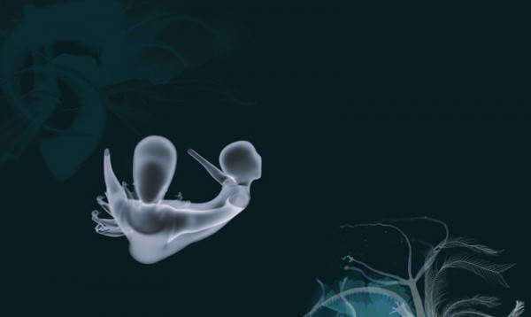
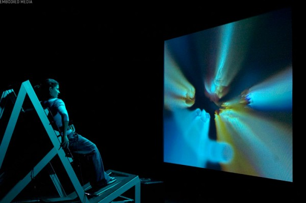
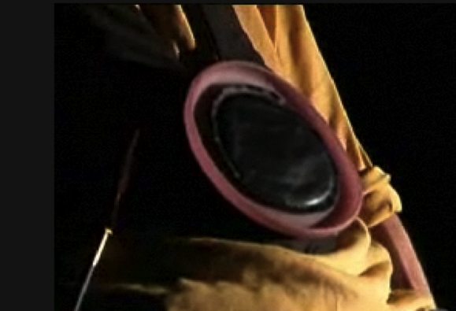
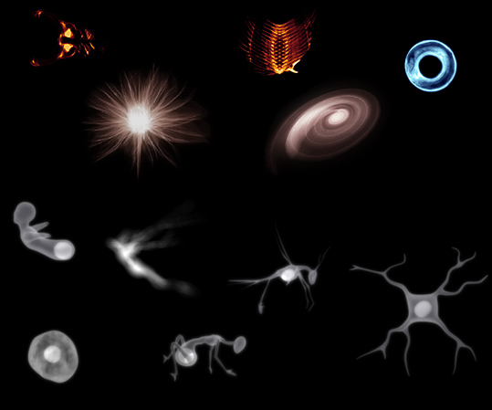
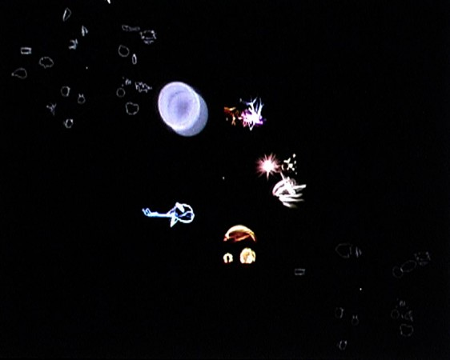
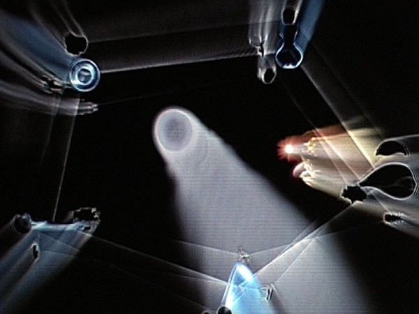

---

This article considers the ‘co-affective’ power (Ettinger, 2011: 13) of the new media artwork *Intimate Transactions.* Keith Armstrong (2005), artistic director of the *Transmute Collective—*the creators of *Intimate Transactions*—describes *Intimate Transactions* as collaborative, ecological, and concerned with relation. [1] In its most recent incarnation *Intimate Transactions* takes the form of a ‘dual site networked installation’—‘two people’ participate in the artwork from ‘two different locations’ (Armstrong, n.d.). In Sydney, where I encountered the work, these locations were the *Performance Space* in Redfern and *Artspace* in Woolloomooloo. [2] {#para1}

Participants engage with *Intimate Transactions* through active ‘full body’ movement. Through this, they engage with the animated ‘creatures’ in the ‘virtual environment[s]’ on a large screen (Armstrong, 2005; Hamilton and Lavery, 2006: 2). At times it is also possible to collaborate in a networked, ‘moving together’ with the other person (Massumi in Massumi and Zournazi, 2002: 223). This ‘moving together’ affects what occurs throughout the entire work. {#para2}

Ultimately, as Armstrong (2005) states, the aim of *Intimate Transactions* is a collaboration that will ‘enrich’ both the sensual and screen environments. The work is not about individual or ‘absolute control’. It is not only about ‘me’ and it is not about winning. Rather, in *Intimate Transactions* there is a complex, and ‘intimate’, bodily ‘energy transfer’ between participants. The design of the work encourages participants to move together, with the non-human creatures as well as the other person, in a ‘co-creative’ (Ettinger, 2006a: 122) collaboration. As such, *Intimate Transactions* as a whole is designed to operate, ‘co-creatively’ (Armstrong, 2005), at a ‘co-affective’ level of experience (Ettinger, 2011: 13). In sum, the ‘co-affective’ activity of *Intimate Transactions* emerges from a larger ‘trans-subjective’ field (Ettinger, 2006a: 111; Guattari, 1995: 6). This field involves the human participants as well as the non-human screen-creatures. {#para3}

Here I will explore the restorative powers of the collaborative and *trans-subjective fields* generated by *Intimate Transactions*(see also Armstrong 2006: 33). To do so, this article draws on the work of Bracha Ettinger, Félix Guattari, and Brian Massumi, amongst others. For these thinkers the ‘trans-subjective level’ of experience—precisely because it is ‘co-affective’—holds ‘ethical potentiality’ (Ettinger, 2006a: 111 and 117). In general, there is a pressing need for explorations of the trans-subjective because such explorations ‘may lead us to discover our part of shared responsibility in… events whose source is not “inside” the One-self’ (Ettinger, 1995a: 51). As such, the kind of exploration of the trans-subjective found in *Intimate Transactions* could be seen as providing a more embodied way of engaging with the contemporary ‘eco-political’ situation (Armstrong, 2006: 15). *Intimate Transactions* then is of particular interest because it is a work that aims to activate the ‘ethical potentiality’ of the trans-subjective more fully than many “interactive” works. [3] {#para4}

In this article I will first give a detailed description of the trans-subjective qualities of *Intimate Transactions*. As the title of the work suggests, *Intimate Transactions* is designed to draw attention to, and filter action through, the *trans-*active (Armstrong 2005; 2006: 25; Birringer, 2006). As such, *Intimate Transactions* deliberately challenges many standard notions of the interactive, and the activities and practices that result from these standard notions (see also Massumi, 2011: 39–86). {#para5}

The description of the work itself will be followed by a theoretical consideration of the ‘co-affective’ nature of the artwork’s ‘*transactivity*’ (Birringer, 2006: 109). In discussing this ‘*transactivity*’, Birringer writes that in *Intimate Transactions* ‘[t]he site of the body is a transactional collectivity; fluid, transitory, ungrounded’ (Birringer, 2006: 109). [4] Taking on board Massumi’s call for a rethinking of ‘inter*activity*’ in affective and ‘relational terms’ (Massumi, 2011: 52 and 67; see also Fritsch, 2011 and Brunner and Fritsch, 2011), the article considers ‘*transactivity*’ from the complementary perspectives of relationality, the trans-subjective, affect and ethics. {#para6}

As I have already begun to suggest, this ‘*transactivity*’ (Birringer, 2006: 109) is different to more conventional notions of the interactive. It is different because, with a focus on the *trans-*, we move away from thinking “interaction” only as occurring between ‘already-constituted’ subjects (and objects). In moving toward the trans-subjective, we move to ‘the primacy of’ affect, relation and of the in-between (Massumi, 2002: 24; 1997a: 175; 2000a and 2011: 39–86). {#para7}

Following the work of Massumi in particular this article argues for the importance of a ‘tending’ to this affective level of experience, both in designing “interactive” art—such as *Intimate Transactions*—and in life more generally (Massumi, 2000a: 216; 1997a; 2011; see also Ednie-Brown, 2007). For Pia Ednie-Brown (one of the collaborators on *Intimate Transactions*) the kind of “design ethics” involved here must embrace a ‘striving for a balance between affecting and being affected’ (Ednie-Brown, 2007: 329). *Intimate Transactions* also makes it clear that to remain ethical and sustainable such tending to the affective level of experience must foster ‘diversity’ in ‘collaboration’ and avoid a consumption of difference (Ednie-Brown, 2007: 323; see also Ednie-Brown and Mewburn, 2006). {#para8}

### Trans-subjective Collaboration and a ‘Logic of Affect’

In *Intimate Transactions* two people in different physical locations engage with a large ‘screen-space’ (Armstrong 2006: 26). In order to engage with the work the participants stand, tilted slightly back on (what the artwork’s creators call) ‘identical Bodyshelves’. [5] Lisa O’Neill explains that the shelf is comfortable but that its backward tilt puts the participants in a ‘slightly unusual position’ (O’Neill, 2006: 38). From this tilted position the participants move their entire body, rolling the back and shoulders against the Bodyshelf in order to navigate the world on the screen. They also shift the weight of their bodies on the mobile platform on which they stand (see O’Neill, 2006). Engagement with the world on the screen involves a strange ‘dance’, more or less on the spot, from which the body-shelf/platform picks up bodily movement (Ednie-Brown, 2007: 244; see also O’Neill, 2006). {#para9}

The movement on the shelf enables participants to engage with the work and its screen-spaces—the worlds of the non-human creatures (Armstrong, 2006: 26). The movements of the body on the shelf also ‘activate’ the participants’ avatars, which can enter what becomes at times a shared realm in the ‘virtual world’ (shared simultaneously across the two screens in the different spaces) (O’Neill: 2006: 36–38). In this ‘shared space’ the avatars of the two participants can ‘meet’ and move together as one semi-merged avatar (Armstrong, 2006: 27–28; O’Neill, 2006: 41). Through all this, as Jillian Hamilton explains, the ‘“Bodyshelf” requires whole body movement to activate the motion sensors embedded in the surface. This shifts the participant from a relatively passive wrist/hand interaction with the interface to a physically active, whole body engagement with it’ (Hamilton, 2006: 120). {#para10}

However, the Bodyshelf does not only pick up and transfer the movements of the body on the shelf onto the avatars on the screen. The shelf also plays an active part in the ‘immersive sound-scape’, as the bodily ‘motion in space generate[s] the feedback of the sound’ (Webster, 2006: 60 and 67). This is an often intense and unusual sound. {#para11}

Finally, the Bodyshelf transmits vibrations, based on the other person’s movements, onto the lower back of the body. The vibrating devices in the Body-shelf, ‘are activated during the “meeting” of the two…avatars, when they become locked together in joint movement’ (Ednie-Brown and Mewburn, 2006: 80–81). {#para12}

Another aspect of the vibrating quality of the work emerges via a rubbery ‘garment’ (with a pink border) that is looped around the neck, like a ‘pendant’, and strapped loosely to the abdomen. Inside this garment there is a device that transmits vibrations onto the stomach of the participants. In this case the vibrations are based on the engagement with the creatures in the ‘screen-world’ (Ednie-Brown and Mewburn, 2006: 80–81; Armstrong, 2005). These vibrations on the stomach, together with the vibrations on the lower back, constitute the most intimate qualities of the work. With these vibrations one literally feels the movement of others (see also Hamilton, 2006: 124). Pia Ednie-Brown and Inger Mewburn worked with the *Transmute Collective* in designing these more intimate vibratory components of the work. {#para13}

The intensity of the sound enhances the experience of intimacy. Guy Webster (sound director of the *Transmute Collective*) explains that ‘[t]he vibrations in the Bodyshelf, and in the pendant…are all controlled by sound’. For Webster this is an important aspect of the ‘sound design’ because the ‘sounds can actually reach out and touch you’ (Webster, 2006: 62). {#para14}

Body, eyes, animated images and creatures, intense sounds and the bodily vibrations are brought into a “co-territorialised” and networked milieu. A partial and distributed subjectivity emerges with this. Armstrong (2005) explains that for both participants the experience is one of transversally engaging with, and feeling the movement of, an excessive if unknown, anonymous body (one does not see the other participant before or during the “interaction”). In fact, it is not *initially* clear whose or even what movement we experience in the vibrations emerging from the ‘haptic devices’ in the Bodyshelf, the ‘immersive sound’ (produced by bodily movement) and the vibrations felt on the stomach (Armstrong, 2006: 7). Yet, over time, a strong sense of affective ‘co-creation’ emerges, between the human participants, the non-organic aspects of the work (including the technology), and the non-human creatures on the screens (these screen creatures are described by the artists as ‘*Force of Change*’, ‘*Force of* *Permanence*’, ‘*Force of* *Instability*’, ‘*Force of Conflict*’, ‘*Force of* *Torment*’ [Lawson and Foley, 2006: 56–58]). {#para15}

At the same time, it is important to note that in this ‘co-creation’ the work does not collapse into undifferentiation (see Ednie-Brown and Mewburn, 2006). Even though the experience is indeed ‘co-affective’, the felt differences between the participants and the screen creatures remain, even as transactions occur. In other words, differences are expressed even during the meeting of bodies and creatures. Rather than mergers, there are encounters via the felt vibrations, the visuals and the sound (Armstrong, 2006: 33 and Webster, 2006: 69). I will shortly discuss the precise moment at which these encounters take an ethical turn (encouraging ‘relational difference in co-emergence’ [Ettinger, 2006b: 72]). In order to discuss this ethical turn, it is first necessary to gain a better understanding of the various environments on the screens. {#para16}

In *Intimate Transactions*, there is a complex layering of different screen-worlds (Armstrong, 2006: 27; Hamilton, 2006: 116). At times, participants, with their own avatars, can engage with the more “local” screen environments of the non-human creatures (Armstrong, 2005). As mentioned, the various forces of the creatures are expressed in part as vibrations, felt on the stomach when participants engage with them (Ednie-Brown and Mewburn, 2006: 80–81; Webster, 2006: 69). However, even in this phase of the work, the actions of avatars change more than the environments of the creatures. They have effects throughout the system (and each person’s avatar is presented as a ‘shadow’ avatar in the other participant’s screen-space [Armstrong, 2005; 2006: 27]). At other times, there is a direct participation in a ‘shared space’ (Armstrong, 2006: 27–33). Here the avatars reflect the movement of both participants within a shared screen-space. It is in this environment that the separate avatars can meet and move together. [6] {#para17}

Armstrong (2005) emphasises the importance of the different screen environments. He explains that at one stage of the work it is possible for the individual participants to impoverish the world of the non-human creatures. In these more ‘local’ spaces the human participants can, individually, take away ‘objects from’ the non-human creatures in order to take possession of them and ‘incorporate…these objects into their own avatars’ (Armstrong, 2006: 27). At the beginning of the experience, the participants are told the following: {#para18}

> You can take things away from your Creatures, but in order to return these you must interact with the other person.
>
> How you treat these Creatures will ultimately affect what you see, hear and feel and what the other person sees, hears and feels … (cited in Armstrong, 2005). {#para19}

Armstrong points out that it is possible to not ‘work collaboratively with the other person’. However, the less one does so, and the more one takes away from the environments of the non-human creatures, the more impoverished the ‘immersive’ world becomes. The experience becomes tame. It loses its intensity. This loss of intensity is ‘indicated by a rapidly increasing, overall sluggishness, lessening brightness and inability to transact smoothly’ (Armstrong, 2005). Webster explains that ‘[a]s the effect moves across the whole spectrum, all the imagery starts to become lethargic and that’s directly represented in the sound’ as well (Webster, 2006: 66). It is clear then that non-collaboration is not encouraged by the very design of the work. {#para20}

In order to re-“enrich” all the screen-spaces, including the worlds of the non-human creatures, and indeed the gallery spaces, the two human participants have to work together. For one thing, their avatars have to join. They must meet in a ‘trans-subjective’ movement based on what Armstrong (2005) terms transversal, ‘networked and cross-affective processes’. These affective processes are ‘multidirectional’ (Ettinger, 2006b: 64) and, as mentioned, take place in a shared space (Armstrong, 2006: 27). In this shared space participants can work together and move together to heal the creatures and ‘restore’ environments that may have suffered over-‘consumption’ (Armstrong, 2006: 29, 27). {#para21}

Ecological responsibility here becomes distributed (networked). It emerges from an *affective (trans-subjective) field* shared across the two gallery spaces. Together, the vibrations, the ‘immersive sound’ and the whirling in the screen-worlds make the movement of this shared trans-subjective affect felt. Affect here clearly emerges from the activation of ‘our (collective) movements’ (Birringer, 2006: 112). As such, it is in the activation of this collective sphere that *Intimate Transactions* takes on an ethical and restorative turn (see Armstrong, 2005). One aspect of this is that the environments of the non-human creatures can only be re-energised if the participants actively surrender control, not that they ever have ‘absolute control’ (Armstrong, 2005). Surrendering control, they can meet in a trans-subjective movement that affects and restores the energy of the entire work. In sum, the participants have to ‘cooperate to restore the creatures and the energy of their own/shared environment’ (Armstrong, 2006: 29). As noted, Armstrong (2005) refers to this cooperative working process as ‘cross-affective’. {#para22}

Here we can build on Armstrong’s idea that much of the “action” in *Intimate Transactions* takes place on a ‘cross-affective’ level of experience. I am taking this idea of ‘cross-affective’ “action” a little further, seeing the potential ‘co-creative’ activity (Ettinger, 2006a: 122; Armstrong, 2005) involved as not only ‘cross-affective’ but also ‘co-affective’ (Ettinger, 2011: 13). That is, affect not only crosses between various actions, but arises from within, and even perhaps as, the ‘transactivity’ involved (Birringer, 2006). This is at the distributed heart of what can be called a ‘logic of affects’. Part of the achievement of *Intimate Transactions* is that it so emphatically emphasises an entire ‘*logic of affects* rather than a logic of delimited sets’ (Guattari, 1995: 9) [7]. In the latter, the ‘logic of delimited sets’, a collection of ‘discrete elements’ (such as participants and technical elements) come first and last, with something like “interaction” occurring, only secondarily, between them (Massumi, 2000a: 191). However, a ‘logic of affects’ is concerned with trans-subjective, ‘pre-personal’ and ‘collective’ fields of experience. A ‘logic of affects’ is ‘polyphonic’ (Guattari, 1995: 9 and 1) ‘multi-polar’, (Guattari, 1996: 158) as well as ‘co-creative’. [8] It is precisely because the ‘logic of affects’ is ‘multi-polar’ and ‘co-creative’ that it can be understood to involve ‘transactivity’ across emergent subjectivities, rather than interaction between ‘already-constituted’ subjects or objects (‘delimited sets’) (see Massumi, 1997a: 175; 2011: 39–86). It is the rigorous attempt to design for engagement within the ‘logic of affects’ that makes *Intimate Transactions* a matter of ‘transactivity’, more than interactivity (the latter of which can sometimes seem more concerned with the ‘logic of delimited sets’). With its focus on ‘co-affective’ ‘transactivity’, *Intimate Transactions* thus appears to challenge the more conventional notions of interaction. {#para23}

Prior to writing about *Intimate Transactions* and ‘transactivity’ Birringer proposed ways of categorizing ‘various types of interactive environments (sensory, immersive, networked and derived environments)’. He explains that ‘[w]hen the parameters of these are mixed, we speak of mixed reality or hybrid environments’. However, according to Birringer *Intimate Transactions* is different because it involves ‘transactivity’: {#para24}

> *Intimate Transactions* is another category, a transactive environment, involving telematic performance with distributed action, where images and sounds are created not simply to be transmitted from one location to another, but to cooperate in an evolving feedback loop via a virtual ecology. (Birringer, 2006: 108–109) {#para25}

As fits ‘a logic of affects’, the primary concerns of *Intimate Transactions* are not only relational then but also ‘ecological’ (see Armstrong, 2005 and 2006). They are ecological in two senses. First there is a focus on ecology understood in terms of the complex dynamics of relations in a given situation, with an emphasis on changing the way that these dynamics are approached/experienced. Second, the design of *Intimate Transactions* fosters the possibility that experiencing the dynamics of this ecological relationality, in this case very intimately within an artwork, may change approaches to more general environmental issues. Armstrong argues that ‘the way we approach design can have an enormous impact upon the way that we interact with the world. It can potentially change the way that we approach, and therefore understand, ecology’ (Armstrong, 2006: 15). [9] {#para26}

‘[E]cological concerns’ then, form a key part of the “transactive design” of *Intimate Transactions* (Armstrong, 2006: 13). We have seen that in order to produce more sustainable changes within the work, the “action” in *Intimate Transactions* must not only emerge from isolated, already individuated bodies or selves (see Armstrong, 2006: 13–16) (from what I referred to above as ‘the logic of’ already ‘delimited sets’). If engagement with the work stops there, this leads to a kind of ‘ecological crisis’ in what become diminished ‘audio-visual’ and ‘tactile’ worlds (Armstrong, 2005). Instead of stopping at individual action, in order to care for the virtual environments, participants in *Intimate Transactions* are encouraged to engage fully in the ‘relational potential’ (Massumi, 2000a: 202) of the ‘logic of affects’ (the collective, ‘co-creative’ and ‘trans-subjective levels’ of experience). Only if “action”—in this case movement—becomes distributed across a larger affective field engaging both participants (as well as the screen creatures) in a ‘co-affective’ collaboration does the work take an ethical and reparative turn toward a restoring of ecological balance. From this collaboration a more rewarding experience of the work itself also emerges (see Armstrong, 2005). {#para27}

The focus on ‘co-affective’ collaboration in *Intimate Transactions* reflects a less individualised notion of affect, shared by the thinkers discussed in this article. Erin Manning, for example, notes that ‘affect does not rest in the individual’. Rather, affect is ‘collective’ and of the in-between (Manning, 2010: 117 and 122). [10] Guattari writes about the “sticky” ‘transitivist character of affect’ operating within a ‘multi-polar affective composition’ (Guattari, 1996: 158). Massumi considers affect ‘*transsituational*’ (Massumi, 2000a: 185) and Ettinger thinks affect in terms of ‘co-affectivity’ (Ettinger, 2000: 98). For all these thinkers affect is located, beyond the emotional states of the human individual, in a larger distributed field. For these thinkers and, as taken up in the design of *Intimate Transactions*, ‘the logic of affects’ is generative, collective and ‘distributed’ (Hamilton, 2006: 118; Armstrong, 2005; see also Ednie-Brown, 2007: 178). [11] {#para28}

These approaches to affect are shared by Ednie-Brown (2007). They are present in the design philosophy and architecturally inflected art practice she brought to the collaborative creation of the ‘haptic components’ of *Intimate Transactions (Armstrong, n.d.)*. As mentioned, Ednie-Brown has developed a “relational design ethics” ‘striving for a balance between affecting and being affected’ (Ednie-Brown, 2007: 329). {#para29}

### Belonging

We have seen that, as an ecological work, explicitly concerned with sustainability (Birringer, 2006: 108), *Intimate Transactions* aims to create a care for the world that tends to a more distributed sense of ‘ethical responsibility’*—*in, across, and beyond the artwork (Armstrong, 2006: 15). For Armstrong, *Intimate Transactions* thus works at the level of the ‘eco-political’ (Armstrong, 2006: 15). Massumi articulates the general aim of this kind of political concern very well, stating that ‘[t]he “object” of political ecology is the coming-together or belonging-together of processually unique and divergent forms of life’ (Massumi, 2000a: 216). {#para30}

For Massumi ‘there are ways of acting upon the level of belonging itself, on the moving together and coming together of bodies *per se‘* (Massumi in Massumi and Zournazi, 2002: 223). Massumi also suggests that ’[e]thics is a tending of coming-together, a *caring for* belonging as such’ (Massumi, 2000a: 216). In general terms, ‘*caring for* belonging’ is relational yet this relationality is ‘*of* the middle’, that is, it does not link the ‘already-constituted’ (Massumi, 1997a: 175). Rather, for Massumi as for Gilbert Simondon ‘a true *relation is that which* constitutes the terms that it connects’ (Flanders in Simondon, 2009: 15, see also Massumi, 1997a). The relation itself is a ‘co-creative’ process, which produces new individuations (see also Brunner and Fritsch, 2011). I have outlined above how *Intimate Transactions* encourages relation – the work is ‘highly relational’ (Armstrong, n.d). Yet for the work to be truly transformative this must involve a co-constitutive ‘transactivity’ productive of new individuations and milieus. {#para31}

Of course, activating the more affective level of experience does not automatically involve a care for ‘belonging-together’. *Intimate Transactions* is affective throughout, yet subtle in its foregrounding of different kinds of affective engagement, some more directed towards ‘belonging-together’ than others. If participants only work individually and collect object from the non-human creatures there is no care for ‘belonging-together’. As we have seen, it is in the more collaborative phases that *Intimate Transactions* explicitly encourages individuations that involve ‘a *caring for* belonging as such’ (Massumi, 2000a: 216). {#para32}

This care ‘for belonging’ involves a “micropolitical” approach to ethics in that it works at the level of our bodily *habits* (see Massumi in Massumi and McKim, 2009 and Guattari in Guattari and Rolnik, 2008). In this regard *Intimate Transactions* attempts to resist, by *deterritorialising*, the more destructive habits of the human body. These destructive habits come to life (and it is hoped that participants become more aware of them) at the moments in *Intimate Transactions* at which it is possible for the participants to impoverish the world of the non-human creatures. *Intimate Transactions* challenges this impoverishment with the offer of a deterritorialisation that can ‘restore’ and re-enrich the ‘virtual world’ (O’Neill. 2006: 41) in a ‘moving together’. In this restorative movement the participants at different locations move together and participate in a collaborative individuation of new subjective possibilities and worlds. In general, it is hoped (but never guaranteed) that these new individuations will avoid a ‘conservative’ or exploitative ‘reterritorialisation of subjectivity’ (Guattari, 1995: 3) and produce a ‘*caring for* belonging’ (Massumi, 2000a: 216). To reiterate, such a care does not emerge from the interaction between ‘already-constituted’ bodies or selves but from the midst of a distributed, vibrating and trans-subjective affect. The care does not emerge from autonomous subjects but from relational ‘*not one-ness*’ (Ettinger, 1992: 178, see also Hamilton, 2006). {#para33}

For thinkers such as Ettinger, Simondon or Erin Manning the question of individuation is complex. Individuation and the body are ‘always more than one’ (Manning, 2010: 117). It is this ‘*not one-ness*’ that *Intimate Transactions* taps into. Yet, again, this ‘*not one-ness*’ involves no simple unity, not even in a ‘coming-together’. Rather it is a question, as in *Intimate Transactions*, of activating what Pia Ednie-Brown and Inger Mewburn (the creators of the haptic components) call the ‘*undeniable difference between us*’. They write about the haptic components as addressing ‘a power that vibrates with the texture of difference’. {#para34}

> In our opinion, the value of this particular project lies in actively exploring ways and means through which we might deal with that difficult political, social, ethical and perhaps universal problem we keep repeating: *the difficulty of forming a sense of shared experience amidst the undeniable difference between us.* (Ednie-Brown and Mewburn 2006: 87) {#para35}

So the ‘not one-ness’ of *Intimate Transactions* does not only concern the simple fact that there is more than one participant. It also concerns the more complex reality of participation. Participation is never foundationally about “the individual” or a “becoming one”, but rather about a collaborative becoming that emerges from ongoing individuation—a ‘relational movement’ in Manning’s terms (2009: 29). The main loci for this are the trans-subjective vibrations of bodies and existential territories as they ‘come…into being’ (Massumi, 2000a: 201). {#para36}

The work of Simondon is again illuminating. Venn explains that for Simondon ‘Being…is neither pure unity nor pure plurality’ (Venn, 2010: 150). To think about this in terms of the ‘production of subjectivity’ (Guattari, 1995: 1) it could be said that the ‘subject does not coincide with the individual’. Rather, in what has been referred to here as the “trans-subjective”, ‘[t]he subject in the Simondonean problematic is an ensemble of pre-individuated and individuated realities, thus pregnant with “virtualities” or “potentials”…and still open to further individuation through the collective or group’ (Venn, 2010: 150). It is this potential for further individuation that ‘comes into being’ (Massumi, 2000a: 201) in the ‘transindividual’ (Simondon, 2009: 8) group processes and experiences in the shared screen-world of *Intimate Transactions*. Throughout there is the question of relations between previous individuations and new individuations. {#para37}

As mentioned previously, Ettinger and Guattari, like Simondon, place great value on transindividual experience in the individuation of subjectivity. Ettinger develops this with her concepts of the *matrixial* and *metramorphosis* and Guattari with the notion of *transversality*. Both thinkers can further our understanding of the ethics involved in the affective ‘transactivity’ of *Intimate Transactions*. Ettinger first. {#para38}

### Metramorphic Transactivity

Ettinger’s concepts of the *matrixial* and *metramorphosis* are intended to account for the potential ethical and generative dimensions of ‘trans-subjective’ encounters (Ettinger, 2006a: 111 and 117). They are thus useful when considering what in this article, following Birringer, has been referred to as ‘*transactivity*’. {#para39}

Trans-subjective encounters include ‘aesthetic encounters’ *with(in)* art, a major concern for Ettinger (Pollock, 2004: 7; Ettinger, 2006b). Ettinger’s concepts describe a relational distribution of subjectivity (across bodies and aesthetic ‘elements’ for example) (Ettinger, 1993a: 39; Pollock, 2004: 7). As such, her concepts enable us to think an artwork’s active participation in the ongoing individuation of subjectivity (Ettinger, 1997: 639). [12]] In short, ‘the *matrixial stratum of subjectivization* reveals subjectivity as an encounter of co-emerging elements through metramorphosis’ (Ettinger, 1996:125). {#para40}

Let us begin with the matrixial. What Ettinger (2007) terms the *matrixial* is situated in a larger ‘trans-subjective sphere’. Ettinger thinks of the matrixial (the ‘trans-subjective’) as a feminine force. However, this does not imply that the matrixial is ‘about women’ as such (Ettinger, 1993b: 18). Ettinger comments that the matrixial is not about ‘Oedipal gender difference’ (2006b: 69). Rather, the matrixial concerns the ‘trans-subjective’ (“the feminine” if you like) for all genders (see also Massumi, 2000b: 31). Ettinger refers to this ‘trans-subjectivity’ (1999: 15) as an ‘enlarged subjectivity’ or ‘subjectivity-as-an-encounter’ (1996: 133 and 145). The main point is that the matrixial conceptualises a *distributed* moment in the production of subjectivity (Ettinger, 1996: 153) – ‘trans-subjectivity in *severality*’, to again use Ettinger’s conceptual vocabulary (1999: 15). In *Intimate Transactions*, the distribution involved moves beyond the individual body or psyche, into what Ettinger (2006b) has termed a larger *matrixial borderspace*. This ‘borderspace’ has its own force – the force of what Ettinger calls ‘relational difference in co-emergence’ (Ettinger, 1995b: 30). I am suggesting here that the collaborative phases of *Intimate Transactions* allow participants to begin to experience the *trans-subjective* and *ethical force* of this ‘borderspace’ more directly. {#para41}

In Ettinger’s (2009) terms *Intimate Transactions* could be described as an ‘encounter-event’. This kind of event involves encounter between what Ettinger terms ‘co-emerging *I(s) and* non-I(s)’ (Ettinger, 1996: 127). This is a productive co-emergence between that which is emerging as “me” and that which is not “me”, but which co-emerges with “me”. ‘*Non-I(s)*’ may include ‘inanimate objects’ (Ettinger, 2006b: 90) or ‘non-human’ life (Pollock, 2004: 7)—such as the creatures of the screen-worlds of *Intimate Transactions*. Crucially, both ‘*I(s) and* non-I(s)’ are ‘partial’. They are part-‘elements’ or ‘partial-subjects’ within the broader and ongoing *production of subjectivity* (Ettinger, 1996: 154 and 129). In addition, like the two participants in *Intimate Transactions*, ‘*I(s)* and *non-I(s)*’ may be ‘unknown’ to each other—even, as in *Intimate Transactions*, never really meet, remaining anonymous (Ettinger, 1997: 638). They can nevertheless still connect in some way and affect each other (see Ettinger, 2006b). Ettinger explains that ‘the trans-subjective level, as the time-space of encounter-event is shared by several intimate-anonymous I(s) and non-I(s)’ (Ettinger, 2006a: 111). {#para42}

Ettinger’s conceptualisation of a quality of subjectivity in terms of ‘co-emerging *I* and non-*I*’ (Ettinger, 1996: 134) reminds us of Armstrong’s commitment to ‘ecological subjectivity’. Armstrong explains: ‘[w]ith my interest in ecological subjectivity I was exploring ideas of things that are close to what I understand as “me” and then moving towards things that appear to be “separate from” or “unknown to me”, yet that I understand my body is undivided from’ (Armstrong in Armstrong and Gallash, 2004). I would argue that this ‘ecological subjectivity’ works at the level of the ‘co-affective’: in a sense it is matrixial. {#para43}

Ettinger writes about the matrixial in terms of ‘co-affectivity’ (Ettinger, 2000: 98). She writes of a ‘co-poietic transformational potentiality’ that moves beyond ‘inter-subjective relationships’ and ‘verbal communication’—and beyond “interactions” between clearly identifiable bodies, objects or subjects (Ettinger, 2005b: 703). {#para44}

It is important to note that in the *matrixial realm* trans-subjective expression becomes not only ‘co-affective’ but possibly also ethical (see Ettinger, 2009). It is such ‘co-affective’ and ethical expression that may emerge in *Intimate Transactions*. Without ever gaining ‘absolute control’, the actions of the participants affect the entire work and all the screen-worlds (Armstrong, 2005). As mentioned above, this becomes particularly evident when, in the collaborative phases of the work, the participants can move together. At these moments there is ‘not a filtering of the other through the one’ (Ettinger, 1993a: 68). Rather, what is experienced is what Ettinger terms ‘*metra*morphosis’. [13] {#para45}

Metramorphosis, in the individuation of subjectivity, and in art, is concerned with transformative engagement and ‘co-affective’ becoming. It is different to metamorphosis in that *metra*morphosis is without a resolution of these becomings into a ‘unity’. One “thing” does not simply become “something else” (Huhn, 1993: 8). Thus Ednie-Brown and Mewburn’s focus on ‘*the undeniable difference between us*’ in their design of the vibrating components for *Intimate Transactions* (Ednie-Brown and Mewburn, 2006: 87). For Ettinger, metramorphosis concerns the between of this ‘*undeniable difference*’. {#para46}

*‘Metramorphosis is the becoming threshold of borderlines*. Through such borderlines, an ever continuing negotiation between *I(s)* and non *I(s)* passes’. Ettinger writes that ‘[w]hen changes occur in the borderline between two fields, they produce changes in both fields’ (Ettinger, 1993b: 13). {#para47}

Rosi Huhn explains that ‘in contrast to metamorphosis, each of the new forms and shapes of metramorphosis does not send the nature of each of the preceding ones into oblivion or even eliminate it’. Unlike metamorphosis, *metra*morphosis ‘leads an existence of multitude rather than unity. It is in this quality that the program of the “Matrixial” conception of the world manifests itself’ (Hunh, 1993: 8). {#para48}

In sum, metramorphic processes are different to metamorphosis. One side of the process is not left behind for the sake of the becoming of the other. Both are transformed. “Interaction” here truly begins to take shape as ‘*transactivity*’. Arguably in being designed for ecological trans-activity, *Intimate Transactions* also moves toward the *metramorphic*. {#para49}

As we have seen, because metramorphosis is ‘co-affective’, it provides a possibility for ‘ethical encounter’ (Ettinger, 2006a: 132). This implies that creating, collaborating, thinking, designing or making artworks metramorphically also provide a possibility for ‘ethical encounter’. Ettinger’s ethical approach to encounter takes account of the *inherent* and *non-reductive* difference in any ‘encounter event’ (Ettinger, 2009). It allows for the always present ‘difference’ in the ‘co-emergence’. {#para50}

It is this kind of *non-reductive* difference that is experienced in *Intimate Transactions*. As we have seen, the design of the work enables participants to sense the productive and ‘*undeniable difference between us*’ (Ednie-Brown and Mewburn, 2006: 87). This is one of the qualities that makes this complex work so powerful. Beyond the ‘visible changes’ (Webster, 2006: 69) you feel and hear the ‘*undeniable difference*’ of the creatures and the ‘co-emerging’ other participant. {#para51}

As I have mentioned, the encounters with the creatures are felt through vibrations in the stomach ‘garment’ (the rubbery device). These sensations differ depending on which creature is encountered (Ednie-Brown and Mewburn, 2006: 81–82). Webster has described the specific sensations in the various encounters with the different creatures in some detail. He explains: {#para52}

> *Permanence* is based on the idea of a rock, and it responds minimally to your presence. The sounds for *Permanence* are based on a deep, meditative series of sounds. There are minimal sound and motion changes, but *Permanence* responds by vibrations. {#para53}
>
> *Torment*, on the other hand, is based on the personality of a voracious insect. And it doesn’t like your presence. It moves a lot. So it is very difficult to engage with. The sounds of *Torment* are breathy. Rhythmically, it is very fast and shaky… {#para54}
>
> Each creature has its own designated series of vibrations that change as you interact with them. For instance, *Conflict* starts pretty harshly and it becomes harsher, until it starts to shake you. Since you’re right in the middle of the space, your whole world becomes intense. (Webster, 2006: 69) {#para55}

However, not only do the participants feel the specific differences of the various creatures. Recall that when participants are ‘moving together’ to ‘restore’ the ‘virtual world[s]’ they also feel each other. O’Neill explains that ‘the movements of the other participant are relayed by pushes and pulls that are felt through the backboard of the shelf’ (O’Neill 2006: 41–42). It is actually possible to ‘feel’ the ‘direction’ in which the other person is moving (Webster, 2006: 66): possible to ‘feel the directional push of the other’ (Ednie-Brown and Mewburn, 2006: 81). {#para56}

To employ Ettinger’s vocabulary then: in *Intimate Transactions* we feel the movement of ‘*non-I(s)*’ and the exchange between ‘*I(s)* and *non-I(s)*’. We feel the vibration or pull of the other in a ‘moving…and coming together of bodies’ as this exchange (Massumi in Massumi and Zournazi, 2002: 223). Creatures, Bodies, Bodyshelves, sound, the haptic device on the abdomen, and the ‘screen-worlds’ become sites for this exchange as each participant is in affective encounter with their own gallery space, the localised screen-worlds and their creatures, the ‘shared world’ and the other participant (Birringer, 2006: 107). It is here we understand the different (perhaps more ethical) approach to interactive art and design suggested both by aspects of *Intimate Transactions* and Ettinger’s concepts of the *matrixial* and *metramorphosis*. For, as interaction becomes ‘*transactivity*’ we have to enter into a ‘co-affective’ movement – *metramorphosis* – in order to ‘restore’ worlds (in *Intimate Transactions*, the worlds of the screen creatures), to *share worlds*, or just to bring back some energy and joy to encounters within and between the separate gallery spaces (see Birringer, 2006). {#para57}

Metramorphic ‘becoming-together’ then (Ettinger, 1995a: 30), is a process that gives ‘expression’ to ‘differential mutual emergence’ (Massumi, 1997b: 779). Furthermore, as I have detailed above, metramorphic ‘becoming-together’ is important in that it provides the ‘logic of affects’ with ethical force. Again, it is such ‘becoming-together’, with difference at the core, that begins to be *rendered perceptible* (Deleuze and Guattari, 1987: 281) in *Intimate Transactions*. *Intimate Transactions* thus encourages the *matrixial quality of subjectivity*—‘relational difference in co-emergence’ (Ettinger, 2006b: 72)—to become the main aspect of the experience for participants. This gives the experience an ethical pull. Recall that the haptic quality of the work in particular enables one to feel the force of this. Ednie-Brown and Mewburn writes that ‘its fruits lay in understanding something of the nature of the power situated between us’. As mentioned this is ‘a power that vibrates with the texture of difference’ (Ednie-Brown and Mewburn, 2006: 87). For me it is also this slightly surprising quality of the work—surprising because the vibrations on the stomach and lower back are so intimate—that enables one most effectively to enter into a creative and *restorative* becoming with the creatures and the other participant (O’Neill: 2006: 41). It is this kind of becoming—not always easy or harmonious—that can tend to the complexity involved in caring for the contemporary world and a differentiated ‘belonging-together’ (Massumi, 2000a: 216). {#para58}

### Transversal Group Eros

This ‘belonging-together’ is also central to Guattari’s work. Here we can extend the discussion of *metramorphic ‘transactivity’* toward collective life as, for Guattari, ‘the production of subjectivity’ (Guattari, 1995: 1) needs to be thought in relation to the group – *as* ‘group subjectivity’ (Tinnell, 2011). Even the supposed “individual” is a ‘group subjectivity’. This group subjectivity involves a consideration of ‘existential territory’ understood here via what Guattari calls *transversality* (see also Armstrong, 2005 and 2006 and Genoski, 2000). Guattari writes that ‘it appears opportune to forge a more transversalist conception of subjectivity, one which would permit us to understand both its idiosyncratic territorial couplings (Existential Territories) and its opening onto value systems (Incorporeal Universes) with their social and cultural implications’ (Guattari, 1995: 4). {#para59}

Guattari’s ‘transversalist’ notion of subjectivity, together with the idea of *existential territory*, enable Guattari to develop a theory (and a politics) of subjectivity with multiplicity, collectivity and difference at the centre (see Guattari 1995 and 1996). Thus Guattari develops ‘a conception of the individual as fundamentally a group, a social subject, a group subject’ (Genosko, 2000: 156). Gary Genosko explains that ‘Guattari stakes a sociological claim with Eros, while Freud [in the end] chooses an anti-sociological principle in the name of Thanatos [the death or destructive drive]. For Guattari, Eros and the Group triumph over Thanatos and the individual’: This implies that Guattari enforces ‘Eros and Society over the death drive and the narcissistic individual’ (Genosko, 2000: 155). [14] {#para60}

This is interesting in terms of the experience of *Intimate Transactions. Intimate Transactions* makes us very aware of our more destructive habits and drives, especially in the phase of the “interaction” during which we can collect objects from the non-human creatures. At this stage, the work allows for more individualistic tendencies: yet it does so via a diminishing of the experience of the work and the worlds of the creatures. The result is that there is not much affective ‘moving together’. Here we can see that, even though *Intimate Transactions* in its final incarnation adopted features similar to many ‘multiplayer game engine[s]’ and competitive computer games, such as avatars and the principle of ‘collecting…objects’ from the creatures (Armstrong, 2005), the work is structured so as to draw the participants away from many of the regular outcomes and modes of engagement involved in much gaming. For a start, *Intimate Transactions* is not competitive (Armstrong, 2005). Also, instead of a destructive individualism, as we have seen, in the more rewarding phases of the collaboration a kind of transversal *group Eros* is at work. A ‘co-affective’ drive vibrates on our bodies, destabilises established, often narcissistic or destructive habits and leads to a reparation of the virtual screen-worlds. {#para61}

This is very different to my own first experience of an interactive virtual game environment, back in the mid 90’s. The game was *Pterodactyls*. We paid a fair amount of money for about three minutes spent in two different support systems, wearing large helmets and holding handheld controller-guns. Our handheld controllers could shoot things—Pterodactyls or any other moving creatures, including, as it turned out, each other’s avatars. I couldn’t see anything. As an unexperienced gamer, I didn’t know what to do, feeling disoriented, I was just standing around. My co-player saw this. Thinking that I would know where I was if I turned around, he called out to me to do so. I did —physically and in the game. However, the *context* of years of conditioning took over and my avatar was shot. My co-player (a more conditioned game player) thought that I would get a few more lives but my avatar fragmented and failed to reappear (see also Murphie, 1997: 738). For the last few minutes of the game the other player was a lonely avatar looking to uncaring pixelated Pterodactyls for company. In *Pterodactyls* there is little ‘ethical potentiality’ (little ‘relational difference in co-emergence’), little collaborative *group Eros* or ‘belonging-together’—the power of ‘co-affective’ metramorphosis is severely diminished. {#para62}

The comparison between *Intimate Transactions* and *Pterodactyls* is stark. *Intimate Transactions* encourages collaboration in order for us to *enrich* the virtual screen environments and the gallery spaces (Hamilton, 2006: 128). One is not alone—the world vibrates ‘with the power of difference’ on the core of the body. Relation—’difference between us’—is felt within and beyond the visual world (Ednie-Brown and Mewburn, 2006: 87). {#para63}

### The Virtual/ “Interaction”/Relation

A more philosophical conceptualisation of the virtual (one in which the virtual is not reducible to “VR” or the ‘visible world’) becomes important here (Murphie, 1997; 715; Guattari, 1995: 91). For Massumi, the virtual is that which holds ‘relational potential’. Moreover, the virtual holds this ‘relational potential’ in excess of what ‘actually occurs’ (Massumi, 2000a: 202; 2002: 110). As we have seen, Ettinger’s concept of the matrixial is a way of understanding how this ‘relational potential’ can take on an ethical quality. The matrixial expresses ‘relational difference in co-emergence’. This ‘relational difference’ is ongoing because the ‘relational potential’ of the work is not exhausted in what ‘actually occurs’. {#para64}

As we have seen, the matrixial, and with it metramorphosis, express ‘relational difference in co-emergence’. If *Intimate Transactions* could be seen as a *metramorphic* work, then it is a work that enables ‘relational difference’ not only to emerge but to replenish itself by being open to that which exceeds what ‘actually occurs’. In short, the metramorphic processes in *Intimate Transactions* suggest a ‘relational potential’ that is never exhausted, even by the ‘transactivity’ that takes place within the actual work. {#para65}

At the same time, as Massumi points out, ‘[any particular] potential does not pre-exist its emergence’ rather, it ‘comes into being, as becoming’ (Massumi, 2000a: 192 and 201). There is a specificity to particular events of encounter. Each encounter within *Intimate Transactions* is a singular and unique actualization of the ‘relational potential’—virtuality—in which the work has been created to immerse itself. This is despite the fact that each encounter with the work takes place in the same (technical) setting. Guattari suggests that it is here—with regard to the ‘virtual’ and not just the actual and ‘visible world’—that various art forms, including “interactive” work like *Intimate Transactions*, ‘have an important role to play’. Such work can participate in a recasting of the ‘the axis of values’ (Guattari, 1995: 91), precisely in terms of a concern with the ‘relational potential’ involved. For Guattari ‘an ecology of the virtual is’ thus ‘just as pressing as ecologies of the visible world’ (Guattari, 1995: 91). However, if we are concerned with relation and the virtual, as thought in the terms above, then the notion of “interaction” also needs to be reconfigured (Massumi, 1997a; 2000a and 2011). {#para66}

Andrew Murphie has written about *interactivity* in terms of ‘interactive becoming’, which involves a taking account of the virtual (Murphie, 2005: 32; 1996), and Massumi suggests that ‘[w]e… translate the concept into relational terms’ (Massumi, 2011: 67; see also Brunner and Fritsch, 2011 and Fritsch, 2011). [15] {#para67}

Massumi notes that ‘inter*action*’ has at times been conceived as ‘a going back and forth between actions, largely reduced to instrumental function’. Yet this kind of instrumentality—present in the game *Pterodactyls*, for example—does not fully allow for the *potentiality of relation* and, as with my experience of the game, the work too easily loses its intensity (Massumi, 2011: 46–52). {#para68}

In short, if one is concerned, as in *Intimate Transactions*, with artworks that are “eco-ethical” (see Armstrong, 2006), ‘it is…not enough’ to ‘simply’ celebrate “interactive” work. Rather, attention must be paid to ‘what modes of experience’ the work creates (Massumi, 2011: 48). Massumi argues that with a shift from thinking in terms of interaction to ‘thinking/feeling’ in terms of relation there is also a shift in focus onto the ‘relational potential’ of the situation the work both creates and immerses itself within [16]. Massumi suggests that it is when ‘interactive art’ takes ‘a *situation* as its “object”… not a use…not a behaviour…not a action-reaction’ that it may become more than a game—possibly art (Massumi, 2011, 52–53, 47 and 78). The work ‘can take a situation and potentially “open” the interactions it affords’. This implies ‘that the relational potential it tends-toward appears’ (Massumi, 2011: 52). {#para69}

As we have seen, *Intimate Transactions* takes ‘a *situation* as its “object”’, not just the “interactions” between ‘discrete elements’ or bodies (Massumi, 2000a: 191). [17] In fact, Birringer considers *Intimate Transactions* in terms of the ‘situation’ of an entire ‘transactive environment’ (Birringer, 2006: 109). This is an environment that aims to keep the ‘relational potential’ of the work alive. As art (again, this is particularly obvious in the vibrations and the sound), *Intimate Transactions* ‘tends-toward’ a ‘care for belonging’ that concerns but exceeds the human participants. This care emerges most obviously at the stage of the work when there is a restorative and collaborative metramorphosis of bodies and creatures. {#para70}

In fact, in *Intimate Transactions*, there is usually more than one situation involved. A number of ongoing individuations are ‘interlaced’ (Ettinger, 1999: 18). It is in the work’s commitment to a fostering of engagements between these multiple situations that we can understand the relation between affect and ‘transactivity’ (see also Hamilton, 2006). For Massumi, affect moves between and connects situations (Massumi, 2000a; 184–185)—the two gallery spaces in *Intimate Transactions* provide a very clear example. As mentioned previously, affect is ‘multi-polar’, ‘transitivist’ and ‘co-creative’. It concerns sociality across situations rather than the personal (Massumi, 2000a: 178–182). In Massumi’s terms ‘affect is *transsituational*’ (2000a: 185). It can deterritorialise the local screen environments and move toward a transsituational ‘shared world’ (Birringer, 2006: 107). In *Intimate Transactions*, as we have seen, this is a world based on ‘co-affective’ collaboration and care for difference. {#para71}

Ednie-Brown has drawn on Massumi’s notion of affect as trans-situational in her conceptualisation of the importance a ‘trans-situational sensitivity’ to the kind of process and collaboration involved in *Intimate Transactions*. She writes— {#para72}

> Trans-situational sensitivity dislodges the ‘contextual’ from the assumption that one stands back and observes things ‘as-they-are’, as if there is a fixed worldly essence to be found. Similarly, it erodes navel-gazing or self-absorption in which the kingdom of the self and its expression reign insensitively supreme. (Ednie-Brown, 2007: 328) {#para73}

It is this kind of sensitivity that emerges in/through *Intimate Transactions* (see Ednie-Brown, 2007: 327–328). {#para74}

In order to fully understand the importance of a ‘trans-situational sensitivity’ to ‘co-affective’ collaboration and process (rather than individual action) I will now give a brief account of Massumi’s conceptualisation of affect as trans-situational. {#para75}

### Transsituational Affect

Massumi’s develops the notion of affect as *transsituational* in relation to the ‘experience of colour’. His starting point is an experiment from 1911 where the subject of the experiment is asked, based on recollection, to ‘match’ the colour of a ‘friend’s eyes’. In the experiment the recollected colour is nearly always more ‘saturated’ than the actual eye colour—it is ‘too-blue’ (Massumi, 2000a: 178). This ‘excessive’ experience of colour is excessive in that it exceeds ‘personal’ memory or emotion. Massumi speculates that the experiment ‘staged…a co-functioning of language, affect and memory’ that is ‘situational’ rather than ‘personal’ (2000a: 178–182). In short, for Massumi the *exaggerated* recollection of the colour is in part due to the ‘situation’ of the experiment (2000a: 179 and 189). In this situation, the actual ‘remembering of the colour is not effectively a reproduction of a perception, but a transformation or becoming of it’ (Massumi, 2000a: 180). As it is a *situational becoming*—related in part to the experiment itself—toward a ‘too-blue’, the affect involved cannot be reduced to personal emotion (Massumi, 2000a: 184). {#para76}

Massumi goes on to explain ‘emotion’ in terms of ‘personalized content’ while he uses ‘*affect*’ to conceptualise ‘the continuation’ beyond the realm of the personal (Massumi, 2000a: 185). Again, the recollection of a friend’s eyes as ‘too-blue’ involves a situational ‘excess’ of colour that cannot be reduced to ‘personal feeling’. Thus, for Massumi affect (‘the logic of affects’) is both ‘pre-personal’ and also ‘continues’ after the individuation of feeling. This is to say it is also ‘post-personal’. Affect involves a kind of ‘presence of process’ (Massumi, 2000a: 185). As we have seen it is this ‘presence of process’ that is emphasised within the design and experience of *Intimate Transactions*. Both the different screen environments, and the complex cross-sensory sound/vibration design, register the constant process of ‘transactivity’ across the two gallery spaces (Birringer, 2006) {#para77}

This can be taken a little further. Massumi explains that the ‘continuation’ of the ‘personalized content’ beyond the personal involves the *context* of emotion entering the ‘relational situation’ of affect (Massumi, 2000a: 185 and 199). ‘Affect is vivacity of context: situ-ation. Affect enlivens’. Context on the other hand processes a ‘relative stability’ in that it ‘pre-exists’ (Massumi, 2000a: 187 and 181). {#para78}

In *Intimate Transaction* affect, even in the terms of excess described here, is expressed in the situation of the environments on the screens. This situation is the enlivening of the more or less stable contexts (technical and otherwise) in which the experience of the work takes place. However, *Intimate Transactions* is also ‘transsituational’ because there is a deliberate bringing together of multiple situations, (expressed, for example, in the sound, the shared screen-world and the vibrations). This only begins with the two different situations of the galleries. This deliberately designed possibility for (networked) transsituational collaboration can deterritorialise the more destructive habits of the individual (or, one could say, of the ‘context’) (Massumi, 2000a: 185). Although, in one sense, the technical design of *Intimate Transactions* is clearly quite stable, designed as a repeatable ‘context’, in another way the design of the work quite deliberately ‘tends toward’ an opening to the ‘transsituation’ (Massumi, 2000a: 185), to *relational potentiality*, affect (and the trans-subjective). Massumi’s suggestion that ‘affect is *transsituational*’ becomes very useful here (Massumi, 2000a: 185). {#para79}

In *Intimate Transactions* the ‘co-creative’ meeting in the worlds on the screen, the gallery spaces, the sound, the movement and the vibrations on the body could all be understood in terms of such an affective transsituationality. Thus Ednie-Brown’s focus on ‘trans-situational sensitivity’, rather than ‘context’ (Ednie-Brown, 2007: 327–328). {#para80}

It is in particular in the excessive and unexpectedly intimate felt vibrations *between* situations that affect ‘continues’ and moves toward the ‘*transsituational*’ (Massumi, 2000a: 185). One could say that in their ‘excess’ these vibrations ‘will overspill’ or ‘escape’ and ‘enter other situations’ (Massumi, 2000a: 184–185). In fact, Massumi suggests that the ‘context-rocking transsituational drift’ of affect ‘holds the world together’. It ‘is the life-glue of the world—a world capable of surprise’ (Massumi, 2000a: 185–187). {#para81}

So to sum up, the joint ‘co-creative’ world in *Intimate Transactions* ‘continues’ and becomes ‘transsituational’. ‘As discursive content, it comes to be. As excess, it continues’ (Massumi, 2000a: 185). The ‘co-creative’ world becomes transsituational within the work and, just as importantly, beyond it. The latter is another aspect of the *ethical potentiality* of *Intimate Transactions*. The work is capable of creating a care that lingers beyond the actual experience itself, as the ongoing possibility of changing modes of living and relating (see Armstrong, 2006: 16). {#para82}

It is again important to emphasise that it is the excessive aspects (the vibrations, to take only one example) that participate in, to some extent enable, the individuation of new modes of relation. For Massumi such ‘excess’ allows for a relationality that is ‘not reducible’ to ‘personalized’ emotion. Rather, as affect, this excess involves ‘movement’, ‘inhabits…passage’ and concerns a ‘*joint situation*’ (Massumi, 2000a: 219, 185 and 181). {#para83}

For me, another good illustration of such an excessive affect—a ‘continuation’, which moves ‘personalized content’ toward a ‘joint situation’ (Massumi, 2000a: 181) – is Alice’s encounter with the Cheshire Cat in her adventures in Wonderland. In Wonderland, Alice comes across the cat a number of times. The first encounter is described as ending like this: {#para84}

> “Did you say ‘pig’, or ‘fig’?” said the Cat. “I said ‘pig,’”, replied Alice; “and I wish you wouldn’t keep appearing and vanishing so suddenly: you make one quite giddy!”
>
> “All right,” said the Cat; and this time it vanished quite slowly, beginning with the end of the tail, and ending with the grin, which remained some time after the rest of it had gone.
>
> “Well! I’ve often seen a cat without a grin,” thought Alice; “but a grin without a cat! It’s the most curious thing I ever saw in all my life!”. (Carroll, 1960: 90–91) {#para85}

Engaging with Lewis Carroll, Deleuze writes that his books ‘let an incorporeal rise to the surface like a mist over the earth, a pure “expressed” from the depths: not the sword, but the flash of the sword, a flash without a sword like the smile without the cat’ (Deleuze, 1997: 22). {#para86}

In a sense this affective ‘smile’ is ‘pre-personal’—a kind of ‘pre-personal’ “animality”. Yet it is also ‘post-personal’, the ‘continuation’ of the ‘personalized content’ beyond the personal, the *context* of emotion entering the ‘relational situation’ of affect (Massumi, 2000a: 185 and 199). If we follow Deleuze and Guattari, it could be said that *Intimate Transactions,* as in the meeting of Alice and the cat, extracts ‘a consistent event from the [context and] state of affairs – a smile without a cat, as it were…’ (Deleuze and Guattari, 1994: 126). Again, any situation, such as that of Alice and the cat, is always a meeting of situations. {#para87}

I would suggest that it is through a becoming ‘transsituational’—through a ‘moving together’ as in *Intimate Transactions—*that the vibrations surprise and linger. Like the smile of the cat they can take us to Wonderland, or at least toward wonder. This wonder provides a further ethical potential for ‘transactivity’ in art. [18] {#para88}

### *Relational Causality* and Wonder

Massumi argues that “affect” and the kind of ‘moving together’ discussed so far—a ‘joint situation’—involves a ‘relational’ or ‘quasicausal openness’. It is concerned with ‘sensing something new’ (Massumi, 2000a: 193). He explains: {#para89}

> Relationality cannot be accounted for by the objective properties of the actual ingredients in play considered as discrete elements. It cannot even be reduced to the interactions that may logically be predicted according to those properties … Relationality pertains to the *openness of the interaction.* Rather than to the interaction per se or to its discrete ingredients. (Massumi, 2000a: 191) {#para90}

This ‘*openness of the interaction*’—its sociality, rather that the ‘discrete ingredients’—is echoed in Ettinger’s concept of metramorphosis. {#para91}

The experience of this ‘*openness*’ comes ‘to the fore’ in *Intimate Transactions* (Massumi, 2011: 45). It is perhaps for this reason that, although one doesn’t feel unsafe in *Intimate Transactions*, one feels a little uncertain and a little fragile. Surprised by the vibrations, for example, one wonders exactly what is going on and where one is (see Birringer, 2006: 109). Yet *Intimate Transactions* encourages one, in such wondering, to be like the traveller discussed by Whitehead. Whitehead wrote: ‘A traveller, who has lost his way, should not ask, Where am I? What he really wants to know is, where are the other places’ (Whitehead, 1985: 170). It is this kind of question, involving wonder and surprise, rather than certainty, that will keep the future alive (see Massumi, 2000a: 203–205). However, it is again important to remember that, as in *Intimate Transactions*, wonder does not primarily emerge from a ‘personalized’ feeling or attitude. Rather, if we follow Irigaray wonder is ‘A third dimension. An intermediary. Neither the one nor the other’ (Irigaray, 1993: 82). [19] Drawing on Irigaray, Ziarek explains that wonder ‘operates as a transformative interval’ and ‘produces a change not simply in the manner of the subject’s being but in the very mode of the relation itself’ (Ziarek, 1999: 6). Wonder is here conceived in terms of relation. It does not emerge from any individual “being”. Rather, it is a *constitutive* force (Irigaray, 1993; Ziarek, 1999). {#para92}

In *Intimate Transactions*, if the pull of the work is followed, one does not get much of a feeling of being an isolated individual in control of the screen-world and its creatures. As mentioned, individual control is not encouraged by the very design of the work. There is, for example, no straightforward identification with an unchanging figure in an image world. Armstrong points out that throughout the engagement with the work ‘a cascade of audio-visual and tactile feedback ripples back and forth through the server. This results in continual changes in the fluidity and movement qualities of the avatars’ (Armstrong, 2006: 33). Furthermore, as we have seen, the participants in *Intimate Transactions* are not encouraged to control the world through individual force. Rather what enlivens the work is an assemblage of forces – a networked, ‘collective’ or ‘relational movement’ (Birringer, 2006: 112; Manning, 2009: 29). {#para93}

In games like *Pterodactyls*, however, one experiences a fairly clear relationship between “self” and avatar, and between subject and object. The aim is to be in control of anything that is “not-me” (the two players have guns for shooting anything “not-me”, most obviously). In such “interactive” games there is not much space for a ‘relational difference in co-emergence’ that will ‘restore’ the ‘virtual world’ and keep it alive (O’Neill: 2006: 41). {#para94}

As opposed to many standard interactive games then, *Intimate Transactions* gains its intensity through a wonder that emerges from the complexity of the meeting of bodies, sound, creatures, screen worlds, vibrations and the two different gallery spaces. This wonder leads toward the ‘new’ (Irigaray, 1993: 75), not only within the experience of *Intimate Transactions* but, as suggested, beyond it. Here we can briefly turn again to the work of Massumi. {#para95}

Massumi’s concern with change and the new is linked to both the possibility for surprise and to wonder (see also Irigaray, 1993). Like Whitehead (1968: 168) he discusses wonder in relation to philosophy and explains that philosophy ‘prolongs wonder’ because (as in *Intimate Transactions*) philosophy ‘works… “against the stream of perception” as Bergson used to say, towards relationality “in itself”; towards the virtual’ (Massumi, 2000a: 203). For Massumi*—* {#para96}

> Wonder is pre-philosophical, in the same way that habit is pre-scientific. Science formally prolongs habit (the reception of the new in an a priori mode of recognition). Philosophy speculatively prolongs wonder (the remainder of surprise persisting across its a priori capture by habit). (Massumi, 2000a: 205) {#para97}

Certain habits may be problematic. As mentioned these more problematic habits are given room in the phase of *Intimate Transaction* when objects can be removed from the creatures. They certainly dominate the interactive game *Pterodactyls*. However, as the ‘activity dedicated to keeping wonder in the world’ philosophy, (like the more collaborative phases in *Intimate Transactions*, when participants come together to restore the worlds of the creatures and the gallery spaces), can avoid an arrest by more troublesome habits and ‘take a situation’ (Massumi, 2011: 52) toward ‘the [becoming] of a relation’ (Massumi, 1997a: 203; see also 2000a: 203). {#para98}

> Wonder. This is where philosophy comes in. Philosophy is the activity dedicated to keeping wonder in the world… Philosophy then starts with the accompaniment: the perceived effects of relational quasicausality. It starts with the glow. Or the too—of the blue. (Massumi, 2000a: 203) {#para99}

Or perhaps it starts with a ‘relational’ and ‘quasicausal’ vibration on the stomach or lower back. For Massumi ‘relational quasicausality’ is the kind of causality that appears when the subject/object division is broken down: A quasicause has to be understood as referring ‘to effects that can only be explained relationally’ (Massumi, 2000a: 202). In *Intimate Transactions,* for example, causality is no longer unidirectional (not that it ever really is). Rather, it is relational. Causality and with it responsibility become distributed (networked), emerging from an affective trans-subjective field. This is a causality that emerges from the relation itself (‘transsituation’ rather than ‘context’ [Massumi, 2000a: 185]). It thus cannot be discussed as a clear division between cause and effect associated with a subject and an object. Rather ‘relational quasicausality’ emerges from and keeps the ‘relational potential’ of the work alive. It enables something new to emerge across and between situations (Massumi, 2000a: 202). {#para100}

Massumi explains that ‘[c]lassical cause concerns context’ while ‘quasicause concerns situation. Classical cause is reactive, in other words active-passive’ while ‘[q]uasicause is sensitive-affective, or creative….it expresses a real material reserve of unpredictable potential’ (Massumi, 2000a: 192). {#para101}

‘[U]npredictable potential’ is expressed in the ‘co-creative’ and collaborative phases of *Intimate transactions*. With this affective ‘co-creation’ it becomes possible for the participants in *Intimate Transactions* to ‘reopen their becoming-together to a relational quasicausality’ (Massumi, 2000a: 206). In *Intimate Transactions* a more ‘relational quasicausality’ ‘becomes expressive’ (Deleuze and Guattari, 1987: 315) not only in the vibrations on the body or in the sound but within the complexity of the entire situation (see also Massumi, 2000a: 193). [20]] The ‘transsituation’ itself ‘becomes expressive’ and a new ‘[trans]subjective music’ is literally ‘composed’ (Guattari, 1996: 267, See also Webster, 2006: 70). {#para102}

### *Diagrammatic* ‘Transactivity’

How might this leave us with a more general approach to designing for relational ‘transactivity’ in new media art and design? One way of answering this question may be to ask whether *transsituational affect* can be diagrammed, and if so, how (see Ednie-Brown, 2007: 327)? Ednie-Brown proposes the concept of the ‘affective diagram’. For Ednie-Brown (who draws on Deleuze here) the ‘[affective] diagram is an assemblage of relations wherein the power to affect and be affected is distributed’ (Ednie-Brown, 2007: 178). She further suggests that ‘trans-situational sensitivity is also a sensitivity to the affective diagram’ (Ednie-Brown, 2007: 327). However, ‘[t]he affective dimensions and sensual experience of relations—or that which constitutes affective diagrams—tend to be repressed under the mantle of representation’ (Ednie-Brown, 2007: 198). The diagram must therefore be conceived of in more dynamic terms than as a static representation (see Watson, 2009: 11; Munster, forthcoming; Ednie-Brown, 2007: 198). [21] {#para103}

Here we can consider an approach to the diagram outlined in Guattari and Deleuze’s work. [22] For Manning, who follows the thought of Guattari and Deleuze in a move beyond the representational, the ‘diagram is not content driven’—that is, it does *not* work with context and signification. Rather, the diagram ‘operates at the interstices of composition where the virtual is felt as a force of becoming’ (Manning, 2009: 125). Similarly, Watson explains that for Guattari, the diagram is not a ‘static image’. Rather, the diagram is a generative ‘site of production’—a transformative and ‘dynamic force’ (Watson, 2009: 11–12). The diagram then does not only concern the human subject: it concerns the ‘force of becoming’. Genosko writes that with the diagram Guattari seeks to escape the interpretative, ‘meaning’-driven search of more representational frameworks and the ‘human and individuated subject’ (Genosko, 2009:103). With this move Guattari ‘separates the image and the diagram: the former belongs to symbolic semiologies, and the latter to a-signifying semiotics’ (Genosko, 2009: 102). {#para104}

A-signfying semiotics are those: {#para105}

> … that tune in directly to the body (to its affects, its desires, its emotions and perceptions) by means of signs. Instead of producing signification, these signs trigger an action, a reaction, a behaviour, an attitude, a posture. These semiotics have no meaning, but set things in motion, activate them. (Lazzarato, 2006) {#para106}

In sum, the a-signifying concerns affect and situation while signification concerns meaning, content and perhaps also context (see also Genesko, 2009: 99–105). As an ‘a-signifying semiotic’ then, the diagram concerns the kind of ‘trans-situational’ affect emerging in *Intimate Transactions*. It *renders it perceivable* and *felt* (see Ednie-Brown, 2007; Massumi, 2011). However, as we have seen in *Intimate Transactions* the ‘co-affective’, constitutive encounters are not only *rendered perceivable* and diagrammed in an image-world, they also traverse the different media forms. Engagement with the work is designed so that it involves a collaborative ‘moving-together’ of bodies and creatures that is diagrammed between screens, sound and felt vibrations. [23] {#para107}

*Intimate Transactions* then provides a very complex series of diagrams of the ‘relational potential’/force of the entire ‘transactivity’ between bodies and ‘*across* situations’ (Ednie-Brown, 2007: 327)—the two gallery spaces for example or the different ‘screen environments’. [24] {#para108}

We can clarify this further. The diagram has at least two sides. First, there is the more obvious ‘diagramming’ (Ednie-Brown, AG3, 2010) in the design of the work. This involves the diagrams that are created before the actual construction, along with the way that these morph into the energising structure of the work itself. Second, there is active ‘diagramming’ by participants within the work. The diagram in this sense is the affective coherence found in the ongoing transactions between *Intimate Transactions* as a work, and participants’ (trans)actions, a literal ‘diagramming’ in situ. Of course, the lines between these numerous aspects of the diagram are sometimes blurred. Ednie-Brown suggests that ‘the use of the word diagram can be confusing…but really the distinction is between diagram (charting/drawing) and “diagramming” (the act)’ (Ednie-Brown in AG3, 2010). [25] *Intimate Transactions* is then a complex ‘diagrammatic’ work (see Deleuze and Guattari, 1987: 142; Ednie-Brown, 2007 and Munster, forthcoming). It is *diagrammatic* not only in the quite obvious way, expressed in the functional structuring of transactions in designing the work—numerous diagrams were drawn in this process (O’Neill, 2006: 40). It is also *diagrammatic* in the sense of the diagram understood as that, which collects the changing relations—‘transactivity’—and keeps the potentiality of the work alive. {#para109}

Overall, the ‘diagramming’ in *Intimate Transactions* engages relational encounters and ‘transactivity’ by operating within an intimate ‘logic of affects’—thus Ednie-Brown’s notion of the ‘affective diagram’. A ‘caring for belonging’ emerges. This care—which is an ecological care tending to difference—is the very ‘relational potential’ *Intimate Transactions* ‘tends-toward’ (Massumi, 2011: 60). It is hoped that this care will follow us when we leave the gallery spaces. {#para110}

### Acknowledgements

A shorter version of this article was first presented (as ‘Bodies, Affect and *Intimate Transactions*’) in January 2011 at the Bodies *in situ* Bodies *Ex situ*, IAG Cultural Geography Study Group Conference, UNSW@ADFA, Canberra.

### Biographical note

Lone Bertelsen (PhD) works across the fields of photography, art and visual studies; affect and subjectivity studies; and cultural and social theory. Her work is inspired by the more micro-political and generative braches of post-structuralist and feminist thought. Her writing has been published in *Theory, Culture and Society* and *The Affect Theory Reader*. She has taught at Macquarie University and The University of NSW, Sydney.

### Notes

- [1] The other members of *Transmute Collective* are Lisa O’Neill (‘performance director’) and Guy Webster (‘sound director’) (see Armstrong, 2006: 16). *Intimate Transactions* was created collaboratively and involved the creative work of numerous other collaborators. For the names of all these collaborators see https://www.embodiedmedia.com/#/page/intimate-transactions. See also Armstrong’s (2005) own article on *Intimate Transactions* published in the *Fibreculture Journal*.

- [2] The work is now a part of the permanent collection of ZKM media arts museum in Karlsruhe, Germany.

- [3] Jillian Hamilton also considers the ethical qualities of *Intimate Transactions* (see Hamilton, 2006: 129).

- [4] Barbara Bolt writes that for Birringer (as for others) ‘the critical element in *Intimate Transactions* is its capacity to raise questions to do with the ways we think about and intervene in the world through our (design) practices’ (Bolt, 2008: 28).

- [5] Zeljko Markov who designed the “shelf” explains that the ‘immediate challenge was to find a way of supporting the human body in a neutral position that’ was ‘not too familiar and yet not threatening’ (Markov, 2006: 45).

- [6]Greg Hooper writes that ‘the whole system forms an ecology and we have avatars within the system: jellybaby angels or glowing discs floating submerged in a dark ocean’ (Hooper, 2005: 26).

- [7] Italics my emphasis.

- [8] Guattari explains that the ‘“term collective” should be understood in the sense of a multiplicity that deploys itself as much beyond the individual, on the side of the socius, as before the person, on the side of pre-verbal intensities, indicating a logic of affects rather than a logic of delimited sets’. Guattari here also points to the ‘incorporeal Universes of reference such as those relative to music and the plastic arts’. For Guattari ‘[t]his non-human pre-personal part of subjectivity is crucial since it is from this that its heterogenesis can develop’ (Guattari, 1995: 9).

- [9] Armstrong (2005 and 2006) gives a detailed outline of the ecological and ‘ecosophical’ commitments underpinning the design of *Intimate Transactions*. He draws extensively on the work of Guattari. See also Genosko (2009) for a discussion of ecosophy. Hooper writes that ‘[Intimate Transactions] continues Armstrong’s development of ecosophical praxis, used here as a pragmatic philosophical take on new media production that chucks out the techno-fetish and puts in a fusion of ecological theory and ethics. New media as experience design rather than commodity production’ (Hooper, 2005: 26).

- [10] In her engagement with Simondon, Manning explains ‘that the force of affect resides’ ‘at the virtual-actual juncture’ and that it is affect that ‘returns, not the subject’ (Manning, 2010: 117–126).

- [11] See also Birringer (2006) and Manning (2009).

- [12] See Bertelsen (2004) for a discussion of this. See also Ettinger (2006).

- [13] Italics my emphasis.

- [14] It should be noted here that Genosko also writes that Guattari’s ‘choice of Eros entails the group subject, that is, a definition beyond the traditional dualities of society and individual, Eros and Thanatos’ (Genosko, 2000: 156). Arguably *Intimate Transactions* also moves in this direction.

- [15] Christoph Brunner and Jonas Fritsch (2011) have introduced the Simondonean concept of transduction into the discipline of interaction design and Fritsch (2011) has activated Massumi’s concepts in a detailed (re)thinking of the discipline and affective ‘interactive environments’. This work is very much in tune with the concerns of this article.

- [16] Massumi could be thinking of *Intimate Transactions* when he writes:
 ‘you’ve built into the operation shifts in emphasis from interaction to lived relation. You’re creating ways of making lived relation really appear. You’re operating on the qualitative level of thinking/feeling, where you are pooling styles of being and becoming, not just eliciting behaviours’ (Massumi, 2011:52).

- [17] Birringer points to how site-specific performance too was conceived as ‘forming a situation’ (Newling in Birringer, 2006: 107). He suggests that ‘“transactions” reverberate with much of what we remember in the history of live art in which bodies are placed in situations’ (Birringer, 2006: 107).

- [18] In the world of thinking interaction design Ednie-Brown and Mewburn suggest that laughter, and I would suggest with it the like of the grin of the Cheshire cat and the vibrations, are quite significant here (see, Ednie-Brown and Mewburn, 2006: 85–86). They keep the intensity of the relation alive.

- [19] For Irigaray wonder is ‘[i]n us and among us’ (1993:82). Wonder must always be ‘[f]aithful to becoming’. And it ‘is an openness across, awaiting new insights’ (Irigaray, 1993:75).

- [20] In Ednie-Brown and Mewburn’s (2006) terms *Intimate Transactions* vibrates with the ‘relational potential’ between us. If we follow Massumi, in this vibrating trans-situationality, causality becomes “relational” (Massumi, 2000a). Causality cannot be prescribed to any individual body or element of the work alone but emerges from a dispersed ‘co-affective’ movement.

- [21] Anna Munster in her forthcoming book (*An aesthesia of networks: conjunctions of experience, media and art*) considers how networks experience. Simply put Munster argues (amongst other things) that such experiences and much networked art are diagrammatic, relational and affective. She draws on the work of Pierce, James and Deleuze and Guattari, amongst others. See in particular the chapter titled ‘Networked Diagrammatism: from map and model to the internet as mechanogram’.

- [22] See in particular Deleuze and Guattari (1987: 111–148 ); Deleuze (2003) and Deleuze (1986). See also Massumi (2002: 177–207; 2011, 83–103).

- [23] Guy Webster explains that the *Transmute Collective* aimed to make the participants ‘feel a part of’ the work. He explains that this is something that is ‘very difficult to do with a screen. But you can do it with sound…[t]he sound and the vibration, rather than the visuals alone perform that function’ (Webster, 2006: 60).

- [24] See Lisa O’Neill (2006: 40).

- [25] Ednie-Brown (AG3, 2010) writes that ‘Brian Massumi’s “biogram” is usually what I mean when I talk of diagram (or “affective diagram”)’. See Massimi (2002: 177–207). See also Ednie-Brown (2000) for a discussion of the diagram.

### References

- AG3: Online. ‘Live Chat: Conference Stream – Art and Architecture’, Griffith University, Brisbane, (2010), https://ag3.griffith.edu.au/node/220.
 Armstrong, Keith. *Intimate Transactions*, *Video Documentary*, Dir. Keith Armstrong, (n.d.). https://www.embodiedmedia.com/#/page/intimate-transactions.

- Armstrong, Keith. ‘Intimate Transactions: The Evolution of an Ecosophical Networked Practice’, *Fibreculture Journal* 7 (2005). https://seven.fibreculturejournal.org/fcj–047-intimate-transactions-the-evolution-of-an-ecosophical-networked-practice/.

- Armstrong, Keith. ‘Towards a Connective and Ecosophical New Media Art Practice’, in Jillian Hamilton (ed.) *Intimate Transactions: Art, Exhibition and Interaction within Distributed Network Environments* (Brisbane: Australasian CRC for Interaction Design, 2006), 12–35.

- Armstrong, Keith and Keith Gallash. ‘Interactive Re-futuring: Keith Gallash talks to Keith Armstrong’, *Realtime* 59, Feb-March (2004),
 https://www.realtimearts.net/article/issue59/7342.

- Bertelsen, Lone. ‘Matrixial Refrains’, *Theory, Culture and Society* 24:1, (Feb 2004), 121–147.

- Birringer, Johannes. ‘Transactivity’, in Jillian Hamilton (ed.) *Intimate Transactions: Art, Exhibition and Interaction within Distributed Network Environments* (Brisbane: Australasian CRC for Interaction Design, 2006), 106–113.

- Bolt, Barbara. ‘Between Research, Philosophy, and Documentation’, *Realtime* 85, June-July (2008), https://www.realtimearts.net/article/issue85/9037.

- Brunner, Christoph and Fritsch, Jonas. ‘Interactive Environments as Fields of Transduction’, *Fibreculture Journal* 18 (2011). https://eighteen.fibreculturejournal.org/2011/10/09/fcj–124-interactive-environments-as-fields-of-transduction/.

- Carroll, Lewis. *The Annotated Alice: Alice’s Adventures in Wonderland and Through the looking Glass* (New York: Bramhall House, 1960).

- Deleuze, Gilles. *Foucault*, trans. Séan Hand (London: Continuun, 2006).

- Deleuze, Gilles. *Essays Critical and Clinical*, trans. Daniel W. Smith and Michael A. Greco (Minneapolis: University of Minnesota Press, 1997).

- Deleuze, Gilles. *Francis Bacon: The Logic of Sensation*, trans. Daniel W. Smith (London: Continuum, 2003).

- Deleuze, Gilles and Guattari, Félix. *A Thousand Plateaus* trans. Brian Massumi (Minneapolis: University of Minnesota Press, 1987).

- Deleuze, Gilles and Guattari, Felix. *What Is Philosophy?* trans. Hugh Tomlinson and Braham Burchell (New York: Columbia University Press, 1994).

- Ednie-Brown, Pia. ‘The Textures of Diagrams: Reasonings on Greg Lynn and Francis Bacon’ *Daidalos*, 74 (January, 2000), 72–79.

- Ednie-Brown, Pia. *The Aesthetics of Emergence: processual architecture and an ethico-aesthetics of composition*, PhD, RMIT University, Melbourne, August (2007).

- Ednie-Brown, Pia and Mewburn, Inger. ‘Laughter and the Undeniable Difference Between Us’, in Jillian Hamilton (ed.) *Intimate Transactions: Art, Exhibition and Interaction within Distributed Network Environments* (Brisbane: Australasian CRC for Interaction Design, 2006), 76–87.

- Ettinger, L. Bracha. ‘Matrix and Metramorphosis’, *Differences: A Journal of Feminist Cutural Studies* 4.3 (1992), 176–207.

- Ettinger, L. Bracha. *Matrix: Halal(a) – Lapsus: notes on painting* (Oxford: Museum of Modern Art, 1993a).

- Ettinger, L. Bracha. ‘Woman-Other-Thing: A matrixial touch’, in (no editor credited) *Matrix – Borderlines* (Oxford: Museum of Modern Art, 1993b), 11–18.

- Ettinger, L. Bracha. *The Matrixial Gaze* (Leeds: Feminist Arts and Histories Network, 1995a).

- Ettinger, L. Bracha. ‘Copoiesis’, *Ephemera* 5.X (1995b), 703–713.

- Ettinger, L. Bracha. ‘Metramorphic Borderlinks and Matrixial Borderspace’ in John C. Welchman (ed.) *Rethinking Borders* (Minneapolish: University of Minnesota Press, 1996), 125–159.

- Ettinger, L. Bracha. ‘Trans-Subjective Transferential Borderspace’ *Canadian Review of Comparative Literature: Revue Canadienne de Littérature Comparée* 24.3 (September, 1997), 625–647.

- Ettinger, L. Bracha. ‘Trauma and Beauty: Trans-subjectivity in Art’, *n.paradoxa* 3 (1999), 15–23.

- Ettinger, L, Bracha. ‘Art as the Transport-station of Trauma’, *Bracha Lichtenberg Ettinger: Artworking: 1985–1999* (exhibition catalogue) (Ghent-Amsterdam: Ludion, 2000), 91–115.

- Ettinger, L. Bracha. ‘From Proto-Ethical Compassion to Responsibility: Besideness and The Three *Primal* Mother-Phantasies of Not-Enoughness, Devouring and Abandonment’, *Anthena* 2, (2006a), 100–145.

- Ettinger, L. Bracha. *The Matrixial Borderspace*, ed. Brian Massumi (Minneapolis, London: University of Minnesota Press, 2006b).

- Ettinger, L. Bracha. ‘Psychoanalysis and Matrixial Borderspace’, Lecture presented at the European Graduate School (2007),
 https://www.youtube.com/watch?v=S6RzN1W6MqY.

- Ettinger, L. Bracha. ‘Fragilization and Resistance’, *Studies in The Maternal* 1:2 (2009). https://www.mamsie.bbk.ac.uk/documents/Bracha1.pdf.

- Ettinger, L. Bracha. ‘Uncanny Awe, Uncanny Compassion and Matrixial Transjectivity beyond Uncanny Anxiety’, *French Literature Series* 38 (Psychoanalysis in French and Francophone Literature and Film, ed. James Day) (2011), 1–30.

- Fritsch, Jonas. ‘Affective Experience in Interactive Environments’ *Fibreculture Journal* 19 (2011). https://nineteen.fibreculturejournal.org/fcj–137-affective-experience-in-interactive-environments/.

- Genosko, Gary. ‘The Life and Work of Félix Guattari: From Transversality to Ecosophy’, in Guattari, Félix *The Three Ecologies*, trans. Ian Pindar and Paul Sutton (London: Athlone, 2000), 106–159.

- Genosko, Gary. *Félix Guattari: A Critical Introduction* (London: Pluto Press, 2009).

- Guattari, Félix. *Chaosmosis: An Ethico-aesthetic Paradigm*, trans. Paul Bains and Julian Pefanis (Sydney: Power Publications, 1995).

- Guattari, Félix. *The Guattari Reader*, ed. Genosko, Gary (Oxford and Cambridge: Blackwell Publishers, 1996).

- Guattari, Félix and Rolnik, Suely, *Molecular Revolution in Brazil*, trans. Karel Clapshow and Brian Holmes (Los Angeles: Semiotext(e), 2008).

- Hamilton, Jillian .‘A Reformation of Space: Intimate Transactions in Art and Distributed Communication’, in Jillian Hamilton (ed.) *Intimate Transactions: Art, Exhibition and Interaction within Distributed Network Environments* (Brisbane: Australasian CRC for Interaction Design, 2006), 116–129.

- Hamilton, Jillian and Lavery, Peter. ‘Introduction’, in Jillian Hamilton (ed.) *Intimate Transactions: Art, Exhibition and Interaction within Distributed Network Environments* (Brisbane: Australasian CRC for Interaction Design, 2006), 2–11.

- Hooper, Greg. ‘The Ecology of Interaction’, in *Realtime* 67, June-July (2005).
 https://www.realtimearts.net/article/issue67/7885.

- Huhn, Rosi. ‘Moving Emissions and Hollow Spots in the Fiels of Vision’ in *Matrix – Borderlines* (Oxford: Museum of Modern Art, 1993), 5–10.

- Irigaray, Luce. *An Ethics of Sexual Difference*, trans. Carolyn Burke and Gillian C. Gill (London: The Athlone Press, 1993).

- Lawson, Stuart and Foley, Benedict. ‘Avatars, Creatures and Environments’ in Jillian Hamilton (ed.) *Intimate Transactions: Art, Exhibition and Interaction within Distributed Network Environments* (Brisbane: Australasian CRC for Interaction Design, 2006), 52–59.

- Lazzarato, Maurizio ‘“Semiotic Pluralism” and the New Government of Signs
 Homage to Félix Guattari’, *Transversal* (‘The Language of Things’, January, 2007), https://eipcp.net/transversal/0107/lazzarato/en.

- Manning, Erin. *Relationscapes: Movement, Art, Philosophy*, (Mass.: MIT Press, 2009).

- Manning, Erin. ‘Always More than One: The Collectivity of *a* Life’, *Body & Society* 16.1 (2010), 117–127.

- Markov, Zeljko. ‘A Shelf for the Body’ in Jillian Hamilton (ed.) *Intimate Transactions: Art, Exhibition and Interaction within Distributed Network Environments* (Brisbane: Australasian CRC for Interaction Design, 2006), 44–51.

- Massumi, Brian. ‘Which came first? The Individual or Society? Which is the chicken and which is the egg?: The Political Economy of Belonging and the Logic of Relation’ in Cynthia Davidson (ed.): *Anybody* (Cambridge: MIT Press,1997a), 174–188.

- Massumi, Brian. ‘Deleuze, Guattari and the Philosophy of Expression’, *Canadian Review of Comparative Literature: Revue Canadienne de Littérature Comparée* 24.3 (September, 1997b), 745–782.

- Massumi, Brian. ‘Too-Blue: Colour-Patch for an Expanded Empiricism’, *Cultural Studies* 14.2 (2000a), 177–226.

- Massumi, Brian. ‘Painting: The voice of the grain’, *Bracha Lichtenberg Ettinger: Artworking: 1985–1999* (exhibition catalogue) (Ghent-Amsterdam: Ludion, 2000b), 9–32.

- Massumi, Brian. *Parables for the Virtual: Movement, Affect, Sensation* (Durham: Duke University Press, 2002).

- Massumi, Brian. *Semblance and Event: Arts of Experience, Politics of Expression* (Mass.: MIT Press, 2011).

- Massumi, Brian and Joel McKim. ‘Of Microperception and Micropolitics
 An Interview with Brian Massumi, 15 August 2008’,*Inflexions: A Journal for Research-Creation* 3 (October 2009).

- Massumi, Brian and Zournazi, Mary. ‘Navigating Movements’ in Mary Zournazi *(*ed.)*: New Philosophies for Change* (Annandale: Pluto Press, 2002), 210–242.

- Munster, Anna. *An aesthesia of networks: conjunctions of experience, media and art* (Mass.: MIT Press, Forthcoming).

- Murphie, Andrew. *Becoming Interactive – Interactive Becoming: A Deleuze – Guattarian to Approach to an Ethics of Interaction*, PhD, Macquarie University, Sydney, June, (1996).

- Murphie, Andrew ‘Putting the Virtual back into VR’ *Canadian Journal of Comparative Literature: Revue Canadienne de Littérature Comparée*, an issue on Deleuze, Guattari and expression (1997), 715–742.

- Murphie, Andrew. ‘Vibrations in the Air: Performance and Interactive Technics’, *Performance Paradigm* 1 (March, 2005). https://www.performanceparadigm.net/journal/issue–1/articles/vibrations-in-the-air-performance-and-interactive-technics/.Issue 1 (2005)

- O’Neill, Lisa. ‘Placing the Participant in the Performing Role’ in Jillian Hamilton (ed.) *Intimate Transactions: Art, Exhibition and Interaction within Distributed Network Environments* (Brisbane: Australasian CRC for Interaction Design, 2006), 36–43.

- Pollock, Griselda, ‘Thinking the Feminine Aesthetic Practice as Introduction to Bracha Ettinger and the Concepts of Matrix and Metramorphosis’, *Theory, Culture and Society* 21:1, (2004), 5–65.

- Simondon, Gilbert. ‘The Position of the Problem of Ontogenisis’, trans. Gregory Flanders,*Parrhesia* 7 (2009): 4–16.

- Tinnell,John. ‘Transversalising the Ecological Turn: Four Components of Felix Guattari’s Ecosophical Perspective’, *The Fibreculture Journal* 18, (2001).
 https://eighteen.fibreculturejournal.org/2011/10/09/fcj–121-transversalising-the-ecological-turn-four-components-of-felix-guattari’s-ecosophical-perspective/.

- Venn, Couze. ‘Individuation, Relationality, Affect: Rethinking the Human in Relation to the Living’, *Body & Society* 16.1 (2010): 129–161.

- Watson, Janell. *Guattari’s Diagrammatic Thought: Writing between Lacan and Deleuze* (London: Continuum, 2009).

- Webster, Guy. ‘An Interview with Sound Artist Guy Webster by Jillian Hamilton and Jeremy Yuille’ edited by Jacqueline Adair Jones in Jillian Hamilton (ed.), in *Intimate Transactions: Art, Exhibition and Interaction within Distributed Network Environments* (Brisbane: Australasian CRC for Interaction Design, 2006), 60–75.

- Whitehead, N. Alfred. *Process and Reality: An Essay in Cosmology*, eds. David Ray Griffin and Donanld W. Sherburne (New York: The Free Press, 1985).

- Whitehead, N. Alfred. *Modes of Thought* (New York: The Free Press, 1968).

- Ziarek, Krzysztof ‘Love and the Debasement of Being: Irigaray’s revisions of Lacan and Heidegger’, *Postmodern Culture* 10.1 (1999),
 https://www.iath.virginia.edu/pmc/text-only/issue.999/10.1ziarek.txt.
