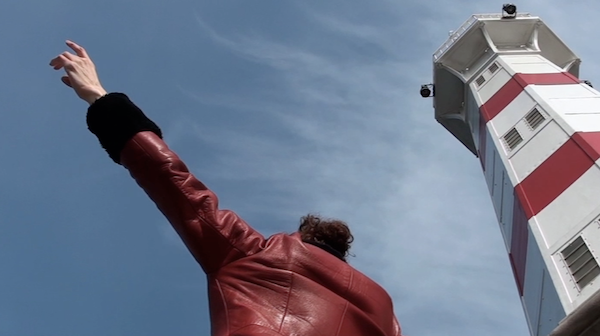
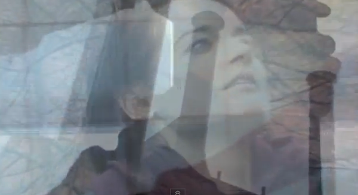
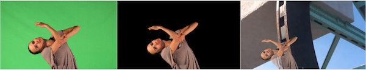

---

### AffeXity

*[AffeXity](https://affexity.org/)* is an enquiry into affect in cities, and a-fixity as an urban condition. It is an artistic research project, but really it is a set of overlapping practices: artistic practices of dance improvisation, video shooting, digital image editing and sound composition, combined with the daily practices of moving through a city and using mobile devices. Add to this bundle the applied technical research of developing applications for mobile devices and the practices of writing and reflecting on all of the processes, and you have an unwieldy assemblage. The entire project is animated by explorations of affect. It is in constant motion, exceeding both the artistic direction or conceptual coherence that attempt to structure it. [1] {#para1}

This project opens implications for interaction design: designing affectively and designing for affect are two different things. It is possible to do the latter using processes and methods that are entirely un-affective, or in other words without affective sensibility. The opposite might also be true: it is possible to use an affective design process for objects or experiences that are not affectively noteworthy. With *AffeXity* we are composing affective processes for the production of an affective experience. We do not know yet whether they are effective, but it is very likely that ‘effectiveness’ is not an appropriate criterion for judgement. {#para2}

At the heart of *AffeXity* is the convergence between performance and mobile technologies. In particular, the project uses the augmented reality browser Argon. This runs on smart phones and permits images, audio and video to be anchored in real world locations using geospatial coordinates or QR codes. The media float in the device’s display over the live feed from its camera. Appropriately for an augmented reality project, *AffeXity* is designed to have several layers, or modes, of interaction. In its simplest interactive mode, it is a locative media project with short movement improvisations videoed and geospatially tagged at various sites in Malmö, Sweden. These locative choreographies are shot in the location where they will be tagged, with the dancer improvising in a mini site specific performance. Once they are registered using GPS or QR codes, these embedded choreographies can be seen by people with mobile devices as they travel through Malmö in the courses of their lives. Whether it is an habitual route to work or walking the dog in the middle of the night, the choreographies can be downloaded and experienced at any time of day or night throughout the year as long as mobile coverage permits. These narratives can be as integrated into urban lives as crowds, buildings and buses, but perhaps offer an idiosyncratic ‘shimmer’ to experience, a play across presence and motion (Barthes, 2005: 101). {#para3}

A more orchestrated option for interaction is for small groups to be led from site to site by a guide, in the style of a promenade performance. With multiple devices downloading and playing the visuals and sounds at slightly different speeds the group will provide their own re-mix of the media simply by being co-located while viewing. An expanded performance option is planned for occasions when a more complex mix of presences can be formally produced, as in the case of a festival: the same live performers from the media will be situated in the sites where the locative choreographies are embedded and projections on the urban structures will accompany the imagery and sound on the devices. {#para4}

An additional performative layer for *AffeXity* takes it even further into the domain of social choreographies. This will occur when the project is promoted through social networking and other initiatives for contribution and participation by whoever desires to do so. Existing choreographies can be downloaded, remixed and retagged; new choreographies can be posted to exist in relation with others; sound, animation or text might be added, or other forms of embedded media might be offered. The exchange and circulation of affect through mobile devices happens all the time as we SMS, tweet and post to Facebook, but this project intends to foster an increasingly performative approach to media and urban living, broadening the choreographic patterns of daily life which risk being ever more controlled and narrowed. [2] {#para5}

This paper is written at a fairly early stage in the research process, contrary to the conventional scholarly practice of reaching closure on a project prior to reporting on it from the clear position of hindsight. This is done for two reasons: the first is that our early phases of research already have revealed considerable tensions and insight into affect and performance both practically and conceptually; the second, more compelling, reason is that this project has an existence prior to its completion as an artwork. It may take years for the piece to end (it will never be complete or closed) but from very early in the process it generated a fever of interest, with blogs and cultural organisations reporting it as existing, resulting in a flurry of demands on the part of festivals and producers to host it. Viewed from the processes of production and reception in the art world this caused uneasiness: almost provoking us to correct the misconception that it existed when in fact it did not yet, making us want to slow its public reception, to decelerate the project, until we could catch up with it. Viewed affectively there is no inconsistency. According to the Spinozan formulation of bodies that is increasingly cited in critical and philosophical writing, *AffeXity* exhibits the capacity to affect and be affected, and it has its own patterns of speeds and slowness. [3] As a construction, as a body, it exists apart from whether or not it is fully complete according to the art world, or indeed according to the artists. Closure is irrelevant. The project will always exist in a state of *not quite*, or *not yet*. From its inception, this project created a sort of affective cloud around it, almost a microclimate, that was palpable and circulating. And so I write and think about it, more to catch up with it than to explain it. {#para6}

The content of this paper seems to flow in several directions at once (philosophical, artistic, technological, methodological…) so I’ll take a moment to be quite pragmatic and indicate the path to be followed below. The discussion of *AffeXity* will be opened by referring to some of the philosophical currents around affect such as intensity, autonomy and contingency; then the AR browser Argon and the impact the technical development and the artistic processes have on each other will be considered. The middle section of the article will paint a picture of affect as it emerges from the actual practices that constitute *AffeXity* ’s early phases of artistic research: dance improvisation, video shooting, image editing and choreographic direction. There is an affective turn in each of these practices that does not necessarily map onto the affective turn in theory; this will be explained by relying on descriptions from the moments of practice by Jeannette Ginslov and myself, the main artistic collaborators. The final section is devoted to outlining a methodological perspective emerging through this research. Calling it provisionally *affective sensibility*, it straddles practical and theoretical activities because it is used in the process of generating the movement and media at the same time as it is a way of engaging with theories of affect. It is a method for generating artistic and theoretical content. What will not be discussed in this paper is the actual implementation, reception or, to use a design term, the ‘user experience’ of *AffeXity*, for the simple reason that the project is not yet at that stage of development. {#para7}

The reflections on affect and the description of the artistic research process in this paper can stand alone, but the intent is for them to contribute to a particular understanding of performance, that most ‘promiscuous’ of interdisciplinary practices and scholarly memes (Thrift citing Dolan, 2008: 124). Performance, in practice and theory, has sparked the interest of interaction designers, urban geographers, media studies scholars and architects in recent years. There is a sense that performance and the performative can shake the dust off conceptual constructions that seem too antiquated to account for the convergence of disciplines and practices, or that they that can provide a level of dynamism, imagination or simply liveness to methods, workshops and practices. Speaking from the perspective of scholarly work in interaction design, performance is frequently posited as a challenge, solution or method, and then walked away from without much elaboration. On occasions when it is elaborated, the usual suspects of Richard Schechner (1988), Erving Goffman (1967) and Victor Turner (1987) are relied upon to emphasise aspects of anthropology, ritual or the performances of daily life. In this paper performance is triangulated across *bodily movement*, *emergence* and *shimmering*. Performance as emergence occurs out of the fissures in habit and codified behaviour; it is heavily influenced by improvisation. Shimmer is based on change, not just change in position but a ripple in affective content and a flicker in the force of habits: it is ‘the shimmering field of the body insofar as it changes, goes through changes’ (Barthes 2005: 73). Performance can be seen as a play between the escape and recontainment of movement, as ‘a shimmer of forces’ of bodies and of things (ibid, 54). Never an easy concept to pin down, this understanding of shimmer will be unfolded further below, in particular when movement and video editing practices attempt to avoid what is habitual and drop into the unexpected. Ginslov uses the metaphor of ‘sniffing out’ the movement she wants to capture on video, the scent of something that is out of the usual patterns. Performance as shimmering has relevance also to social choreographies, seen as the many minute actions, uncontrollable from a central source, of a multiplicity of bodies and objects. {#para8}

### Extending Affect

Affect is notoriously hard to define, and this can make writing about it seem precious or coy, particularly if clear explanations are avoided. Suffice to say that any definition is not going to fit, but take this one in good faith: affect is the passage of forces or intensities, between bodies that may be organic, inorganic, animal, digital or fictional. It is located in the domain beyond reason, logic or ‘conscious knowing’ (Gregg and Seigworth, 2010: 1) but is so much more than emotion or feeling. Emotions are a jumping off point for understanding affect, the common currency of affect (Thrift, 2010), but the swirl of corporeal, conscious and pre-reflective forces that make up affect exceed the narrower domain of emotions. Melissa Gregg and Gregory Seigworth offer an excellent overview of affect, they manage to provide just enough clarity but not too much, just enough poetry without becoming too ethereal; and crucially for me, they do not extract affect too far from bodily experience. ‘Affect, at its most anthropomorphic, is the name we give to those forces that can serve to drive us toward movement, toward thought, toward extension’ (Gregg and Seigworth, 2010: 1). Extension in space and time through mediation and mobility is a possible way of describing the basis of *AffeXity*, but this extension is more than the revelation over the past decades, beginning with telematics, that we can be present in distant locations and be recorded and replayed in different temporalities. [4] {#para9}

The extension relevant to current practices and discourses around technologies of presence and communication is more of a repatterning of the forces that make up our bodies and our lives. This repatterning is no longer just construed as movement extending outwards from a contained subject. Whether through recording and layering, or by means of the sharing, annotating and reposting of social media, this repatterning is not a vector: it is a complex choreography of extension and intensities, of externality and immanence. In designing and devising the performances that make up *AffeXity,* we are less concerned about the physical forms of bodies in urban spaces than the play of intensities radiating from and through people with their devices. {#para10}

Extension and retraction are familiar biomechanical motions in most dance forms (*plié* and *tendue*, bend and stretch). In taking a choreographic approach to affect, *AffeXity* locates these actions in the wider flows of the extension, compression, radiation, dilution and multiplication of affect. These are not simply qualities beginning or ending with a solitary performer or recipient of media: extensive relations and intensive capacities are located in a shared domain. When Deleuze wrote that extensive and intensive relations are not just ‘a matter of utilizations or captures, but of sociabilities and communities’ he, of course, was not writing about Augmented Reality (Deleuze, 1988: 126). He refers to ethology, the study of relations between things. However, his ideas are useful in that mobile media is not merely about what we can capture or whether we utilize our mobile phones 24/7. Deleuze helps redirect our focus to the creation, destruction and recreation of different social groupings or extended bodies. [5] {#para11}

Affective forces need not be forceful. They can be barely detectable shifts in relationality between ourselves and our built environments, or between bodies in urban spaces moderated and mediated by technologies. *AffeXity*, as a locative media choreographic project, explores a body’s ongoing ‘immersion in the world’s obstinacies and rhythms, its refusals as much as its invitations’ (Gregg and Seigworth, 2010: 1). In cities we encounter brick walls that refuse, and glass windows that invite; but equally the glass windows obstruct and the brick walls offer crevices for opening. The obstruction or invitation is not sustained, but the state of relations is. Affect is as much outside a body as within it, and ultimately clear distinctions between inside and outside no longer make sense. {#para12}

### Muddy autonomy

As important as it was in the 1990s to suggest that affect was autonomous it is now equally important to emphasise that it is not separate from situated, messy exchanges between dynamic bodies. {#para13}

> The autonomy of affect is its participation in the virtual… Affect is autonomous to the degree to which it escapes confinement in the particular body whose vitality, or potential for interaction, it is. Formed, qualified, situated perceptions and cognitions fulfilling functions of actual connection or blockage are the capture and closure of affect (Massumi, 2002: 35). {#para14}

Brian Massumi’s formulation has generated many reactions but they tend to fit into two currents. Some readers are prompted to let out a sigh of relief that they can escape the discourse of bodies, while others dig their heels in and emphasise that affect is still corporeal and situated. Instead of being forced to situate myself on one or the other side of yet another pernicious duality (that is, is affect free from or situated in bodies?) I prefer to ask what is meant by bodies. How are they constructed, composed and lived? I find it surprising, and quite revealing of a particular intellectual climate, how many people—media students, musicians, dancers , literary theorists, not to mention designers of games, software and services—are relieved and even captivated when they hear of a Spinozan approach to bodies. The relief comes from no longer being cornered into choosing between the meat or the abstraction, but being able to live with the combination as both necessary and contradictory. [6] I choose to interpret Massumi as creating a sort of undulating current between affect within and outside my body, possibly because I have a strong corporeal resonance with his assertion that ‘Actually existing, structured things live in and through that which escapes them’ (Massumi, 2002: 35). At the same time, I am wary that too much emphasis on autonomy falsely lulls us away from the awareness that we are corporeally impacted by affective practices. I breathe a little easier when I read Sara Ahmed’s assertion, ‘I do not assume there is something called affect that stands apart or has autonomy …Instead I would begin with the messiness of the experiential, the unfolding of bodies into worlds, and the drama of contingency, how we are touched by what we are near’ (Ahmed, 2010: 30). I appreciate the nuance of Eve Kosofsky Sedgwick and Adam Frank’s writing on Silvan Tompkins, but as an artist attempting to work affectively I embrace even more their practical insights that, like it or not, affect is felt and that affective events afford the possibility *not* to be affected. They describe the act of reading Tomkins: ’At least as often as paragraphs permit reader and writer to do—here to enjoy but in other places to anger…—they permit one to *not do’* (Sedgwick, 2003: 96). This points to a latent political motivation for *AffeXity.* Urban dwellers are ever increasingly affectively manipulated by political and economic forces *without* the scope to *not* be affected. This is echoed in another way by Thrift and Amin when they imply that we ignore affect at our peril (Amin and Thrift 2002). {#para15}

Affect exists. It is a part of me and beyond me. Affect is really affects: they are shared, and shaped by me and by others. They seem to hang in the air, they live in the pit of my stomach. They do both at the same time. There are strings attached. Sometimes they come from the marginal movements of banal bodies. I absolutely cannot access affect without my body but it does not reside or originate or remain in me. Affect does not discriminate between age, gender, materiality or bit rate. It is perceptually polymorphous, and socially ambiguous. Beyond taste and judgements. Affect is and is not at the same time. It is excessive and beneath notice. It is performative, shimmering. The moment of affective emergence exists in between minute movements and decisions, in the tension and the flicker of motion. {#para16}

### Augmented Reality as Augmented Materiality

‘Considerations of affect are impossible to decouple from those of materiality,’ writes Susanne Paasonen. Materiality in her research refers to the bodies performing in and viewing pornography, but it also refers to ‘the technological objects, protocols, networks, and platforms’ involved (Paasonon, 2011, 8). Her argument can be mapped with ease onto the experimentation with augmented reality as a platform for the transmission of affect across bodies that themselves exist across layers of mediatization. {#para17}

Argon, the augmented reality platform we use, is currently the first and only application to offer video as a layer, alongside text, audio, still images and the possibility for animation. [7] The development of *AffeXity* occurs synchronously with the development of Argon, prompting the question: Why work with a developing piece of software? {#para18}

As hackers and improvisers have long known (since the days of experimentation between artists and scientists such as E.A.T. in the 1960s and the wave of technology and dance experimentation in London in the 1990s called Digital Dancing) when something is not quite finished it has an immanent quality of unfolding: we don’t quite know what functionalities it will have or how these might be used. This echoes Spinoza’s oft-cited words on bodies ‘No one has yet determined what the body can do’ (Gregg and Seigworth, 2010: 3). We work with Argon because *no one has yet determined what it can do*. Like the performing bodies in *AffeXity* Argon is itself a body which exists in a state of potential. It is still being sketched, or to use Massumi’s phrase it participates in the virtual (Massumi, 2002: 35). Two caveats need to be introduced to this somewhat utopian tone of immanence and potential, one pragmatic and one political. The pragmatic one is simple: when a piece of software is not yet completed it is buggy, limited and frustrating to use. It crashes. The interval between what you imagine it might do and what it currently does is what provides momentum to develop further, but that interval also taunts you. {#para19}

The political caveat is that in our current social and economic climate very little software is created without already having a place in the consumer market. In their pamphlet on Urban Computing, Adam Greenfield and Mark Shepard accurately acknowledge that advertising is the biggest problem lurking behind urban computing (Greenfield and Shepard, 2007: 15–16). The projects they discuss enter into critical relationships with advertising and surveillance. Like most AR software, Argon is well positioned to serve the advertising industry, but it has some important distinctions. It is free, open source and operates according to open standards for web content. Further, the development team opts for breadth by emphasizing the potential for cultural heritage applications alongside more commercial ones and by working with artists to develop its potential for artistic use. No one has yet determined what this body, the non-human body of Argon, might do. Or what the bodies that are combinations of people, devices and software might do with Argon. {#para20}

More specifically, it is worth asking what the *AffeXity* artists seek from Argon, if we could have any functionality at all? In terms of affordances, our desires are not surprising. We want from our mobile media devices what most people do: rapid downloading; a fairly intuitive interface; the ability to manipulate our video images; a capacity for annotation so that one choreography can be linked in AR space with others, thus creating a network of images commenting on each other. This wish list of functionality can also be expressed in the terms of affect: we desire the ability to slide across speeds and slowness in order to modulate how we affect and are affected. In other words we want to have vectors of gradience built into the augmented reality application, or the ability to shift visual or temporal intensities by subtle degrees. Sliders work far better than buttons (as any DJ knows) and we would like several: one permitting us to adjust the transparency of the images, one to dissolve the edges of an image by degrees, and another to shift the size and rotation of the images. All of these can be considered technological affordances for the transmission of affect, or ‘durational indices of shapes, timings, rhythms, folds, and contours’ (Gregg and Seigworth 2010: 13) but they do not end with image manipulation. These also return to Paasonen’s multiple designation of materiality by introducing the materiality of perception and the texture of the images (Passonen, 2011: 8). These are our desires, but they are a long way from being implemented. We are in the midst of that most familiar but not-so-often-written-about phase of the technological ‘work around’, finding ways to work around limitations. {#para21}

The actual locative component of locative media needs to be reflected upon further. Geo-spatial tagging is not a new technology, but what happens when the tags are heavily populated—when multiple images need to inhabit a GPS location? Like densely populated cities, the layer of augmented reality itself contains layers. It should be called augmented realities. The plural form invites the choreography of parts, or ’relation as rhythm to account for the passage of intensities between bodies, or bodies and world (Gregg & Seigworth, 2010: 13). Or the term Augmented Materiality would do: AM instead of AR. Deeper discussion of locative aspects will wait for a later paper once we deal with this phenomena more tangibly. Right now it is still speculative for us but we can see where current discourse stops short. For example, does AR have to be about the clear framing of media in our devices and legible insertion into cities? Or can it be used as a mode of peripheral vision, as considered by Juhani Pallasmaa in his reflections on architecture when he writes that what is missing from our dwellings today are the potential transactions between body, imagination, senses and the environment (Pallasmaa 2004)? Can we go beyond the ‘choreography of sensations,’ a formulation by another architect critically questioning his field, toward a performance of affect (Haque, 2003)? {#para22}

### An Inventory of Shimmers – exploring the process

Here the focus shifts to descriptions of the actual processes of performing affect. As such, this section is ‘an inventory of shimmers, of nuances, of states, of changes’ (Barthes, 2005: ,77), revealing degrees of gradience between speaking from within movement and reflecting on movement. This ‘inventory’ can be seen as an accumulation of raw affective data from experience obtained by applying the method of affective sensibility. It can also be seen as an “affectual composition” (Gregg and Seigworth, 2010:11). The usual structure of scholarly writing is inverted (or contradicted) because the data in this section is presented just prior to the articulation of the method in the final section. Echoing the discussion above, this can be seen as a ‘necessary contradiction’, respecting the fact that the methodological perspective emerges at the same time as the artistic material. In the paragraphs below JG and SK are used to indicate the words of Jeannette Ginslov or Susan Kozel. We write and move in such a way as to explore the small shifts of affect as they make themselves felt in motion, perception and aesthetic habits. {#para23}

### Movement improvisation: ‘Where to start?’

> **SK:***How do I even begin to think about working with affect? For so many years the improvisatory focus was on kinaesthesia, on corporeality and embodiment with all its multiple voices in motion. Here I stand in a city about to begin a movement improvisation. Where to start? I attempt to start from somewhere different from my usual starting points: I try to inhibit my habits. I have an inkling that I usually begin a kinaesthetic trajectory by releasing my arms and letting my hands travel, leading my body, at the same time as softening my knees letting my spine create a different torque. Now I decide to reframe the starting point: can I let affect lead me rather than motion? I want to move less and sense more. Sensing is not just an internal focus, it radiates outwards. When an affective state arises and is not fought or tampered with it acts as a window: as the mover, I can choose to notice this window and pass through it. * {#para24}

Of course the entire notion of a ‘starting point’ is awkward and forced because dance is a pattern that occurs all the time. Improvisers of movement and music have a practical understanding of Deleuze’s assertion that ‘it is by speed and slowness that one slips in among things, that one connects with something. One never commences; one never has a tabula rasa; one slips in, enters in the middle; one takes up or lays down rhythms’ (Deleuze, 1988: 123). {#para25}

Yet, when working with media that begins with video capture there is a starting point, or at least a threshold: it is when Jeannette tells me the camera is rolling. {#para26}

> **JG**: *I am very aware of the task at hand: the desire to capture the affective gestures that the dancer is performing far outweighs the capture of movements or choreographies. I relax, breathe, but I am alert to all the subtle nuances. I try not to think too much or direct too much. This direction is a gentle persuasion. The dancer needs to sniff and tease these out by exploring her somatic connection to the space she is performing in. We do not think of dance, steps, counts, but enchaïnements of affect. There may be a score that is decided upon, something to work on. The dancer and I enter that resonant space. When I feel it is there, I hit the record button.* {#para27}

This is a subtle variation on improvisation because improvisation is about suspending conscious judgement and letting the flow of inner or outer stimulation direct the flow of movement, talking, singing, reacting, making and creating. It has some relation to contact improvisation. Contact improvisation has been characterized as cultivating alertness ‘in order to work in an energetic state of physical disorientation.’ [8] In other words, improvisation is not just about fluidity and synchronicity. Consideration is given to inertia and disorientation, gravity and temporality, how contact with the ground, others or oneself may be varied, sporadic, and inconsistent but is all the stronger because of these qualities (Kozel, 2012). {#para28}

> **SK:***In this particular improvisation I am standing in front of a lighthouse in Malmö. It is sunny and cold. People are passing close by, for this lighthouse is near a drawbridge leading to the ship building yards close to the university and many other buildings. What is the affective window? It is a combination of impulses from inside and outside: I bend my knees and fall over the railing wanting to dissolve into particles at the same time as turn to water on the stones. There are emotional overtones, but the affective state is more than feeling tired or a little anxious or happy to be outside in the air as the seasons change. I can’t quite capture it, or seem to slide in and out of different affective currents. There are traces of the social urban environment for the presence of the two observing tourists and the cars, bicycles and trucks passing. Suddenly I am more aware of what is going on outside of me than inside: the tourists begin to stage their own performative shoot, letting themselves become more adventurous in how they use their bodies as they are co-located with us using our bodies in a way that is clearly for a film or art project. Two workers see me slide down the concrete slope to the rocks and water below and ask, partly humourously, partly in earnest, if I need help. The affective state is made up of the emotional, physical, social, environmental and meteorological. * {#para29}

::: embed
https://www.youtube.com/embed/2Gf7ohn5SY8
:::

*AffeXity* Phase 02 Lighthouse 01

::: embed
https://www.youtube.com/embed/ywfSTKEC3KI
:::

*AffeXity* Phase 02 Lighthouse 04

A way of understanding the different movement patterns in *AffeXity* is to say there is a shift from patterns to ‘feeling tones,’ to movement qualities or ‘atmospheres’ (Seigworth & Gregg 2011: 2). This is why the cloud is an apt metaphor, not for the usual connotations of invisible data clustered around our heads, like a swarm of bees, but because clouds can be damp, dense, light, ridged or bubbly. Passing through a cloud or carrying one around with us cannot help but be affecting on the levels of sensibility, thought and motion. {#para30}

Watching the images from the lighthouse shoot, I see how ‘in my head’ I was struggling not to direct, but instead to release the tendency to control and direct movement. Jeannette too, when presenting this section before a small audience paused and said ‘it’s not quite right, it is not quite … there.’ [9] Of course not. Affect is never there, it implies an “extreme changeability” (Barthes, 2005: 101). Artistically there is the possibility that the images and sequences will never feel complete or quite right. At the time of writing this article we are still in the early stages of developing an improvisational approach but there is a possibility that when the motivating forces are affective there will never be a coherent aesthetic quality to the movement. It will always be about disorientations and attunements, in perpetuity, in and out of one’s head. This is what makes this project especially suited to social choreographies, rather than the vision of an artist or collaborative team, where social choreographies are the multiple minute actions of a myriad of bodies, undirected by a central source (Kozel, 2010a). This project needs to live in the wider domain of social networked media, constantly being raveled and unraveled, ignored or obsessed over, by many people according to the different rhythms of their lives and bodies. {#para31}

> **SK:** *And next thing I know I am draping over the barrier and floating upward again, my body is moving of its own accord. I feel like a strange bird at the same time as embed the cold metal into my lower abdomen. The improvisation takes me into a standing arc with arms slicing the air, and reaching back with bent elbows. My back is important again. I realize, perhaps for the first time that when improvising vision shifts: no longer central and frontal, all visual processes seem to be peripheral, sensing in the round.* {#para32}

### Video Capture : Intensities and Resonances

With *AffeXity* the capture of movement on video is done with care, always with an awareness of what Pallasmaa has called the danger of reduction to a ‘retinal journey.’ He writes of architectural design and how ‘computer imaging tends to flatten our magnificent, multi-sensory, simultaneous and synchronic capacities of imagination by turning the design process into a passive visual manipulation’ (Pallasmaa, 2005: 2). Expressed differently, escaping the retinal journey is an escape from an ocular or representational approach into what Nigel Thrift has called the non-representational (Thrift, 2007). This impacts the processes of video shooting and editing in particular: at the same time as being image-based, the desire is to construct, edit and choreograph the images and media in a non-representational way. We are only just beginning to feel our way into using video-non-representationally. Some might say this process is doomed because images are always representational and that we would be better off simply using sound. Instead of migrating to sound, however, we work with resonance. Our non-representationality comes out of an approach to trusting the emergent moment of improvisation rather than framing the image. This invites an entirely different series of ‘bindings and unbindings, becomings and unbecoming’ (Gregg and Seigworth, 2010: 4). In other words, we try to permit one movement—of camera or body—to lead to another according to a different logic or intuition from most video practices. Following Thrift in his detailed writings on movement, or ‘the geography of what happens,’ non-representationality also rests on an oblique capacity to see something that is not there, or is not yet there (Thrift citing Castoriadis, 2008: 2 and 111). We suggest that *AffeXity* offers an additional take on non-representationality, found in the complexity of an assemblage: the piece (call it a locative choreography or an AR performance) only exists through a combination of actions, perceptions and technological affordances in any given moment. Even if we wanted to control the representation more carefully the many components would pull apart our intentions. {#para33}

> **JG:** *I shoot. I remain calm and breathe. I shoot from my centre as if in a contact improvisation with the dancer and the affective gesture. I try not to direct too much, but rather express an allowance to the dancer, an open space in which to explore affect. I can sense it immediately when it is there. All the wires, plastic, glass and metal of the technology melts away.* {#para34}
>
> The shoot becomes very subjective and I am patient. I wait if the affect leaves the dancer or the resonance is not there. I try again to find a somatic connection with what is being captured by the lens. My eye, the lens and my body’s centre always trying to connect with the affective resonances before me. My legs are the tripod. My lens is my eye. My centre is alert and all three are connecting. {#para35}
>
> This connection is a space that is very particular, a condensed vision of what I really see before me, that is the dancer in the environment. I have to ‘zone in’ on the resonances and ‘zone out’ the environment trying to capture the same intensities and resonances the dancer is sensing. I use my screendance and choreographic techne subconsciously, allowing it to guide these short moments of intensities. {#para36}
>
> These subjectivities were never discussed but rather moved out in affective gestures and movements, leaving trails, suggestions and a semiotics of ineffability that can only be traced in affective gestures. {#para37}
>
> I try to remember the Dogme principle of: ‘what you see is what you get.’ I now add: ‘what you feel is what you get.’ [10] The screendance genre becomes the perfect medium to capture these states of affective poesis. {#para38}
>
> {#para39}

::: embed
https://www.youtube.com/embed/umlCMJ7Numg
:::

*AffeXity* Phase 01 #1 Carlsberg

### Editing Process: Rhythmic Attunements

Technologies provide constraints and affordances—all of us know this—but technologies that are in development provide an entirely new mix of constraints. As discussed above, Argon is a rapidly developing augmented reality browser that now supports video, but it is still rough and the devising period discussed in this paper coincided with very limited video functionality. Our visual aesthetic was layered, fleeting, ethereal but also stark and geometric. Being able to play with layering and opacity are of extreme importance to us. This corresponds with a certain aesthetic in Screen Dance that Ginslov is known for, but also reflects our emerging affective sensibility: for *AffeXity* it is important for bodies to be multiple and shimmering at the same time as merging with the built environment. Our affective sensibility far outstrips what the browser can support. Our artistic research process consists in moving and waiting at the same time. {#para40}

> **JG:** *There is no shot list, no script and no narrative, no psychological development of a character in a location and linear narrative. In the edit process one uses a montage structure. One intuits and trusts the choices, the pace, rhythm, timing and cutting all connecting to the score or affective gestures and states of being expressed and captured. My job is to amplify that, cutting out all other extraneous information. I try to achieve this without too much intellectualization. I try to amplify affect and movement through the edits and overlays. If it is present it is there. It was a good take. Both camera and dancer worked in harmony. Sometimes if there was a good connection during the shoot, the video practically edits itself. There are no special effects required.* {#para41}
>
> *However sometimes the intellectual processes need to surface in the edit. I need to shape the affect. I need to amplify the affect. I use layers and shots of the dancer in a moving lift, dancing in a stairwell and outside against a building. I layer these takes and make the moving images transparent. I amplify the dancer’s face, her looking sublimely upwards, her hands trying to reach for spaces and moments that are escaping. She seems ethereal, in a dream state. The edit needs to reveal this in a non-linear montage, as if she were in a loop, in a lift forever reaching and moving sky ward. She is in the lift, the building, the stairwell, the area outside – the lift, the building, the stairwell and area outside are in her. They merge.* {#para42}

### Directing Movement: Dislocations and Orientations

Here we return once more to the limitations of working with an AR application that is in the process of being developed. Ginslov and I wanted the video to be a layer over the display of the mobile device, and for the edges of the frame to be incremental or soft, but were presented with postage stamp images. [11] In order to get past the problems with inserting video into Argon, the engineers requested that we provide them with video footage that was shot in green screen, with the background extracted. Suddenly we found ourselves working in a way we did not want to work—this project was all about movement embedded in the city not about shooting movement in the dislocated and decontextualised environment of a studio with green walls and floor. Green screening also did not coincide with our affective visual aesthetic because it tends toward the insertion of a clear edged ‘sprite’ into the environment. Despite this, the strength of a good artistic-technological collaboration is the willingness to modify practices in the interests of development, so we set up a green screen in a studio and worked with dancer Niya Lulcheva. This posed unexpected challenges from the perspective of choreographic direction: how is it possible to direct a dancer into an affective state, to initiate flows of affective exchange that result in movement improvisation when you are standing behind a camera and she is standing on green cloth in an extremely cold room with cement walls and floor? {#para43}

  {#para44}

::: embed
https://www.youtube.com/embed/oH6wj-GghcY
:::

(green screen no chroma key)

::: embed
https://www.youtube.com/embed/61V8xu3Pozk
:::

(green screen after chroma key)

::: embed
https://www.youtube.com/embed/0hNKga4d8iw
:::

(first mock up of possible AR effect.Note that this was only a test.)

  {#para45}

> **JG:** *The merging with the environment, spaces or buildings one can imagine oneself occupying became the central and most evocative means to find the scores within which Niya had to work. She was not in a location but working in a studio in front of a Green Screen. We tasked her to dance as if in a space, a location, a building.* {#para46}
>
> At first she performed and danced from an exteriorized perspective. Her dance was large, projected and danced as if performing on a stage. We needed to guide her into interiority, a subjective presence, in order to get the affect we were looking for. {#para47}
>
> The interiorisation of the space she was imagining herself to be in only became obvious and affective when we asked her to blend into the building: not just move in the passageways, the negative spaces, the passageways that we normally occupy and move around in. We asked her rather move in its echoes, its mortar, its bricks and in its cement. {#para48}
>
> With that her focus became inward, her dance became affective gestures, traces of memory and echoes of her internal vision. She was “in the zone” in the “vibe” of the place. She no longer had to project outwards, but allowed herself to transpire in the journey, her gestures became the echoes, the mortar became liquid and the building she was in, was in her. {#para49}
>
> She had connected and I had shivers watching her do this. The affect had been passed into me. Her internal journey travelled into me via the wires, metal and plastic of the techne and technical. The affective had transcended the technical, the machinic and become poetic, visceral and liquid. {#para50}

This inventory of shimmers charts the nuances and changes in practice that make up the early processes of *AffeXity*. The metaphor of shimmer lends itself easily to speaking from the fleeting, never fully defined, relational moment of practice, but I want to call attention to the dynamic of the shimmer as a tiny moment of rupture. This moment of fissure produces an inkling that things might be different, and out of it a subtle change is enacted. A tiny change like this, whether it is in moving differently, using a video camera in an unconventional way or managing to coax a dancer into an improvisation that yields unexpected qualities, is an example of the shimmer of performance. Changes or shimmers point to a state of emergence, rather than seamless, circular repetition. {#para51}

### Affective Sensibility—A Reflexive Methodological Practice

Here I will sketch the development of a particular understanding of performance that comes directly from the performance of affect in *AffeXity*[12]. I rely on the following stepping stones in my path: first the Austinian performative speech act, next the performative potential of description, followed by the performative emergence of non-representational actions. The result is a rough triangulation of performance across bodily movement, emergence and shimmering. The bodily movement keeps performance grounded in corporeality, but this is already a transformed corporeality in the mode of Spinozan bodies—of speeds and capacity to affect and be affected—that is also the mode of our contemporary urban bodies. The emergence is the crucial constructive or generative aspect of performance. The shimmering plays an unusual role, drawing attention to the fissures or uncertainties of affect out of which something new can arise. Perhaps this *understanding* of performance, which is also a *practice* of performance, is only really relevant to the performing of affect and will provide only a fragment to the more general consideration of performance in interaction design and mobile media. Even if this is so, it will be consistent with the attention to affect occurring through ‘microscopic fragments’, the ‘filings of affect’ (Barthes, 2005:101). {#para52}

### The Performative Potential of Description

Austinian performativity is about how language constructs or affects reality rather than merely describing it, and it was influential to the development of gender studies and queer studies in the 1990s. It is not directly about bodies or movement, but embedded in it is what we might now call emergence, or a generative potential—an ontological dimension of bringing something into being that was not there previously. On an intuitive level, I believe this is why so many designers are attracted to the notion of performance, combined with the ease of integrating the social, critical and ludic into performative practices and concepts. Sedgwick identifies several features in Austin’s explicit performative utterances, examples of which include: ‘I promise…’ ‘I dare you…’ ‘I apologise’ ‘I give up…’ ‘I forgive…’. They are in the first person singular; they are present tense; they are indicative and active; the verb in each one names the act (Sedgwick, 2003: 3). I would also call attention to a certain affective intensity that accompanies the verb. {#para53}

Is the performative lost when assertion gives way to description? Sedgwick makes the provocative claim that the performative, or productive, aspect of language is most revealing when the language is closest to claiming a simply descriptive relation to reality (Sedgwick, 2003: 5). The provocation lies in the generally held assumption that description is a weakly mimetic form of language, offering little scope for fissures out of which anything new or productive can emerge. But this is not so. As someone who has, for many years, explored the convergence between thick description and dance in a phenomenological vein, I see how the performativity of the linguistic description works hand in hand with the performativity of movement. Both create openings, both are actual shifts to new grounds for thinking, acting and being. Linguistic descriptions of lived experience and movement improvisation—which can sometimes read like fragments, aphorisms or even poetry—do not *point to* the possibility of something new; they *are* that crystallization or transformation of something that was previously virtual into being. Affective description can move us to a different state of being. Witness your own reaction when I say ‘I breathe…’, ‘It shimmers…’ Language operates on a somatic level. While an elaboration of somatics is beyond the scope of this short section on performance, it is enough for now to say that somatics shares the field with affect. This is illustrated in Sedgwick and Frank’s description of the experience of reading Tomkins; {#para54}

> a potentially terrifying or terrified idea or image is taken up and held for as many paragraphs as are necessary to “burn out the fear response,” then for as many more until that idea or image can recur in the text without initially evoking terror. Phrases, sentences, sometimes whole paragraphs repeat; pages are taken up with sentences syntactically resembling one another (epistemically modal non-factive utterances of the form “It is possible that…,” “If … may …,” “Whether because…”), sentences not exemplifying a general principle but sampling—listing the possible. This rich claustral writing nurtures, pacifies, replenishes, then sets the idea in motion again. Bambi isn’t the only terrified wild thing in this picture. (Sedgwick and Frank, 1995: 95).
