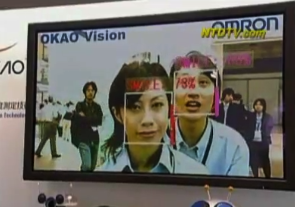

---

### Introduction: ordering affect and the question of labour

Recent developments in the workplace have seen the intensification of methods to elicit and capture value within and across the affective encounter, notably through the introduction of technologies to measure the production of emotion by service workers. One of the most compelling examples of such methods is the ‘smile-scan’ – a technology developed by Japanese company OMRON to read and measure the intensity of facial expression in the workplace. Through an analysis of the use of OMRON’s OKAO Vision smile scans in workplaces, this paper seeks to understand the insertion of particular affective technologies into the technical composition of capital and their role in the ordering of affect. {#para1}

In the post-Fordist condition, the role of affect has emerged as a central point of contestation, since the capacity to produce relationships and feeling is pivotal to the work of service, communicational and relational industries. Autonomist Marxists [1] in particular have pointed to the importance of affective labour in contemporary forms of production and circulation. Surprisingly, however, these theorists have paid very little attention to the new technological infrastructures that shape and modulate the production of affect in the workplace. As a consequence, their understanding of the affective conditions of post-Fordist labour neglects to explore the ways in which the technological composition of capital intersects with and informs the question of class composition. This paper revisits and complicates the insights of autonomist Marxism by examining the *technological nexus* which organises and compels affective labour as a force in the production and circulation of value. {#para2}

The critique of the technological nexus and composition of affective labour will explore the inclusion of affect within processes of HCI on the one hand, and the modulation and ordering of the affects of the user, on the other. The ‘turn’ to affect in computing and HCI design has opened up a vast field of research and potential applications (see for example the collection Tao and Tan, 2009). This paper focuses on just one of these applications – namely emotion recognition technologies that seek to subordinate user affect to the imperatives of capitalist valorisation (productivity, rapid circulation and accumulation). In so doing I aim to identify how, within HCI, certain technological assemblages come to compel the body of the worker within a particular *ordering of* *affect*. The ordering of affect occurs both in the process and as the effect of the use of particular affective HCI technologies in the workplace. In pursuing this line of inquiry into the ordering of affect, we will be better placed to understand contemporary elements of the technical composition of affective labour as expressed in affective HCI. The use of OKAO Vision as a technology of work perfectly captures the tensions inherent in the relationship between user and computer, affect, emotion and technology. The smile-scan is a technology for the ordering of affect *par excellence*. {#para3}

Eva Hudlicka (2003: 3–6) provides a useful overview of the potential applications of HCI technologies focused upon user affect. Within a larger taxonomy of applications, she identifies one phylum of technologies that aim to sense, recognize and modulate user affect. In Hudlicka’s words, such technologies might be deployed, amongst other possible uses, for ‘*maintaining a particular user state for a particular task*’ and for *inducing* a particular affective state in the user (5; emphasis in original). Both of these applications are characteristic of the use of smile scans in service work, in particular, and the monitoring of affective labour, more generally. Moreover, both of these applications point to the sometimes very fine line and indeed the tension that exists between affect and emotion. This tension is developed below, but briefly now, affect here is understood as a relationship of varying degrees of intensity between bodies, and the impact of this relationship upon the bodies involved. However emotion is taken to mean the emotional quality or disposition of an individual at a given point in time. Emotion relates purely to the individual. The examination throughout this paper looks to the position of affect within HCI used as a force upon labour, and which orders the affects of the user as a technology of work. {#para4}

Paying attention to the uses of HCI in the contemporary labour process, this paper will argue that technologies such as the smile scan form a point of refraction that articulates affect in a similar way to which a prism impacts upon light waves, shifting their flow, direction and speed. Although refraction does not change the substance of affect, it does alter the rhythm of movement and the perception of the flow. In this respect, we can engage the problem of affective labour and technology in the Spinozist terms of movement and rest, speed and slowness. Tension emerges as affect qua activity and labour moves through different spaces, constituted by different logics and codes: value’s organisation of labour determines a degree of movement or rest of a body and affect particular to the imperatives of valorisation. Here the deployment of a technological infrastructure to induce and maintain an affective state in a worker, mobilised within the logic of valorisation, forms the prism that compels and bends the affective encounter. {#para5}

### Posing compositionist problems

The perspective of compositionist analysis first emerged within the Operaismo movements in Italy during the 1960s, and has continued to develop in subsequent decades. The journals *Classe Operaia* (Working Class) and *Quaderni Rossi* (Red Notebooks), circulating the work of authors such as Raniero Panzieri, Romano Alquati, Mario Tronti, Antonio Negri and Sergio Bologna, first introduced the practice of compositionist analysis into a renewal of communist thought and engagement. Feminist theorists working from a compositionist perspective, such as Maria Rosa Dalla Costa and Silvia Federici, and groups such as Lotta Femminista (Feminist Struggle) radicalised the scope of the method, insisting on the critique of the various relations of reproduction and unwaged work as sites of antagonism (Wright, 2002; Red Notes, 1978; Cunninghame; Bargallo & Federici, 2012). Since the early period of compositionist thought in the 1960s and 1970s, the method has continued to be used as means to problematize the organization of the reproduction of capital. {#para6}

Compositionist analysis comprises two related categories: technical and political composition. The general category of class composition refers to the technical organisation of (re)production of capitalism and the political forms of organisation that emerge both within and against this arrangement. The concept of technical composition takes on a specific dimension of meaning in this school of thought [2]. On the simplest level, technical composition is an expression of the structural organisation of labour-power in the production process, and the conditions of the reproduction of labour-power. Perhaps put otherwise, technical composition expresses the technological conditions, or lack thereof, that determine the characteristics of the labour process of a given area of work. It is also an engagement with the myriad features of what is required to perform specific tasks ‘on the job’ in a given area of work. The technical composition of class comes to assume, or at least inform, the posing of a political dimension in so far as the organisation of capitalism involves class antagonism. [3] Finally, technical composition articulates specific forms of the labour processes of respective types of work, placing the development of such processes within the cycles of class struggle. {#para7}

In recent years, there have been gestures toward a renewed analysis of affective labour through the lens of compositionism. For example, Hardt and Negri revisit the question of the technical composition of class in *Commonwealth* (2009). Hardt and Negri’s analysis identifies in the contemporary technical composition of class three trends: firstly the hegemony of immaterial production, secondly the so-called feminisation of labour, and finally the migratory movements of labour. According to Hardt and Negri, the three trends of the ‘technical composition of labour…all are engaged in the production of common forms of wealth, such as knowledges, information, images, affects and social relationships, which are subsequently expropriated by capital to generate surplus value’ (2009: 139). However, their examination is very general, and says little of consequence for understanding a contemporary technical composition of class, at the micro and daily level. For example, although the three tendencies Hardt and Negri point to do resonate and express in broad terms elements of the configuration of contemporary class composition, they cannot explain the ongoing encounters that mobilise the production of knowledge, affects and so on within the framework of capital’s organisation of work. As a result, it is not possible on the limited terms of the ‘three tendencies’ to grasp the details and microelements of antagonism that occur in the everyday conditions of immaterial production. The perspective offered here by Hardt and Negri does not draw out the complex and dynamic relations that a detailed engagement with the terms of technical and political composition of class can provide. This article moves towards addressing this problem, through a critique of the relationship between affective HCI and labour in the workplace. {#para8}

### The contribution and limitations of the theory of affective labour in the critique of contemporary capitalism

The conceptual terrains upon which the theory of affective labour is developed are wide. Theorists of affective labour draw together Spinozist and Deleuzian concepts of affect and a Marxian critique of capital to interrogate the process of value creation and exploitation in post-Fordist capitalism (see Spinoza, 1996, Deleuze, 1988 & 2005, Negri, 1999, Casarino & Negri, 2008, & Hardt & Negri, 2000, 2004 & 2009). Whilst the specific engagement with the works of philosophers such as Spinoza and Deleuze constitutes a key conceptual field for the development of the theory, feminist critiques of political economy, emotional labour and the body have also been pivotal. [4] Drawing from feminist critiques of emotional labour and ‘reproductive’ work, autonomist Marxists have developed the theory of affective labour within the broader conception of immaterial production. {#para9}

The work of theorists such as Michael Hardt (1999), Antonio Negri (1999), and Franco Berardi (2009a), represents one attempt to rethink labour and work in a contemporary context. For these theorists the condition of post-Fordism is in fundamental ways characterised by the emergence of immaterial production. For Hardt and Negri, immaterial production sees ‘images, information, knowledge, affects, codes, and social relationships…coming to outweigh material commodities in the capitalist valorisation process’ (2009: 132). [5] The emergence of immaterial production is marked by an increase in the amount of labour carried out in service industries generally. Perhaps more importantly, with immaterial production the work of communication, cultivating relationship and producing affect comes to constitute primary points in the organization of accumulation in contemporary capitalism. In other words, the resources, raw materials and labour used in immaterial production are directly affect, language and knowledge. This is what is meant when it is said that today, fixed capital and the general intellect are increasingly located not in machinery but in the bodies and brains of workers. {#para10}

In a somewhat different register, emphasizing the pervasiveness of communication to contemporary production Paolo Virno has argued that the ‘communication industry…plays the role of *industry of the means of production*’, in so far as techniques of communication and relation become means of production in post-Fordism (2004: 61, emphasis in original). The passage to post-Fordism, which brings us to the present conjuncture, complicates the relationship between time and labour, and the techniques that articulate this relationship. Christian Marazzi (2008: 41) brings this complexity to the fore, emphasizing the centrality of language and communicative-relational action in post-Fordist production. Marazzi argues that ‘the chain of production has…become a *linguistic chain*, a *semantic connection*, in which communication, the transmission of information has become both a raw material and instrument of work’ (50, emphasis in original). Here, language and communication become the stuff of production and the means of wielding it; production sees the linking of material and execution of labour in language and communication. However, it is also necessary to locate affect and emotion specifically within the post-Fordist economy. Berardi’s articulation of semiocapitalism maintains that ‘productive life is overloaded with symbols that not only have an operational value, but also an affective, emotional, imperative and dissuasive one’ (2009(b): 107). In the passage to post-Fordism, the labour of producing affects, communication, knowledge, the creation and maintenance of relationships and the cultivation of attention emerge as key economic terrains. {#para11}

On a higher level of abstraction the theory of affective labour produces a number of political and philosophical problems. For Hardt and Negri, affective and immaterial labour do not produce commodities, but rather social relationships and ways of life. In other words, the category of labour merges with that of life, and thus becomes a singular productive substance. Immaterial production and affective labour therefore become biopolitical production: work that produces the very fabric of social life and of the common. The emphasis on biopolitical production marks a key element in the ontological turn in post-workerist thought. The limitation of the ontological turn in theories of affective labour becomes clear when we return to some of the critical resources provided by earlier examples of compositionist analysis within autonomist Marxist theory. {#para12}

All of the above authors have, in their own way, attempted to come to terms with the new forms and configurations of labour. In doing so they have identified the various forms of the direct relationship between the body, subjectivity and the labour processes of immaterial production (Eden, 2012). Although some of the primary theorists of immaterial production and affective labour emerged from the perspective of compositionist analysis, the theory’s construction has dispensed with some of the key theoretical insights of the earlier period of research and political practice. The key limitation of the analysis of the class composition of immaterial production arguably lies in its flattening, or collapsing, the categories of technical and political composition into the singular foundation of biopolitical production, or productive life. [6] It is in this move, however, that the rigour of the critique of labour and work is lost. The perspective developed in this paper seeks to avoid the problems of this ontological turn through refocusing on the question of the technical composition as expressed in affective HCI. {#para13}

The complexities that emerge when we consider the technological nexus that is developing specifically within the factories of affect, whether these are call centres, hospitals, retail outlets or any other customer service floor, warrant a more nuanced consideration of contemporary forms of technical composition. The point of departure for such a consideration involves, following the insights of early compositionist critiques of class and work, the technical, including the technological, organization of labour. It is with this point of departure in mind that the analysis of this paper will approach both the question of affect within HCI, and also that of developing the complexity of the theory of affective labour and its composition. Whilst theorists of affective labour have identified the need to consider the problem of immaterial production, they have less to offer in critiquing how the relation of capital and its various technical elements have also taken up and incorporated this same problem of affect and labour. The critique of affective HCI in this paper thus aims to situate affective HCI, specifically OKAO Vision, as an element within the structural organization of labour-power. In doing so, it will be possible to look firstly at the specific implications of the use of this technology at work, and secondly, to develop some general points to be applied to the more broader analysis of affective labour and immaterial production. We will return to the discussion of composition and HCI towards the end of the paper, with an emphasis on the elements of technical composition. {#para14}

### Affect and emotion

On a superficial level it appears that the various theorisations of affect have in common an understanding of affect as a bodily and relational force. Yet in certain disciplines and registers affect and emotion can be used interchangeably. It is therefore useful to be clear about the difference between these categories, particularly as we are attempting to come to terms with the process of modulating and ordering affect through HCI at work. The definitions used throughout this paper will follow those of Gilles Deleuze and Brian Massumi (Deleuze, 1988; Massumi 2002). Following Deleuze, affect is an intensity of feeling that runs across, between and through bodies, but which cannot be captured within an individual body. The sense of relation is thus never closed, and affects cannot belong to a subject but must be a flow of intensity between bodies expressed as passion or action. As Massumi suggests, emotion will necessarily emerge from an affect, but it is effectively objectified and possessed by an individual. Emotion becomes the individual’s, the subject’s expression of feeling. In this respect, perhaps, emotion represents the reduction of affect as open flow to something that is quantifiable, fixed and exchangeable. It remains to be seen, however, whether various affective HCI technologies necessarily carry out such a reduction, or whether they rather generate a unique process of order. {#para15}

In *Post-cinematic affect* (2010) Steven Shaviro makes the argument that affects bear the same relationship to emotion as does labour to labour-power. The first in each of these respective relationships, affect and labour, can be described as the open intensity, and the non-containable force: labour is the form giving fire of human creativity; affect is the open intensity of relation that cannot be individualised and objectified (Marx, 1973, p361; Spinoza, 1996). In contrast, the categories of emotion and labour-power are the objectified form of the creative intensities from which they emerge, and which they represent. Emotion is a contained, personalised moment of affect, while labour-power constitutes the captured, commodified expression of labour (Massumi, 2002; Marx, 1951, pp74–97). Building upon this distinction, we come to the following problems: if the exchange of labour-power is a necessary objectification of labour within the social relation of capital, it might seem difficult to talk of an affective labour within the valorisation process, based on the terms of distinction outlined so far. In a different sense, we also need to clarify the role of HCI technologies, in this case OKAO Vision, in the determination of affective or emotional relations. We will return to these problems throughout the paper. {#para16}

### HCI and the circuits of order and amplification

Recent trajectories in HCI, drawing from work in affective computing, have sought to emphasise the affective state and expression of users in the design of interactive technologies, and to develop the capacities of machines for affective display (see Zeng et al., 2007; Gunes et al., 2004; & Truong, 2010). Rosalind Picard’s (2000) work on affective computing opened up a field of enquiry which has subsequently been taken much further by researchers and designers in the field. The variety of innovations emerging from affective computing and HCI is vast and include eye tracking instruments, devices which interpret the emotional significance of physiological data such as temperature and heart rate, as well as emotion and gesture recognition technologies, to name just a few (see Gunes et al., 2004; Lao & Kawade, 2004; Zhao et al., 2003; Jaimes & Sebe, 2006). The diversity of these trajectories all indicate a general ‘turn’ to affect in computing and interactive technologies. {#para17}

HCI, understood as a broad field of research and development, focuses on the improvement of the relationship between users and computers. However, the engagement with affect in recent decades has contributed much to expanding this field. Speaking generally, prior to the affective turn, most research in HCI was concerned with the logical and calculative powers of the computer, while studies in human-machine interaction focused upon the adaptability of the user to the computer. [7] Here, it was assumed that it is easier to get a person to adapt to the rigidity of a machine/computer than to get the computer to learn and adapt to the user (Raskin; 2000). More recently, as Noam Tractinsky et al. (2000) have demonstrated, researchers have uncovered empirical correlations between designs that address the affective dimension of an interface and its perceived usability by humans, constituting evidence that challenges the previous wisdom of function over form. The increasingly sophisticated engagements with affect are productively complicating the frameworks through which computer and interface design and development is thought. Not surprisingly, in the relatively short period of time in which affective computing and technologies have emerged as a field worthy of serious consideration (Hudlicka, 2003; Sengers et al, 2002; Boehner et al. 2005; Partala and Surakka, 2004), numerous divergences have emerged. These divergences reflect the difficulties inherent in the very definition of the concept of affect and cognate understandings of interaction. {#para18}

Some of the initial engagements with affective computing approached the problem of the direct relationship between an individual user and his or her computer. Picard (2000:1) defined affective computing in terms of computing that either relates to, influences or arises from emotions. This implies that the computer should be able to recognise emotion in the user, recognise and respond to this emotion, and in other cases, that the computer itself possesses emotion of its own. In a paper linking affective computing and HCI, Picard (1999), identified four areas of development: reducing user frustration, communication of user emotion, developing the means to handle affective information, and finally development of social-emotional skills. In each case, the aim is to improve the fluidity of the relationship between an individual user and a computer through a direct attention to the dimension of emotion in computing. {#para19}

Picard’s conceptualization of a one-to-one affective relationship between user and computer reveals a number of practical and theoretical limitations. In the first instance the slippage in terms from affect to emotion opens the way for a conception of affect as a quantifiable substance, which can be measured, interpreted, learnt and directed. Following the argument of Boehner et al. (2005), what we have here is an example of an informational model of emotion. In their words, ‘emotion, in the informational model, is a dual of cognition, but it is nonetheless the same sort of phenomenon – an internal, individual and delineable phenomenon, which acts in concert with and in the context of traditional cognitive behaviour’ (p59). Thus the potential for opening a deeper affective engagement within the confines of this informational model is limited by this reduction of affect to a quantifiable unit. This, in fact, has reproduced some of the very problems that advocates of affective computing had identified and critiqued in the cognitivist approaches to artificial intelligence. A further limitation can be identified in the personal nature of the relationship between user and computer. The construction of the concept of affect, emotion and relationship here effectively reduces these terms to fixed possessions held either by the user or the computer. The affective relation here is an interchange of fixed units of emotion, determined through the reading of indicators on the body, or in the expression of the computer. Affect itself is defined as a fixed possession, or inherent feature, of a person, precluding any understanding of its social, cultural or political dimensions (Sengers et al., 2002). {#para20}

To counter this notion of affect as information Boehner et al. (2005) develop an interactional model as a way of constructing a more complex framework through which to approach the question of affect and emotion. Within the interactional model affect is not reduced to either a possession of the individual or a characteristic that can be fixed within a computer. Rather emotion and affect are placed in a social and cultural context, and as such are seen as dynamic arising from action and interaction. Within the interactional model we can see affect as a form of intensity produced in the relationship between the user and computer. {#para21}

The theoretical openings and limitations produced in affective HCI, such as the informational model, has led others to push the potential of interactive design in the direction of constructing environments or spaces of becoming. Jonas Fritsch (2009) draws on Massumi’s crucial theorisations of affect to deepen the prospects for affective engagement in HCI. As is well known, and pointed out above, Brian Massumi develops the Deleuzean and Spinozist theorisations of affect, through an array of discussions of how a body, already constituted by various intensities and potentials, that is, affects, is in turn affected and thus moves to a higher or lower capacity to act (Massumi, 2002). Affect is a pre-personal potential and intensity, which is irreducible to the level of the personal or individual. Affect is inherent to and mobilised in experience and event, which is to say affects move and reconstitute given bodies. To affect or be affected is thus to be within a process of becoming, to a greater or lesser capacity to act. Fritsch discusses these theorisations of affect in the context of a public interactive installation called *Touched Echo* (Markus Kison). The interaction with the installation creates an open affective engagement through the orientation of the interaction and the transformation of the physical space in which it is installed. What is significant in Fritsch’s discussion is the investigation into the installation’s production of an amplifying and expansive affective encounter. Fritsch’s contribution to the field pushes to a further level the conception of affect within interaction design, beyond models of emotion and information. {#para22}

Based on the above discussion of tendencies within the development of affective technologies, it is possible to make a qualitative, yet fluid, distinction within the field. On the one side of this demarcation lie those innovations in the application of affective technologies for the amplification of affect, and on the other side lie technologies for the ordering of affect. The demarcation is fluid in so far as the distinction between amplification and ordering could shift depending on where and how a given technology is mobilised and functions within the materiality of social relations. Yet it is useful as it allows us to problematise the relationship between technology and affect, and going further to grapple with the tensions involved in their deployment. Technologies of amplification can be defined as those situations in which the orientation of their use is in the construction of an expansive affective engagement and environment, as discussed above in the works of theorists such as Fritsch (2009) and Boehner et al. (2005) Here we encounter an affective resonance opening out to processes of becoming. On the other hand, ordering technologies function not through resonance and expansion but act as a directive force upon a body’s behaviour. It is to examples of these latter technologies that we now turn our attention. {#para23}

### OKAO Vision & assemblages for the ordering and modulation of affect [8]

::: embed
https://www.youtube.com/embed/ReC86fy1pJQ
:::

Figure 1: ‘Smile Training for Japanese Workers’, New Tang Dynasty Television, 2009. Permission to embed by New Tang Dynasty Television.

In its 2009 annual report, the company OMRON provided a brief overview of one of its most recent, cutting edge and ‘exciting’ sensor technologies. The name of this sensor technology is OKAO Vision, commonly called the smile-scan, and is OMRON’s most advanced model of a facial recognition technology. The senior manager of OMRON’s sensing and control laboratory, Masato Kawade, has stated that ‘the technology has great potential for a whole host of applications from consumer electronics to healthcare. Imagine a camera that makes sure you don’t miss that moment when everyone is smiling at their best. Or what about a ‘smile-checker’ for people working in the service industry?’ (cited in Control Engineering, 2007). Evidently, the software itself is quite versatile, and as such there are a number of applications for which the facial imaging and sensor technology can be used. In applications designed for the private consumer these include hand held photography cameras, video game applications, and in personal computers for purposes of security such as biometric login. In other instances, facial recognition technologies have been installed in public areas, such as town squares or transport areas with high pedestrian traffic, for identification and surveillance, including the ability to identify individual faces within large crowds. However, of importance for the present discussion is the use of the technology for commercial applications within the workplace. OMRON’s OKAO Vision has been installed for use in service and care industries, where it is used for training and on the job monitoring of the worker’s facial expression. It is this latter deployment of OKAO Vision as a directive upon the worker’s body that I will analyse below. {#para24}

Facial recognition technologies function by reading, categorising and responding to a person’s face. The basic steps of the operation include fixing an image, reading it and providing a feedback loop with the user. The software first fixes an image then detects the face within the image. The feature points of the face, eyes and mouth, for example, are located within the image. Once the computer has recognised and interpreted the configuration of the feature points of the face, it is in a position to assess the overall image. The process provides the foundation for the facial recognition of the user. The information accumulated from the individual user’s face is compared against the OKAO Vision library or database, which in turn informs the feedback to the user, including an estimation of gender and age, as well as facial condition including expression, gaze, and finally a facial image optimisation (Lao & Kawade, 2004). {#para25}

The smile scan follows much the same series of operations, but adds layers of detail along the way. The scan itself locates a larger number of points on the face, such as the tips of the eyes and mouth, points on the cheeks. Reading the individual’s face and the position of their features, the software then constructs a model image, a three dimensional configuration of the face, and compares this against a library of facial images in its database. Given the measurement of the face and the location and shape of the key features, the software is then able to provide a feedback rating and assigning a value measurement of the individual’s smile, out of the potential result of one hundred percent. It does this through measuring the movement of the key features of the face as it smiles. The categorisation and response generally involves the assignment of a given value and emotional reading of the individual’s face. {#para26}

At the time of writing, existing reports show that the OKAO Vision technology has been in use in various service, retail and health workplaces for the purposes of training and monitoring employees whilst at work. At Keihin Station, the smile scan technology is in use for the purposes of regulating the bodily performance of workers at the station and for the purposes of training. In this case, workers at the station undergo a smile scan at the beginning of a shift. The technology, as indicated above provides a measurement and ranking of the ‘potential smile’ of the individual, a percentage out of one hundred. The point of this process is to develop in the worker the most perfect smile for the individual to perform whilst on shift. It is reported further that they retain a print out of their smile scan to remind them throughout the day (Meyers, 2009). Each of these applications operates as a directive on the body of the worker to perform a repetitious but familiar appearance of intimate labour. {#para27}

There are in fact two interfaces in the process of production involving OKAO Vision. The first is that determined in the relationship between the user (worker) and the computer (OKAO Vision). On first appearance this relationship functions within a closed circuit. The worker engages with the computer, which interprets, measures and feeds back the information about the performance of the worker. However, given the fact that the use of this circuit is to modulate the performance of the worker in a second environment, which might be put as the shop floor, the closed circuit at a given point opens onto this second space. At this point, the body of the worker, having already been engaged, interpreted, and modulated/compelled by OKAO Vision, becomes itself a second interface expected to produce a desirable affective encounter with those other bodies it comes into contact with whilst at work. In the connection between the time of the worker’s first encounter with OKAO Vision, and the ongoing performance throughout the worker’s shift, we witness the broader assemblage that modulates the form of affective labour carried out on the job. This larger procedure, consisting of the first encounter between user-computer and the opening of this circuit onto the second space of the shopfloor, situates OKAO Vision as a central component of the assemblage for the ordering and modulation of affect. {#para28}

It is useful here to locate OKAO Vision alongside another example of the use of affective technologies for the modulation and ordering of affect in the workplace. In a similar way to the smile-scan, the use of vocal emotion recognition technologies in call centres produces a relationship between user and computer that compels the performance of a specific affective labour. This involves the use of vocal emotion recognition technologies in the training of workers, as well as at the point of interaction. *Diverted to Delhi*, (Stitt, 2003), demonstrates the use of HCI as Indian call centre workers are trained to perform correct communication with clients. The outcomes of the training and monitoring consist in the pronunciation of words, accent training to sound either accent neutral or ‘native’ to the country from which they are calling and/or receiving calls, and finally training in vocal pitch and tone. As is the case with the use of OKAO Vision, the first circuit between the worker and the technology produces an affective performance, which the worker then repeatedly enacts in the encounter with other bodies when on shift. [9] {#para29}

The implementation of OKAO Vision in the workplace functions through the measurement of the performance of an emotive display for the creation of an affective encounter: it creates the possibility for the indexing of the efficiency of affective performance. The notion of efficiency in service work often takes on new meanings, as it is difficult to subject practices such as care or attention to the usual standards of productivity and metricity. However in a context in which relation, attention and emotion become key considerations of economic organisation, the modulation and intensification of affect is paramount. Upon this foundation, affective technologies are linked to the effectiveness of the worker, and to this degree a conception of efficiency within the workplace. The application of emotion recognition technologies such as facial and vocal emotion recognition is already evident in some service industries involving human-human affective interaction and human-machine affective interaction, or both (see Omron, 2009; Vora, 2010: 33–47; Records et al. 2007). {#para30}

### Returning to problems of composition

Throughout the remainder of the paper we will problematise the theory of affective labour in relation to OKAO Vision and the broader issue of work and technological assemblages for modulating affect. Having considered the terms of class composition, and of HCI and OKAO Vision specifically, I would like briefly to draw these threads together, returning to the problem of composition. It is clear that the development and innovations in affective computing and their application within HCI are now critical elements within computer design. The importance of the turn to affect is evident in the discussion throughout this paper. In the condition of ubiquitous computing, the importance of innovations in affective design of interfaces will only grow. At the same time as this tendency develops, we see that there is a mirrored importance of affective HCI in the dynamics and forms of technical composition of class today. Inasmuch as affective labour is, in many workspaces, mediated by the computer interface, the configuration of affect as a quantifiable substance (or emotion) to be modulated in the interests of securing customer satisfaction and loyalty is enabled by theories of HCI that focus on the instrumental relation between the user and the computer. The smile scan can be understood as an exemplar of this. {#para31}

In another respect, however, and returning to the conditions of post-Fordism and ubiquitous computing, we again see the importance of coming to terms with the emerging technological infrastructure oriented to organize the production and circulation of affect. Within the framework of immaterial production, the social composition of affective labour goes beyond the technological mediation of the computer to seep into the entire infrastructure of affective relations that constitute the post-Fordist workplace. From this perspective, with or without the direct mediation of such technologies as the ‘smile scan’, the post-Fordist process of valorisation necessarily attempts to subsume the affective relations of society, and thus is intent on the ordering of affect, and perhaps its transformation into emotion. The critique of the technological nexus of affect is thus relevant for understanding the composition of affective labour at both the immediate encounter with technology at work and throughout the social terrain. {#para32}

The attempt to impose a metrics and form of measure onto affective relations generates a refraction of affect from the perspective of the worker. The process of refraction operates through the modulation of the production of relationship imposed by particular affective HCI technologies. The attempt to impose measure, and thus transform affect into something quantifiable, sharpens the relationship between affective labour and perceptions of worker efficiency. Further, the relationship between affective labour and efficiency is evident in the literature and management techniques that are concerned with worker performance of affect and, for example, the interpretation and development of indicators of sales rates of workers linked to affective engagement (Byron, Terranova & Nowicki, 2007; Bjerg & Staunaes, 2011) [10]. Affective management techniques work as elements alongside affective HCI in the workplace as an apparatus of compulsion and refraction. As Bjerg and Staunaes point out, managerial technologies of affect are designed ‘to energise the register of affectivity’, to ‘concentrate on the production and formation of intensity’ and that in this framework ‘affects and affectivity are not simply by-products or something to be overcome, but the core matter to be managed by and through’ (139). Whilst it may be theoretically untenable to subject affect to measure, to reduce it to something quantifiable, the techniques of modulation and measure demonstrate the will to subsume, and to order, that the process of post-Fordist valorisation mobilises. It is through the lens of compositionist analysis of these elements of affective labour that future research and critique will be best placed to understand the forms of tension and antagonism such a condition produces. {#para33}

### Prism, control, refraction

The OKAO Vision smile-scan, and its use in the workplace, functions as a directive upon the body to produce a particular affective performance. This performance in turn can be characterised as a modulation of affect on two levels, occurring simultaneously. Firstly, the scan compels the worker’s body to perform affect. In other words, this is a regulation of labour, but not in a linear temporal sense, but rather in compelling the body to produce an affective intensity. The first element of the modulation of affect takes place in the circuit between the worker and the computer. The next element in the modulation of affect takes place in the second space of the shop floor, in the encounter between the worker and the bodies it engages. In other words, once processed by the smile scan, the workers reproduce a particular form of engagement or relation with those they come into contact with. The labour they perform is certainly involved in the production of communication, relationship and affect. However, the organisation of the material constitution of this work, problematises, rather than confirms, the literature concerning affective labour and affective or emotion recognition technologies. {#para34}

The applications of the smile-scan technology function as a directive upon the body in a repetitious compulsion to perform affective labour. The process of affective labour is identified and regulated through repetition in the smile scan, in order to reproduce a performance of intimacy. It is through this process that affect and labour become indexed and ordered through the value rating and training organised through the application of OKAO Vision in workplaces. The deployment of OKAO Vision in the context of affective labour produces the homogeneity of a striated space in which work is organised. {#para35}

Spinoza theorised affect in the interaction between bodies, and the means by which they come to determine other bodies to different states of movement or rest, and express what happens to the modes of substance (Spinoza 1996; Deleuze 1988: 48). The concept of the technological infrastructure as a prism and point of refraction is introduced as a way to engage affect, labour and value whilst retaining the Spinozist foundation of affect and singular substance. In other words, there is no need to pose a restoration of essence of being, or the completely alienated subject to be restored. Rather the tension or antagonism is located through the prism as it compels the body and affect through the technological articulation of labour. This necessary movement through the OKAO Vision technology, as it orders the affect of the worker, constitutes the point of refraction of affect. In this movement, the affects of the worker’s body are determined to a different degree of movement, in turn producing a particular affective encounter through the space of work. The worker’s body and affects are not removed, but rather engaged, modulated and ordered in the double interface produced by the deployment of OKAO Vision in the workplace. In this respect the imperatives of value’s self-valorisation determines the degree of movement, and repetition, to the worker’s affective labour. {#para36}

The use of emotion recognition technologies in job training and at work, thus points towards a novel form of command in the workplace and of the performance of labour. Alongside this, the mobilisation of affect in management discourse and technique, specifically as a mechanism for intensified self-management, demonstrates a further dimension to the integration of analyses of affect, understood broadly, to the command of labour. Emotion recognition technologies and affective management techniques, in this sense, represent an attempt to introduce/impose a form of measure to the production/circulation of affect in contemporary work arrangements, and thus to link quantifiable standards and notions of efficiency to the command of affective labour. {#para37}

### Conclusion

It is increasingly evident that the turn to affect is a central element in the future of computer design and for HCI technologies. The present innovations within HCI and design demonstrate this tendency. Whether these innovations are developing the informational model of affect and increasing the level of sophistication of these technologies, or whether designers and theorists are pushing beyond this model to radicalise the experience of interaction, it is clear that the engagement with affective design is of key importance. However, whilst the relationship between affect and interface design has been developed and interrogated in various ways, the field has not addressed to a similar degree the implications for how we think about labour and work in relation to affective technologies. And yet, in the post-Fordist condition of the expansion of labour involved in communication, emotion and affect, the tendency for these technologies to confront labour as a directive force or control technique becomes a key area of tension. This paper has sought to contribute to opening this area of research and critique through integrating a discussion of affective HCI with the perspective of compositionist analysis and the modulation and ordering of affect at work. {#para38}

Developing a compositionist approach allows us to situate affective computing and HCI, in this case OKAO Vision, within a specific relationship produced by the valorisation process and in the workplace. The discussion of OKAO Vision provides a brief insight into the circuits of interaction between user and computer in the workplace, and the process of modulation and order produced in this situation. Rather than a simple interaction between user and computer, in the context of the workplace, affective technologies can function as a directive upon the body of the worker in the first moment of interaction, which in turn produces a homogenous form of interaction between the worker (user) and those bodies it engages on the job. In this respect, the discussion of OKAO Vision, in the context of a compositionist perspective, opens some possible directions for developing this area of critique in understanding the impact of affective computing and HCI on the social and political dimensions of work. {#para39}

A second and minor element of this paper, again through emphasising the compositionist approach to analysing affective technologies, allowed us to problematise the terms and limitations within the theorisation of affective labour. This task was carried out primarily through the identification of the limitations concerning the understandings of the technological organisation of affective labour, and pointing to the need for a serious reconsideration of the technical composition of class. These limitations, it was pointed out, arise primarily from the ontological turn of post-workerist elements of autonomist Marxist theory, evident in the collapsing of the categories of life and labour, into a singular productive substance. This ontological turn has meant that these theorists have marginalised the very material, everyday organisation of this labour. However, a return to a compositionist analysis, which picks up on the emerging technological nexus involved in affective and immaterial labour, specifically affective HCI, provides a means to address these limitations. {#para40}

### Biographical Note

Mark Gawne is a PHD student at the University of Sydney, writing a thesis titled *The political and economic dimensions of affect: a critique of post-operaismo perspectives on immaterial production and affective labour*. This work develops a critique of the political impasse produced by the ontological turn of recent post-operaist theory.

### Acknowledgements

I would like to acknowledge the very useful critical comments from the reviewers of this article, the feedback from the guest editors of this edition of Fibreculture, and the critical assistance from Dr Melinda Cooper, and Rachel Rowe. All mistakes and limitations are of my own making.

### Notes

- [1] Throughout this paper I will generally use the term autonomist Marxism to refer to the theoretical literature that has developed the theory of immaterial production, affective labour and compositionist analysis. This term is used for the sake of simplicity, and because in English this is the most common name for what is in reality a heterogeneous constellation of perspectives. Although using the Italian terms of Operaismo and post-Operaismo, naming the earlier and later tendencies of autonomist Marxism would provide more accuracy, for the limits of the present paper, autonomist Marxism is sufficient, and provides greater continuity throughout the paper.

- [2] In the opening of chapter 25 of *Capital vol.I*, Marx outlines his conception of the composition of capital. For Marx, these include the value composition of capital, the technical composition of capital, and the relation between these in the organic composition of capital. As is so often the case in Marx, these different categories express the material and a social dimension of capital. The technical composition for Marx is the material expression of capital in the relationship between variable and constant capital, whilst the social composition is expressed in the value composition. These each express, in different ways, the ratio between constant and variable capital, between the means of production and living-labour. The relationships outlined here by Marx, give an indication of the notion of compositionist analysis within the Autonomist thread of Marxism, however the latter perspective adds a twist to Marx’s explanation, through a more direct engagement with the subjective elements of class within the framework of composition.

- [3] Throughout this paper I am focusing on some nuances that emerge in the question of technical composition, and simply pointing to how an engagement with this element is necessary within the analyses of class composition and affective labour today. Whilst this is a limitation on the scope of the argument and does not provide the workers’ perspective, it is in line with the objectives of the paper. For discussions on political composition and its relationship to technical composition, see Sergio Bologna, ‘Eight Theses on the Militant Historiography’.

- [4] Although feminist scholarship is often cited as a pivotal source in the development of the theory of immaterial production and affective labour, and indeed is in a number of respects, it is important to note the serious criticisms made by feminists of the immaterial production theses. These criticisms charge that the theory of affective labour effectively marginalizes, excludes or ignores the critical insights into the critique of political economy made by feminist scholarship at least since the 1970s. In carrying out such a marginalization, the specific power dynamics and hierarchical divisions in the various forms of ‘reproductive’ labour are smoothed over in the generality of the theory of affective labour. I am in agreement with these criticisms, although I do not address them explicitly in this paper. See for example, Alessandrini (2012), and Schultz, (2006).

- [5] There is significant criticism of the theory of immaterial production, particularly in such claims that it ‘outweighs material commodities’ (See Henwood, 2003). Hardt and Negri have counter argued that they mean immaterial production outweighs, or is hegemonic, in the sense that it has a qualitative effect upon other areas of production (See *Multitude*, 2004: 109). This particular debate is not relevant to the concerns of the present paper, as here I am not analysing the empirical quantity of service work, or the hegemony of immaterial production, but rather looking at the material organisation of labour within service industries and the forms in which affect becomes a contested terrain within this work.

- [6] Hardt and Negri claim to invert Foucault’s conception of biopower to include the perspective of the resistance and the productivity of the multitude. They name the perspective produced by this inversion biopolitical production. Biopolitical production becomes, for Hardt and Negri, the production of the common, of knowledge, affects codes and so on. As such, biopolitical production is a key element in the ontological turn of post-workerist thought. However it is also in the centrality of biopolitical production for the post-Operaisti that the simplification of the technical problems of work takes place. For Hardt and Negri’s discussion of their reading of Foucault’s biopower, and their presentation of biopolitical production, see Hardt and Negri (2000, 2004 and 2009).

- [7] The shift in design focus to engage affect marks a significant break with previous emphases in computational and interaction engineering and design that effectively prioritised function over form. Elizabeth Wilson’s recent book *Affect and Artificial Intelligence* (2010) draws attention to the importance of affect in Turing’s thinking on artificial intelligence, uncovering an often-neglected history of affect in computing. However it remains the case that despite this minor thread of affect in computing, by and large, until very recently, the power of cognition and calculation has constituted the index against which intelligence is measured.

- [8] See New Tang Dynasty (2009) for use of OKAO Vision.

- [9] It is not the intention here to argue that the use of affective technologies in the workplace is inherently negative and restrictive. Moreover, the discussion in this paper has avoided engagement with the workers’ perception of the use of OKAO Vision in their workplace. Ariel Ducey’s *Technologies of caring labour: from objects to affect* provides an insightful discussion of the complexities and nuances of perception concerning the use of various affective technologies in the training of health care workers in the United States. Although Ducey does not look at HCI or indeed any forms of computerized technology, her analysis can be of use to us. Ducey highlights both the limitations of the use of technology in soft skills training, and the problems that the commercial logic within which they are deployed creates. Yet she also points out the potentialities the technological objects may hold for opening and expanding the capacities of workers to affect and be affected whilst carrying out care work, a form of work that ‘produces society itself’. The points raised by Ducey are important, because they point beyond the contexts of the use of emotion recognition technologies in call centers and the use of the smile scan. It is clear though that the use of OKAO Vision in the workplace does not play a role in the production of soft-skills, as is the case in the discussion provided by Ducey, except in so far as being trained to smile could be said to count as a skill.

- [10] Bjerg and Staunaes (2011) provide an insightful analysis of the development of affective management techniques and the shift from reflexivity. They develop upon the work of Massumi and Deleuze in developing the critique of how affect as a mobilizing force is being deployed in the management and self-management of individuals and workers. For a broader discussion of the history of affect within the workplace, see Gary Latham, *Work motivation: history, theory, research* (2007).

### References

- Alessandrini, Donatella. ‘Immaterial labour and alternative valorisation processes in Italian feminist debates: (re)exploring the commons of reproduction’, *Feminists@law*, 1:2 (2012).

- Barbagallo, Camille and Federici, Silvia (eds), *The Commoner*, 15 (2012).

- Baumeler, Carmen. ‘Technologies of the Emotional Self: affective computing and the “enhanced second skin” for flexible employees’, in Nicole Karafyllis and Gotlind Ulshofer (eds) *Sexualised Brains: scientific modelling of emotional intelligence from a cultural perspective* (Cambridge, Mass.: MIT Press, 2008), 179–190.

- Berardi, Franco. *Precarious Rhapsody: semiocapitalism and the pathologies of the post-alpha generation*. Trans. Arianna Bove, Erik Empson, Michael Goddard, Giuseppina Mecchia, Antonella Shintu and Steve Wright. (London: Minor Compositions, 2009a).

- Berardi, Franco. *The Soul at Work*.Trans. Francesca Cadel and Giuseppina Mecchia. (Los Angeles: Semiotext(e), 2009b).

- Bjerg, Helle and Staunaes, Dorthe. ‘Self-management through shame – Uniting governmentality studies and the “affective turn”’, in *Ephemera*, 11:2 (2011): 138–156

- Boehner, Kirsten, DePaula, Rogério, Dourish, Paul and Sengers, Phoebe. ‘Affect: from information to interaction’, in proceedings of *4th decennial conference on Critical computing: between sense and sensibility*. (ACM, 2005): 59–68.

- Bologna, Sergio. *Eight theses on militant historiography*, URL: https://libcom.org/library/eight-theses-militant-historiography

- Byron, Kristin, Terranova, Sophia and Nowicki Jr, Stephen. ‘Nonverbal emotion recognition and salespersons: linking ability to perceived and actual success’ in *Journal of applied social psychology*, 37:11 (2007): 2600–2619

- Casarino, Cesare and Negri, Antonio. *In Praise of the Common: a conversation on philosophy and politics*. (Minneapolis, MN.: University of Minnesota Press, 2008).

- Control Engineering, ‘Omron facial recognition software now measures smiling faces’ in *Control engineering Asia magazine*, 2007, URL: https://www.ceasiamag.com/article/omron-facial-recognition-software-now-measures-smiling-faces/3241

- Cuninghame, Patrick. ’Italian feminism, workerism and autonomy in the 1970s’, *Amnis.* Online since 01 September 2008, URL : https://amnis.revues.org/575

- Deleuze, Gilles. *Spinoza: practical philosophy*. Trans. Robert Hurley. (San Francisco, CA.: City Lights Books, 1988; 1970).

- Deleuze, Gilles. *Expressionism in Philosophy: Spinoza*. Trans. Martin Joughin. (New York: Zone Books, 2005; 1968).

- Deleuze, Gilles and Guattari, Felix. *A Thousand Plateaus: capitalism and schizophrenia*. (London: Continuum, 2004).

- Dowling, Emma. ‘Producing the dining experience: measure, subjectivity and the affective worker’, *Ephemera* 7.1 (2007): 117–132.

- Ducey, Ariel. ‘Technologies of caring labour: from objects to affects’ in Eileen Boris and Rhacel Salazar Parreñas (eds.) *Intimate Labours: cultures, technologies and the politics of care*, (Stanford, CA.: Stanford University Press, 2010), pp18–32.

- Eden, Dave. ‘Angels of love in the unhappiness factory’, *Subjectivity* 5 (2012): 15–35

- Fritsch, Jonas. ‘Understanding affective engagement as a resource in interaction design’, in proceedings of *Engaging Artefacts, Nordic Design Research Conference* (2009).

- Gregg, Melissa and Seigworth, Gregory J. ‘An inventory of shimmers’ in Gregg, Melissa & Seigworth, Gregory J (eds.) *The affect theory reader*, (Durham and London, Duke University Press, 2010), pp1–25.

- Gunes, Hatice, Piccardi, Massimo, and Jan, Tony. ‘Face and Body Gesture Recognition for a Vision-Based Multimodal Analyser’, *The pan-Sydney area workshop on visual information processing (VIP2003)* 36, (Sydney: Conferences in Research and Practice in Information Technology, 2004).

- Hardt, Michael and Negri, Antonio. *Empire*. (Cambridge, Mass.: Harvard University Press, 2000).

- Hardt, Michael and Negri, Antonio. *Multitude: war and democracy in the age of Empire*. (London: Hamish Hamilton, 2004).

- Hardt, Michael and Negri, Antonio. *Commonwealth*. (Cambridge, Mass.: Harvard University Press, 2009).

- Henwood, Doug. *After the new economy* (New York: New Press, 2003).

- Hudlicka, Eva. ‘To Feel or Not to Feel: the role of affect in human-computer interaction’, *International Journal of Human-Computer Studies* 59 (2003): 1–32.

- Jaimes, Alejandro, and Sebe, Nicu. ‘Multi-Modal Human-Computer Interaction: a survey’, *Computer Vision and Image Understanding* 108 (2007): 116–134.

- Kison, Markus, *Touched Echoe*, https://www.markuskison.de/index.html – touched_echo

- Lao, Shihong. and Kawade, Masato. ‘Vision-Based Understanding Technologies and their Applications’ in S.Z. Li et al. (eds.), *Sinobiometrics* (Berlin: Springer-Verlag, 2004), 339–348.

- Latham, Gary, *Work motivation: history, theory, research* (California: Sage Publications, 2007)

- Marazzi, Christian. ’*Capital and language’*, Trans. Gregory Conti. (London: Semiotext(e), 2008; 2002).

- Marx, Karl. *Capital: A critique of political economy vol 1*, Trans. Benjamin Fowkes. (London: Penguin Books, 1990; 1867).

- Marx, Karl. *Grundrisse: foundations for a critique of political economy*, Trans. Martin Nicolaus. (London: Pelican Books, 1973; 1939).

- Marx, Karl. ‘Wage labour and capital’ in Marx, Karl & Engels, Frederick *Selected works volume 1*, (Moscow, Foreign Languages Publishing House, 1951)

- Massumi, Brian. *Parables for the virtual: movement, affect, sensation.* (Durham, NC.: Duke University Press: 2002).

- Mitropoulos, Angela. ‘The Social Softwar’, *Mute* 2.4 (2007), https://www.metamute.org/en/The-Social-SoftWar

- Negri, Antonio. *Revolution retrieved: Selected writings on Marx, Keyenes, capitalist crisis & new social subjects 1967–1983.* ( London: Red Notes, 1988), 199–228.

- Negri, Antonio. ‘Value and Affect’, *Boundary 2* 26.2 (1999): 77–88.

- New Tang Dynasty Television, ‘Smile training for Japanese workers’ (2009), URL: https://www.youtube.com/watch?v=ReC86fy1pJQ

- OMRON. *OMRON: sensing tomorrow. Annual Report.* (2009) https://www.omron.com/ir/irlib/irlib_list.html

- Partala, Timo and Surakka, Veikko. ‘The effects of affective interventions in human-computer interaction’, *Interacting with computers* 16 (2004): 295–309

- Picard, Rosalind. ‘Affective computing for HCI’ in proceedings of *8th International Conference on Human-Computer Interaction: Ergonomics and User Interfaces* 1(1999).

- Picard, Rosalind W. *Affective Computing*. (Cambridge, Mass.: MIT Press, 2000).

- Raskin, Jef. *The human interface*: *New directions for designing interactive systems,*(Reading, MA.: Addison-Wesley, 2000).

- Records, Hal, Records, Nancy, Glass, Richard, Behling, Robert, and Prichard, Janet, ‘The Potential Impact of Speech Recognition Technology on Workplace Productivity’, *Issues in Information Systems* 8.2 (2007): 541–546.

- Red Notes. *Italy 1977–78: living with an earthquake*, (London, Publications Distribution Cooperative, 1978).

- Schultz, Susanne. ‘Dissolved boundaries and “affective labour”: on the disappearance of reproductive labour and feminist critique in *Empire*’, *Capitalism, nature, socialism*, 17:1 (2006) pp77–82.

- Sengers, Pheobe, Liesendahl, Rainer, Magar, Werner, Seibert, Christoph, Muller, Boris, Joachims, Thorsten, and Geng, Weidong. ‘The enigmatics of affect’, in proceedings of *4th conference on Designing interactive systems: processes, practices, methods, and techniques; Symposium on Designing Interactive Systems *(London: 25–26 June, 2002).

- Shaviro, Steven. ‘Post-cinematic affect: on Grace Jones, *Boarding Gate*, and *Southland Tales*’, *Film Philosophy*, 14:1 (2010) pp1–102

- Spinoza, Benedict De. *Ethics*, trans. Edwin Curley (London: Penguin Books, 1996).

- Stitt, Greg. *Diverted to Delhi* (Sydney: Film Australia, 2002)

- Tao, Jianhua and Tan, Tienieu. *Affective information processing* (London: Springer, 2003)

- Tractinsky, Noam, Shoval-Katz, Adi, and Ikar, Dror. ‘What is Beautiful is Useable’, *Interacting with Computers* 13 (2000): 127–145.

- Truong, Khiet P. ‘Measuring Affective and Social Signals in Vocal Interaction’, in proceedings of *Measuring behaviour 2010*,(Eindhoven, The Netherlands: August 24–27, 2010).

- Udsen, Lars Erik & Helms Jorgensen, Anker. ‘The aesthetic turn: unravelling recent aesthetic approaches to human-computer interaction’, *Digital creativity* 16.4 (2005): 205–216.

- Virno, Paolo. *A Grammar of the Multitude: for an analysis of contemporary forms of life*. Trans. Isabella Bertoletti, James Cascaito and Andrea Casson. (Los Angeles: Semiotext(e), 2004).

- Vora, Kalindi. ‘The Transmission of Care: affective economies in Indian call centers’ in Eileen Boris & Rhacel Salazar Parreñas (eds.) *Intimate Labours: cultures, technologies and the politics of care*, (Stanford, CA.: Stanford University Press, 2010), 33–48.

- Wilson, Elizabeth A. *Affect and artificial intelligence*. (Seattle: University of Washington Press, 2010).

- Wissinger, Elizabeth. ‘Modelling a way of life’ *Ephemera* 7.1 (2007): 250–269.

- Wright, Steve. *Storming heaven: class composition and struggle in Italian autonomist Marxism*. (London: Pluto Press, 2002).

- Zeng, Zhihong, Pantic, Maja, Roisman, Glenn I., and Huang, Thomas S. ‘A Survey of Affective Methods: Audio, Visual and Spontaneous Expressions’, *ICMI ’07* (Nagoya, Japan: November 12–15, 2007).

- Zhao, Wen-Yi, Chellappa, Rama, Phillips, P. Jonathon and Rosenfeld, Azriel. ‘Face Recognition: A Literature Survey’, *ACM Computing Surveys* 35.4 (2003): 399–458.
