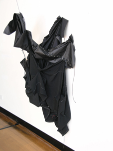
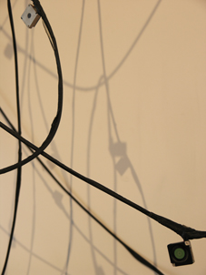
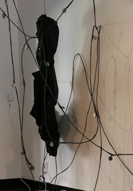
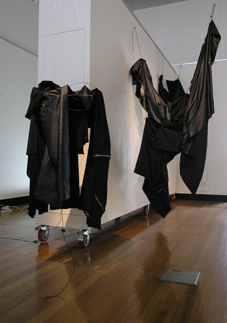
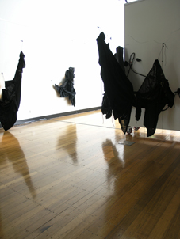

---

**Andrew:** Erin, before we discuss the implications of ‘Entertaining the environment’ [1] with an artwork or event, I thought we could perhaps start with a brief outline of how you arrived at the concept? {#para1}

**Erin:** I think the concept has been lurking in the sidelines of my practice for some time. It began to take form around questions of interactivity, particularly around technologically innovative art projects that themselves question how art tackles notions of participation. Two issues seemed most salient for me in this turn toward the technological: 1. How do we not become too entranced by the technology itself, bending to *its* needs—how, as artists, do we not fall prey to feeling as though it is technology that provides the experience. Or, put differently, how do we not fall prey to the idea that it is technology that supplies the wonder, while at the same time not dismissing the complexity of technology and the many roles it can play within our practices? 2. How do we retain a sensitivity to the art- event (not just the technology-event), keeping in mind the difference between interactivity and relation, between the setting up of a cause-effect scenario and the creation of an event.

These questions led me to take the process of investing in digital technologies very carefully, wanting to be certain that I could back out at any moment. My sense is that once the investment in a technological process becomes too dominant, we can lose sight of the field effect we are looking for—an effect that may be available with much more limited use of technology. This is not to speak against the use of technology, but to ask how technology itself becomes artful. How to create a patient investment in “what the art can do” and not just “what the technology can do.” {#para2}

“Entertaining the environment” comes out of this thinking. It is a reminder not to place ourselves too quickly at the center of each experience. It suggests that what is perceptible may not be immediately available to us, or may be obfuscated by our expectation that relation always includes us. And it perhaps pushes us to reconsider how experience unfolds, leading toward more nuanced interpretations of what participation can mean. {#para3}

“Entertaining the Environment” also places us immediately in a relational framework rather than investing in the hierarchy of subject and object (human and nonhuman). When the human is considered the centre of the experience, the sense is that the entertainment also has to fit into human-scales of time. In an art experience, this usually means that the access to the artwork has to be quite quick—the attention of the spectator must be secured within seconds. But when it’s the environment that is being entertained, suddenly there is a different sense of duration. It is not solely about us, but about how the various assemblages—concrete and abstract, human and nonhuman—are realigned through the artistic process. Concretely, this means that we begin to design, or better to create platforms of relation, for more ephemeral participants—air currents, movement, breath. And in doing so, we are perhaps more aware of how space is crafted, how time itself is artful. {#para4}

**Andrew:** This is going in several interesting directions already … Perhaps to bring it back to your first statements about technology, there does seem to be a general difficulty in finding a balance where technologies are utilised in art works. So many works seem invested in a demonstration of the technology’s capabilities (and/or the artist’s technological skills). Likewise in ‘interactive’ work (a problematic term at best), there is a tendency to demonstrate the interactions/connections on a very overt level—a doubly deathly combination when interactivity and technology are combined. Somehow both artists and, I think, viewers need to get beyond the entrancement with what the technology is doing and, as you say, back to “what the art can do”. If we think of painting, for example, I don’t think anyone would accept that the major conversation between a painting and a viewer would be about the pigment or type of medium used, even if the painter or a painter/viewer might be invested in thinking this through. And in fact when we watch TV or go to a movie, for the most part the huge technological complexities that allow such events to happen are hidden from sight—even CGI imagery needs to do more than demonstrate power nowadays to hold an audience—we want a different kind of engagement. It seems naive for an artist to think that they could supply much wonder through technological demonstration, considering the capabilities of Xboxes/iPads and so on. {#para5}

Given all that, your approach of investing cautiously in technology seems a wise tactic. I try to remember the relational works of Lygia Clark as a benchmark of what might be achieved through very simple means. Perhaps we should all plaster our studios with images of her work, along with Dan Graham, Robert Irwin and Steina and Woody Vasulka to remind us of the imaginative possiblities at the fringes of technology. At the same time, electricity, for example, seems to have interesting possibilities in terms of thinking forces outside of any human agency. I’m thinking of the earliest experiments/art events with electricity—running a current through a line of 300 monks holding hands, for example (it’s the image of monks holding hands that brings in the poetry). [2] While clearly this has a ‘demonstrative’ element, it seems to me also involved in a shift in positioning the human in the environment—an understanding of and entrancement with environmental forces capable of transversing and reorganising the human. In this way perhaps technology does open possibilities for thinking art events outside of human-centric fields. {#para6}

**Erin**: Andrew, I love this image of the monks—particularly when we think of it less as a human circle than as an electric circle activated through a collective body. Lygia Clark is certainly an example I hold on to, particularly as a reminder that the art object is not ultimately what art is about. The artfulness of art is about the lure it activates, the provocation. A painting is a lure for feeling-seeing texture- become-image or shadow-become-sound (to think of the use of calligraphy in early Chinese painting). Lygia Clark’s relational objects were not “valuable” or “artistic” abstracted from what they could do—they were “just” bags, rocks, air. But taken in concert with the relational field they were capable of activating, they became-art, became artful in the sense that they were capable of affecting the environment they were co-creating. {#para7}

Technologies, as you point out, are ever-present. We cannot conceive of a world without them, nor should we. The point is to activate them at the level of their integration into a lure that stimulates the event, not to make them the event in their own right. It’s not that I don’t think technology-in-itself can’t be an event. It’s just that I don’t think that is the best use of an artist’s talents. Microsoft, NASA, Nike can make technology an event—they have the means to do so, and their teams are poised to produce the newest-new. Art, it seems to me, is best at doing something different: at making apparent the interstices between capitalisms and their outdoings, at making apparent the interstices between the present and the folds of time that run through it. I think of art as proposing an event-time that is not allied to linear time, that is not about novelty per se, but about creating alternate conditions for a tweaking of experience. {#para8}

**Andrew**: I like the fact that we’re including painting in this conversation. It seems to me that too often its relational possibilities are overlooked in favour, once again, of mediums more overtly able to demonstrate relation, whereas really any mode of art has potential to include interesting events of relation, as it can also fall into representational traps. {#para9}

What we are talking about here could be defined as the making of ‘propositional’ artworks—Whitehead’s definition of a proposition being of a ‘lure towards feeling’. This most obviously links in Western art history to conceptual art, but also whenever events of relation are thought of as the primary artistic ‘product’, whether between objects (Duchamp’s *Three standard stoppages* [1913–1914]), objects and bodies (Clark’s *Caminhando* [1963]), or purely the conceptual (Yoko Ono’s *Grapefruit* [1964]). I mean that it doesn’t exclude the making of objects, but that they are employed tactically rather than representationally, valued for their ability to condition, to seed the actualisation of interesting events. It does seem to me though, that there is perhaps an interesting shift from much of 60s/70s conceptual art to contemporary propositional works such as yours—a shift away from the index and towards a concern with the much more slippery areas of affect and sensation. It relates to conceptual art in that it is concerned with an open-ended ‘thinking-through’ of concepts through action and is not about representation, but the events produced are less concerned with activating conceptual processes in the viewer/participant, and more with activating Deleuze’s ‘blocs of sensation’ (my favourite definition of art). {#para10}

Paul Klee defines art’s purpose as making things visible, making us see or experience in a new way, which I think fits in with your statement above about art not being about novelty but rather allowing a ‘tweaking of experience’—reconfiguring old or accessing new, and potentially decentered, relations within the world. Perhaps this brings us back to the question of what reconfigurations of relation/experience “Entertaining the environment” might specifically offer? One of the first things that comes to mind for me, suggested by the title of your work in the exhibition— *Weather patterns* —is an interest in reconnecting with or embracing the forces of multiplicities within nature [3]. Michel Serres refers to multiplicities as ‘nebulous set(s)…whose exact definition escapes us, and whose local movements are beyond observation’ (1995: 103), and he lists heat, flame, clouds, wind, and climate as instances of multiplicities with transformative powers that ‘nature makes us live in’. Are connections with these kinds of ‘unknowable’ fields of relation of interest to you in your work? {#para11}

**Erin:** Absolutely! I am thinking of weather as that which surprises and disrupts, and also that which is absolutely everyday, backgrounded from experience. Whitehead talks of negative prehension, referring to aspects of experience which actively make up experience without being prehended as such. I think that for the most part this describes weather. Though, in countries like Canada (and perhaps, with climate change, more and more countries are going to move in a similar direction), weather is also that which explicitly moulds experience. It is not simply that which is expected, it is that which is overcome (be it the –30 of winter or the +30 of summer). This would also be the case in places that high rates of floods or tornados, or for farmers who depend on weather for the crops. In such cases, weather itself becomes propositional, an activity that not only frames but also creates modes of engagement.) {#para12}

*Weather Patterns* as a piece plays on all of this, but with a focus more on the side of negative prehension. I think of it as a weather system in its own right—a sound-and-wind-maker that responds not only to your direct interaction with it, but to the multitudinous electromagnetic variations in its wireless field. The idea of backgrounding human interaction (or at least not foregrounding it) was based to some degree on weather itself, which is very much out of our hands! {#para13}

The last iteration of the work (May 2012, MiIlwaukee USA), with Nathaniel Stern and Bryan Cera, complexified the field of interaction by building in a system of digital-analog speakers that move the sound through the fabric-field (a line of 45 speakers was created with sound bouncing from one to another). We also created a fan-line that is similarly activated by the movements in the field. The data stream itself is activated by sensors sewn into some of the fabric pieces (which also have conductive fabric sewn into them). But the focus for me is not so much on the technical aspects as on the ways in which this system can make felt some of the complexity of weather all the while emphasizing its non-human- centred focus. {#para14}

With your collaboration for the next iteration (August-November 2012, Melbourne Australia), I see us complexifying the soundscape, which at the moment is very basic. Sound is something you have worked with a lot, perhaps you have ideas about how sound can best work in a work that seeks to make felt field effects? I know your own work has played with these kinds of ideas as well. One of the ideas you mentioned was the possibility of making a (sound) effect that is itself negatively prehended—a sound, perhaps, that unfolds in a time that is not of the human. What would a sound be like that took three months to unfold? (I am thinking of the three-month span of our exhibition/collaboration project). {#para15}

**Andrew:** So a negatively prehended sound would perhaps have to be conceived as one that one (as a human) could somehow become aware of, in its existence, but unable perhaps to perceive it—one to grasps it conceptually only. If you take the pitch of a sound outside of a perceivable human range—higher or lower—I think there can still be an affectual relation to the body: low sounds experienced as some kind of almost rhythm or pulse in your bones, and high sounds that are almost felt as a sensation on the hairs on your skin—that’s at least my approximation, since they escape any direct conceptualisation—you know them only sideways, through their effects. Of course with the high-pitched sounds you ‘know’ them through the effects seen in the environment—most specifically all the dogs start to howl in my neighbourhood when I’m mixing. {#para16}

To me this could lead into the idea of ‘micro-perceptions’, things noticeable through affect and sensation rather than perception, that as a multiplicity perhaps can become a perceived sound. Its something I’ve been experimenting with, layering eight or more sounds ‘behind’ the dominant sound so that while you cannot ever name them as separate things, they add qualitatively to the overall effect. That is, when you take them out it sounds different somehow, but the change is nothing quantifiable, almost, I want to say, an affectual tonality, that works through the body in ways other than the ears. Perhaps this relates to synesthesia—we have to start thinking outside ‘normative’ perception and about what a sound feels like on the skin, what it tastes like, what it looks like, as much as what it sounds like. {#para17}

But more generally, as you suggest, thinking imaginatively through specifically non human time spans and/or fields of environmental forces that other ‘beings’ can connect with is an interesting angle, inherently decentering the human. If we accept from Whitehead that all entities are capable of prehension then we will want to specifically think inanimate as well as animate and sentient beings—which is where imagination comes in. What forces in nature is a rock attuned to—heat, wind, acidity? Where do a tree’s sympathies lie—with rain, daylight patterns, symbiotic conversations with bacteria? On some level we can I guess imagine these things conceptually if not bodily—we can also know mechanically but never empathically understand what the changes in sap flow as the days lengthen feels like and how this connects a tree to the tilt of the earth. {#para18}

But what about ways of experiencing that we can’t even really begin to imagine or name? In *The embodied mind* Francisco Varela talks about different mechanisms for seeing—humans have, apparently, developed three differential categories (hue, saturation and tone), while some animals have only two, and others have perhaps four or more. These added qualities are not simply extensions of our ways of seeing (being able to see infra red, for example), but completely new categories. For example, he postulates that there might also be, for some creatures, a rhythmic pulse to objects that gives a whole new dimension to ‘seeing’ (Varela, Thompson and Rosch, 1992: 147–180). Even as we know and can already experience that the senses are synesthetic and already irretrievably intertwined, this seems to go beyond that to truly unknowable forces. {#para19}

The big question for me is whether we can manage to make something felt that is so outside of human timespan or perception so that it can only be understood negatively. Can this be more than a conceptual understanding? That is, can we move beyond a level of pitching a tone that humans can’t hear, while telling them it exists so that they can conceptualise their lack of perception, to a true prehension, related to/in a bodily, affectual or sensual manner? I’m not sure if this will be a productive line of inquiry, whether it could prove enlightening or too negative towards, not only human subjectivities, but also more-than-human bodies rather than establishing new and interesting relations with them … {#para20}

**Erin:** The challenge, as you say, is not presuming to know how a more-than- human ecology makes itself felt not only beyond the human, but also for the human. It would be a relatively straightforward move to create a theoretical problem that translated to one that we call negatively prehended (that is, work with sounds that are outside of human hearing but heard by animals). But this might simply keep us in a standstill as regards experimenting with the idea of entertaining the environment—it might presume we know what that means and can orchestrate it. It seems to me that the call must remain experimental, that entertainment is something that we need to be reinventing all the while. Brian Massumi and I recently went back to Whitehead’s two perceptual categories “causal efficacy” and “presentational immediacy” and rethought them in terms of entrainment and entertainment. We did this to try to activate the sense in “causal efficacy” of there being a force that exceeds any straightforward notion of causality. As we understand it, the first phase of perception – what Whitehead calls causal efficacy – involves an immanently relational intertwining of perception with action. It is causal in the sense that it directly activates a field of relation. It entrains. And out of this entrainment follows the possiblity of the activation (the self-activation, at the level of the field itself) of a notion of entertainment, or what Whitehead calls “presentational immediacy.” Entertainment here is not about the human being entertained by the environment, but about the direct perception of the fielding of experience such that it brings its qualitative resonances to the fore. I think this is what we are talking about in terms of “entertaining the environment.” We are not wanting to explore the idea of an instrumental, human-centred approach that involves “entertaining” the environment. That would just take us back to square one. Instead, we are asking what it might look like, feel like, be like, for entertainment to be given back to us as a field of relation. {#para21}

### Biographical Notes

**Andrew Goodman** is a visual artist with a focus on participatory practices, sound and technology, and is currently a PhD candidate at Monash University, researching a rethinking of interactivity through process philosophy.

**Erin Manning** holds a University Research Chair in Relational Art and Philosophy in the Faculty of Fine Arts at Concordia University (Montreal, Canada). She is also the director of the *Sense Lab* ([www.senselab.ca](https://www.senselab.ca)), a laboratory that explores the intersections between art practice and philosophy through the matrix of the sensing body in movement. In her art practice she works between painting, dance, fabric and sculpture ([https://www.erinmovement.com](https://www.erinmovement.com)). Her writing addresses the senses, philosophy and politics, articulating the relation between experience, thought and politics in a transdisciplinary framework moving between dance and new technology, the political and micropolitics of sensation, performance art, and the current convergence of cinema, animation and new media. Publications include *Relationscapes: Movement, Art, Philosophy* (Cambridge, Mass.: MIT Press, 2009), *Politics of Touch: Sense, Movement, Sovereignty* (Minneapolis: Minnesota University Press, 2007) and *Ephemeral Territories: Representing Nation, Home and Identity in Canada*(Minneapolis: Minnesota University Press, 2003). Her new book, *Always More Than One: Individuation’s Dance*, will be published by Duke University Press in 2012.

### Notes

- [1] *Entertaining the Environment* was an exhibition in Melbourne in during 2012. See . For more on the concept of entertaining the environment, see Manning, 2011. *Weather Patterns* is a work by Erin Manning, Nathaniel Stern, Bryan Cera, Andrew Goodman, exhibited in one iteration as part of *Entertaining the Environment*.

- [2] See Elsenaar and Scha, 2002: 19.

- [3] For more on *Weather Patterns*, see [https://www.erinmovement.com/erin_manning_weatherpatterns_exhibit.swf](https://www.erinmovement.com/erin_manning_weatherpatterns_exhibit.swf).

### References

- Elsenaar, Arthur and Scha, Remko. ‘Electric Body Manipulation as Performance Art: A Historical Perspective’, *Leonardo Music Journal* 12, ‘Pleasure’ (2002): 17–28.

- Manning, Erin. ‘Fiery, Luminous, Scary’, *Substance* 40.3 (2011): 41–48.

- Serres, Michel. *Genesis* (Michigan: University of Michigan Press, 1995).

- Varela, Francisco J., Thompson, Evan, Rosch, Eleanor. *The embodied mind*
 (Cambridge Massachusetts: MIT Press, 1992).
