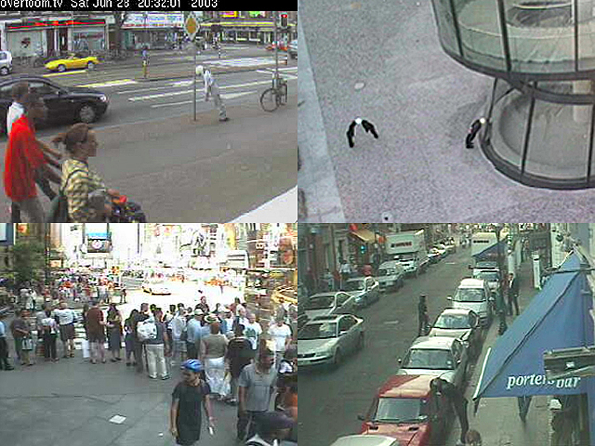
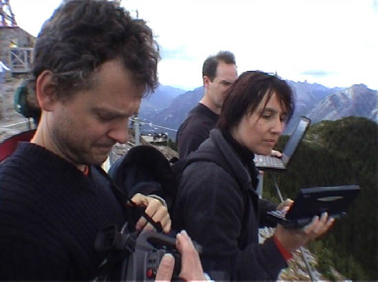
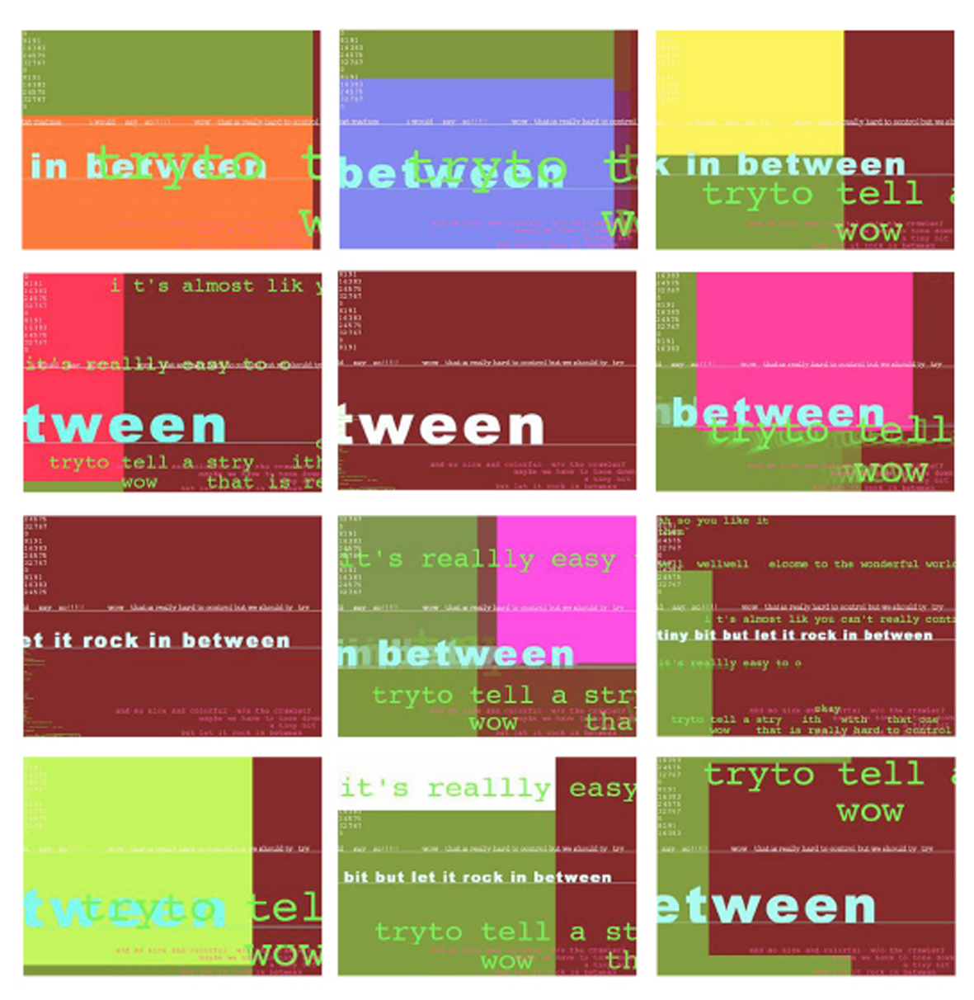
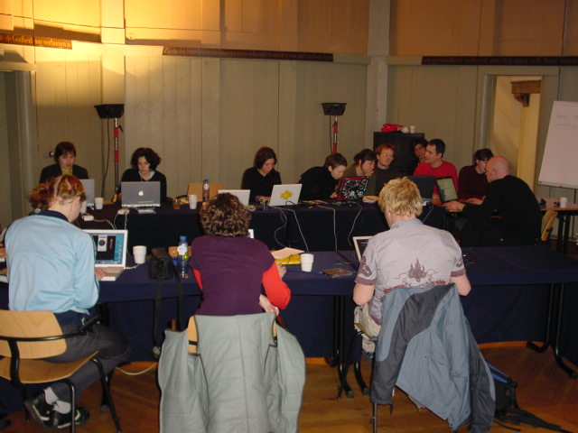
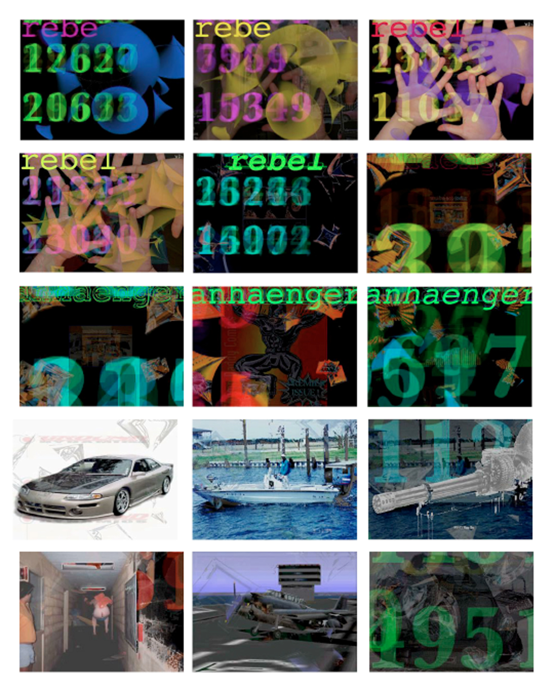
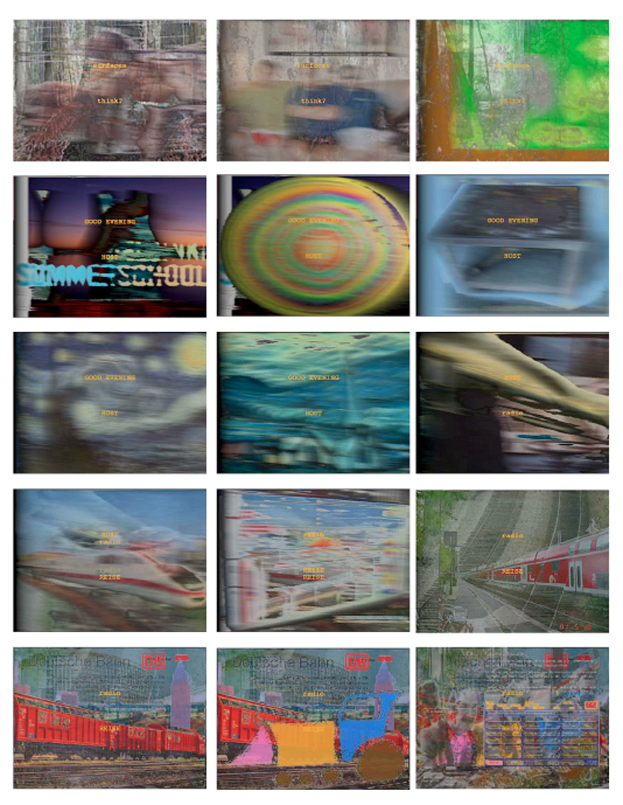

---

  {#para1}

::: embed
https://player.vimeo.com/video/44602933
:::

Video: Interfacing/Radiotopia/KeyWorx (DEAF03)

  {#para2}

**Andrew Murphie:** I am interested in your background, in how you see your own movement through the use of media. Something I find really interesting is your work with the translocal and the collaborative. I’m also interested in why you are thinking about moving this towards a more directly material practice. [1] {#para3}

**Sher Doruff:** Yes! (laughs) Caught in a transitional vacuum! Would you want a little bit of a history? Is that helpful? {#para4}

**Andrew:** Yes, that would be fantastic. {#para5}

**Sher:** I went to art school from ’68 to ’72. I was attracted to what was then emerging, which was conceptual art. But I was unhappy with my art department. So I switched to the philosophy department. In my junior year a new faculty was hired in the art department and they confronted me and said, ‘Why do you want to be in the philosophy department writing papers? You can do-what-you’re-doing in the art department, and it’s just much more fun!’. And it was actually a very silly, but convincing, argument! (laughs). So I thought, ‘I’d really rather make things than write papers’. So I transferred back to art. {#para6}

I was reading Whitehead’s *Science in the Modern World* at that time which had a tremendous impact on me. I was nineteen. I’m sure I didn’t understand much of what I was reading really. I remember having an elaborate plan for a kinetic sculpture based on Whitehead’s theory of duration (laughs), and if I think about it now it was probably very clunky and not-very-well conceived. But I was very excited about it. I worked on the sketches and when I finally finished my plans, I was quite excited about this piece. I figured it would take me two months to build it. When my mentor looked at my plans he said, ‘You’re done!’. ‘What’s next?’. And I thought, ‘What do you mean, I’m done? I haven’t even started making it!’. He said, ‘There’s no point in making it, because as far as I can tell the work has been in your process of thinking this through, and then you would be spending two months making this thing in which there would be some skills you would learn, but I don’t see the point in it.’. And that was completely confrontational. I still don’t know if it was good advice, but it was advice that—it’s something that has resonated my entire life. {#para7}

**Andrew:** And you still want to work with diagrams! {#para8}

**Sher:** (Laughs) Yes! It’s a frustration. Anyway. When I left art school in ’72, leaning towards conceptual art, I had no idea what to do with it! (laughs) So I was in a band for ten years [2]. {#para9}

**Andrew:** Really? Ten years? {#para10}

**Sher:** With the same people. This is where I learned about collaboration. We rehearsed every day we didn’t gig. So really, in my twenties, in the seventies, what I learned, and what excited me was that you come together with a group of people and you make something happen, and you figure out how to do that together. So that’s my history. Eventually I became a multimedia artist in New York, working mostly with dance and theatre companies. I’ve been working with computers since ’85. It became my tool of choice, and I worked mostly with sound and then with graphics, and then picked up video when the quicktime protocol was launched in the early 90s. {#para11}

**Andrew:** So you would have been involved with the initial transformations in dance involving multimedia? {#para12}

**Sher:** Yes, in the eighties/nineties… it was very experimental and there was a lot of leeway for failure, and I think that in that sense it was very exciting … {#para13}

In 1990 my apartment burned down and I travelled for awhile. I got a residency in Paris for a year, ending up in Amsterdam and eventually in residence at STEIM [3] where I met Tom Demeyer [4], who was working with Steina Vasulka [5]. Steina was Visiting Art Director of STEIM at that time, and she was working with Tom on a programme called *Image/ine* [6], and *Image/ine* … as far as I know, was the first personal PC application in which you could effectively use real-time digital video editing. {#para14}

**Andrew:** I’ve seen *Image/ine*. {#para15}

**Sher:** Yes. I think it really was the first. Tom was, in my opinion, a genius programmer, and to have Steina as a collaborator, well, it was magic. Really magic. I’d taken some courses in digital video editing and AVIDs in New York and I learned quite a bit about digital filtering. When I saw Tom coding it in real time on a Mac desktop computer, it was phenomenal to me. It was also so aesthetic because it had many of Steina’s ideas in it. So I spent a great deal of time nosing around the computer lab, checking out what they were up to. {#para16}

Tom eventually asked me to write the technical manual for *Image/ine*. I’d never written a technical manual before and I thought, ‘Can I do this?’. I threw myself into the work, and spent months trying to put together an informative guide. I learned so much from that exercise because it entailed discovering and explaining every connection, every interconnective relation of every parameter to every other parameter of the media objects in the application. I went deeply into the interactive possibilities and that was really transformative for me. {#para17}

So that was my entrance into interactive dynamic media. This is 1996/97. I started using *Imag/ine* and performing with it, and I taught many workshops to performing artists of all kinds. Those workshops were really interesting. I had something like twenty, thirty people, often, in those workshops, trying to teach them real-time interaction with one desktop computer (laughs) … many of them didn’t even use email at that time so the computer environment was somewhat frightening to them. But in those workshops we also always had some media artists, and one or two programmers mixed in with the performing artists. It was an exciting mix because, in fact, the performing artists were more liberated in their conceptual use of the technology than the media artists and technicians who were somewhat stuck behind their computers experimenting with the software itself, with what the software could do, and not looking beyond the code to the relation to, well, whatever was happening in the space itself. {#para18}

At some point, I think it was 1997, a colleague asked me to come up with a proposal for an online virtual studio environment. I’d been working with *Image/ine’s* real-time capacities so much that I thought, ‘What if there was an online site where you have the ability to interconnect media parameters – sound, video, image, text?’. What if it was a collaborative open environment in which all the players see the same dynamic interface and make choices together? A performative situation in which you would continually enact/react to the choices and content of those performing with you. Synchronous interaction. How to enable this activity over the internet in ’97 was completely blue sky although easy enough to imagine as technological protocols progressed. *KeyStroke* grew out of this original proposal. To have any hope of actualising it, it needed Tom’s skills and brilliance at real-time processing. {#para19}

So, yeah, imagining that some day the internet—as an enabling environment—could be a zone of processing video, images, sound and text in real-time. In the late nineties … the only other collaborative environment was *Resrock*, as I recall, and that was only MIDI enabled. Using the MIDI protocol, musicians could send signals back and forth building musical compositions in real time. MIDI was fast enough for broadband, for modem speeds at that time. So we wrote a proposal with the Waag Society for Old and New Media in Amsterdam as our support institution. We received eighty thousand Guilders—that’s roughly forty thousand Euros. It was enough to give the project a kick start. {#para20}

**Andrew:** So it’s still continuing? {#para21}

**Sher:** Yeah, it’s changed names and direction but yes, it’s been *KeyWorx* since 2003ish. {#para22}

We began in ’98. Tom came on board with Just van den Broecke, who had worked with Lucent and Bell Labs on multi-location and multi-user experiments. He was the perfect server-side programmer for this project. We were lucky to find Niels Bogaards, who began as an intern, to work with me on the interface. So it was a very small team originally, working one day a week on a project that was admittedly crazily ambitious. But over time we actually managed to produce something promising. Lodewijk Loos and Eric Redlinger were important contributors. As we progressed, bandwidth improved in parallel. Our progress seemed to follow the technology protocols in such a way that, by 2000, we had a very, very buggy application that worked well enough to excite a small group of dedicated artist practitioners. {#para23}

**Sher:** I had learned to program *MAX* in 1990 and that encounter with modular interfacing was influential. We wanted the *KeyStroke* interface to be modular but not as spaghetti-messy. In a collaborative environment, there’s no way a *MAX* patch can be effective when other (multiple) people are simultaneously working with it. It’s just too—it’s too chaotic and too idiosyncratic. We wanted to have the same kind of modularity in an interface but much more intuitively rendered. People would need to enter and somehow easily understand what was happening in a given patch. {#para24}

But also, and this was unique to *KeyStroke*, parameters of every media object and controller would be transparently open so that, for example, I could change the speed and position parameters of one of your movie clips with the frequency and amplitude of one my sound clips. That sort of activity opened across a full range of devices and objects. So basically you needed to adapt to creative negotiation on every level. It’s collaborative like a theatre piece is collaborative yet more so. You could enter this environment and say, ‘You’re working with visuals, you’re working with Quicktime movies, with moving imagery, with still imagery, or perhaps someone enters with sound material’. You might decide together to assign roles and functions, but then you might not. All media and controllers (mouse, camera, joystick, GPS, etc.) were objects in an open field. The thing is, if you have a modular application your ‘playing field’ emerges from the negotiations of the players and the transformative objects in play. {#para25}

**Andrew:** So it’s a modular system but you have all these interstices where negotiation can arise. I should say that before we started the interview we were talking about coming out of theatre and arts backgrounds, and how you learn a lot more about collaboration in these areas. You really do have to negotiate with people, and you also have to go somewhere with them, and I guess, finish the work with them. Get some satisfaction, shall we say, of some kind! Even if it results in death! So what you’re trying to design … it’s a kind of an open framework. You’re designing for potential collaborations rather than for those that are really heavily structured from the beginning. {#para26}

**Sher:** Right! It’s essentially about conditions—we tried to limit conditions in the application design as much as possible … the conditions are established by the players and emerge from the play. *KeyStroke/KeyWorx* provided the tools, the basic components. The conditions of play can be established while playing or before arriving to play. A lot of the people that use the software—I mean, there was never anything normative in who used it and how. Some people couldn’t work with the potential chaos of emerging conditions so they tended towards structured improvisations where they would find some way to establish the initial conditions before they would enter the session, and everyone would have certain terms or tasks or goals. Or roles would be distributed between the people who would join. Everything would be pre-set before they would even begin. With others, sometimes you could be playing in a session and someone else would enter who wasn’t even invited, because the server was open. Then all of a sudden you’ve got somebody new in this field. They might not be aware your conditions or style of negotiation. You might also choose to type text in real-time, and your negotiations could become part of the performance, because you’d be writing to each other and those texts would be ‘public’. On the other hand, a lot of the people who became more adept at the programme would usually run an IRC chat on the side. They’d chat about what they wanted to do next, often not as part of the artistic material, of what you might be experiencing as a spectator. {#para27}

**Andrew:** Kind of a meta-dialogue. {#para28}

**Sher:** Yes. But it was often interesting to me to see that negotiation become part of the piece itself, you know? If that was the artistic choice. {#para29}

**Andrew:** There is a kind of ongoing meta-modelisation in that. [8] The thing kind of shifts, as you say, according to the players, and it forms a kind of genetic modelling as it goes, but these models are changing with time— {#para30}

**Sher:** Right— {#para31}

**Andrew:** And there’s layers of that going on, as well. What were people doing? What were some of the results when people were using *KeyStroke*? {#para32}

**Sher:** Well … there were many things about *KeyStroke/KeyWorx* that were difficult to adapt to because it was always in Beta, and it was always buggy, and we had terrible difficulties with network protocols and the emergence of firewalls. So the software itself was constantly having to deal with these kinds of issues. Nonetheless, we had a devoted contingent of fearless and patient artists. I’d say maybe, back in the early 00’s there were only twenty or thirty—quite a few interested Norwegians such as Amanda Steggel and Per Platou from Motherboard who sponsored the first *KeyStroke* workshop in 2000. Also Michelle Teran and Jeff Man, Isabelle Jenniches, Arjen Keesmaat, Nancy Mauro Flude, Linda Dement and several others. It was interesting, because many of those first performances were between Australia, Canada, Norway, New York and Amsterdam. So I would say that those were often the points of contact, the nodes, though they always shifted and there were of course performances we would never know about as the app was freely downloadable. {#para33}

**Andrew:** What actually happened? {#para34}

**Sher:** Well, there’s a community in New York called SHARE, and they actually became the biggest user group through the supportive efforts of Eric Redlinger, and they’re still going strong. I think they were originally based near St. Mark’s Place in New York, and every Sunday they would host translocal performances. They used *KeyWorx*, in tandem with *MAX/MSP/Jitter*, *Pd* and other emerging applications. {#para35}

**Andrew:** So you became a kind of religion. {#para36}

**Sher:** Hmmm. I think there were many people … not a lot of people, actually, to be honest, a handful of people, devoted to this idea of translocal, real-time collaborative performance. One of the things I try to touch on in my thesis is the notion that translocal experience, as an embodied experience, is amplified because your body is … you have the sensation of … how can I say this? The effect of intensities of translocal performance when it’s indeterminate and you’re collectively negotiating and making choices together and you’re playing off those choices as a jazz band would or as a dancers might … the translocal becomes incredibly, intensely physicalised, but your feeling of space is non-locally oriented. {#para37}

There’s almost an imbalance with the “virtual” in a sense. By which I mean the Bergsonian or Deleuzian (virtual), not the virtual simulation that we talk about when we speak of media technologies and networks. You really find yourself intensely in this differential space. I think that this is something that can be found in translocal experience when it is performative and not when it’s streaming, so that it’s passive. That’s another experience, and that’s not what I’m referring to. What I’m interested in is collaborative performance as transducer through non-local space. The space becomes … it’s not that it’s a non-issue, it’s just a completely different issue. You end up collaborating and your co-existence … well, happens between your monitors essentially, but in the space of your monitors, as well, and in the shared space is this … {#para38}

**Andrew:** Well it kind of is in the monitors, but its kind of not as well, isn’t it? {#para39}

**Sher:** Exactly. Brian (Massumi) has an essay called ‘Strange Horizon’ (in Massumi, 2002), and he talks about the biogram, about topologies, and about vision and proprioception, and he suggests, ‘Well, maybe even staring into a screen’, you have that same biogrammatic experience. {#para40}

**Andrew:** And you used this idea in your discussion of collaboration, I think? {#para41}

**Sher:** Yes. When I read that I thought, ‘I know this experience, and I know this experience through *KeyWorx*’. Brian talks about the biogram as the lived experience re-emerging from itself. That’s what everyone that I talked to who was an avid *KeyWorx* user says … people like Michelle Teran. She told me she would be in a session for twelve hours and it would be only at something like the tenth hour that she would have the sense of losing … of being completely in sync and being in another world. {#para42}

**Andrew:** So, people would get into using *KeyWorx* for the experience itself? And they would do this quite regularly, as a kind of ritual? {#para43}

**Sher:** I believe so. {#para44}

**Andrew:** That’s really interesting. I hadn’t thought about that aspect of it. {#para45}

**Sher:** Almost every artist said you needed a minimum of three hours in the environment. This is three hours of completely focused attention before you could find the rhythms between each other, because there’s also latency, depending on the network, depending on all kinds of network conditions, and also conditions concerning different styles of making between the people involved. There are also conditions relative to the different kinds of media that you’re using and processing, and all of these kinds of things matter, before you find a rhythm together. Just as performers also need that kind of time before they find a rhythm together. But translocally it’s a bit different because you don’t have the sensation of the person (directly). You can’t make eye contact. You don’t have perceivable body language between you. So you have to find other ways to find that kind of synchronisation. It’s incredibly intense and affective, and it requires so much focus that it creates a kind of extreme experience (laughs). I do think people were in it for that. It was a kind of a high. It was for me … when it wasn’t frustrating. I mean, there was a down side to it as well, because the technology was never plug and play. You could never count on it not crashing— {#para46}

**Andrew:** Maybe that’s part of it. {#para47}

**Sher:** You had to build the idiosyncratic temperament of the network and the application technology itself into your rhythms and into your modes of play. {#para48}

**Andrew:** So when you write about ‘polyrhythmic diagrams’, [9] is this what you mean? {#para49}

**Sher:** By polyrhythms I just mean … I’m probably extrapolating a little bit from Bergson in that I’m attaching a rhythm to duration, which I don’t think he does, but I find that interesting because I’m very attracted to his idea of multiplicities of duration. What I find in performance is that within those multiplicities, the durations of performers, the durations of the ‘things’ that you’re engaged with … there is an infinite bandwidth of multiplicity, of the durations of everything involved in a particular experience. I think in performance it’s quite easy to associate a rhythm with those durations, and in these kinds of performances, if you have rhythms of, let’s say, the media components, the rhythms of the processing and the thought of the performers and the people who are controlling those processes … they’re all differently relating. There are these moments where they’re polyrhythmic in the sense of very complex and complementary rhythms that sometimes sync, you know, and sometimes come together, and you can never really … you can feel them all at the same time. You can’t hear them all, because you have to fixate on one or the other. Polyrhythms in Western African music are really fantastically complex and you can sort of let yourself go and experience the whole, but when you try to listen to them it’s almost impossible to hear them all at the same time. At least, I have that experience. And that’s what I felt happen in these kinds of … it reminded me of Sengalese … {#para50}

**Andrew:** Drumming? {#para51}

**Sher:** Yes—drumming. But I’m romanticising it! (laughs) {#para52}

**Andrew:** I like romanticising it. As I said, I think the ‘not working’ and the Beta and everything is really part of it. I really do. {#para53}

**Sher:** (laughing) I think if some of the people who used it over the years were here and were listening, they would say, ‘Oh, yeah, well, that’s Sher just going off and riffing.’ But taking the best parts of it … this is what it was for me, and I spent a lot of time watching people and experiencing what other people were doing. I was so fascinated to observe what happened, and how people interacted with this environment, and for me, that kept me going for six, seven years! {#para54}

**Andrew:** Really? So, *KeyStroke* became *KeyWorx* at a certain point— {#para55}

**Sher:** Yes. {#para56}

**Andrew:** But that’s not terribly significant in— {#para57}

**Sher:** No. We had to change the name because eventually somebody had—well, you can imagine it was quite a common name. So, only for legal reasons. And it did become open source, but eventually Waag Society just couldn’t support it anymore. Well, they wanted to roll it back and then work on open sourcing it, which they’ve done, which is great. But at the same time, they weren’t interested in supporting it as an artist’s tool anymore. So now, it is a monolithic open source platform mainly utilised by Waag Society programmers for internal projects. I’m happy that it’s open sourced, but I don’t anticipate artists using it any longer— {#para58}

**Andrew:** Really? {#para59}

**Sher:** There’s no graphic interface. The initial interface that I designed was very quirky, and I still am quite fond of it, but the code quickly outgrew that design. As we kept adding modules the screen real estate just became too limited. We had to rethink this and we never had an adequate secondary interface so that people could also easily access a histogram of activity in a readable way. But I still think that one of the most interesting things about the interface was its openness to intervention—to soft or brutal addition and deletion. I mean, it was possible to delete or alter the modules of other performer/players, because the interface was openly shared and any device or object entering the interface was shared. {#para60}

**Andrew:** So there wasn’t just the power of veto over your own work, it was veto over other people’s work … (laughs) This is free cooperation extended plus! (Spehr, 2003) {#para61}

**Sher:** Yes. And often, when people were learning it during workshops, you’d see that happening all the time as they were focusing on understanding the operations … ‘Well, if I do this …’ and then someone changes your connecting patch before your eyes … the tendency was to think ‘I don’t want this!’ And they’d just delete it! {#para62}

**Andrew:** I’d be terrified! (laughs) Again, it’s like the theatre, really, in a way. Those kinds of negotiations that we were talking about before: in a theatre, you see it all the time. The actors are, in essence, deleting each other’s work all the time, because they kind of have to… {#para63}

**Sher:** Overriding … {#para64}

**Andrew:** In a sense, all that—the Beta states, things not quite working, the deletions, and the negotiation of all their theatre and dance and those sorts of … any kind of collaborative (work) involves similar things. {#para65}

Do you think something else is coming along now that’s going to do— {#para66}

**Sher:** You know, I still haven’t seen it. If you look at *MAX/MSP/Jitter*, or *PD*— and I feel more of an affinity to *PD* because I would want to support the open source initiative — but they’re still not shared interfaces. {#para67}

**Andrew:** No. That’s right. {#para68}

**Sher:** These are the technologies that are used in most current translocal performance. You’re sharing data just by sending data over various network protocols, but you don’t have that shared dynamic Umwelt. {#para69}

**Andrew:** If it’s not a completely shared interface, that’s a huge difference. {#para70}

**Sher:** Exactly. And that’s the thing that I still haven’t seen. Maybe it does exist, I just don’t know about it. {#para71}

**Andrew:** You know that phrase that Mark Amerika uses?… He writes about the ‘asynchronous real-time’ … [10] which is a phrase that keeps coming back to me all the time while we talk. {#para72}

**Sher:** In fact, I think what we mean by “real-time”—because I always question what we mean by “real-time” … {#para73}

**Andrew:** Because in fact the polyrhythmic diagram you’re talking about is not *quite* real-time. It’s the durational formation of a diagram that’s constantly modulating in asynchronous real-time—so it is real-time, and it’s not, which I think is maybe one reason why you get these “highs” working with it. The nature of the duration is really changing, in that environment, quite profoundly. I mean you’ll never get a high from one moment, there’s always going to be (a duration of time). That’s interesting. {#para74}

**Sher:** Yes, and it was interesting to see with different people how long—there was actually, you talk about linear time, there were different stretches of linear time to achieve that. Michelle saying twelve hours, most other people saying three, but still, it’s … It’s a long time. {#para75}

**Andrew:** We were talking last night about the need for patience, and it’s true. I think if you don’t have patience, there’s little that happens. It’s not just about being “open”. You also need patience, and you need things to go wrong for a while. {#para76}

**Sher:** But the shared interface, I think it’s crucial. It’s critical, but it’s difficult. It’s really difficult. And it might be utopian in a kind of way. Dystopian in another… {#para77}

**Andrew:** It’s confronting as well, because people’s spaces now are their interfaces. That’s *their* space, as well. {#para78}

**Sher:** But on the other hand, we flash forward now, (because I’ve been blah-blahing about all of this … four years ago). I’m really locked into a 2003 era. In 2006 we now have the notorious Web 2.0, we have all of these social networking spaces, spaces of shared activity—which I’m really dubious about. {#para79}

**Andrew:** I was going to ask what you thought about that. {#para80}

**Sher:** In fact, I’m just not interested! And I’m not sure why that is, because I’ve spent so much time thinking about it, and working from these near-utopian visions back in the nineties —“Oh, wouldn’t this be exciting!”—to the reality of making, and being involved in the development of such an application, and the highs and lows of all that, and seeing what’s possible and what’s not possible. What’s interesting and what’s not interesting. And now, in western culture where social networking has become so influential … “influential” is maybe not the right term … I find myself… I’m not interested in these environments *at all*. {#para81}

Maybe it’s just because of my particular history. I overdosed, maybe, on the social … {#para82}

**Andrew:** You were talking about this before the interview, about your feeling of wanting to move back to materials, and you’re not quite sure whether that’s because you’ve been too involved in technology, whether you’ve overdosed on technology, in a way. I’m quite interested in where it’s leading you. {#para83}

**Sher:** I’m not sure I entirely understand it myself, but I feel it very strongly. I don’t know. Maybe it’s the realisation of having been behind a computer screen for over twenty years, and having so much of my life revolve around bits and bytes, in an immaterial sort of way. Maybe it’s just a natural process. Perhaps I’m merely entering a continuum that says, ‘Now I need tactility. I want to work with materials again because there’s been a dearth of it’. I mean—yeah, I don’t see myself becoming a Luddite or something like that. It’s difficult to talk about now, because I haven’t really … I’m at the beginning of something, and I also don’t want to push it … {#para84}

**Andrew:** Yes. I don’t want to push you too far on it. {#para85}

**Sher:** … into a rationale. {#para86}

 {#para87}

KeyWorx screen shot sequence from the performance by Lodewijk Loos in Rotterdam and Eric Redlinge in New York. Taken from *Connected! LiveArt*(Doruff, 2005: 38) {#para88}

**Andrew:** Let me ask you another way! (laughter) With *KeyWorx*, it sounds almost like it reached its own kind of ‘self-enjoyment’ or ‘satisfaction’ at a certain point … [11] {#para89}

**Sher:** Yes. {#para90}

**Andrew:** In a collaborative sense, actually, there was a larger social event, a larger “occasion of experience”, whatever you want to call it. There was this actual entity there, a ‘*KeyWorx* experience’, right? But it perhaps reached a point and that was it, it was there and it was actualised, then, after … in some ways it seems to be … not gone for everyone, but people are picking up on that in different ways. I guess, to think more positively, in terms of what you’re thinking of moving to now, what are the kind of ‘prehensions’ being drawn from the *KeyWorx* experience? The things that are coming out of that that are leading you towards the more material approach? It’s not like you’re rejecting the technology. It’s like, OK, that experience has finished, but what’s coming out of that experience that’s bringing you back to materials? Again, I don’t want to push you, because I know this is an initial period, and you don’t know what it is… {#para91}

**Sher:** These are my questions as well. I’ve always been interested in process, and product, for me, has always been a by-product of process. {#para92}

**Andrew:** Yet something else takes off. {#para93}

**Sher:** Something else takes off. And I’ve come to accept that that’s how I make work, that’s what I do, and it’s not about these final, finished assemblages that can be aestheticised in some sort of way. There’s something about an emergent aesthetic that is very ephemeral, that I’ve always been after, and what touches me and what excites me. And I think I’ve been involved in processual aesthetics with digital media now for however many years, and I’m interested to see what kind of format that takes when I’m using other kinds of materials other than bits and bytes. And it may be complementary—I may be using digital media with the material. I just don’t know. These things I have yet to find out. But what I’m pretty sure of is that the idea, my attraction to processual aesthetics is my bottom line. {#para94}

**Andrew:** OK. And so—it’s not just processual though, is it. You want to set up kind of complex forms of collaboration and negotiation, from which interesting things are going to emerge. {#para95}

**Sher:** Yes. But I’m also open to the fact that maybe there will be some kind of artefact now! (laughs) So I’m also wondering what that might be. How I work with processual aesthetics, how that might have matured into something that might in fact become artefact. {#para96}

**Andrew:** This all sounds very different to where institutions pre-territorialise the whole thing, in a way, so it’s already determined. Pre-territorialisation just kills it right from the beginning. I think that’s a very common schema coming up. There’s that great book by Jean-Pierre Dupuy where he talks about the ‘mechanisation of the mind’ (2000). He’s knows cognitive science very well. Yet he almost doesn’t really believe in “cognition”, as far as I can tell. He thinks the cyberneticists were wrong, but he says at least they were interesting and complex! Whereas he writes that cognitive psychology, when it came out, it really just got rid of all the complexity and the possibility of emergence, and it threw away the polyrhythmic diagrams and non-linearity and just went for a linear, simplistic version of things. He says it killed everything. Everything becomes pre-packaged, pre-territorialised, which is what a lot of bureaucrats like. {#para97}

… I’d like to hear more about your actual work in the mid-nineties. You’ve referred to this as being another story. {#para98}

**Sher:** Well, it depends on when in the mid-nineties. In the early nineties I was still working mainly with sound composition and what was then called multimedia. {#para99}

I found that, around ’95/’96 *Image/Ine* (real-time interaction) was what I needed. I had run into a wall with sound composition, because I had locked myself into a genre I wasn’t comfortable with, and I wasn’t finding openings for myself. When I had the possibility to watch this new interactive platform in its inception, and follow it on a day-by-day basis, I found it quite exciting that there was an openness and an interconnectivity between parameters of any kind of media—well, that wasn’t quite true, necessarily. In the beginning it was mainly video processing, I had always admired the Vasulkas and admired Steina’s work, so it was interesting to work with a new application that I could use as well. It was an exciting time, and yes, it’s hard to relive, because now we’re so used to these capabilities that we don’t give it another thought, but back in the mid-nineties real-time filtering and real-time processing without a stultifying latency was just so fucking amazing! {#para100}

**Andrew:** I know what you mean. I just discovered it in 2006, of course, but … I’m about ten years behind. {#para101}

**Sher:** (laughs) And I’d worked in the theatre with slide projectors and with 16 mm film and overhead projectors in New York. Suddenly, you know, access to digital technology expanded possibilities within theatre and dance contexts. All live performative contexts. At that time I was not necessarily interested in authoring my own work, but found collaborating with the directors and choreographers more to my taste. {#para102}

**Andrew:** OK. This is something I hadn’t understood. {#para103}

**Sher:** In Amsterdam, for example, in the late nineties, I was sometimes commissioned by composers or ensembles to create visuals for their performances … sometimes utilising interactive techniques. {#para104}

**Andrew:** There’s a real friction, you’ve said, between the experience of the collaboration— {#para105}

**Sher:** The experience of the collaborators and the experience of the audience? {#para106}

**Andrew:** Yes. {#para107}

**Sher:** This is something quite important to keep in mind, because everything that I was talking about in positive and glowing terms about the experience of the event was from the perspective of the interrelation between the performers. It’s quite a different experience for an audience, and I think that remains problematic, because the shared intensity between the performers is strategically focused and concentrated. The audience experience is often very different. But this is another major topic … {#para108}

### Postscript

**Andrew:** So, looking back on this conversation, which took place in 2006, where have things gone for you? Have you created some artefacts? Or did translocal technologies keep their interest for you? {#para109}

**Sher:** Looking back on this conversation I’m surprised by the unabashed enthusiasm of my offhand remarks. It must have been the lovely sunny day, good company and very strong cup of coffee that fueled my exuberance in the re-telling of the good ole days of the dawn of interactive digital media. It’s strangely unnerving, in a good way, to be reflecting on this conversation today. Were we to meet over coffee tomorrow the conversation would no doubt be animated with a quizzical critique of the medium that once seemed poised, from my perspective, to evoke a paradigmatic shift in the arts. {#para110}

It’s not as though I view this ‘genre’ as failed, it just did not sustain my interest. Perhaps its pioneering relevance exhausted itself for me. Clearly, the advent of what is now pervasive streaming media, Skyping, and social networking has subsumed the translocal experience into an indistinguishable mix of synchronous and a-synchronous communication. That once magic flutter of passing through potential itself escapes me now when online. {#para111}

The coming of the Web 2.0 revolution which was briefly alluded to here in ’06 indeed effects my everyday life. I no longer struggle with bugs and crashes in daily doses but then I no longer experiment with alpha and beta hardware and software applications. I rarely if ever use social networks. {#para112}

Is this the worn old script of the suspicious senior who now tires of keeping pace with the new and romanticises the frontier past? I hope not although I do think the 80-s–00’s were a rarefied coming of age of digital arts. I have a persistent sense that the digital lost the fight to de-instrumentalise. It now effects just about every medium as a tool but has, arguably, dissipated its affectivity as a material. {#para113}

You ask Andrew if I have created artefacts since we spoke. I would have to say, no, not really. I have spent some years researching diagrammatic praxis which continues to insist on de-territorialising incipient form. There is an affective tonality of the *KeyStroke/KeyWorx* experience still at play I suppose. This is perhaps at the heart of my activities now as I mainly teach, tutor and supervise artists in Artistic Research programmes. What I can say regarding the resonance of the 20+ year involvement in interactive media is that I can only approach academic guidance collaboratively and from a beginner’s mind. All those years of linking and unlinking the dynamic parameters of things/objects/concepts affects the way I encounter theory/practice relations with students. It’s a learned attunement with the fluctuating intensities of the non-relation of relation, as Brian Massumi might say, that somehow describes the reciprocity of discovery I feel with students. So the field of play has shifted, but the collaborative sensibility is as strong as ever. {#para114}

### Acknowledgement

This research was made possible by funding by the Australian Research Council.

### Biographical Notes

**Sher Doruff** currently tutors, mentors and supervises masters and PhD students in in artistic research programmes at the Royal Academy of Art/Royal Conservatory, The Hague, the University of Amsterdam and the Amsterdam Master of Choreography at the Amsterdam School for the Arts. She is a senior researcher at the Gerrit Rietveld Academy. Her doctoral research mapped collaborative, creative processes in Live Art performance practice and is now focused on Diagrammatic Praxis. She is a member of the editorial boards of *Inflexions Journal of Research Creation, Fibreculture Journal,* and *RTRSRCH* and has published numerous texts in academic and artistic contexts. Parallel to teaching she attempts to maintain an artistic practice.

**Andrew Murphie** is Editor of the *Fibreculture Journal* (digital media + networks + transdisciplinary critique), and Associate Professor in the School of the Arts and Media at UNSW. Andrew’s research examines the productive nature of differential intensity. He works on transformation, crisis and possibility—as these are filtered through generative process in media, arts and philosophy, dynamic modeling of all types, and new forms of cooperation in politics/social organization. He is currently writing a book—*Differential Media, Differential Life: the past and future of social organization*—that rethinks the ‘world as medium’. Andrew’s work also draws on electronic arts and design (eg cross signal processing), poststructuralism (Deleuze), process philosophy (Whitehead), ‘speculative pragmatics’ (Massumi/Manning), and extended and dynamicist theories of mind. He also works on the new publishing (academic publishing to books, music, journalism), and related events in education and knowledge mobilization and exchange (technics, methods, and new network, information and attentional literacies). [[https://www.andrewmurphie.org/](https://www.andrewmurphie.org/)]

### Notes

- [1] This interview took place in 2006, in Montréal, during the workshop *Dancing the Virtual* at Senselab. Many thanks to Erin Manning and Senselab. It was edited, updated and extended in 2012. Thanks to Liz Brownlee and Xavier Fijac for help with the transcription. The interview was funded by the Australian Research Council as part of an ARC Discovery grant concerning “dynamic media”, on which Murphie worked in partnership with Anna Munster, Adrian Mackenzie, Brian Massumi, Mat Wall-Smith and others.

- [2] Although, as discussed, Doruff was in an underground band in Chicago in the 1970s, Care of the Cow. See [https://careofthecow.wordpress.com/](https://careofthecow.wordpress.com/).

- [3] For STEIM, see [https://steim.org/](https://steim.org/).

- [4] Tom Demeyer is now Head of Techology and of the Future Internet Lab at the Waag Society in Amsterdam. See [https://www.youtube.com/watch?v=T5k4Kval-Qc](https://www.youtube.com/watch). Here Demeyer compares ‘data with clay. It is something which a programmer can get creative with’.

- [5] On Steina and Woody Vasulka, see [https://www.vasulka.org/](https://www.vasulka.org/), with a biography of Steina at [https://www.vasulka.org/Steina/Steina_bio.html](https://www.vasulka.org/Steina/Steina_bio.html).

- [6] On the development of *Image/ine* see [https://timeline.1904.cc/tiki-index.php?page=Image/ine](https://timeline.1904.cc/tiki-index.php) and Steina Vasulka discussing her perspective at [https://vimeo.com/41196405](https://vimeo.com/41196405). The *Image/ine* site is at [https://image-ine.org/index.html](https://image-ine.org/index.html).

- [7] *KeyStroke* became *KeyWorx* in 2003, ‘due to trademark issues’ (https://www.keyworx.org/). It was developed by Waag Society, Amsterdam (https://waag.org/en/search/node/keyworx). For more on *KeyWorx* see Doruff, 2005. See also the Sensing Presence page, at the Waag Society, where Doruff, 2005, among other publications, can be downloaded [https://spresearch.waag.org/papers.html](https://spresearch.waag.org/papers.html).

- [8] On metamodelisation, see Genosko and Murphie, 2008; Watson, 2008; Wall-Smith, 2008.

- [9] On the translocal and polyrhythmic diagrams, see Doruff, 2006a and 2006b. There is more material on her ‘Diagrammatic Praxis’ site at [https://www.researchcatalogue.net/view/?weave=6622](https://www.researchcatalogue.net/view/).

- [10] ‘By asynchronous realtime I am referring to what at times feels like a perpetual jet-lag consciousness or timeless time, a blur motion of experiential metadata that indicates a formal investigation of complex event processing where the VJ artist, always gyrating at a pivotal location in the narrative, becomes a multitude of flux identities nomadically circulating within the net-worked space of flows (both geophysical networks and cyberspace networks). Living in asynchronous realtime often produces a feeling of being both avant- garde (ahead of one’s time) and time-delayed or even preempted’ (Amerika, 2009: 26).

- [11]‘Self-enjoyment’ and ‘satisfaction’ are Whitehead’s terms, for the very process of life, drawing things together into an ‘actual occasion’. Crucially, once this occasion has reached a ‘satisfaction’, it is finished, though becomes available for further ‘prehensions’ into new ‘actual occasions’ or ‘occasions of experience’ In this there is a-

- *‘…certain immediate individuality, which is a complex process of appropriating into a unity of existence the many data presented as relevant by the physical processes of nature. Life implies the absolute, individual self-enjoyment arising out of this process of appropriation. I have, in my recent writings, used the prehension to express this process of appropriation. Also I have termed each individual act of immediate self-enjoyment an occasion of experience. I hold that these unities of existence, these occasions of experience, are the really real things which in their collective unity compose the evolving universe, ever plunging into creative advance’.*(Whitehead, 1938: 150–151)

- On Whitehead and technical interaction, see Murphie, 2005.

### References

- Amerika, Mark. *META/DATA: A Digital Poetics*(Cambridge, MA: MIT Press, 2009).

- Doruff, Sher. (ed.) *Connected! LiveArt* (Waag Society, Amsterdam: 2005), .

- Doruff, Sher. ‘The Translocal Event and the Polyrhythmic Diagram’, (2006a) [https://ualresearchonline.arts.ac.uk/2278/2/Doruff_thesis_TheTranslocalEvent.pdf](https://ualresearchonline.arts.ac.uk/2278/2/Doruff_thesis_TheTranslocalEvent.pdf).

- Doruff, Sher. ‘The Tendency to Trans-: The Political Aesthetics of the Biogrammatic Zone’, (2006b) [https://media.researchcatalogue.net/upload/data/Tendency to Trans.pdf](https://media.researchcatalogue.net/upload/data/Tendency to Trans.pdf).

- Dupuy, Jean-Pierre. *The Mechanization of the Mind: On the Origins of Cognitive Science* (Princeton: Princeton University Press, 2000).

- Genosko, Gary and Murphie, Andrew. ‘Models, Metamodels and Contemporary Media’, the *Fibreculture Journal*, 12 (2008): [https://twelve.fibreculturejournal.org/issue-12-editorial/](../issues/12.md).

- Massumi, Brian. *Parables for the Virtual: Movement, Affect, Sensation* (Durham: Duke University Press, 2002).

- Murphie, Andrew. ‘Differential Life, Perception and the Nervous Elements: Whitehead, Bergson and Virno on the Technics of Living’, *Culture Machine* 7 (2005): [https://www.culturemachine.net/index.php/cm/article/view/32/39](https://www.culturemachine.net/index.php/cm/article/view/32/39).

- Spehr, Christoph. ’’ *https://www.republicart.net/* (2003) [https://www.republicart.net/art/concept/alttransspehr_en.htm](https://www.republicart.net/art/concept/alttransspehr_en.htm).

- Wall-Smith, Mat. ‘Toward An Ontology of Mutual Recursion: Models, Mind and Media’, the *Fibreculture Journal*, 12 (2008): [https://twelve.fibreculturejournal.org/fcj-081-toward-an-ontology-of-mutual-recursion-models-mind-and-media/](../papers/fcj-081-toward-an-ontology-of-mutual-recursion-models-mind-and-media.md).

- Watson, Janell. ‘Schizoanalysis as Metamodelling’, the *Fibreculture Journal*, 12 (2008): [https://twelve.fibreculturejournal.org/fcj-077-schizoanalysis-as-metamodeling/](../papers/fcj-077-schizoanalysis-as-metamodeling.md).

- Whitehead, Alfred North. *Modes of Thought* (New York: Free Press, 1938).
