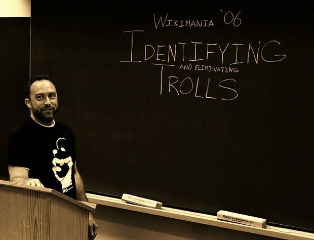

---

I begin with two images. The first image is actually a diagram. [1] Call it the new diagram of work; specifically, of working together online. It is the diagram of collaboration. The diagram of collaboration is abstracted from any particular setting or function. There is no representation of time, and its spatial logics are purely relational, or topological. Collaboration takes place in the open, under conditions of openness. Workers, or participants, are first and foremost equal. The two-dimensional bodies are literally cut from the same stuff, and their synoptic gaze is spread symmetrically and indiscriminately. Their circular arrangement and lack of distinguishing qualities further emphasises the non-hierarchical or ‘peer’ nature of this mode of work. Difference is only registered in the varying colours of the 2D cutouts. The vibrancy of these colours suggests they are to be celebrated, that they are generally and vaguely positive, but they have no obvious bearing on the activities of work. Colour is a difference that makes no difference. Finally, the spirit of this diagram, if diagrams can be said to have such a thing, is captured in the joined, raised hands of the cutout figures. Collaboration is working together and such togetherness is what makes it both unique and superior. [2] {#para1}

The second image is that of the internet troll. In contrast to the diagram of collaboration, the figure of the troll is rich in detail. Personal hygiene, eating habits, bodily shape and condition, sleeping patterns, dress, dwelling; in short, the troll’s entire habitus – complete with Mother’s 1970s carpet – is offered here for the sake of a laugh. Combined, the picture and accompanying descriptions capture many core aspects of the internet troll, the most important of which is the sense that trolls represent a kind of pure negativity. As it is commonly remarked of the troll, it unleashes its vitriol and damaging stunts simply for the ‘lulz’, that is, for its own pleasure and nothing more. This pure negativity is explicitly not related to a recognisable political programme or a demand for some form of justice and instead, stems from the core of the troll’s very being. Unlike collaborative peers, the troll is depicted as a lone figure. While trolls may act together to coordinate attacks, for example, there is nevertheless the sense that the troll is on the outside, too dysfunctional and destructive for meaningful relationships. The historical emergence of trolls, their possible motivations, and the range of activities that may or may not be considered trolling, are not of direct consequence or interest (see Coleman, 2012) for this essay. There are, instead, three questions about trolls that I want to focus on: Why are the activities of trolling so commonly depicted as stemming from personality defects or character flaws and reducible to the individual? What is the effect of naming someone or thing as a troll? And what, if anything, is the relationship between the figure of the troll and the diagram of collaboration? These questions will help make visible a kind of liberal and exclusionary politics that underpins – and indeed, makes possible – much collaborative work, which I will consider in relation to writing, editing, sorting and maintaining articles on Wikipedia. Before I commence, though, a further note on collaboration. {#para2}

There is a large body of literature on collaboration as a distinct mode of working together. In the business world, the origin story of collaboration often begins with Toyota’s strategy of setting up non-competitive working relationships with members of its supply chain. From around 2006 onwards, however, a body of work on collaboration emerged to specifically describe working together online and it is this revised notion that is expressed in the diagram. The renewed interest in collaboration emerged almost exactly with the rise of Wikipedia as a popular cultural artifact. In fact, projects like Wikipedia pose the problem of working together that theorists of collaboration attempt to solve (Benkler, 2006; Bruns, 2008; Elliott, 2006; Jenkins, 2006; Reagle, 2010; Shirky, 2008). Within this literature, collaboration is commonly positioned as the kind of work that takes place in forms of organisation that do not rely ‘on market signals or managerial commands’ (Benkler, 2006: 60). Managerial command and control structures are replaced with non-hierarchical peer structures, which do not need to respond to the price signals of the market to organise production. With no apparent organisational a priori, collaborative work is often described as ‘unmanaged’, as enabling a ‘spontaneous division of labour’ (Shirky, 2008: 118), and as making possible what Axel Bruns describes as ‘ad hoc meritocracy’ (2008: 25). {#para3}

If collaboration is ‘open to anyone’, if managerial hierarchies are replaced with peers and if there is no traditional market to organise value, how does collaboration sort desirable contributions and contributors from undesirable ones? How does one judge what is good, what belongs and what doesn’t? This question of sorting offers a different way into thinking about the how of collaboration. It is a question that has rarely been considered in any detail, with the exception, perhaps, of Joseph Reagle’s discussion of the Wikipedia’s Neutral Point of View (NPOV) policy. {#para4}

Through a consideration of the entry on Evolution, Reagle shows how collaboration is actually only possible because of NPOV, together with the assumption of ‘good faith’ (2010: 45–55). NPOV is the mechanism that seemingly allows both believers and critics of the theory of evolution to work together and, importantly, to work out any conflicts that arise in the process. Reagle also digs up the following quotation from Wales, which suggests that Wikipedia’s co-founder sees NPOV in a similar way: {#para5}

> The whole concept of neutral point of view, as I originally envisioned it, was this idea of a social concept, for helping people get along: to avoid or sidestep a lot of philosophical debates. Someone who believes that truth is socially constructed, and somebody who believes that truth is a correspondence to the facts in reality, they can still work together. (Wales, cited in Reagle, 2010: 53) {#para6}

From the perspective of Reagle and Wales, therefore, collaboration is the result of certain principles that seemingly allow everyone to work together regardless of their particular point of view. Wikipedia is collaborative not because it has no hierarchies, but because it has policies that mediate different, and indeed, often conflicting views, seemingly absorbing different perspectives into a single frame. While Reagle’s work is exceptional in coupling the concept of collaboration with core Wikipedia policies, I am less certain about the possibility for NPOV and other core policies to mediate different ‘points of view’ and the disputes that emerge from them. To explore the role of policies and procedures in the sorting of articles, I now turn to an instance of failed collaboration: Wikipedia Art. {#para7}

### Article for Deletion: Wikipedia Art

> Yes, anyone can edit. No guarantee your edit will stick, though. All edits can also be reversed and deleted. Goes both ways, you see. So if you want to say Wikipedia is your temporary canvas, until someone notices what you did, then sure, it’s your canvas. {#para8}
>
> — User: Equaczion {#para9}

Wikipedia Art was a short-lived, highly controversial addition to Wikipedia. It was by no means a typical article, conceived rather as a work of concept art in the guise of an encyclopaedic entry. The article was created on February 14, 2009, by the artists Scott Kildall and Nathaniel Stern, who describe their piece as an art intervention with ‘a nod to the traditions of concept- and network-based art’, and further elaborate that ‘Wikipedia Art is many things: an open-ended concept, an immanent object, a collaborative text and a net-work that complicates the very possibility of these distinctions’ (Kildall and Stern, 2011: 165).[3] The first few lines of the entry as it initially appeared on Wikipedia read: {#para10}

> Wikipedia Art is a conceptual artwork composed on Wikipedia, and is thus art that anyone can edit. It manifests as a standard page on Wikipedia — entitled Wikipedia Art. Like all Wikipedia entries, anyone can alter this page as long as their alterations meet Wikipedia’s standards of quality and verifiability. As a consequence of such collaborative and consensus-driven edits to the page, Wikipedia Art itself, changes over time. (Kildall and Stern, 2009) {#para11}

Wikipedia Art no longer exists on Wikipedia. There are, however, several traces of the entry that still haunt the site. At the former address of the original Wikipedia Art webpage, readers are presented with a short message about the article’s (non)existence: {#para12}

> This page has been deleted. The deletion and move log for the page are provided below for reference.
>
> • 06:30, 15 February 2009 Werdna (talk | contribs) deleted ‘Wikipedia Art’ (A7: No indication that the article may meet guidelines for inclusion) {#para13}
>
> (Wikipedia Contributors, 2012c) {#para14}

The details reveal that the entry titled, ‘Wikipedia Art’ lasted a mere day before being deleted by Wikipedia administrator, ‘Werdna’. Besides these details and the links to information about Werdna are details (in brackets and with links) about why the page was deleted. Following the link to ‘A7’ takes readers to the policy page ‘Wikipedia: Criteria for speedy deletion’. The page provides a list of criteria for when it is acceptable for Wikipedia administrators to ‘bypass deletion discussion, at their discretion and immediately delete Wikipedia pages or media’ (Wikipedia Contributors, 2013a). The rationale for the existence of this administrator privilege is to ‘reduce the time spent on deletion discussions for pages or media with no practical chance of surviving discussion’ (Wikipedia Contributors, 2013a). The list of criteria include things like ‘patent nonsense’, ‘pure vandalism and blatant hoaxes’, ‘creations by banned or blocked users’, ‘no context’, ‘no content’, and in the case of Wikipedia Art, ‘no indication of importance’ (Wikipedia Contributors, 2013a). {#para15}

However, before Werdna had swooped in and ‘speedily deleted’ Wikipedia Art, thus classifying it as having no importance and ‘no practical chance of surviving discussion’, a discussion about its merits had already begun. When there is a significant debate underway about the validity of an article, it is usually nominated as an ‘Article for Deletion’ (AfD). The nomination activates a series of procedures and rules for conducting and settling debates about deletion, which are outlined in the ‘Wikipedia:Articles for deletion’ page. Any previous debate about the article’s validity (from the ‘discussion’ section of an entry) is copied over to a newly designated page where the rest of the debate plays out. ‘Wikipedia:Articles for deletion’, further notes that ‘articles listed are normally discussed for at least seven days, after which the deletion process proceeds based on community consensus’ (Wikipedia Contributors, 2013b). Wikipedia Art therefore followed a somewhat unusual trajectory, seemingly proving worthy of discussion and speedy deletion at the same time. {#para16}

At the bottom of the AfD page is a search bar that provides access to the archive of all previous AfD discussions. It is here that the most important trace of Wikipedia Art resides: the record of the debate itself. The deletion debate was quite short, both in length and time (roughly 7,500 words over one day), but it nonetheless makes visible how the body of instructions and procedures for article deletion actually played out. {#para17}

Discussants generally begin their contribution with a pronouncement of what they think the fate of the article should be, or by classifying their contribution in an immediately graspable manner. The most common classifications are ‘keep’ or ‘delete’, but in this particular debate others include ‘comment’, ‘proposal’, ‘recap’ and ‘move to project space’. The deletion discussion is opened by user DanielRigal, the same user who marked it as an AfD. This user writes: {#para18}

> This is an attempt to use Wikipedia as an ‘art platform’. It is not encyclopaedic. It can never be encyclopaedic by its very nature. It can’t be referenced to anything other than itself because it is an original work based on Wikipedia. These guys need to get themselves their own Wiki and host this there. It also seems to be part of a walled garden of suspicious articles about the artists themselves (Scott Kildall, Nathaniel Stern, and Brian Sherwin). It seems that they have accounts and edit these themselves. They may, or may not, be significantly notable outside of their own circle and may, or may not, have inflated their importance in their articles. I think it needs looking at. DanielRigal (talk) 20:54, 14 February 2009 (UTC) [4] {#para19}

There are two main arguments put forward and several issues raised in DanielRigal’s initial post. The first and most obvious criticism is that it is not an encyclopaedic contribution. While DanielRigal does not explicitly refer to any policies, guidelines or principles, this first argument is supported by the first of Wikipedia’s five core operating principles, or ‘Five Pillars’. At the time of the deletion discussion, the first pillar read: {#para20}

> Wikipedia is an encyclopedia incorporating elements of general and specialized encyclopedias, almanacs, and gazetteers. All articles must strive for verifiable accuracy: unreferenced material may be removed, so please provide references. Wikipedia is not the place to insert personal opinions, experiences, or arguments. Original ideas, interpretations, or research cannot be verified, and are thus inappropriate. Wikipedia is not a soapbox; an advertising platform; a vanity press; an experiment in anarchy or democracy; an indiscriminate collection of information; or a web directory. It is not a newspaper or a collection of source documents; these kinds of content should be contributed to the Wikimedia sister projects. (Wikipedia Contributors, 2009) {#para21}

DanielRigal’s second argument leads directly from the first and further serves to define what constitutes something as ‘encyclopaedic’. Wikipedia Art cannot be encyclopaedic, the argument goes, because it only exists on Wikipedia and therefore ‘can’t be referenced to anything other than itself’. It is an argument about ‘verifiability’ and serves to define ‘encyclopaedic’ in such terms. The post finishes by flagging concerns about self-editing (which relates to the behavioural guideline about ‘conflict of interest’) and by questioning the notability of the artists themselves (see ‘Wikipedia:Notability’). {#para22}

The first to respond to DanielRigal is a user called Artintegrated, who begins by noting, ‘Whether these people do simple edits on their own pages in no way validates what they have said here. If something is true then it should stay in the article regardless’. It is targeted loosely at the concerns that DanielRigal finished on. Following this, Artintegrated writes, ‘Did you know this article is already referenced at The Whole 9 […] just today. I feel that your idea that it can only reference itself is unfounded at this point’. This is an attempt to overcome the verification dilemma, and cuts to the heart of the Wikipedia Art experiment. DanielRigal immediately recognises the issue and responds accordingly: {#para23}

> you can’t have a circular chain of references. You can’t reference Wikipedia from a non-RS [reliable source] blog that itself references Wikipedia. By that logic, any information replicated on two different websites and referencing eachother [sic] would be gospel truth. Referencing does not work like that. {#para24}

DanielRigal also notes that users can’t write their own articles because they ‘lack objectivity’. Two more users add comments: one responds to the objectivity question, ‘there is no such thing as objectivity on Wikipedia. That is the whole point — it is inherently subjective’, and the other suggests giving the article ‘time to improve’. To this DanielRigal responds, {#para25}

> Please read the article carefully and see that it can’t possibly improve to become a valid Wikipedia article. It is an article about itself. It is intrinsically unencyclopaedic. I don’t think it was necessarily created in bad faith but it is an abuse of Wikipedia to seek to use it as an art platform and it undermines Wikipedia as an encyclopaedia. {#para26}

The early part of the debate therefore follows two lines, one on what is considered encyclopaedic in relation to verifiability and the other on whether or not it is acceptable for editors to write material about themselves. And while DanielRigal is initially outnumbered three to one, new discussants soon come to his aid. RHaworth categorises their post as Delete and writes, ‘Only fractionally better than any MADEUP topic. Created very recently. Also a totally confused concept — a collaborative art project — fine. But trying to do it on one Wikipedia page — you must be joking mate! We also have an avoid self-reference rule’.[5] Contributors JohnCD and LtPowers also suggests deletion: ‘an interesting concept, but not suitable here: this is an encyclopaedia’ and ‘Out of scope as a project, completely lacking in evident notability as a concept’. {#para27}

At this point DanielRigal discovers the artists’ own wiki, which mirrors the page on Wikipedia. It forces him to revise his initial argument: {#para28}

> OK. Now I am really confused. They have a Wiki of their own at: wikipediaart.org, which has the same content as the Wikipedia article we are discussing here. I am not sure how the two are meant to relate to eachother [sic] but it may be that they are confused as to the difference between a Wiki and Wikipedia. I am not sure which site they are proposing to be the actual art work. If it is the Wikipedia article then all I have said above is correct. If it is their own Wiki then the circularity is broken and the article is not intrinsically unencyclopaedic. In that case I would like to add the following alternative reasons to delete the article: Lack of notability and lack of RS references. {#para29}

It seems now that it isn’t the very possibility of the article that is objectionable, but rather that it isn’t notable enough and is still not verified by reliable sources. A discussion about the location of the art project and how that bears on the encyclopaedia entry also follows. Freshacconci enters the debate by affirming DanielRigal’s initial position, but then adds another layer of complexity: {#para30}

> This could never be properly sourced, as it could only exist here first before it could ever be written about in order for it to be notable enough to be mentioned here. Yes, an interesting paradox, but that’s not our problem. We can only go by Wikipedia policies and guidelines, and it’s pretty clear that this needs to be deleted. But here’s an idea: the fact that this was attempted and subsequently deleted could possibly generate enough third-party coverage to make the initial project notable enough to be included (at least as part of the artists’ articles). But until then, it cannot stay. It’s not encyclopedic as an entirely self-referential article. {#para31}

By the middle of the debate there is still nothing close to consensus, at least as defined in the traditional sense of ‘agreement’. New arguments continue to be introduced, while some points are laboured many times over. Statements in favour of deletion come to include: ‘This does not make any sense: it is an article about itself. I think the article is a breaching experiment’; ‘This does not fit Wikipedia’; ‘’Wikipedia Art’ fails WP:N and WP:V’; ‘I see no reason to make an exception for its failure to meet basic requirements for Wikipedia articles. In the absence of any reasons given for overriding Wikipedia basic policy, I see no reason not to delete ’Wikipedia Art’’; ‘Previous discussions about sourcing are besides the point, because this is an art project, and art projects are not allowed in article space’; ‘an article is an attempt to objectively capture the facts about a subject and […] art is a subjective attempt to say something original about something. Given that Wikipedia is for objectivity and against original research it really is an incredibly inappropriate place to seek to make art’; ‘We ask for reliable sources and you give us blogs. We complain of original research and you seek to remedy it by soliciting more original research. I would have expected better’; ‘Speedy Delete — G1, G2, G3, or G11 — Take your pick. How about simply not notable, vandalism, hoax, etc? Whether it can be considered art or not is irrelevant. Wikipedia ain’t your canvas’; ‘This ‘article’ seems designed to violate as many of our basic policies as possible. Linking every word? Signatures in article space? Ridiculous amounts of self-referencing? An article that is about nothing but itself? It is absurd’; ‘WP:OR, WP:SOAPBOX, not notable, no reliable sources except one blog, trying to use wikipedia for something other than writing an encyclopedia…. why are we even having this discussion?’; and finally, there is a suggestion that Wikipedia Art is ‘most likely infringing on the Wikimedia Foundation’s copyright on the name Wikipedia’. While there are, at least in the middle of the debate, equal voices in favour of keeping Wikipedia Art, the mode of argumentation is notably different. The excerpts show how ‘Deleters’ regularly refer to policies and guidelines and how they tend to be highly dismissive of the article/artwork. For their part, the ‘Keepers’ rarely refer to established policies and guidelines to support their claims. Their argumentative mode is far more deconstructive and explorative, often challenging or attempting to redefine existing rules. For example, in response to the charge that Wikipedia ‘is not a web host for collaborative art projects’ an unsigned user questions, ‘What exactly distinguishes a collaborative art project from a collaborative article?’. In a similar vein, Shmeck provides a lengthier contribution: {#para32}

> Those who care most about Wikipedia’s mission would probably agree that Wikipedia already is a collaborative art form. If you feel that Wikipedia is a beautiful thing, then at some level (whether or not you admit it) you consider Wikipedia an art form, with its own codes and conventions. This artwork can only exist as a Wikipedia page that refers to itself. Therefore, deleting would not only send the message ‘this is not Wikipedia’; it would also be saying ‘this is not art.’ {#para33}

The contribution tries to bridge the gap between art and encyclopaedic knowledge that underpins many of the Deleters’ arguments: to deny the existence of Wikipedia Art is to deny the beauty and hence the aesthetic value of Wikipedia as a whole. {#para34}

These kinds of argumentative strategies and attempts to redefine the terms of debate lead DanielRigal to make the following reflective comment: {#para35}

> Recap: I think we have an unusual situation here in two ways. First up there are a lot of people here who do not normally ‘do’ AfDs. Secondly, there is a real, and I believe honest, failure of those who want to keep the article to understand the fundamental nature of the problem, or of Wikipedia itself. I don’t want to be patronising but lets quickly recap Wikipedia 101: The five pillars of Wikipedia explains what Wikipedia is, isn’t and also how it is run. Almost everything of importance is linked from there but I would specifically like to mention notability, verifiability, reliable sources, no original research and, last but not least, do not disrupt Wikipedia to illustrate a point. {#para36}

Immediately following this comment are two attempts by Keepers to mobilise, rather than critique or redefine, existing rules. Both Patlichty and Shane Mecklenburger mount arguments for ‘notability’ and ‘verifiability’ and the latter addresses issues of ‘reliable sources’, ‘no original research’ and the ‘do not disrupt Wikipedia to illustrate a point’ behavioural guideline. Once again, though, the Keepers refer to these rules in highly strategic ways or in a manner otherwise deemed unacceptable by the Deleters. Patlichty, for example, uses his own status as a ‘New Media Art professor & curator’ as part of his argument about notability, which is quickly pointed out and dismissed by DanielRigal, who soon after proposes to close the entire discussion and move to delete. {#para37}

Although one contributor notes closing the discussion ‘within the first couple of hours’ is not standard practice, and suggests ‘this is way too soon in the process for this to happen unless the person who put it up for deletion is afraid that those of us who support the article will ultimately see the page remain’, the final part of the discussion is a flurry of suggested deletions. There are six in total, in under thirty minutes, with two added ‘comments’ that are also pro-delete. These rehash some of the main previous arguments, but become shorter and more forceful.[6] Finally, the administrator called Werdna answers DanielRigal’s request and ends the discussion with this statement: ‘Speedily deleted. No indication that the content may meet our criteria for inclusion’. At the same time Werdna deletes Wikipedia Art, leaving a very similar statement about inclusion (noted above) and a link to the A7 criterion for speedy deletion. Thus ended the life of the entry on Wikipedia Art. {#para38}

### Frames

The debate about Wikipedia Art involves *a politics of the frame.* Gregory Bateson once used the concept of the frame to explore the relation between abstract, meta-communication and ‘psychiatric theory’. Among other things, Bateson was interested in those aspects of communication that signal something more than the message, or rather, that provide signals *about signals* — about how a message is to be understood. In particular, Bateson considers the question of play and how it is that human and non-human animals can recognise a series of signals as such. Bateson invokes two useful analogies that mark an entry point into thinking about frames. The first is that of a diagram used in set theory, where items are organised into specific sets in relation to axioms or basic principles. The principles define which items are deemed meaningful and belong in the set and those which are not and are thus relegated to the outside of the frame. In terms of play, the set would include all of the statements between two human or non-human animals that can be classified as such (as play) within a specified duration. Bateson describes such set theory diagrams therefore as ‘a topological approach to the logic of classification’ (Bateson, 1972: 186). From the outset, then, a frame is a mode of referring *by ordering*. A frame always sorts things as either belonging or not belonging and this process is mediated by axioms or principles — indeed the axioms are what define the frame; they are the conditions of its possibility. {#para39}

The second analogy Bateson employs is the picture frame, which is considered in relation to the first analogy and in the process of identifying the ‘common functions’ of framing in general.[7] In addition to ‘excluding’ and ‘including’ certain messages or ‘meaningful actions’ (which the set theory analogy makes apparent), frames serve an interpretive or perceptive function and mark a qualitative distinction between what is included and what is left out: {#para40}

> The picture frame tells the viewer that he is not to use the same sort of thinking in interpreting the picture that he might use in interpreting the wallpaper outside the frame. Or, in terms of the analogy from set theory, the messages enclosed within the imaginary line are defined as members of a class by virtue of their sharing common premises or mutual relevance. The frame itself thus becomes a part of the premise system. Either, as in the case of the play frame, the frame is involved in the evaluation of the messages which it contains, or the frame merely assists the mind in understanding the contained messages by reminding the thinker that these messages are mutually relevant and the messages outside the frame may be ignored. (Bateson, 1972: 187–188) {#para41}

Frames sort, order, differentiate (in quantitative and qualitative ways) and importantly, contribute to the very differences they act upon. This performative ambiguity is captured in the phrase ‘the frame is involved in the evaluation of the messages which it contains’. The last common function I want to stress is the frame’s relation to communication. Bateson states that frames are by their very nature ‘metacommunicative’: ‘Any message, which either explicitly or implicitly defines a frame, *ipso facto* gives the receiver instructions or aids in his attempt to understand the messages included within the frame’ (Bateson 1972, 188). In regard to Bateson’s consideration of play, the statement ‘This is play’ serves as an example of an explicit metacommunicative message and hence framing device: once a person states, ‘This is play’, everything that comes after is received and responded to differently than if the statement was never uttered. Finally, the converse is also true: ‘Every meta-communicative or metalinguistic message defines, either explicitly or implicitly, the set of messages about which it communicates, i.e., every metacommunicative message is or de-fines a … frame’ (Bateson, 1972: 188). This suggests that it is not possible to speak of something without invoking a frame, and such frames have already cut through the world before their invocation. Because a frame is defined equally by what it is not, it is not possible for a frame to be all-inclusive. One could put it as follows: *there are no frames that are open*. {#para42}

Bateson’s short essay was the inspiration for Erving Goffman’s influential work, *Frame Analysis* (1974). In it, Goffman uses the concept of the frame to explore a basic question fundamental to all experience: How do we know what’s going on in a given situation? In responding to this question Goffman greatly extends Bateson’s analysis. In particular, Goffman develops a nuanced language for interpreting situations when ‘what’s going on here’ is not at all clear, such as keying, fabrication, misframing and illusion. For my purposes, the key type of ambiguity Goffman identifies is the ‘frame dispute’. He offers a simple example: ‘It is reported that what is horseplay and larking for inner-city adolescents can be seen as vandalism and thievery by officials and victims’ (Goffman, 1974: 321–322). Following from this, Goffman defines the main features of a frame dispute: {#para43}

> Now although eventually one of these sides to the argument may establish a definition that convinces the other side (or at least dominates coercive forces sufficiently to induce a show of respect), an appreciable period can elapse when there is no immediate potential agreement, when, in fact, there is no way in theory to bring everyone involved into the same frame. Under these circumstances one can expect that the parties with opposing versions of events may openly dispute with each other over how to define what has been or is happening. A frame dispute results. (Goffman, 1974: 322) {#para44}

Difficulty in achieving ‘frame alignment’, coercive forces in play, open disputes — herein lays the politics of frames. {#para45}

Wikipedia Art raises the question of the frame. All the characteristics of framing I have described above are operative. Rather than frame ambiguity, it seems more a question of object ambiguity: Does Wikipedia Art fit within the Wikipedia frame? But this question itself, of course, cannot be answered without making the Wikipedia frame explicit. The ambiguity of the object is at once that of the frame. While the article entry itself draws attention to the frame, this is greatly amplified during the ‘Article for deletion’ debate. All of the policies and guidelines are principles for sorting. Some of the major ones mobilised in the deletion debate included: ‘Wikipedia:Five pillars’, ‘Wikipedia:Deletion process’, ‘Wikipedia:Criteria for speedy deletion’, ‘Wikipedia:Deletion policy’, ‘Wikipedia:No original research’, ‘Wikipedia:Neutral point of view’ and ‘Wikipedia:Verifiability’. The ‘Wikipedia:Criteria for speedy deletion’ policy, for example, is very clear on what lies outside the frame: ‘patent nonsense’, ‘pure vandalism and blatant hoaxes’, ‘creations by banned or blocked users’ and so on. And even if it is not always clear when a hoax or vandalism has occurred, it is clear when something has been identified as such it is removed. It is not merely a question of whether or not Wikipedia Art belongs in the frame, however. Framing activity is going on in several places and on different levels. The ‘Wikipedia:Guide to deletion’ and ‘Afd Wikietiquette guidelines’ are procedural frames. The Consensus policy frames what constitutes a settled debate. The frame sorts the outside from the inside, but also orders the inside. As the debate proceeded, frames themselves are interrogated and ‘higher level’ frames are brought in to settle the debate — such as when a contributor writes, ‘this is an encyclopaedia’, to frame how others should interpret Wikipedia — and these higher level frames are themselves challenged in a search for ever higher frames to settle the dispute. From ‘flame wars’ in spaces of discussion (such as email lists, Usenet groups, or Wikipedia talk pages), we move to something like ‘frame wars’. {#para46}

The deletion process transformed Wikipedia Art from ‘encyclopaedia entry’ to ‘art stunt’, or, if it was originally both of these things at once, it soon became ‘just art’. If there was a fleeting possibility that ‘The Wikipedia Art page is something that explains art, explores art, and is art all at the same time’, this identity was never realised; at least not in the way intended — not in the form of an encyclopaedia entry. Likewise, if there was a possibility that the Wikipedia frame could be both art and encyclopaedia, that the art frame and the encyclopaedic frame could be made compatible, Wikipedia Art made that possibility less real, instead enforcing the non-compatibility of these higher level frames. This sorting also had interpretive effects, which could be stated as follows: ‘do not approach Wikipedia Art as an encyclopaedia entry; approach it as art’ and conversely, ‘Wikipedia is an encyclopedia, which is distinct from art’. Wikipedia Art was placed outside the frame, but so too were all the arguments made in favour of ‘keep’ during the deletion discussion. Contributors such as Shmeck, Patlichty and Artintegrated were marked as people who make invalid arguments, who don’t understand the frame, while contributors like DanielRigal and Freshacconci were affirmed as productive contributors. {#para47}

The politics of the frame is about sorting, of people and things, of statements, spaces and regimes of interpretation; in and out, meaningful and irrelevant, legitimate and illegitimate. Although outright frame wars are rare, there is no escaping framing, and such sorting always has political effects. A frame is always partly constituted by what it is not; it is the product of, and also produces, difference. Wikipedia is constituted by a distinct frame of knowledge, one that owes a lot to the tradition of Enlightenment, but it equally frames interaction; how debates can play out; what counts as agreement (i.e. consensus); how contributors’ statements are to be received; who is productive, a mediator, an administrator, an artist, a radical, and indeed, a troll. Frames sort statements of knowledge that cannot be divorced from their subjects. Because there is no frame without an outside; no frame that isn’t constituted by what it sorts out as well as in, there is equally no escape from the politics of the frame. {#para48}

### On Trolls and Peers

I began with a consideration of collaboration as a way of understanding how people work together. We saw how collaboration was distinguished from other forms of working together, and in particular those characteristic of governments and firms operating within the conditions of the market. Although collaboration is used as a term that explains how people work together — how working together is organised — it often sits very awkwardly in relation to this very question (of organisation). A host of terms have emerged that tend to downplay the organising forces within collaborative work. We are told, for example, that collaboration is: ‘radically decentralized’ (Benkler); ‘unmananged’ and with a ‘spontaneous division of labour’ (Shirky); self-organising (Elliott); and that collaborative work is ‘non-hierarchical’ and creates ‘*ad hoc* meritocracies’ (Bruns). Without denying that such terms and related commentaries do point to novel transformations, they cannot explain how an average contribution to an open project is organised. Such a lack, I have suggested, has political consequences. {#para49}

Attending to the politics of the frame goes some way in remedying this lack. The frame itself emerges as an organising force, and this force flows over the different facets of collaborative work. While collaboration might be beyond market signals and managerial commands, as Benkler suggests, the frame has its own signals (‘This is an encyclopaedia’) and its own principles, from which the authority of commands can be established (‘This is an encyclopaedia, therefore Wikipedia Art must be deleted’). The force of these commands does not stem from one’s (managerial) position within a firm or other bureaucratic institution. Instead, it comes from the frame; more specifically, the ability to fit within the frame, to position oneself in relation to it, to mobilise it, and if necessary, defer to its authority. [8] While contributors and information architectures can accurately be described as decentralised (Benkler), contributions are nonetheless brought together and played off against one another in relation to a complex set of principles that are not weakened by decentralisation. Indeed, decentralised organisation can only exist if certain principles are especially forceful. {#para50}

While the division of labour might not follow traditional patterns and might not be managed in terms of hierarchies of command, the frame shows that labour is not exactly spontaneous or unmanaged (Shirky). When Shirky writes, for example: ‘one person can write a new text on asphalt, fix misspellings in Pluto, and add external references for Wittgenstein in a single day’ (Shirky, 2008: 120), it is because encyclopaedias must be comprehensive, must not have spelling mistakes, and should provide references to further sources. To make clear how the frame orders work, consider if Shirky had instead written: ‘one person can write a second entry on asphalt, create spelling errors in Pluto, and delete valid external references for Wittgenstein’. Work on Wikipedia is indeed ordered and organised in ways different to industrial or post-industrial models, but there is a logic to it. {#para51}

Leading on from this, Bruns’ account of work structures as non-hierarchical, ‘*ad hoc* meritocracies’ is also somewhat lacking. All kinds of hierarchies exist between articles, rules, contributions and contributors and during the deletion debate these hierarchies were largely reinforced. Bruns’ ‘*ad hoc* meritocracies’, however, refer specifically to emergent forms of *leadership* that are derived from the quality of contributions: Leaders will emerge in specific situations because the community perceives them to be the best in that instance at a particular task. No doubt leaders do emerge and hold sway over specific groups or build up authority in relation to a particular task or topic. But the nature of this leadership, let’s say the source of its competence and authority, plays out in relation to the frame and therefore cannot be considered *ad hoc*. The more a contributor masters the frame, the more likely it is that their contributions will be valorised within it and, in turn, that the quality of their contributions will increase access to positions of authority and leadership. We must also be very careful to qualify merit, therefore, as the ‘mastery of a frame’, rather than as some general and absolute quality of an individual. Finally, while Reagle (and Wales) rightly point out that NPOV is a key mechanism of enabling collaboration, I have shown that the very principles that make collaboration possible also exclude certain contributors and contributions. This is not to suggest that such exclusion is necessarily bad, just that it is necessary: the same frame that makes a coherent thing like Wikipedia possible, does so by sorting out what is other. In light of claims that Wikipedia’s policies provide a position from which everyone can agree and work together in harmony, even if only in theory, placing the politics of the frame alongside collaboration is especially pressing. Indeed, it is not possible to make visible the genuinely agonistic realities found in Wikipedia without doing so. {#para52}

What then, to make of the diagram of collaboration and the figure of the troll in light of the politics of the frame? Way back in 2006, in his opening plenary address for the Wikimania conference, Jim Wales introduced the possibility of having ‘stable versions’ of articles. The general idea behind stable article versions was to continue ‘allowing anyone to edit anything at any time, while at the same time showing the general public something that’s not too frightening’. This technical intervention was considered a better solution than ‘protecting’ and ‘semi-protecting’ pages, which rubbed awkwardly against Wikipedia’s ethos of openness. The reason for suggesting this new solution, and indeed, for ‘protecting’ articles in the first place was to fend off the trolls. ‘We have to lock certain articles’, said Wales, ‘because we can’t afford to let the trolls make us look bad’ (2006). He went on to elaborate that ‘with stable versions, we can actually let the trolls do whatever they please, and we can just block them and revert them’. Stable article versions were deemed able to disarm the trolls, but in such a way as to ‘preserve the openness of Wikipedia’ (Wales, 2006). Returning to the Wikipedia Art controversy in 2009, once again Wales invokes the troll to describe the project’s artist-authors: ‘a group of trolls managed to manufacture for the media a publicity stunt’ (2009). {#para53}

Trolls do not merely haunt the collaborative work of creating Wikipedia articles, swooping in from the dark corners of the net. Despite the varying history of trolls and trolling, increasingly the figure of the troll must be understood as the outcome of a particular kind of politics, a frame politics. Trolls are not the opposite but the converse of collaborative peers; they are, if you will, two sides of the same coin. Produced in the sorting of collaboration, troll refers to those who are literally ‘sorted out’. But in a mode of work that claims to be open and that allows anyone to edit despite any differences, the only kind of subject that can legitimately be ‘sorted out’ is that which is purely negative and whose only intent is destruction. Part of this sorting process involves reducing what otherwise might be understood as a political conflict to a character flaw of one or a handful of individuals. Whenever a frame dispute occurs within the diagram of collaboration, beware! Trolls will surely be identified and eliminated. {#para54}

### Biographical note

**Nathaniel Tkacz** is an Assistant Professor in The Centre for Interdisciplinary Methodologies at The University of Warwick. He is co-editor with Geert Lovink of *CPOV: A Wikipedia Reader* (2011). His book, *Wikipedia and The Politics of Openness* is forthcoming (2014) with the University of Chicago Press. More information about his research is available at:https://www2.warwick.ac.uk/fac/cross_fac/cim/people/tkacz/

### Notes

- [1] For an elaboration of the diagram, see Gilles Deleuze, *Foucault* (London: Continuum, 1999), 30–34.

- [2] In order to demonstrate the diagrammatic nature of this image, I encourage readers to conduct an image search for ‘collaboration’. Note the recurring circular arrangement, colour schemes, lack of hierarchy, faceless and featureless bodies and joined hands. While differences between these images are easily detected, the consistencies across images are immediately striking.

- [3] The artists’ own account of Wikipedia Art can be found in *Critical Point of View: A Wikipedia Reader* (Lovink and Tkacz, 2011).

- [4] Unless otherwise indicated, all cited material from the AfD discussion is from, ‘Wikipedia:Articles for deletion/Wikipedia Art’ (Wikipedia Contributors, 2009). To avoid large redundancies, I will not continue to cite this page as I make use of it below.

- [5] ‘MADEUP topic’ is a reference to the content guideline, ‘Wikipedia:Wikipedia is not for things made up one day’ and which stipulates ‘Wikipedia is not for things that you or your friends made up. If you have invented something novel in school, your garage, or the pub, and it has not yet been featured in reliable sources, please do not write about it in Wikipedia’ (Wikipedia Contributors, 2013c). The self-reference rule RHaworth refers to is part of the Manual of Style guidelines. It advises contributors not to refer specifically to Wikipedia when writing articles.
 [6] The most notable is Huntster’s contribution: ‘Delete as non-notable, self-referential mess. Tried by others, and deleted. Kill kill kill’.
 [7] It is worth noting that Bateson writes specifically of ‘psychological frames’, but to avoid unnecessary confusion I have left this dimension out of the current discussion.
 [8] To be clear, I am not suggesting that frames are fixed. Frames may transform slowly over time, or quickly, perhaps as the result of a frame dispute. A frame is a form of structure whose existence is part and parcel of the details of the situation. Because of this, they are both durable and porous.

### References

- Bateson, Gregory. *Steps to an Ecology of Mind: Collected Essays in Anthropology, Psychiatry, Evolution, and Epistemology* (London: Intertext Books, 1972).

- Benkler, Yochai. *The Wealth of Networks: How Social Production Transforms Markets and Freedom* (New Haven: Yale University Press, 2006).

- Bruns, Axel. *Blogs, Wikipedia, Second Life, and Beyond: From Production to Produsage* (New York: Peter Lang, 2008).

- Coleman, E. Gabriella. ‘Phreaks, Hackers, and Trolls: The Politics of Transgression and Spectacle’, in Michael Mandiberg (ed.), *The Social Media Reader* (New York: New York University Press, 2012), 99–119.

- Deleuze, Gilles. *Foucault*, trans. Seán Hand (London: Continuum, 1999; 1988).

- Elliott, Mark. ‘Stigmergic Collaboration: The Evolution of Group Work’, *MC Journal: A Journal of Media and Culture*, 9.2 (May 2006). https://journal.media-culture.org.au/0605/03-elliott.php

- Goffman, Erving. *Frame Analysis: An Essay on The Organization of Experience* (Cambridge, Mass.: Harvard University Press, 1974).

- Jenkins, Henry. *Convergence Culture: Where Old and New Media Collide* (New York: New York University Press, 2006).

- Kildall, Scott and Nathaniel Stern. ‘Wikipedia Art: Citation as Performative Act’, in Geert Lovink and Nathaniel Tkacz (eds.), *Critical Point of View: A Wikipedia Reader*, (Amsterdam: Institute of Network Cultures, 2011), 165–190.

- Kildall, Scott and Nathaniel Stern. ‘Wikipedia Art’, (2009). https://wikipediaart.org/wiki/index.php?title=Wikipedia_Art&oldid=211

- Reagle, Joseph. M. *Good Faith Collaboration: The Culture of Wikipedia*, (Cambridge, Mass.: MIT Press, 2011).

- Shirky, Clay. *Here Comes Everybody: The Power of Organizing without Organizations* (New York: Penguin Press, 2008).

- Wales, Jim. ‘Opening Plenary’, *Wikimania*, 5 August (2006). https://wikimania2006.wikimedia.org/wiki/Opening_Plenary_(transcript)

- Wales, Jim. ‘Wikipedia Art Pushes The Elastic Boundaries Of Fair Use’, *WebProNews*, 27 April (2009). https://www.webpronews.com/wikipedia-art-pushes-the-elastic-boundaries-of-fair-use–2009–04

- Wikipedia Contributors. ‘Wikipedia:Critieria for speedy deletion’, *Wikipedia, The Free Encyclopedia*, 12 April (2013a). https://en.wikipedia.org/w/index.php?title=Wikipedia:Criteria_for_speedy_deletion&oldid=549164176

- Wikipedia Contributors. ‘Wikipedia:Articles for deletion’, *Wikipedia, The Free Encyclopedia*, 12 April (2013b). https://en.wikipedia.org/w/index.php?title=Wikipedia:Articles_for_deletion&oldid=543581957

- Wikipedia Contributors. ‘Wikipedia:Wikipedia is not for things you made up one day’, *Wikipedia, The Free Encyclopedia*, 12 April (2013c). https://en.wikipedia.org/w/index.php?title=Wikipedia:Wikipedia_is_not_for_things_made_up_one_day&oldid=535042424

- Wikipedia Contributors. ‘Wikipedia:Articles for deletion/Wikipedia Art’, *Wikipedia, The Free Encyclopedia*, 15 February (2009). https://en.wikipedia.org/wiki/Wikipedia:Articles_for_deletion/Wikipedia_Art

- Wikipedia Contributors. ‘Wikipedia:Five pillars’, *Wikipedia, The Free Encyclopedia*, 12 Febraury (2009). https://en.wikipedia.org/w/index.php?title=Wikipedia:Five_pillars&oldid=270318633
