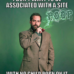
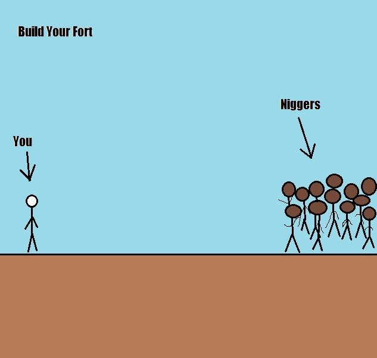
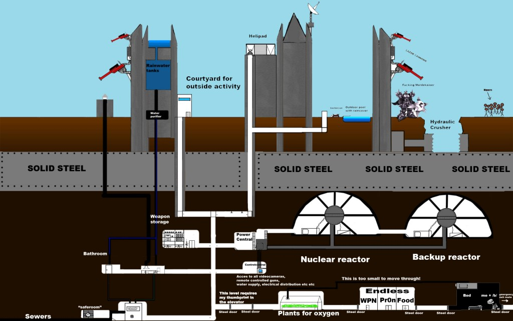
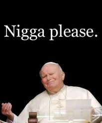
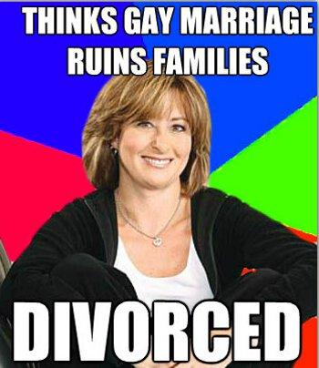
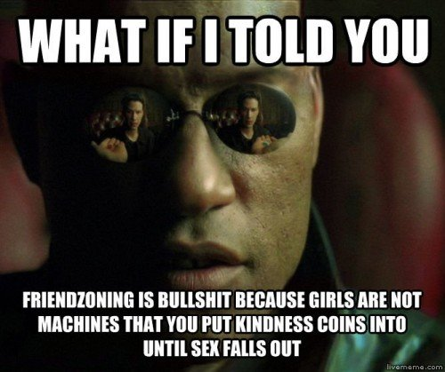
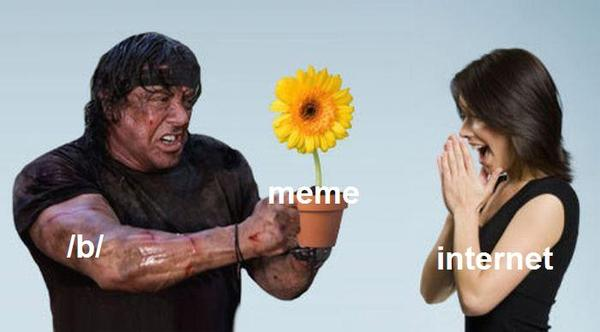

---

### Violentacrez and the Antagonistic Internet

> ‘A troll exploits social dynamics like computer hackers exploit security loopholes…’ (Adrian Chen, 2012 October 12) {#para1}

In October 2012, reddit – a popular link aggregation service and public discussion forum – was embroiled in a prominent controversy. Adrian Chen, a journalist for the news site Gawker, had just revealed the ‘offline’ identity of Violentacrez, one of reddit’s ‘most reviled characters but also one if its most beloved users’ (Chen, 2012 October 12). Violentacrez, who Chen calls ‘the biggest troll on the web’, was responsible for reddit pages (called ‘subreddits’) like ‘r/Jailbait’ (sexualised photos of young girls) and ‘r/Creepshots’ (sexualised photos of women taken in public without their consent). Chen accuses Violentacrez of releasing ‘an unending fountain of racism, porn, gore, misogyny, incest, and exotic abominations yet unnamed’ to reddit. To Chen, Violentacrez ‘hacked’ social dynamics with his posts, exploiting the reddit collective for his own amusement. {#para2}

The unmasking of Violentacrez (who turned out to be an office worker from Texas) inspired extensive debate about the nature and role of public discourse on reddit. Some condemned Chen for ‘doxxing’ Violentacrez, claiming that anonymity online is equivalent to a First Amendment right, and should not be undermined even when that right is used irresponsibly. Others countered that those posting to r/Creepshots hadn’t bothered with consent; why should these posters be afforded more control of their mediated presence than the girls they exploited? {#para3}

The debate stirred. Prominent subreddits like ‘r/Politics’ responded to Chen’s article by banning links to Gawker’s network of sites (including Jezebel, Gizmodo, and Kotaku). In response to that censorship, the metacommentary subreddit ‘r/CircleJerk’ began ONLY allowing Gawker network links. Accusations bounced back and forth between participants on ‘r/MensRights’ (labeled as ‘a place for those who wish to discuss men’s rights and the ways said rights have been infringed on’) and ‘r/ShitRedditSays’ (which catalogues ‘bigoted, creepy, misogynistic, transphobic, racist, homophobic’ content from other subreddits). After much discussion – and little resolution – the controversy eventually quieted and Violentacrez retreated from prominence. Left in his wake were questions of identity, antagonism, voice, and exclusion in an ostensibly ‘participatory’ media collective. {#para4}

The goal of this essay is an empirical assessment of these questions, focusing on content and tone in mediated public discourse. It is an analysis of ‘the logic of lulz’ persistent on a pair of ever-vibrant and increasingly prominent participatory media collectives: reddit and 4chan. As it did during the Violentacrez debate, this ironic and critical logic often antagonizes the core identity categories of race and gender, essentialising marginalised others. However, the logic can also be employed to ‘troll’ those categories themselves, at the expense of those invested in their rigid distinctions. Representations of race and gender will be analysed here, asking what ambivalent identity politics mean for mediated public participation. {#para5}

Further, this logic is multimodal. It is expressed in both text and image, especially in the ‘image memes’ that are shared and remixed according to subcultural standards and individual creative expression on these sites. These images – and the discourses that surround them – starkly underscore the social dynamics evident in these collectives. I’ve argued internet memes constitute a formal ‘media lingua franca’, bearing multiplicities of content to dispersed collectives (Milner, 2013a). They are also aesthetic manifestations of the logic of lulz. Image memes will be of central focus here, asking how they’re employed in race and gender discourse on 4chan and reddit. {#para6}

These twin emphases in mind, the following section will tie image memes to the logic of lulz in participatory media collectives. The sections after will analyse race and gender representations on 4chan and reddit, arguing that irony-laden communicative practices can both reinforce essentialisms and disrupt them. The final section will assess the merits and limitations of this logic and the practices it affords. {#para7}

In the sections that follow, this essay evaluates racism and misogyny akin to that at the heart of the Violentacrez debate, and therefore presents racist and misogynistic discourses. Even if it’s done in the service of critical assessment, reproducing these discourses continues their circulation, and therefore may continue to normalise their antagonisms and marginalisations. The goal here is a frank discussion of the ambivalent potential of mediated popular participation. Meaghan Morris ([1988] 2007) warns against cultural studies’ tendencies to either emphasise “banality and fatality” to the point of cynicism on the one hand or to “ventriloquize the popular” until it becomes detached and benign on the other. The arguments on race, class, and gender herein could lean either way. Therefore, in this essay I will assess the voice and exclusion embedded in the banal, while attempting to avoid the trap of normalising and sterilising everyday antagonism. This in mind, I hope to highlight what Morris calls the ‘aggressive, critical voices embedded in the grit and hardness of day to day life’ (119). {#para8}

### Memes, Lulz, and the Mediated Public

‘Internet memes’ were a prominent part of the Violentacrez debate, as they now are with many discussions on participatory media collectives. Limor Shifman (2013) calls internet memes ‘units of popular culture that are circulated, imitated, and transformed by internet users, creating a shared cultural experience’ (367). The term can refer to oft-repeated phrases reappropriated from popular culture or subcultural history (like ‘that escalated quickly’ or ‘consequences will never be the same’), to remixed videos (like YouTube parodies of ‘Leave Britney Alone’ or ‘Gangnam Style’), or to captured performative acts (like ‘Tebowing’ or ‘Planking’). However, image memes – small, still picture and animated GIF files extensively circulated, transformed, and incorporated into public discussion – are especially prolific in participatory collectives. These memes are easy to produce and can be agilely applied to diverse ends. Their ironic tone can quickly be employed for political or social debate, as I argued was the case during vibrant mediated conversation at the height of the ‘Occupy Wall Street’ protest movement (Milner, 2013b). Memes evidenced ‘pop polyvocality’; they were a pop cultural common tongue that facilitated the diverse engagement of many voices. {#para9}

The ironic lingua franca predominant in memes can afford political edge. For instance, when reddit General Manager Erik Martin became a candidate for *TIME Magazine*‘s ’*TIME* 100 Poll’ in 2012 (*TIME* Staff, 2012 March 29), participants on r/ShitRedditSays took the photo accompanying the nomination and remixed it to reflect a sentiment they found appropriate for the site. When controversies swirled around subreddits like r/Jailbait and r/Creepshots, the remixed image could then be specifically captioned (fig. 1, 2 & 3). {#para10}

 Figure 1: original image of reddit General Manager Erik Martin (which *TIME* itself took from reddit content). Click to Enlarge.

 Figure 2: An initial graphic manipulation of Figure 1. Click to Enlarge

 Figure 3: A subsequent ‘image macro’ caption used on r/ShitRedditSay -Click to Enlarge

Through this process, Erik Martin’s image becomes a visual template; it becomes an ‘image macro’ or ‘stock character macro’. From an established template, participants add unique text to make a joke. Macro humour derives from what Shifman (2011) calls ‘incongruity’, a clash between expectation and experience. These clashes often occur by first setting up the joke at the top of the image (“I don’t want to be associated with a site…” in fig. 1). Next, the ‘stock character’ in the middle of the image (reddit’s Erik Martin in fig. 1) provides a visual ellipsis, a pause between set up and punch line as readers scan past it and associate it with prior context and the specific text of the image. Last, the punch line rests at the very bottom of the text (“…with no child porn on it” in fig. 1). As participants on r/ShitRedditSays and beyond created, circulated, and transformed these images, memetic remix afforded collective satire. These participants employed a logic of lulz to make political points. {#para11}

Whitney Phillips (2012) says ‘lulz’ – a derivation of ‘lol’ or ‘laughing out loud’ – labels on participatory collectives a detached and dissociated amusement at others’ distress. Conceptually, it’s the fundamental logic of trolling, a discursive strand Phillips says is wrought with the ‘self-reflexive’ and the ‘absurdist’, an ‘opaque influence’ on these sites. ‘Both ubiquitous and invisible,’ Phillips says, ‘trolling permeates the online ecosystem’ (2). Trolling performs the work of both ‘cultural critic’ and ‘cultural syphon’, using humour and antagonism to rile angry responses and shift the content and tone of the conversation. However, as Phillips (2012) explains, even if trolling can be ‘equal opportunity laughter’, it still disproportionately targets minorities and women. This fits with Lisa Nakamura’s (2002) observations about the exclusionary force of dominant race and gender identities in participatory media. The harshest test of the logic of lulz is how it is used to engage the most core of identities. If the tone of these representations is exclusionary, then there is cause for concern. However, if these identity categories intertwine in polyvocal public discourse, then perhaps there’s public utility in the logic of lulz. {#para12}

In short, exclusionary *antagonism* should be less evident than adversarial *agonism*. Chantal Mouffe (2005, 2009) defines antagonism as ‘relations between enemies’, but sees a healthier agonism in ‘relations between adversaries’. She argues that ‘conflict in liberal democratic societies cannot and should not be eradicated’ (2009: 551). The collective reality of public life necessitates the existence of factionist discourse, since ‘when dealing with political identities, which are always collective identities, we are dealing with the creation of an ‘us’ that can only exist by its demarcation from a ‘them’ ’ (550). Agonistic conflict is the core of a ‘counterpublic’ model of mediated public discourse (see Lincoln Dahlberg, 2011). Counterpublics succeed when they can utilise ‘critical-reflexive spaces of communicative interaction’ to ‘contest dominant discourses that frame hegemonic practice and meaning’ (Dahlberg 861). {#para13}

But counterpublic critique necessitates a lack of dominant abuse or repression of minority perspectives. To Mouffe (2005), agonism is achieved by embracing public participation that encourages adversarial ‘pluralism’, acknowledging the equal rights of disparate perspectives to clash. Participation must be premised on the ‘values of liberty and equality for all’ even if it also embraces ‘dissent about their interpretation’ (121). Antagonism rejects those values outright, pushing voices out of the public sphere. For the logic of lulz afford vibrant, agonistic public discourse, multiple perspectives and counter perspectives should be evident. Voice should be evident over exclusion, even if that voice is not monolithic in content or tone. {#para14}

Analysing communicative specifics will illuminate public discourse in the participatory media collectives that afford both identity exclusion and pop polyvocality. The logic of lulz – and the trolling that most explicitly evidences it – reflects the ambivalent potential of this contested commons. To Kelly Bergstrom (2011) ‘to troll is to have negative intents, to wish harm or at least discomfort on one’s audience. To be trolled is to be made a victim, to be caught along in the undertow and be the butt of someone else’s joke’. To Phillips (2012) trolling need not be ‘inherently regressive’; it’s all about ‘who uses the tools’. Gabriella Coleman (2010) says the mischievous engagement of the mediated ‘trickster’ may serve a political purpose. Violentacrez is an extreme example of Bergstrom’s (2011) harmful antagonistic troll, but Coleman frames trolls in more forgiving – if not wholly prosocial – terms: {#para15}

> cunning, deceit, lying, provocateur, mischief, audacious, thief, play, shrewdness, audacity, grotesque, over the top, appetite, shocking, fun, delight, wit, trap, subversive, ability, wanderer. {#para16}

By this conception, the practice of trolling may serve public ends, creating discomfort, but also productive engagement with political adversaries and othered identities. {#para17}

The rest of this essay will apply these questions on memes, identity, and lulz to representations of race and gender on 4chan and reddit. Its ultimate question is how exclusion and voice operate within the logic of lulz. {#para18}

### 4chan, Reddit, and Analysing Lulz

For a broader project on mediated cultural participation, in 2011 and 2012 I undertook an analysis of participatory media collectives where discussion online is at its most vibrant, disembodied, and raw. Collecting discourse most heavily between April and December 2011, I wove a corpus of thousands of discussion threads and their accompanying images. Drawing from that project, this essay addresses two prominent, interrelated, yet distinct participatory collectives: 4chan and reddit. On 4chan and reddit, members of the mediated public consistently employ a logic of lulz. As they do, participants on each site extensively represent race and gender in their discourse. {#para19}

4chan is a notorious ‘image board’ network. While the site is divided into a multiple boards – forums for a multitude of interests from anime to fitness – its ‘random’ board (known as ‘/b/’ for its URL: 4chan.org/b/) is the most active and raw. /b/ is built on the premise of anonymity. Participants are not required to post with any pseudonym or credentials, and most don’t. Threads are not archived (becoming inaccessible as new threads push them away) and are scantly organised on the barebones site. The board comes with a boilerplate warning at the top of its page, which reminds participants that trolling is its guiding aesthetic. ‘The stories and information posted here are artistic works of fiction and falsehood,’ the warning has long read. ‘Only a fool would take anything posted here as fact’. {#para20}

In the shadow of this warning, 4chan has developed an ‘anything goes’ reputation. It is avant-garde or lewd, depending on the person being asked and the thread being read. This environment of anonymous public discourse means extensive engagement with race and gender identities. {#para21}

Reddit – the epicenter of the Violentacrez debate – is increasingly notable in mediated public discourse. Like 4chan, it also contains boards (its subreddits) devoted to multiple topics. In reddit’s case these subreddits are innumerable, since participants create them. This affords the ability for both r/ShitRedditSays and r/MensRight to exist in the same media landscape, and operate within a similar lingua franca, even if each subreddit can develop its own unique memes, norms, and discourses. {#para22}

On reddit, new posts – and comments within those posts – can be ‘upvoted’ and ‘downvoted’ by other users. Upvotes mean ‘karma points’ for posters, quantifying their contribution to the site. The highest-voted comments reach the top of the post, the highest-voted responses to those comments reach the top position under parent comments. The highest-voted posts reach the tops of their subreddits. Those top posts are seen on the ‘front page’ of the site, based either on the subreddits a participant subscribes to, or, if not logged in, by a rank of default subreddits. Reddit tends to inspire complex and intricate discussion, but its upvote system can potentially contribute to a ‘tyranny of the masses’, pressing down unpopular perspectives until they’re hidden from default view. {#para23}

Taken together, 4chan and reddit are each vibrant sites of mediated public discourse. They each prominently feature a logic of lulz and extensively engage with race and gender identities. All this means that they are exemplary research sites in an analysis of how social dynamics are hacked and identities collide in participatory media collectives. {#para24}

In order to assess the multimodal commentary and representations on these sites, I have employed critical discourse analysis (Ruth Wodak and Michael Meyer, 2009). Critical discourse analysis is sensitive to the subtle and powerful relations between communication created (in all its multimodal dimensions) and ideology reinforced. Exclusionary, dominant ideologies discursively undermine broad cultural participation. Antagonistic ideology is antithetical to agonistic engagement. Assessing micro-level representations regarding race and gender provides a means for evaluating identity antagonism on these sites. The next two sections will undertake that assessment. {#para25}

### Race, Poe’s Law, and Ambivalent Irony

Participatory media collectives have, historically, been white and privileged. In Lori Kendall’s (2002) analysis of a ‘Multiuser Domain’ called BlueSky MUD, she finds whiteness is assumed unless explicitly stated otherwise, as is class cohesion. Likewise, Nakamura (2002) finds that in Excite chat communities: {#para26}

> The organizing identity does not include ‘white’ as a category; it is not on the menu at all. This omission is a disturbing example of the colonialist or imperialist gaze that sets up a racial other; whiteness is defined by its invisibility rather than its presence. The racial category of ‘whiteness’ is assumed to be a default option, thus creating a guided reading of the web that assumes that the reader is white. (105) {#para27}

Ronald Jackson, Chang Shin, and Keith Wilson (2000) call whiteness a ‘constructed centrality’. The problem is that ‘if whiteness is unmarked, it becomes distributed throughout social spaces and eventually functions as a ‘universal insider’ ’ (72). Because of this: {#para28}

> White people do not have to change who they are, how they talk, or how they behave. The talk and behavior of whites occupy a legitimised cultural space of social interaction, in which the identity of whiteness is acknowledged as normal and standard. (82) {#para29}

Kendall (2002) finds whites have similar statuses on BlueSky. BlueSky participants defend their lack of racism by arguing they hardly notice if anyone they talk to is ‘black’. After all, how could they in a ‘disembodied’ online environment? But ‘in these statements, the ultimate test of whether race matters online is the ability of black people to pass unnoticed as black. This emphasises the presumed desirability of hiding blackness and the assumption that people online are white’ (210). It also boils race down to an easy binary: white or black, white or not white. {#para30}

This constructed centrality is why a logic of lulz can reinforce oppressive ideologies, and repress minority value in the discourse. Michael Billig (2001) analyses how KKK joke sites support oppressive ideology with antagonistic humour. Because of this, ‘the person finding the joke funny is implicitly accepting these stereotyped assumptions about the nature of the other’ (277). Phillips (2012) finds similar practices in her analysis of 4chan’s /b/. Here, participants on both 4chan and reddit employed stereotypes for quick shortcuts to ironic humour. Further, racial representations were partial, and privileged the constructed centrality of whiteness without much contestation from participants. {#para31}

Race was constructed on these sites multimodally, commonly mixing image and text in representations. For instance, one image macro series, called Successful Black Man, was particularly popular on reddit. [1] Like other image macros (see fig. 1, fig. 5), Successful Black Man is at its core a visual template. From this template, participants add unique text to make a joke. The macro is derived from a photo on the stock image website ShutterStock entitled “Handsome African American business man dressed in a black suit”. In the Successful Black Man macros the image inspired, a racist premise is established in the top clause of the added text; the bottom clause inverts that premise to deliver the punch line. ‘These streets are mine…’ the top clause in one example reads; ‘…investing in residential development is a great idea’, reads the bottom clause. {#para32}

Steeped in stereotype, Successful Black Man could further ingrain inegalitarian representations (e.g., ‘You want to get iced…tea after another round of golf?’, ‘I do not tip…less than 20 percent’, ‘I can’t read…this newspaper without my coffee’). Familiarity with racist tropes is necessary to get the joke. If common perceptions that blacks are uneducated, cheap, and violent didn’t exist, neither would Successful Black Man. The name of the macro itself creates a racially-presumptuous association. If a black man is successful, he requires a modifier in front of his name to set him apart from a ‘normal’ black man. He’s novel enough to premise a joke. Successful Black Man is the exception that proves the rule. The title makes apparent invisible associations between blackness and a lack of ‘success’ (defined narrowly and materialistically). It also assumes a readership likely to see an ‘other’ in Successful Black Man. {#para33}

On the other hand, the macro – in its play on stereotypes – might undermine them. The turn of phrase that comes with the second clause punch line lampoons tendencies to unproblematically accept negative representations. The humourous incongruity ‘works’ because dominant cultural assumptions lead readers astray. Stereotypes ensure that the class comfort or social responsibility in the second clause creates a clash. That clash works as what Christian Burgers, Margot van Mulken, and Peter Jan Schellens (2012) label an ‘irony marker’, a ‘meta-communicative clue’ that helps readers understand an utterance as ironic. The punch line functions as a ‘reversal of valence between the literal and intended meaning’ (292) of the set up. Readers are trolled by the first clause in the macro, and the bait and switch in the second clause reverses a dominant discourse. The mischief reminds us – in a small way – to not take all stereotypes at face value. {#para34}

As memetic remix affords the freedom to apply creativity to multiple ends, less ambiguous examples of racism existed on 4chan and reddit. 4chan in particular had a tendency toward racist discourse. On 4chan’s /b/ board, broader social conventions regarding race were antagonised for commentary or humour. In discussions of race, polite dynamics were hacked for reaction and play in ways seemingly inconsistent with Mouffe’s (2005) criteria for inclusive agonism. {#para35}

While many racial identities were othered, people of African descent bore the brunt of the critique. For instance, in a /b/ thread entitled Community College Negro, racism was the punch line, not the premise. The thread birthed a macro that inverts Successful Black Man, using a different stock image of another black male. This stock character is younger, and smiling in front of a row of lockers. The same juxtaposition between top clause and bottom clause exists as in Successful Black Man, but here it’s used to convey underachievement and deviance (e.g., ‘14 different scholarships..1.3 GPA’). The macro spawned dozens of transformations in its single thread (e.g., ‘went to college…just to sell drugs out of dorm room’; ‘failing me…is racist’; ‘library quiet floor…yelling at La’Shonda’). Successful Black Man conveys what Burgers, van Mulken, and Schellens call ‘ironic blame’; the macro begins with a ‘negative’ set up before a ‘positive’ reversal. Community College Negro is ‘ironic praise’; it begins with a positive set up before a reversal to a social negative. The second clause incongruity brings the punch line back to stereotype, not away from it. {#para36}

On 4chan, this racism was sometimes ‘memetic’ itself. It was the stable core by which participants creatively remixed, displaying technological and subcultural literacy. For instance, one 4chan thread proposed readers ‘build their fort’ based on the original image in figure three. {#para37}

The challenge was for participants to use proficiency and creativity in editing and illustrating to fill in the space between the white ‘you’ and a horde of threatening minorities. Racism became the premise for a memetic game. Most solutions played on prevalent stereotypes (e.g., putting a child of African descent in front of the minorities to scare of absentee fathers; inserting a sign for ‘Wite Wimmins, Fryin’ Chikins, n watermelons’ with an arrow pointing the other way; a sign that reads ‘jobs’ here in front of the ‘you’ character). These images were premised on zenophobic essentialisms of a homogenized outgroup. However, the consensus ‘winner’ of the thread (fig. 5) did not rely on stereotypes as much as portray the most complex fort from any invading threat. {#para38}

In the thread, a racist premise was used to encourage humorous contribution. This premise reinforced oppressive ideologies, as was the case in Billig’s (2001) study. 4chan posters operated in an environment where racial stereotypes were an understood and largely unchallenged assumption. {#para39}

This unchallenged assumption represents a communicative blur inherent to the logic of lulz. The line between playful (if antisocial) irony, satire, and parody and ‘earnest’ racism is difficult to differentiate. Looking at the artifacts alone – and even the threads that accompany them – it’s difficult to gauge intent. The logic of lulz was prevalent enough to blanket a considerable amount of antagonistic discourse in these collectives. The posts above could be the expressions of ‘genuine’ racists; they might also be downplayed as ‘just for the lulz’, a troll on ‘politically correct’ sensibilities. The difficulty in separating ‘ironic’ antagonism from ‘earnest’ antagonism is prevalent enough that it comes with a name in these collectives: Poe’s Law. {#para40}

According to the participatory media reference site, Know Your Meme (‘Poe’s Law’, undated) Poe’s Law ‘is an internet axiom which states that it is difficult to distinguish extremism from satire of extremism in online discussions unless the author clearly indicates his/her intent’. It was named for a 2005 forum thread on Creationism where a poster going by Poe declared that ‘without a winking smiley or other blatant display of humor, it is utterly impossible to parody a Creationist in such a way that someone won’t mistake for the genuine article’. The term has become a way for participants to express confusion or ambivalence to seemingly antagonistic content. Poe’s Law – and the ambiguity it represents – indicates the difficulty in parsing out – within the logic of lulz – ‘ironic’ and ‘legitimate’ identity antagonism. {#para41}

Even /b/’s infamous boilerplate warning is subject to Poe’s Law. The boilerplate claims that ‘the stories and information posted here are artistic works of fiction and falsehood. Only a fool would take anything posted here as fact’. In early 2013, a participant on the subreddit dedicated to collecting 4chan content, r/4chan, posted an alleged suicide note from a pilot. The pilot promised that the suicide would come as a plane crash during a full flight. Participants in the thread wondered if the crash would really occur. When one poster cited the boilerplate warning as evidence the suicide clearly wouldn’t happen, another responded by asking ‘you don’t seriously believe that cop-out disclaimer is always true, do you?’ The discussion turned to difficulties in parsing out the ‘bullshit’ on 4chan. No matter the message, participants in these collectives lived in the shadow of Poe’s Law. {#para42}

Poe’s Law is born from an ambiguous ‘stance’. Shifman (2013) argues that beyond content (what a meme says) and form (how a meme looks), we must consider its stance (‘information memes convey about their own communication’, 367). How memes stand in relation to each other and broader discourses is revealed in their ‘participation structures’ (which voices are included and silenced), their ‘keying’ (the tone and style they adopt), and their ‘communicative function’ (whether its emotive, phatic, poetic, etc.). Seemingly racist content or form may be an attempt to ‘key’ satire through a hyperbolic, antagonistic tone, but may also reinforce unequal participation structures in doing so. The banal can carry both simultaneously. When content and form are so grounded in lulz, communicative function becomes ambiguous. {#para43}

Indeed, it may not even be possible or helpful to try to separate ‘true’ identity antagonism in these collectives from antagonism ‘just for the lulz’. As Patricia Lange (2006) argues about ‘flaming’ (expressions of directed anger online in some ways a vernacular ancestor to trolling), declaring content a ‘true troll’ would require knowing both communicative intent and public reception. In the absence of either, we only have best-guess speculations. Hence, Poe’s Law. {#para44}

The blur between irony and earnestness makes room for discourse otherwise impermissible. The logic of lulz combined with the repression of alternative perspectives meant there was a free use of racist language and imagery on 4chan’s /b/ board. Epithets more broadly impermissible were not off limits. Rampant use of the racial slurs on 4chan may have just been ‘for the lulz’, but it still represented a hacked social dynamic, one that favoured a white centrality. Racist discourses helped establish a participation structure premised on repressions of diverse voice. {#para45}

But derivation of these slurs was also common on /b/, and may have perhaps keyed less antagonism. For instance, ‘Nigga’ – with the ‘soft a’ of the ingroup – was often used on 4chan (see fig. 6). 4chan consistently reappropriated hip-hop vernacular. However, the joke in figure four comes from an incongruity that reinforces stereotypes, from associating an unlikely and ill-fitting source with the phrase. The term was often placed in macros over images of white men, underscoring its irony. As in Lange’s (2006) case, reading intent is difficult given the ambiguous logic of the forum. {#para46}

Still, overtly racist discourse was prevalent on 4chan’s /b/; minorities were consistently marked for their minority status. In the case of people of African descent, those markings relied on stereotype (e.g. criminality, stupidity, and savage masculinity). Even if Poe’s Law and Lange remind us it’s hard to assess ideological intent in discourse, racist labels and attributions still discursively trapped a minority identity through antagonistic stereotype. Like the ‘build your fort’ thread (figs. 4, 5), their stance does the discursive work of separating a human ‘us’ from a savage ‘them’. {#para47}

The tone of this discourse precluded the adversarial encounter Mouffe (2005) finds so essential to productive agonism. The discourse cast an enemy. In the voices excluded, in the humour employed, and in perspectives forwarded, an outgroup was consistently implied. Poe’s Law or no, lulz or no, the discourse was antagonistic. Further, it was antagonistic to an outsider counterpublic not vocally present to counter. {#para48}

Stereotypes were levelled against majority populations on 4chan too. However, in line with Nakamura’s (2002) findings, they implied the white and Western are the invisible insider. For instance, in common threads about differences between Europe and America (lines drawn along the two dominant population centres on the site), Americans were critiqued for being unintelligent or overweight, Europeans for being weak or pretentious. These critiques, even if they featured disparaging images of people with light skin, were levelled at national differences, rather than racial differences. The races of minorities were emphasised and critiqued explicitly; critiques of whites did not typically emphasise race. {#para49}

It may be easy to dismiss 4chan as anomalous, given its level of explicit racism. On reddit, racial discussion was less antagonistic and less explicit. Still, race was a marked category for minorities in reddit image memes and was an invisible category for whites. Instead, whites were often used to stand in for the class comfortable. One example of such class critique popular on reddit is a macro called Sheltering Suburban Mom (fig. 7) based on an image of romance novel writer Carly Phillips. [2] There is no clear indication how she became associated with the meme. {#para50}

Sheltering Suburban Mom is the prototypical cul-de-sac Christian, a socially-conservative, white, middle-class American who does not see the hypocrisies she posits (e.g., ‘supports war on drugs…can’t live without valium’, ‘claims not to be racist…tells son he can’t date a black girl’; ‘pro life…unless it’s her daughter’s baby’). The macro critiques a political and social class sheltered from complex inequalities. However, it reinforces the invisibility of dominant whiteness in its critique of class. {#para51}

In the case of another popular macro, called High Expectations Asian Father, racial minority and class comfort both exists in a single portrayal. [3] However, race is the marked category. The stereotypical high expectations of Asian parents are skewered in the macro (e.g., ‘Facebook?…why don’t you face book and study?’; ‘Asian with no A’s…sin’; ‘B+ on blood test?…failure run through veins’). The emphasis is predominantly on education, a class mobility concern, but race is the marked attributive category. Despite the class emphasis of the content, the title of the macro and the nonstandard English often applied as part of the joke foreground race, not class. While racism may not have been overt on mainline reddit, its discourses still marked race for minorities and made it invisible for whites. {#para52}

Racial representations on 4chan and reddit had their differences, but operated under similar logics. The racism on 4chan was more explicit, but reddit also perpetuated a white centrality. Both worked to repress difference. A lack of multiple voices engaging – even in conflict – meant one-sided public discourse. The logic of lulz was employed partially and exclusively, and even with Poe’s Law casting doubt on the authenticity of the antagonism, the discourse itself was antagonistic. The next section will assess gender representations on these collectives, which evidenced heavy counterpublic contestation. {#para53}

### Gender, r/ShitRedditSays, and the Arts of Making Do

Along with being white, participatory media collectives have also historically been male-dominated, both in population and in discourse. These spaces have therefore been masculine, if uniquely masculine. As Charlie Gere (2002) explains: {#para54}

> The early hackers at MIT and Stanford established one of the central archetypes of computing subculture, which continues to this day, that of the intellectually advanced but socially and sexually awkward male, who is prepared to devote most of his time to an engagement with the possibilities of digital technology, to the exclusion of almost anything else. (132) {#para55}

Likewise, Kendall (2002) says that ‘since the 1980s, the previously liminal masculine identity of the nerd has been rehabilitated and partly incorporated into hegemonic masculinity’ (81). Kendall (2002) analyses how participants on the BlueSky MUD joke about their chances with women. She finds that ‘the joke is intended to be on the participants themselves, regarding their nonhegemonic masculinity, but women are the ultimate butts of the joke’ (87). Women are still detached objects, even if they’re unattainable ones. Even in these jokes – meant to be commentary on atypical masculinity – inequality is discursively reproduced. {#para56}

The problem is masculine forms are, as with race, the constructed centrality dominant in mediated collectives, while feminine forms are the marked minority and ‘thereby highlight the femininity of the person as an essential aspect’ (Klaus Fiedler and Jeannette Schmid, 2001: 264). Such demarcations can mean a hostile environment for marginalised groups, thus souring participatory potential. In this way, a cycle continues which normalises partial forms of understanding. Engaging in these collectives often means performing masculinity, thus embedding the ideologies further. {#para57}

The discourse that ‘The Internet’ is a male space persists, despite the fact that the number of women and men ‘online’ has been balanced as far back as 2000 (Nakamura, 2002). Phillips (2012) finds the male gaze predominates 4chan, and reddit’s similar reputation for misogyny came out during the Violentacrez debate. Both reddit and 4chan were prone to gender antagonisms. However, gender was also the subject of explicit agonistic discussion. Partial representations of gender were met with contestation from participants explicitly identifying as female. This meant hostile argument, but also agonistic engagement. {#para58}

Engagement did mean contesting a dominant masculine stance. Gendered language marked females similar to how racial language marked minorities. The phrase ‘bitches love’ was commonly remixed in image memes. It quotes an episode of the show *The Boondocks* where a character is texting and says ‘I sent that bitch a smiley face…bitches love smiley faces’. In memes, it was often applied to male voices like Spider-Man (‘I spun that bitch a web…bitches love webs’), William Shakespeare (‘I’m writing that bitch a sonnet…bitches love sonnets’), George Washington (‘I’ll give those bitches freedom…bitches love freedom’). These male characters all somewhat dismissively go about their standard business in order to impress some vague and denigrated female. Other examples of gendered language were more antagonistic (see fig. 8). {#para59}

Poe’s Law haunted gender antagonisms on the site as much as partial representations of race. The caption in figure eleven could be satirising a perceived misogynistic tone of the original work; it could also be adding a layer of sexism less evident without the text. Many examples are hard to brush off as ‘just lulz’ (see fig. 9). {#para60}

The participation structures imbedded in antagonistic memes – marking women for gender, issuing authoritarian commands, and applying denigrating labels –work toward exclusion (‘back to the kitchen’ was a common phrase; one annotated image reads ‘if you watch *Cinderella* backwards, it’s about a woman who learns her place’). That these images reflect the dominant discourse – the banal standard – means irony can shelter bigotry. Morris ([1988] 2007) says banality intertwines ‘lordly pronouncement’ and ‘mimetic popular performance’ (143). Predominant inequalities are reinscribed in everyday interactions. Lulz or no, 4chan and reddit were wrought with identity antagonism. {#para61}

Many image memes portrayed women as stupid, irrational, and inconsistent. A macro series called Woman Logic plays on perceptions of hypocrisy in how women think. [4] The incongruity in each is premised on an ironic connection between women’s ‘logic’ and supposedly illogical statements (e.g., ‘don’t want guys to look at my ass…wear shorts that have words on them’; ‘I’m so fat!…wait for compliments’; ‘pluck your eyebrows out…draw them back on’). A common image used in the macro features a young, blonde, white girl staring off and lifting her hand up as if to say ‘what’s the big deal?’. The macro contrasts how ‘women’ reason and the understood norm of ‘sound’ logic, the invisible masculine. {#para62}

These images key a masculine participation structure; the constructed centrality is male. This occurred in conversation as well. On 4chan’s /b/ board, it was common practice to tell a female participant posting her picture to also show ‘tits or GTFO [get the fuck out]’. In one annotated image, a shot of Vito Corleone from the film The Godfather is overlayed with the following command: {#para63}

> you come to us, hat in hand, with your story of gaia-faggotry and ask for our attention. and yet you do not show the proper respect and offer neither tits or a tasty sammich. the godfather says GTFO. {#para64}

The oft-repeated warrant for the demand is that ‘there are no girls on the internet’, so a female wanting to make her gender identity salient during a discussion must make it physically explicit. The demand reifies the board as a male space. The assumption is that if you’re specifically referring to your female gender (or ‘your story of gaia-faggotry’), then you must only be looking for validation (or coming to ‘ask for our attention’). {#para65}

For these participants, displaying their female body is the demanded penance for the transgression of interrupting the board’s invisible masculinity. The process is intentionally antagonistic and coercive to participants who mark themselves as female. In one oft-shared screenshot, a 4chan participant claims that the only reason to come out as female is to ‘get your girl advantage back’ through sexual manipulation (displaying a common tendency to deny male dominance by arguing ‘pretty girls’ get whatever they want). Therefore displaying that body ‘is, and should be, degrading for you, an admission that the only interesting thing about you is your naked body’. {#para66}

This tendency echoes an established problem. In Kendall’s (2002) analysis: {#para67}

> …the gendered social context on BlueSky casts women as outsiders unless and until they prove themselves able to perform masculinities according to the social norms of the group. Women who are able to do so find acceptance within the group, but their acceptance reinscribes masculine norms, which continue to define women as assumed outsiders and outsiders, by definition, as not men. (100) {#para68}

On 4chan’s /b/, marking gender meant marking the ‘feminine’ against a male centrality. To be an ‘anon’ (a 4chan slang label for participants in the collective, short for ‘anonymous’) was to be discursively male. To mark one’s self as ‘femanon’ meant reifying outsider status. {#para69}

Counter-intuitively, another discourse was prevalent alongside discourses of subjugation, violence, and stupidity: ‘the friend zone’. The friend zone is a forced platonic relationship. When one friend wants romance and another doesn’t, the former is in the friend zone. Women who put ‘nice guys’ in the friend zone were accused of abuse, manipulation, and neglect. A macro called Friend Zone Fiona is premised on this perceived injustice. [5] Fiona ‘loves you…like a brother’, ‘totally wants you…to meet the right girl someday’, and ‘invites you over…to fix her computer’. The friend zone discussion was prevalent on reddit, where ‘nice guys’ would often lament their limbo status. Those in the friend zone received sympathy and, in the process, ‘friend-zoning’ girls were villainised. As with the Woman Logic macro, the woman is a prototypical ‘pretty girl’: young, thin, white, and blonde. The image juxtaposes the first clause premise and the second clause punch line to elevate hopes, and then crush them. Addressivity is commonly second person. The nice guy friend (the implied reader and addressee) is left with the scraps of the relationship. {#para70}

But there were extensive pushbacks against the notion of the friend-zoned nice guy on reddit. Some contended that cross-sex friendship is itself a fulfilling state, that ‘nice guys’ aren’t always so ‘nice’, and that niceness alone is not what keeps a relationship platonic (see fig. 10). Image memes existed that troubled broader reddit conventions, applying a logic of lulz to respond to dominant perspectives. Memetic humour and irony were tools to counter a dominant discourse. {#para71}

Another push against friend zone discourse was critical of ‘guys on the internet’ at a more fundamental and antagonistic level. In many macros, the prototypical ‘internet-culture’ participant exists in the lineage of Kendall’s (2002) BlueSky MUD. He’s not only a male, but a geek and a loser as well. The insult that targeted males most explicitly was ‘neckbeard’, used to conjure up familiar stereotypes about overweight, socially-awkward males (who can’t grow facial hair anywhere except in patches on their neck, yet still try). A prototypical ‘neckbeard’ is a macro called Butthurt Dweller. [6] Butthurt Dweller ‘can’t workout…don’t want to get too buff’, ‘complains about being bullied in school…calls everyone a faggot online’, and ‘posts anti-religion threads on /b/…feels like god’. He is overconfident, deluded about his prowess, and sophomorically arrogant. The macro employs ironic commentary to reinforce negative stereotypes about participants on reddit and 4chan. {#para72}

A predominant argument was that the ‘internet culture’ male is insufficiently masculine and romantically unsure. On 4chan, participants often called those who successfully perform hetero-normative masculinity ‘alphas’ and those who don’t for fear or awkwardness ‘betas’. Many 4chan participants explicitly identified with ‘betas’. However, ‘neckbeards’ weren’t marked merely for being men, but for being men who deviated from dominant masculine standards. Being a woman was essentialised and universalised, being a ‘neckbeard’ or a ‘beta’ only labeled one type of inadequate masculinity. Women were discussed in blanket terms that men were not. {#para73}

Still, debates over gender essentialisations did occur, even when debates became factionist. As dominant discourses butted against dissenting perspectives, discussions representative of Dahlberg’s (2011) counterpublic model of mediated public discourse were born. In particular, pro-feminist subreddits provided participants a place ‘to form counter-publics and counter-discourses; to link up with other excluded voices in developing representative, strategically effective counter-discourses; and subsequently to contest the discursive boundaries of the mainstream public sphere’ (861). One popular subreddit was ‘r/TwoXChromosomes’, which – to quote its own description – housed ‘thoughtful content – serious or silly – related to gender, and intended for women’s perspectives’. Its meme-focused counterpart was ‘r/TrollXChromosomes’, whose subscriber count as of early 2014 proudly stated there are at least ‘47,729 girls on the internet’. A distinct example, r/ShitRedditSays took a more actively antagonistic approach to calling out sexism on reddit. {#para74}

However, as these counter-spaces adopted the logic of lulz, they were subject to its inherent tensions. Trolling behaviour still meant identity antagonism; Poe’s Law still meant ambiguities regarding stance. Nowhere was this more controversial than on r/ShitRedditSays, which embraced a lulz mentality in their discussion. r/ShitRedditSays most fundamentally catalogued identity antagonisms from other subreddits, curating what it called a ‘museum of poop’. Posts to r/ShitRedditSays most often quoted comments from other subreddits deemed hegemonic, noted the number of upvotes the comment received, and then mocked the comment. Sidebar rules discouraged explicitly refuting the offending comment in its original subreddit, admonishing that readers ‘don’t touch the poop’. {#para75}

r/ShitRedditSays was ripe with self-referential assessments of the subreddit made by its own participants; and Poe’s Law came with these assessments. For instance, figure nine could be said to either flaunt antagonistic exclusion in the subreddit or to satirise the subreddit’s reputation for such antagonism. It was common practice to upvote and mock submissions to r/ShitRedditSays ostensibly made by a male complaining about r/ShitRedditSays. Speculations on Poe’s Law were also common during these posts. {#para76}

![Figure 11: An image housed at the bottom of the r/ShitRedditSays front page. It portrays innocent redditors (fans of ‘funny joeks, post-*ism, logic, reason, and Ron Paul’) being assaulted with dildos by members of the subreddit. The flying band is stealing reddit’s ‘internet points’. r/ShitRedditSays is often accused of being a ‘downvote brigade’ which mobilises its members to ‘bury’ offending posts with downvotes after they’re linked in the subreddit. Because of the alleged transgression, the reddit alien weeps over the death of free speech.](../media/twentytwo.fibreculturejournal.org/files/2014/02/FCJ-156fig76.png)

The broader reddit population (and r/MensRights in particular) often accused r/ShitRedditSays participants of contributing nothing to productive public discourse, but instead being as hegemonic as the patriarchal forces they supposedly resist. After all, one of the sidebar rules for the subreddit read: {#para77}

> RULE X: SRS is a circlejack and interrupting the circlejack is an easy way to get banned. For instance, commenters are not allowed to say ‘This post is not offensive’ or ‘This is not SRS worthy.’ Instead, if you do not know why the shitpost was submitted to SRS, get the fuck out. {#para78}

The explicitly stated aim of r/ShitRedditSays is a ‘circlejack’ where participants answer gender antagonism on reddit with their own antagonism, mocking more than discussing. The moderator post introducing the sidebar rule change expressed frustration with so many questions about why something belonged in r/ShitRedditSays and argued that ‘we are not a debate club’. The logic of lulz was employed contrary to rational discourse. {#para79}

r/ShitRedditSays might be considered counterproductive to agonistic public discourse for its disregard for more rational public debate. However, Peter Dahlgren (2013) sees value in more expansive engagements between counterpublics: {#para80}

> Adherence to what we might characterize as a ‘straightjacket’ of rational speech for the civic subject thus undermines the potential richness and vibrancy of political discussion in favour of an illusory deal, and is likely to deflect civic engagement rather than enhance it. This is not least true in the age of Web 2.0, with all its possibilities for creative expression. (75) {#para81}

Perhaps r/ShitRedditSays says wasn’t a space for rational debate, but it was a space for participants to employ the logic of lulz to counter dominant discourses on reddit as a whole. Morris, borrowing from Michel de Certeau (1984), labels reappropriations of banal hegemonies ‘the arts of making do’. Working within the lingua franca that predominated the broader reddit, participants on r/ShitRedditSays made do with what they had, critiquing from within. {#para82}

This counter, of course, assumes that participants on r/ShitRedditSays were themselves being earnest in their posts and comments. The role of r/ShitRedditSays as a ‘troll’ subreddit was contested on the broader site. In a thread on the subreddit ‘r/BestOf’ accusing r/ShitRedditSays of being a downvote brigade, one poster commented that ‘my take is that SRS is full of people who think they’re complete trolls, but don’t understand that it doesn’t count as trolling if you actually believe the things you say’. The next poster speculated that participants on r/ShitRedditSays really didn’t believe anything they posted, and ‘if that’s true, they may well be some of the best trolls reddit’s seen’. A third exhibited further confusion: ‘I don’t think even THEY know any more if they’re joking or they’re not’. Poe’s Law haunted the discourse of r/ShitRedditSays, even as it contested gender antagonisms on the broader site. {#para83}

Just like discourses on race, discourses on gender were problematic in their dominant antagonism. But nonmasculine perspectives were present, vocal, and antagonised back. In these arguments, multiple participants expressed multiple views utilising the logic of lulz – mischief, irony, and disruption – in their critiques. We’re left with questions on whether this engagement was closer to adversarial agonism or to the antagonism of enemies, and the shadow of Poe’s Law looms large. However, counterpublics engaged on gender issues extensively and vibrantly. {#para84}

### Hacking the Social

A 4chan participant, in a common 4chan practice, once described /b/ via annotated image (fig. 12). The comment was on the fierce and dirty process behind the memes that spread beyond the site. The pretty flower is the result of Morris’ ([1988] 2007) banal ‘grit and hardness’, the cultural work of the rawest core of mediated cultural participation. Before Facebook or Twitter, before reddit even, memes are violently forged deep within in the antagonisms of 4chan’s /b/. Before the rest of the mediated public engages with the newest ironic artifact, established social dynamics have been hacked and exploited in the name of lulz. {#para85}

The logic of lulz is vital to 4chan, and to reddit as well. It is core to the grammar and tone of the lingua franca shared by mediated cultural participants. The Violentacrez debate spawned serious attention and serious controversy; r/Creepshots was shut down with Chen’s exposé in October 2012, but the trolls and the lulz have not gone away. Instead, as of early 2014, ‘r/CandidFashionPolice’ is a 17,000-subscriber subreddit. It began in November 2012 and posts the same content as r/Creepshots. However the creepshots are now veneered with titles like ‘gurl those are some ugly shorts’ and ‘dayuum, look at dat fabulous dress’. The subreddit – labeled as a forum where ’people post candid photos of women and then we judge their fashion choices similar to TLC’s what not to wear and E!‘s FashionPolice’ – is serious objectification in an ironic frame. It’s an example of the identity antagonisms left in trolling’s wake. {#para86}

When looking at race and gender representations on 4chan and reddit, we’re left with a pair of lessons. First, as Phillips (2012) argues, trolling can be a communicative tool applied to diverse ends. It can be used to support regression and exclusion, or progression and agonism. Trolling is banal on 4chan and reddit. Morris ([1988] 2007) says it is the ‘common place’ birthed out of social practice. The prevalence of the ironic frame means a linga franca of contestation, one that can both broaden and limit voice. {#para87}

The logic of lulz – in all the essential identity categories it antagonises – does not operate in the narrowly rational realm. However, neither do members of the public. As Dahlgren (2013) argues: {#para88}

> …the version of the civic self that is most coherent is precisely the one where rationality and affect, reason and emotion, are in constant interplay. The life of democracy requires that people be informed, and that they discuss and deliberate, but also that they be emotionally engaged, aroused to involvement, and at some point made to feel that they are sufficiently empowered to make a difference. (76) {#para89}

This empowerment is essential for the logic of lulz to work well. Lulz must be coupled with polyvocality. Publics need counterpublics; trolls need countertrolls. Participants on r/MensRights and r/ShitRedditSays might each label themselves as ‘counter’ and their opponents as ‘hegemony’. Arguments are sharpened and refined when points clash. One-sided trolling means the logic of lulz is served for exclusion rather than voice. Trolling – at its best – may not be narrowly rational, but it can be a way to stir issues that are often left invisible in more narrow or polite discussion. Even if the relations are between enemies instead of adversaries, contestation is more vibrant than repression. Exclusion is always more antagonistic than voice. {#para90}

Second, however, the logic of lulz – that hyper-humorous, hyper-ironic, hyper-distanced mode of discourse – can cause tensions by the ambiguity of its stance. The real challenge for public discourse in participatory collectives may not narrowly be disembodiment or affect, but Poe’s Law. As Shifman (2013) argues, even when we can easily read content and form, stance has more subtle dimensions. Tone and intent are hard to read, as they were when Lange (2006) argued for the difficulties in labelling a ‘true’ flame. Irony markers can be employed ceaselessly to a multitude of ends. The problem is not with the ‘lean’ medium (4chan and reddit are capable of vibrant and robust multimodal communication); the problem is the ironic norms foundational to the logic of lulz. ‘Only joking’ can be used to ‘whitewash’ exclusion and silence countering perspectives, online or off. Adversarial levity can be a benefit, but a lack of earnest engagement – conflicted or otherwise –undermines those benefits. {#para91}

In an environment of banal antagonism, participants made do with what they had. They hacked social dynamics so extensively that trolling itself became an expected norm. While repressive and abusive trolling – the kind attributed to Violentacrez – is antagonistic and counterproductive to public discourse, the practice can have its productive, agonistic dimensions as well. However, this awareness shouldn’t preclude acknowledging the very real inequalities that persist. As Morris ([1988] 2007) argues: {#para92}

> Cultural studies is a humane and optimistic discourse, trying to derive its values from materials and conditions already available to people. On the other hand, it can become an apologetic ‘yes but…’ discourse that most often proceeds from admitting class, racial, and sexual oppressions to finding the inevitable saving grace. (130). {#para93}

Trolling wasn’t a saving grace. The logic of lulz facilitated old inequalities. But the social dynamics hacked by that logic could be hacked to diverse ends. With enough voices engaging and enough of a balance between irony and earnestness, the logic of lulz could be a tool vibrantly employed. {#para94}

### Biographical note

**Ryan M. Milner** is an Assistant Professor of Communication at the College of Charleston in Charleston, SC, USA. He received his Ph.D. from the University of Kansas in 2012. His research intersects participatory media and public discourse, investigating the social, political, and cultural implications of mass connection. He has published in *The International Journal of Cultural Studies*, *Convergence*, and *The International Journal of Communication* on mediated subcultures and media audiences. This includes substantial work on the interactions between fans and producers of the videogame series *Fallout*. His latest project explores the internet memes as public discourse, analysing the aesthetics, identities, and perspectives that constitute these participatory media artifacts.

### Acknowledgements

I would like to thank everyone who had a hand in the collaborative creation of this paper. The feedback of anonymous reviewers, and editors Su Ballard, Glen Fuller, and Jason Wilson proved invaluable as the argument herein emerged. This essay was born from hard, but vital, discussions on race, gender, and visual representation. The review team was essential in that process.

### Notes

- [1]. “Successful Black Man” (2011) https://knowyourmeme.com/memes/successful-black-man

- [2]. “Sheltering Suburban Mom” (2011) https://knowyourmeme.com/memes/sheltering-suburban-mom

- [3]. “High Expectations Asian Father” (2010) https://knowyourmeme.com/memes/high-expectations-asian-father

- [4] “Women Logic” (2011) https://knowyourmeme.com/memes/women-logic

- [5] “Friend Zone Fiona” (2011) https://knowyourmeme.com/memes/friend-zone-fiona

- [6] “Butthurt Dweller” (2010) https://knowyourmeme.com/memes/butthurt-dweller-gordo-granudo

### References

- Bergstrom, Kelly. ‘“Don’t Feed the Troll”: Shutting Down Debate About Community Expectations on Reddit.com’, *First Monday* 16.8 (2011), https://firstmonday.org/htbin/cgiwrap/bin/ojs/index.php/fm/article/viewArticle/3498/3029%3E. doi:10.5210/fm.v16i8.3498.

- Billig, Michael. ‘Humour and Hatred: The Racist Jokes of the Ku Klux Klan’, *Discourse & Society* 12.3 (2001): 267–89. https://dx.doi.org/10.1177/0957926501012003001

- Burgers, Christian, Margot van Mulkin, and Peter Jan Schellens. ‘Verbal Irony: Differences in Usage across Written Genres.’ *Journal of Language and Social Psychology* 31.3 (2012): 290–310.https://dx.doi.org/10.1177/0261927X12446596

- Chen, Adrien. ‘Unmasking Reddit’s Violentacrez, the Biggest Troll on the Web’, *Gawker* (2012, Oct. 12), https://gawker.com/5950981/unmasking-reddits-violentacrez-the-biggest-troll-on-the-web%3E

- Coleman, Gabriella. ‘Hacker and Troller as Trickster’, *Interprete* (2010, February 7), https://gabriellacoleman.org/blog/?p=1902%3E.

- Dahlberg, Lincoln. ’Re-Constructing Digital Democracy: An Outline of Four ‘Positions’, *New Media & Society* 13.6 (2011): 855–72. https://dx.doi.org/10.1177/1461444810389569

- Dahlgren, Peter. ‘Tracking the Civic Subject in the Media Landscape: Versions of the Democratic Ideal’, *Television & New Media* 14.1 (2013): 71–88 https://dx.doi.org/10.1177/1527476412458809

- de Certeau, Michel. *The Practice of Everyday Life* (Berkeley, CA: University of California Press, 1984).

- Fiedler, Klaus, and Jeannette Schmid. ‘How Language Contributes to Persistence of Stereotypes as Well as Other, More General, Intergroup Issues’, in Rupert Brown and Sam Gaertner (eds.) *Blackwell Handbook of Social Psychology: Intergroup Processes* (Malden, MA: Blackwell, 2001), 261–80.

- Gere, Charlie. *Digital Culture* (London: Reaktion Books, 2002).

- Jackson, Ronald L. II, Chang In Shin, and Keith B. Wilson. ‘The Meaning of Whiteness: Critical Implications of Communicating and Negotiating Race’, *World Communication* 29.1 (2000): 69–86

- Kendall, Lori. *Hanging out in the Virtual Pub: Masculinities and Relationships Online* (Berkeley, CA: University of California Press, 2002). https://dx.doi.org/10.1525/california/9780520230361.001.0001

- Lange, Patricia G. ‘What Is Your Claim to Flame?’ *First Monday*. 11.9 (2006), https://firstmonday.org/ojs/index.php/fm/article/view/1393/1311.

- Milner, Ryan M. ‘Media Lingua Franca: Fixity, Novelty, and Vernacular Creativity in Internet Memes’, *Selected Papers of Internet Research* 3 (2013a). https://spir.aoir.org/index.php/spir/article/view/806.

- —. ‘Pop Polyvocality: Internet Memes, Public Participation, and the Occupy Wall Street Movement’, *International Journal of Communication* 7 (2013b): 2357–2390. https://ijoc.org/index.php/ijoc/article/view/1949.

- Mouffe, Chantal. ‘Democracy in a Multipolar World’, *Millennium: Journal of International Studies* 37.3 (2009): 549–61. https://dx.doi.org/10.1177/0305829809103232

- —. *On the Political* (London: Routledge, 2005).

- Morris, Meaghan. ‘Banality in Cultural Studies’, In Simon During (ed.) *The Cultural Studies Reader* (3rd ed., London: Routedge, [1988] 2007), 119–144.

- Nakamura, Lisa. *Cybertypes: Race, Ethnicity, and Identity on the Internet* (New York: Routledge, 2002).

- Phillips, Whitney M. *This Is Why We Can’t Have Nice Things: The Origins, Evolution, and Cultural Embeddedness of Online Trolling*, Ph.D. Dissertation, University of Oregon (2012).

- ‘Poe’s Law’. Know Your Meme. https://knowyourmeme.com/memes/poes-law.

- Shifman, Limor. ‘Memes in a Digital World: Reconciling with a Conceptual Troublemaker’, *Journal of Computer-Mediated Communication* 18.3 (2013): 362–77. https://dx.doi.org/10.1111/jcc4.12013

- —. ‘An Anatomy of a YouTube Meme’, *New Media & Society* 14.2 (2011): 187–203.

- *TIME* Staff. ‘Erik Martin – 2012 Time 100 Poll’, *TIME* (2012, March 29), https://www.time.com/time/specials/packages/article/0,28804,2107952_2107953_2109626,00.html

- Wodak, Ruth, and Michael Meyer, (eds.) *Methods of Critical Discourse Analysis* (2nd ed., Los Angeles: Sage, 2009).
