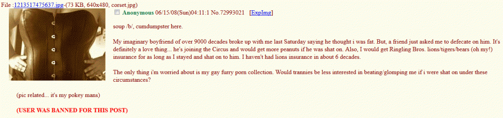
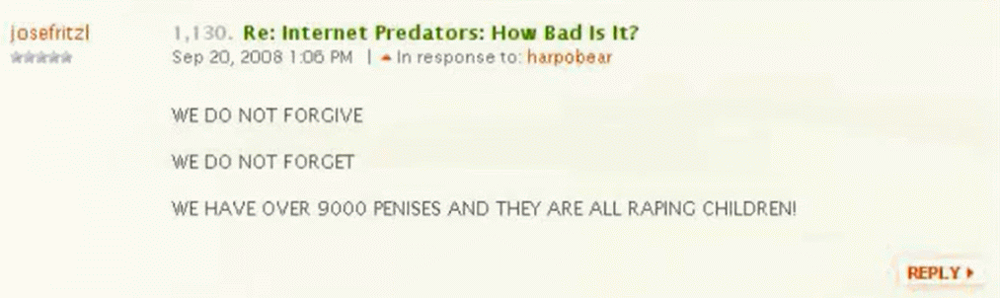
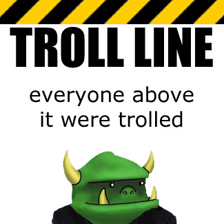

---

### Introduction: The adoption of ‘cumdumpster’

On June 15, 2008, a 4channer identified as female using the colloquial portmanteau ‘femanon’, posted an erotic photograph of herself on the Random – /b/ board, and requested advice regarding a recent breakup, a marriage proposal, and whether she could easily commit marital infidelity. She asserted that the marriage would be for love but simultaneously stressed the money and government insurance she would receive by marrying an Air Force man. [1] Six minutes into the thread, moderators began editing the post, transforming the original poster’s (OP) request into an ad hominem self-assassination and banning her for authoring it. Wordfilters specifically tailored to the June 15 post in question altered this seemingly benign request for advice into a paraphilic interest in excrement, animal anthropomorphism, and transsexuals, in addition to demeaning the OP’s potential husband and insurance concerns. Wordfilters are an automated form of moderation that replace a word or string of words with another word or string of words. They are normally used to filter out offensive words (such as profanity, racist or sexist epithets, and so on) and facilitate other forms of low-level censoring on web forums. On 4chan’s Random – /b/ board, the wordfilter logic of censorship is inverted to make the source material more offensive as opposed to removing offensive words. Most significantly, the wordfilter exchanged ‘femanon’ for ‘cumdumpster’ (Anonymous, 2008a): {#para1}

The thread only lasted thirty minutes but was temporarily affixed to the first page of /b/, heightening its visibility and extending its lifespan. Although several words were filtered, ‘cumdumpster’ was singled out by 4channers as ‘win’, ‘lulz’, and necessary ‘chemo’. [2] As 4channers tested the wordfilters to verify their authenticity, they unanimously expressed gratitude for ‘cumdumpster’ in particular, one user even deeming it as potent a warning as ‘a human head on a pike’ (Anonymous, 2008a). {#para2}

As wordfilters are used on the Random – /b/ board to attack the logics of confessional self-publicity with offensiveness, this warning has been misread by mainstream media and its public as simply bigoted. Online economies are split between high visibility, which relies on identity disclosure and prestige measures like followers, ratings, and consistent usernames; and what David Auerbach (2012) calls ‘A-culture’: the intentional disconnect between online and offline selves where participants use fluid usernames and resist all forms of identity disclosure. Arguably the apotheosis of A-culture, 4chan’s Random – /b/ board is the most robust alternative to and dedicated antagonist of economies of self-publicity. Its impenetrable, anti-normative ethos facilitates sensationalist description (KTTV, 2007; Douglas, 2008; Schwartz, 2008; Grossman, 2008), but in actuality, the ‘head on a pike’ is not uniformly aimed at female participants, many of whom disclose their gender in accordance with /b/’s normative social structures and practices and are treated no differently for it. [3] Rather, misogynistic discourse is one variant within a canon of trolling practices meant to exert collective control over new, casual users who disregard /b/’s habitus. These new users bring with them the behavioural values of economies of self-publicity: egocentrism, narcissism, indicators of offline identity, and identity-based prestige. Such qualities are necessary to participate in the dominant online cultural economy of self-publicity on social media platforms, where participation means ‘public-by-default, private-through-effort’ (boyd, 2011). These users are colloquially singled out as ‘newfags’ on 4chan, where they enact the very practices toward which 4channers are so antagonistic: namely, unnecessarily violating zero identity by groundlessly revealing identity factors; or by ‘camwhoring’, a term used to refer to the practice of posting personal photographs as a prestige measure symptomatic of interactions on rating sites and social media platforms. {#para3}

These users, dubbed ‘newfags’, barraged 4chan once its existence came to light following 2006 media coverage of offsite raids and a dirty bomb hoax. Once secretive and exclusive, 4chan ascended to prominence in 2008 following Project Chanology and the emergence of the politicised activist group Anonymous. [4] Expecting the dominant paradigm of online interaction, newcomers flooded /b/ with photographs, low-content greetings, requests to be rated, and offers to perform for /b/—behaviours that either conform with cultural economies of self-publicity or presume that /b/’s normative social structures merely run counter to dominant cultural economies. This behaviour, termed ‘newfaggotry’, consists of introducing to /b/ the logics of self-publicity and imposing socially normative interpretations of ‘anti-normative behaviour’ onto /b/’s practices without understanding the habituated dispositions actually comprising them. Such behaviour is met with antagonistic trolling practices intended as a deterrent to newfags disinclined to acquire and internalise /b/’s cultural logics through habituation, or the repeated performance of particular bodily, affective, and cognitive repertoires through which social competence is made commonsensical and routine (Bourdieu, 1977: 82–83). {#para4}

By contrast, the logics of self-publicity call for stabilised, traceable identity through consistent usernames, ostensibly excluding trolls and supposedly creating an environment for freer expression. However, since user contributions are forever linked to a single identity, prestige measures are such that users become popular for recognisable successes and ostracised for a single failure. Thus, strong-identity environments may be oppressive with regard to the generation of novel content, as they foster cultural economies that foreground narcissism and the need for a continually reinforced self-image (Dibbell, 2010: 85). Power in these communities favours users whose profiles indicate longtime membership and whose posts are recognisably successful, encumbering newcomers with anxieties concerning sociometric status. Consequently, creative experimentation stagnates. Dissimilarly, 4chan utilises the per-message anonymity of its Japanese predecessors 2channel and Futaba Channel, where identity is unverifiable across posts (Stryker, 2011: 108, 130–135; Auerbach, 2012). Its zero-identity principle reduces social context cues to discursive style and is intended as a panacea for the social anxieties inherent to self-oriented reputation systems. In the absence of strong identity, meritocratic principles wholly replace traditional prestige measures; creative experimentation is prone to increase as the costs of failure decrease; and homogeneity occurs as a result of ratiocination and social-situational exigencies as opposed to pandering. It is telling that 4chan originated following the institution of registration fees to promote strong identity at Something Awful (SA), its Western antecedent (Stryker, 2011: 107). {#para5}

The antagonistic trolling practices directed at newfaggotry on /b/ are highly variable, demonstrating misandry, racism, heterosexism, religious discrimination, ableism and mentalism, weightism, general lookism, and so on. This is in keeping with the long history of performative ‘insult dialectic’ that can be mapped through popular culture to the Afro-American practice of ‘the dozens’, which Dollard (1939: 8–10) argued was organised around gratification gained through the expression of forbidden themes (remarks about one’s family and mother in particular) and aggressive interactions that escalate as participants trade insults. In accordance with this insult dialectic, 4channers tailor abusive rhetoric to the revealed identity factors of the offending newfags in question, deterring self-oriented practices through personalized demoralization. Thus, the majority of trolling practices employ insults based on visible or stereotypically presumed attributes about participants: for example, ‘asspie’ or ‘ass-burgers’ [Asperger’s syndrome], ‘fat permavirgin’, ‘Narutard’ [*Naruto* fan], or ‘underage b&’ [banned]. Similar to ‘the dozens’, the loser is the participant who takes the insults at face value, rather than being part of an exchange. Thus, the more likely an insult is to offend, the more likely it is to be habituated into 4chan’s boundary-policing trolling practices. {#para6}

Within the canon of trolling practices on 4chan, misogynistic remarks are seemingly presumed most effective at provoking the normatively moral reactions that expose newfags and are central to 4channers’ performance of insult dialectic. Misogynistic discourse is no more rampant than other forms of interactive insult on /b/, but it is perhaps more visible given the prevalence of photographic identity disclosure by women, the seeming lack of irony surrounding their degradation, and the cross-culturally graspable outrage affect experienced by outsiders. Rather than targeting all female participants, this particular trolling practice targets only those female participants that post revealing images of themselves. They are known as ‘camwhores’ and are considered through this inverted logic of self-publicity to be the gravest transgressors against /b/’s social structures. This is not to say that male camwhores do not exist, or that trolling practices directed at camwhores are solely sexist. Whether because of the logics of self-publicity or the fact that /b/’s meritocracy is largely built on the successful deception of geeky users in an environment saturated with suspicion, identity-revealing photographs primarily feature women. 4channers’ apparent misogyny is largely—though not wholly—designed to maintain the cultural exclusivity of a transgressive, anonymous space where trolling is the signature mode of discursive politics. The pervasive bigotry of /b/’s misogynistic trolling discourse indicates not widespread prejudice but anxiety over the increasing encroachment of economies of self-publicity, which threatens zero-identity anonymity. {#para7}

Misogyny as trolling practice may have crystallised with the 2008 implementation and linguistic assimilation of ‘cumdumpster’, but it predates the wordfilter to the first influx of so-called ‘camwhores’, whose discourse demonstrated a failure to acclimatise and whose sheer numbers threatened /b/’s subcultural integrity. Significantly, while there is no record of the neologisation of ‘femanon’, the word was in documented usage prior to 2006, when it was rarely contested. Discourse suggests that ‘femanon’ was filtered because it was overused by ‘camwhores’ to the point of stifling novel content and exasperating /b/’s mostly absent moderators. While all of 4chan’s wordfilters were deactivated between 2007 and 2010, ‘cumdumpster’ remains in common parlance. Its retention seemingly reflects the cruel, misogynistic humour popularly ascribed to /b/. However, it indicates a rationale more closely connected with 4channers’ deindividuating collectivism, implicit zero-identity mandate, and antipathy to egocentrism, narcissism, and hubris. In selecting to individuate from the collective through gratuitously disclosing her gender and including an erotic photograph, the OP of what became the ‘cumdumpster’ thread violated zero-identity; her transgression was amplified by the attention-seeking quality of her post. As one 4channer noted, ‘The fact that you introduce yourself as ‘femanon’ proves that you are an attention whore. True anon has no gender’ (Anonymous, 2008a). Although misogynistic trolling practices constitute significant cultural capital in 4chan’s alternative hierarchy of authority and power, the glorification of these practices downplays 4chan’s replication of the asymmetrical power relations of dominant social structures it claims to overturn. Appreciating misogynistic discourse as part of a broader strategy of regenerative subcultural practice is radical but necessary to understanding /b/ on its own terms. {#para8}

### ‘A-culture’: The cultural logics of Random – /b/

Posing a stark contrast to the trust networks of social media, the incongruity between normatively constructed expectations and 4chan’s discursive reality encourages performative role-play in the form of anti-normative, egregious, and abusive dialogue. These practices serve as informal structures of socialisation and coincide with the anthropological notion of the habitus. Pierre Bourdieu (1990: 54–57) defines ‘habitus’ as the synthesised locus of norms and regularities that serve as principles of practice in societies that lack formal codification. There are some principles underpinning the practices that characterise participation on 4chan that are more visible than others. For example, 4chan lacks the option of registration and default usernames are ‘Anonymous’, adopted by over 90% of users. Users who do otherwise are deemed culturally incompetent. Above all else, however, is the capacity of participants to participate; that is, there is a commitment to commitment itself. Cultural competence is dictated not only through the performative offense of gate-keeping insults but also by consistent presence, as content refreshes rapidly on /b/ and is irrevocably deleted. Unlike other forms of communication online that are continually archived into databases, this permanent ‘refresh’ of content necessitates the transmission of collective memory through orality and the sharing of personal archives to which 4channers save material they deem worthy (Bernstein et al, 2011: 5–7). 4chan’s cultural economy is therefore penetrable only by immersive lurking or extensive perusal of sanitised databases like *Know Your Meme* or *Oh Internet*, which aggregate and explain some of the more popularised memetic references and mainstays of Internet culture. These repositories are accessible to the mainstream public and are anathema to 4channers, who are valuated based on the cultural capital they demonstrably possess and distribute (Bourdieu, 1990: 54; Manivannan, 2012). [5] These constitute the system of dispositions that generate and organise the unconscious cultural practices structuring relationships between the individual and the collective. As the social tendencies that guide behavioural dynamics, habitus is neither fixed nor permanent and, as a product of history, generates practices—which constitute more history—influenced by that history. As 4chan lacks an official archive, this history must be acquired and internalised through protracted lurking, which precipitates the habituation of dispositions distinctive to a cultural economy founded on zero identity. In the absence of conscious rule, the past experiences generated by history, deposited in committed participants, craft a dispositional stance that assures the constancy and ‘correctness’ of practices over time (Bourdieu, 1990: 53–4). {#para9}

This summates Auerbach’s (2012) ‘A-culture’: the set of logics, dispositions, and practices resulting from complete detachment from offline personae and sublimation of social identity to shared communal interests. A-culture provides an intentional disconnect for individuals who do not want to be known, demographically categorized, or ranked in a hierarchy of identity-based prestige. It offers a lack of accountability, of lasting indicators of stigma, and of bars to visibility, parameters that are intrinsic to economies of self-publicity. A-culture participants come together in diffuse communities that possess a greater collective mentality, where content reifies a shared culture and sense of belonging that surpasses abiding individual differences. The anti-leader, anti-celebrity, consensus-based meritocracy espoused by 4chan’s A-culture flexibly absorbs differences without making them apparent, precluding identity-based conflict until identity factors are disclosed. {#para10}

A-culture on 4chan is characterised by its dehistoricising velocity, elitism, self-documentation, self-mythologising, self-awareness, and constant ironising as a means of competitively displaying different knowledges and their permutations (Auerbach, 2012; Hutcheon, 1994: 93). Like Japanese *otaku*, or individuals stigmatised for their obsessive interest in stereotypically geeky pursuits, 4channers embrace their alienation from mainstream culture and take pride in their collective shame. As such, it is practically expected that 4chan retain the normative gender associations geek identity typically imposes on technological access, particularly given that *otaku* stereotypically distrust discussions of *otaku* subjects initiated by non-*otaku*, who are popularly presumed to be female (Eglash, 2002: 49; Azuma, 2001: 5). {#para11}

4chan’s A-culture is bounded by two conflicting impulses: a penchant for deviancy and contingency and an espousal of skepticism, deception, and derision. Auerbach (2012) identifies three primary economies organising these qualities: suspicion, offense, and unreality. {#para12}

- *Suspicion*: On 4chan, the economy of suspicion is a consequence of radical opacity, as discourse is not always independently verifiable and unverifiable discourse is the signature of trolls. Within this economy, gullible posters who disregard these verification standards instantly reveal themselves as outsiders. The overall effect is that discourse is never taken at face value and dubious claims must meet the burden of proof demanded by the collective, as in the generic exhortation, ‘pics + timestamp or it didn’t happen’.

- *Offense*: Designed as a barrier to entry, 4chan’s economy of offense pertains to its antisociality, willful alienation, and uses of outrage affect. Auerbach (2012) notes that participants are not necessarily bigoted given A-culture’s constant play of self-referential irony, although free speech—both normatively moral and genuinely hateful—may be suppressed or absorbed due to the equilibrium of offense.

- *Unreality*: Finally, contingent on the economies of offense and suspicion, the economy of unreality reformulates participation as masquerade, as A-culture absents collateral indicators of embodied reality. Discourse is presumed fictional by default unless incontrovertible proof is provided, engendering simultaneous detachment and investment within participants (Auerbach, 2012). The result is the perpetual experience of cognitive dissonance, made bearable by the unremitting suspension of belief no matter how plausible the narrative (Greenwald, 1969: 385–6).

These spaces rather than their inhabitants nurture a social libertarian ethos and surplus of shock images and obscenity, allegedly establishing an undifferentiated assemblage. Social classes manifest, however, in the form of established users and newfags and their respective canons of practices and cultural capital. Bourdieu (1990: 58–59) describes class habitus as the ‘homogeneity of conditions of existence’ that enable the objective harmonisation and adjustment of practices in the absence of conscious rule, reference to norms, or direct interaction. Power is socially and symbolically constructed in such spaces and is constantly legitimised through the interplay of systems of agency and structure. Members are unconsciously informed by the internalised class conditions and conditionings produced by historical experience regarding how to react to cultural stimuli and manipulate cultural capital, which replaces material assets in these power matrices, permitting alternate forms of domination. {#para13}

In a sense, these two antagonistic sets of practices are engendered and harmonised such that 4chan becomes a differentiated society of established users with a shared historical experience, and ‘newfags’, created by the shared experience of a lack of identical history. The practices of each class habitus ‘presuppose mastery of a common code’ (Bourdieu, 1990: 59), as members of the same class are likely to have been confronted with similar situations. For instance, established users are accustomed to recognising misogyny as an ironic measure of deterrence and acknowledge the possession of this awareness as cultural capital. By contrast, ‘newfags’, who have internalised the media’s sensationalist rhetoric rather than 4channers’ sensibilities and schemes of perception, equate cultural capital and social competence with positively responding to misogynistic requests and performing for /b/. {#para14}

Ultimately, sites that function through this logic of A-culture and inculcate participants with a correlative habitus owe their continued existence to ‘newfags’ (or an equivalent), whose imposition of an alternate, unwelcome habitus and attendant practices of self-affirming identity disclosure allow experienced participants (4channers) to reproduce and reinforce the normative social structures of the site (/b/) in the absence of an archive, explicit norms, and moderation. Misogynistic discourse and knowledge of its ironisation occupies an increasingly privileged place in /b/’s normative trolling practices and acquires greater cultural capital given that offline gender discrimination is a cross-cultural, sensitive issue and consequently possesses reliable outrage affect among newfags. Thus, the three economies of A-culture generate trolling practices that produce and reproduce /b/’s unique anti-normative social norms and socially motivated rhetorical actions calibrated to those norms. However, trolling itself has yet to be satisfactorily pinned down. Simultaneously configured as pathological depravity and harmless tricksterism, trolling has become an overly used, devitalised concept that is not truly applicable to 4chan and thus needs reevaluation (KTTV, 2007; Coleman, 2012b: 99). As the mainstream media continues to misrepresent trolling within normative frameworks, it is imperative to consider trolling as a stratified phenomenon modulated by participant characteristics, the space and habitus in which it occurs, and its onsite situational exigencies. {#para15}

### Trolling as disruptive practice

Although the term arose in online contexts, the logic of trolling applies to both online and offline interactions. From its outset, it was predicated on resistance to a dominant paradigm, whether in the form of hierarchical rule or authoritative assertions presented as indisputable. It sought to construct alternative hierarchies of cultural capital, where authority was derived from an awareness of the flaws of dominant institutions and practices of power and an ability to perform and enact this knowledge through oppositional or ambivalent practices of disruption. Creative disruption has long manifested symbolically and materially, as in art pranksters’ ‘Great Art Swindle’ of 2000, Jonathan Swift’s anonymously published A Modest Proposal, or Orson Welles’s radio drama War of the Worlds (Deseriis, 2010: 65–67; Coleman, 2012a; Phillips, 2011: 6). [6] Social engineering, or the psychological manipulation of others, is similarly pervasive, including the thirty-six stratagems of Chinese warfare, grifting, telephone pranking, the countercultural actions of the Yes Men, and routine identity management strategies. The flourishing existence of offline disruption undermines technologically deterministic arguments linking trolling to disembodiment and anonymity. The assorted disruptive and deceptive practices of private investigators, confidence artists, and pranksters suggest that disruptive behaviour is filtered through diverse moral and political sensibilities. {#para16}

Early online trolling emerged as a social practice tempered on Arpanet and Usenet and as a post-hoc label applied to participants who were intentionally disruptive, posting naïve questions with obvious answers, expressing vituperative condescension, or performing assorted forms of demagoguery (Donath, 1999: 42–3; Hoey, 1992). Such posts engendered flame wars, escalating conflicts that were irrelevant, irresolvable, and prolonged, overwhelming productive discussion (Pfaffenberger, 1996: 373). Flame wars generally began when a troll posted ‘flame bait’, a post deliberately designed to provoke hysteria. They could last for months and grow intensely personal within self-oriented cultural economies (380). Early flame wars also functioned as homeostatic mechanisms regulating linguistically-signalled factional group identity: for instance, alternating capitalisation was perceived as the language of trendy would-be hackers, who were derided for it and ostracised by experienced alt.2600 users (Donath, 1999: 37–38). {#para17}

Early Usenet trolling mirrored flaming to a certain degree; it was likened to the act of trawling bait, awaiting responses, and revelling in the ensuing commotion. As systems with reduced social context rely on discursive cues to signal reputation and status, flaming practices were ad hominem, defamatory, accusatory, threatening, or intentionally inane. In environments organised around traditional reputation systems, identity depends on conventional signals, or unreliable signals of personal traits that correlate to custom or convention; correspondingly, invested interactants must defend their reputations lest trolling remarks become associated with their identities (Donath, 1999: 32). Flaming was refined into taxonomies of flame wars, flame warriors, and implicit rules of engagement, such as Godwin’s Law and its codicil Formosa’s Law. [7] ‘Doxing’, or the revelation of personal details via leaking documents, emerged as a trolling practice as well. Jason Fortuny, who posed as a submissive masochistic woman on Craigslist’s ‘Women seeking Men’ forum and then doxed the men who replied, was himself doxed on Usenet; notably, this was viewed as a self-regulatory measure, purportedly reacting to his inability to cope with being trolled in return (TwistyCreek, 2006; Schwartz, 2008). {#para18}

On Usenet, these trolling practices became overt responses to situational exigency after September 1993, colloquially known as ‘eternal September’ (Fischer, 1994), the moment when an influx of newcomers permanently overwhelmed veteran users and irrevocably altered the site’s demographics and habitus. These newcomers were ignorant of Usenet’s habitus and unwilling to lurk long enough to learn its behavioural dynamic. Thus, deceptive discourse proved instrumental in identifying longtime users, who possessed a sense of 4chan’s particular linguistic registers and could therefore distinguish flame bait from naïve posts. This socially motivated trolling practice is largely ‘a game about identity deception, albeit one that is played without the consent of most of the players’ (Donath, 1999: 42). In this game, the troll’s objective is to be accepted as a legitimate participant by echoing common concerns and interests; the objective of other participants is to identify trolling postings and compel the troll to leave. The success of either party depends on their comprehension of identity cues specific to the discourse community in which the game takes place: that is, a successful troll is able to mimic the rhetorical voice appropriate to the trolling practice, while a successful participant is cognisant of and able to produce evidence of trolling behaviour. Success is also dependent on whether or not the troll’s enjoyment is diminished or nullified by participants’ reactions, as veteran users also know better than to reply to a troll (42–3). {#para19}

These self-regulatory, communally-sustaining trolling practices remained intact on Usenet’s descendants and 4chan’s predecessors, like *Something Awful* (SA) and 2channel. SA seeks to minimise and contain onsite trolling but encourages and mythologises offsite trolling that is morally authoritative and emotionally disruptive, as in satirical articles about online shrines to stillborn infants or anorexic, pedophilic, and zoophilic forums. Additionally, forum members who are too sincere or trustworthy (in direct opposition to A-culture’s economy of unreality) risk further dissemination of their personal disclosures (Auerbach, 2012). For instance, SA member Redfox, who confessed to sniffing his sister’s underwear, had his behaviour exposed to his parents by a fellow user who was able to deduce his offline identity (Redfox, 2003). Deceptive discourse offsite may also serve as retribution for scammers and proof of intellectual superiority, as in the P-P-P-Powerbook prank where the would-be victim of escrow fraud scammed the scammer into purchasing a fake laptop (Harris, 2003). [8] {#para20}

By contrast, the zero-identity anonymity of 2channel facilitates sockpuppetry and renders nearly all conventional signals unreliable. Despite the absence of identity markers, 2channel’s trolling incorporates racist and ethno-nationalist discourse. 2channel’s bigotry transpires along particularly fraught racial lines, as in participants’ reflections on the sexual depravity of Korean women, rumours that Koreans eat cats, or statements correlating Koreans to colonial slaves (McLelland, 2008: 828–30). Given A-culture’s economy of unreality, however, it is impossible to conclusively verify whether posters are voicing sincere opinions or are ‘doing it for the lulz’, the oft-cited rhetorical defense that normalises trolling behaviour online (Manivannan, 2012). {#para21}

The dispositions of A-culture develop at the group-specific level and are continually reinforced through users’ implementation of structural and social sanctions against individuals who abuse community mores (Baym, 1998: 60). On /b/, these social sanctions are formulated as trolling. The economies of suspicion, offense, and unreality create an environment in which gullibility is evidence of cultural incompetence and the endlessly competitive posting of increasingly deceptive and offensive material is championed. Moreover, standardising offensiveness controls for genuinely bigoted speech by removing the contrast between normative offense and hate speech (Auerbach, 2012). 4chan’s discourse adopts the practices of trolling identified here as flaming, spamming, doxing, and prankish discursive deceptions. However, its radical opacity ensures that each is differently mediated by A-culture’s economies of suspicion, offense, and unreality. Crapflooding has evolved from spammed evangelist posts on Usenet to the repeated posting of shock media like Goatse, Tubgirl, ‘shitting dick nipples’, and mutilated corpses. Flaming has developed from comparing participants to Hitler to derisively captioned offensive images. 4chan’s misogynistic discourse revolves largely around captioned camwhore photographs and ‘tits or GTFO’, short for the ironic insistence that women should provide timestamped photographs of breasts and then cease to participate, at least under a gendered identity. {#para22}

Thus, classifying 4chan’s misogynistic trolling practices requires considering the rhetorical actions and frameworks available to 4channers at the time. Although personal motives tend to manifest in dialogue, the class habitus of established 4channers privileges communal motives. Onsite misogyny especially illustrates the unification of crapflooding, flaming, doxing, and identity deception as a single boundary-policing social practice. Rhetoric such as ‘cumdumpster’ and ‘tits or GTFO’ was generated from and reemerges during socially exigent circumstances, often incorporating each of the aforementioned trolling practices. Carolyn Miller (1984: 157) theorises that generic conventions develop out of an objectified social need for action. She defines exigence as ‘a set of particular social patterns and expectations that provides a socially objectified motive for addressing danger, ignorance, separateness’ (158). Rhetorical genres are categories of discursive action particular to specific social contexts and, when they jointly recur within a society, they represent a large component of social action. As such, rhetorical genres provide indexes to sociocultural patterns (162–3). Exigence necessarily arises from the social motivations of the community, in this case the perceived need to preserve subcultural integrity as sensationalist reportage attracts newfags who create a new, unwanted class habitus based on cultural economies of self-publicity. {#para23}

### Trolling practices and the skewing of the A-culture habitus

Anonymous 4channers who violate 4chan’s zero-identity principle by disclosing their gender are disciplined with stereotyped, shaming, gender-based insults. For instance, when male users post photographs of themselves, they are received with comments like ‘cock or GTFO’, ‘you look like a faggot’, ‘permavirgin’, ‘eat your own cum’, ‘cock in X’, ‘X in cock’, or ‘X in anus’. As with ‘tits or GTFO’, these flames are oriented toward undermining socially acceptable traits of gender, such as male virility, while also spamming the individual with posts conflating self-worth with sexually degrading behaviour. However, self-disclosures of femaleness predominate on /b/, and so misogynistic discourse occurs more frequently than its misandrist counterpart. {#para24}

As per the economy of suspicion, once any discursive identity disclosure is made, photographic evidence is required. [9] The offensive requests function as a means of identifying newfags, as users who perform for /b/ demonstrate their failure to understand the ironic nature of the rhetorical genre, lack an appropriate understanding of /b/’s habitus, and cannot reproduce its social norms. Newfags are disciplined through toxic shame, as trolling practices discursively reconstruct transgressors based on negative stereotypes of self-disclosed or community-exposed identity aspects (Baker, 2001). {#para25}

Despite the zero-identity principle of 4chan’s A-culture, newfags are distinguishable from established users as their post content reflects a lack of social competence within the class habitus of established users: for instance, they lack familiarity or versatility with native speech patterns or cultural capital, indicating a lack of immersion in the site; or they attempt to force content into popularity, implying the egotistical, narcissistic logics of cultural economies of self-publicity. However, quintessential newfag behaviour is typically met with suspicion, as the rhetor may be an experienced user employing these behaviours to troll a community easily offended by them. [10] {#para26}

The rise in misogynistic trolling practices coincides with the influx of female ‘camwhores’, itself corresponding to cycles of sensational reportage that began in 2006, peaked twice in 2008 and 2010, and then stabilised. Until 2007, /b/ was relatively exclusive. In 2006, Jake Brahm brought the first curious journalists to 4chan after he was credited with a dirty bomb hoax authored as an attempt at a new meme. After reaching memetic popularity, Brahm’s story diffused to more normative spaces where it alarmed users and was brought to the attention of the Department of Homeland Security and the FBI. Brahm was arrested and sentenced to a federal prison term, house arrest, and a substantial fine (Anonymous, 2006a; U.S. v. Brahm, 2007). This story received limited media coverage at the time, mostly occurring in 2008, the year Brahm was sentenced. {#para27}

Between 2006 and 2007, a sharp increase in offsite raids on online communities such as myg0t, eBaumsworld, and Habbo Hotel and actions against Hal Turner led to stricter moderation on /b/, an emigration of veteran users to other imageboards like 7chan, and increased media coverage. In 2007, Fox News affiliate KTTV aired a spectacular and almost parodic report on Anonymous, characterising them as ‘hackers on steroids’, ‘an Internet hate machine’, ‘a hacker gang’, and ‘domestic terrorists’ (KTTV, 2007), juxtaposed against stock footage of exploding vans and anonymised interviewees experiencing online and telephone harassment. Cole Stryker (2011: 152) notes that this was 4chan’s ‘eternal September moment’. {#para28}

The 2007 massification led to an influx of new users who, in flooding a space recently sapped of its veteran users, further challenged its habitus by ignoring the symbolic and material conditions of participation. 4channers’ various cultural and ethical genres of engagement began to crystallise around media misrepresentations, including but not limited to the notion that 4channers’ behaviour is completely divorced from a moral hinge, that zero identity affords impenetrable protection and indivisible alliance with the ‘hivemind’, that this hivemind is easily convinced to raid ordinary individuals over members’ personal problems, and that ‘tits or GTFO’ is a prima facie rule of engagement. {#para29}

Most significantly, new users brought with them the egocentrism and narcissism intrinsic to radically transparent social media systems. As media sensationalism linked zero identity to aimless trolling, new users accustomed to economies of self-publicity misinterpreted A-culture’s economies of suspicion, offense, and unreality, and therefore behaved as though the mere act of engagement rendered them immune to trolling. For longtime users, A-culture’s economies overlapped such that verification measures tailored to outmanoeuvre identity deceptions were ironically offensive and requested post hoc in response to attention-seeking behaviours. These measures were not a prerequisite of participation and were expected to be outmanoeuvred, not fulfilled. {#para30}

New users fail to understand the need for verification measures, and the importunate and demanding quality of new users’ participation indicates reduced technical awareness, savvy, and facility with respect to BBS culture, scripts, and 4chan’s specific rules of engagement. Offensive discourse—once sustained by material like genital mutilation, landmine victims, and aborted fetuses—has been reinterpreted and attenuated by newfags who equate abhorrence with pornography and bigotry but are prone to moralising when flamed themselves. Bizarre, obscene, and facetious verification standards are obeyed rather than understood as a warning to comply with A-culture, including preemptive, unnecessary fulfillment of ‘tits or GTFO’ that directly contravenes the zero-identity ethic. {#para31}

4chan’s notoriety spiked again in 2008 following media coverage on Project Chanology. While Anonymous was gingerly romanticised even as it was vilified, 4chan was strictly moral panic material. The 2008 reportage discussed the swastika symbol topping Google’s Hot Trends, the Sarah Palin email breach, and the trolling of Bill O’Reilly and Oprah. *The New York Times* credited the email breach to ‘computer hackers’, citing campaign manager Rick Davis’s statement that it was ‘a shocking invasion of the governor’s privacy and a violation of law’ (Falcone, 2008). *Gawker* quoted O’Reilly as describing 4chan as ‘despicable, slimy, scummy’ (Carlson, 2008), after which 4channers hacked his website and leaked the information of 205 subscribing users to WikiLeaks and 4chan. A 4channer’s pedophilic posting to Oprah’s online forum furthered media moral panic as Oprah read it on her talk show, resulting in heightened public attention to 4chan but successful subcultural transgression, as mainstream media failed to notice signals of trolling obvious to insiders: for instance, the memetic reference to ‘over 9000’, a *Dragon Ball Z* reference, and the poster’s pseudonym ‘josefritzl’, the name of a rapist who repeatedly impregnated his daughter: {#para32}

The invisibility of these deceptive signals proved that 4chan remained impenetrable to the mainstream public, but this did not inoculate 4chan itself. The media moral panic solidified with the 2009 to 2010 coverage of 4chan’s manipulation of *Time*’s ‘Person of the Year’ poll, pro-WikiLeaks hacktivism such as Operation Payback, and its trolling of Jessi Slaughter, a tween girl with an account on Stickydrama. *Gawker* admonished 4chan regarding the Jessi Slaughter case, ‘sometimes the Internet beats up on an 11-year-old girl, posting her address, phone number and making her cry. Bad. This is what happened to Jessi Slaughter’ (Chen, 2010). Although not a 4channer, Jessi Slaughter was perceived as representative of the female camwhores skewing /b/’s habitus. She was self-celebrating on Stickydrama, feigning authority and toughness, and was deceptive about her age, habits, and personality, flaming commenters who interrogated her. When her videos were posted to /b/, she was viewed as a camwhore, and she was trolled online and offline to exemplify communal self-disciplining even though she herself was not a community member. {#para33}

The Jessi Slaughter case clarifies a gap in 4chan’s misogynistic trolling practices. As she did not camwhore on /b/, she did not constitute an appropriate target according to /b/’s habitus. According to /b/’s social structures, the cultural logics of self-publicity are only targetable when they appear onsite and threaten the class habitus of established 4channers. As *Gawker* journalist Adrian Chen concluded, the Jessi Slaughter case was an instance of 4chan going too far—in terms of both offline normative social structures and 4chan’s own habitus. To put this plainly, such offsite trolling practices are more attributable to the class habitus of A-cultural sites like 4chan being internalised by ‘newfags’ who then enact such practices in strong-identity spaces. However, it is equally important to note that the figures targeted in offsite raids comprise acceptable topics of discussion on 4chan, illustrating problematic aspects of 4channers’ schemes of perception. {#para34}

Although offsite trolling practices lie outside the scope of this article, it is worth mentioning that communally endorsed offline practices tend to be political rather than prejudicial. Onsite discussions suggest that acceptable raids are organised around the political concerns of geeks, like censorship and Internet policy, as well as resistance to the very bigotry enacted onsite in trolling practices, like the targeting of Hal Turner and the Westboro Baptist Church. Self-proclaimed established 4channers distance themselves from apolitical offsite raids, acknowledging that 4chan’s ethos is untenable elsewhere and will be covered by the media in a way that will attract newfags, who will bolster a rival class habitus. 4channers frequently discuss the problematic nature of exporting 4chan’s habitus, as in the trolling of Anita Sarkeesian by Video Games–/v/ in 2012, or /b/ users’ deceptive and derogatory comments around the 2012 Aurora shooting or the George Zimmerman trial. Users claiming long-term membership attribute this mindset to newfags, who misinterpret the logics of raiding to mean simply attacking anyone who seems dislikable or easily provoked. {#para35}

### Conclusion: ‘Only a fool would take anything posted here as fact’

The presumption of Western male heterosexual identity is invisibly imbricated into 4chan’s subculture, undermining its post-identity politics paradigm. 4chan is not universally accessible, as Internet access is limited in portions of the world and controversial content is often censored, contributing to 4chan’s largely Western demographic (Bernstein et al, 2011: 5). However, misogynistic trolling practices are less a reflection of this asymmetrical power structure than of the desire for subcultural preservation. It exists as a subset of bigoted discourse, including misandrist and racist rhetoric, all of which target users who violate anonymity, misinterpret irony, and attempt to normalise 4chan’s class habitus of established users. {#para36}

The rationalisation of misogyny as a socially motivated rhetorical action is facilitated by the economy of unreality, in which narratives and personae never achieve fruition and participants are sheltered from inextricable engagement and guilt (Auerbach, 2012). Narrator and spectators are simultaneously invested in and detached from /b/’s discourse, resulting in an environment of constant play. However, the agonistic playfulness of this economy of unreality is fundamentally breached by newcomers expecting either hard prestige measures or total anarchy. As offensive rhetoric is simultaneously unreal and suspect to habitual 4channers, it is integrated into the moral panic reaction and often remains playful, surreal, and objectionable by normative standards. {#para37}

In a 2007 thread that occurred after the KTTV special report, a 4channer posted a photograph of herself and announced that she was not a camwhore; she was an amateur model sharing images from a photo shoot. She signed off ‘/b/itch’, but despite her feigned toughness, she retaliated when flamed, indicating her investment in an online persona. When crapflooding ‘tits or GTFO’ failed, users turned to visual vernacular, posting images of elderly women’s genitalia, vaginal prolapses, furry pornography, and female anime characters being beaten by men. The OP’s photographs were made into motivational posters ordering her to GTFO, wear cleaner underwear, and have a tubal ligation, after which she stopped contributing photographs (Anonymous, 2007d). By contrast, after the institution of the ‘cumdumpster’ wordfilter in 2008, outsmarting the wordfilter became a game, wherein the ability to bypass the filter using non-breaking space characters made visible the very epithet 4channers wanted eradicated. In outmanoeuvring the wordfilter, 4channers’ discourse gave rise to ‘good job, femanon’, ‘femanonigger’, ‘femanigger’, ‘femanon’, ‘femdumpster’, and ‘cumnigger’ (Anonymous, 2008b). {#para38}

In the eyes of the subculture, these two threads are not that different. Outwitting the ‘cumdumpster’ wordfilter permitted users to simultaneously celebrate and parody it. It made outsiders of offended users and technologically unskilled users. It helped define subcultural boundaries that had been blurring since media coverage in 2006. The economy of unreality permits these contradictory uses of bigoted discourse: one in which the OP is treated harshly as a gender-identifying individual outside of the magic circle of play; another in which misogynist and racist rhetoric becomes an unreal, playful point of solidarity. {#para39}

The wordfilter itself later inspired a parody thread proposing a ‘cumgarbagemen’ filter, where users of indeterminate gender and race skewered stereotypical white male behaviour, and male users posted timestamped images of their pectorals and penises in a satirical strike at ‘tits or GTFO’ (Anonymous, 2010a). These users were flamed with increasingly specific verification standards, such as ‘computer mouse in cock or GTFO’, images of a female anime character hurling a male by his penis and ordering ‘GTFO and take your penis with you’, ‘butthurt spermshooter detected’, ‘gb2office’, and ‘cumgarbagemen aren’t worth anything but pics and dicks’ (Anonymous, 2010a). Female users identified as ‘femanon’, ‘newhags’, ‘samedykes’, and ‘niggerettes’, while male users referred to themselves as ‘cumdumpers’ and lamented their objectification in the manner of female camwhores who self-objectify themselves. This thread was praised for its originality and its cleverness in satirising 4chan’s culture in 4chan’s cultural terms. The catch, of course, is that all discourse is similarly parodic, whether or not it possesses an antecedent to parody. The subjects of satire are the normative conventions of offline reality. Had the amateur model understood that, she might have been welcomed. {#para40}

### Biographical note

**Vyshali Manivannan** is pursuing a Communications Ph.D. at Rutgers University. Her research interests include digital cultures, comics, and animation. Her scholarship has appeared in Enculturation, Forum for World Literature Studies, and ImageTexT, and is forthcoming in The Joker: Critical Essays on the Clown Prince of Crime. She has published a novel, Invictus, and creative work in Black Clock, Consequence, and theNewerYork.

### Notes

- [1] The original post read:
 Sup, /b/, femanon here.
 My boyfriend of two years broke up with me last Saturday saying he thought I was fat. But, a friend just asked me to marry him. It’s definitely a love thing… he’s joining the Air Force and would get more money if he was married. Also I would get government health/dental/vision insurance for as long as I stayed married to him. I haven’t had health insurance in about 6 years.The only thing I’m worried about is my love life. Would guys be less interested in dating/fucking me if I were married under these circumstances?
 (pic related: it’s my corset) (Anonymous, 2008a)

- [2] ‘Chemo’ is the term applied to any measure that can foreseeably cure ‘the cancer that is killing /b/’, a memetic phrase referring to any and all symptoms of /b/’s apparent decline in quality. On /b/, the most aggressive form of ‘cancer’ is believed to be individuals whose contributions suggest an unwarranted sense of self-importance and a desire for complimentary attention.

- [3] Long-term nonparticipant observation on /b/ indicates that discursively revealed identity factors essential to dialogue are implicitly permissible—for instance, signalling one’s gender in discussions of dating, sexual failures, significant others, sexual orientation, urination, genital piercing, and so on; or signalling one’s race in discussions of traveling in ethnically homogenous cities or countries. Users who flame such revelations are swiftly chided themselves as newfags for being unable to distinguish between self-publicity and necessary revelation.

- [4] In 2008, Anonymous launched a trolling attack against the Church of Scientology in an operation dubbed Project Chanology. The group exceeded /b/’s cultural boundaries, including members of other fraternal transgressive online cultures such as Encyclopedia Dramatica, Something Awful, users of a variety of *chans such as 7chan and 420chan, Wikipedia editors, former antagonists of Scientology hailing from Usenet, and offline activists utilizing conventional street protest tactics (Coleman, 2012b). The group should not be confused with 4channers, who adopt the username ‘Anonymous’ onsite.

- [5] Unlike *Know Your Meme* and *Oh Internet*, the troll folklore repository Encyclopedia Dramatica is authored in the same ironising, self-aware, and self-mythologising fashion that characterises much of 4chan’s discourse. As such, it remains largely impenetrable to outsiders.

- [6] The Great Art Swindle involved the invention of an artist, Darko Maver, whose radical performance art included the positioning of dismembered mannequins as a social critique of murder, war, and suffering bodies. Maver was arrested and killed in prison, announced in a press release accompanied by a photograph of the corpse. The episode was later revealed as ‘an active riot’ against ‘a capitalist art system’, and Maver himself as fictitious, ‘pure mythopoesis’ (Deseriis, 2010: 67–68).

- [7] Godwin’s Law states that ‘as a Usenet discussion grows longer, the probability of a comparison involving Nazis or Hitler approaches one’. Formosa’s Law states that ‘the truly insane have enough on their plates without us adding to it’, suggesting that purely irrational posters are impervious to flames and the situation cannot be improved through trolling.

- [8] The P-P-P-Powerbook prank began when an SA user’s eBay auction of a Powerbook drew the attention of an escrow scammer. The user, Jeff Harris, polled the SA forums regarding how to react and, following consensus, constructed a fake Powerbook using a three-ring binder, cardboard and paper cutouts, and a permanent marker. He obtained the scammer’s address and even compelled him to pay an exorbitant customs fee (Harris, 2003).

- [9] Cumtart-kun is a notorious male camwhore who achieved infamy for ejaculating onto a Pop Tart and eating it, documented with photographed evidence.

- [10] These trolls tend to reveal themselves as trolls at the ends of their threads, upon which they are applauded for ‘successful’ trolling in a community used to this particular practice.
 ### References

- Anonymous. ‘Dirty bomb hoax’, posting to 4chan – /b/, 18 September (2006a), personal archive.

- Anonymous, ‘ITT excuse me wtf r u doin pictures’, posting to 4chan – /b/, 11 December (2006b), https://chanarchive.org/4chan/b/109/zooey-chan

- Anonymous, ‘Camwhore time’, posting to 4chan – /b/, 9 April (2007a), personal archive.

- Anonymous, ‘Martini-chan destroyed’, posting to 4chan – /b/, 12 April (2007b), personal archive.

- Anonymous, ‘Rat-chan’, posting to 4chan – /b/, 9 December (2007c), personal archive.

- Anonymous, ‘A Camwhore’s Photo Shoot’, posting to 4chan – /b/, 1 December (2007d), personal archive.

- Anonymous. ‘femanon ban – introduction of the cumdumpster wordfilter’, posting to 4chan – /b/, 15 June (2008a), https://chanarchive.org/4chan/b/3065/femanon-ban-introduction-of-the-cumdumpster-wordfilter

- Anonymous. ‘Newfags Can’t Femanon’, posting to 4chan – /b/, 15 June (2008b), personal archive.

- Anonymous. ‘If cumdumpsters visited /b/’, posting to 4chan – /b/, 13 March (2010a), personal archive.

- Anonymous. ‘Cumdumpsters youre on notice’, posting to 4chan – /b/, 19 April (2010b), personal archive.

- Anonymous. ‘penis inspections’, posting to 4chan – /b/, 10 May (2010c), https://chanarchive.org/4chan/b/5846/penis-inspections

- Anonymous. ‘U Nostalgia U Loose’, posting to 4chan – /b/, 9 March (2011), personal archive.

- Anonymous, ‘hey /b/, i’m bored’, posting to 4chan – /b/, 6 January (2013), personal archive.

- Auerbach, David. ‘Anonymity as Culture: A Treatise’, *Triple Canopy* 15 (2012), https://canopycanopycanopy.com/15/anonymity_as_culture__treatise

- Baker, Peter. ‘Moral Panic and Alternative Identity Construction in Usenet’, *Journal of Computer Mediated Communication* 7:1 (2001).

- Baym, Nancy. ‘The Emergence of On-Line Community’, in Steve Jones (ed.) *Cybersociety 2.0: Revisiting Computer-Mediated Community and Technology* (London: SAGE Publications, 1998), 35–68.

- Bernstein, Michael S., Monroy-Hernández, Andres, Harry, Drew, André, Paul, Panovich, Katrina, & Vargas, Greg. ‘4chan and /b/: An Analysis of Anonymity and Ephemerality in a Large Online Community’, *Fifth International AAAI Conference on Weblogs and Social Media* (2011). Retrieved from https://projects.csail.mit.edu/chanthropology/4chan.pdf

- Bourdieu, Pierre. *Outline of a Theory of Practice* (Cambridge: Cambridge University Press, 1977).

- Bourdieu, Pierre. *The Logic of Practice* (Stanford: Stanford University Press, 1990).

- Boyd, Danah. ‘Dear Voyeur, Meet Flaneur… Sincerely, Social Media’, *Surveillance and Society Vol 8, No 4* (2011)(2011).

- Bruckman, Amy. ‘Gender Swapping on the Internet’, *Proceedings of INET* (Presented at The Internet Society, San Fransisco, CA, August 1993.), https://www.cc.gatech.edu/~asb/papers/gender-swapping.txt

- Carlson, Nicholas. ‘‘Despicable, Slimy, Scummy Websites’ Take Revenge on Bill O’Reilly’, *Gawker*, 24 September (2008), https://gawker.com/5054185/despicable-slimy-scummy-websites-take-revenge-on-bill-oreilly

- Chen, Adrian. ‘How the Internet Beat Up an 11-Year-Old Girl’, *Gawker*, 16 July (2010), https://gawker.com/5589103/how-the-internet-beat-up-an–11+year+old-girl

- Coleman, E. Gabriella. ‘Our Weirdness is Free’, *Triple Canopy* 15 (2012a), https://canopycanopycanopy.com/15/our_weirdness_is_free

- Coleman, E. Gabriella. ‘Phreaks, Hackers, and Trolls: The Politics of Transgression and Spectacle’, in Michael Mandiberg (ed.), *The Social Media Reader* (New York: New York University Press, 2012b), 99–119.

- Debord, Guy and Wolman, Gil. ‘A User’s Guide to Détournement’, *Les Levres Nues* 8 (1956), https://www.bopsecrets.org/SI/detourn.htm

- Deseriis, Marco. ‘*Lots of Money Because I Am Many*: The Luther Blissett Project and the Multiple-Use Name Strategy’, *Thamyris/Intersecting* 21 (2010): 65–94.

- Dibbell, Julian. ‘Radical Opacity’, *Technology Review* (2010): 82–86. https://www.technologyreview.com/featuredstory/420323/radical-opacity/

- Dollard, John. ‘The Dozens: Dialectic of Insult’, *American Imago: A Psychoanalytic Journal for the Arts and Sciences* 1:1 (1939): 3–25.

- Donath, Judith. ‘Identity and Deception in the Virtual Community’, in Peter Kollock and Marc Smith (eds.) *Communities in Cyberspace* (London: Routledge, 1999), 29–59.

- Douglas, Nick. ‘What the Hell Are 4chan, ED, Something Awful, and ‘b’’, *Gawker* (2008),https://gawker.com/346385/what-the-hell-are–4chan-ed-something-awful-and-b

- Eglash, Ron. ‘Race, Sex, and Nerds: From Black Geeks to Asian American Hipsters’, *Social Text* 71 (2002): 49–64.

- Falcone, Michael. ‘Palin’s E-Mail Account Hacked’, *The New York Times: The Caucus*, 17 September (2008), thecaucus.blogs.nytimes.com/2008/09/17/palins-e-mail-account-hacked/

- Fischer, Dave. ‘Re: Weeks? hah!!’, posting to Usenet – alt.folklore.computers, 26 January (1994), https://groups.google.com/group/alt.folklore.computers/msg/4bd75d223b992e8d?dmode=source&output=gplain&noredirect&pli=1

- Greenwald, Anthony C. ‘The Open-Mindedness of the Counterattitudinal Role-Player’, *Journal of Experimental Social Psychology*, 5 (1969): 375–388.

- Grossman, Lev. ‘The Master of Memes’, *Time* (2008), https://www.time.com/time/magazine/article/0,9171,1821656,00.html

- Harris, Jeff. ‘The Powerbook Prank’, posting to Something Awful – Comedy Goldmine, 5 December (2003), https://forums.somethingawful.com/showthread.php?threadid=1016390

- Hoey, Dan. ‘Re: Famous flame wars, examples please?’, posting to Usenet – alt.folklore.computers, 1 Dec (1992), https://keithlynch.net/DanHoey/92/c012142

- Hutcheon, Linda. *Irony’s Edge: The Theory and Politics of Irony* (New York: Routledge, 1994).

- Kendall, Lori. *Hanging Out in the Virtual Pub: Masculinities and Relationships Online* (Berkeley: University of California Press, 2002).

- KTTV. ‘Fox 11 Investigates: ‘Anonymous’’, *MyFOX Los Angeles*, CA, 26 July (2007), https://replay.web.archive.org/20080522123812/https://www.myfoxla.com/myfox/pages/Home/Detail?contentId=3894628&version=7&locale=EN-US&layoutCode=VSTY&pageId=1.1.1&sflg=1

- Manivannan, Vyshali. ‘Attaining the Ninth Square: Cybertextuality, Gamification, and Institutional Memory on 4chan’, *Enculturation* 15 (2012), https://enculturation.net/attaining-the-ninth-square

- Manivannan, Vyshali. ’Never Give ‘Em What They Expect: The Joker Ethos as Paradigmatic of Lulz on 4chan’s /b/’ in Robert M. Peaslee and Robert G. Weiner (eds.), *The Joker: Critical Essays on the Clown Prince of Crime*, unpublished manuscript (2014).

- McLelland, Mark J. ‘‘Race’ on the Japanese Internet: Discussing Korea and Koreans on ‘2-channeru’’, *New Media Society* 10:6 (2008): 811–829.

- Miller, Carolyn. ‘Genre As Social Action’, *Quarterly Journal of Speech* 70 (1984): 151–167.

- Phillips, Whitney. ‘Meet the Trolls [Interview]’, *Index on Censorship* 40.68 (2011): 68–76.

- Pfaffenberger, Bryan. ‘‘If I Want It, It’s OK’: Usenet and the (Outer) Limits of Free Speech’, *The Information Society* 12:4 (1996): 365–386.

- Redfox. ‘To whoever just destroyed my life’, posting to Something Awful – GBS, 25 January (2003), https://forums.somethingawful.com/showthread.php?threadid=429124&userid=0&perpage=40&pagenumber=1

- Schwartz, Mattathias. ‘The Trolls Among Us’, *New York Times* (2008), https://www.nytimes.com/2008/08/03/magazine/03trolls-t.html?pagewanted=all&_r=0

- Stryker, Cole. *Epic Win for Anonymous: How 4chan’s Army Conquered the Web* (New York: The Overlook Press, 2011).

- TwistyCreek. ‘Jason Fortuny contact information, help Jason become more famous’, posting to Usenet – alt.privacy, 12 September (2006), https://newsgroups.derkeiler.com/Archive/Alt/alt.privacy/2006–09/msg00172.html
