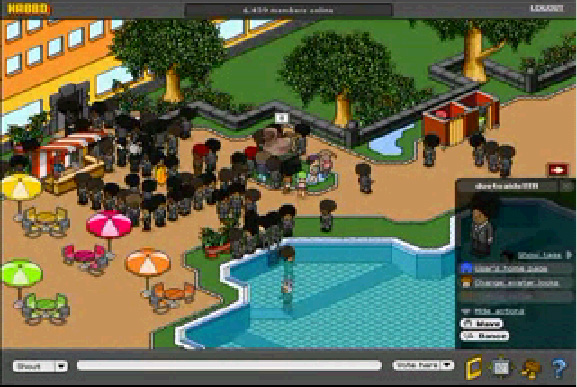
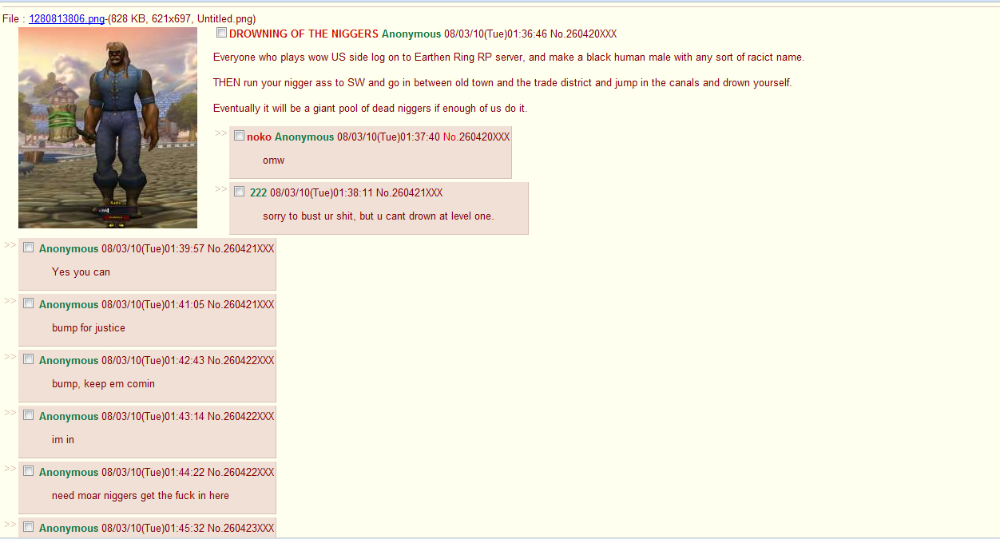
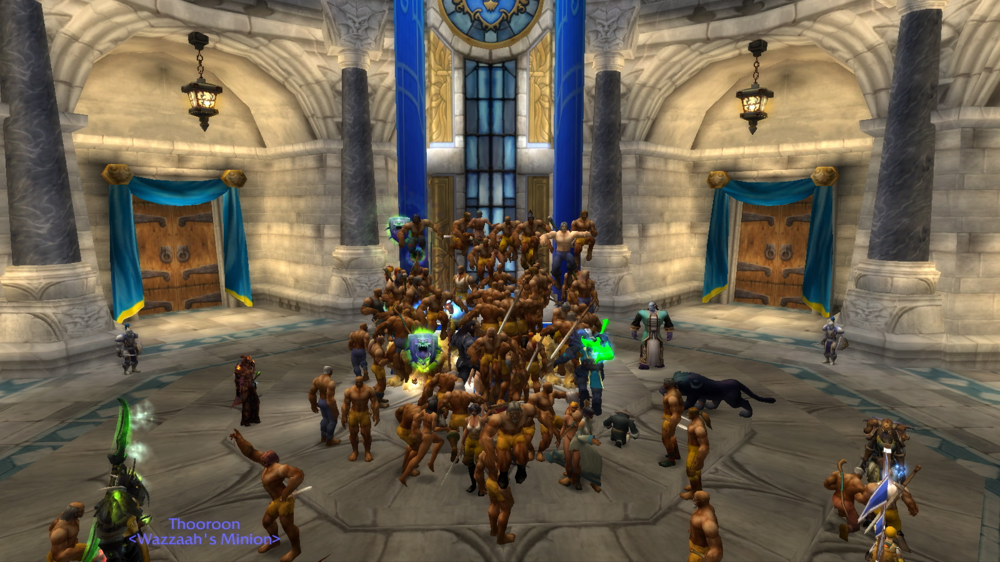
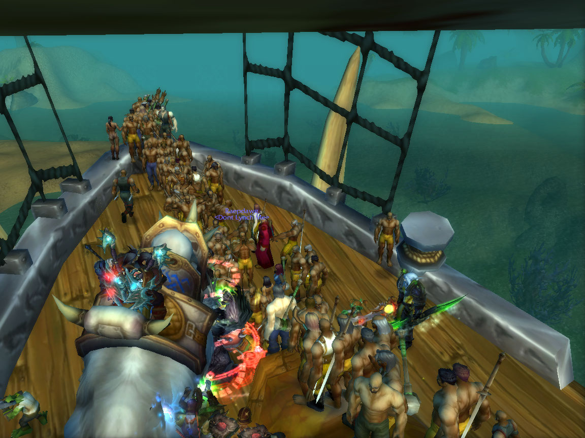
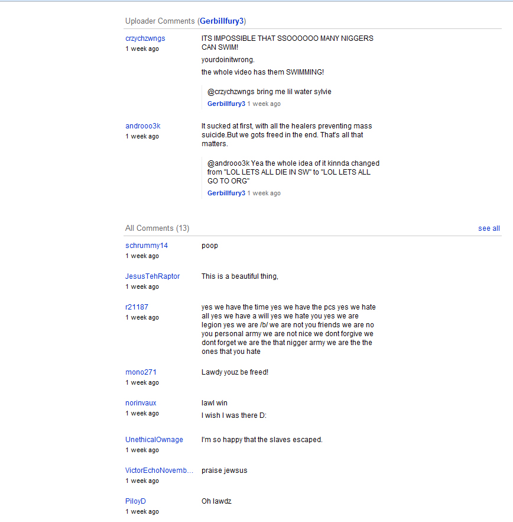
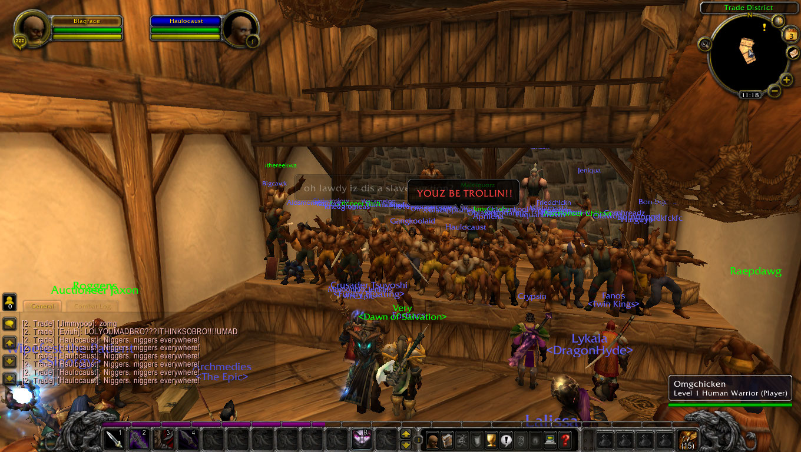

---

> I hate racists (even if I sometimes play one on the internet).
>
> Paulie Socash (Phillips, 2012) {#para1}

### Closing Pools, Posing Questions

I’d been a fringe observer of 4chan and /b/ for years, aware but ignorant of its pleasures and horrors. Then in a particularly aimless night of YouTube browsing, I watched something that plunged me into the /b/ abyss. It was a player made *World of Warcraft* (WOW) machinima video featuring a white human avatar dressed in plain clothes and a wide brimmed hat. This wasn’t remarkable, but what followed him—a group of dark skinned human avatars—was. Couched in a Benny Hill sensibility, the video featured a pack of ‘slaves’ who chased and were chased by the ‘slave master’ through the city of Stormwind to crowds of (one can assume) perplexed, entertained, and offended onlookers. {#para2}

The ‘slave chase video’ as I refer to it (it’s long since removed and I didn’t get a chance to archive it) was a troll. Trolling tends to be thought of as rhetorically baiting others usually into frustration and anger. Although it has become an increasingly hot topic of debate in light of ‘RIP trolling’ on Facebook and the exposé on the troll Redditor ‘Violentacrez,’ trolling has long been a fixture of internet discourse (Chen, 2012; Lynch, 2012; Phillips, 2011). Irony—the backbone of trolling—has been used for rhetorical effect for centuries, but trolling as we currently understand it is most often traced to Usenet groups in the early 1990s. Whitney Phillips describes this 90s era trolling as ‘disrupt[ing] a conversation or entire community by posting incendiary statements or stupid questions onto a discussion board’ (2012: para. 3). Judith S. Donath documented this era of trolling, exploring it through the lens of identity performance (1999). This work expanded an existing concern over inauthentic, and potentially malicious identity performance (especially gender performance) common among early internet scholarship (O’Brien, 1999; Rheingold, 2000; Turkle, 1997). During this era, it was less that the troll identified himself/herself as a troll, and more that he/she was accused of ‘trolling.’ It’s a subtle but important difference that speaks to the formalisation and pride attendant to modern trolling. According to Phillips, modern trolling is a ‘game … that’s steeped in a distinctive shared language, subcultural trolling is predicated on the amassment of lulz, an aggressive form of laughter derived from eliciting strong emotional reactions from the chosen target(s)’ (2012: para. 4). As time has passed, some trolls who take the discourse seriously view trolling as well practiced performance art. {#para3}

Representative of this evolution, the slave chase video is part of a larger troll/meme genre referred to as ‘invasions’ or ‘raids.’ The incarnation studied here began with invasions of *Habbo Hotel*. Created by a Finnish developer the Sulake Corporation, *Habbo Hotel* is a free avatar-based online virtual community driven by teen users, and focused primarily on socialising. It continues to be a popular destination today. While *Habbo* raids have been a favourite activity of trolls, July 12, 2006 was the date many identify as the greatest of all, and as with most memes each iteration has offered diminishing returns (‘The Great Habbo Raid of July 2006,’ n.d.). Responding to alleged banning of black avatars by *Habbo* moderators, users of the message board 4chan.org organized a massive disruption of the *Habbo* community. The users entered the world and selected characters with suits, dark skin, and afros, referred to themselves as ‘nigras,’ and stormed one of *Habbo*’s most popular social destinations, the pool. There the raiders shouted racial slurs, formed swastikas with their bodies, and blocked access to the pool and other popular spaces using *Habbo*’s collision detection to effectively trap other users (Figure 1). {#para4}

These raids, which took the motto ‘the pool’s closed!’ as their rallying cry, initiated the template from which subsequent raids iterate. Beyond the dubious earnestness and effectiveness of the protests, they certainly initiated a fascination with distributed political action that continues today in the far more powerful attacks by the hacker collective Anonymous, and which were riffed on by the WOW slave chase raid and its ilk. Surprisingly, Chris Poole, better known as moot, the founder and clown prince of 4chan, has spoken out against raids. During a question and answer session at 2007’s Otakon, Poole referred to an afro clad audience member’s request for a board dedicated solely to ‘invasions’ as ‘the cancer that is killing /b/ [that is, a sector of 4chan]’ (LordGrimmie, 2007). Poole implied that activism, and efforts to spread 4chan’s influence beyond its boundaries, were ruining the lulz of the insular and anonymous community. Invasions were letting the secret out, and boring holes into the safe space of 4chan. The crowd applauded. {#para5}

As evidenced by their targets (Habbo Hotel and WOW), the pool’s closed style raids of interest here could be seen as peaking in the late 2000s. They continue today, however, and demonstrate how trolling more generally oscillates between harassment, lulz, and protest/intervention, creating controversy not just between troll and trolled, but between trolls. I would go as far as to say that all trolling has a version of politics; even those trolls who claim to do it just for fun have a stake in protecting that fun. It’s what’s behind the fun, or what’s truly at stake, that’s of more interest. {#para6}

The natural inclination is to laugh or cringe at raids chalking them up to lulz, racism, or some mixture of the two. But having played WOW since launch, and researched racial representation in videogames, I found the slave chase video extraordinary because it produced unintended but nonetheless provocative stray signifiers; it made the racial subtext of WOW explicit. If it’s possible—I understand that for some it might be impossible—to look beyond the racist discourse embedded within this performance, the raids, particularly the WOW raids, remind us of the importance of blackness and race more generally to these spaces. By analyzing the raids we can understand the cultural politics of trolling and its post-politics, or the way some trolls discursively cloak discriminatory and/or hateful business as usual within anonymity; we can also explore the possibilities opened up by strategic use of irony and performance to think through, expose, and confront issues of race. I’d like to investigate these two poles of trolling—post-political discursive practice and socio-political critique—by looking more closely at raids that deploy blackness in virtual worlds. {#para7}

### 4chan and Discursive Barriers

While 4chan became synonymous with troll culture and the raid or invasion style troll, it had simple beginnings as an image sharing message board created by Poole in 2003. /b/, a sub-board of 4chan dedicated to ‘random’ content, is the most notoriously generative and offensive board, and the community that has iterated and refined the fine art of the troll including the raids and invasions. Once considered an underground phenomenon, 4chan has grown to 22 million monthly visitors and has become a significant influence on internet trends (xoxofest, 2012). I defer to the following description of 4chan from Julian Dibbell: {#para8}

> Filled with hundreds of thousands of brief, anonymous messages and crude graphics uploaded by the site’s mostly male, mostly twenty something users, 4chan is a fountainhead of twisted, scatological, absurd, and sometimes brilliant low-brow humor. It was the source of the lolcat craze (affixing captions like ‘I Can Has Cheezburger?’ to photos of felines), the rickrolling phenomenon (tricking people into clicking on links to Rick Astley’s ghastly ‘Never Gonna Give You Up’ music video), and other classic time-wasting Internet memes. In short, while there are many online places where you can educate yourself, seek the truth, and contemplate the world’s injustices and strive to right them, 4chan is not one of them. (2009: para. 1) {#para9}

As Dibbell notes, 4chan is anonymous and quite famously so. Users can identify themselves within a post using something called a ‘tripcode’ but this is rare and usually done to momentarily verify one’s identity. The vast majority of users are completely anonymous (hence the name ‘anon’ for a user), and most posts disappear in a matter of seconds or minutes. Nothing is archived server side. This anonymity is something Poole staunchly defends, and has been more vocal about in light of recent controversies over privacy and identity spawned by Facebook and Google (Fowler, 2011). According to Poole, ‘Anonymity and ephemerality are the two things that kinda define 4chan’ (xoxofest, 2012) and by allowing users an anonymous bastion on the internet people can ‘reinvent’ themselves, collaborate, and achieve a kind of ‘authenticity’ difficult to find in other communities (Halliday, 2011: para. 6). Since ‘the cost of failure is really high when you’re contributing as yourself’ in less anonymous places both on and off the internet, Poole has re-framed 4chan as a productive and collaborative avant garde community (Halliday, 2011: para. 7). It’s hard to arguewith. Many of the most beloved fixtures of internet culture trace their origins to /b/, and more recent factories like 9GAG and Reddit each bear significant influences. {#para10}

So does this mean the popular association of 4chan with depraved hideousness is a mischaracterisation or misunderstanding? Not exactly. It’s impossible even for Poole to deny that at any given time the boards, especially /b/, are full of offensive imagery and language that would make most cringe. In Poole’s view the ‘notorious reputation’ of 4chan is a means to end and not an end in itself. He frames 4chan’s offensiveness as a strategic effort—a coordinated and improvisational meta-troll—by anons to police their borders. It’s a kind of discursive security system meant to repel those who don’t fit the 4chan mold. As Poole puts it ‘you have to be cut of a certain gib’, and if you find yourself offended or disgusted by 4chan, chances are anons ‘don’t want you using it’ (xoxofest, 2012). {#para11}

This kind of discursive policing is nothing new. Anyone who has had inside jokes, or been involved in or excluded from a clique knows the subtle and not so subtle language of exclusion and ostracization. But while it might be tempting to downplay 4chan’s discursive practices as simply an extension of these more local and relatively less harmless examples, the board’s use of racism, sexism, and homophobia affiliate it more with a different scale of discursive practice that’s institutionalized, traumatic, and powerful. 4chan’s use of culturally offensive language and imagery as a kind of enculturation apparatus rings true of a dominant ideology that’s been a fixture of internet discourse since its inception, but also larger socio-political apparatuses like Jim Crow. Using sensitive cultural terms to establish the boundaries and norms of internet communities is nothing new, but with 4chan and similar communities where trolling is a favoured mode of expression it’s less an implication and more an explicit hail (e.g. ‘Tits or GTFO’). {#para12}

### Keeping the Internet ‘Free’

This is why I’d like to propose that the targeting of race, gender, and sexuality by trolls is not only for the lulz or because of it’s controversy; rather, anons who engage in racist, sexist, and homophobic trolling are also representative of a larger effort to preserve the internet as a space free of politics and thus free of challenge to white masculine heterosexual hegemony. When internet spaces formerly coded ‘white, ‘straight,’ or ‘masculine’ get challenged by diversity, there’s often an anxious and sometimes hateful prodding of sensitivities—and the viewpoints and people they represent—most acutely felt by women, people of colour, and queers. Anita Sarkeesian, a critic who produces a video blog series on feminism and media called *Feminist Frequency*, was the target of a massive trolling campaign after she posted a Kickstarter for a video series on sexist tropes in videogames (Lewis, 2012). In her talk at TEDxWomen 2012, she offered a counterpoint to Poole’s sanitized view of racist, sexist, and homophobic discourse. She views the offensive language and imagery as the product of a ‘boys club’ that ’[creates] an environment too toxic and hostile to endure’ (TEDxTalks, 2012). In her experience, the exclusionary discursive practices of 4chan were not limited to 4chan. She was not just being kept out of a message board or a chat room, but out of videogame culture completely. Although not connected with the trolling campaign against Sarkeesian, self-identified troll Paulie Socash provides insight into how trolls defend their behaviour: {#para13}

> People who are overly earnest and serious online deserve and need a corrective. I started [trolling] because there was no way to have rational conversations with some people and because I like to debate things. But there’s also a time to just say, You are an idiot, which is the most basic, entry level of trolling and most honest people will admit they have done it. (Phillips, 2012) {#para14}

As Sarkeesian’s case illustrates, ‘overly serious’ is often code for ‘politically correct’ which in turn is code for anti-sexist, anti-homophobic, anti-racist. {#para15}

Are raids then part of this assault on progressive politics and equitable representation? On the surface, they seem to fall right in line with the harassment Sarkeesian and others have experienced. Raids draw from a well of offensive and politically charged racial history, imagery, and language meant to engage sensitivities and offend. But how then do we reconcile the initial stated intentions of the *Habbo* raids: assaulting racially/ethnically discriminatory moderation practices? This complex and contradictory politics that undermines its own intentions can perhaps best be clarified via a brief overview of Anonymous, the hacker group that first gestated on 4chan and has since become one of the most recognized hacktivist organizations (Crenshaw, n.d.). {#para16}

Though Anonymous maintains much of the ironic humor and playful essence of troll culture as well as many of the tactics, they have strategically jettisoned most of the politically charged speech we associate with 4chan lingo. Their decentralized activist campaigns against a litany of enemies from Visa and MasterCard to the Church of Scientology to PayPal to the Westboro Baptist Church have been drawing headlines and have many reconsidering what activism looks like in the 21st century. Both Dibbell and E. Gabriella Coleman have highlighted Anonymous’s chaotic and yet powerful political interventions and tactics which have mobilized thousands, raised significant awareness, and taken down some of the most trafficked websites in the world (Dibbell, 2009; Coleman, 2011; Coleman 2012). Even though they’ve had success, the organization has ‘no leaders, no hierarchical structure, nor any geographical epicenter’ and therefore it’s been difficult to pin down a consistent ideology guiding Anonymous (Coleman, 2011). Coleman sees Anonymous as indebted to but moving beyond troll culture, becoming ‘a political gateway for geeks (and others) to take action’ and this action seems to cohere around the issue of ‘internet freedom’ (Coleman, 2011). Coleman’s ideological distillation here offers a useful reconciliation of all types of trolling. Raids, the mysogynistic campaign against Sarkeesian, and Anonymous each are distinctive kinds of trolling, yet they are all united by the common desire for freedom whether from diversity, political correctness, or censorship. By operating under the banner of freedom, raids can both argue for equal representation of people in Habbo while also deploying stereotypes that actively denigrate the people they’re fighting for. {#para17}

For a time, videogames—the battleground for both Sarkeesian and raids—offered an ideal solution to these contradictions. Game worlds were advertised and understood as boundless power fantasies—toys basically—with negligible social impact or cultural importance. This, as Nick Dyer-Witheford and George de Peuter point out, is false and is increasingly recognized as such: {#para18}

> games, once suspect as delinquent time wasters are increasingly perceived by corporate managers and state administrators as formal and informal means of training populations in the practices of digital work and governability…A media that once seemed all fun is increasingly revealing itself as a school for labor, an instrument for rulership, and a laboratory for the fantasies of advanced techno-capital… (2009, xix) {#para19}

Yet many people still seem ignorant of or incredulously deny the cultural and political significance of videogames. Commenters on videogame sites offer a particularly severe example, and one relevant to discussions of trolling given the likely overlap between trolls of games blogs and trolls of gamespace more generally. The privileged, deflective, and derisive rhetoric of internet commenters has become so common in fact that many critics have codified it (dbzer0, 2011; O’Malley, 2012; Scalzi, 2012). By diminishing social justice oriented perspectives wherever and whenever they arise—from Kotaku or Second Life—games are preserved as places of escape safe from messy political squabbles that make the game world and real world less fun. It’s a mutation of the peace loving and techno-utopian conceptualization of the internet and cyberspace forged by Stewart Brand and other early counter-cultural and anti-establishment internet pioneers who viewed cyberspace as a frontier of democratic community that could eclipse or transcend political divisions (Turner, 2008). As key sites of political fantasy and struggle, cyberspace and now gamespace nurture, as Vincent Mosco explains, the ‘central myths of our time…the end of history, the end of geography, and the end of politics’ (2005: 13). The unifying thread behind all three dominant myths is an illusory freedom whether it be from past violence, market borders, or cultural politics. Not coincidentally, all of these freedoms are especially desirable for free market loving white men of able means looking to escape responsibility for persistent, institutionalized oppression. {#para20}

### Trolls and Race

The desire for freedom results in an ideological split among anons; this split forms the contradictory foundation of raids making them so hard to parse. On one hand, there are the post-racial anons who espouse a depoliticized view of the net and consider race a funny antiquity. On the other hand, there are anons who believe race is real, but, due to the anonymity of the internet, anxiously struggle with the lack of reliable markers visual and performative difference at the interface. Consequently this anxiety compels many anons to rehearse the fixity of real world racial division. With these two perspectives intermingled in one thread on /b/ or a raid of Habbo, the line between ironic parody of traditional racist language and actual indulgence is blurred. Offensive and derogatory discourse is so frequent and wide-ranging that one either leaves offended or gives into an ironic detachment that sees race, gender, and sexuality as comedic fodder. Even so, while the anons that participate in raids like the slave chase probably represent a mixture of both the ironic racist and traditional racist viewpoints, it’s safe to say the majority would identify with the former. {#para21}

Lisa Nakamura sees little difference between the two. From her perspective, ironic racism, specifically the repeated use of ‘nigger,’ is ‘enlightened racism’ (BerkmanCenter, 2010). Drawing on Susan Douglas’s concept of ‘enlightened sexism’ wherein sexism is perceived as funny and acceptable by the ‘enlightened’ because sexism has been solved, racist terms like nigger can be used by those ‘who are known, or assumed known, not to be racist’ (quoted in Daniels, 2010: para. 5). From this perspective ‘The n-word is funny because it is so extreme that no one could really mean it. And humor is all about ‘not meaning it.’ If you take humor and the n-word, you get enlightened racism online’ (quoted in Daniels, 2010: para. 5). Enlightened racism is the comedic cousin of the ‘I am not racist, but…’ disposition of post-racial society, a rationalization of racist discourse presuming erroneously that racism is over and that because of this, and the speaker’s progressiveness, that he/she is not racist. In fact as the following Encyclopedia Dramatica entry for ‘Nigra’ illustrates, the only problem from the perspective of the enlightened is people who continue to identify racism: {#para22}

> the Internets is largely Anonymous and because the term was invented by a /b/tard (a cyber being of indeterminate and irrelevant sex/age/heritage) in the virtual, ‘colourblind’ environment of Habbo Hotel as a way to say ‘nigga’ without alerting their dirty word Department of Habboland Security feds, any suggestion that the word ‘nigra’ is racist is not only completely without merit, it’s racist against the inhabitants of Internets. (‘Nigra,’ n.d.) {#para23}

Potential racism is peculiarly and illogically disproved in the case of ‘nigra’ because the word was not intentionally meant to be racist (as if racism only exists when intended) and was created by someone of indeterminate and irrelevant race (as if racism is the exclusive domain of specific races). Moreover, in a common tactic of colorblind deflection, any contrary claims are themselves racist because racism is conflated with seeing race. {#para24}

While I agree with Nakamura’s diagnosis, and her reframing of ironic racism as regression masquerading as progression, there remains something about raids in particular that exceeds this categorization even if it is unintentional. While raids operate under the guise of a post-racial and enlightened Internet where racism is the exclusive domain of super villain racists like the KKK, they betray this ideology through a compulsive reintroduction of blackness into pervasively white spaces. Consider this provocation: if race doesn’t matter to anons then why choose black avatars? In a post-racial world, the enlightened deployment of blackness in the form of nigra would be funny, but it would not be a satisfying troll. Clearly anons, at some level, understand the continued importance of race on and offline and deploy it for its arresting power as a signifier both in virtual and physical space. And it’s this power that I first recognised in the slave chase video. Although /b/ might deploy race as an absurdity, they end up making an argument for its centrality to online interaction and games. {#para25}

### /b/lack up

I made these observations, and came to these conclusions in 2010 while observing /b/ silently or ‘lurking.’ For months, I sat idly at the edge of the board’s depths, hoping to catch the shimmer of a thread announcing another invasion like the one I had witnessed in the slave chase video. I saw the birth, death, resurrection of and nostalgia for memes. I underwent the familiar life cycle of a ‘/b/tard’—initial disgust seeding lingering curiosity enabled by moral numbness giving way to obsessive monitoring of favoured threads/memes, ending in an aged distance and disinterested pining for halcyon days. {#para26}

Finally in August 2010—having all but given up on witnessing an actual raid—I opened a window to /b/, hit F5 to refresh the list of threads, and my luck turned. I caught the tail end of the largest raid of WOW I had seen in my research. My mouse wheel spun as the mountain of replies to the original call for participants (commonly referred to as ‘/b/lackup’) blurred by. Most of the thread was mundane: questions about where to go, proud declarations of name selection, and exclamations of joy at finding the raid. At the end of the thread, there was much celebration over a job well done. By some counts nearly two hundred brown skinned anon avatars gathered in the city of Stormwind, and ran in a crazed mass through the world annoying and entertaining onlookers. {#para27}

The raid was much like the other raids I had previously archived and studied through video clips and screenshots: a spontaneous call to arms on /b/, a prompt assembling of brown skinned and inappropriately named level one humans in the Alliance capital city of Stormwind (Figure 3). As was the case with this raid, there’s almost always a parade through the city with stops in areas of high player density such as the bank or auction house. Racist slurs are shouted. The mass of nigras embark on a cross-continental journey involving a boat ride which doubles as a slave ship (Figure 4). The raid usually ends with mass deaths at the hands of monsters, other players, or simple negligence. But sometimes the lulz just run out, or, as in the case of the raid I witnessed, accounts get banned by customer service representatives. {#para28}

A mere week after the August 3, 2010 raid it was almost completely forgotten. There was a YouTube video with just under four hundred views and thirteen comments, but it is now removed (Figure 5). Little mention was made of the raid the following day. Its existence was limited to its happening. But this doesn’t mean it was without impact. It is exactly this ephemeral, temporal experience that makes these raids compelling. They transform space, troll, and, most importantly, challenge and reveal the racial boundaries of the community. {#para29}

The raid I documented, more akin to the slave chase video than the pool’s close Habbo raid, was far more interested in deploying race primarily as an easy trolling mechanism than trying to make a political statement. But despite their best efforts to be annoying and offensive, anons open up the possibility for critical reflection on racial representation. In each raid, the dominant whiteness of Habbo or WOW is exposed and confronted via a sudden invasion of non-white avatars. The raids create semiotic maelstroms full of offensive and provocative imagery that ignite reflection on the norms of appropriate or inappropriate imagery and/or expression in gamespace. {#para30}

### Tactical Performance, or, Don’t Feed the Trolls, Learn from Them

From a certain perspective these raids are imperfect but nonetheless intriguing performances that issue a critique of character creation. They do so by exposing, through the mass replication of bodies, the limited set of programmed options with which someone can manufacture an avatar other users identify as black. The mass of bodies recolours and re-contextualizes the space. It facilitates recognition of WOW’s pervasive whiteness, or the racial and ethnic histories that motivate much of the game’s character design and story (Douglas, 2010; Higgin, 2009; Langer, 2008). The repetition of ‘black’ bodies, and their relative sameness, also reflects back on the game itself. Character creation, adhering to myths of freedom and consumer choice in game design, presents users with a customizable avatar but always with a set of programmed options ranging from a selection of pre-built avatars to detailed systems where everything from skin colour and age to chin size can be manipulated (Douglas, 2010). We cannot ignore that these systems are made; each coded system carries its own biases and logics, and the baggage of the cultural circumstances from which those logics stem (Chun, 2008; McPherson, Stone, 1991). Thus there are errant, historical meanings in these performances. For players more familiar with the world’s lore and its story of racial conflict and imperial conquest, the slave auction also makes explicit the subdued historical referents—the Atlantic slave trade, the Great Chain of Being, scientific racism, genocide, etc.—that form the foundations for the game world’s allusions and metaphors. Sure /b/lackup raids troll, and they have a muddled, flawed, dangerous, and damaging post-racial politics that finds racism humorous, but they are also surprisingly similar to net art like [Joseph DeLappe’s oft referenced *dead-in-iraq* piece](https://www.delappe.net/project/dead-in-iraq/). The raids infiltrate space, transform it, and challenge the audience to look awry at something so familiar. {#para31}

Take, for example, the slave auction trope common to these raids and present in the raid I documented. In WOW, as in most MMORPGs, there’s an auction house where players can buy and sell goods by clicking on an NPC and browsing what others players have put up for auction or by putting their own items up for sale. It’s usually one of the more populated areas of a major city with ten to twenty other players nearby. The popularity of the space makes it a favoured target of the /b/ raids. During a raid, the number of people can easily quadruple when counting the performers and their unwitting audience members. The raiding party fills up the front of the auction house where the auctioneers stand, and turn to face the other players shouting ‘PICK ME,’ or ‘I’s a good nigra massa! I reeeeeeeeeeeeeeeeeeeeal good at pickin’ me some cotton!’. Sometimes anons will stand in the crowd playing the part of an auctioneer or slave owner. {#para32}

In the image above, you can see the striking reconfiguration of bodies in space created by this performance (Figure 6). The non-participating players in the foreground are recontextualized as slave auction customers, their whiteness resignified, and the mass of brown skinned humans bringing the exclusions of the medieval setting to the surface. Skin colour is crucial to this performance; brown skin is an aberration within WOW (and when deployed is often done through a lens of stereotype), and thus inherently interesting to passersby (Higgin, 2009: 5–7). A mass of white skinned humans, while worth a glance, would not be as powerful. White human avatars, as evident even in this image, are often seen throughout the city and surrounding areas as players congregate for guild events, general socialization or organization, or for key events like the seasonal holiday quests. Anons deploy brown skin for its attention seizing power due to its relative absence within the game world and its political baggage. They also use tactics tuned to each space. From the virtual sit-in of a Habbo pool’s closed raid to the less focused and playful spontaneity of the WOW /b/lackup raids, these differences illustrate some key variables and how games each offer their own contexts in which to work. Habbo’s restrictive collision detection and pathing, as well as its limited scope, became assets and integrated into the tactics of the raid. WOW’s sprawling nature and more free form spatial navigation necessitates more mobile activities that travel through space forming crowds. The transitory nature of these WOW raids thus open up the possibility for rare virtuosic moments of engagement and reflection. If nothing else, they make players conscious of the multi-layered mediation of race in gamespace from code to discourse. {#para33}

Raids provide a corrupt but structurally sound template for progressive activism aimed at exposing the racialized power structures of game content, the industry, and fan communities. By opening up a critical space that reflects on the culture of games and game technologies, which is to say ‘at the level of technological apparatus and at the level of content and representation,’ raids can be interpreted as tactical media that, in some bizarre way, manages to issue a productive gesture. The raids also demonstrate a light and agile performance based counter-discourse free of the technical barriers inherent to modding and coding (both of which run the risk of reproducing logics of protocol and control (Raley, 2009: 16; Galloway, 2006)). Just as Rita Raley argues good tactical media should ‘not simply be about re-appropriating the instrument but also about reengineering the semiotic systems’ the raids deploy the familiar signifiers of WOW but transform the signified (2009: 16). While fatally relying on minstrelsy, raids show us the possibility for playful critical activities that engage productively with constructions of race in videogames within the games themselves. They go beyond the tried and true method of cataloging stereotypical representations by recontextualizing the larger techno-social systems of meaning making in games through those very representations, ultimately exposing the cultural logics of videogame technologies (Higgin, 2011). Perhaps most importantly, they show us it might be time to stop feeding the trolls and start learning a few tricks from them. {#para34}

### Biographical note

**Tanner Higgin** (Ph.D. University of California, Riverside) is an Independent Scholar. His work focuses on race, gender, sexuality, and power in digital media. He has published an article in Games and Culture and the edited collections The Meaning and Culture of Grand Theft Auto and Joystick Soldiers as well as on the websites Kotaku and Unwinnable. For more visit: https://www.tannerhiggin.com

### References

- Chen, Adrian. ‘Unmasking Reddit’s Violentacrez, The Biggest Troll on the Web,’ *Gawker*, 12 October (2012), https://gawker.com/5950981/unmasking-reddits-violentacrez-the-biggest-troll-on-the-web

- Chun, Wendy Hui Kyong. ‘On ‘Sourcery,’ or Code as Fetish,’ *Configurations* 16.3 (2008): 299–324.

- Coleman, E. Gabriella. ‘Anonymous: From Lulz to Collective Action,’ *The New Everyday*, 6 April (2011), https://mediacommons.futureofthebook.org/tne/pieces/anonymous-lulz-collective-action

- ———. ‘Phreaks, Hackers, and Trolls: The Politics of Transgression and Spectacle,’ in Michael Mandiberg (ed.) *Social Media Reader* (New York, NY: NYU Press, 2012), 99–119.

- Crenshaw, Adrian. ‘Crude, Inconsistent Threat: Understanding Anonymous,’ *Irongeek.com* (n.d.), https://www.irongeek.com/i.php?page=security/understanding-anonymous

- Daniels, Jessie. ‘Enlightened Racism in MMORPG’s,’ Racism Review, 19 June (2010), https://www.racismreview.com/blog/2010/06/19/enlightened-racism-mmorpg/

- dbzer0. ‘Let’s Play /r/gaming Redditor Bingo!’, Reddit , 7 December (2011), https://www.reddit.com/r/ShitRedditSays/comments/n3ycn/lets_play_rgaming_redditor_bingo/

- Dibbell, Julian. ‘The Assclown Offensive: How to Enrage the Church of Scientology,’ Wired, 21 September (2009), https://www.wired.com/culture/culturereviews/magazine/17–10/mf_chanology?currentPage=all

- Donath, Judith S. ‘Identity and Deception in the Virtual Community,’ in Peter Kollock and Marc Smith (eds.) Communities in Cyberspace (New York, NY: Routledge, 1999), 27–58.

- Douglas, Christopher. ‘Multiculturalism in World of Warcraft,’ Electronic Book Review, 4 June (2010), https://www.electronicbookreview.com/thread/firstperson/intrinsically

- Dyer-Witheford, Nick, and Greig de Peuter. Games of Empire: Global Capitalism and Video Games. (Minneapolis, MN: University Of Minnesota Press, 2009).

- Fowler, Geoffrey A. ‘4Chan’s Chris Poole Says Facebook and Google Get Identity Wrong,’ Wallstreet Journal: Digits, 7 October (2011), https://blogs.wsj.com/digits/2011/10/17/4chan%E2%80%99s-chris-poole-says-facebook-and-google-get-identity-wrong/

- Galloway, Alexander R. Gaming: Essays on Algorithmic Culture. (Minneapolis, MN: University of Minnesota Press, 2006).

- Halliday, Josh. ‘SXSW 2011: 4Chan Founder Christopher Poole on Anonymity and Creativity.’ The Guardian, 13 March (2011), https://www.guardian.co.uk/technology/2011/mar/13/christopher-poole–4chan-sxsw-keynote-speech

- Higgin, Tanner. ‘Blackless Fantasy: The Disappearance of Race in Massively Multiplayer Online Role-Playing Games,’ Games and Culture 4.1 (2009): 3–26.

- ——— . ‘The Trap of Representation.’ Gaming the System, 23 May (2011), https://www.tannerhiggin.com/the-trap-of-representation/

- Langer, Jessica. ‘Playing (Post)Colonialism in World of Warcraft,’ in Hilde G. Corneliussen and Jill Walker Rettberg (eds.) Digital Culture, Play, and Identity (Cambridge, Mass.: MIT Press, 2008), 87–108.

- Lewis, Helen. ‘This Is What Online Harassment Looks Like.’ The New Statesman, 6 July (2012), https://www.newstatesman.com/blogs/internet/2012/07/what-online-harassment-looks

- LordGrimmie. ‘Moot on Invasions.’ YouTube, 19 August (2007), https://www.youtube.com/watch?v=QgOwfXW2eao

- Mosco, Vincent. The Digital Sublime: Myth, Power, and Cyberspace. (Cambridge, Mass.: MIT Press, 2008).

- O’Brien, Jodi. Writing in the Body: Gender (Re)production in Online Interaction,’ in Peter Kollock and Marc Smith (eds.) Communities in Cyberspace (New York, NY: Routledge, 1999), 75–106.

- O’Malley, Harris. ‘Nerds and Male Privilege Part 2: Deconstructing the Arguments.’ Kotaku, 6 January (2012), https://kotaku.com/5873885/nerds-and-male-privilege-part–2-deconstructing-the-arguments

- Lisa Nakamura: Don’t Hate the Player, Hate the Game, (2010), https://www.youtube.com/watch?v=P5AaXuzaPtk&feature=youtube_gdata_player

- ‘Nigra,’ Encyclopedia Dramatica, https://encyclopediadramatica.se/Nigra

- Phillips, Whitney. ‘Interview with a Troll’, a Sandwich, with Words???, 28 May (2012), https://billions-and-billions.com/2012/05/28/interview-with-a-troll/

- ——— . ‘LOLing at Tragedy: Facebook Trolls, Memorial Pages and Resistance to Grief Online.’ First Monday 16.12 (2011), https://firstmonday.org/htbin/cgiwrap/bin/ojs/index.php/fm/article/view/3168/3115

- ——— . ‘What an Academic Who Wrote Her Dissertation on Trolls Thinks of Violentacrez.’ The Atlantic, 15 October (2012), https://www.theatlantic.com/technology/archive/2012/10/what-an-academic-who-wrote-her-dissertation-on-trolls-thinks-of-violentacrez/263631/

- Raley, Rita. Tactical Media (Minneapolis, MN: University of Minnesota Press, 2009).

- Rheingold, Howard. The Virtual Community: Homesteading on the Electronic Frontier. (Cambridge, Mass.: MIT Press, 2000).

- Anita Sarkeesian at TEDxWomen 2012, (2012), https://www.youtube.com/watch?v=GZAxwsg9J9Q&feature=youtube_gdata_player

- Chris Poole, Canvas/4chan – XOXO Festival (2012), (2012), https://www.youtube.com/watch?v=BxRNRi7bOSI&feature=youtube_gdata_player

- Scalzi, John. ‘Straight White Male Is The Lowest Difficulty Setting There Is: A Follow-Up.’ Kotaku, 21 May (2012), https://kotaku.com/5911853/straight-white-male-is-the-lowest-difficulty-setting-there-is-a-follow+up

- Stone, Allucquère Rosanne. ‘Will the Real Body Please Stand Up?’, in Michael Benedikt (ed.) Cyberspace: First Steps (Cambridge, Mass.: MIT Press, 1991), 81–118.

- ‘The Great Habbo Raid of July 2006,’ Encyclopedia Dramatica., https://encyclopediadramatica.se/The_Great_Habbo_Raid_of_July_2006

- Turkle, Sherry. Life on Screen: Identity in the Age of the Internet. (New York, NY: Simon & Schuster, 1997).

- Turner, Fred. From Counterculture to Cyberculture: Stewart Brand, the Whole Earth Network, and the Rise of Digital Utopianism. (Chicago, IL: University of Chicago Press, 2008).
