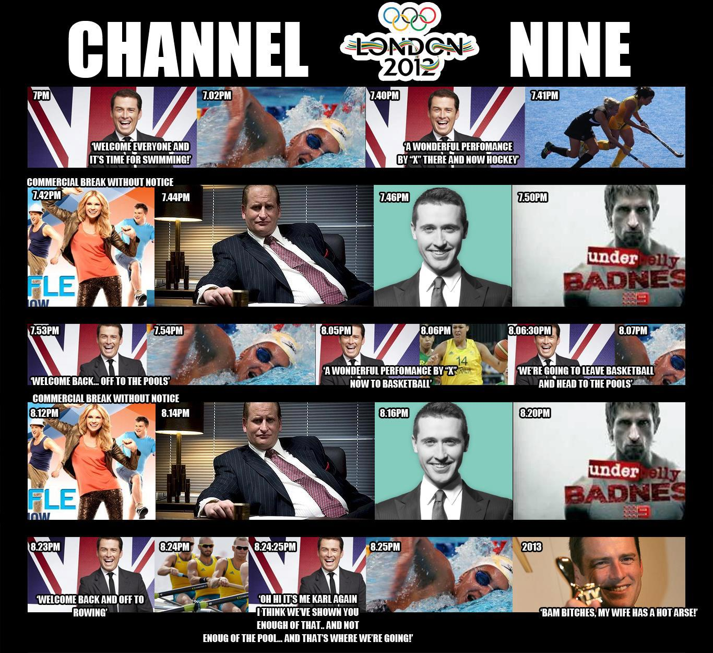

---

### Introduction

During 2012, the Australian and international press frequently deployed the accusation of ‘trolling’ as part of a wider moral panic about supposedly anonymous online abuse facilitated by social media. The term trolling has been applied to a range of activities, many of which are simultaneously labelled abuse, (cyber)bullying and general mischief. Despite clear early work on trolls in Usenet discussion groups (Donath, 1999), there is surprisingly little detailed research on trolling, and what exists is largely focused on the provocative and ephemeral internet image board 4chan, and the related Anonymous movement (Phillips, 2011b; 2012a). As 4chan has been a hotbed for the creation of online memes—jokes and images, often combining text and visuals, following a particular style or grammar, which are rapidly spread across the internet—memes and trolling have often been tied together.

However, this paper focuses on a more banal example of memes as deployed by a Facebook group dubbed ‘Ch9Fail’ which gathered commentators angry with the coverage of the 2012 London Olympic Games by the Australian free-to-air broadcaster, Channel Nine. This article seeks to examine whether a protest group using memes is necessarily engaging in acts of trolling. To situate this examination, I will begin with a brief overview of existing research on trolling, reviewing the way trolls and memes have been tied together, along with the importance of context, especially the role of anonymity. With that framework in mind, I will take a cursory look at how the accusation of trolling was used in Australian press in 2012. In doing so, inherent contradictions emerge, especially when the most prominent examples of people ostensibly on the receiving end of trolling turn out, themselves, to have been ‘trolls’ at some point (at least going on the broad implicit definition of trolling used in the press). Shifting contexts somewhat, the paper will look at the Olympic Games, especially the tensions that emerge when a global sporting event which is touted as the pinnacle of human goodwill and achievement is meticulously sliced into national broadcasting rights and sold to the highest bidder. The 2012 Olympics were notable, too, for the role of memes and social media commentary during the Games, with the most widespread examples being the hashtag #NBCFail and the ‘McKayla is Not Impressed’ meme. Finally, building on these overlapping contexts, I will examine the Ch9Fail group, which appears to deploy the techniques of trolling – memes and provocative images of celebrities to engage the media and provoke a response – but ends up having decidedly banal aims and outcomes. The conclusions reached will argue that more precise notions of trolls and trolling are desperately needed, and when looked at closely, online abuse on one hand, and the use of memes on the other hand, can both exist without any reference or relevance to trolling whatsoever. {#para1}

### Trolling: From Usenet to 4Chan

While trolling is widely associated with anonymity online both in the press and in scholarly work, this was not always the case. Early work focusing on Usenet discussion groups (Donath, 1999) and online discussion forums (for example Herring, Job-Sluder, Scheckler, and Barab, 2002), found that provocateurs in those groups tended to deploy persistent identities, albeit often pseudonyms (in online spaces where a username rarely resembled a full legal name), in an attempt to appear a legitimate and sincere member of the group in question. The key characteristic of trolling in these early studies was that the individual frequently tried to provoke arguments for the sake of argument, rather than having a consistent point or desiring anything other than the continuation of disagreement, often disrupting the regular discussion patterns of a group or community. Donath’s (1999: 45) work also points out that the presence or history of trolling in a group can cause a higher level of mistrust amongst group members, and lead to alienating interrogations of new group members who, for whatever reason, might be suspected of trolling. Trolling in discussion forums and online communities is often described as harmful to online communities and groups since they increase levels of distrust and distract from the purpose of the online community (Herring et al., 2002; Ortega, Troyano, Cruz, Vallejo, and Enríquez, 2012; Shachaf and Hara, 2010). {#para2}

The correlation of trolling and anonymity has emerged in the last decade, particularly due to the interest from the media, and scholars, in the participants in the 4chan imageboard – a discussion forum based around image sharing. Significantly, while it is possible to create a username, almost all posts on 4chan–and certainly on the infamous ‘/b/’ or random board–are anonymous, with no listed username, no persistent identities and thus a very different sense of community, if that is even an applicable term. As 4chan has no official archive, posts tend to remain on the boards only briefly, with even the most popular threads disappearing within hours. Whereas most ‘anonymous’ sites on the web are really deploying pseudonymity – handles but not real names – 4chan is anonymous in the truer sense of the word (Knuttila, 2011). As many web services, including prominent social networking service Facebook, mandate the use of real names on the web, anonymity has been increasingly pathologised. Reviewing a range of sources, Hardaker (2010: 224), for example, summarised this trend as arguing that ‘anonymity can also foster a sense of impunity, loss of self-awareness, and a likelihood of acting upon normally inhibited impulses, an effect known as deindividuation’. Since 4chan holds up anonymity as a core part of its identity, with 4chan founder Christopher Poole publicly championing the need for anonymous spaces online (Poole, 2010), trolling and anonymity have been frequently tied together. {#para3}

The other major reason 4chan is well known is for spawning the Anonymous movement, which initially drew media attention for physically protesting against the Church of Scientology in 2008, with members wearing the distinctive Guy Fawkes masks to hide their identities. These protests by Anonymous were seemingly the first materialisation of troll culture in the offline world. Since then Anonymous has been associated with protests and actions in support of Wikileaks and in assisting with protests in the Middle East. Of course, as Coleman (2011) notes, due to their mode of operation, there is no way of guaranteeing, or even knowing, if the same people are involved in all protests, or different people are involved in each protest or action. Nevertheless, even if the active protesters of Anonymous are not the same anonymous individuals on 4chan at that very moment, both groups revere their unidentified status and encourage the uncertainty it entails. {#para4}

While the protestors and activists of Anonymous may have more explicitly political aims, the vast majority of self-styled trolls on 4chan prefer to operate online only. 4chan participants often describe their rationale as being in it for the ‘lulz’ (Schwartz, 2008); lulz being a variation of the abbreviation for Laugh Out Loud (LOL), which has more ominous overtones that Phillips (2011a: 69) characterises as ‘a particular kind of aggressive, morally ambiguous laughter indicating the infliction of emotional distress’. Coleman (2012) argues that some trolls may be seen, and may wish to be seen, in light of tricksters of mythology, from Loki to the North American Coyote, whose bile and mischief nevertheless disrupts for a reason. Indeed, Whitney Phillips’s (2011a, 2011b) research into attacks on web memorial pages has, for example, identified a particular code of practice underlying this form of trolling. While media reports tend to emphasise the distress memorial page vandalism causes for the family of the deceased, Phillips (2011b) argues that the main targets are not legitimate mourners, but ‘grief tourists’ who did not know the victim but nevertheless profess their sense of loss online. Trolls are characterised as seeing, for example, the sentiment ‘I didn’t know you but I’m very sorry you’re dead’ as a ‘a flashing neon declaration of trollability’. Thus, while their methods are highly questionable, trolls may be attacking the inauthenticity and self-centred exhibitionism of grief tourists rather than actual relatives and mourners. Moreover, when mainstream media reports run stories decrying the actions of trolls, they both amplify the pleasures of trolling, vastly widening the awareness of the trolling, and thus encourage the very actions they ostensibly denounce. Indeed, Phillips (2011b, 2012a) argues that trolls and the media form a symbiotic circle, with trolls being encouraged and amplified by the coverage, and the resulting activities of trolls fuelling further sensationalist stories. For trolls, media attention paid to their activities simply makes the lulz louder and sweeter. {#para5}

One of the most recognisable stylistic elements of 4chan and trolling is the creation and perpetuation of internet memes of various forms, including image macros: the same or similar images with different text, following stylistic particular rules. Two of the longest running memes, LOLcats (cat pictures with specifically stylised text) and Rickrolling (fooling someone into clicking a link that unexpectedly takes them to Rick Astley’s 1980s hit ‘Never Gonna Give You Up’), originated with 4chan. Similar to the term viral media, memes are often described as ‘self-replicating’, occluding the human agency driving their distribution and widespread remixing (Jenkins, Ford, and Green, 2013: 18–21). However, at least in the context of 4chan, the agency behind memes tends to be more evident, akin to ‘microcosmic nests of evolving content’ (Phillips, 2012b). In the ephemeral imageboard structure of 4chan, it is not individual posts which persist, but rather shared styles, images and ideas; these will persist ‘if enough users engage a particular piece of content, either through reposting or remixing, it will enter the subculture lexicon. It will become, in other words, a meme’ (Phillips, 2012a: 9). By successfully deploying and remixing memes, trolls are able to assert their ‘cultural literacy and to bolster the scaffolding on which trolling as a whole is based’ even if, due to the anonymous nature of 4chan and trolling, no specific individual is identified in the process (Phillips, 2012b). Thus, along with anonymity and seeking lulz, memes are a core part of 4chan and trolling culture. However, while researchers have clearly identified specific attributes of trolling, the use of the term by the mainstream media is far from precise. {#para6}

### Trolling (in the) Australian Press

Trolling became a national issue in the Australian press after television personality Charlotte Dawson ended up in a psychiatric hospital battling depression apparently fuelled by abusive exchanges with twitter users (editor: see Whelan in this issue). While many commentators questioned Dawson’s decision to retweet abusive tweets, citing the mantra ‘don’t feed the trolls’, her tale was nevertheless leveraged in various ways (Moses and Hornery, 2012). One Australian newspaper attempted to utilise the media panic with a ‘Stop the Trolls’ campaign and online petition, but despite several front page stories the campaign failed to gain much traction (‘Twitter must be held accountable,’ 2012). Weeks later, after Dawson’s recovery and interviews about that recovery, she herself was accused of making abusive comments during a red carpet event and deleted her twitter account, protesting that there were, importantly, still lines she never crossed (Knox, 2012). {#para7}

Also in 2012, when Australian Rugby League star Robbie Farah received tweets from a pseudonymous account defiling the memory of his recently deceased mother, he told the press social media laws needed to be stronger to prosecute abusers (Jackson, Patty, and Gardiner, 2012). However, just days later, Farah had to apologise himself after a reporter found a past tweet from Farah suggesting Australia’s Prime Minster should be sent a noose for her fiftieth birthday (Paine and Farr, 2012). Indeed, following the implicit definition of trolling extrapolated from these examples–deliberate online provocation for the sake of getting any reaction at all–then, as Jason Wilson (2009) argues, a number of Australian newspaper columnists might be considered ‘trollumnists’ themselves, taking provocative rather than meaningful or consistent positions. With trolling basically meaning any online abuse, the line between those being trolled, and the trolls themselves, seems blurred at best. {#para8}

These 2012 examples are by no means the only times the term trolling has appeared in the Australian press. In 2010, for example, the term was used to describe people posting provocative posts and vandalism on memorial pages for deceased Australia teenagers (Dickinson, 2010; Moses, 2010). While the attacks on memorial pages may align with broader trolling aimed at supposedly inauthentic grief tourists as mentioned above, the wider use of ‘troll’ in the Australian media has diluted the term to such an extent that any online abuse or bullying seems to be trolling. Notably, when an episode of the SBS investigative discussion television series Insight tackled the question of trolling, the high-profile self-identified trolls who were interviewed distanced themselves from pointless online abuse, arguing that there was always an aim to trolling; trolling and bullying for the sake of bullying were described as quite different things (‘Trolls,’ 2012). However, the discussion never reached any depth, because representatives of the Australian press continued to argue that any online abuse was trolling, leaving the program with epistemological questions about what constitutes a troll rather than reaching any meaningful conclusions. Thus, despite fairly clear criteria emerging from recent scholarly work in the realm of trolling, the imprecision with which the term, or accusation, is used in the Australian press means that almost anyone online who has ever used a harsh word or criticised someone might be labelled a troll. The point here is not to lament a binary division in the meaning of the term troll between academic and press uses, or even to sketch a continuum of activities that are considered trolling in different contexts, but to argue that if trolling is situated as a practice to be addressed, then the term at least needs to be better explicated in each instance in order to ensure arguments and discussions of trolling are actually talking about the same thing. {#para9}

### Olympic Contradictions

The modern Olympic Games may have begun as a global sporting goodwill event intended to celebrate the human spirit, but the current incarnation is inevitably situated within the complexities and contradictions of media saturation and celebrity culture. During the Opening Ceremony of the 2012 London Olympics many historical events were celebrated, with one of the most contemporary being the invention of the World Wide Web. At one point, Web inventor Tim Berners-Lee appeared and gigantic letters appeared across the stadium stating ‘This Is For Everyone’. Yet this celebration of the global reach and democratic ideals behind the Web sits uneasily alongside the realities of dissecting, marketing and distributing Olympic coverage and broadcast rights. Far from universal access, many countries had televised and online coverage that was technically restricted – geo-blocked – so it was only available in that specific country. Far from available ‘for everyone’, access to coverage of the Olympic Games was piecemeal and proprietary, with online access in many countries only via paid apps or bundled with cable subscriptions. This failure to balance the message and medium is exactly the sort of inauthenticity which might be considered troll bait, attracting the attention of trolls whose self-styled mission may well be to make visible and comical such glaring contradictions. {#para10}

One of the most prominent examples of a national rights-holder making questionable choices was the decision by NBC in the US to delay most big Olympic events until local television primetime, despite between five and eight hours time difference between London and the US. While time-shifting has been a common practice for many years, in an era where social media tools such as Twitter and Facebook mean that the results of events are often being discussed mere seconds after they finish, the potential for spoilers (knowing the results before being able to see the events) is enormous. Of the many responses lamenting NBC’s Olympic broadcasting decisions, one of the most well-known and humorous was the Twitter parody account NBC Delayed (@NBCDelayed). Simply put, the NBC Delayed account made increasingly farcical tweets announcing breaking news that was more and more anachronistic. An early promotional tweet suggested ‘Tune in tonight for the Olympic Opening Ceremonies in Beijing #NBCFail’ referring not to the current games, but the previous Olympics in China four years earlier. Tweets got increasingly amusing, including the reference to 2007 ‘BREAKING: John McCain picks Alaska Governor Sarah Palin as VP running mate’; 1969 ‘FLASH: Neil Armstrong walks on moon, ‘a giant leap for mankind’’; and even earlier. The account amassed over 25,000 followers in only a few days and received considerable media attention with the technology blog TechCrunch, for example, declaring ‘Satirical Twitter Account @NBCDelayed Is The Best Part Of NBC’s Olympics Coverage’ (Gallagher, 2012). {#para11}

While parody Twitter accounts might not immediately be associated with trolls, memes often are, and the 2012 Olympics provoked a range of different memes. The Opening Ceremony proved a fertile source for memes, with favourites including images remixing both the pre-filmed scene with Daniel Craig’s James Bond skydiving into the arena with Queen Elizabeth II, and the antics of Rowan Atkinson’s Mr Bean during a performance of Chariots of Fire (Rintel, 2012). While these memes were largely affectionate, amplifying and enjoying the Opening Ceremony, a somewhat more critical meme featured US Olympic gymnast McKayla Maroney. After Maroney fumbled a final jump, misjudging her landing, she won the silver rather than expected gold medal. On the podium she was seen scowling at the gold medal winner and this seemingly petulant and unsporting response led to the ‘McKayla Maroney is not impressed’ meme which features the scowling image of Maroney photoshopped into any number of historical or significant events. A gallery of the most humorous of these memes resides on the bespoke Tumblr account https://mckaylaisnotimpressed.tumblr.com (see Figures 1 and 2). Patrick Davison suggests a meme can be defined as ‘a piece of culture, typically a joke, which gains influence through online transmission. While not all internet memes are jokes. … what makes Internet memes unique [is] the speed of their transmission and fidelity of their form’ (Davison, 2012: 122). The global audience for the Olympics meant that a vast number of people were in a position to get the joke (having watched the medal ceremony), and thus the Maroney meme spread rapidly online, not just on social media but also reported in the mainstream press (Cohen, 2012). {#para12}

Both the NBC Delayed Twitter parody account and the McKayla meme described above are to some extent critical of the distribution and sporting ethics of the Olympics, but also reinforce the ideal of the Olympic Games. NBC Delayed is really a plea to watch the Olympic events live, while the McKayla meme’s critique of unsporting behaviour largely upholds the ideal of sporting goodwill rhetorically driving the Olympic Games. Despite the widespread popularity of @NBCDelayed it was nevertheless the case that ‘the 2012 games were still the most watched TV event in US history’ (Sambrook, 2012: 3). Similarly, McKayla Maroney’s long-term reputation does not seem to have been negatively impacted by the meme; if anything, she’s better known and better loved to the extent that when her team visited the Whitehouse, US President Obama actually posed with Maroney as both of them made her infamous scowl (Lavender, 2012). Rather than acts of trolling, these examples show mainstream memes and related humour as a more normalised part of the cultural conversation around events like the Olympics, aware of the contradictions at play, but not so much attacking as playing with them. The following section will examine a more coherent group that deployed memes during the Olympic Games to try protest the quality of the Olympic coverage in Australia. {#para13}

### Ch9Fail: Olympic Trolls?

The ‘Channel 9 Olympics Coverage sucks’ Facebook page, or Ch9Fail for short (www.facebook.com/ch9fail), was set up during the first full day of Olympic competition. It became a hotspot for unhappy Australian viewers frustrated by the quality of televised coverage provided by the free-to-air broadcaster Channel Nine. In Australia, the rights were successfully co-bid for by free-to-air Channel Nine, whose online delivery included recaps, while pay television vendor Foxtel provided a multi-channel subscription service, with a bundled iPad-only app providing real-time online viewing. Most Australians rely on free-to-air, with only 30% having subscription TV. Thus, when Channel Nine’s Olympic coverage prove to be riddled with national myopia, excessive advertising and promo placement, time-shifting events despite claiming to be ‘live’, and extensive focus on only a few types of sports, complaints filled social media. The ‘Channel 9 Olympics Coverage sucks’ page quickly attracted an audience, peaking at 28,000 ‘likes’ during the Games themselves. The page’s members used derisive language, and employed many memes in their pillaring of Nine’s coverage and commentary team. While these characteristics might mark the Ch9Fail page as a locus of trolling, a more detailed look at the way the page was deployed marks certain similarities but also key differences with the features of trolling as identified in relation to 4chan. {#para14}

The single most popular image posted on the Ch9Fail page was a meme satirically summarising Nine’s Olympic coverage. Quite a complex image, it features 22 panels, each showing the timestamp, with additional captions on 10 of those images. The repeated pattern shows host Karl Stefanovic making a banal comment, cutting to Olympic swimming events with Australian competitors, cutting away to a different sport for 30 seconds, and then a series of advertisements and promotional shorts for Channel Nine shows premiering after the Games. The final panel shows Stefanovic holding his Gold Logie award (an Australian audience-voted television award), with the text ‘Bam Bitches, My Wife Has a Hot Arse’. This image received 3364 ‘likes’, 450 shares (indicating the image was re-posted to the sharer’s own Facebook profile or timeline) and 211 comments. Certainly, some of the comments on this post are edging into illegal (or not clearly legal, at least) territory and some are clearly abusive toward Stefanovic and his co-hosts. Representative comments agreed with the tone of the image (‘the worst olympics coverage of all time’); provided examples of poor coverage (‘Tonight they crossed from a rowing final – with Aussies in it and medals on the line – to a swimming heat! I am not joking’); suggested ways to access online coverage outside Australia (‘BBC for me using VPN. Get to view any sport you want’); made fun of viewers only accessing free-to-air broadcasts (‘Lol at all the poor people who don’t have Fox and its 8 olympic channels’); or complained about the hosts (‘I have an uncontrollable urge to punch Stefanovic in the face’). For the Australian press, these features would also certainly make the Ch9Fail page commentators trolls — as deliberate online provocation for the sake of getting a reaction — and this point would certainly be reinforced by other images and memes deployed on the page. {#para15}

A large number of the images posted on the Ch9Fail page utilised common memes from across the web. Most bore the watermark of meme generator pages, meaning that the users posting these images simply found the appropriate website, chose the background image, entered the text and the meme was produced online, with no Photoshop or image editing needed (unlike the Summary Meme above, which would have required at least some image editing skill to create). The memes complaining about the dominance of Swimming over any other sports included Trollface (‘Trollface / Coolface / Problem?,’ 2012), Success Kid (‘I Hate Sandcastles / Success Kid,’ 2012) and Imminent Ned (‘Imminent Ned / Brace Yourselves, X is Coming,’ 2012) (Figures, 4, 5 and 6 respectively). Each of these combined a simple image and text which followed the grammar or syntax of that particular meme. These posts received between a few hundred and a thousand ‘likes’, with proportionally less comments compared to the Summary Meme. While one of these images is a recognisable character from the television series Game of Thrones, the other two only make sense as memes. Indeed, the fact that the Trollface meme can be deployed in such a banal context suggests that even the iconography of trolling, if not the wholesale practice itself, has entered mainstream culture, moving away from the subcultural fringes. Some of the comments did demonstrate that these images were not all familiar, especially the Game of Thrones Imminent Ned meme, but were readily circulated by visitors to the Facebook page. However, despite some of these memes originating from Troll culture, in the Facebook page their usefulness is more like a rallying cry or shared complaint at the online water cooler rather than disruptive abuse. If anything, these memes implicitly championed an idealised notion of the Olympics in terms of goodwill, an ideal not reflected in the partial and partisan coverage offered by the Channel Nine coverage. {#para16}

Probably the most abusive language and images found on the Ch9Fail page was reserved for host Karl Stefanovic. He was the focus on a number of memes, although the abuse never went beyond the sort of childish name-calling that can be found across thousands of other Facebook pages and online discussion forums. The Facebook page did manage to provoke some media attention about their disappointment with Nine’s coverage (Kermond, 2012; Murdoch, 2012) although the page itself was embroiled in an ongoing network rivalry, with suggestions that one of the page organisers might work for the Seven television network (Marcus and Nauman, 2012). That rivalry aside, the key difference between this page and 4chan trolls is motivation: the Ch9Fail page does not appear to be in it ‘for the lulz’. Most active members of the page had a clear aim: to critique Channel Nine’s Olympic coverage, and, for some, to recommend better practices for future events of a similar nature (evident, for example, in many messages congratulating the ABC for their subsequent coverage of the Paralympic Games). Later in the Games, when Australians succeeded in the athletics, the some posts were straight-forward congratulations; the post ‘Sally Pearson delivering another GOLD in the 100m Hurdles. Well done!’, for example, received more the a thousand ‘likes’. If there are traits of trolls that can be seen as consistent, then the core characteristic has to be an almost pathological resistance to authority (Phillips, 2011a, p. 70). If there was a core to the usually playful criticism of the Ch9Fail page, it was that the members simply wanted broadcasters and others in authority to do their work better. Indeed, the seeming resistance in the Ch9Fail page can be understood using Jodi Dean’s (2010, p. 4) notion of ‘communicative capitalism’ which describes the way seeming critique and reflexivity actually serves to reinforce existing power relationships and the status quo; the Facebook page thus acted as a release valve which allowed members to critique the coverage but at the same time pointed to it, encouraged viewers consumption of it, and required deeper engagement with the coverage if only to further an ultimately ineffective critique. {#para17}

The question of anonymity is also important since Facebook users certainly use real names (or names that sound real) and there was no evidence that most people posting on the page had set up pseudonyms. As Lee Knuttila argues, this is an important difference: {#para18}

> Unlike 4chan, Facebook relies on individuals that one knows, or at least those that have been accepted as ‘friends’. Facebook’s tagline states, ‘Facebook helps you connect and share with the people in your life’ . This is a key step away from the experience of contingency, as those you interact with are necessarily approved; engaging with a truly anonymous stranger is rendered impossible (Knuttila, 2011). {#para19}

Whether they think about it or not, Facebook users write comments, even abusive ones, deploying a recognisable name. Indeed, comment systems on newspaper websites which use and display Facebook identities have been deployed as one way to keep anonymity at bay and encourage commentators to take responsibility by using their ‘real’ identities (Binns, 2012: 553). That is not to say some of the comments on the Ch9Fail page were not highly abusive, but the fact that this abuse was tied to an identity, and that the comments were made in such a comparatively safe and contained environment, makes the abuse less direct and appear less explicitly threatening. While the Ch9Fail group might have been abusive at times, this does not appear to align with the concept of trolling emerging from existing academic work. {#para20}

### Conclusions

It is unlikely that any of the 28,000 Facebook users who liked the ‘Channel 9 Olympics Coverage sucks’ page self-identify as trolls, nor do their actions and traces online meet with scholarly definitions of trolling extrapolated from the activities of 4chan. From the limited examples presented in this article, motivations seem to be one of the core differences between online abuse in general terms and trolling; trolls are in it for the lulz, but many of the groups, movements and individuals deploying some of the tools associated with trolling have more banal and concrete aims. The active participants on the Ch9Fail page utilise memes, abusive language, and courted media attention, but they did so either to vent their frustrations or try to galvanise change. The venting clearly succeeded, but there is no direct evidence that any meaningful change was achieved. Facebook’s insistence on real or recognisable names distances participants from the anonymous nature of trolling; this does not mean people using their real names are not abusive, but it does distance them from the cultural specificities that appear to drive people that self-identify as trolls. Many memes might have highly questionable origins, whether starting on trolling boards or elsewhere, but their use and distribution is now decidedly mainstream. Far from abnormal, the rapid distribution and remixing of memes is now a core part of online culture, filling Facebook and Twitter as readily as 4chan (Jenkins et al., 2013). Memes are now a feature of everyday discourse and discord in a digital culture. {#para21}

For some sections of the popular press in Australia, and elsewhere, the accusations of trolling has the same utility as being called a terrorist or unAustralian; the term attracts attention and readers, but the more it is used, the less precise it becomes. While scholarly work on trolling is at an early stage, distancing hard core trolling from online abuse and bullying will inevitably make our understanding of each area more precise. It is the common nature of abuse and bullying which make them problematic, and the accusation of trolling somehow distances these problems from the everyday. Sensationalist articles pointing to trolls cloud broader issues as to how social media influences and changes bullying or abuse. Deepening our cultural understanding of all of these issues matters, but that depth will only emerge if the term troll stops being a magnet for moral panics and is given the critical and analytical attention it deserves. {#para22}

### Biographical note

**Tama Leaver** is a lecturer in the Department of Internet Studies at Curtin University in Perth, Australia, and is also a research fellow in the ARC Centre for Excellence in Creative Industries and Innovation (CCI) working in Curtin’s Centre for Culture and Technology. His research interests include social media, online identity and media distribution, and he has published in a number of journals including Popular Communication, Media International Australia, Ctrl-Z and Comparative Literature Studies. He is currently working on a research project looking at the impact of birth and death online entitled The Ends of Identity and is the author of Artificial Culture: Identity, Technology and Bodies (Routledge, 2012). Tama is @tamaleaver on Twitter, and his main web presence is www.tamaleaver.net.

### References

- Binns, Amy. ‘Don’t Feed the Trolls!’, *Journalism Practice*, 6.4 (2012): 547–562. doi:10.1080/17512786.2011.648988

- Cohen, Ben. ‘McKayla Is Not Impressed By This Meme’, *Wall Street Journal.* (9 August 2012), https://stream.wsj.com/story/london-olympics–2012/SS–2–13789/SS–2–43362/

- Coleman, E. Gabriella. ‘Anonymous: From the Lulz to Collective Action.’ *The New Everyday: A Media Commons Project* (6 April 2011) https://mediacommons.futureofthebook.org/tne/pieces/anonymous-lulz-collective-action

- Coleman, E. Gabriella. ‘Phreaks, Hackers, and Trolls: The Politics of Transgression and Spectacle’ in M. Mandiberg (ed.), *The Social Media Reader* (New York: NYU Press, 2012), 99–119.

- Davison, Patrick. ‘The Language of Internet Memes’ in M. Mandiberg (ed.), *The Social Media Reader* (New York: NYU Press, 2012), 120–134.

- Dean, Jodi. *Blog Theory: Feedback and Capture in the Circuits of Drive* (Cambridge: Polity, 2010).

- Dickinson, Alex. ‘Facebook moves to protect memorial pages from offensive ‘trolling’’, News.Com.Au. (31 March 2010). https://www.news.com.au/technology/facebook-moves-to-protect-memorial-pages-from-offensive-trolling/story-e6frfro0–1225847737623

- Donath, Judith. ‘Identity and Deception in the Virtual Community’ In M. A. Smith and P. Kollock (eds.), *Communities in Cyberspace* (London: Routledge, 1999), 29–59.

- Gallagher, Billy. ‘Satirical Twitter Account @NBCDelayed Is The Best Part Of NBC’s Olympics Coverage’ TechCrunch (1 August 2012) https://techcrunch.com/2012/08/01/satirical-twitter-account-nbc-delayed-is-the-best-part-of-nbcs-olympics-coverage/

- Hardaker, Claire. ‘Trolling in asynchronous computer-mediated communication: From user discussions to academic definitions’ *Journal of Politeness Research,* Language, Behaviour, Culture, 6.2 (2010): 215–242. doi:10.1515/jplr.2010.011

- Herring, Susan, Job-Sluder, Kirk., Scheckler, Rebecca and Barab, Sasha. ‘Searching for Safety Online: Managing ‘Trolling’ in a Feminist Forum’ *The Information Society* 18.5 (2002): 371–384. doi:10.1080/01972240290108186

- ‘I Hate Sandcastles / Success Kid.’ Know Your Meme. (2012). https://knowyourmeme.com/memes/i-hate-sandcastles-success-kid

- ‘Imminent Ned / Brace Yourselves, X is Coming.’ Know Your Meme. (2012). https://knowyourmeme.com/memes/imminent-ned-brace-yourselves-x-is-coming

- Jackson, Glenn, Patty, Anna, and Gardiner, Stephanie. ‘Farah appalled at troll tweet’ *The Age* (10 September 2012) https://www.theage.com.au/technology/technology-news/farah-appalled-at-troll-tweet–20120910–25n5z.html

- Jenkins, Henry, Ford, Sam, and Green, Joshua. *Spreadable Media: Creating Value and Meaning in a Networked Culture* (New York and London: New York University Press, 2013).

- Kermond, Clare. ‘Nine faces social storm’ WA Today (2 August 2012) https://www.watoday.com.au/olympics/off-the-field/nine-faces-social-storm–20120801–23fza.html

- Knox, David. ‘Charlotte Dawson deletes Twitter account amid criticism of Brownlow fashions’ *TV Tonight* (26 September 2012) https://www.tvtonight.com.au/2012/09/charlotte-dawson-deletes-twitter-account-amid-criticism-of-brownlow-fashions.html

- Knuttila, Lee ‘User unknown: 4chan, anonymity and contingency’, *First Monday*, 16.10 (2011) https://firstmonday.org/htbin/cgiwrap/bin/ojs/index.php/fm/article/view/3665/3055

- Lavender, Paige ‘Obama, McKayla Maroney Are Not Impressed (PHOTO)’, *Huffington Post* (17 November 2012) https://www.huffingtonpost.com/2012/11/17/obama-mckayla-maroney-_n_2150140.html?utm_hp_ref=comedy&ir=Comedy

- Marcus, Caroline, and Nauman, Zoe. ‘London Olympics brawl as Channel 9 suspects Seven of dirty tricks campaign’, *DailyTelegraph* (12 August 2012) https://www.dailytelegraph.com.au/sport/london-olympics/tv-tiff-over-dirty-games/story-fn9dirj0–1226448220286

- Moses, Asher. ‘Ghoulish Facebook vandals mock Australian laws’, *The Sydney Morning Herald* (9 November 2010) https://www.smh.com.au/technology/technology-news/ghoulish-facebook-vandals-mock-australian-laws–20101109–17lku.html

- Moses, Asher, and Hornery, Andrew. ‘Expert says Dawson broke the first rule of social media: don’t feed the trolls’, *The Sydney Morning Herald* (31 August 2012) https://www.smh.com.au/technology/technology-news/expert-says-dawson-broke-the-first-rule-of-social-media-dont-feed-the-trolls–20120831–254b6.html

- Murdoch, Alex. ‘Olympic coverage on free-to-air TV creates social media storm of complaints’, *The Courier-Mail* (2 August 2012) https://www.couriermail.com.au/sport/london-olympics/olympic-coverage-on-free-to-air-tv-creats-social-media-storm-of-complaints/story-fn9di2lk–1226441443906

- Ortega, F. J., Troyano, J. A., Cruz, F. L., Vallejo, C. G., and Enríquez, F. (2012). ‘Propagation of trust and distrust for the detection of trolls in a social network’, *Computer Networks*, Volume 56 Issue 12, August (2012): 2884–2895. doi:10.1016/j.comnet.2012.05.002

- Paine, Chris, and Farr, Malcolm. ‘Robbie Farah apologises for telling PM Julia Gillard to get ‘a noose’ on Twitter’, *News.Com.Au* (12 September 2012) https://www.news.com.au/technology/robbie-farah-told-pm-julia-gillard-to-get-a-noose-on-twitter/story-e6frfro0–1226472572446

- Phillips, Whitney. ‘Meet the trolls’, *Index on Censorship* 40.2 (2011a): 68–76 doi:10.1177/0306422011409641

- Phillips, Whitney. ‘LOLing at tragedy: Facebook trolls, memorial pages and resistance to grief online’, *First Monday* 16.12 (2011b) https://firstmonday.org/htbin/cgiwrap/bin/ojs/index.php/fm/article/view/3168/3115

- Phillips, Whitney. ‘The House That Fox Built: Anonymous, Spectacle, and Cycles of Amplification’, *Television and New Media* (2012a) doi:10.1177/1527476412452799

- Phillips, Whitney. ‘In Defense of Memes’, *Spreadable Media* (2012b). https://spreadablemedia.org/essays/phillips/

- Poole, Christopher. ‘Christopher ‘moot’ Poole: The case for anonymity online’, *TED Talks*. (February 2010). https://www.ted.com/talks/christopher_m00t_poole_the_case_for_anonymity_online.html

- Rintel, Sean. ‘Social media winners and losers in the Olympics opening ceremony’, *The Conversation* (28 July 2012) httpss://theconversation.edu.au/social-media-winners-and-losers-in-the-olympics-opening-ceremony–8478

- Sambrook, Richard. ‘The Olympics and TV’, *JOMEC Journal: Journalism, Media and Cultural Studies*, 2 (July 2012): 1–8.

- Schwartz, Mattathias. ‘The Trolls Among Us’, *The New York Times*. (3 August 2008) https://www.nytimes.com/2008/08/03/magazine/03trolls-t.html

- Shachaf, Pnina, and Hara, Noriko. ‘Beyond vandalism: Wikipedia trolls’, *Journal of Information Science*, 36.3 (2010): 357–370. doi:10.1177/0165551510365390

- ‘Trollface / Coolface / Problem?’ *Know Your Meme* (2012) https://knowyourmeme.com/memes/trollface-coolface-problem

- ‘Trolls’. *Insight*. SBS. [Television Programme] (16 October 2012). https://www.sbs.com.au/insight/episode/watchonline/507/Trolls

- ‘Twitter must be held accountable’, *DailyTelegraph* (12 September 2012) https://www.dailytelegraph.com.au/news/opinion/twitter-must-be-held-accountable/story-e6frezz0–1226472115214

- Wilson, Jason. ‘If I Make You Angry Enough, Maybe You’ll Keep Reading’, *New Matilda* (2 November 2009) https://newmatilda.com/2009/11/02/if-i-make-you-angry-enough-maybe-youll-keep-reading
