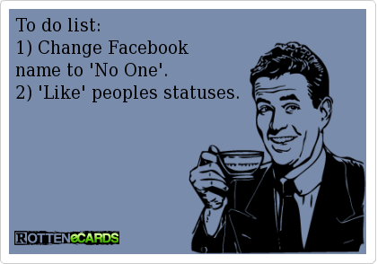
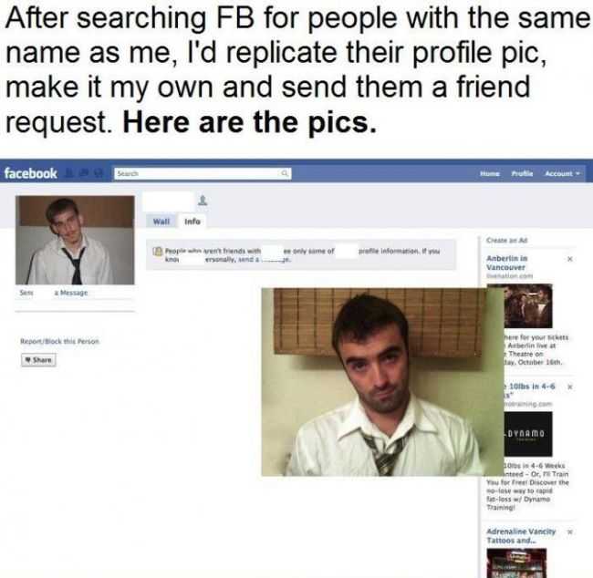

---

Whitney Phillips (2012: 3) has recently argued that in order to understand trolls and trolling we should focus on ‘what trolls do’ and how the behaviour of trolls ‘fit[s] in and emerge[s] alongside dominant ideologies.’ [1] For Phillips dominant ideologies are connected to the ‘corporate media logic.’ Her point is that social media platforms are not objective or ‘neutral’, but function according to certain cultural and economic logic and reproduce that logic through the platforms at various levels. [2] {#para1}

The premise, which I will build on in this article, is that the logic of a social media platform can be explored through the troll. In the following I will discuss how trolls and trolling operate alongside Facebook’s politics and practices of user participation and user agency. I provide a material “close reading” of two particular types of trolls and trolling within Facebook – the RIP troll and the doppelgänger troll. Empirically, the article focuses on both the actual operations and actions of these types of trolling and how trolls are or are not defined by Facebook’s various discourse networks. {#para2}

The point is that trolls may be aberrant to regular Facebook users to the extent that their behaviour departs from the norm but not anomalous since they belong to Facebook in their own particular ways. For example a simple and widely spread meme suggests that one way to troll on Facebook would simply be by changing the user name to “No One” and then liking other peoples statuses. If one appears as “No One”, then it is “No One” who likes your Facebook status or “No One” who recommends a link. In this example the troll is undertaking basic Facebook actions but also exploiting Facebook’s real name policy and using anonymity as their advantage. The troll is furthermore exploiting platform’s functions for social interaction to build a Facebook specific trolling performance. In short trolls’ behaviour emerges from the same logic Facebook use to manage online personas. {#para3}

By paying attention to Facebook trolls and trolling we are able to better grasp the logic and conditions of what is at stake when we are using social media sites. Trolls and trolling are discussed here especially in the context of affect theory and a specific reading of Gabriel Tarde’s (1903; 2012) social theory, which has recently been adapted to studies of network culture by Tony Sampson (2012). These theoretical thresholds are used to address the operations of human and non-human actors involved in the scheme of user participation that Facebook trolling also represents. Furthermore a specific emphasis is given to the Tardean inspired idea of affective construction of the social, and examining different powers that are mobilized when trolls and trolling potentially occurs. {#para4}

### Whoever

Let me begin with a simple question: how does Facebook define trolls? First off querying the words “troll” or “trolling” in Facebook Help Center does not give any results. Neither does trolls or trolling exist in Facebook’s rules, regulations or instructions. In fact Facebook does not seem to officially recognise trolls or trolling at all. Despite the lack of any official recognition by Facebook regarding trolls and trolling practices various scholars have analysed or at least noted that such practices take place on the platform (see Phillips, 2011; Paasonen, 2011; Paasonen, Forthcoming). [3] {#para5}

To get deeper into this problematic let me introduce two examples that have been identified as Facebook trolling by different publics. First the so called Facebook RIP trolling cases, identified by the press and researchers alike, targeting recently deceased Facebook users have recently gained popular attention (see Morris, 2011; Phillips, 2011). One of the most famous cases took place in the UK where a RIP troll was hunted down and arrested by police, named in public, jailed for 18 weeks and banned from social media use for a period of five years. What did the troll actually do? As Morris (2011) explains in his newspaper story the troll for example ‘defaced pictures of her [the deceased], adding crosses over her eyes and stitches over her forehead. One caption underneath a picture of flowers at the crash site read: “Used car for sale, one useless owner.”’ In another event the troll created a fake tribute page for the deceased, sent harassing content to the official memorial pages and posted pictures that were found offensive and desecrated the memory of the deceased (Morris, 2011). [4] {#para6}

Trolling, however, does not always need to be so extreme. A more mundane and playful way of trolling is demonstrated in the second example found from an imgur.com thread that goes by the name ‘facebook trolling at its best.’ It presents a simple doppelgänger troll. The troll looks for people with the same name from Facebook. Then he replicates their profile picture, makes it his own and sends a friend request to the person whose picture he is imitating. [5] {#para7}

These cases can be approached from at least two angles. Firstly trolling here resembles the operations of impression management (see Goffman, 1990). It is a way to present the self in network culture through expressions that one gives and is given off (Papacharissi, 2002: 644). Secondly trolling is also a public performance. As the case of RIP trolling points out trolling targets the impressions of the others and the self-identity of the troll may be anonymous or a mere vehicle that is used to produce different affective relations. {#para8}

Evidently, these two angles are intertwined. Susanna Paasonen (Forthcoming) notes that trolling is ‘behaviour that can be best defined as intentional provocation of other users, as by posing opinions and views that one does not actually hold, or by pretending simplicity or literalness.’ Trolling is about addressing particular publics and user groups. Trolling presupposes a public and tries to conjure it into being through different actions (see Warner, 2002: 51). Here impression management connects to social engineering. For example Judith Donath’s (1999) early definition of trolling points towards this direction. Donath (1999: 43) sees online trolling in particular as a game of playing with other users and issues of trust, conventions and identities: {#para9}

> Trolling is a game about identity deception, albeit one that is played without the consent of most of the players. The troll attempts to pass as a legitimate participant, sharing the group’s common interests and concerns […] A troll can disrupt the discussion on a newsgroup, disseminate bad advice, and damage the feeling of trust in the newsgroup community. Furthermore, in a group that has become sensitized to trolling – where the rate of deception is high – many honestly naïve questions may be quickly rejected as trollings. {#para10}

Trolling-through-deception is just one means and method through which trolling occurs. Also Donath implies that trolling is dependable not only about how the self is represented online but also about different conditions where it takes place. As Michael Warner (2002: 75) points out publics do not self-organise arbitrarily around discourses but their participants are selected through pre-existing channels and forms of circulation such as ‘shared social space’, ‘topical concerns’ or ‘intergeneric references.’ {#para11}

RIP trolls provoke their publics by breaking the cultural norms of dealing with the deceased. Furthermore RIP trolls operate in a social space of a Facebook memorial pages where the grievers are already gathered to remember the deceased. In these spaces trolls may appear like regular users or even be regular users but in some way their behaviour does not fit perfectly with the norms (which can be explicit or implicit) of the platform where the participation takes place. Thus trolling is not so much about who you are but who you become. It is an identity or position one adopts. {#para12}

In the case of the doppelgänger troll the adaptation of particular identity in order to provoke responses is more obvious. The troll impersonates the target of trolling by mimicking their profile picture and starts harassing them with friend requests. Such identity performance is not, in fact, missing from Facebook’s vocabulary, but rather described as a direct violation of their terms of service. According to Facebook Rules and Regulations (Facebook c) a Facebook user account should always be a portrayal of the terrestrial self; only one personal user account is allowed, the user must appear with their own name, the user is not allowed to misrepresent their identity or appear as another user. Facebook has the right to stop providing all or part of Facebook to any user account that violates Facebook’s Statement of Rights and Responsibilities or otherwise creates risk or possible legal exposure for them (Facebook c). {#para13}

Thus trolls and trolling are not only missing from Facebook’s vocabulary but they and their actions such as using fake names, generating fake Facebook profiles bring us to the limits of Facebook user participation and user engagement. The actions described in RIP trolling and doppelgänger trolling for example are actions that allow Facebook to disable user accounts. [6] {#para14}

Whether or not a violation against the terms of service the self-identity of trolls remains vague. This vagueness is a part of who trolls are (see also Phillips, 2012: 4). Thus to ask about the identity of trolls is largely irrelevant; identity becomes the material through which trolling practices operate. ‘Trolls are people who act like trolls, and talk like trolls, and troll like trolls because they’ve chosen to adopt that identity’ (Phillips, 2012: 12). Consequently ‘Change name to No One. Like peoples status,’ the meme described in the introduction of this article, is not a harmless joke but in fact points directly to the violation of Facebook’s foundations of social media; {#para15}

> We believe that using your real name, connecting to your real friends, and sharing your genuine interests online create more engaging and meaningful experiences. Representing yourself with your authentic identity online encourages you to behave with the same norms that foster trust and respect in your daily life offline. Authentic identity is core to the Facebook experience, and we believe that it is central to the future of the web. Our terms of service require you to use your real name and we encourage you to be your true self online, enabling us and Platform developers to provide you with more personalized experiences. (Facebook d: 2.) {#para16}

While one could easily argue that in social media our identity is always managed and performed rather than represents any “real” or “actual” identity, trolls and trolling highlight just how fictitious and performative online identities can be. Trolls are the negation of the demand for authentic identity. Trolls do not have any or they make it irrelevant. In fact who are trolls is a question that cannot be answered with terrestrial identity. Anyone can become a troll by simply trolling. For the same reason, Facebook cannot and will not define trolls. Trolls are whoever. {#para17}

While the trolls, in their whoeverness, are excluded from the platform I intend to show in the following pages that “the whoever” has a particular role for Facebook. However, instead of focusing only on trolls I will explore how the logic of troll is corresponded with the logic of Facebook. In specific I will explore the questions of affect, data and identity, which for me are the key terms in defining this relation. {#para18}

### Affect and Algorithm

According to *The Guardian* the US military is developing an ‘online persona management service’ to ‘secretly manipulate social media sites by using fake online personas to influence internet conversations and spread pro-American propaganda’ (Fielding and Cobain, 2011). While this service may or may not exist it is clear that Facebook would be a very powerful platform for such affective content to spread, amplify and become contagious. Consider the RIP trolls. They mobilize negative affects and presumably want people to respond to their posts. Facebook does not only offer multiple ways to spread those messages from status updates to posted photos but also offers many options to display the responses in different forms from liking to commenting, sharing and even reporting the post as a spam. Consequently while “one user account” and “real name” policies might suggest otherwise, I argue that “online persona management” for Facebook is not as much about controlling individuals as controlling the things that spread and become affective on their site. {#para19}

To discuss this affective dimension of Facebook I will refer to a very specific idea of affectivity developed by the French sociologist Gabriel Tarde circa 1900 and modelled to our current network culture by Tony Sampson (2012). ‘Everything is a society,’ is a catchphrase Tarde (2012: 28) is perhaps most well-known for. With this assertion Tarde wants to remove social from ‘the specific domain of human symbolic order’ and move the focus towards a more radical level of relations. ‘The social relationalities established in Tardean assemblages therefore make no distinctions between individual persons, animals, insects, bacteria, atoms, cells, or larger societies of events likes markets, nations, and cities,’ as Sampson (2012: 7) puts it. What Tarde helps us to do here with his idea of heterogeneous relationalities is to show how Facebook builds an architecture that is highly affective. {#para20}

Indeed, Tarde’s assertion that everything is a society and anything can from a social relationship comes in handy in the age of network culture and social media in particular since it can be used to explain the interplay of human and non-human operators in the forming of mediated social relationships. [7] The point of convergence in our current social media landscape and Tarde’s thought deals with subjectivity. Tarde grounds his thought in the semi-conscious nature of human subjects that ‘sleepwalk through everyday life mesmerized and contaminated by the fascinations of their social environment.’ (Sampson, 2012: 13). With states that indicate a half-awake consciousness, like hypnosis or somnambulism Tarde (1903: 77) wants to describe how social relations and social subjectivities are constituted in relation to other people, the surrounding environment and other objects. The subjectivity of a somnambulist is a subjectivity of the whoever. The half-wake state indicates a condition where the subject is receptive for suggestions and acts according to them. It is not an intentional rational subject–at least not entirely. Instead it is a subjectivity that ‘is open to the magnetizing, mesmerizing and contaminating affects of the others’ that take place in relational encounters (Sampson, 2012: 29). {#para21}

According to Sampson (2012: 5) there are two different contagious forces of relational encounters: molar and molecular. [8] Molar is the category for well-defined forces, wholes that can be governed and are often manifested in analogical thinking. One defines a molar identity in comparison with others. In Facebook molar identity is the user profile that is expressed through indicators such as sex, a workplace or any other pre-given category. Molecular forces then again are the forces of affect. They are pre-cognitive, accidental, attractive uncategorized forces that make us act. On Facebook, molar entities such as status updates, photos or friendship requests have their molecular counterpart in the affects they create. When affected we click the link, like the photo and become friends. The idea of affectivity is here examined in the vein of Brian Massumi (2002) who separates affects from emotions and describes them as intensities. In his thinking affects are elements necessary for becoming-active (Massumi, 2002: 32). Preceding emotions, affects as Andrew Murphie (2010) explains, group together, move each other, transform and translate, ‘under or beyond meaning, beyond semantic or simply fixed systems, or cognitions, even emotions.’ {#para22}

To rephrase, sociality emerges according to molar and molecular categories. It emerges in contact to other people and other identities but these encounters are not only rational but also affective. Now Sampson (2012: 6) poses an interesting question of ‘how much of the accidentality of the molecular can come under the organizational control of the molar order?’ This for me is a question that can be asked in the very specific context of Facebook as a platform that tries to capture both of these sides. {#para23}

While molar categories are more evident in Facebook’s case, as for example categories through which the user profile is constructed, they also, and perhaps even more significantly, try to build architectures that produce molecular forces. When the user submits information to the molar categories they simultaneously give material for Facebook to build molecular, affective relations through this material. For example, when a user posts an update of a new job it does not only place them to a new molar category but the post becomes visible in a News Feed and may or may not affect user’s friends. Thus what I am describing here is a reciprocal process where encounters of molar forces release molecular forces and molecular forces invite people to encounter molar categories. {#para24}

One way to analyze Facebook’s system of algorithmic management of molar and molecular forces is to look at the functions such as ‘top stories’ to ‘friendship requests’ or ‘sponsored stories’ to ‘likes’ and ‘recommendations’ (See Bucher, 2013; 2012b). We can begin with Taina Bucher’s (2013: 2) work on ‘algorithmic friendship.’ Bucher’s claim is that Facebook user-to-user relations are thoroughly programmed and controlled by the platform. Algorithms search and suggest Facebook friends from different parts of a user’s life. A user needs only to click a friendship request to connect and establish a social relation (Bucher, 2013: 7–8). {#para25}

Similarly the content posted in user-to-user communication goes through algorithmic control. One of Facebook’s algorithms is the so called EdgeRank algorithm. It operates behind the News Feed stream and is programmed to classify what information is relevant and interesting to users and what is not. To upkeep the page and to ensure that it remains visible to other users one must constantly update the page and connect with other users and pages preferably 24 hours a day since other users may be geographically spread in different areas and time zones. Still not everything is in the hands of the user. As Bucher (2012b) maintains Facebook nowadays limits posts visibility, valuates information, classifies it and distributes it only to selected Facebook users. Bucher (2012b: 1167) explains how Facebook’s EdgeRank algorithm works according to three factors or edges: weight, affinity and time decay. By manipulating her own News Feed, Bucher (2012b: 1172) shows that while many of EdgeRank’s features are secret we can identify some of its functions and factors. Affinity score measures how connected a particular user is to the edge. These connections are apparently measured according to for example how close friends users are, which communication means (Facebook Chat, Messages) they use etc. Weight score depends on the form of interaction to the edge. Comments are worth more than likes and increase the score for the edge. Time decay means Facebook’s evaluation of how long the post is interesting. (Bucher 2012b.) While the exact information about how the algorithm works is impossible to gain, we can at least say that the affectivity of the content can be determined according to factors like weight, time decay and affinity. {#para26}

Following this train of thought everyone in Facebook is a potential spreader of affective material. Interestingly then the whoever is again an agent or actor in Facebook but in a very different manner. This time “the whoever” has become meaningful for Facebook. In fact the whoever grounds Facebook’s idea of sociality, at least technologically. Whoever spreads the affect and anyone can be affected. From the view of algorithmic control and affectivity Facebook is not interested in why people become affected. The only relevant history for Facebook is the user’s browsing history, to put this provocatively. To rephrase, Facebook’s algorithmic control is not interested in individuals as such but renders users to intermediaries of affects. Individuals become a means of spreading affects. The social emerges in this relation. It does not begin from person or individuals and their motivations but from a capability of affect and to be affected. {#para27}

### Trolls

If trolls are whoever and they aim at spreading affects, then they hardly are anomalous for Facebook. They are not oppositional to its model of user participation but almost like its perverted mirror image (see Raley 2009: 12). They are social in the Tardean extended sense of the word operating in the context of community and the technological conditions of a given platform. In fact, trolls emerge alongside what José van Dijck (2011) calls as culture of connectivity. This is a culture profoundly built around algorithms that brand ‘a particular form of online sociality and make it profitable in online markets – serving a global market of social networking and user-generated content’ (Dijck, 2011: 4). {#para28}

Not only users but also algorithms manage and curate the content we see on Facebook. While we know something about these algorithms most of their functions are hidden due to things like the mathematical complexity of corporate secrecy. Accordingly Tarleton Gillespie (2011) has recently noted that ‘there is an important tension emerging between what we expect these algorithms to be, and what they in fact are.’ In fact he suggests (Gillespie, forthcoming) that ‘[a]lgorithms need not be software: in the broadest sense, they are encoded procedures for transforming input data into a desired output, based on specified calculations.’ Janez Strehovec (2012: 80) goes even a step further and argues that logic of smart corporate algorithms organizing and managing content through software corresponds with ‘algorithmic problem-solving thinking and related organized functioning’ by users themselves. What we are seeing here is an intermingling of the processes of actual algorithms and the different processes which we conceptualize as algorithmic. {#para29}

For me this is an important notion because it highlights the two sides of the culture of connectivity that is more or less defined as algorithmic; on the one hand we have the programmed algorithms and on the other we have an algorithmic logic of using social media. I am not making a claim that people have always been algorithmic in their behaviours but rather I am following Friedrich Kittler (1999: 203) who argues that the technologies and devices we use also influence the ways in which we think and operate. [9] Thus, if we are constantly immersed within the particular algorithmic logic of Facebook, we also adapt to that logic in different ways. To discuss the culture of connectivity from both of these perspectives is a practical choice because first it helps us to understand how actual algorithms make certain content spread through Facebook instead of other social media platforms, and second it illustrates how users have different methods to exploit this knowledge in order to build affective contagions specific to the Facebook platform. {#para30}

Consequently I argue that programming the actual algorithms is the logic of Facebook and using processes that resemble algorithmic operations is the logic of trolls. Hence whoever can become a troll on Facebook only by exploiting how it operates, how things spread, how affects are produced, what the real user policy indicates. ‘To play the game means to play the code of the game. To win means to know the system. And thus to interpret a game means to interpret its algorithm,’ as Alexander Galloway (2006: 90–91) maintains. While Galloway talks directly about video games the argument extends to acting in network culture in general and trolling Facebook (as a particular cultural site) in particular (see also Strehovec, 2012: 80). {#para31}

Playing with the culture of connectivity can be ugly. RIP trolls point this out explicitly by manipulating the platform and exploiting user suggestibility. How this takes place has been analyzed by Phillips (2011) for example who examines the case of Chelsea King, a 17 year old American teenager who was murdered in 2010, and whose Facebook memorial pages were attacked by RIP trolls. Offensive wall posts were written on Facebook pages made to respect the memory of Chelsea King resulting in the deletion of these comments but also to furious responses from other users commenting that the trolls were being ‘sick’, ‘horrible’ and ‘disrespectful.’ In addition, pages such as ‘I Bet This Pickle Can Get more Fans than Chelsea King’ were created by trolls, which for example featured ‘a picture of scowling, underwear-clad cartoon pickle gripping a crudely-PhotoShopped cutout of Chelsea’s head.’ This page got likes from both the people who took part in trolling but also people who were defending the integrity of Chelsea’s memory (Phillips, 2011). {#para32}

It is possible to analyse the algorithmic logic of RIP trolling by dividing it further into six dimensions that Gillespie (Forthcoming) finds behind algorithms that have public relevance: {#para33}

> - Patterns of inclusion: the choices behind what makes it into an index in the first place, what is excluded, and how data is made algorithm ready
>
> - Cycles of anticipation: the implications of algorithm providers’ attempts to thoroughly know and predict their users, and how the conclusions they draw can matter
>
> - The evaluation of relevance: the criteria by which algorithms determine what is relevant, how those criteria are obscured from us, and how they enact political choices about appropriate and legitimate knowledge
>
> - The promise of algorithmic objectivity: the way the technical character of the algorithm is positioned as an assurance of impartiality, and how that claim is maintained in the face of controversy
>
> - Entanglement with practice: how users reshape their practices to suit the algorithms they depend on, and how they can turn algorithms into terrains for political contest, sometimes even to interrogate the politics of the algorithm itself
>
> - The production of calculated publics: how the algorithmic presentation of publics back to themselves shape a public’s sense of itself, and who is best positioned to benefit from that knowledge.

To begin with, in using a bottom-up approach trolls produce calculated publics. In fact trolls cannot be without a public since the public affirms their being (Paasonen, 2011; 69; Paasonen, Forthcoming). Trolls live for their publics but even more importantly they make calculations or predictions of the nature of the public. For example in the case of memorial pages trolls operate on the presumption that the public of Facebook memorial pages consists either of people who know the deceased or people who want to commemorate the deceased. By entering to these pages they exploit the presumed emotional tie that connects the public together. When the trolling begins the public of the memorial page is potentially captured under the troll’s influence but nothing stops the affective contagion from spreading. Take for example the Chelsea King case: the message about the troll’s actions started to spread and attract a new audience ranging from Facebook users to journalists and other actors such as law enforcement officials. Hence in sending disturbing posts to existing memorial pages, trolls do not only structure interactions with other members but also produce new publics (see Gillespie, Forthcoming: 22). {#para34}

Moreover trolls are entangled with the operations of the social media platform. Trolls make our suggestibility by the platform and its users visible by sharing wrong things, misusing the platform, posting inappropriate content. Trolls are also able to react. When they appear on memorial pages, admins can for example restrict who can comment on posts. In response trolls can create their own pages such as “I Bet This Pickle Can Get more Fans than Chelsea King” or simply create fake RIP pages where the trolling may continue. On a general level trolls are entangled with the possibilities the platform has built for user participation. Anything can be used for trolling. Trolling is a tactical use of the platform and user engagement. {#para35}

According to Gillespie (Forthcoming) algorithms are ‘also stabilizers of trust, practical and symbolic assurances that their evaluations are fair and accurate, free from subjectivity, error, or attempted influence.’ Now trolls are not stabilisers but yet they exploit the promise of algorithmic objectivity. ‘The troll attempts to pass as a legitimate participant, sharing the group’s common interests and concerns.’ (Donath, 1999: 43) Trolls play the game of trust important to relationships in social networks in general (Dwyer, Starr and Passerini, 2007). {#para36}

For trolls the evaluation of relevance is based on cycles of anticipation. Trolls rely on sociality that is the affectation and suggestibility of users, and Facebook’s inbuilt technologies to exploit these capabilities. Indeed, they are very good at using Facebook’s infrastructure for spreading affect and generating affective responses. By targeting for example Facebook memorial pages created by the family of the deceased they are more likely to get affective responses than if they built their own pages. Furthermore trolls do not only provide content to users but they also invite users to participate in this affective cycle. A comment by a troll generates new comments, these comments in turn generate new responses. Every interaction increases a troll’s knowledge of what is relevant in order to increase affective responses and thus potentially changes their method of trolling. Trolls do not need big data for their working apparatus. With small fractions or patterns of behaviour they are able to create a working apparatus that exploits the social network and its users. For example weight, affinity and time decay are not only edges for the EdgeRank algorithm but also edges that troll’s use. Contrary to the EdgeRank algorithm, the troll needs no mathematical formula to calculate the functions of their actions. The troll needs only to be aware of two things: that affects are what spread in social media and that people are suggestible. [10] The responses to troll’s affective trickery determine how well the released affect has worked and how well it keeps on spreading. {#para37}

### Identity

‘Going to war against the trolls is a battle society must fight,’ psychologist Michael Carr-Gregg (2012) declared recently. While for Carr-Gregg the reasons to fight against trolls are related to the individual and psychological effects of ‘cyber bullying’, for social media companies trolls pose a different threat. To understand trolls as a threat means to understand how user engagement is turned into profit in a very concrete manner. {#para38}

A significant amount of Facebook’s revenue is based on advertising. By accruing data from users and their participation Facebook is able to target advertisements for particular demographic groups (See Andrejevic, 2009; van Dijck, 2009). According to John Cheney-Lippold (2011: 167–168) marketers try to understand user’s intentions, and consumer trends by identifying consumer audiences and collecting behavioural data. For identifying purposes the Facebook user profile is handy since it offers preselected identity clusters which can be used to place individuals within larger clusters. [1] For example when a user creates a Facebook profile they need to choose different markers of identity such as age, gender, nationality and also seemingly more arbitrary categories such as job history, medical history and relationship status. By making these selections the user voluntarily makes themselves a part of a certain identity cluster that can be used for targeted advertising. Instructions for Facebook advertisers make this particularly visible: Ads can be targeted to identity categories such as ‘location, age, gender.’ Moreover categories of ‘precise interests’ and ‘broad interests’ can be used to get a more specific audience. Broad interests refer to the general interests and lifestyle of the user, precise interests refer to people who have expressed specific interest in a certain topic. (Facebook b.) {#para39}

Cheney-Lippold calls this construction ‘a new algorithmic identity’ but following Sampson’s division of molar and molecular it could also be called a molar identity. It is an identity that is fixed and built in comparison to other identities. {#para40}

By participating in the different actions in Facebook, users also contribute to the building of another kind of identity; a molecular identity. This identity is ephemeral and fluctuating. This category is composed of the behavioural patterns that emerge when people use Facebook and this behavioural data can be used to supplement the molar identity categories. It is based on clicks, shares and recommendations that form a infrastructured sociality that can be tracked and traced (see Gerlitz and Helmond, 2013). It can be based on deep inside data such as erased status updates, and things that are visible only for Facebook (see Das and Kramer, 2013). In short, this molecular identity emerges when users are affected and their participation is driven by affects and affectation. The more things there are to attract the user, the more affects it creates, and the more these affects spread and multiply, the more information of users and their actions is extracted and evaluated. Consider for example the mere communication media forms inside the Facebook platform: the chat, the wall post, the comment, the message, the news feed, the ticker. The more engaged the users are the more they participate in liking, recommending, commenting and chatting the more information they unnoticeably produce for the social media site. Affective relation produces quantitative results. {#para41}

We have here two different categories of user data. The first is the data from the molar identity which users willingly submit to Facebook and the second is the molecular data that is produced in affective encounters with the platform. By tracing the molar and molecular Facebook is able to give its users a particular identity: molar, molecular or both. This identity is developed through algorithmic processes, which as Cheney-Lippold (2011: 168) notes parse commonalities between data and identity and label patterns within that data. This Facebook identity needs not to be connected to user’s terrestrial identity or actual intentions. Rather it is based on specific data that is collected and parsed through Facebook’s infrastructure; it is an affective identity which is determined by Facebook infrastructure and the given identity markers (such as gender, age and so on (Galloway, 2012: 137)). In other words, this means that algorithms are, with fluctuating results, able to automatically decide based on for example consumer history, what the identity of a particular user is. User’s actions build on an identity that is marketable, traceable and most importantly Facebook specific. This is the identity that can be sold to marketers for targeted marketing or other purposes. {#para42}

This is also the reason why Facebook has no place for trolls: Facebook’s business success is connected to the ways it can produce valid data but trolls and the data they produce both directly and indirectly, through molar and molecular categories, are invalid for Facebook. In effect, trolling other users is always also indirect trolling of Facebook’s algorithms. ‘Algorithms are fragile accomplishments’ as Gillespie (Forthcoming) puts it. When trolls deliberately like wrong things in the interface, when they comment on wrong things and gain attention and interactions what happens is that the ‘weight’ of a particular edge is increased and the visibility of that object in other users’ news feeds also increases. The affectivity of the platform corresponds with the affectivity of the algorithm. Trolls and their actions are too edgy for the EdgeRank algorithm. Trolls interaction leads to an increased amount of “wrong” or “bad” data. To be clear this is not bad in a moral sense but in a practical sense since it skews the clutters of information. If Facebook cannot deliver valid and trustworthy information to marketers and advisers they lose them and simultaneously their stock market value decreases (Facebook d). {#para43}

Finally trolling as social engineering of relationships may end up destroying established forms of Facebook sociality. Open groups are transformed into closed groups, commenting becomes disallowed, new friendship requests are ignored. The functions built for good connectivity are used to spread bad content, bad relations, and unwanted users (van Dijck, 2012: 8). It is no wonder that trolls are excluded from Facebook and their accounts become disabled when been caught. Trolls are not only whoever but they are also ‘whatever’ (Galloway, 2012: 141–143). They do not fit in Facebook’s user engagement scheme or to Facebook identity categories of data mining. They belong to Facebook but do not fit in with it. {#para44}

### Online Persona Management

Analyzing trolling points out how Facebook builds on a particular model of user participation. This user participation does not involve total freedom for the users to produce any content what-so-ever or behave in any chosen manner. On the contrary user participation takes place within different predefined limits. One of them, as argued, is the condition set to collect representable data from a specific user groups. This user participation is conducted through technologies of what could be called Facebook’s online persona management, a set of control mechanisms external and internal, centralised and decentralised that turn the whoever into identified and/or profitable users. {#para45}

Facebook manages online personas in three interconnected ways. First Facebook has very strict norms and rules under which the identity performances can take place and ways to punish users from misbehaviour; as pointed out Facebook regulates the number of user accounts and for example bans inappropriate users. [2] Second norms and rules are accompanied with the socio-technical platform enabling some actions and disabling others. Third Facebook manages personas on the human level of everyday interaction giving emphasis on self-regulation, personal responsibility and individual choice (Guins, 2009: 7). Proper ways for user participation are built through algorithmic control coded to the platform. The ways to act are given for the users and emphasised by the interface. The impressions of the self are built according to the possibilities provided by the platform. {#para46}

Obviously, as pointed out in this article, this online persona management is exploited by the trolls in numerous ways from manipulating one’s own identity to stealing others. In their very nature of whoeverness and whateverness trolls are both the amplification and the corruption of Facebook’s mission statement (Facebook a) ‘to give people the power to share and make the world more open and connected.’ They are a product of social media technologies of user participation and user engagement. No one participates more than a troll, no one is more engaged in the technology itself, technology that allows the troll to build an audience and to spread the message across the platform and shake the somnolent being of likers, friends and followers with affects that run through them and are emphasised by them. Trolls’ own online persona management is guided through tools that are both social and technical. They take advantage of user suggestibility and affect virality. They exploit the functions of the platform. Their methods as such do not differ from any other methods of user participation; they use the same functions that are built and coded to emphasise this relation of engagement. Indeed one of the implications of this article is that the algorithmic logic of Facebook is also a code of conduct for trolls. {#para47}

Could this becoming a whoever, then, or ‘whatever’ as Galloway (2012: 140–143) has recently suggested, be a tactical position that resists the system of predication; that being and becoming is defined through for example identity categories in social media. Is trolling such a tactical position adapted by social media users? {#para48}

Firstly on an abstract level trolls may be whoever and whatever, but as daily users they are as suggestible and half-awake, responsive for affectation, as other users operating within the platform. The banality is that they are incapable of entirely escaping the system of predication since they participate in it. Their personas become managed, one way or the other. In addition, while trolling may be harmful for the platform, the platform seldom is its main target. Trolls use or even exploit the platform but their actual investments as for example RIP Trolling points out relate to sociality in a more casual and straightforward manner. Trolling may be oppositional but it hardly is revolutionary. {#para49}

Secondly if Facebook can keep trolling at the current level and restrict, for example, the use of double or fake user accounts then one could suggest that the effects of trolling to Facebook data are somewhat minor. It causes only minor statistical anomalies. To be sure with this claim I do not want to water down too much the argument that trolls are a threat to Facebook because they create bad data and corrupt its statistics, but to point towards the more general impression management possible through online personas. In fact Facebook’s war against trolls from this angle is more about maintaining the illusion for investors and business partners that Facebook user data is 100% valid and that every single thing users do generates useful data. Facebook’s online persona management is about keeping up appearances, the illusion of participatory culture that anything we do has a monetary value. {#para50}

### Biographical note

**Tero Karppi** is a Doctoral Student in Media Studies, University of Turku, Finland, where he is currently completing his dissertation ‘Disconnect.Me: User Engagement & Facebook’. His work has been published in, among others, *Culture Machine*, *Transformations Journal* and *Simulation & Gaming*.

### Notes

- [1] According to Phillips (2012: 3) we do not know who trolls are. We can merely make some conclusions on the ‘terrestrial identity’ of trolls based on their online choices including ‘the ability to go online at all’ but ‘precise demographics are impossible to verify.’ This is a challenge for digital ethnography in general; one cannot be sure about the validity of answers or even the identity of the respondents if they remain anonymous and are interviewed online.

- [2] Ideologies, as pointed out by Wendy Chun (2004: 44) and Alexander Galloway (2012: 69–70), are often inscribed deeply in the operations of the software and digital materiality of the platforms in general.

- [3] This observation is liable to change since Facebook is known to update and change their service constantly. While writing this Facebook does not have any references to ‘trolls’ or ‘trolling’.

- [4] Trolling in my approach merges with a related concept of flaming used to describe behaviour that insults, provokes or rebukes other users (see Herring et al., 2002). News media in particular seems to mix trolling with flaming and online bullying. While some authors differentiate them conceptually (the former aiming for the lulz and the latter to cause emotional disturbance) for me they work on the same level of exploited intensities and affects that spread around the platform and alter the social order.

- [5] This is illustrated in an imgur.com thread called ‘facebook trolling at its best.’ https://imgur.com/gallery/y5S2S

- [6] In short Facebook has the right to stop providing all or part of Facebook to any user account that violates Facebook’s Statement of Rights and Responsibilities or otherwise creates risk or possible legal exposure for them (Facebook c). A list of violations that can result into disabling one’s user account can be found from the Facebook Help Center (2012) and they include:
 -Continued prohibited behaviour after receiving a warning or multiple warnings from Facebook
 -Unsolicited contact with others for the purpose of harassment, advertising, promoting, dating, or other inappropriate conduct
 -Use of a fake name
 -Impersonation of a person or entity, or other misrepresentation of identity
 -Posted content that violates Facebook’s Statement of Rights and Responsibilities (this includes any obscene, pornographic, or sexually explicit photos, as well as any photos that depict graphic violence. We also remove content, photo or written, that threatens, intimidates, harasses, or brings unwanted attention or embarrassment to an individual or group of people)
 -Moreover these violations concern issues such as safety, privacy, content shared, account security or other people’s rights. (Facebook c.)

- [7] Tarde made his notions in a situation where simultaneously new media technologies (telegraph, telephone, cinema) were introduced and also the conceptions of psyche and subjectivity were changing. As such the situation bears a resemblance to ours.

- [8] While I rely here on Sampson’s interpretation of molar and molecular it should be pointed out that they are categories used also by Gilles Deleuze and Félix Guattari (1984). For Deleuze and Guattari these concepts serve a very similar purpose. Without going into a depth of their interpretation one could say that for them molar is a category for established structures and molecular describes operations on a pre-cognitive level where things interact to produce effects. (See Deleuze and Guattari, 1984: 279–281.)

- [9] Kittler’s work is focused on understanding how being human becomes negotiated in relation to different technologies. From this point of view the claim that human behaviour resembles algorithmic operations is more than a fashion statement. It is a way to describe how Facebook as contemporary technology potentially modulates our being.

- [10] Or as Antonio Negri (2005: 209) puts it ‘The postmodern multitude is an ensemble of singularities whose life-tool is the brain and whose productive force consists in co-operation. In other words, if the singularities that constitute the multitude are plural, the manner in which they enter into relations is co-operative.’

- [11] In targeted marketing individual users are made parts of larger clusters according to preselected identity categories (Solove, 2001: 1406–1407).

- [12] Facebook also has control applications such as the Facebook Immune System (Stein, Chen and Mangla, 2011), which is a security system that through algorithms calculates functions, processes data and tries to predict and prevent emerging threats occurring on the platform.

### Acknowledgements

My thanks goes to a number of people who have contributed in the developments of this paper in different phases, including Jukka Sihvonen and Susanna Paasonen Media Studies, University of Turku, Jussi Parikka Winchester School of Art and Kate Crawford Microsoft Research. I would also like to thank the anonymous reviewers and the editors of this issue for important comments and suggestions.

### References

- Andrejevic, Mark. ‘Privacy, Exploitation, And the Digital Enclosure’, *Amsterdam Law Forum* 1.4 (2009), https://ojs.ubvu.vu.nl/alf/article/view/94/168

- Bucher T. The friendship assemblage: investigating programmed sociality on Facebook. Television & New Media. November vol.14 (2013);1–15. https://dx.doi.org/10.1177/1527476412452800

- Bucher, Taina. ‘Want to be on the top? Algorithmic power and the threat of invisibility on Facebook’, *New Media & Society* November 2012 vol. 14 no. 7 (2012b): 1164–1180. https://dx.doi.org/10.1177/1461444812440159

- Carr-Gregg, Michael. ‘Going to war against the trolls is a battle society must fight’, *The Telegraph*, (September 13, 2012), https://www.dailytelegraph.com.au/news/opinion/going-to-war-against-the-trolls-is-a-battle-society-must-fight/story-e6frezz0–1226472889453..

- Cheney-Lippold, John. ‘A New Algorithmic Identity: Soft Biopolitics and the Modulation of Control’, *Theory, Culture & Society* 28.6 (2011): 164–181.

- Chun, Wendy Hui Kyong. ‘On Software, or the Persistence of Visual Knowledge.’ *Grey Room* 18 Winter (2004): 26–51.

- Deleuze, Gilles and Guattari, Félix. *Anti-Oedipus: Capitalism and Schizophrenia*, trans. Robert Hurley, Mark Seem, and Helen R. Lane (London: Athlone, 1984; 1972).

- Dijck, José van. ‘Users like you? Theorizing agency in user-generated content’, *Media, Culture & Society* 31.1 (2009): 41–58.

- Dijck, José van. ‘Facebook and the Engineering of Connectivity: A multi-layered approach to social media platforms’, *Convergence* OnlineFirst Version, September (2012): 1–5.

- Donath, Judith. ‘Identity and deception in the virtual community’, in Marc A. Smith and Peter Kollock (Eds.) *Communities in Cyberspace* (London & New York: Routledge, 1999): 29–59.

- Dwyer, Catherine, Hiltz, Starr Roxanne, and Passerini, Katia. ‘Trust and privacy concern within social networking sites: A comparison of Facebook and MySpace’, *Proceedings of the Thirteenth Americas Conference on Information Systems* (Keystone, CO, 2007), https://csis.pace.edu/~dwyer/research/DwyerAMCIS2007.pdf.

- Facebook a. ‘About’ (2012), https://www.facebook.com/facebook?v=info

- Facebook b. ‘Facebook for Business’ (2012), https://www.facebook.com/business/overview

- Facebook c. ‘Statement of Rights and Responsibilities’, June 8 (2012), https://www.facebook.com/legal/terms

- Facebook d. *Form S–1. Registration Statement*’ S–1 (Washington, D.C., 2012).

- Facebook Help Center. ‘Disabled’, November 7 (2012), https://www.facebook.com/help/382409275147346/

- Fielding, Nick and Cobain, Ian. ‘Revealed: US Spy Operation That Manipulates Social Media’, *The Guardian* (17 March 2011), https://www.guardian.co.uk/technology/2011/mar/17/us-spy-operation-social-networks

- Galloway, Alexander. *Gaming: Essays on Algorithmic Culture* (Minneapolis, London: University of Minnesota Press, 2006).

- Galloway, Alexander. *The Interface Effect* (Cambridge & Malden: Polity, 2012).

- Gerlitz, Carolin and Helmond, Anne. ‘The Like economy: Social buttons and the data-intensive web’, *New Media & Society*, published online before print, 4 February (2013): 1–18.

- Gillespie, Tarleton. ‘The Relevance of Algorithms,’ in *Media Technologies*, by Tarleton Gillespie, Pablo Boczkowski and Kirsten Foot (Cambridge, Mass.: MIT Press, Forthcoming). Unpublished manuscript (2012), https://culturedigitally.org/2012/11/the-relevance-of-algorithms/

- Gillespie, Tarleton. ‘Can an Algorithm Be Wrong? Twitter Trends, the Spectre of Censorship, and our Faith in the Algorithms around US’, *Culture Digitally*, October 19 (2011), https://culturedigitally.org/2011/10/can-an-algorithm-be-wrong/

- Goffman, Erwin. *The Presentation of the Self in Everyday Life* (London: Penguin Books, 1990; 1959).

- Guins, Raiford. *Edited Clean Version: Technology and the Culture of Control* (Minneapolis, London: University of Minnesota Press, 2009).

- Herring, Susan, Kirk Job-Sluder, Rebecca Scheckler, and Barab, Sasha. ‘Searching for Safety Online: Managing ‘Trolling’ in a Feminist Forum’, *The Information Society* 18.37 (2002): 371–384.

- Kittler, Friedrich. *Gramophone, Film, Typewriter*, trans. Geoffrey Winthrop-Young and Michael Wutz (Stanford, California: Stanford University Press, 1999; 1986).

- Massumi, Brian. *Parables for the Virtual: Movement, Affect, Sensation* (Durham & London: Duke University Press, 2002).

- Morris, Steven. ‘Internet troll jailed after mocking deaths of teenagers’, *The Guardian*, September 13 (2011), https://www.guardian.co.uk/uk/2011/sep/13/internet-troll-jailed-mocking-teenagers.

- Murphie, Andrew. ‘Affect—a basic summary of approaches’, blog post, 30 January (2010), https://www.andrewmurphie.org/blog/?p=93

- Negri, Antonio. *Time for Revolution*, trans. Matteo Mandarini (London, New York: Continuum, 2005; 2003).

- Paasonen, Susanna. ‘A midsummer’s bonfire: affective intensities of online debate’, in *Networked Affect*, by Ken Hillis, Susanna Paasonen and Michael Petit (Cambridge Mass., London England: MIT Press, Forthcoming).

- Paasonen, Susanna. ‘Tahmea verkko, eli huomioita internetistä ja affektista – The sticky web, or notes on affect and the internet’, In *Vuosikirja: Suomalainen Tiedeakatemia* (Academia Scientiarum Fennica, 2011).

- Papacharissi, Zizi. ‘The Presentation of Self in Virtual Life: Characteristics of Personal Home Pages’, *Journalism & Mass Communication Quarterly* 79.3 Autumn (2002): 643–660.

- Phillips, Whitney. ‘LOLing at Tragedy: Facebook Trolls, Memorial Pages and Resistance to Grief Online’, *First Monday* 16.12 (2011), https://firstmonday.org/htbin/cgiwrap/bin/ojs/index.php/fm/article/view/3168

- Phillips, Whitney. ‘The House That Fox Built: Anonymous, Spectacle, and Cycles of Amplification’, *Television & New Media* published online before print, 30 August (2012): 1–16, https://tvn.sagepub.com/content/early/2012/08/27/1527476412452799.abstract?rss=1

- Raley, Rita. *Tactical Media* (Minneapolis, London: University of Minnesota Press, 2009).

- Sampson, Tony D. *Virality: Contagion Theory in the Age of Networks* (London, Minneapolis: University of Minnesota Press, 2012).

- Solove, Daniel J. ‘Privacy and Power: Computer Databases and Metaphors for Information Privacy’, *Stanford Law Review* 53 July (2001): 1393–1462.

- Stein,Tao, Erdong, Chen, and Mangla, Karan. ‘Facebook Immune Sytem’, *EuroSys Social Network Systems (SNS)*, Salzburg (ACM, 2011), https://research.microsoft.com/en-us/projects/ldg/a10-stein.pdf

- Strehovech, Janez. ‘Derivative Writing’, in Simon Biggs (ed.) *Remediating the Social: Creativity and Innovation in Practice* (Bergen: Electronic Literature as a Model for Creativity and Innovation in Practice, 2012): 79–82.

- Tarde, Gabriel. *Laws of Imitation*, trans. Elsie Clews Parsons (New York: Henry Holt and Company, 1903; 1890).

- Tarde, Gabriel. *Monadology and Sociology*, trans. Theo Lorenc (Melbourne, Australia: re.press, 2012; 1893).

- Warner, Michael. ‘Publics and Counterpublics’, *Public Culture* 14 Winter (2002): 49–90.
